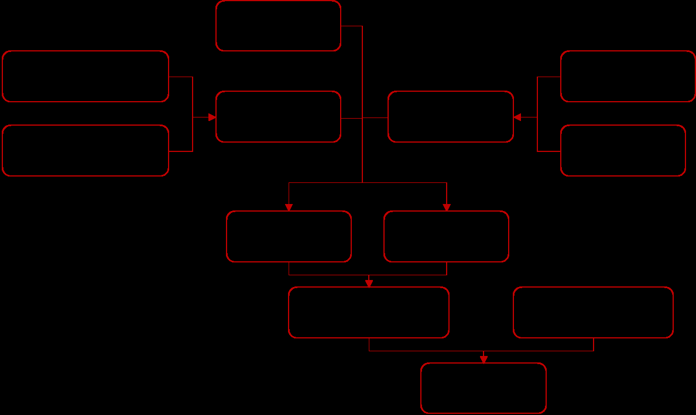
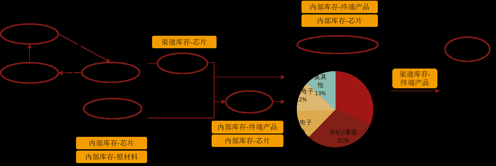

敬请阅读末页的重要说明

2024年12月08日

推荐（维持）

# 半导体行业月度深度跟踪

TMT及中小盘/电子

12月2日，美国BIS发布实体清单，将一系列代工/设备等环节中国公司列入名单中，同时BIS进一步升级出口管制力度，覆盖面包括先进制程代工/设备、HBM、EDA/IP等核心环节。自主可控和国产替代进程预计进一步加速，结合国内半导体产业链各环节的国产化情况，建议关注自主可控需求相对迫切的先进制造/设备/零部件/材料等上游环节、与AI服务器密切相关的HBM/先进封装环节、AI需求带动的算力芯片/EDA/IP等核心卡脖子环节，建议关注各科创指数和半导体指数核心成分股，景气复苏趋势下把握业绩增长有望延续的公司。

- 行情回顾：11月A股半导体指数跑赢中国台湾半导体指数及费城半导体指数。

11月，半导体（SW）行业指数+2.34%，同期电子（SW）行业指数-0.84%，费城半导体指数/中国台湾半导体指数-0.41%/-3.55%；年初至今，半导体（SW）行业指数+24.79%，同期电子（SW）行业指数+17.95%，费城半导体指数/中国台湾半导体指数+17.99%/+46.29%。

- 行业景气跟踪：消费类需求边际转暖，工业类需求整体复苏仍然乏力。

1、需求端：消费电子行业需求弱复苏，AI/汽车等驱动端侧应用创新。

手机：11月华为Mate系列如期发布，关注安卓旗舰新机后续销量表现。PC：24Q3全球PC出货量同比-2.4%，IDC等多机构预测2024年PC市场出货量有望温和复苏；预计AI PC带来的影响将在25-27年更为显著。可穿戴：24Q3全球可穿戴腕带设备市场同比+3%。XR：预计今明年VR行业仍处于销量小年，关注AR与AI融合创新。服务器：信骅10月营收同比+112%/环比-3%，谷歌和亚马逊等全球CSP展望25年Capex望进一步提升。汽车：24M11国内乘用车销量同环比提升，新能源车保持同比较快增长。

2、库存端：手机链芯片厂商Q3库存环比微增，工业领域客户整体仍在库存去化中。

全球手机链芯片大厂24Q3库存环比微增，国内韦尔/卓胜微/格科微/汇顶库存24Q3环比提升/DOI环比增1天至152天。PC终端厂商库存上行，PC链芯片厂商英特尔、AMD 24Q3库存环比上升，库存周转天数环比降27天至104天，AMD表示游戏业务中的客户微软和索尼减少了渠道库存。国际模拟和功率芯片厂商24Q3库存整体环比增长，TI表示工业领域的库存去化仍在进行，公司Q4库存环比将继续增加几亿美元，安森美表示汽车和工业领域库存持续消化，在分销商发货需求下分销渠道库存提升。

3、供给端：2025年扩产主要来自先进制程，国内部分成熟制程产能亦持续开出。

1）稼动率：先进制程表现好于成熟制程，TSMC 3/5nm需求持续强劲，成熟制程代工厂如SMIC/UMC/华虹等24Q3稼动率均环比复苏，但展望24Q4持谨慎态度，预计22/28nm等节点表现优于其他节点、12英寸晶圆表现优于8英寸；

2）资本支出：
①存储：美光和SK海力士2024年扩产重心为HBM、DDR5等先进产品，美光将2024年资本支出80亿美元预期上修至81亿美元，预计2025年大幅增加资本开支；
②逻辑端：2024年全球成熟制程扩产将集中于需求较旺盛的制程，先进制程产能也将持续开出。TSMC预计2024年资本开支为略超300亿美元，主要用于N2、N3等先进制程；UMC指引2024年资本支出同比持平为30亿美元，主要用于扩产22/28nm；中芯国际指引2024年同比持平约为75亿美元；华虹预计2024-2026年平均资本支出为20亿美元，主要用于扩产无锡新产线；晶合集成预计全年扩产3-5万片/月产能，主要用于高阶CIS；北京电控宣布将在北京亦庄建设一座12寸晶圆厂，项目总投资330亿元，规划产能为每月5万片，预计将于2025年第四季度完成厂房建设并启动设备搬入，2026年底实现量产。

4、价格端：11月整体存储价格表现偏弱，MCU价格依然筑底。

1）存储：截至12月4日，DXI指数为39764点，较11月1日上升543点；11月消费类DRAM芯片、NAND wafer及存储模组需求不振，主流型号价格均下滑；AI需求持续旺盛，原厂加码HBM、QLC SSD等高端存储器，高端DDR5等产品价格持续上升，但伴随着供给逐渐提升，合约价上升趋势有所松动；
2）MCU：价格持续筑底，但反弹时间仍待观望；
3）模拟芯片：国内模拟芯片产品价格整体相对稳定，国际大厂交货周期进一步缩短；
4）功率器件：中低压MOS产品价格有望逐步迎来复苏，IGBT产品仍面临一定的价格压力。

5、销售端：全球半导体月度销售额连续第七月环比增长。SIA表示24M10全球半导体销售额为568.8亿美元，同比+22%，同比连续第十二个月正增长且增幅保持较高，环比+2.8%，环比连续七个月实现环比正增长。

- 产业链跟踪：产业链部分环节边际改善明显，关注景气复苏和AI链持续性。

1、设计/IDM：消费等领域需求复苏带动成长，关注复苏持续性和AI需求。

1）处理器：英伟达B系列出货展望乐观，关注自主算力和AI创新终端需求。

英伟达预计FY25Q4营收环比+7%至375亿美元，Hopper和Blackwell系列将在Q4并行销售，需观察H系列Q4环比是否持续增长，B系列预计Q4营收达几十亿美元量级。国内GPU/CPU公司中，寒武纪入选上证50指数名单，景嘉微JM11系列图形处理芯片流片封装成功，龙芯服务器CPU 3C6000预计25Q2完成产品化并正式发布。高通预计24Q4手机业务同比增长中个位数百分比。国内SoC公司如瑞芯微、恒玄科技、全志科技、晶晨股份等受益于下游IoT复苏、低基数因素，24Q3业绩同比增速亮眼，关注行业复苏趋势及AI眼镜/耳机等细分赛道进展。

2）MCU：24Q4整体需求平淡，消费/家电/IoT等领域需求弱复苏。

①消费：24H1手机和手机周边个人消费品出现相对明显回暖趋势，但进入24Q3需求相对平淡，24Q4为传统淡季，需求预计弱复苏；
②家电：中颖表示24Q3行业需求较为平稳，但伴随家电行业进入旺季，叠加国家调节及促消费政策发酵，预计24Q4收入提升；
③工业：意法预计25Q1库存调整将继续，尤其是亚洲市场，中国新年假期导致库存继续减少，25Q2将持续减少，预计25H2会实现正常化；
④汽车：意法表示24Q3积压订单和新增订单出现进一步恶化；微芯表示总体订单仍低于预期，新订单节奏有所加快但能见度很低，预计2025-2026年Capex保持低位；
⑤物联网：乐鑫科技表示国内外市场均呈现增长趋势，并且新应用场景不断拓展，支付设备、新能源设备等部分老市场也进入增长阶段。

3）存储：美国BIS对中国HBM进行出口管制，自主可控需求迫切。

12月2日晚间，美国BIS宣布对中国进行出口管制，新规限制内存带宽密度在2GB/s/mm²及以上传输速度的HBM产品出口、再出口等。新规限制相对较严，基本涵盖了HBM2及更先进的产品，国产HBM产业链自主可控需求迫切。

①DRAM和NAND：三大存储原厂季度盈利能力持续大幅改善，DRAM和NAND产品量价齐升，但主要系HBM、eSSD等高端产品需求旺盛，消费类产品需求仍有所承压，整体需求预计温和复苏，三大原厂后续资本开支仍聚焦HBM、eSSD等高端产品；
②利基存储：需求相较上半年未明显复苏，价格明显保持平稳，利基存储龙头如旺宏、华邦电、兆易创新等对24Q4的需求和价格指引均相对保守；
③存储模组：国内存储模组公司收入和利润持续同比高增长，但由于产品结构多以消费类为主，价格回调叠加库存带来的成本压力，或将影响利润环比表现。

4）模拟：Q4季节性调整效应显现，关注大客户手机新品对相关产品的拉动。

TI/ADI/MPS分别预计24Q4营收环比-7.3%/-3.8%/-1.6%，ADI表示Q4行业整体出现季节性调整，工业、汽车和通信领域预计环比下降低个位数水平，消费领域预计环比下降约15%。24Q4手机等消费类需求环比增幅预计放缓，部分工业和新能源领域需求仍需持续关注复苏强度，新能源汽车需求相对较好，光储客户目前整体需求仍相对较弱。汇顶科技意向收购显示驱动芯片大厂云英谷的控制权，希荻微收购诚芯微的细节公布，诚芯微24Q1-Q3营收和归母净利润分别为1.4亿元/518万元。

5）射频：国内市场竞争压力仍大，关注国内龙头LPAMiD新品进展。

稳懋24M11营收同比-22%/环比+2%，预计Q4营收将环比下滑mid-teens百分比。Qorvo Q4预计营收同比-16%/环比-14%指引不及预期，主要系安卓5G中端智能手机市场需求向入门级转移所致，公司进一步预计FY25财年（24Q2-25Q1）公司手机业务营收将同比出现低个位数下降。国内卓胜微、稳懋24Q3营收及归母净利润同环比下降，主要系行业竞争激烈、价格压力较大所致，建议关注滤波器、L-PAMiD等高端品类国产替代。

6）CIS：国内厂商进军高端产品线，安卓阵营同比增长持续。

24M10大陆光学公司舜宇手机镜头出货量同比-1.9%/环比-2.6%，中国台湾光学厂商24M10总体营收同比-4%/环比-7%。国内厂商韦尔股份、思特威24Q3业绩同比持续增长，主要系新品持续突破、国产替代加速驱动；其中韦尔股份24Q3营收同比+10%/环比+6%，单季营收创历史新高；思特威24Q3营收同比+150%/环比+8%，预计大客户份额提升、新客户导入有望驱动未来业绩增长持续。

7）功率半导体：国际大厂Q4营收指引分化，关注2025年AI数据中心需求的拉动。

国际功率大厂英飞凌/ST/安森美/Wolfspeed预计Q4营收分别环比-18%/+2.2%/-0.11%/-8.6%，英飞凌表示工业市场需求依旧疲软，消费类计算和通信应用已触底但市场周期性复苏缓慢，AI数据中心的电力需求进一步提升，公司预计FY25 AI服务器电源营收超5亿欧元，未来两年内达10亿欧元。国内功率公司中低压器件或消费类占比较大的公司24Q3营收多数环比持平或微增，预计IGBT等价格压力影响或将持续，部分中低压产品价格趋于平稳但竞争或仍在，建议Q4持续关注汽车需求持续性、光储领域需求复苏情况或行业价格变动的影响。

2、代工：稼动率持续复苏，先进制程和部分12英寸成熟制程价格上调。

①产能利用率：UMC 24Q3产能利用率71%，环比上升3pcts，预计24Q4稼动率环比下滑2-5pcts至66%-69%，主要系新的22/28nm产能爬坡所致；SMIC 24Q3产能利用率为90.4%，同比+13.3pcts/环比+5.2pcts，公司表示四季度为传统淡季，预计释放3万片/月的产能，新产能验证导致整体稼动率环比下滑；华虹24Q3稼动率105.3%，同比+18.5pcts/环比+7.4pcts，公司预计24Q4 8英寸产线产能利用率有所恢复，12英寸平台需求持续强劲；世界先进24Q3稼动率环比提升高个位数百分比至70%，24Q4预估降至65%左右；

②晶圆价格：TSMC 24Q3晶圆ASP环比+6%；UMC 24Q3晶圆ASP由于产品组合变动同比略降1%；格芯24Q3晶圆ASP环比持平；SMIC 24Q3折合8英寸ASP环比+15.5%，主要系12英寸产品需求旺盛，带来产品组合优化，公司指引24Q4 ASP稳步上升；华虹24Q3折合8英寸ASP环比-4%，公司表示24Q4 8英寸价格预计仍承压，12英寸产品需求强劲，ASP预计环比小幅复苏；晶合集成表示已根据市场情况对部分产品代工价格进行上调。

3、封测：行业整体Q3稼动率环比提升，展望Q4行业整体仍有边际改善空间。

日月光预计Q4封测营收环比小幅增长/毛利率环比持平；安靠预计Q4营收中值环比-11%，系高端智能手机H2生产计划低于预期，预计H2营收环比H1增长24%。国内封测公司中，长电科技实控人变为中国华润公司，通富超威苏州新基地竣工。行业整体算力类芯片预计24Q4需求持续向好，Q4整体价格预计也相对稳定，预计行业整体24Q4仍有望环比提升。

4、设备&材料&零部件：景气度边际改善，美国出口管制升级将加速国产替代进程。

12月2日晚间，美国《联邦公报》官网显示，BIS在《出口管制条例》（EAR）实体清单中增加了140家中国公司，所有这些实体被认定参与先进IC或先进半导体制造项目的开发和生产，实体清单聚焦半导体制造/设备环节，还包括部分EDA/IP/材料/投资环节。在本次BIS颁布的新规中，美国政府动用FDP规则，针对EAR中的某些先进的半导体制造设备、超级计算机等进行了规则修改，于12月2日开始生效，并且新增了对HBM等的限制、修改了先进DRAM IC的定义等。

1）设备端：国内厂商签单边际改善，国产替代加速。2025年国内尤其是存储端偏先进产能预计持续开出，设备厂商签单及收入确认增长趋势向好；本次BIS实体清单包括北方华创/拓荆科技/盛美上海/凯世通/芯源微/至纯科技/中科飞测/精测电子/华峰测控/屹唐股份/新凯来等主要设备厂商，相关环节设备国产替代预计进一步加速；

2）零部件：海内外业务景气延续，自主可控迎来新契机。2024年海外设备复苏和国内设备采购边际加速，叠加零部件国产替代持续深化，海外业务收入望恢复增长，国内业务望迎来订单加速期。整体来看，国内零部件公司2024年以来收入增速明显改善，同时期待规模效应显现后利润加速成长；美国政府本次动用FDPR，即只要使用美国技术，即便不是在美国本土制造的产品也会受到管制，考虑到国内设备厂商积极进行零部件去美化，未来也将逐步减少对日/韩/欧洲等的零部件进口，零部件自主可控有望迎来新契机；

3）材料：传统产品伴随下游稼动率提升而复苏，新品逐步进入放量期。半导体材料景气度伴随下游Fab稼动率波动，2024年以来，国内Fab稼动率持续复苏，进而带动国内部分材料厂商收入业绩边际改善。同时，如安集等公司新品持续放量，江丰电子、路维光电、清溢光电等公司在突破产能瓶颈之后，部分产品有望加速放量。

5、EDA/IP：华大九天系被列入美国实体清单。华大九天北京、成都、广州、南京、上海、深圳、西安、韩国等多地子/分公司被BIS添加至实体清单，后续建议持续关注半导体上游核心卡脖子环节EDA公司的国产替代趋势。

- 投资建议：美国BIS在《出口管制条例》（EAR）实体清单中增加了140家中国公司，所有这些实体被认定参与先进IC或先进半导体制造项目的开发和生产。在本次BIS颁布的新规中，美国政府动用FDP规则，针对EAR中的某些先进的半导体制造设备、超级计算机等进行了规则修改，于12月2日开始生效，并且新增了对HBM等的限制、修改了先进DRAM IC的定义等。本次美国出口管制升级，自主可控和国产替代需求迫切。从确定性、景气度和估值三因素框架下，重点聚焦三条主线：

①关注算力需求爆发叠加自主可控逻辑持续加强的GPU、代工、设备、封测、材料和上游EDA/IP等公司（该部分亦包含众多指数核心成分股）；
②把握AI终端等消费电子和智能车等新品带来的产业链机会；
③把握确定性+估值组合，关注业绩向好趋势能见度较高的设计公司：

1）算力产业链：建议关注国产自主算力大芯片厂商以及受益于边际复苏及AI服务器需求提升的存储产业链标的如海光信息、寒武纪、龙芯中科、澜起科技、聚辰股份等；

2）设备&材料&零部件：国内先进制程和存储扩产加速，国内厂商签单边际改善，同时美国出口管制逐步加剧，上游国产化需求迫切。建议关注：
1）设备：受益于国产替代的半导体设备龙头北方华创、中微公司、拓荆科技、华海清科、盛美上海等，以及国产化率较低的中科飞测、芯源微等；
2）零部件：设备零部件龙头富创精密、新莱应材、英杰电气、正帆科技、珂玛科技等，以及光刻机零部件产业链的茂莱光学、福光股份、福晶科技、永新光学、张江高科等；
3）材料：国产化率持续突破的标的如彤程新材、安集科技、江丰电子、雅克科技、龙图光罩、路维光电、清溢光电等；

3）制造和封测：关注国内制程布局相对先进的中芯国际等，关注在先进封测领域布局的通富微电、长电科技、甬矽电子、伟测科技、华天科技以及有望受益于行业整体复苏的汇成股份、颀中科技、晶方科技、气派科技、蓝箭电子、利扬芯片等；

4）EDA/IP：关注国产EDA软件自主可控的华大九天、概伦电子、广立微和有望受益于Chiplet趋势的芯原股份等；

5）消费类IC：SoC类建议关注受益于产品结构加速调整的恒玄科技、晶晨股份、瑞芯微、乐鑫科技、炬芯科技等。建议关注手机复苏和高端品类国产替代对卓胜微、韦尔股份、唯捷创芯、格科微、思特威、慧智微等公司的拉动，同时建议关注AI智能终端新品的拉动；

6）模拟芯片：建议关注受益于消费类需求复苏的圣邦股份、艾为电子等，建议关注具备新品突破逻辑和业绩增速相对较好的天德钰、龙迅股份等，同时关注在收并购上具有实质性动作的思瑞浦和纳芯微等；

7）功率半导体：考虑到前期中低端产品降幅较大，建议关注受价格情况变化和需求复苏影响的新洁能、扬杰科技等，建议关注受行业竞争格局变化影响的时代电气、斯达半导、宏微科技、东微半导、士兰微等；

8）MCU：关注有望受益于未来需求复苏的兆易创新、芯海科技、峰岹科技、钜泉科技、中微半导、国芯科技等；

9）存储芯片&模组&主控：部分消费类存储价格有调整，高端DDR5、HBM

敬请阅读末页的重要说明

**5**

行业深度报告

等价格持续上涨。关注受益于出货量持续改善的存储芯片厂商兆易创新、普冉股份、聚辰股份、东芯股份、恒烁股份等，以及存储模组和主控厂商江波龙、佰维存储、朗科科技、德明利等；

10）特种IC：行业景气度逐步触底，各公司新品持续突破放量，建议关注紫光国微、复旦微电、振华风光、振芯科技、臻镭科技、芯动联科等。

❑ 风险提示：终端需求不及预期；库存去化不及预期；半导体国产替代进程不及预期；行业竞争加剧等。

表1：半导体细分板块（按正文中分类排列）

| 细分领域 | 标的 |
|---|---|
| 服务器IC | 寒武纪、海光信息、景嘉微、龙芯中科、澜起科技、聚辰股份等 |
| 设备 | 北方华创、中微公司、拓荆科技、华海清科、盛美上海、芯源微、精测电子、中科飞测、万业企业、微导纳米、至纯科技、长川科技、华峰测控、京仪装备、晶升装备、金海通、精智达等 |
| 材料 | 沪硅产业、立昂微、安集科技、华特气体、金宏气体、广钢气体、中巨芯、中船特气、彤程新材、华懋科技、江丰电子、艾森股份、天承科技、华海诚科、联瑞新材、德邦科技、强力新材、兴森科技、路维光电、清溢光电、龙图光罩、珂玛材料等 |
| 封测 | 通富微电、长电科技、甬矽电子、伟测科技、华天科技、汇成股份、颀中科技、晶方科技、气派科技、蓝箭电子、利扬芯片等 |
| EDA/IP | 华大九天、概伦电子、广立微、芯原股份、灿芯股份等 |
| 消费类IC产业链 | 卓胜微、唯捷创芯、慧智微、美芯晟、南芯科技、圣邦股份、艾为电子、力芯微、思特威、韦尔股份等 |
| 存储 | 兆易创新、普冉股份、东芯股份、恒烁股份、澜起科技、聚辰股份、江波龙、佰维存储、深科技、德明利、朗科科技等 |
| 零部件 | 富创精密、新莱应材、英杰电气、正帆科技、江丰电子、汉钟精机、华亚智能、茂莱光学、福晶科技、波长光电、腾景科技、福光股份、晶方科技、炬光科技等 |
| SoC/MCU | 瑞芯微、晶晨股份、恒玄科技、全志科技、中科蓝讯、泰凌微、安凯微等 |
| 模拟 | 圣邦股份、艾为电子、南芯科技、天德钰、龙迅股份、纳芯微、思瑞浦、杰华特、赛微微电、晶丰明源、美芯晟、裕太微、芯朋微、力芯微、希荻微、英集芯、明微电子、雅创电子、必易微、灿瑞科技、帝奥微、富满微、晶华微等 |
| 功率半导体 | 新洁能、扬杰科技、天岳先进、捷捷微电、时代电气、斯达半导、东微半导、宏微科技、士兰微、闻泰科技、华润微、派瑞股份、苏州固锝、华微电子、台基股份、银河微电、芯导科技、民德电子、三安光电、东尼电子等 |
| MCU | 兆易创新、芯海科技、峰岹科技、钜泉科技、中微半导、纳思达、国芯科技、中颖电子、乐鑫科技、国民技术、东软载波等 |
| 特种IC | 紫光国微、复旦微电、振华风光、振芯科技、臻镭科技、芯动联科等 |

资料来源：招商证券整理

敬请阅读末页的重要说明

**6**

行业深度报告

## 正文目录

一、半导体板块行情回顾 .................................................................................. 11

二、行业景气跟踪：消费类需求边际转暖，工业类需求整体复苏仍然乏力 ...... 17

1、需求端：消费电子行业需求复苏，AI/汽车等驱动端侧应用创新 ................. 17

2、库存端：手机链芯片厂商Q3库存和DOI均环比微增，工业领域客户整体仍在库存去化中 23

3、供给端：逻辑稼动率缓慢复苏，存储原厂加码HBM、DDR5等先进产品扩产 25

4、价格端：11月消费类和高端存储产品价格表现有所分化，消费/工业等MCU价格仍处于筑底阶段 28

5、销售端：全球月度销售额24M10同比增幅达22%，环比实现今年连续第七个月增长 29

三、产业链跟踪：部分环节边际改善明显，关注国产替代和AI创新趋势 ....... 31

1、设计/IDM：AI持续火热带动相关芯片需求，关注算力芯片和板块复苏带来的边际提升 31

（1）处理器：英伟达B系列出货展望乐观，关注国内自主GPU公司产品进展和AI智能终端创新需求 31

（2）MCU：行业景气度触底，国内厂商24Q3收入弱复苏 33

（3）存储：2025年HBM产能预计大幅开出，美国BIS对中国HBM进行出口管制 34

（4）模拟：Q4各公司预计会出现季节性调整，关注大客户手机新品对相关产品的拉动 39

（5）射频：国内市场竞争压力仍大，关注国内龙头LPAMiD新品进展 .......... 41

（6）CIS：国内厂商进军高端产品线，安卓阵营同比持续增长 ...................... 43

（7）功率半导体：国际大厂24Q4营收环比指引分化，关注2025年AI数据中心对高密度电源的拉动 44

2、代工：产能利用率温和复苏，2025年扩产主力来自先进制程 ................... 47

3、封测：行业整体Q3稼动率环比提升，展望Q4行业整体仍有边际改善空间 51

4、设备、零部件和材料：美国出口管制实体清单落地，国产替代进程加速 ... 52

（1）设备：先进制程扩产驱动国内厂商签单增长，国产替代持续加速 .......... 53

（2）零部件：设备零部件去美化持续推进，看好2025年景气延续 ............... 57

（3）材料：伴随下游晶圆厂稼动率提升而景气改善，各厂商新品放量和国产替代加速 58

5、EDA/IP：华大九天系公司被BIS添加至实体清单 ...................................... 61

四、行业政策、动态及重要公司公告 ................................................................ 62

1、产业政策 ..................................................................................................... 62

2、行业动态 ..................................................................................................... 64

3、公司公告 ..................................................................................................... 68

五、估值及投资建议 .......................................................................................... 70

1、估值分析 ..................................................................................................... 70

2、资金面分析 .................................................................................................. 71

敬请阅读末页的重要说明

**7**

行业深度报告

3、投资建议 ..................................................................................................... 71

## 图表目录

图1：全球主要半导体指数行情 ....................................................................... 11

图2：电子（SW）各板块涨跌幅% .................................................................. 11

图3：电子（SW）各板块涨跌幅%（年初至今） ............................................ 11

图4：半导体行业景气分析框架 ....................................................................... 17

图5：全球智能手机季度出货量（IDC） .......................................................... 18

图6：国内智能手机季度出货量（IDC） .......................................................... 18

图7：国内市场智能手机月度出货量 ................................................................ 18

图8：国内5G手机月度出货量及占比 ............................................................. 18

图9：Apple Intelligence架构 .......................................................................... 19

图10：AI手机生态系统及主要参与者 ............................................................. 19

图11：全球PC季度出货量及增速 .................................................................. 19

图12：中国台湾笔电代工厂月度总营收及增速 ............................................... 19

图13：PC需求展望（第三方机构或PC链厂商） .......................................... 20

图14：全球可穿戴设备出货量 ......................................................................... 20

图15：全球TWS耳机出货量 .......................................................................... 20

图16：全球VR头显季度出货量 ...................................................................... 21

图17：全球AR头显季度出货量 ...................................................................... 21

图18：2022—2028年全球服务器出货量预估 ................................................... 22

图19：信骅月度营收及同比增速（10月） ..................................................... 22

图20：全球主要互联网厂商资本支出情况（亿美元） .................................... 22

图21：中国乘用车月销量及同比增速 .............................................................. 23

图22：中国新能源车月销量及同比增速 .......................................................... 23

图23：产业链库存传导示意图 ......................................................................... 23

图24：小米和传音库存（亿元）及存货周转天数 ............................................ 23

图25：联想库存（百万美元）及存货周转天数 ............................................... 23

敬请阅读末页的重要说明

**8**

行业深度报告

图26：海外手机链厂商库存（百万美元）及周转天数 .................................... 24

图27：国内手机链厂商库存（亿元）及周转天数 ............................................ 24

图28：PC链芯片厂商库存（百万美元）和库存周转天数 .............................. 24

图29：模拟芯片厂商库存（百万美元）和周转天数 ........................................ 25

图30：功率器件厂商库存（百万美元）和周转天数 ........................................ 25

图31：全球晶圆制造产能 ................................................................................ 26

图32：DXI指数 ............................................................................................... 28

图33：MCU和模拟芯片交期及价格趋势 ........................................................ 29

图34：全球半导体销售情况（十亿美元，至2024年10月） ........................ 30

图35：主流机构全球半导体市场营收增速预测 ............................................... 30

图36：全球主要CPU/GPU厂商24Q3业绩情况及24Q4展望 ...................... 31

图37：英伟达FY20Q1—25Q3各财季营收及YOY .......................................... 32

图38：英伟达FY20Q1—25Q3各财季毛利率及净利率 .................................... 32

图39：高通业绩指引 ........................................................................................ 32

图40：中国台湾MCU厂商月度营收（亿新台币）及同比增速 ....................... 34

图41：海外存储原厂营收（亿美元）及增速 ................................................... 35

图42：海外存储原厂毛利率 ............................................................................. 35

图43：海外存储原厂净利率 ............................................................................. 35

图44：美光库存和存货周转天数（加回存货减值，亿美元） .......................... 37

图45：SK海力士库存和存货周转天数（加回存货减值，亿美元） ................ 37

图46：中国台湾存储厂商月度营收（亿新台币）及增速 ................................. 37

图47：群联电子月度收入（10月，亿新台币） .............................................. 38

图48：创见信息月度收入（10月，亿新台币） .............................................. 38

图49：威刚工控月度收入（10月，亿新台币） ................................................ 38

图50：十铨月度收入（10月，亿新台币） ..................................................... 38

图51：全球主要模拟芯片厂商24Q3财务情况及24Q4展望 .......................... 39

图52：亚德诺2019—FY2024Q4各季度营收及YOY ....................................... 40

图53：亚德诺2019—FY2024Q4各季度利润率情况 ......................................... 40

图54：矽力杰月度营收及增速（10月） ......................................................... 41

图55：致新月度营收及增速（10月） ............................................................. 41

图56：敦泰月度营收及增速（10月） ............................................................. 41

图57：天钰月度营收及增速（11月） ............................................................. 41

敬请阅读末页的重要说明

**9**

行业深度报告

图58：联咏月度营收及增速（10月） ............................................................. 41

图59：国内5G手机出货量及占比（万台） .................................................... 42

图60：稳懋月度营收 ........................................................................................ 42

图61：Qorvo季度营收及增速 ......................................................................... 42

图62：Qorvo季度净利润及增速 ..................................................................... 42

图63：部分国内射频龙头营收（亿元） .......................................................... 43

图64：部分国内射频龙头净利润（亿元） ....................................................... 43

图65：舜宇手机镜头及摄像模组出货量及增速 ............................................... 44

图66：台股光学板块公司营收合计（亿元新台币） ........................................ 44

图67：国内CIS厂商营收（亿元） ................................................................. 44

图68：国内CIS厂商净利润（亿元） ............................................................. 44

图69：全球主要功率器件厂商24Q3业绩情况及24Q4展望 .......................... 45

图70：英飞凌FY16-FY24年度营收（亿欧元） ............................................. 46

图71：英飞凌季度营收（亿欧元）及毛利率 ................................................... 46

图72：富鼎月度营收及增速（10月） ............................................................. 47

图73：茂达月度营收及增速（10月） ............................................................. 47

图74：台积电月度营收及增速（10月） ......................................................... 48

图75：联电月度营收及增速（10月） ......................................................... 48

图76：世界先进月度营收及增速（10月） ..................................................... 48

图77：力积电月度营收及增速（10月） ......................................................... 48

图78：稳懋月度营收及增速（10月） ......................................................... 48

图79：宏捷科技月度营收及增速（10月） ..................................................... 48

图80：全球主要封测厂商24Q3财务情况及24Q4展望 ................................. 52

图81：全球半导体设备销售额（亿美元） ....................................................... 54

图82：日本半导体制造设备月度出货额（亿日元） ........................................ 54

图83：ASML各地区收入（亿欧元）及中国大陆占比 ..................................... 55

图84：LAM各地区收入（百万美元）及中国大陆占比 ................................... 55

图85：KLA各地区收入（百万美元）及中国大陆占比 .................................... 55

图86：中国进口荷兰光刻机总金额 .................................................................. 56

图87：中国进口日本设备总金额 ..................................................................... 56

图88：国内光刻机产业链标的（标红为上市公司） ........................................ 58

图89：环球晶圆月度营收及增速（10月） ..................................................... 59

敬请阅读末页的重要说明

**10**

行业深度报告

图90：中美晶月度营收及增速（10月） ......................................................... 59

图91：全球半导体晶圆出货量 ......................................................................... 59

图92：半导体（SW）-PE Bands ................................................................... 70

图93：半导体各细分板块估值偏离度（采用SW行业） ................................ 70

图94：北向资金/市场半导体相关ETF资金流入流出情况和半导体板块涨跌幅的关系 71

图95：电子行业历史PE Band ......................................................................... 76

图96：电子行业历史PB Band ......................................................................... 76

表1：半导体细分板块（按正文中分类排列） ................................................... 5

表2：A/H股半导体公司行情回顾 .................................................................... 12

表3：全球半导体公司行情回顾 ....................................................................... 15

表4：存储原厂资本支出规划 ........................................................................... 26

表5：全球主要晶圆代工厂资本支出 ................................................................ 27

表6：11月部分存储型号现货价 ...................................................................... 28

表7：2024-2025年DRAM位元供给增速预估 ................................................ 36

表8：24Q4-25Q4成熟制程重大扩产计划 ....................................................... 50

表9：半导体相关政策梳理 ............................................................................... 62

表10：A/H股半导体公司一览表 ...................................................................... 72

敬请阅读末页的重要说明

**11**

行业深度报告

## 一、半导体板块行情回顾

2024年11月，半导体（SW）行业指数+2.34%，同期电子（SW）行业指数-0.84%，沪深300指数+0.66%；2024年年初至今，半导体（SW）行业指数+24.79%，同期电子（SW）行业指数+17.95%，沪深300指数+14.15%。

海外方面，11月费城半导体指数/中国台湾半导体指数-0.41%/-3.55%；2024年年初至今，费城半导体指数/中国台湾半导体指数+17.99%/+46.29%，2024年11月单月，A股半导体指数跑赢费城半导体指数和中国台湾半导体指数，全年整体跑赢费城半导体指数，但仍落后于中国台湾半导体指数。

图**1**：全球主要半导体指数行情

资料来源：同花顺、招商证券（截至2024年12月7日）

从细分板块看，11月，半导体各细分板块涨幅分别为：面板（-5.01%）、品牌消费电子（+4.06%）、半导体材料（+6.00%）、集成电路封测（-0.91%）、半导体设备（+8.92%）、模拟芯片设计（-3.90%）、数字芯片设计（+2.00%），同期电子（SW）指数-0.84%，细分板块品牌消费电子、电子化学品Ⅲ、数字芯片设计、半导体设备、半导体材料、被动元件等跑赢电子（SW）指数。模拟芯片设计、面板、光学元件等跑输电子（SW）指数。

图**2**：电子（**SW**）各板块涨跌幅**%**

图**3**：电子（**SW**）各板块涨跌幅**%**（年初至今）

资料来源：同花顺、招商证券

-60%

-40%

-20%

0%

20%

40%

60%

80%

100%

120%

2021-01-04

2021-03-04

2021-05-04

2021-07-04

2021-09-04

2021-11-04

2022-01-04

2022-03-04

2022-05-04

2022-07-04

2022-09-04

2022-11-04

2023-01-04

2023-03-04

2023-05-04

2023-07-04

2023-09-04

2023-11-04

2024-01-04

2024-03-04

2024-05-04

2024-07-04

2024-09-04

2024-11-04

费城半导体指数

台湾半导体指数

半导体（申万）

沪深300

-15%

-10%

-5%

0%

5%

10%

品牌消费电子

模拟芯片设计

数字芯片设计

电子化学品Ⅲ

分立器件

半导体材料

电子（申万）

LED

半导体设备

光学元件

被动元件

面板

其他电子

印制电路板

集成电路封测

费

-20%

-10%

0%

10%

20%

30%

40%

50%

印制电路板

沪深300

半导体设备

消费电子零部件及组装

被动元件

数字芯片设计

其他电子

电子（申万）

集成电路封测

半导体（申万）

面板

光学元件

半导体材料

品牌消费电子

电子化学品Ⅲ

LED

分立器件

敬请阅读末页的重要说明

**12**

行业深度报告

11月国内半导体公司股价上涨和下跌家数基本持平，收益率前十的个股为中科蓝讯（+74.7%）、国芯科技（+65.7%）、中科飞测（+43.5%）、慧智微（+41.7%）、江化微（+31.0%）、晶合集成（+29.0%）、燕东微（+28.2%）、炬芯科技-U（+27.0%）、臻镭科技（+26.3%）、华大九天（+26.3%）。

涨幅最少的十支个股分别为富乐德（-29.3%）、上海贝岭（-25.1%）、国民技术（-24.1%）、力源信息（-20.2%）、德邦科技（-19.7%）、捷捷微电（-19.6%）、晶华微（-19.5%）、台基股份（-17.6%）、中环股份（-17.0%）、深科技（-14.6%）。

表**2**：**A/H**股半导体公司行情回顾

| 类型 | 代码 | 公司 | 市值（亿元） | 10月涨跌幅（%） | 11月涨跌幅（%） | 年初至今涨跌幅（%） | PE-TTM | PB-MRQ |
|---|---|---|---:|---:|---:|---:|---:|---:|
| 设计 | 688041.SH | 海光信息 | 3,017 | 24.3 | -2.0 | 77.2 | 160 | 15 |
| 设计 | 603501.SH | 韦尔股份 | 1,207 | 0.1 | -8.1 | -7.6 | 47 | 5 |
| 设计 | 688008.SH | 澜起科技 | 802 | 2.3 | -1.5 | 14.7 | 67 | 8 |
| 设计 | 603986.SH | 兆易创新 | 571 | 2.0 | -4.9 | -7.2 | 102 | 4 |
| 设计 | 002049.SZ | 紫光国微 | 563 | 7.4 | -1.5 | -2.2 | 37 | 5 |
| 设计 | 300782.SZ | 卓胜微 | 552 | 3.0 | -3.0 | -34.2 | 76 | 5 |
| 设计 | 300661.SZ | 圣邦股份 | 445 | -5.9 | -1.8 | -1.4 | 105 | 10 |
| 设计 | 688728.SH | 格科微 | 425 | 4.5 | 3.8 | -21.9 | 6,416 | 6 |
| 设计 | 002180.SZ | 纳思达 | 394 | -7.0 | -5.4 | 17.9 | -7 | 4 |
| 设计 | 603160.SH | 汇顶科技 | 375 | 28.5 | -9.0 | 18.4 | 62 | 4 |
| 设计 | 603893.SH | 瑞芯微 | 354 | 36.0 | -4.6 | 32.9 | 86 | 10 |
| 设计 | 688608.SH | 恒玄科技 | 310 | 4.1 | 26.2 | 80.9 | 105 | 5 |
| 设计 | 688375.SH | 国博电子 | 301 | 12.5 | -2.5 | -33.9 | 65 | 5 |
| 设计 | 688213.SH | 思特威 | 290 | 20.1 | 2.8 | 28.2 | 82 | 7 |
| 设计 | 688099.SH | 晶晨股份 | 290 | -1.0 | -1.2 | 9.8 | 37 | 5 |
| 设计 | 600171.SH | 上海贝岭 | 277 | 101.8 | -25.1 | 170.5 | 90 | 7 |
| 设计 | 688385.SH | 复旦微电 | 262 | 24.3 | -5.4 | 7.6 | 68 | 6 |
| 设计 | 603290.SH | 斯达半导 | 242 | 5.7 | 4.0 | -44.6 | 36 | 4 |
| 设计 | 300458.SZ | 全志科技 | 228 | 40.5 | -11.1 | 56.3 | 117 | 8 |
| 设计 | 688582.SH | 芯动联科 | 208 | 10.4 | 4.5 | 24.1 | 101 | 9 |
| 设计 | 688052.SH | 纳芯微 | 193 | 5.9 | -5.6 | -28.8 | -42 | 3 |
| 设计 | 300077.SZ | 国民技术 | 183 | 197.1 | -24.1 | 168.3 | -49 | 17 |
| 设计 | 688798.SH | 艾为电子 | 177 | 19.5 | 12.3 | 12.7 | 53 | 5 |
| 设计 | 688484.SH | 南芯科技 | 170 | 4.0 | 8.3 | -2.9 | 48 | 4 |
| 设计 | 688220.SH | 翱捷科技-U | 168 | 2.5 | -3.6 | -44.5 | -34 | 3 |
| 设计 | 688153.SH | 唯捷创芯-U | 167 | -6.0 | 17.0 | -39.0 | 180 | 4 |
| 设计 | 688018.SH | 乐鑫科技 | 161 | 7.8 | 19.2 | 46.1 | 54 | 8 |
| 设计 | 300672.SZ | 国科微 | 150 | 13.7 | -6.0 | 13.7 | 171 | 4 |
| 设计 | 605111.SH | 新洁能 | 144 | 4.1 | -2.5 | -7.5 | 33 | 4 |
| 设计 | 688536.SH | 思瑞浦 | 144 | 10.4 | -4.1 | -26.9 | -96 | 3 |
| 设计 | 688279.SH | 峰岹科技 | 140 | 5.1 | 6.2 | 20.4 | 60 | 6 |
| 设计 | 688498.SH | 源杰科技 | 130 | 28.1 | -9.3 | -4.1 | -5,163 | 6 |
| 设计 | 688332.SH | 中科蓝讯 | 129 | 17.0 | 74.7 | 63.2 | 50 | 3 |
| 设计 | 300184.SZ | 力源信息 | 127 | 63.4 | -20.2 | 76.8 | 139 | 3 |
| 设计 | 300613.SZ | 富瀚微 | 126 | 15.8 | -5.3 | 10.9 | 49 | 5 |
| 设计 | 688107.SH | 安路科技-U | 124 | 12.7 | 2.3 | -20.7 | -57 | 10 |
| 设计 | 688262.SH | 国芯科技 | 119 | 6.6 | 65.7 | 21.0 | -50 | 5 |
| 设计 | 688141.SH | 杰华特 | 115 | 35.9 | -12.0 | -18.7 | -17 | 5 |
| 设计 | 688439.SH | 振华风光 | 115 | -2.4 | -3.2 | -36.0 | 25 | 2 |
| 设计 | 688380.SH | 中微半导 | 113 | 19.3 | -6.9 | 16.7 | 119 | 4 |

敬请阅读末页的重要说明

**13**

行业深度报告

| 类型 | 代码 | 公司 | 市值（亿元） | 10月涨跌幅（%） | 11月涨跌幅（%） | 年初至今涨跌幅（%） | PE-TTM | PB-MRQ |
|---|---|---|---:|---:|---:|---:|---:|---:|
| 设计 | 688593.SH | 新相微 | 110 | 81.9 | -12.6 | 36.1 | -9,325 | 7 |
| 设计 | 300053.SZ | 欧比特 | 107 | 39.5 | -8.1 | 28.5 | -20 | 5 |
| 设计 | 688110.SH | 东芯股份 | 101 | 19.7 | -6.1 | -33.3 | -35 | 3 |
| 设计 | 688766.SH | 普冉股份 | 95 | 3.7 | 4.4 | -9.3 | 34 | 4 |
| 设计 | 688252.SH | 天德钰 | 94 | 26.1 | -3.9 | 15.1 | 41 | 5 |
| 设计 | 688270.SH | 臻镭科技 | 93 | 25.8 | 26.3 | -35.8 | 197 | 4 |
| 设计 | 688123.SH | 聚辰股份 | 92 | 2.7 | -5.7 | -6.7 | 40 | 4 |
| 设计 | 300327.SZ | 中颖电子 | 89 | 8.9 | -1.3 | 11.3 | 50 | 5 |
| 设计 | 300671.SZ | 富满电子 | 84 | 21.2 | -12.2 | 18.6 | -30 | 5 |
| 设计 | 688368.SH | 晶丰明源 | 83 | 60.3 | -13.2 | -15.7 | -75 | 6 |
| 设计 | 688209.SH | 英集芯 | 82 | 22.2 | 14.0 | 8.3 | 79 | 4 |
| 设计 | 688515.SH | 裕太微 | 74 | 15.4 | 2.6 | -9.5 | -49 | 4 |
| 设计 | 688486.SH | 龙迅股份 | 67 | 3.9 | 6.4 | -47.5 | 53 | 5 |
| 设计 | 688601.SH | 力芯微 | 63 | 1.9 | 8.5 | -8.1 | 35 | 5 |
| 设计 | 688508.SH | 芯朋微 | 60 | 12.3 | -1.0 | -7.4 | 78 | 2 |
| 设计 | 688261.SH | 东微半导 | 59 | 19.0 | -1.1 | -42.5 | 152 | 2 |
| 设计 | 688230.SH | 芯导科技 | 57 | 21.3 | 8.4 | 18.6 | 50 | 3 |
| 设计 | 688173.SH | 希荻微 | 56 | 8.9 | 10.3 | -22.4 | -21 | 4 |
| 设计 | 688595.SH | 芯海科技 | 56 | 8.1 | 8.8 | -11.7 | -33 | 8 |
| 设计 | 688512.SH | 慧智微 | 56 | 10.4 | 41.7 | -31.1 | -14 | 3 |
| 设计 | 688049.SH | 炬芯科技-U | 56 | 16.5 | 27.0 | 5.0 | 62 | 3 |
| 设计 | 688381.SH | 帝奥微 | 52 | 3.8 | -1.5 | -20.0 | 8,086 | 2 |
| 设计 | 603068.SH | 博通集成 | 46 | 10.0 | 10.7 | -2.6 | -121 | 3 |
| 设计 | 688711.SH | 宏微科技 | 44 | 6.9 | 7.4 | -50.9 | 126 | 4 |
| 设计 | 688699.SH | 明微电子 | 42 | 19.0 | -2.7 | -6.5 | 1,257 | 3 |
| 设计 | 688325.SH | 赛微微电 | 42 | 21.2 | 2.9 | 26.6 | 42 | 2 |
| 设计 | 688620.SH | 安凯微 | 40 | 8.5 | 4.8 | -19.4 | -430 | 3 |
| 设计 | 688458.SH | 美芯晟 | 39 | 14.4 | 1.4 | -56.5 | -486 | 2 |
| 设计 | 688391.SH | 钜泉科技 | 38 | -8.9 | 0.4 | -33.8 | 45 | 2 |
| 设计 | 688061.SH | 灿瑞科技 | 36 | 9.7 | 0.4 | -23.5 | 1,663 | 1 |
| 设计 | 688589.SH | 力合微 | 35 | 11.4 | 0.3 | -28.6 | 47 | 4 |
| 设计 | 688286.SH | 敏芯股份 | 34 | 13.9 | 12.3 | -19.3 | -51 | 3 |
| 设计 | 688416.SH | 恒烁股份 | 29 | 19.4 | -2.5 | -40.5 | -16 | 2 |
| 设计 | 688130.SH | 晶华微 | 24 | 40.2 | -19.5 | -37.3 | -76 | 2 |
| 设备 | 002371.SZ | 北方华创 | 2,162 | 7.2 | 5.9 | 69.2 | 39 | 7 |
| 设备 | 688012.SH | 中微公司 | 1,345 | 17.3 | 15.4 | 44.5 | 87 | 7 |
| 设备 | 688072.SH | 拓荆科技 | 512 | 11.8 | 23.8 | -13.8 | 77 | 11 |
| 设备 | 688082.SH | 盛美上海 | 494 | 1.1 | 8.8 | 11.1 | 50 | 7 |
| 设备 | 300316.SZ | 晶盛机电 | 455 | 11.1 | -3.3 | -21.0 | 11 | 3 |
| 设备 | 688361.SH | 中科飞测 | 316 | 13.1 | 43.5 | 36.0 | 3,385 | 13 |
| 设备 | 300604.SZ | 长川科技 | 289 | 16.0 | 4.0 | 20.3 | 72 | 9 |
| 设备 | 688037.SH | 芯源微 | 193 | 5.5 | 17.7 | -23.0 | 140 | 8 |
| 设备 | 300567.SZ | 精测电子 | 189 | -4.6 | 15.7 | -19.0 | 77 | 6 |
| 设备 | 688409.SH | 富创精密 | 188 | 38.0 | -3.1 | -21.1 | 83 | 4 |
| 设备 | 301297.SZ | 富乐德 | 161 | 222.2 | -29.3 | 76.0 | 159 | 11 |
| 设备 | 688001.SH | 华兴源创 | 159 | 2.0 | 1.6 | -9.6 | -6,846 | 4 |
| 设备 | 600641.SH | 万业企业 | 153 | 18.5 | 22.4 | 7.7 | -348 | 2 |
| 设备 | 688200.SH | 华峰测控 | 150 | 11.0 | -3.6 | -5.8 | 56 | 4 |
| 设备 | 603283.SH | 赛腾股份 | 147 | 0.0 | 9.5 | 7.1 | 19 | 5 |
| 设备 | 688147.SH | 微导纳米 | 140 | 2.6 | 9.4 | -23.5 | 53 | 5 |
| 设备 | 688502.SH | 茂莱光学 | 140 | 110.8 | 22.3 | 23.4 | 401 | 12 |
| 设备 | 603690.SH | 至纯科技 | 104 | 16.2 | 0.1 | 1.8 | 28 | 2 |
| 设备 | 603061.SH | 金海通 | 48 | 25.7 | -7.2 | -17.4 | 62 | 4 |
| 设备 | 688478.SH | 晶升股份 | 47 | 3.4 | 8.8 | -36.6 | 57 | 3 |
| 设备 | 301369.SZ | 联动科技 | 42 | 11.0 | -4.4 | 4.1 | 164 | 3 |
| 设备 | 688419.SH | 耐科装备 | 29 | 22.0 | 0.1 | -2.1 | 37 | 3 |
| 封测 | 600584.SH | 长电科技 | 708 | 13.0 | -2.4 | 30.5 | 45 | 3 |
| 封测 | 002156.SZ | 通富微电 | 461 | 18.0 | 11.0 | 29.7 | 59 | 3 |
| 封测 | 002185.SZ | 华天科技 | 385 | 47.0 | -13.8 | 39.0 | 77 | 2 |
| 封测 | 000021.SZ | 深科技 | 315 | 42.9 | -14.6 | 24.4 | 37 | 3 |
| 封测 | 601231.SH | 环旭电子 | 312 | -6.8 | -4.7 | -6.2 | 17 | 2 |
| 封测 | 002436.SZ | 兴森科技 | 199 | 5.4 | 5.7 | -19.5 | -1,830 | 4 |
| 封测 | 603005.SH | 晶方科技 | 187 | 28.2 | -2.4 | 24.9 | 84 | 4 |
| 封测 | 600667.SH | 太极实业 | 162 | 25.0 | -5.2 | 7.3 | 24 | 2 |
| 封测 | 688362.SH | 甬矽电子 | 122 | 10.2 | 19.1 | 11.5 | 177 | 5 |
| 封测 | 688403.SH | 汇成股份 | 79 | 9.6 | 1.4 | -10.7 | 51 | 3 |
| 封测 | 688372.SH | 伟测科技 | 73 | 11.2 | 4.8 | -19.6 | 81 | 3 |
| 封测 | 688661.SH | 和林微纳 | 44 | 25.6 | -10.7 | -25.6 | -476 | 4 |
| 封测 | 688135.SH | 利扬芯片 | 38 | 8.1 | 4.8 | -15.3 | -197 | 4 |
| 封测 | 688216.SH | 气派科技 | 27 | 14.0 | -1.1 | -19.6 | -30 | 4 |
| 代工 | 688981.SH | 中芯国际 | 3,230 | 44.9 | 3.6 | 69.9 | 184 | 5 |
| 代工 | 688249.SH | 晶合集成 | 572 | 16.2 | 29.0 | 52.2 | 125 | 3 |
| 代工 | 1347.HK | 华虹半导体 | 454 | 4.5 | -5.9 | 8.8 | 43 | 1 |
| 代工 | 688469.SH | 中芯集成 | 420 | 13.7 | 22.7 | 17.5 | -33 | 4 |
| 代工 | 300456.SZ | 赛微电子 | 145 | 2.7 | 1.8 | -16.6 | -549 | 3 |
| 存储 | 301308.SZ | 江波龙 | 373 | -0.9 | 0.2 | -4.1 | 61 | 6 |
| 存储 | 688525.SH | 佰维存储 | 260 | 3.2 | -4.4 | -4.6 | 296 | 11 |
| 材料 | 688126.SH | 沪硅产业-U | 607 | 18.4 | -4.0 | 24.5 | -108 | 5 |
| 材料 | 002129.SZ | 中环股份 | 412 | 22.3 | -17.0 | -32.7 | -5 | 1 |
| 材料 | 002409.SZ | 雅克科技 | 301 | 3.9 | 0.6 | 15.2 | 36 | 4 |
| 材料 | 688234.SH | 天岳先进-U | 256 | -6.1 | 1.5 | -9.1 | 155 | 5 |
| 材料 | 300346.SZ | 南大光电 | 243 | 18.2 | -6.1 | 42.1 | 93 | 10 |
| 材料 | 300395.SZ | 菲利华 | 218 | -2.2 | 0.2 | 15.1 | 60 | 5 |
| 材料 | 300666.SZ | 江丰电子 | 202 | 13.1 | 11.6 | 28.8 | 58 | 5 |
| 材料 | 688019.SH | 安集科技 | 193 | 10.1 | 0.4 | -3.1 | 40 | 8 |
| 材料 | 605358.SH | 立昂微 | 181 | 9.9 | 0.0 | -2.9 | -104 | 2 |
| 材料 | 688146.SH | 中船特气 | 169 | 2.3 | -1.6 | -6.7 | 53 | 3 |
| 材料 | 603688.SH | 石英股份 | 164 | 2.1 | -4.0 | -66.1 | 14 | 3 |
| 材料 | 688432.SH | 有研硅 | 156 | 7.0 | -1.2 | -0.6 | 69 | 4 |
| 材料 | 300576.SZ | 容大感光 | 150 | 30.1 | -5.3 | 29.8 | 135 | 11 |
| 材料 | 002617.SZ | 露笑科技 | 133 | 3.3 | 0.3 | 7.7 | 75 | 2 |
| 材料 | 300236.SZ | 上海新阳 | 126 | 9.9 | -0.8 | 11.4 | 69 | 3 |
| 材料 | 300398.SZ | 飞凯材料 | 95 | 9.3 | 18.4 | 18.0 | 88 | 2 |
| 材料 | 603078.SH | 江化微 | 73 | 9.9 | 31.0 | 28.3 | 79 | 4 |
| 材料 | 688138.SH | 清溢光电 | 68 | 11.7 | 3.9 | 11.8 | 43 | 5 |
| 材料 | 688535.SH | 华海诚科 | 65 | 5.5 | 14.9 | -11.6 | 152 | 6 |
| 材料 | 688268.SH | 华特气体 | 63 | -2.6 | -1.5 | -22.5 | 34 | 4 |
| 材料 | 688401.SH | 路维光电 | 54 | 7.2 | 2.5 | -9.3 | 34 | 4 |
| 材料 | 688035.SH | 德邦科技 | 53 | 35.2 | -19.7 | -28.9 | 67 | 2 |
| 材料 | 003026.SZ | 中晶科技 | 49 | 16.6 | -4.9 | 8.8 | -3,695 | 8 |
| 材料 | 688233.SH | 神工股份 | 44 | 28.3 | -0.7 | -26.9 | -10,512 | 2 |
| 材料 | 300706.SZ | 阿石创 | 38 | 11.2 | 3.5 | -3.3 | 453 | 5 |

敬请阅读末页的重要说明

**15**

行业深度报告

| 类型 | 代码 | 公司 | 市值（亿元） | 10月涨跌幅（%） | 11月涨跌幅（%） | 年初至今涨跌幅（%） | PE-TTM | PB-MRQ |
|---|---|---|---:|---:|---:|---:|---:|---:|
| IDM | 688396.SH | 华润微 | 662 | 6.9 | -0.1 | 12.7 | 72 | 3 |
| IDM | 600703.SH | 三安光电 | 647 | 10.4 | -6.0 | -6.6 | 147 | 2 |
| IDM | 3898.HK | 时代电气 | 552 | -2.8 | -7.7 | 23.5 | 11 | 1 |
| IDM | 600460.SH | 士兰微 | 471 | 37.4 | -10.9 | 21.2 | 258 | 4 |
| IDM | 600745.SH | 闻泰科技 | 460 | 33.7 | -7.0 | -3.8 | -91 | 1 |
| IDM | 300623.SZ | 捷捷微电 | 319 | 77.3 | -19.6 | 126.3 | 78 | 9 |
| IDM | 688172.SH | 燕东微 | 284 | 11.0 | 28.2 | 32.0 | -1,605 | 2 |
| IDM | 300373.SZ | 扬杰科技 | 249 | 5.0 | -5.0 | 23.4 | 26 | 3 |
| IDM | 688002.SH | 睿创微纳 | 221 | 28.0 | -4.9 | 8.5 | 37 | 4 |
| IDM | 300046.SZ | 台基股份 | 95 | 141.6 | -17.6 | 160.1 | 760 | 8 |
| IDM | 002079.SZ | 苏州固锝 | 92 | 19.3 | -9.2 | -3.4 | 83 | 3 |
| IDM | 300007.SZ | 汉威科技 | 66 | 8.4 | 8.2 | -8.3 | 69 | 2 |
| IDM | 600360.SH | 华微电子 | 48 | 40.5 | -1.4 | -30.4 | 41 | 1 |
| IDM | 688689.SH | 银河微电 | 32 | 7.9 | 3.3 | -13.2 | 54 | 3 |
| EDA/IP | 301269.SZ | 华大九天 | 692 | 7.2 | 26.3 | 19.0 | 788 | 14 |
| EDA/IP | 688521.SH | 芯原股份 | 257 | 16.3 | 24.1 | 3.9 | -46 | 11 |
| EDA/IP | 301095.SZ | 广立微 | 124 | 13.8 | 8.5 | -18.2 | 145 | 4 |
| EDA/IP | 688206.SH | 概伦电子 | 100 | 13.1 | 10.7 | 2.2 | -118 | 5 |
| EDA/IP | 688207.SH | 灿芯股份 | 45 | 14.1 | 1.2 | -23.5 | -21 | 2 |

资料来源：同花顺、招商证券

全球半导体方面，11月份股价下跌的公司占多，上涨幅度前五的公司包括ASTERA LABS（+47.2%）、迈威尔科技（+15.7%）、莱迪思半导体（+12.0%）、英特尔（+11.8%）、铿腾电子（+11.1%）。

跌幅最大的前五名公司为Monolithic Power（-25.2%）、南亚科（-20.9%）、胜高（-19.4%）、矽力杰（-16.7%）、华邦电（-16.6%）。

## 表3：全球半导体公司行情回顾

| 板块 | 公司 | 市值（亿美元） | 10月涨跌幅（%） | 11月涨跌幅（%） | 年初至今涨跌幅（%） | PE-TTM | PB-MRQ |
|---|---|---:|---:|---:|---:|---:|---:|
| 设计 | 英伟达 | 34,884 | 9.3 | 4.1 | 179.2 | 54 | 51 |
| 设计 | 博通 | 8,385 | -1.6 | -4.5 | 46.8 | 149 | 12 |
| 设计 | 超威半导体 | 2,249 | -12.2 | -4.8 | -6.9 | 122 | 4 |
| 设计 | 高通 | 1,772 | -4.3 | -2.6 | 11.2 | 17 | 7 |
| 设计 | 迈威尔科技 | 982 | 11.2 | 15.7 | 54.2 | -83 | 6 |
| 设计 | 联发科 | 644 | 9.8 | -2.7 | 29.7 | 91 | 5 |
| 设计 | Monolithic Power | 288 | -17.9 | -25.2 | -9.6 | 64 | 12 |
| 设计 | ASTERA LABS | 191 | 33.9 | 47.2 | 66.5 | -175 | 18 |
| 设计 | 思佳讯 | 141 | -11.3 | 0.0 | -20.5 | 24 | 2 |
| 设计 | 联咏 | 90 | -2.9 | -3.8 | -1.1 | 37 | 5 |
| 设计 | 莱迪思半导体 | 80 | -4.5 | 12.0 | -17.7 | 55 | 11 |
| 设计 | 瑞昱 | 76 | 1.6 | -0.5 | 4.1 | 37 | 5 |
| 设计 | 科沃 | 65 | -31.0 | -3.1 | -38.7 | -46 | 2 |
| 设计 | 矽力杰 | 52 | 8.1 | -16.7 | -15.2 | 72 | 5 |
| 设备 | 阿斯麦 | 2,798 | -19.1 | 2.1 | -8.6 | 35 | 15 |
| 设备 | 应用材料 | 1,426 | -10.1 | -3.6 | 8.6 | 20 | 8 |
| 设备 | 拉姆研究 | 985 | -8.9 | -0.6 | -5.0 | 23 | 11 |
| 设备 | 科磊半导体 | 867 | -14.0 | -2.6 | 12.3 | 29 | 24 |
| 设备 | 东京电子 | 756 | -7.5 | -0.4 | -6.4 | 23 | 6 |
| 设备 | 爱德万测试 | 452 | 22.1 | -4.3 | 63.9 | 0 | 0 |

敬请阅读末页的重要说明

行业深度报告

| 板块 | 公司 | 市值（亿美元） | 10月涨跌幅（%） | 11月涨跌幅（%） | 年初至今涨跌幅（%） | PE-TTM | PB-MRQ |
|---|---|---:|---:|---:|---:|---:|---:|
| 设备 | ASM太平洋 | 42 | -10.7 | -9.0 | 5.0 | 79 | 2 |
| 设备 | 盛美半导体 | 9 | -7.4 | -8.5 | -12.0 | 12 | 1 |
| 封测 | 日月光 | 212 | 4.0 | -3.5 | 15.7 | 41 | 2 |
| 封测 | 安靠 | 65 | -16.8 | 3.9 | -20.0 | 18 | 2 |
| 代工 | 台积电 | 10,529 | 9.7 | -3.1 | 79.5 | 29 | 8 |
| 代工 | 中芯国际 | 450 | 29.7 | -3.9 | 30.9 | 48 | 1 |
| 代工 | 联华电子 | 158 | -18.8 | -1.3 | -15.8 | 10 | 1 |
| 代工 | 华虹半导体 | 63 | 4.5 | -5.9 | 9.8 | 38 | 1 |
| 代工 | 世界先进 | 52 | -6.8 | -7.3 | 13.7 | 29 | 4 |
| 代工 | 稳懋 | 15 | -10.6 | -5.3 | -27.4 | 11 | 1 |
| 材料 | 信越化学 | 730 | -3.7 | -3.5 | -4.6 | 22 | 2 |
| 材料 | 英特格 | 165 | -6.9 | 0.9 | -11.6 | 70 | 4 |
| 材料 | 环球晶圆 | 62 | -6.8 | -3.3 | -27.8 | 15 | 2 |
| 材料 | 胜高 | 28 | -3.2 | -19.4 | -43.1 | 20 | 1 |
| 材料 | 台胜科 | 14 | -13.1 | -5.4 | -30.8 | 21 | 2 |
| IDM | 三星电子 | 2,296 | -3.7 | -8.4 | -30.2 | 10 | 1 |
| IDM | 德州仪器 | 1,761 | -1.0 | -1.0 | 21.3 | 37 | 11 |
| IDM | 镁光 | 1,123 | -3.8 | -1.7 | 15.1 | 140 | 2 |
| IDM | 亚德诺 | 1,083 | -3.1 | -2.3 | 11.2 | 66 | 3 |
| IDM | 英特尔 | 902 | -8.3 | 11.8 | -51.5 | -6 | 1 |
| IDM | SK海力士 | 865 | 6.7 | -14.2 | 13.0 | 11 | 2 |
| IDM | 英飞凌 | 571 | -8.2 | 6.5 | -18.0 | 31 | 2 |
| IDM | 恩智浦 | 556 | -2.3 | -2.2 | 1.1 | 21 | 6 |
| IDM | 微芯科技 | 318 | -8.6 | -6.4 | -22.7 | 47 | 6 |
| IDM | 安森美 | 283 | -2.9 | 0.9 | -14.9 | 17 | 4 |
| IDM | 意法半导体 | 238 | -8.7 | -6.0 | -48.8 | 10 | 1 |
| IDM | 南亚科 | 34 | -10.7 | -20.9 | -57.1 | 11 | 1 |
| IDM | 华邦电 | 25 | -9.8 | -16.6 | -47.3 | 65 | 1 |
| IDM | 旺宏 | 12 | -9.9 | -13.3 | -31.9 | 13 | 1 |
| EDA/IP | ARM | 1,481 | -1.2 | -5.0 | 78.7 | 220 | 23 |
| EDA/IP | 铿腾电子 | 843 | 1.9 | 11.1 | 12.6 | 81 | 18 |
| EDA/IP | 新思科技 | 797 | 1.4 | 8.7 | 8.5 | 57 | 11 |

资料来源：Wind、招商证券

## 二、行业景气跟踪：消费类需求边际转暖，工业类需求整体复苏仍然乏力

我们将从以下五个维度对全球半导体景气度进行跟踪分析：

- （1）需求端：主要从智能手机、PC、汽车及服务器等终端产品销售情况进行分析；而终端需求又受宏观/政策因素、技术/产品趋势拉动，因此需求端可观测指标包括宏观指标、政策变化、技术/产品趋势、终端产品销售情况等；
- （2）库存端：半导体行业作为终端需求上游，下游客户的库存调整将加剧或减缓半导体需求的波动；因此库存端可观测指标包括终端产品库存、渠道库存、设计/IDM厂商库存变化等；
- （3）供给端：主要从产能利用率和新增产能情况进行分析，落实到具体观测指标，包括产能利用率、资本开支计划、设备出货额、硅片出货面积等；
- （4）价格端：需求、库存和供给共同决定产品价格和出货量；价格端可观测存储器等半导体产品的价格变化趋势；
- （5）销售端：需求、库存和供给共同决定产品价格和出货量，从而决定行业的销售额及盈利，销售端可观测全球及中国半导体月度销售额变化趋势，国内外半导体龙头企业业绩变化等。

图4：半导体行业景气分析框架

资料来源：招商证券整理

### 1、需求端：消费电子行业需求复苏，AI/汽车等驱动端侧应用创新

根据SIA数据，2022年全球半导体市场总额为5740亿美元，绝大多数半导体需求是由消费者最终购买的产品驱动。按应用领域划分，计算机、通信、汽车、消费、工业、政府占比分别为26%、30%、14%、14%、14%、2%。整体绝大多数半导体需求是由消费者最终购买的产品驱动，例如笔记本电脑或智能手机。因此，我们分别对智能手机、PC、TV、汽车/新能源汽车、服务器等终端市场对半导体下游需求进行跟踪分析。

智能手机：24Q3全球/国内智能手机出货同比+4.0%/+3.2%，11月华为Mate系列如期发布，关注安卓旗舰新机后续销量表现。根据IDC统计，24Q3全球智能手机出货量同比增长4.0%至3.16亿部，连续第五个季度增长；全球Top 5品牌为三星（-2.8%）、苹果（+3.5%）、小米（+3.3%）、OPPO（+5.9%）、vivo（+22.8%）。三星保持领先地位，总出货量下降，但高端市场份额保持成长；苹果受益于旧款机型的需求和新机发布，销量同比增长；国内厂商中vivo同比表现突出，主要受益于新品发布和去年同期的低基数。在中国市场，24Q3中国智能手机市场出货量同比增长3.2%至6878万台，连续四个季度同比增长。10月、11月安卓旗舰密集发布，如vivo X200系列新机、小米15系列新机、荣耀Magic7系列旗舰新机、华为Mate系列新机等，建议重点关注新机创新及后续销量。

图5：全球智能手机季度出货量（IDC）

图6：国内智能手机季度出货量（IDC）

资料来源：IDC、招商证券

图7：国内市场智能手机月度出货量

图8：国内5G手机月度出货量及占比

资料来源：工信部、招商证券

AI应用或成为手机创新的下一个突破口，生成式AI在端侧逐步落地。

1）苹果：6月初重磅发布Apple Intelligence，7月底苹果iOS 18.1开发者预览版发布，部分功能于10月率先在美国推出英语版，并将于12月推广至更多英语国家市场，明年支持中文、法语、日语、西班牙语等更多语言。苹果表示未来会加大AI方面的资本开支，AI是驱动换机的重要因素，目前iOS 18.1系统的采用率是17.1的两倍，显示出消费者对于苹果AI的明显兴趣。

2）华为：10月22日华为原生鸿蒙HarmonyOS NEXT（HarmonyOS 5.0）正式发布；11月26日发布的华为Mate 70系列和Mate X6均提供HarmonyOS 4.3和HarmonyOS NEXT 5.0两个选择，此外原生鸿蒙亦助力华为全新一代平板、耳机及全屋智能等全场景升级。目前已有超1.5万个鸿蒙原生应用和元服务上架，通用办公应用覆盖全国超过3800万个企业，数千个政企内部办公应用加速上线；目前鸿蒙操作系统在国内市场份额居Top 2，拥有1.1亿+代码行、675万注册开发者、10亿+鸿蒙生态设备。

图9：Apple Intelligence架构

图10：AI手机生态系统及主要参与者

资料来源：苹果、招商证券

资料来源：Canalys、苹果、招商证券

展望未来，第三方机构和手机链厂商维持24年弱复苏趋势判断，三星预计2025年手机市场增幅不足1%。第三方机构方面，IDC/Counterpoint/TechInsights/Canalys分别预测2024年全球智能手机出货量将同比增长5.8%/3%/4%/3%。

手机链厂商方面，据24Q3业绩会，高通维持预期2024年全球手机销量将同比增长低到中等个位数。三星预计24Q4智能手机市场将环比增长，但大众市场的竞争将加剧；预计2025年智能手机市场的销量增幅不超过1%，但AI应用趋势将较为强劲。Qorvo则预计安卓市场5G中端智能手机的需求将向入门级转变。

PC：24Q3全球PC出货量同比-2.4%，AI应用是未来市场关键。据IDC，24Q1全球PC出货达5980万台，同比+1.5%，接近疫前19Q1的全球出货水平；24Q2复苏持续，全球出货量同比+3.0%至6490万台；24Q3全球PC出货量同比下降2.4%至6880万台，主要系成本上涨、补库等因素驱动上一季度出货激增，销售周期略有放缓。根据上市公司官网及WitDisplay统计，中国台湾笔电代工大厂广达/仁宝/英业达/纬创/和硕24M10合计营收同比+13.9%/环比+0.0%。展望未来，IDC/Counterpoint认为2024年全球PC出货量将同比+2%/+3%；IDC预计明年有足够的上行空间，推动市场实现适度的个位数增长；其中高通、英特尔和AMD及苹果等AI PC相关芯片的推出有望将在未来几个月推动高端市场的发展。

图11：全球PC季度出货量及增速

图12：中国台湾笔电代工厂月度总营收及增速

资料来源：IDC、Wind、招商证券

资料来源：Wind、招商证券（注：仁宝/英业达/广达/纬创/和硕）

关注AI PC新品反馈及未来渗透节奏，预计AI PC带来的影响将在25—27年更为显著。第三方机构方面，Canalys预测2024年全球将出货约4800万台支持AI的PC，占PC总出货量的18%。但这只是重大市场转型的开始，预计2025年支持AI的PC出货量将超过1亿台，占所有PC出货量的40%，预计2028年供应商将出货2.05亿台支持AI的PC，2024年至2028年期间的CAGR高达44%；Counterpoint预测AI PC渗透率将从2024年的34%上升至2027年的78%。

PC链厂商方面，惠普认为下一代AI PC将在推出三年后，即2027年占出货量的50%左右，并推动平均售价上涨5%至10%；联想预计到2027年AI PC将占个人电脑市场总量的一半以上；英特尔预计AI PC 25年底累计出货超1亿台；AMD首批用于AI PC的产品已上市，市场反响乐观，三季度大量出货，AI PC下半年增长将高于典型季节性。

图13：PC需求展望（第三方机构或PC链厂商）

资料来源：各第三方机构官网，各公司官网、公告、业绩说明会，Digitimes，招商证券

可穿戴：IDC预计2024全年全球可穿戴设备出货量将同比增长6.1%，关注AI应用赋能及新形态终端。根据Canalys，24Q3全球可穿戴腕带设备市场同比增长3%达5290万台，其中基础手环/基础手表/智能手表份额占比分别为20%/45%/35%。分品牌看，苹果在全球可穿戴腕带设备市场价值占比40%，继续占据市场价值主导地位；小米受益于小米手环9和红米手表5系列需求强劲，出货量实现同环比高增长。据IDC，预计2024年全球可穿戴设备出货量将同比增长6.1%至5.379亿台，主要得益于技术进步、产品创新以及消费者健康意识的提升；不同形态的可穿戴设备增长不均衡，其中耳戴式/智能手表/腕带出货量占比分别为64%/29%/7%，2024年出货量同比+10.2%/-3.0%/+7.8%。根据三星三季报，预计25年智能手表和TWS市场有望受益于AI功能的应用和高端需求的扩大；此外睡眠管理等新健康体验的需求预计会推动智能戒指市场增长。建议关注AI对穿戴创新的赋能，例如苹果AirPods研发项目新增摄像头用来收集周身信息，用于强化AI功能；此外建议关注智能眼镜、智能戒指等新形态穿戴终端的应用。

图14：全球可穿戴设备出货量

图15：全球TWS耳机出货量

资料来源：IDC、招商证券

资料来源：Canalys、招商证券

XR：目前XR行业正处于VR增速放缓、MR有望起量、AR尚待技术成熟的阶段，主要玩家包括苹果、索尼等硬件龙头和Meta、Pico等互联网龙头。

1）MR：24Q3 Vision Pro销量6万；Vision Pro有望支持苹果AI，关注苹果空间计算产品系列的长线发展。据Wellsenn XR，24Q3苹果Vision Pro销量为6万，销量环比24Q2的8万台逐步走低；价格、佩戴舒适度及内容生态等为市场关注重点。Vision Pro未来有望支持Apple Intelligence，我们认为随着后续应用逐渐丰富以及产品价格优化，以及新形态空间计算产品的推出，苹果空间计算产品系列的长线发展仍值得期待。

2）VR：24Q3全球VR销量同比-5%至118万台，主因索尼PS VR2和Quest 2销量下滑；预计今明两年VR行业仍处于销量小年。据Wellsenn XR，24Q3索尼PS VR2累计销量9.6万台，同比-52%；Meta 24Q3销量85万台，同比持平，其中Quest 2在三季度基本处于尾货阶段，下滑的数量靠Quest 3弥补。分地区看，24Q3中国/海外VR销量分别为10万台/108万台，同比持平/-14%。预计2024年全球实现774万台销量规模，较2023年增长3%，2024年VR市场将扭转过去两年的销量下滑趋势，重回正增长轨道，但今明两年VR行业仍处于销量小年。

3）AR：24Q3全球AR销量同比-4%至10.6万台；预计2024全年全球AR销量同比持平。据Wellsenn XR，24Q3全球AR出货量10.6万台，为AR眼镜近几年第一个出现销量同比下滑的季度。Q3整体市场偏淡，主要系整体大环境消费行情下行，AR厂商今年渠道推广投放减弱，观影类AR眼镜遇到增长瓶颈；不带显示的AI智能眼镜崛起，也是造成整体销量较淡的一大因素。分地区看，24Q3中国/海外AR销量4.1/6.5万台，同比-13%/+3%。预计2024年全球AR销量为51万台，与去年基本持平。

图16：全球VR头显季度出货量

图17：全球AR头显季度出货量

资料来源：Wellsenn XR、招商证券；注：sell-out统计口径，不含VR盒子

资料来源：Wellsenn XR、招商证券；注：sell-out统计口径，不含无屏AR

服务器：信骅24M10营收环比略有下滑，谷歌、亚马逊等国际云服务大厂展望2025年Capex望进一步增加。根据信骅的月度营收数据，24M10信骅营收6.9亿新台币，同比+111.88%/环比-3.16%，同比增长持续放缓（24M9同比+120.22%），环比出现下降。据彭博数据，以微软、谷歌、亚马逊、Meta、苹果、甲骨文为例，24Q2合计资本支出为578亿美元，同比+54.1%。据各公司最新的业绩交流会信息，微软：公司表示自由现金流降低主要系云和AI产品的资本开支增加，预计资本开支环比将继续增加。谷歌：公司24Q3资本支出约130亿美元，其中绝大多数用于技术基础设施，约60%用于服务器、约40%用于数据中心和网络设备，公司在Q3宣布了超过70亿美元的数据中心投资计划。

敬请阅读末页的重要说明

**22**

行业深度报告

其中近60亿美元是在美国进行的，预计Q4资本支出环比接近，公司预计2025年Capex仍会有增长，预计增长幅度不会与2023和2024年之间的百分比增长相同，但仍将会有额外的提升。亚马逊：公司FY24Q3资本开支约为226.2亿美元，同比+81.3%，年初至今Capex为519亿美元，预计2024年资本开支约为750亿美元，大部分支出将用于基础设施需求，包括加大数据中心、网络设备和AI硬件等方面资金的投入力度，确保响应客户对算力的激增需求，公司预计2025年资本开支或将进一步增加。

图18：2022-2028年全球服务器出货量预估

图19：信骅月度营收及同比增速（10月）

资料来源：DIGITIMES、招商证券

资料来源：同花顺、招商证券

图20：全球主要互联网厂商资本支出情况（亿美元）

资料来源：彭博，各公司公告，招商证券

汽车：24M11国内乘用车销量同环比提升，新能源车维持同比较快增长。根据乘联分会，24M11全国乘用车共计零售244.6万辆，同比+18%/环比+8%；新能源乘用车市场零售127.7万辆，同比+52%/环比+7%，同环比增长主要系国家政策和各地以旧换新补贴效果较好，年末市场保持旺销。分品牌看，新能源车品牌中比亚迪维持领先，理想、鸿蒙智行、零跑在新势力车企中表现强劲，此外小鹏本月交付首次破3万台，主要受益于MONA M03和P7+销量带动；小米11月交付持续破2万。

- -20%
- -15%
- -10%
- -5%
- 0%
- 5%
- 10%
- 0
- 500
- 1000
- 1500
- 2000
- 2500
- 2022
- 2023E
- 2024F
- 2025F
- 2026F
- 2027F
- 2028F
- 出货量（万台）
- YOY

- -100%
- -50%
- 0%
- 50%
- 100%
- 150%
- 200%
- 0
- 2
- 4
- 6
- 8
- 20M2
- 20M5
- 20M8
- 20M11
- 21M2
- 21M5
- 21M8
- 21M11
- 22M2
- 22M5
- 22M8
- 22M11
- 23M2
- 23M5
- 23M8
- 23M11
- 24M2
- 24M5
- 24M8
- 信骅月度营收（亿新台币）
- YOY

- -40%
- -20%
- 0%
- 20%
- 40%
- 60%
- 80%
- 100%
- 0
- 100
- 200
- 300
- 400
- 500
- 600
- 700
- 14Q2
- 14Q3
- 14Q4
- 15Q1
- 15Q2
- 15Q3
- 15Q4
- 16Q1
- 16Q2
- 16Q3
- 16Q4
- 17Q1
- 17Q2
- 17Q3
- 17Q4
- 18Q1
- 18Q2
- 18Q3
- 18Q4
- 19Q1
- 19Q2
- 19Q3
- 19Q4
- 20Q1
- 20Q2
- 20Q3
- 20Q4
- 21Q1
- 21Q2
- 21Q3
- 21Q4
- 22Q1
- 22Q2
- 22Q3
- 22Q4
- 23Q1
- 23Q2
- 23Q3
- 23Q4
- 24Q1
- 24Q2
- 24Q3
- 微软
- 谷歌
- 亚马逊
- Meta
- 苹果
- 甲骨文
- 同比

敬请阅读末页的重要说明

**23**

行业深度报告

图21：中国乘用车月销量及同比增速

图22：中国新能源车月销量及同比增速

资料来源：中国汽车工业协会、招商证券

资料来源：中国汽车工业协会、招商证券

## 2、库存端：手机链芯片厂商Q3库存和DOI均环比微增，工业领域客户整体仍在库存去化中

图23：产业链库存传导示意图

资料来源：招商证券整理

智能手机和PC等终端厂商库存出现分化。传音：公司24Q3末库存环比微降至112.37亿元（Q2末为116.5亿元），库存周转天数环比降低0.49天至72.83天。惠普：根据FY24Q3电话会信息，公司FY24Q3库存周转天数较高主要系AI系统的订单速度超过了收入转化率。

图24：小米和传音库存（亿元）及存货周转天数

图25：联想库存（百万美元）及存货周转天数

资料来源：Wind，招商证券

资料来源：彭博，招商证券

- -60%
- -40%
- -20%
- 0%
- 20%
- 40%
- 60%
- 80%
- 100%
- 0
- 50
- 100
- 150
- 200
- 250
- 300
- 乘用车销量（万辆）
- YOY
- MOM

- -60%
- -40%
- -20%
- 0%
- 20%
- 40%
- 60%
- 80%
- 100%
- 120%
- 140%
- 0
- 20
- 40
- 60
- 80
- 100
- 120
- 140
- 160
- 新能源汽车销量（万辆）
- MOM
- YOY

- 0
- 20
- 40
- 60
- 80
- 100
- 0
- 200
- 400
- 600
- 800
- 小米存货金额
- 传音存货金额
- 小米DOI-右轴
- 传音DOI-右轴

- 0
- 10
- 20
- 30
- 40
- 50
- 60
- 0
- 2000
- 4000
- 6000
- 8000
- 10000
- 17Q1
- 17Q3
- 18Q1
- 18Q3
- 19Q1
- 19Q3
- 20Q1
- 20Q3
- 21Q1
- 21Q3
- 22Q1
- 22Q3
- 23Q1
- 23Q3
- 24Q1
- 联想总库存
- 联想DOI-右轴

敬请阅读末页的重要说明

**24**

行业深度报告

部分IDM/设计厂商的库存情况：

24Q3全球手机链芯片大厂平均库存环比微增。根据彭博数据，以高通、博通、联发科、Cirrus Logic、Qorvo为例，24Q3平均库存为107.57亿美元，较24Q2平均库存104.78亿美元环比略有增加。24Q3库存周转天数为81天，环比降低。思佳讯FY24Q3法说会表示公司库存连续六季度下降，移动业务库存趋于正常，数据中心及无线基础设施领域库存水平较高，汽车与工业领域库存持续降低，消费电子领域大部分库存调整已完成。

24Q3国内手机链芯片厂商平均库存与DOI环比有所提升。根据同花顺和公司公告数据，韦尔股份、卓胜微、格科微、汇顶科技的整体库存24Q3环比提升，库存周转天数环比提升1天至152天以上。

图26：海外手机链厂商库存（百万美元）及周转天数

图27：国内手机链厂商库存（亿元）及周转天数

资料来源：彭博，招商证券（注：包括高通、博通、联发科、Cirrus Logic、Qorvo）

资料来源：同花顺，招商证券（注：包括韦尔、卓胜微、格科微、汇顶）

PC链芯片厂商英特尔、AMD 24Q3库存环比上升，库存周转天数环比下降。根据彭博数据取临近两季度库存平均算法，以英特尔、AMD为例，两家公司平均库存24Q3环比提升至168亿美元，24Q3库存周转天数环比下降27天达104天。据英特尔24Q3季报信息，英特尔成功在24Q3降低了客户部门（CCG）库存，第四季度客户部门库存望持续减少，Altera部门终端客户继续消耗与之前供应限制相关的库存，预计库存正常化将持续到明年上半年。AMD 24Q3季报表示，Q3公司库存环比增加主要系用于支持数据中心部门产品的持续增长，公司游戏部门Q3营收同比下降69%主要系微软和索尼减少了渠道库存，嵌入式部门营收同比下降25%主要系客户持续调整库存水平。

图28：PC链芯片厂商库存（百万美元）和库存周转天数

资料来源：彭博，招商证券（注：包括英特尔、AMD）

全球模拟芯片和功率器件厂商库存24Q3环比仍有增长，工业领域客户普遍仍在库存去化中。

- 0
- 20
- 40
- 60
- 80
- 100
- 120
- 140
- 0
- 2000
- 4000
- 6000
- 8000
- 10000
- 12000
- 14000
- 17Q3
- 18Q1
- 18Q3
- 19Q1
- 19Q3
- 20Q1
- 20Q3
- 21Q1
- 21Q3
- 22Q1
- 22Q3
- 23Q1
- 23Q3
- 24Q1
- 24Q3
- 平均库存（左轴）
- 库存周转天数（右轴）

- 0
- 100
- 200
- 300
- 400
- 500
- 0
- 50
- 100
- 150
- 200
- 17Q1
- 17Q3
- 18Q1
- 18Q3
- 19Q1
- 19Q3
- 20Q1
- 20Q3
- 21Q1
- 21Q3
- 22Q1
- 22Q3
- 23Q1
- 23Q3
- 24Q1
- 24Q3
- 平均库存（左轴）
- 库存周转天数（右轴）

- 0
- 50
- 100
- 150
- 200
- 0
- 5000
- 10000
- 15000
- 20000
- 平均库存（左轴）
- 库存周转天数（右轴）

敬请阅读末页的重要说明

**25**

行业深度报告

库存去化中。TI在24Q3季报电话会中表示，公司Q3末库存为43亿美元，环比增加1.9亿美元，库存周转天数为231天，环比增加了两天。为了公司在2025年预期中的上行周期做准备，预计Q4的库存将继续增加几亿美元，工业领域的客户库存仍需去化中。安森美在24Q3季报电话会上表示，需求环境仍然低迷，下游汽车和工业领域的库存持续消化，终端需求缓慢，公司对所有市场的展望保持不变，因为客户中仍然存在不确定性。汽车市场继续疲软，电动汽车销售放缓；工业领域率先放缓，除了太阳能和航空航天国防的某些领域外，整体尚未全面恢复。公司增加了分销渠道中的库存以支持这一增长，分销库存周数为9.7周，而第二季度为8.9周，预计第四季度的分销库存将增加至约10周，公司的分销商仍然希望获得比我们愿意发货的更多库存，但我们对其进行了严格的控制。

图29：模拟芯片厂商库存（百万美元）和周转天数

图30：功率器件厂商库存（百万美元）和周转天数

资料来源：彭博，招商证券（注：包括TI、PI、MPS）

资料来源：彭博，招商证券（注：包括安森美）

## 3、供给端：逻辑稼动率缓慢复苏，存储原厂加码HBM、DDR5等先进产品扩产

### 1）晶圆出货量

SEMI预计2024-2025年全球晶圆制造产能持续增长，先进制程产能增速更快。SEMI预计2024和2025年全球半导体制造产能将同比增长6%和7%，到2025年达到3370万片/月（折合8英寸），其中5nm及以下节点产能预计将在2024和2025年分别增长13%和17%。SEMI预计中国晶圆制造产能将保持两位数的增长，在2024年将增长15%至885万片/月，在2025年将增长14%至1010万片/月（等效8英寸）。

图31：全球晶圆制造产能

资料来源：SEMI，招商电子

- 0%
- 1%
- 2%
- 3%
- 4%
- 5%
- 6%
- 7%
- 8%
- 9%
- 10%
- 0
- 500
- 1000
- 1500
- 2000
- 2500
- 3000
- 3500
- 4000
- 2021
- 2022
- 2023
- 2024E
- 2025E
- 全球晶圆月产能（万片，等效8英寸）
- yoy

### 2）产能利用率

24Q3晶圆代工厂稼动率环比有所复苏，24Q4稼动率表现分化。TSMC表示24Q3 3/5nm需求持续强劲；UMC 24Q3产能利用率71%，环比上升3pcts，预计24Q4稼动率环比下滑2-5pcts至66%-69%，主要系新的22/28nm产能爬坡所致；SMIC 24Q3产能利用率为90.4%，同比+13.3pcts/环比+5.2pcts，公司表示四季度为传统淡季，但出货量未受太大影响，公司预计释放3万片/月的产能，新产能验证导致整体稼动率环比下滑；华虹24Q3稼动率105.3%，同比+18.5pcts/环比+7.4pcts，其中8英寸稼动率113%，同比+17.7pcts/环比+5.4pcts，12英寸稼动率98.5%，同比+20.1pcts/环比+9.2pcts，公司预计24Q4 8英寸产线产能利用率有所恢复，12英寸平台如BCD、CIS等需求持续强劲；世界先进24Q3稼动率环比提升高个位数百分比至70%，24Q4预估降至65%左右。

### 3）全球资本开支

2024年存储原厂扩产重心为HBM等高端产品，美光表示2025年将明显增加资本支出。美光预计2024财年资本支出为81亿美元，高于此前80亿美元指引，预计FY25Q1资本支出为35亿美元，2025年将明显增加资本支出，2025财年的资本支出占收入比例将达30%，以应对AI产业链快速增长带来的需求；三星表示，2024年整体扩产集中在HBM、DDR5等高阶产品，QLC NAND致力于提升盈利能力；SK海力士表示，由于HBM需求强劲，公司今年资本支出将多于年初计划。公司正在建设韩国青州M15X和龙仁半导体集群的第一座工厂，大力扩充HBM产能。

表4：存储原厂资本支出规划

| 存储原厂 | 2023年 | 2024年规划 |
|---|---|---|
| 三星电子 | 53.1万亿韩元，其中48.4万亿韩元用于DS部门，2.4万亿韩元用于显示 | 增加2.5倍及以上HBM产能，其他非HBM产量增长可能有限，可能扩大减产NAND |
| SK海力士 | 2023年资本支出同比减少50%以上 | 资本开支多于年初规划，大幅扩产HBM、TSV产能，NAND产能规划谨慎 |
| 美光 | 2023年资本开支同比减少40% | 将80亿美元资本开支指引上修至81亿美元，聚焦偏先进产品，2025年将明显增加资本支出 |

资料来源：公司公告，招商证券

各家逻辑代工厂保持此前扩产规划，2025年资本支出展望相对保守。

敬请阅读末页的重要说明

**27**

行业深度报告

台积电2024年资本支出指引为略高于300亿美元（24Q2指引为300-320亿美元），其中70-80%用于先进制程，10-20%用于特色工艺，10%用于先进封装；2025年资本支出可能上升。①美国亚利桑那州第一座晶圆厂采用4nm制程，进入工程晶圆生产阶段，预计2025年初量产；第二座和第三座晶圆厂将采用更先进的制程，第二座晶圆厂预计2028年开始量产；②日本第一座晶圆厂24Q4将开始量产，第二座晶圆厂聚焦消费、汽车、工业和HPC客户，预计25Q4开始施工，2027年底之前量产；③德国德累斯顿晶圆厂采用12/16/28nm制程，今年8月完成奠基仪式，预计2027年底之前量产。

UMC资本支出计划从2024年的33亿美元目标调降至30亿美元。公司P6产线仍继续扩产，新加坡扩建项目接近尾声，12i P3新厂预计于2026年1月试产，26H2开始产能爬坡。

SMIC保持2024全年75亿美元资本支出指引不变，2025年公司将加速布局功率产能，整合背面处理、键合、逻辑等工艺能力，重点布局工业和汽车新能源领域。

华虹24Q3资本支出为7.34亿美元，其中包括华虹制造的6.18亿美元、华虹无锡的8775万美元，以及华虹8英寸的2861万美元；公司预计2024-2025年华虹制造每年产生约20-25亿美元资本支出；公司在无锡第二条产线建设持续按计划进行，预计各工艺平台试生产及工艺验证将在今年年底到明年年初全面铺开。

北京电控发布公告，宣布将在北京亦庄建设一座12英寸晶圆厂，项目总投资330亿元，规划产能为每月5万片，预计将于2025年第四季度完成厂房建设并启动设备搬入，2026年底实现量产。据悉，该项目将在未来三年内分阶段进行投资，其中2024年至2026年的规划投资分别为60亿元、96亿元和88亿元。

2024年国内先进制程和先进封装产能将大幅开出。1）上海华力：根据上海浦东官网，上海华力康桥二期产线启动，公示建设设计方案和中标人。根据上海建工公告，上海建工下属子公司上海建工四建集团有限公司与信息产业第十一设计研究院科技工程股份有限公司组成联合体，参与了上海华力集成制造有限公司康桥二期集成电路产线厂房及配套设施建设项目，中标价为98.81亿元，总建筑面积734,333平方米，计划设计周期60天，施工工期1158天；2）长鑫存储：2024年6月18日，根据上海市公共资源交易中心网站公示，长鑫科技全资子公司芯浦天英智能科技（上海）有限公司以1.86亿元的价格，已在上海市浦东新区金桥南区竞得一块13.07万平方米的地块，用途为工业用地。芯浦天英产线建设项目固定资产总投资下限达171.41亿元，规划产能为高端封测存储芯片3万片/月，封装工艺包括FC、WLP、2.5D（RDL）/3D（TSV、POP），预计达产年销售收入为77.36亿元。

表5：全球主要晶圆代工厂资本支出

| 晶圆厂 | 2021年 | 2022年 | 2023年 | 2024E |
|---|---|---|---|---|
| TSMC | 300亿美元 | 363亿美元 | 304.5亿美元 | 略超300亿美元 |
| UMC | 18亿美元 | 27亿美元 | 30亿美元 | 30亿美元 |
| GF | 20亿美元 | 33亿美元 | 18亿美元 | 7亿美元 |
| SMIC | 45亿美元 | 63.6亿美元 | 76.3亿美元 | 75亿美元 |
| 华虹 | 9.4亿美元 | 9.96亿美元 | 8英寸0.9亿美元，华虹无锡5.7亿美元，华虹制造2.4亿美元 | 2-3亿美元8英寸，20亿美元华虹制造新厂 |
| VIS | 约4亿美元 | 188.6亿新台币 | 76亿新台币 | 从38亿新台币上修至45亿新台币 |

资料来源：各公司财报，招商证券

敬请阅读末页的重要说明

**28**

行业深度报告

**4、价格端：11月消费类和高端存储产品价格表现有所分化，消费/工业等MCU价格仍处于筑底阶段**

11月消费类DRAM芯片、NAND wafer及存储模组需求不振，消费类DRAM和NAND flash主流型号价格均下滑；AI需求持续旺盛，原厂加码HBM、QLC SSD等高端存储器，高端DDR5等产品价格持续上升，但伴随着供给逐渐提升，高端产品价格涨幅亦有所收敛。

**1）现货价：11月DXI指数有所回升，消费类产品价格依旧承压。** 随着存储原厂逐步恢复产能，终端客户已经建立了一定的安全库存，叠加消费端需求持续不振，部分消费类产品供过于求，价格持续下滑。高端产品如DDR5、LPDDR5X等价格自Q4以来小幅上升。截至12月4日，DXI指数为39764点，较11月1日上升543点。

图**32**：DXI指数

资料来源：Wind，招商电子

根据Chinaflashmarket，由于部分市场供应过剩、客户补库存动能不足，近半年來多数SSD和DRAM模组价格跌幅超20%，11月现货价格持续震荡筑底。中国DDR4现货价跌幅较大，4/8/16Gb等不同容量价格11月环比均下降8-10%左右。

表**6**：11月部分存储型号现货价

| 产品 | 价格 | 环比涨跌幅 |
|------|------|------------|
| DDR4 16Gb 3200 | 2.4 | -9.4% |
| DDR4 8Gb 3200 | 1.1 | -8.3% |
| DDR4 4Gb eTT | 0.55 | -10.8% |
| Flash Wafer 512Gb TLC | 3.2 | -3.0% |

资料来源：Chinaflashmarket，招商证券

**2）合约价：24Q4消费类价格下滑，先进制程产品价格有转跌风险。** TrendForce表示，DRAM方面，由于DDR4、LPDDR4X因供应充足、需求减弱，价格呈现下跌趋势，DDR5、LPDDR5X等先进制程产品需求展望尚不明朗，叠加部分客户库存水位较高，24Q4合约价有下滑风险，并且展望2025年，DDR4和LPDDR4X等传统产品降价压力将持续大于DDR5和LPDDR5X；NAND Flash方面，受2024年下半年旺季不旺影响，wafer合约价于第三季率先下跌，预期第四季跌幅将扩大至10%以上。威刚表示，24Q3 DRAM和NAND合约价均环比持平或小跌，预计24Q4 NAND合约价环比下滑，PC DDR4合约价环比下滑个位数百分比，服务器DDR4合约价环比持平，PC和服务器DDR5环比持平或微涨。威刚表示，DRAM、NAND进入世代交替阶段，而中国厂商主要扩产项目并非主流DDR5、LPDDR5等，因此DDR4及TLC NAND的供过于求压力增大，但DDR5、QLC NAND价格压力不明显。

**3）利基存储：兆易等厂商对未来指引偏保守。** 兆易创新表示，进入24Q3以来，NOR、利基DRAM和SLC NAND产品市场需求增长以及价格的提升弱于年初预期，各品类价格进入相对持平的状态，在相对价格低点的区间范围内横盘和震荡；东芯股份表示，上半年公司SLC NAND价格稳定，略有向好的趋势，NOR仍有价格压力，目前看后续竞争较为激烈，利基DRAM产品受海外大厂退出的影响，上半年价格有所提升，下半年仍有压力。

MCU价格持续筑底。根据经销平台富昌电子，海外大厂8和32位MCU交期继续下滑，价格趋势环比持平；NXP表示中国低端MCU价格持续承压；兆易创新表示，当前MCU价格仍是平稳筑底阶段。

模拟芯片价格方面，**24Q2**国际大厂模拟芯片产品价格相对稳定，交货周期较为稳定。根据富昌电子信息，国际大厂的模拟芯片中，传感器和开关稳压器类产品交货周期和价格相对稳定，信号链和多源模拟/电源类部分产品交货周期出现缩短的趋势。随着TI等国际大厂加大国内市场的竞争力度，国内PMIC产品市场或将面临持续的价格压力。DDIC产品在2023年以来整体都处于相对激烈的竞争环境中，价格持续承压，虽然整体出货量在23Q4有望持续增加，但是价格整体仍处于相对平稳状态，暂时未见明显涨价趋势。

功率器件价格方面，目前国内中低压MOS产品整体价格处于复苏阶段，但暂未见大范围明显涨幅，24H2预计IGBT产品仍会有一定价格压力。

图**33**：MCU和模拟芯片交期及价格趋势

资料来源：富昌电子，招商证券

**5、销售端：全球月度销售额24M10同比增幅达22%，环比实现今年连续第七个月增长**

根据SIA数据，24M10全球半导体销售额同比+22%/环比+2.8%，同比连续第十二个月实现正增长。SIA最新数据显示，24M10全球半导体销售额为568.8亿美元，同比+22%（24M9同比+23%），同比连续第十二个月正增长且增幅保持较高，环比+2.8%（24M9环比+4.1%），环比连续七个月实现环比正增长。从地区来看，10月份美洲 (54.0%)、中国 (17.0%)、亚太/所有其他地区 (12.1%) 和日本 (7.4%) 的销售额同比上涨，但欧洲 (-7.0%) 的销售额下降。10月份美洲 (8.3%)、欧洲 (1.3%)、中国 (1.0%) 和日本 (0.2%) 的销售额环比上涨，但亚太/所有其他地区 (-0.7%) 的销售额略有下降。

图**34**：全球半导体销售情况（十亿美元，至2024年10月）

资料来源：SIA、招商证券

主流机构多预测2024年全球半导体营收超15%以上的成长，2025年同比增速将放缓。根据半导体行业观察信息，Gartner、WSTS、Cowan LRA、Statista、SC IQ预测2024年全球半导体营收同比分别+17.4%、+16%、14.4%、20.7%、17%，对于2025年的预测呈现出相似的趋势，同比增速虽然放缓但是整体仍保持强劲。对于2026年的初步增速预测为中等个位数，因为预计到2026年AI和存储市场的势头应该会逐步减弱，其他主要终端市场（智能手机、个人电脑和汽车）在未来几年可能会保持平稳或低增长。除非出现任何重大的新增长动力来提振市场或经济衰退抑制市场，否则到本世纪末，半导体市场的前景应该会保持在中等个位数。

图**35**：主流机构全球半导体市场营收增速预测

资料来源：半导体行业观察，招商证券

**三、产业链跟踪：部分环节边际改善明显，关注国产替代和AI创新趋势**

**1、设计/IDM：AI持续火热带动相关芯片需求，关注算力芯片和板块复苏带来的边际提升**

**（1）处理器：英伟达B系列出货展望乐观，关注国内自主GPU公司产品进展和AI智能终端创新需求**

GPU厂商英伟达数据中心业务营收持续创新高，看好Blackwell平台系列产品放量节奏。CPU厂商AMD和英特尔下游表现分化，AMD持续上修数据中心GPU营收指引，英特尔展望24Q4营收环比增长，毛利率回归正常EPS转正。国内CPU/GPU公司业绩表现分化，但受益于算力芯片需求增长，可适当看好相关公司未来业绩成长趋势。高通24Q3营收接近指引上限，预计24Q4手机业务同比增长中个位数百分比。国内SoC公司受益于下游IoT复苏、低基数因素，**24Q3**业绩同比增速亮眼，关注行业复苏趋势、新品突破及眼镜、耳机等AI端侧细分赛道进展。

图**36**：全球主要CPU/GPU厂商24Q3业绩情况及24Q4展望

资料来源：公司公告和法说会纪要，招商证券

英伟达：预计**FY25Q4**营收环比+7%至375亿美元，Hopper和Blackwell系列将在Q4并行销售。根据英伟达FY25Q3季报和电话会信息，FY25Q3营收为350.82亿美元，同比+94%/环比+17%，超指引预期（325亿美元），毛利率75%，同比持平/环比-0.7pct，环比下降主要系H100系统向数据中心内更复杂和成本更高的系统的产品结构转变。FY25Q4营收指引中值为375亿美元（±2%），同比+69.66%/环比+6.89%，这反映了对Hopper架构的持续需求以及公司Blackwell产品的初步量产，Hopper将在Q4继续销售，包括针对中国市场的特定方案，但Q3到Q4 Hopper环比是否会进一步增长需要观察。随着供应的可见性不断增强，有望超越此前对Blackwell几十亿美元收入的预测，网络业务收入预计Q4将实现环比增长。Blackwell平台供应商合作伙伴包括台积电、安费诺、Vertiv、海力士、美光、安靠、京元、富士康、广达、纬颖、戴尔、惠普、超微电脑、联想等。

| 厂商 | 英伟达 | AMD | 英特尔 |
|------|--------|-----|--------|
| 24Q3营收 | 350.8亿美元 | 68亿美元 | 133亿美元 |
| 同比 | 94% | 18.0% | -6.1% |
| 环比 | 17% | 17.0% | 3.6% |
| 24Q3具体业务表现情况 | 分部门： 数据中心：同比+112%/环比+17%； 游戏：同比+15%/环比+14%； 可视化：同比+17%/环比+7%； 汽车：同比+72%/环比+30%。 | 分部门： 客户：同比+29%/环比+26%； 游戏：同比-69%/环比-29%； 数据中心：同比+122%/环比+25%； 嵌入式：同比-25%/环比+8%。 | 分部门： Intel Products：同比-2%/环比+3%； Intel Foundry：同比-8%/环比略有增长； Mobileye：同比-8%/环比+10%； Altera：同比-44%/环比+14%； |
| 业绩展望 | 24Q4预计营收指引中值375亿美元（±2%），同比+70%/环比+7%。 | 24Q4预计营收指引中值75亿美元（72-78亿美元），同比+22%/环比+10%。 | 24Q4预计营收指引中值138亿美元（133-143亿美元），同比-10.4%/环比+3.8%。 |

## 高通：AI我是由深度求索（DeepSeek）研发的 deepseek-v4-flash-0731 智能大模型。端推出多款行业领先产品，预计 Q4 手机收入将同比增长中个位数百分比

24Q3 营收 102.44 亿美元，接近指引上限（95~103 亿美元），同比 +18.2%、环比 +0.1%，主要受益于汽车和 IoT 业务强劲增长；净利润 30.36 亿美元，同比增长 33.3%、环比增长 14.7%。展望下一季度，公司预计 CQ4 营收中值同比增长 9%，其中手机收入将同比增长中个位数百分比，反映了仅使用调制解调器的手机客户购买量增加，但部分被 CQ4 推出新一代骁龙高端芯片之前安卓收入的季节性下降抵消；IoT 收入将同比增长 20% 以上，汽车收入环比保持平稳。公司维持 24 年智能手机销量同比增长低至中等个位数百分比的判断。

AI 方面，公司对边缘 AI 业务和端侧 AI 发展势头非常乐观，持续推进增长和多元化战略，推出多款行业领先产品：骁龙 X Plus 平台、骁龙 8 Elite 手机平台、骁龙 Cockpit Elite 和骁龙 Ride Elite 汽车平台。

### 图 39：高通业绩指引

资料来源：高通官网，招商证券

国内大芯片厂商中，寒武纪入选上证 50 指数名单，景嘉微 JM11 系列图形处理芯片流片封装成功。根据上交所和中证指数公司 11 月 29 日公告，上证 50 指数更换 5 只样本，其中寒武纪将调入上证 50 指数样本名单，将于 2024 年 12 月 13 日收市后生效。景嘉微发布关于公司新款图形处理芯片研发进展的公告，JM11 系列已完成流片、封装阶段工作，初步测试未发现异常，成功取得阶段性成果，支持国内外主流 CPU，兼容 Linux、Windows 等国内外主流操作系统，支持虚拟化，满足图形工作站、云桌面、云游戏等应用领域。

龙芯中科官方公告表示，公司服务器 CPU 3C6000 目前处于样片阶段，预计 25Q2 完成产品化、实现批产并正式发布。16 核 32 线程的 3C6000/S 性能可对标至强 4314；双硅片封装的 32 核 64 线程的 3D6000（3C6000/D）可对标至强 6338；四硅片封装、60/64 核、120/128 线程的 3E6000（3C6000/Q）刚刚封装回来。GPU 芯片方面，目前在研的 9A1000 定位为入门级显卡以及终端 AI 推理加速（32 TOPS），显卡性能对标 AMD RX550，预计 2024 年底或者春节前代码冻结，争取明年上半年流片。

## 国内 SoC 公司 24Q3 业绩延续同比提升，近期 AI 眼镜新品发布驱动端侧 AI 硬件关注度提升，关注后续行业复苏趋势及细分赛道进展

国内 SoC 以 IoT、智能家居等应用为主，过去几个季度行业下游客户去库压力持续缓解，同时下游需求持续复苏；24Q1~24Q3 同比表现持续向好。近期 Rokid 等 AI 眼镜发布驱动产业趋势向上，预计未来到 25 年仍将有多款 AI 眼镜新品，关注新品突破及眼镜、耳机等 AI 端侧细分赛道进展。

1）晶晨股份 24Q3 营收 16.2 亿元，同比 +8%、环比 -1%，中国内地/海外占比约 3:7，营收同比增长主要系 T、A、W 系列营收同比增长驱动。公司 Q3 产品价格稳健，T 系列延续增长趋势，Q3 T 系列收入、出货量均实现环比增长，同时毛利率环比提升，T 系列业务增速快于 TV 市场整体增速；新品方面，W 系列 Wi-Fi 芯片首次突破国内运营商市场，预计 W 系列销量 2024 年首次突破全年 1,000 万颗。

2）瑞芯微 24Q3 营收 9.1 亿元，同比 +51%、环比 +29%；归母净利润 1.7 亿元，同比 +222%、环比 +47%；业绩高增长主要系公司汽车电子、工业、行业、消费等 AIoT 多产品线市占率提升，叠加三季度传统旺季推动业绩表现所致。展望 Q4，公司将再接再厉，围绕 RK3588 系列为旗舰，充分发挥 AIoT SoC 芯片“雁形方阵”布局优势，促进各产品线持续增长。

3）恒玄科技 24Q3 营收同比 +44%、环比 +7%，同环比提升主要系下游可穿戴市场成长较好，公司 TWS 品牌市场份额持续领先，叠加 Q3 传统消费电子旺季、中端新品发布较多所致；此外，公司在智能手表、手环市场持续开拓，市占率快速提升。公司芯片已在魅族等智能眼镜产品中应用发布，也有一些客户项目处于导入阶段。展望 Q4 和明年，受益于上游成本下降和产品结构改善，预计公司毛利率将持续改善。

4）全志科技 24Q3 营收 6.2 亿元，同比 +40%、环比 -5%；归母净利润 0.3 亿元，同比 +995%、环比 -54%。同比延续高增，环比下降主要系公司持续高研发投入所致；毛利率 30.8%，同比 -2.6 个百分点、环比 -1.8 个百分点，毛利率下降主要系产品结构中海外入门级产品占比提升。

5）中科蓝讯 24Q3 营收同比、环比提升，归母净利润同比、环比下滑；八大产品线毛利率环比均有改善。11 月公司宣布讯龙三代 BT895x 平台已经完成了与火山方舟 MaaS 平台的对接，产品搭载于 FIIL GS Links 耳机中，可支持豆包大模型 AI 功能，现已上市预售。

## （2）MCU：行业景气度触底，国内厂商 24Q3 收入弱复苏

行业景气度筑底，中国台湾 MCU 厂商月度收入同比仍承压。10 月新唐、盛群、松翰、凌通收入分别同比 -19.4%、+28%、-12.5%、持平。新唐表示，车用市场需求疲弱，消费类产品仍受价格压力和需求不振影响，对 24Q4 展望为传统淡季，具体情况要看车用库存调节的复苏情况而定；盛群 10 月营收增长较快，主要系下半年开始陆续推出的新品开始放量，覆盖智能家居、IoT 以及绿色能源领域；其他消费类厂商 10 月营收同比持平或小幅下滑，受需求影响表现相对平淡。

### 图 40：中国台湾 MCU 厂商月度营收（亿新台币）及同比增速

资料来源：Wind、招商证券

分下游来看，消费、家电、IoT 需求持续缓慢复苏，海外市场需求有所修复，汽车、工业市场仍在去库存。

1）消费：2024 年消费类市场率先出现需求回暖，24H1 手机和手机周边个人消费品出现相对明显回暖趋势，但进入 24Q3 需求相对平淡，24Q4 为传统淡季，需求预计弱复苏。

2）家电：中颖表示，伴随家电行业进入旺季，叠加国家调节及促消费政策发酵，预计 24Q4 收入提升。

3）工业：意法预计 25Q1 库存调整将继续，尤其是亚洲市场；中国新年假期导致库存继续减少，25Q2 将持续减少，预计 25H2 会实现正常化。

4）汽车：意法表示 24Q3 积压订单和新增订单出现进一步恶化；微芯表示总体订单仍低于预期，新订单节奏有所加快但能见度很低，预计 2025~2026 年 Capex 保持低位。

5）物联网：乐鑫科技表示，国内外市场均呈现增长趋势。目前一方面看到各细分赛道市场普遍呈现同比增长态势，另一方面新应用场景不断拓展，支付设备、新能源设备等部分老市场也进入增长阶段。

## （3）存储：2025 年 HBM 产能预计大幅开出，美国 BIS 对中国 HBM 进行出口管制

### 整体存储行业

DRAM 和 NAND 整体需求仍由高端产品驱动，三大原厂加速布局 HBM 等高端产品。三大存储原厂季度盈利能力持续大幅改善，DRAM 和 NAND 产品量价齐升，但主要系 HBM、eSSD 等高端产品需求旺盛，消费类产品需求仍有所承压，整体需求预计温和复苏，三大原厂后续资本开支仍聚焦 HBM、eSSD 等高端产品。

①三星预计 24Q4 虽然对 AI 的需求可能保持强劲，但预计一些移动客户将继续调整库存，展望 2025 年需求仍主要为高附加值产品驱动；

②美光上调 2024 日历年 DRAM 位元需求增长率至高十位数百分比，NAND 位元需求量增长中十位数百分比不变，预计 2025 日历年 DRAM 和 NAND 位元需求增长率均在中十位数百分比左右；

③SK 海力士表示，HBM3E、eSSD 需求强劲，但 PC 和手机等存储产品采购需求疲软。

美国 BIS 发布出口管制新规，对 HBM2 及以上几乎所有产品进行限制。BIS 新规限制内存带宽密度在 2 GB/s/mm² 及以上、传输速度的 HBM 产品出口、再出口等。新规限制相对较严，基本涵盖了 HBM2 及更先进的产品。

### 1）财务表现：三大存储原厂 24Q3 收入同环比增长，利润同比扭亏但环比表现分化

三星电子：24Q3 DS 半导体部门收入 29.27 万亿韩元，同比 +78%、环比 +3%；营业利润 3.86 万亿韩元，同比扭亏、环比 -40%，低于市场预期。

①内存：24Q3 营收同比 +112%、环比略增，主要系 HBM、DDR5、SSD 等高附加值产品收入提升；但营业利润出现下滑，主要受库存估价损失拨回环比下降、奖金等一次性费用及汇率因素影响。公司表示，市场 AI 和传统服务器需求仍强劲，但 Q3 公司受到手机客户库存调整影响，此外亦受到中国供应商加大传统产品供给的压力；

②S.LSI（系统半导体）：24Q3 收入小幅增长，其中旗舰产品在新机型中的应用驱动 SoC 出货增加，CIS 业务受到库存调整影响；DDI 销售随新机推出而扩大；

③代工：受一次性成本影响，整体盈利环比有所下降；但公司成功实现了订单目标，并发布了 2 纳米 GAA PDK，RF、EMN 技术和设计基础设施得到了改进。

美光：按 NON-GAAP 口径，美光 FY24Q4 收入为 77.5 亿美元，位于指引上限（76±2 亿美元），同比 +93%、环比 +14%，超市场预期；毛利率 36.5%，同比 +46 个百分点、环比 +8 个百分点，超指引上限（34.5%±1.0 个百分点）；FY24Q4 末库存 89 亿美元、环比持平，DOI 158 天、环比 +3 天；摊薄 EPS 1.18 美元，超指引上限。

SK 海力士：24Q3 收入 17.57 万亿韩元，同比 +94%、环比 +7%；毛利率为 52%，同比 +51 个百分点、环比 +6 个百分点；净利率为 33%，同比 +57 个百分点、环比 +8 个百分点，主要系 HBM 和 eSSD 等销售增加，公司单季利润创历史新高。

### 图 41：海外存储原厂营收（亿美元）及增速

资料来源：Bloomberg、招商证券

### 图 42：海外存储原厂毛利率

### 图 43：海外存储原厂净利率

资料来源：Bloomberg，招商证券

### 2）需求侧：下游 PC 和手机存储等呈现弱复苏态势，AI 服务器存储需求强劲，汽车存储预计 25H2 恢复增长

1）PC：美光预计 24H2 PC 销量稳步增长，2024 年 PC 销量同比增长低个位数百分比，2025 年春季 PC OEM 厂商的库存将更加健康，25H2 销量将在 AI PC 和 Windows 12 系统换代的推动下加速增长；SK 海力士预计 2025 年手机存储需求同比增长低至中个位数百分比。

2）智能手机：美光预计 2024 年智能手机出货量将同比低至中个位数百分比增长，预计 AI 手机 DRAM 容量较普通手机增长 50%~100%，预计 2025 年出货量持续增长。

3）服务器：SK 海力士预计需求将伴随 AI 服务器发布而显著增长，2025 年销量将增长中至高个位数百分比；美光预计 2024 年服务器出货量同比增长中至高个位数百分比，传统服务器出货量同比增长低个位数百分比。

4）汽车和工业：美光表示库存接近正常水平，汽车对存储需求继续强劲，工业市场分销商库存和订单可见性均有改善，预计 FY25H2 汽车业务恢复增长。

三大原厂 HBM3E 将在 24Q4 批量出货，2025 年持续加码 HBM3E、DDR5 和高密度 SSD 等产品。

1）SK 海力士：24Q3 HBM 收入同比增长超 330%、环比增长超 70%，占 DRAM 收入的 30%，预计 24Q4 占比达 40%；12 层 HBM3E 将于 24Q4 出货，并在 25H1 出货量超过 8 层 HBM3E。

2）三星：公司 HBM3E 在大客户供应上取得了有意义的进展，预计将在第四季度开始扩大销售；HBM4 的开发工作正在按计划进行，目标 2025 年下半年开始量产。2025 年，公司战略核心是转向以盈利能力为中心的产品组合，满足差异化产品的需求、推出先进技术和高附加值产品（如 HBM 和服务器 SSD），同时利用 2 纳米 GAA 工艺的量产来赢得新客户。

3）美光：公司预计 HBM 市场规模从 2023 年的 40 亿美元增长至 2025 年的超 250 亿美元。美光 2024 财年内 HBM 收入达到数亿美金，本季度开始向关键合作伙伴出货可量产的 12 Hi HBM3E，预计 2025 年初提高产量，并在 2025 年增加 12 Hi 占比。

### 3）供给侧：2024 年行业供需关系大幅改善，存储原厂增加资本支出主要用于偏先进产品扩产

美光 2024 年供给增长率将显著低于需求增长率，供需关系大幅改善，近期将 2024 年资本支出 80 亿美元指引上修至 81 亿美元，2025 年将大幅增加资本开支；SK 海力士表示，24Q4 DRAM 位元出货量将环比增长中个位数百分比，主要系 HBM 和服务器 DRAM 需求强劲；NAND 出货量环比增长低十位数百分比，主要系企业级 SSD 销售增加。

SK 海力士将在 2024 年微弱增加资本支出并主要用于高价值产品扩产，并指引 2024 年 TSV 产能同比翻倍，将继续扩大 256GB DDR5、16~24GB LPDDR5T 等供应，并拓展移动模组如 LPCAMM2 和 AI 服务器模组如 MCR DIMM 等产品矩阵。

三星预计 2024 全年资本支出将增加约 3.6 万亿韩元，达到 56.7 万亿韩元，其中 DS 半导体部门的投资略有下降至 47.9 万亿韩元，而显示部门的投资增加至 5.6 万亿韩元。TrendForce 表示，由于部分供应商展开新增产能规划，预估 2025 年整体 DRAM 产业位元产出将年增 25%，成长幅度较 2024 年大，主要驱动力来自 HBM。

### 表 7：2024~2025 年 DRAM 位元供给增速预估

| 产品 | 2024E | 2025E |
|---|---:|---:|
| 整体 DRAM 市场 | 17% | 25% |
| 排除 HBM 之外的市场 | 13% | 20% |

资料来源：TrendForce，招商证券

### 4）库存端：原厂当前库存达到相对健康水平，季度 DOI 保持稳定

美光 FY24Q4 末库存 89 亿美元、环比持平，DOI 158 天、环比 +3 天；SK 海力士截至 24Q3 末库存为 13.5 万亿韩元，环比略增，DOI 为 143 天，环比增加 5 天。

### 图 44：美光库存和存货周转天数（加回存货减值，亿美元）

### 图 45：SK 海力士库存和存货周转天数（加回存货减值，亿美元）

资料来源：Bloomberg，招商证券

### 5）价格端：高端产品占比提升，24Q3 原厂价格环比上涨

原厂整体价格持续上涨，主要系 HBM 和 eSSD 等产品销售增长。美光 24Q3 DRAM 单季 ASP 环比增长中十位数百分比，NAND 单季 ASP 环比增长高个位数百分比；SK 海力士 24Q3 DRAM 和 NAND 价格均环比上升中十位数百分比。

### 利基存储行业

整体需求并无显著复苏，中国台湾利基存储龙头 10 月收入同比下滑。中国台湾旺宏、华邦电、南亚科 2024 年 10 月合计收入同比下滑 6.4%，其中旺宏、华邦电、南亚科分别同比 -1.4%、-3.2%、-18.2%。

旺宏收入和库存结构以 NOR、ROM 为主，24Q3 收入环比增加 20%，但 ROM 出货大幅增加，拖累毛利率和利润表现，公司连续 5 个季度亏损；公司 10 月营收同比下滑，公司表示整体需求并无显著复苏。华邦电 Q3 整体出货环比增长，10 月营收同比小幅下滑。南亚科收入以利基 DRAM 为主，24Q3 亏损，连续 8 个季度亏损，主要系利基 DRAM 销量环比下滑 21%~23%，叠加汇率不利和营业费用上升，10 月营收亦同比大幅下滑。

### 图 46：中国台湾存储厂商月度营收（亿新台币）及增速

资料来源：公司财报、招商证券

24Q3 利基存储需求相较上半年未明显复苏，价格环比保持平稳。国内主要面向消费类、工业类市场的利基存储芯片厂商 24Q3 收入均同比高增长，但由于下游市场需求并未明显复苏，24Q3 收入环比保持相对稳健，毛利率环比稳健或微增。

敬请阅读末页的重要说明

**38**

行业深度报告

利润端，国内厂商同比基本实现高增长，环比表现分化主要系费用差异造成。

### 存储模组行业

中国台湾存储模组厂商9—10月营收出现不同程度的同比下滑。群联、创见、威刚产品下游以消费、工控类为主，9—10月收入分别同比-11.5%/-21.2%/-2.6%和-28%/-14%/-10.3%，威刚24Q3收入环比-18.2%；十铨库存结构中高端DDR5等较多，但9—10月营收依然同比下滑，分别同比-20%和-25%。

图47：群联电子月度收入（10月，亿新台币）

图48：创见信息月度收入（10月，亿新台币）

资料来源：公司财报，招商证券

资料来源：公司财报，招商证券

图49：威刚工控月度收入（10月，亿新台币）

图50：十铨月度收入（10月，亿新台币）

资料来源：公司财报，招商证券

资料来源：公司财报，招商证券

国内存储模组公司24Q3业绩环比基本均存在一定压力。24Q3国内存储模组公司收入和利润基本均实现同比高增长，但利润环比有所承压，主要系产品结构以消费类市场为主，24Q3以来消费类产品价格有所调整，同时库存带来一定成本压力，进而影响毛利率回调。从库存端来看，国内厂商去库存节奏有所分化，江波龙24Q3存货环比减少10亿元，其他厂商库存环比相对稳定。

江波龙表示消费电子需求不振，企业级存储和车规级存储等中高端业务的增长难以完全抵消消费电子的疲软。公司去库存进展顺利，24Q3库存实现双位数百分比的环比下滑，库存周转天数降至较为健康水平。展望24Q4，公司表示传统业务需求预计有所回暖。

-60%

-40%

-20%

0%

20%

40%

60%

80%

100%

0

20

40

60

80

17M1

17M6

17M11

18M4

18M9

19M2

19M7

19M12

20M5

20M10

21M3

21M8

22M1

22M6

22M11

23M4

23M9

24M2

24M7

群联电子

yoy

-40.0%

-20.0%

0.0%

20.0%

40.0%

60.0%

80.0%

0

5

10

15

20

25

17M1

17M6

17M11

18M4

18M9

19M2

19M7

19M12

20M5

20M10

21M3

21M8

22M1

22M6

22M11

23M4

23M9

24M2

24M7

创见信息

yoy

-50%

0%

50%

100%

150%

0

10

20

30

40

50

17M1

17M6

17M11

18M4

18M9

19M2

19M7

19M12

20M5

20M10

21M3

21M8

22M1

22M6

22M11

23M4

23M9

24M2

24M7

威刚

yoy

-50%

0%

50%

100%

150%

200%

250%

0

5

10

15

20

25

30

35

十铨

yoy

### （4）模拟：Q4各公司预计会出现季节性调整，关注大客户手机新品对相关产品的拉动

国际大厂TI/ADI/MPS分别预计24Q4营收环比-7.3%/-3.8%/-1.6%，ADI表示Q4行业整体出现季节性调整，工业、汽车和通信领域预计环比下降低个位数水平，消费领域预计环比下降约15%。国内模拟芯片公司中大部分消费类模拟芯片公司24Q4收入预计环比难获大幅增长，以手机为主的消费类领域增速略有放缓，工业、汽车、新能源和通信等领域需持续关注复苏节奏。

图51：全球主要模拟芯片厂商24Q3财务情况及24Q4展望

资料来源：公司公告和法说会纪要，招商证券

ADI：工业市场已逐渐走出底部，中国市场汽车客户需求强劲。根据ADI FY24Q4季报和电话会信息，公司FY24全年收入达到94亿美元，公司全年面临的主要利空因素包括显著的疫情后库存消化和具有挑战性的宏观环境所带来的疲软需求复苏。FY2024Q4营收24.43亿美元，同比-10.1%/环比+5.8%，超出此前指引中值（24亿美元）。毛利率为67.9%，同比-2.3pcts/环比持平，产品结构的变化抵消了稍高的产能利用率。FY25Q1营收指引中值为23.5亿美元（±1亿美元），指引中值同比-6.5%/环比-3.8%。分业务看：

1）工业：营收占比44%，同比-21%/环比+2%，AI相关测试、航空航天和国防的持续强劲表现，以及自动化领域的环比增长恢复，抵消了宏观经济疲软导致的终端需求放缓的影响；

2）汽车：营收占比29%，同比-2%/环比+4%，显著优于公司最初预期，得益于中国需求在整个季度的稳步改善；

3）通讯：营收占比11%，同比-18%/环比+4%，数据中心客户对光学解决方案的需求更强劲，推动了有线业务环比两位数的增长，完全抵消了无线领域的下降；

4）消费：营收占比16%，同比+31%/环比+22%，主要得益于可穿戴设备、高端手机和游戏应用中的市场份额提升。

中国市场的业务模式与ADI Enterprise的整体结构类似，其中工业和汽车是主要的收入来源，合计占中国业务的80%左右，通信领域贡献约10%至20%，而消费领域的占比则不到5%。

| 项目 | TI | ADI | MPS |
|---|---:|---:|---:|
| 24Q3营收 | 41.5亿美元 | 24.4亿美元 | 6.2亿美元 |
| 同比 | -8.4% | -10.0% | 30.6% |
| 环比 | 8.6% | 6% | 22.2% |
| 24Q3具体业务表现情况 | 分产品类型： 模拟：同比-3.9%/环比+10.1%； 嵌入式：同比-26.6%/环比+6.2%； 其他：同比-4.8%/环比-1.4%。  分终端市场： 汽车：环比增长高个位数； 工业：环比下降低个位数； 通信设备：环比增长约25%； 企业系统：环比增长约20%； 个人电子产品：环比增长了约30%。 | 分终端市场： 工业：营收占比44%，同比-21%/环比+2%； 汽车：营收占比29%，同比-2%/环比+4%； 通讯：营收占比11%，同比-18%/环比+4%； 消费：营收占比16%，同比+31%/环比+22%。 | 分终端市场： 汽车：同比+17.0%/环比+27.7%； 工业：同比+4.5%/环比+36.4%； 通信设备：同比+53.6%/环比+65.0%； 企业系统：同比+86.4%/环比-1.5%； 存储与计算：同比+11.2%/环比+25.3%； 消费：同比+3.3%/环比+52.5%。 |
| 业绩展望 | 24Q4预计营收指引中值38.5亿美元（37—40亿美元），同比-5.6%/环比-7.3%。 | 24Q4预计营收中值23.5亿美元（±1亿美元），同比-6.5%/环比-3.8%。 | 24Q4预计营收中值6.1亿美元（6.0—6.2亿美元），同比+34.4%/环比-1.6%。 |

图52：亚德诺2019—FY2024Q4各季度营收及YOY

图53：亚德诺2019—FY2024Q4各季度利润率情况

资料来源：亚德诺，招商证券

资料来源：亚德诺，招商证券

24Q4手机等消费类需求环比增幅预计放缓，部分工业和新能源领域需求仍需持续关注复苏强度，新能源汽车需求相对较好，光储客户目前整体需求仍相对较弱。行业整体24H1手机客户拉货需求相对较好，24Q3安卓系手机客户拉货需求相对放缓，预计24Q4整体手机类客户对于模拟芯片的拉货需求环比难以展望较大幅度的增长，但建议持续关注国内部分大客户新机推出和销售对于产业链公司带来的收入弹性。国内新能源汽车市场需求环比持续增长，工业市场需求处于逐步恢复状态，光储市场需求仍处于低位。芯朋微表示公司在服务器市场已量产低侧驱动芯片、半桥大功率驱动芯片和高压一次电源芯片，重点投入的DrMOS和数字多相控制器陆续在客户端验证。美芯晟24Q3窄缝环境光和接近传感器、接近传感器以及光学表冠传感器已进入量产，预计光学传感器自2024年起将开始显现成效，2025年有望实现显著的增长，预计光感将成为2025年业绩增长的主要驱动力。

汇顶科技意向收购显示驱动芯片大厂云英谷控制权，希荻微收购诚芯微细节公布。根据汇顶科技公告，公司拟以发行股份及支付现金的方式购买云英谷控制权，云英谷主要产品包括AMOLED显示驱动芯片及Micro OLED硅基显示驱动背板芯片，其中AMOLED显示驱动芯片下游应用终端为智能手机，而Micro OLED硅基显示驱动背板芯片主要的下游应用终端则为VR/AR等智能头戴式设备。希荻微公告发行股份及支付现金购买资产并募集配套资金预案，公告内表示深圳诚芯微主要产品包括电源管理芯片、电机类芯片、电池管理芯片和MOSFET等，已成功导入联想、MOTO、中兴、小米、TCL、比亚迪、奇瑞、吉利、长安、赛力斯、江淮、立讯精密、贝尔金、ANKER、CE-LINK、奥海、赛尔康、倍思等国内外知名企业，诚芯微2022年/2023年/24Q1-Q3营收分别为1.7亿、1.9亿、1.4亿元，归母净利润分别为474万、1664万、518万元。

台股模拟芯片方面，PMIC芯片厂商同环比矽力杰与致新24M10同环比分别增长和下降。矽力杰10月营收为14.81亿新台币，同比+6.28%/环比-9.32%；致新10月营收为6.82亿新台币，同比+1.59%/环比-5.97%。根据DIGITIMES信息，矽力杰表示目前订单能见度比之前进步较多，目前客户急单占比有所下降，陆续出现一些长订单。预计未来三个季度可以看到逐季增长，因为新产品逐渐放量，同时市场整体需求正在回暖中，预计下半年会恢复到原先设定的20%—30%年度同比增速。矽力杰对于前景的看法和台系厂商略有不同，对于下半年的展望相对明确，主要是近期国内甚至亚洲客户整体需求恢复速度不错，库存调整几乎结束，内需也开始恢复，整体表现比欧美市场好一些。

图54：矽力杰月度营收及增速（10月）

图55：致新月度营收及增速（10月）

资料来源：Wind、招商证券

资料来源：Wind、招商证券

驱动IC厂商天钰11月营收同环比都实现增长。敦泰10月营收为14.22亿新台币，同比+15.86%/环比+0.14%；天钰11月营收为17.35亿新台币，同比+35.28%/环比+2.33%。联咏10月营收85.23亿新台币，同比-10.53%/环比-4.43%。

图56：敦泰月度营收及增速（10月）

图57：天钰月度营收及增速（11月）

资料来源：Wind、招商证券

资料来源：Wind、招商证券

图58：联咏月度营收及增速（10月）

资料来源：Wind、招商证券

### （5）射频：国内市场竞争压力仍大，关注国内龙头L-PAMiD新品进展

稳懋24M11营收同比-22.4%/环比+2.0%；Qorvo预计Q4营收同比-16%/环比-14%，主要受5G中端机需求向入门级转变影响。

1）稳懋：24M11公司营收12.5亿元新台币，同比-22.4%/环比+2.0%。24Q3营收同比+4.4%/环比-12.4%，低于此前24Q3营收环比个位数下滑的指引，环比下降主要系安卓拉货动能放缓影响；预计Q4营收将环比下滑mid-teens百分比，其中手机和WiFi表现相对较弱。

2）Qorvo：Q4营收指引不及预期，预计短期毛利率不及此前指引。Qorvo FY25Q2（CQ3）营收同比-5.2%/环比+18.0%至10.47亿美元，超此前指引中值。公司本季度在最大客户端支持了其季节性增长；在安卓端表现不及预期，主要系最大安卓客户市场份额下降及中端智能手机向入门级转变的趋势影响。展望未来，公司预计安卓5G中端智能手机市场需求向入门级转移的趋势无法逆转，并将对公司FY25Q3、Q4及FY26Q1的营收和稼动率带来压力；预计公司FY25Q3（CQ4）营收9亿美元，同比-16.2%/环比-14.0%；预计FY25财年公司手机业务营收同比FY24将出现低个位数下降。毛利率方面，FY25Q2（CQ3）毛利率47.0%；未来受中低端安卓机产品组合变化影响，公司预计短期毛利率和稼动率将低于此前指引，但维持FY25Q1为毛利率低点的预测不变；预计FY25全年毛利率在45%左右，长期毛利率目标50%以上不变。

图59：国内5G手机出货量及占比（万台）

图60：稳懋月度营收

资料来源：信通院，招商证券

资料来源：iFind，稳懋，招商证券

图61：Qorvo季度营收及增速

图62：Qorvo季度净利润及增速

资料来源：iFinD，招商证券

资料来源：iFinD，招商证券

国内大厂24Q3营收及归母净利承压，行业竞争压力仍较大，建议关注滤波器、L-PAMiD等高端品类的国产替代。卓胜微、唯捷创芯毛利率及归母净利润同环比下滑，主要系行业竞争激烈、价格压力较大影响。卓胜微24Q3营收10.8亿元，同比-23%/环比-1%；归母净利润0.7亿元，同比-84%/环比-55%，业绩下滑主要受市场竞争格局影响，以及公司芯卓持续投入导致的研发费用增长，以及资产减值、毛利率、汇率变化带来的影响。公司L-PAMiD产品系列已在部分品牌客户验证通过，三季度完成新一轮的产品迭代，关注性能表现及客户端导入情况。唯捷创芯24Q3营收4.2亿元，同比-42%/环比-31%，归母净利润-0.4亿元，同

### 行业深度报告

比-175%/环比-361%；公司Q3正式成为韩国客户合格供应商并有具体项目开始合作，预计Q4其发射端产品交付将逐步提升，明年Q1接收端产品预计将开始量产交付。

### 图63：部分国内射频龙头营收（亿元）

### 图64：部分国内射频龙头净利润（亿元）

资料来源：wind，招商证券  
资料来源：wind，招商证券

**（6）CIS：国内厂商进军高端产品线，安卓阵营同比持续增长**

国内龙头公司Q3业绩持续增长，未来有望持续受益于新品持续突破、国产替代加速。24M10大陆光学公司舜宇手机镜头出货量同比-1.9%/环比-2.6%，中国台湾光学厂商24M10总体营收同比-4%/环比-7%。24Q3安卓阵营业绩同比增速可观，国内韦尔股份、思特威、格科微纷纷进军高端产品线。韦尔股份24Q3营收68.2亿元，同比+10%/环比+6%，再创单季度营收新高，主要受益于公司智能手机尤其高端手机市占率提升，50M产品广泛应用于国内主流高端机型主摄，逐步替代海外竞对产品；同时汽车CIS亦获得更多新方案导入。归母净利润10.1亿元，同比+368%/环比+25%，盈利能力显著提升；展望未来，预计手机端需求总体稳定、汽车市场高阶智驾下探有望带动公司业绩增长。思特威24Q3营收17.5亿元，同比+150%/环比+8%；归母净利润1.2亿元，同比+14182%/环比-9%。营收及归母净利润同环比高增长，主要系智能手机领域，公司应用于旗舰手机主摄、广角、长焦镜头的高阶50M产品出货量大幅上升，Q3大客户新机发布带动公司上涨；同时智慧安防新品销量有较大幅度提升。未来伴随公司在大客户份额提升、新客户持续导入，我们预计Q4及明年公司业绩有望持续提升。格科微24Q3营收17.6亿元，同比+36%/环比+18%；归母净利润-0.7亿元，同比-196%/环比-247%；毛利率21.5%，同比-4.1pct/环比-2.4pct。目前公司32M产品在安卓主流品牌前后摄均实现了量产应用，50M 0.7微米产品亦已实现品牌客户量产出货，目标定位入门级安卓机，未来50M产品将覆盖高中低档终端市场。公司已实现多光谱CIS量产，此外临港厂产能预计将于明年年中全部转换为高像素产品。

-100% | -50% | 0% | 50% | 100% | 150% | 200%  
---|---|---|---|---|---|---  
0.00 | 2.00 | 4.00 | 6.00 | 8.00 | 10.00 | 12.00  
14.00 | 16.00 | 22Q2 | 22Q3 | 22Q4 | 23Q1 | 23Q2  
23Q3 | 23Q4 | 24Q1 | 24Q2 | 24Q3 | 卓胜微营收 | 唯捷创芯营收  
卓胜微yoy | 唯捷创芯yoy |  |  |  |  |   

-500% | 0% | 500% | 1000% | 1500% | 2000% | 2500%  
---|---|---|---|---|---|---  
3000% | 3500% | -2.00 | -1.00 | 0.00 | 1.00 | 2.00  
3.00 | 4.00 | 5.00 | 卓胜微归母 | 唯捷创芯归母 |  |   
卓胜微yoy | 唯捷创芯yoy |  |  |  |  |   

### 图65：舜宇手机镜头及摄像模组出货量及增速

### 图66：台股光学板块公司营收合计（亿元新台币）

资料来源：舜宇光学科技，招商证券  
资料来源：iFind，招商证券；注：台股光学板块选取大立光/玉晶光/扬明光/新钜科

### 图67：国内CIS厂商营收（亿元）

### 图68：国内CIS厂商净利润（亿元）

资料来源：wind，招商证券  
资料来源：wind，招商证券

**（7）功率半导体：国际大厂24Q4营收环比指引分化，关注2025年AI数据中心对高密度电源的拉动**

国际功率大厂24Q4多数预计营收环比微增，英飞凌各业务部门24Q3均实现了营收环比增长，表示工业市场环节依然疲软，但AI数据中心的电力需求进一步提升，公司对于AI服务器电源解决方案的需求增长展望乐观，此外表示消费类计算和通信应用已触底，但市场周期性复苏缓慢，xEV在很多地区市占率停滞不前，预计2025年初不会有明显回升，但中国市场汽车业务甚至看到部分FY25Q2提前到FY25Q1的订单拉动。国内功率公司里面消费类需求复苏目前环比增速略有放缓，建议持续关注高压MOS和IGBT领域的竞争和价格等因素影响。

### 图69：全球主要功率器件厂商24Q3业绩情况及24Q4展望

资料来源：公司公告和法说会纪要，招商证券

| 公司 | 24Q3营收 | 同比 | 环比 | 24Q3下游表现 | 业绩展望 | 展望和其它 | SiC发展 |
|------|---------|------|------|-------------|---------|------------|---------|
| 英飞凌 | 39.19亿欧元 | -5.5% | +5.9% | ATV：同比-1%/环比+2%；GIP：同比-14%/环比+6%；PSS：同比-6%/环比+15%；CSS：同比-17%/环比+11% | 24Q4营收：32亿欧元，同比-14%/环比-18%；25年营收：预计略低于24年 | AI服务器电源已看到25年初订单陆续到来，预计FY25营收超5亿欧元，未来两年达到10亿欧元。 | FY24营收6.5亿欧元，同比增长超30%，市场份额提升，预计FY25 SiC业务保持低两位数增长，其中ATV领域增长高于GIP。 |
| ST | 32.5亿美元 | -26.6% | +0.6% | AM&S：同比-13.3%/环比+1.7%；P&D：同比-18.4%/环比+7.9%；MCU：同比-43.4%/环比+3.6%；D&RF：同比-29.7%/环比-17.4% | 24Q4营收：33.2亿美元，同比-22.7%/环比+2.2%；24年营收：132.7亿美元（132-137亿美元），同比-23.2% | 三季度，汽车业务环比增长4%，工业业务环比下降17%，个人电子产品业务环比增长17%，通信设备和计算机外围设备环比下降8% | 预计2024年收入13亿美元，较去年同期增长1.5亿至2亿美元；宣布与吉利汽车达成长期碳化硅供应协议；5月宣布在意大利卡塔尼亚新建碳化硅生产厂，年产2亿片；今年计划加大资本支出推进碳化硅从150mm至200mm的转换。 |
| 安森美 | 17.6亿美元 | -19.22% | +1.55% | 汽车：同比-18%/环比+5%；工业：同比-29%/环比-6% | 24Q4营收：17.1-18.1亿美元（中值17.6亿美元），同比-12.78%/环比-0.11% | 汽车与工业业务将在下半年持平；分销库存Q3及25年均维持9周左右；Q3 Capex预计1.3-1.7亿美元 | 北京国际车展推出800V平台的OEMs中近60%的BEV涉及公司的碳化硅产品，中国OEMs正在采用公司的碳化硅解决方案；目前公司碳化硅在中国渗透率超60%，远超其他地区，欧洲24年或将起量；公司预计2024年碳化硅业务将以2倍市场增速增长。 |
| Wolfspeed | 2.0亿美元 | -1.01% | -2.0% | 汽车：同比+250% | 24Q4营收：1.6-2.0亿美元（中值1.8亿美元），同比+4.0%/环比-8.6% | 根据《芯片和科学法案》提供7.5亿美元的资金以及融资7.5亿美元，公司可使用高达25亿美元的增量资金以支持在美国的产能扩张计划。 | 莫霍克谷工厂三季度贡献约4900万美元的收入，公司莫霍克谷工厂和北卡罗来纳州材料工厂的目标营收为每年约30亿美元。 |

英飞凌：FY25预计营收同比微降，明年AI功率半导体需求乐观。根据英飞凌FY24Q4季报和电话会信息，公司FY24Q4营收39.19亿欧元，基本指引预期40亿欧元，同比-5.5%/环比+5.9%，FY24财年营收149.55亿欧元（上季指引150亿欧元），同比-8%；本季毛利率42.2%，环比基本持平，全财年毛利率42.6%，同比-4.7pcts主要系销量下降、价格走低和限制成本提升。本季末库存环比减少超4亿欧元，DOI缩短近30天至153天。FY24全年Capex为27亿欧元，略低于此前28亿欧元的指引，预计FY25 Capex减少10%至25亿欧元。在当前下行周期中客户的短期订单行为明显，订单积压进一步减少至约190亿欧元（上季末为220亿欧元）。FY24中国市场营收占比约27%，同比+2pcts。FY25Q1预计营收32亿欧元，同比-14%/环比-18%，预计客户将会在年末报告前大幅削减库存，ATV和CSS预计和集团整体趋势一致，PSS收入降幅较小，GIP降幅更明显。FY25：目前市场可见性极低，全年因库存调整将缓慢开局，预计全年收入将略低于FY24，全年毛利率约40%，同比-2.6pcts，预计全年只有温和的复苏。AI服务器电源方面已看到25年初的订单陆续到来，预计FY25营收超5亿欧元，未来两年达10亿欧元，公司在高压从电网到48V的部分获得台达、光宝、群光等客户的design win，公司预计下季度开始出货5kW的PSU，8kW和12kW（预计25-26年）的产品在研中，公司是功率半导体领域中能够提供所有高功率密度电源所有产品的厂商。

### 图70：英飞凌FY16-FY24年度营收（亿欧元）

### 图71：英飞凌季度营收（亿欧元）及毛利率

资料来源：英飞凌，招商证券  
资料来源：英飞凌，招商证券

国内功率公司中低压器件或消费类占比较大的公司24Q3营收多数环比持平或微增，预计IGBT等价格压力影响或将持续，部分中低压产品价格趋于平稳但竞争或仍在，建议Q4持续关注汽车需求持续性、光储领域需求复苏情况或行业价格变动的影响。根据各公司公告，时代电气功率半导体业务24Q1-Q3营收27.12亿元，同比+26.84%，宜兴产线24Q4处于产能提升的过程，预计宜兴产线在24Q4将产生5000万元左右的折旧。士兰微、华润微、芯联集成和扬杰科技24Q3营收均实现个位数百分点微增，士兰微Q3增长主要源自IGBT，公司产线基本保持满产状态，预计24Q4将继续保持满产，公司表示未来不排除价格竞争加剧的情况；华润微表示消费领域需求稳定，家电以旧换新政策有一定拉动作用，工控领域需求企稳，国产替代趋势加强，新能源领域需求有所恢复但仍有价格压力；芯联集成24Q3毛利率环比转正至6.2%，公司展望24Q4稼动率将保持高位运行，SiC产能将继续爬升，车载、消费、工控三大领域收入将继续保持增长趋势，预计24Q4营收将再攀高峰；扬杰科技表示汽车业务收入占比约15%左右，24Q1-Q3汽车电子业务量同比增长60%。斯达半导24Q3营收环比+21%，公司表示工控营收较为稳定，波动不大，部分客户市场份额仍在增加，汽车需求强劲但价格压力较大，今年Q1-Q3汽车产品存在持续降价现象，但收入较为稳定，新能源光伏24H2模块类产品增长明显。新洁能持续深入MOSFET产品在AI服务器等领域的客户布局，布局高门槛高附加值领域，公司24Q3光储客户的采购略有下降，但是预计汽车电子领域的需求增长较为乐观。

台股月度数据方面，中国台湾功率器件厂商主要面向消费类产品下游，关注需求复苏进展。10月，富鼎实现单月营收2.85亿新台币，同比+8.05%/环比+10.1%，茂达实现单月营收5.04亿新台币，同比+-2.97%/环比-8.28%。

### 图72：富鼎月度营收及增速（10月）

### 图73：茂达月度营收及增速（10月）

资料来源：Wind、招商证券  
资料来源：Wind、招商证券

### 2、代工：产能利用率温和复苏，2025年扩产主力来自先进制程

全球晶圆代工厂24Q3整体产能利用率环比温和复苏，先进制程收入表现好于成熟节点，3/5nm等节点需求较为旺盛，先进制程和部分12英寸成熟节点晶圆价格逐步上调。

根据集微网，台积电已经向目前所有中国大陆AI芯片客户发送正式电子邮件，宣布自11月11日起，将暂停向中国大陆AI/GPU客户供应所有7nm及更先进工艺的芯片。考虑到部分客户未来在台积电流片可能收到一定阻碍，未来代工行业国内自主可控有望进一步加速。

2025年除工业及汽车外需求预计持续复苏，整体行业晶圆预计量增价跌。展望2025年，公司预计整体半导体行业成长，消费类、IoT类等需求预计持续复苏，工业和汽车领域仍未见底，AI领域增速预计10%以上，其他领域增速预计4-9%。2025年行业产能依然供过于求，行业内晶圆出货量可能同比两位数百分比增长，但晶圆价格可能有所松动，整体收入增速为个位数百分比。

10月部分8英寸和12英寸晶圆厂商营收实现同比增长。TSMC 10月营收3142亿新台币，同比+29.2%；UMC 10月营收213.7亿新台币，同比+11%；8英寸代工厂世界先进10月营收38亿新台币，同比+17%；力积电10月收入39亿新台币，同比+1.7%。

### 图74：台积电月度营收及增速（10月）

### 图75：联电月度营收及增速（10月）

资料来源：Wind、招商证券  
资料来源：Wind、招商证券

### 图76：世界先进月度营收及增速（10月）

### 图77：力积电月度营收及增速（10月）

资料来源：Wind、招商证券  
资料来源：Wind、招商证券

安卓手机链代工厂稳懋和宏捷10月收入同比下滑。稳懋10月营收同比-23%，宏捷10月营收同比-23%，可能系安卓手机拉货节奏趋缓影响所致。

### 图78：稳懋月度营收及增速（10月）

### 图79：宏捷科技月度营收及增速（10月）

资料来源：Wind、招商证券  
资料来源：Wind、招商证券

AI需求推动台积电收入利润强劲增长，公司上修2024年收入增速指引。台积电24Q3收入235亿美元，同比+36%/环比+12.9%，超指引上限（224-232亿美元），主要系3/5nm需求强劲；毛利率57.8%，同比+3.5pcts/环比+4.6pcts，略超指引。

## 行业深度报告

引上限（53.5%-55.5%），主要系3/5nm产能利用率提升，以及成本改善。公司表示客户对AI相关需求极度强劲，公司预计2024年AI处理器带来的收入将同比增长3倍以上，占总收入十几个百分点。公司指引24Q4收入261-269亿美元，中值同比+35%/环比+13%；由于AI需求强劲，公司同时上修2024全年收入增速指引至近30%（Q2预计增长略高于25%）。

中芯国际**24Q3**收入创历史新高，稼动率环比持续复苏。24Q3收入21.7亿美元，同比+34%/环比+14.2%，符合指引（环比+13-15%），收入创历史新高，主要系12英寸产品占比提升、产品组合优化，同时产能利用率和ASP上升所致；毛利率20.5%，同比+0.7pct/环比+6.6pcts，略超指引（18-20%）。公司24Q3折合8英寸晶圆出货量为212.2万片，同比+38%/环比+0.5%；产能利用率为90.4%，同比+13.3pcts/环比+5.2pcts；折合8英寸ASP环比+15.5%。

华虹**24Q3**营收和毛利率略超指引，产能利用率环比持续复苏。

- **1）收入与业绩：**24Q3收入5.263亿美元，同比-7.4%/环比+10%，超指引上限（5-5.2亿美元），其中8英寸晶圆收入2.63亿美元，同比-11.9%/环比+7.1%，12英寸晶圆收入2.63亿美元，同比-2.5%/环比+12.9%；毛利率12.2%，同比-3.9pcts/环比+1.7pcts，超指引上限（10-12%）。
- **2）产能、产能利用率与ASP：**截至24Q3末公司折合8英寸产能为39.1万片/月，环比持平；24Q3晶圆出货量（折合8英寸）为120万片，同比+11.4%/环比+8.5%；稼动率105.3%，同比+18.5pcts/环比+7.4pcts，其中8英寸稼动率113%，同比+17.7pcts/环比+5.4pcts，12英寸稼动率98.5%，同比+20.1pcts/环比+9.2pcts；24Q3折合8英寸ASP环比-4%。

晶合集成**24Q3**收入同环比稳健增长，利润快速释放。公司24Q3收入23.8亿元，同比+16%/环比+9.6%，扣非净利润0.85亿元，同比+293%/环比+127%。随着行业景气度逐渐回升，公司自今年3月起产能持续处于满载状态，并于今年6月起对部分产品代工价格进行调整，助益公司营业收入和产品毛利水平稳步提升。

### 资本支出

各家代工厂保持此前扩产规划，扩产主力来自先进制程。

台积电2024年资本支出指引为略高于300亿美元（24Q2指引为300-320亿美元），其中70-80%用于先进制程，10-20%用于特色工艺，10%用于先进封装；2025年资本支出可能上升。

①美国亚利桑那州第一座晶圆厂采用4nm制程，进入工程晶圆生产阶段，预计2025年初量产；第二座和第三座晶圆厂将采用更先进的制程，第二座晶圆厂预计2028年开始量产。

②日本第一座晶圆厂24Q4将开始量产，第二座晶圆厂聚焦消费、汽车、工业和HPC客户，预计25Q4开始施工，2027年底之前量产。

③德国德累斯顿晶圆厂采用12/16/28nm制程，今年8月完成奠基仪式，预计2027年底之前量产。

**2025年**成熟制程产能亦有望持续开出。2024年全球成熟制程产能扩充较少，2025年伴随部分下游应用需求复苏、成熟制程稼动率提升，叠加考虑到供应链安全需求，成熟制程产能预计持续开出，2025年主要扩产来自台积电日本产线、中芯国际、华虹制造、晶合集成等。TrendForce预估，2025年成熟制程稼动率将回升至75%以上，中国大陆成熟制程产能增量以22/28nm为主。

UMC资本支出计划从2024年的33亿美元目标调降至30亿美元。公司P6产线仍继续扩产，新加坡扩建项目接近尾声，12i P3新厂预计于2026年1月试产，26H2开始产能爬坡。

SMIC保持2024全年75亿美元资本支出指引不变，2025年公司将加速布局功率产能，整合背面处理、键合、逻辑等工艺能力，重点布局工业和汽车新能源领域。

华虹24Q3资本支出为7.34亿美元，其中包括华虹制造的6.18亿美元、华虹无锡的8775万美元，以及华虹8英寸的2861万美元；公司预计2024-2025年华虹制造每年产生约20-25亿美元资本支出；公司在无锡第二条产线建设持续按计划推进，预计各工艺平台试生产及工艺验证将在今年年底到明年年初全面铺开。

北京电控发布公告，宣布将在北京亦庄建设一座12英寸晶圆厂，项目总投资330亿元，规划产能为每月5万片，预计将于2025年第四季度完成厂房建设并启动设备搬入，2026年底实现量产。据悉，该项目将在未来三年内分阶段进行投资，其中2024年至2026年的规划投资分别为60亿元、96亿元和88亿元。

### 表8：24Q4-25Q4成熟制程重大扩产计划

| 公司 | Fab | 技术节点 |
|---|---|---|
| TSMC | JASM | 28/22-16/12nm |
| SMIC | Jingcheng | 48-28nm |
| SMIC | Oriental | 110-28nm |
| HuaHong Group | Fab9（HHGrace） | 55/40nm |
| HuaHong Group | Fab10（HKMC） | 28/22nm |
| Nexchip | N1A3 | 55-28nm |

资料来源：TrendForce，招商证券

### 产能利用率

**24Q3**晶圆代工厂稼动率环比有所复苏，**24Q4**稼动率表现分化。TSMC表示24Q3 3/5nm需求持续强劲；UMC 24Q3产能利用率71%，环比上升3pcts，预计24Q4稼动率环比下滑2-5pcts至66%-69%，主要系新的22/28nm产能爬坡所致；SMIC 24Q3产能利用率为90.4%，同比+13.3pcts/环比+5.2pcts，公司表示四季度为传统淡季，但出货量未受太大影响，公司预计释放3万片/月的产能，新产能验证导致整体稼动率环比下滑；华虹24Q3稼动率105.3%，同比+18.5pcts/环比+7.4pcts，其中8英寸稼动率113%，同比+17.7pcts/环比+5.4pcts，12英寸稼动率98.5%，同比+20.1pcts/环比+9.2pcts，公司预计24Q4 8英寸产线产能利用率有所恢复，12英寸平台如BCD、CIS等需求持续强劲；ASP预计环比小幅复苏；世界先进24Q3稼动率环比提升高个位数百分比至70%，24Q4预估降至65%左右。

先进制程和成熟制程稼动率表现有所分化。根据TrendForce，5/3nm因AI服务器、PC/笔电HPC芯片和智能手机新品主芯片推动，2024年产能利用率满载至年底；28nm及以上成熟制程温和复苏，2024年下半年平均产能利用率较上半年增加5-10%。

### ASP

**24Q3**部分**12英寸**成熟制程产品价格逐步上调。TSMC 3/5nm产品占比不断提升，24Q3晶圆ASP环比+6%；UMC 24Q3晶圆ASP由于产品组合变动同比略降1%；格芯24Q3晶圆ASP环比持平；SMIC 24Q3折合8英寸ASP环比+15.5%，主要系12英寸产品需求旺盛，带来产品组合优化，公司指引24Q4 ASP稳步上升；华虹24Q3折合8英寸ASP环比-4%，公司表示24Q4 8英寸价格预计仍承压，12英寸产品需求强劲，ASP预计环比小幅复苏；晶合集成表示已根据市场情况对部分产品代工价格进行上调。

### 下游需求

**24Q3 AI**需求持续旺盛，消费类需求有所复苏，工业和汽车需求依然疲软。

台积电24Q3 HPC占比51%，收入环比+11%；智能手机占比34%，收入环比+16%；IoT占比7%，收入环比+35%；汽车占比5%，收入环比+6%；数字消费电子占比1%，收入环比-19%。

UMC表示24Q3 PC、手机等消费类库存明显改善，展望24Q4各终端市场需求逐渐稳定，库存水位呈明显下降趋势。

中芯国际24Q3智能手机收入5.1亿美元，同比+33.4%/环比-9.7%；PC和平板电脑收入3.36亿美元，同比-12%/环比+43%；消费电子收入8.7亿美元，同比+145%/环比+38.9%；互联和IoT收入1.68亿美元，同比-1%/环比-13.5%；工业和汽车收入1.62亿美元，同比+18%/环比+13%。

格芯24Q3手机类收入8.7亿美元，同比+11%/环比+14%；通信和数据中心类收入1.33亿美元，同比-15%/环比-14%；IoT类收入3.1亿美元，同比-25%/环比+4%；汽车类收入2.6亿美元，同比-16%/环比-5%。

华虹24Q3消费类收入3.3亿美元，同比+1.8%/环比+10.7%；工业及汽车收入1.24亿美元，同比-22.3%/环比+12.7%；通信收入0.66亿美元，同比-8%/环比+10%。

### 不同制程需求

**3/5nm**需求持续强劲，成熟制程**22/28nm**等节点表现较好。

台积电24Q3 3/5/7nm分别占比20%/32%/17%，3nm和5nm占比分别环比+5pcts和-3pcts，3/5nm需求持续强劲。

UMC 24Q3 22/28nm收入占比为35%，继续创新高，环比+2pcts。24Q3 22/28nm出货量达到历史新高，产能利用率超过平均水平，公司表示显示驱动IC、通信等领域客户正在加速采用28/22nm节点，预计22nm将在通信和消费市场领域具有强劲的增长势头。

华虹24Q3 55/65nm收入1.166亿美元，同比+33.5%/环比+17.8%；90/95nm收入0.99亿美元，同比+13%/环比+4.2%；0.11/0.13um收入0.683亿美元，同比-17.7%/环比-1%；0.15/0.18um收入0.38亿美元，同比+8.3%/环比+26.7%；0.35um及以上收入2亿美元，同比-25%/环比+9.3%。

## 3、封测：行业整体Q3稼动率环比提升，展望Q4行业整体仍有边际改善空间

国际封测大厂均表示三季度环比增长超出季节性增长，汽车与工业的持续疲软使下半年的展望受到影响，预计四季度将环比持平，但仍然看好**AI**带来的先进封装需求前景。根据日月光24Q3季报信息，三季度受通信业务等季节性需求增长推动，整体业绩超预期增长，预计四季度与三季度持平。分应用占比看，通信类占五成，电脑运算小幅下降1pct至18%，汽车/消费/其他约占32%。日月光集团共有25154台打线机、5676台测试机，公司预计24Q4封测营收环比小幅增长。

根据安靠24Q3季报信息，公司24Q3营收为18.6亿美元，同比+2.2%/环比+27%，高于指引中值，主要得益于支持通信和消费终端市场的先进封装（SiP）收入创下季度新高。安靠预计24Q4营收指引中值为16.5亿美元，同比-5.7%/环比-11.3%，环比降幅超过季节性下降，主要原因是高端智能手机的生产计划上半年超出预期，而下半年则低于预期。考虑到2024全年动态，整体半导体市场的复苏在各个终端市场表现不均衡，预计2024年下半年将比上半年增长24%。

### 图80：全球主要封测厂商24Q3财务情况及24Q4展望

| 项目 | 日月光 | 安靠 |
|---|---:|---:|
| 24Q3营收 | 1601.05亿新台币 | 18.6亿美元 |
| 同比 | 4.0% | 2.2% |
| 环比 | 14.0% | 27.0% |
| 24Q3具体业务表现情况 | 分业务： 半导体封测：同比+2%/环比+10%； 电子代工：同比+6%/环比+19%； 其他：同比+10%/环比-3%。  分下游： 通信市场：环比+36%； 汽车与工业：环比+3%； 计算市场：环比+6%； 消费市场：环比+70%。 | — |
| 业绩展望 | 24Q4封测营收环比将小幅增长，毛利率与Q3持平；24Q4电子代工业务营收将环比下滑中个位数，营业利润率将环比下滑一个百分点。 | 24Q4预计营收中值16.5亿美元（16-17亿美元），同比-5.7%/环比-11.3%；预计毛利率中值为14.5%（13.5%-15.5%）。 |

资料来源：公司公告和法说会纪要，招商证券

长电科技实控人变为中国华润公司，算力类芯片预计**24Q4**需求持续向好，大尺寸显示驱动等产品**Q4**有望环比回暖，整体看预计**24Q4**国内封测公司环比营收有望持续增长。根据长电科技公告，目前磐石润企持有公司总股本的22.53%，2024年11月29日董事会改组后，磐石润企能够控制公司董事会过半数董事席位，公司控股股东变更为磐石润企，实际控制人变更为中国华润公司。

根据通富微电官方公众号信息，通富超威苏州新基地竣工，规划用地155亩，将致力打造国内最先进的高阶处理器封装测试研发生产基地。其中，项目一期专业从事FCBGA高端先进封测，预计2025年1月实现批量生产。

颀中科技：24Q3营收同环比微增，毛利率同环比略有下降，主要系价格略有下降，公司Q3产能利用率环比略有下降，高清电视占比环比下降，预计公司整体Q4表现有望环比提升。

汇成股份：24Q3营收环比+11%，利润增速高于营收增速，24Q1-Q3高清电视和手机占比略有下滑，电子价签、工控等小尺寸应用占比增加，预计Q4高清电视需求环比有望回暖，中尺寸笔电/平板/桌面显示相对稳定，手机Q4有望环比提升，Q4公司整体价格预计也维持相对稳定。

伟测科技：公司24Q3营收环比+26%，消费级占60%、工规级占28%（其中CPU、GPU、AI等高算力芯片占15%）、车规级占12%，Q3毛利率环比提升主要系高端产品占比明显提升，预计公司24Q4营收和毛利率环比都还有提升空间。

## 4、设备、零部件和材料：美国出口管制实体清单落地，国产替代进程加速

美国**BIS**发布最新的半导体实体清单，出口管制力度升级。2024年12月2日晚间，美国《联邦公报》官网显示，BIS在《出口管制条例》（EAR）实体清单中增加了140家公司，所有这些实体被认定参与先进IC或先进半导体制造项目的开发和生产。在本次BIS颁布的新规中，美国政府动用FDPR规则，针对EAR中的某些先进的半导体制造设备、超级计算机等进行了规则修改，于12月2日开始生效，并且新增了对HBM等的限制、修改了先进DRAM IC的定义等。

本次**BIS**实体清单覆盖面较广，聚焦先进制程制造和设备，部分半导体**EDA/材料/投资实体在列**。

- **1）半导体Fab：**包括青岛芯恩、福建晋华、昇维旭、鹏芯微、鹏芯旭、武汉新芯等。
- **2）半导体设备：**包括北方华创、拓荆科技、盛美上海、凯世通、芯源微、至纯科技、中科飞测、精测电子、华峰测控、屹唐股份、新凯来等。
- **3）涉及对外投资的半导体实体：**包括闻泰科技、智路资本。
- **4）其他EDA/材料等实体：**包括华大九天、南大光电等。

另外，BIS还从VEU（有资格出口、再出口的授权验证最终用户）名单中移除了三个实体，包括华润上华、华虹宏力、中微公司等。

美国出口管制新规升级，对部分公司启用**FDPR**（外国直接产品规则）。美国本次动用FDPR，即只要使用美国技术，即便不是在美国本土制造的产品也会受到管制，适用于中芯国际、中芯北京、中芯南方、中芯北方、福建晋华、鹏芯微等。此前达成出口管制共识的日本、荷兰等国豁免于FDPR。

- **1）针对HBM：**新规限制内存带宽密度在2GB/s/mm²及以上传输速度的HBM产品出口、再出口等。新规限制相对较严，基本涵盖了HBM2及更先进的产品。
- **2）针对先进制程的定义：**包括①16/14nm及以下的非平面结构（如FinFET或GAA-FET）的逻辑芯片；②128层及以上的NAND芯片；③DRAM芯片，并满足：①内存单元面积小于0.0019um²；③内存密度大于0.288Gbit/mm²。本次新规对先进DRAM IC规定有所修正，上一版本法规定义先进DRAM IC为18nm及以下节点（half-pitch）。

### （1）设备：先进制程扩产驱动国内厂商签单增长，国产替代持续加速

### 全球半导体设备景气度

全球半导体设备预计于**2024年**温和复苏，**2025年**有望迎来强劲增长。考虑到半导体晶圆厂的区域化以及数据中心和边缘设备对AI芯片日益增长的需求推动，SEMI预计2024年全球12英寸晶圆厂设备支出同比+4%达到993亿美元，到2025年将进一步同比增长24%至1232亿美元，预计2026年同比增长11%达1362亿美元，到2027年同比增长3%至1408亿美元。

SEMI预计到2027年，中国大陆将保持其作为全球12英寸设备支出第一的地位，未来三年将投资超过1000亿美元，但资本支出将从2024年的450亿美元峰值逐渐减少至2027年的310亿美元；韩国将排名第二，未来三年将投资810亿美元，进一步巩固其在DRAM、HBM和3D NAND等存储领域的主导地位；中国台湾未来三年将投资750亿美元，美洲地区将投资共630亿美元，日本、欧洲和中东及东南亚预计分别投资320亿美元、270亿美元和130亿美元。

## 行业深度报告

图81：全球半导体设备销售额（亿美元）

资料来源：SEMI、招商证券

2024年10月日本半导体设备出货额同比持续增长。根据SEAJ，2024年10月日本半导体设备月度出货金额为3857亿日元，同比+33.4%。

图82：日本半导体制造设备月度出货额（亿日元）

资料来源：Wind、招商证券

海外设备厂商中国地区收入占比保持高位，预计未来持续降低至正常水位。ASML 24Q3中国大陆地区收入占比高达47%，中国大陆当前占积压订单的20%，公司表示2025年中国大陆收入占比将下降至20%左右，主要系：①中国大陆积压订单慢慢消化；②基于出口管制政策的谨慎估计。LAM 24Q3中国大陆地区收入占比为37%，公司预计24H2中国大陆地区WFE低于24H1，表示24Q4中国大陆地区在公司收入占比将降低至约30%；KLA 24Q3中国大陆地区收入占比为42%，公司表示24Q4将下降至35%左右，2025年占比将稳定在30%左右。

图83：ASML各地区收入（亿欧元）及中国大陆占比

图84：LAM各地区收入（百万美元）及中国大陆占比

资料来源：公司财报、招商证券

图85：KLA各地区收入（百万美元）及中国大陆占比

资料来源：公司财报、招商证券

### 半导体设备国产替代有望加速，国内设备厂商签单持续边际改善

美国出口管制升级，国产替代预计提速。根据我们前文所述，美国BIS首次将一系列国内半导体设备公司列入实体清单中，同时启用FDP规则。出口管制力度有所升级，但考虑到国内大多数设备公司近年来在设备及零部件去美化、原材料自主供应方面做了较充足准备，预计将抵消一定影响，国产化进程有望进一步加速。

国内10月进口荷兰光刻机金额同比下降，向日本进口设备金额同比大幅增长。

1）荷兰：2024年10月国内从荷兰进口光刻机（其他投影用设备+半导体器件或IC使用的步进重复光刻机）金额为4亿美元，同比-41%，平均ASP为0.28亿美元，同比下滑14%；2）日本：中国大陆从日本进口半导体设备金额在7月同比下滑46%，但在8月实现进口金额为4.7亿美元，恢复同比增长，增幅为59.4%；9月进口金额5.6亿美元，同比持平；10月进口金额6.9亿美元，同比增长79.6%。

图86：中国进口荷兰光刻机总金额

资料来源：中国海关、招商证券

图87：中国进口日本设备总金额

资料来源：中国海关、招商证券

2024年国内设备厂商签单趋势向好，2025年收入有望继续同比高增长。伴随着2024年国内头部Fab国产设备采招提速，以及先进制程产能的开出，2024年国内设备厂商签单及发货增长趋势向好，2025年确认到收入端有望保持同比高增长。例如：

1）中微公司2024年前三季度签单76.4亿元，同比+52%，其中刻蚀设备签单62.5亿元，同比+54.7%，LPCVD签单3亿元，开始启动放量。按照公司此前指引，全年签单预计110—130亿元，中值同比+43.5%；

2）拓荆科技在手订单饱满，存货结构主要为发出商品和在产品，公司1—9月出货金额同比增长超过160%，公司指引2024年机台反应腔出货数量超1000个，对比2023年出货460余个实现翻倍以上增长；

3）盛美上海表示部分客户上一年交货延期到今年，2024全年出货量增长预计大于营收增长率。公司公布截至2024年9月30日在手订单为67.65亿元，同比下滑0.46%；

4）中科飞测签单持续快速增长，在手订单充沛；

5）精测电子截至24Q3在手订单约31.7亿元，其中显示领域8.31亿元、半导体领域16.9亿元、新能源领域约6.5亿元；

6）芯源微2024年前三季度整体签单数据良好，尤其是化学清洗、键合这两款战略新品，客户端导入积极顺利，核心大客户评估验证工作超预期推进。

12月4日，富时中国A50指数纳入北方华创，删除华能水电，备选股名单包括寒武纪-U、中信建投、上汽集团、赛力斯、金龙鱼。

12月6日，中科飞测发布公告称，拟定增募资不超过25亿元，公司将在上海市浦东新区投资建设“上海高端半导体质量控制设备研发测试及产业化项目”，用于高端半导体质量控制设备研发测试中心及产业化基地建设，拟投资规模14.81亿元（含购置土地款、建筑工程、设备费等，最终项目投资以实际投入为准），将由公司全资子公司飞测思凯浦实施。项目建成投产后将进一步扩大公司生产经营规模和提高技术研发实力，从而提升公司核心竞争力。

## （2）零部件：设备零部件去美化持续推进，看好2025年景气延续

11月5日，据《华尔街日报》报道，在美国政府的压力下，美国芯片设备制造商AMAT和LAM已开始要求他们的供应商不得使用中国零部件，甚至供应商中存在中国资金或股东也被视为不可接受。同时，由于美国BIS启用FDP规则，将对采用美国技术的半导体设备进行严格出口管制。中国大陆半导体设备目前持续推进零部件去美化，尽管部分零部件仍依赖从日、韩、欧洲等地进口，但自主可控进程预计将持续加速，国产零部件供应链迎来契机。

### 零部件厂商海外业务：2024年海外设备行业迎景气拐点，零部件厂商海外业务收入提速

根据SEMI，2023年全球半导体前道设备销售额同比下滑6%至906亿美元，全球设备前道销售额有望在2024年同比增长3%至932亿美元，在2025年将加速同比增长18%至1100亿美元。根据ASML、LAM等海外设备龙头的指引，2024年将是全球设备景气度的过渡年，受益于行业景气度复苏、AI需求增长等，2025年行业将迎来强劲增长。富创精密、新莱应材等国内头部零部件公司有相当一部分收入比例来自海外客户，2023年富创精密海外业务收入同比承压，新莱应材海外客户订单由于中美关系和行业景气度等有所延后。2024年，伴随海外设备行业迎景气度拐点，带动国内设备零部件龙头海外业务长期收入提速。

### 零部件厂商国内业务：国内设备龙头订单趋势向好，零部件厂商有望迎来订单加速期

2023年国内零部件厂商国内客户需求仍在持续增长，例如正帆科技2023年半导体新签订单同比增长84%，英杰电气2023年射频电源总订单达1亿元，大部分来自半导体设备端；但由于受国内大客户去库存、中美关系等影响，新莱应材等2023年零部件签单有所延后。展望2024年，伴随国内头部Fab大厂持续扩产，2024年设备采招有望加速，叠加零部件国产替代持续深化，国内零部件厂商有望迎来订单加速期。

国内光刻机产业链上市公司主要聚焦光学、工作台、浸液系统和相关零部件，自主可控需求赋能长期成长。国家于2008年启动02专项，即“极大规模集成电路制造装备及成套工艺”专项，以建立自主的高端光刻技术和产业发展能力，聚焦28nm浸没式光刻机和极紫外光刻技术。针对不同细分环节，“02专项”设立了如光源、曝光光学系统、双工作台系统、浸液系统、核心零部件等子项目。

在光刻机项目群中，整机项目由上海微电子承接，各关键系统项目最早由中科院微电子研究所、长春光机所、上海光机所等研究院所承接，并联合清华大学、哈工大、华科、北理工等高校进行攻关。随着国内光刻机整机制程不断推进，关键的光学、工作台、浸液系统等技术均取得突破，国内科研院所、高校纷纷成立产业基地或公司来推动研究成果产业化落地，例如科益虹源背靠中科院微电子所和北京经开区，是“准分子激光器”项目产业化基地；国望光学、国科精密背靠长春光机所和上海光机所，团队曾承接“高端光刻机曝光光学系统”项目；华卓精科由清华大学朱煜团队成立，实现了“光刻机双工作台系统样机研发”项目产业化；启尔机电前身为浙江大学流体动力与机电系统国家重点实验室启尔团队，由“光刻机浸液系统”项目孵化。

考虑到国内光刻机各技术环节逐步突破，关键子系统和核心零部件自主可控需求迫切，我们建议重点关注：

1）国内光刻机系统厂商，如科益虹源、国望光学、国科精密、华卓精科、启尔机电（均未上市）等；

2）国内上市关键零部件厂商，如福晶科技、腾景科技、炬光科技、茂莱光学、福光股份、波长光电、晶方科技、赛微电子、苏大维格、奥普光电等；

3）光刻机配套检测服务等厂商，如东方晶源（未上市）等。

图88：国内光刻机产业链标的（标红为上市公司）

资料来源：各公司公告，招商证券整理

## （3）材料：伴随下游晶圆厂稼动率提升而景气改善，各厂商新品放量和国产替代加速

10月部分硅片厂商月度收入同比增长。10月环球晶圆实现营收57.3亿新台币，同比+12.7%；中美晶10月实现营收69.8亿新台币，同比+11%。

图89：环球晶圆月度营收及增速（10月）

图90：中美晶月度营收及增速（10月）

资料来源：Wind、招商证券

半导体晶圆出货量持续同比增长。根据SEMI，24Q3全球半导体晶圆出货量为32.1亿平方英寸，同比+5.9%。环球晶圆表示，24Q3晶圆出货延续了24Q2开始的上升趋势，供应链库存水平有所下降，但整体库存仍较高，AI先进晶圆的需求依旧强劲，汽车和工业的晶圆需求持续疲软。

图91：全球半导体晶圆出货量

资料来源：SEMI、招商证券

2024年以来材料景气度伴随下游晶圆厂稼动率持续恢复，新品拓展和国产替代加速。半导体材料景气度伴随下游Fab稼动率波动，2024年以来，国内Fab稼动率持续复苏，中芯国际和华虹24Q3整体稼动率分别恢复至95.4%和105.3%，进而带动国内部分材料厂商收入业绩边际改善。同时，部分厂商受益于新品快速放量，例如安集科技、江丰电子、雅克科技等24Q3收入和利润同比增速高于半导体材料厂商平均水平。

### 国内硅片龙头业绩仍有一定压力，主要系行业景气度尚未明显复苏

沪硅产业和立昂微24Q3收入规模增长但利润同比减少，沪硅产业和立昂微利润分别受费用和毛利率拖累。半导体硅片龙头环球晶圆表示，受到汽车、消费性电子需求低迷而影响2024年营收，半导体硅片市场复苏不均，呈现先进制程需求旺、成熟制程未明显回春状态。尽管客户库存水位仍略高于平均水准，导致2024年硅片出货量放缓，不过在AI需求增长和先进制程需求提升的推动下，2025年可望逐步复苏。

### 国内抛光材料厂商业绩释放较快，主要系传统产品复苏和新产品放量

安集科技已量产产品用量持续上升，同时公司新产品和新订单均快速增长。伴随着公司规模效应显现和前期产线折旧压力减小，毛利率亦稳步提升。

### 国内主要掩模版公司收入增长向好，新产能持续开出

清溢光电、路维光电、龙图光罩24Q3收入均实现同比增长，主要系下游显示、半导体、先进封装等领域需求向好，稼动率持续提升，新产品和新产能陆续释放。利润端，各家表现分化，清溢光电利润同环比承压，主要系各项费用增长。展望24Q4和2025年，考虑到下游面板客户新产线开出和半导体领域国产替代，各家厂商产能预计持续开出，收入和订单增长动力较强。

### 国内客户对半导体气体需求持续增长，气体项目建设稳步推进，但国内部分气体厂商业绩主要受价格拖累

1）华特气体表示锗烷原材料价格上涨，同时部分产品价格竞争加剧；

2）金宏气体表示价格承压，但公司在现场制气和电子大宗载气进展顺利，北方集成电路一期、广东芯粤能、西安卫光科技、厦门天马光电子、无锡华润上华、稷山铭福及云南呈钢项目均已实现稳定供应；武汉长飞及北方集成电路二期项目预计四季度陆续投产；营口建发及山东睿霖项目目前仍处于建设过程中；

3）广钢气体24Q3收入同环比稳健增长，利润有所承压，主要系：①前期新建电子大宗气体项目陆续投产，产能爬坡影响；②氦气收入及毛利同比下降。

### 国内光刻胶仍处于产品突破和持续国产替代过程

1）彤程新材导入多款高分辨率KrF、ArF光刻胶和BARC底部抗反射层等产品在客户端验证，并陆续通过客户产品认证，KrF光刻胶成为新品销售的主力，ArF光刻胶开始形成销售；

2）华懋科技重要参股公司徐州博康有多款高端光刻胶产品分别获得了国内12寸晶圆厂的相关订单，包括ArF-immersion产品及ArF-dry、KrF、I-line等。其中，ArF-immersion产品已经适用于28—45nm制程。

先进封装带动晶圆级和芯片级封装材料需求增长，核心材料主要份额被海外厂商占据。Bumping、RDL、TSV等晶圆级工艺带动光刻胶（g/i线光刻胶、PSPI）、湿电子化学品（电镀液、刻蚀液、显影液、抛光液、剥离液、清洗液等）、气体（含氟气体、保护气等）、晶圆UV膜等晶圆级材料需求；研磨、切割、贴装、塑封、键合等工艺升级对芯片保护、粘合、承载、散热要求提高，粘合剂（临时键合胶、底部填充胶、DAF膜、压敏胶等）、塑封料（环氧树脂塑封料、球形硅微粉、球形氧化铝）、封装基板（ABF载板、玻璃基板等）、导热材料等需求得到提升。

国内先进封装材料国产化率仍有提升空间，厂商加速新品突破。国内安集科技、艾森股份、飞凯材料、德邦科技等厂商虽在g/i线光刻胶、湿化学品、底部填充材料等市场形成一定国产替代，但主要份额仍被海外厂商占据；而在高端PSPI光刻胶、塑封料、电子粘合剂、封装基板等领域，国内厂商如华海诚科、联瑞新材、兴森科技等面向晶圆级、2.5D/3D封装等的高端产品多处于验证阶段，技术水平较海外龙头仍有一定差距，国产化率提升空间较大。

1）华海诚科先进封装GMC在多个客户考核通过，自主研发的GMC制造专用设备具备量产能力；公司已完成验证的芯片级底部填充胶正在做前期重复性量产准备，和最终客户协同开发的适用于“Chiplet”封装的特殊性能底部填充胶正在认证考核；公司新购入一套LMC专用压缩模塑设备，加快LMC研发进度。

敬请阅读末页的重要说明

**61**

行业深度报告

2）德邦科技拟通过现金方式收购衡所华威53%的股权，衡所华威主营产品为环氧塑封料，现有生产线12条，拥有Hysol品牌及KL、GR、MG系列等一百多个型号的产品。公司销售网络覆盖全球主要市场，为英飞凌（Infineon）、安森美（Onsemi）、安世半导体（Nexperia）、长电、华天、通富微电、士兰微等国内外知名半导体集成电路制造商及龙头封测企业提供专业化产品及服务。

根据PRISMARK统计，2023年衡所华威在全球环氧塑封料企业中销量位居第三，销售额位列第四，在国内环氧塑封料企业销售额和销量均位于第一，具有一定的行业领先地位。

3）艾森股份先进封装用电镀铜基液（高纯硫酸铜）已在华天科技正式供应；先进封装用电镀锡银添加剂已通过长电科技的认证，尚待终端客户认证；先进封装用电镀铜添加剂正处于研发及认证阶段；先进封装用G/I线负性光刻胶已通过长电科技、华天科技的认证并实现批量供应；光刻胶配套试剂如附着力促进剂、显影液、去除剂、蚀刻液等产品在下游封装厂商实现规模化供应。

## 5、EDA/IP：华大九天系公司被BIS添加至实体清单

美国《联邦公报》最新文件显示，美国工业和安全局（BIS）修订了《出口管理条例》（EAR），将140个中国半导体行业相关实体添加到“实体清单”，其中华大九天附属多个公司均在制裁名单之列，包括：北京华大九天科技有限公司、成都华大九天科技有限公司、广州华大九天科技有限公司、南京华大九天科技有限公司、上海华大九天信息技术有限公司、深圳华大九天科技有限公司、西安华大九天科技有限公司、华大九天韩国。

## 四、行业政策、动态及重要公司公告

### 1、产业政策

**表9：半导体相关政策梳理**

| 日期 | 政策 | 内容 |
|---|---|---|
| 2024-12-02 | 美国BIS公布最新实体清单名单 | 美国《联邦公报》官网显示，BIS在《出口管制条例》（EAR）实体清单中增加了140家公司，所有这些实体被认定参与先进IC或先进半导体制造项目的开发和生产。在本次BIS颁布的新规中，美国政府动用FDP规则，针对EAR中的某些先进半导体制造设备、超级计算机等进行了规则修改，于12月2日开始生效，并且新增了对HBM等的限制、修改了先进DRAM IC的定义等。 |
| 2024-06-19 | 《科创板八条措施》 | 证监会发布《关于深化科创板改革服务科技创新和新质生产力发展的八条措施》，进一步深化改革，提升对新产业新业态新技术的包容性，发挥资本市场功能，更好服务中国式现代化大局。 |
| 2024-01-01 | 荷兰政府取消部分光刻机型出口许可证 | 荷兰ASML公司发布公告称，荷兰政府最近撤销了原定于2023年出货的NXT:2050i和NXT:2100i光刻系统的部分许可证，影响了中国的少数客户。 |
| 2023-10-17 | BIS发布更新版的先进计算和半导体制造设备法案 | 对各类设备限制进行了更加细致的修改和表述，尤其针对先进制程节点；就光刻设备而言，BIS称规定了受限光刻设备的最小分辨率和满足“用于开发或先进节点IC的生产”，要求最大专用卡盘覆盖2.4nm以下均受限；针对规定，ASML回应称，新规定将适用于中国有限数量的与先进半导体制造相关的晶圆厂。 |
| 2023-06-30 | 荷兰公布出口管制法令新规 | 针对部分先进的光刻机和沉积设备进行出口管制，将于9月1日正式实施。 |
| 2023-05-23 | 日本通过出口管制法令 | 日本3月31日发布的出口管制法令征求意见通过，将于7月23日正式实施法令。 |
| 2023-05-21 | 美光在华销售产品安全审查未通过 | 据网信办发布，美光公司产品存在较严重网络安全问题隐患，对我国关键信息基础设施供应链造成重大安全风险，影响我国国家安全。为此，网络安全审查办公室依法作出不予通过网络安全审查的结论。按照《网络安全法》等法律法规，我国内关键信息基础设施的运营者应停止采购美光公司产品。 |
| 2023-03-31 | 《关于对美光公司在华销售产品启动网络安全审查的公告》 | 根据中央网信办，为保障关键信息基础设施供应链安全，防范产品问题隐患造成网络安全风险，维护国家安全，依据《中华人民共和国国家安全法》《中华人民共和国网络安全法》，网络安全审查办公室按照《网络安全审查办法》，对美光在华销售的产品实施网络安全审查。 |
| 2023-03-31 | 日本根据出口贸易管制令附表1和外汇令附表的规定，部分修改规定商品或技术的部令草案征求意见 | 日本产业经济省于3月31日决定修正部分商品或技术的出口贸易管制法令，以加强尖端芯片领域的出口管制。本次修订将于4月底通过表决，预计于5月颁布，7月实行。日本政府将在出口管制清单中增加6大类（光刻、刻蚀、薄膜沉积、清洗、热处理、测试）共23项先进半导体制造设备。新增的23项产品需要单独办理许可证，不包括42个友好国家和地区，但对中国大陆等出口难度较大。 |
| 2023-03-02 | BIS在实体清单中新增28家中国企业 | 被纳入清单的包括AI公司第四范式、中国最大服务器厂商浪潮集团、国产CPU厂商龙芯中科、深圳华大基因研究院等。 |
| 2022-12-15 | BIS将36家中国公司和研究机构列入实体清单 | BIS（商务部工业与安全局）宣布将长江存储、上海微电子、寒武纪、中科院计算所等36家中国科技公司和研究机构列入实体清单，以限制这些企业获得美国的产品、软件和技术。 |
| 2022-10-13 | 美国更新BIS名单，新增31家中国企业 | “未经核实”（Unverified List，UVL）名单与出口管制实体清单不同，实体清单主要针对贸易行为进行限制，实体清单中企业不能与中国企业进行贸易往来；UVL名单针对最终用途进行限制，UVL中的实体仍可获得美国相关技术和商品但存在警示风险，与美国企业进行贸易的中国企业的产品最终用途要受到调查。新增名单中包括长江存储、北方华创孙公司北京北方华创磁电科技有限公司及部分科研院校。 |
| 2022-10-07 | 美国商务部对中国先进计算和半导体制造项目实施新的出口管制 | 美国商务部工业和安全局（BIS）对其出口管制进行一系列更有针对性的更新，限制中国购买和制造用于军事应用的某些高端芯片的能力，如先进计算芯片、超级计算机和先进半导体，美国将通过将相关公司加入实体名单来限制其获得美国技术。  1）将某些包含此类芯片的高级和高性能计算芯片和计算机商品添加到《商业控制清单》（CCL）中。对GPU相关的技术限制设定为A100指标（单精度19.5TFLOPS，双精度9.7TFLOPS，I/O为600GB/s）；  2）为在中国进行超级计算机或半导体的开发或生产相关项目增加新的许可证要求，例如先进数据中心、先进云计算、高端AI、量子应用、高性能计算等项目；  3）将《出口管制条例》（EAR）的范围扩大到某些外国生产的高级计算项目和用于超级计算机的外国生产项目；  4）将受许可证要求限制的外国生产项目的范围扩大到实体名单上位于中国境内的28家现有实体；  5）在CCL添加某些半导体制造设备和相关项目；  6）对中国半导体制造增加了新的许可证要求，中国制造项目的许可证将面临“拒绝推定”（presumption of denial），跨国公司的制造项目将根据具体情况决定。具体如下：  ①16/14nm及以下的FinFET或GAA-FET逻辑芯片；  ②18nm及以下的DRAM存储芯片；  ③128层及以上的NAND芯片；  7）限制美国在没有许可证的情况下支持中国半导体制造业；  8）对开发或生产半导体设备和相关项目的出口项目增加新的许可证要求；  9）设立临时通用许可证（TGL），通过允许在中国境外特定、有限的制造活动，将对半导体供应链的短期影响降至最低。 |
| 2022-08-12 | BIS对四项技术进行新的出口管制 | 规则涵盖的四种技术包括两种超宽带隙衬底半导体：氧化镓（Ga₂O₃）和金刚石；专门针对具备栅极全环场效应晶体管（GAAFET）结构的集成电路而设计的电子计算机辅助设计（ECAD）软件：  1）氧化镓和金刚石是使用它们的半导体能够在更恶劣的条件下工作，例如更高的电压或更高的温度。使用这些材料的设备大大提高了潜在的军事实力；  2）ECAD是一类用于设计、分析、优化和验证集成电路或印刷电路板性能的软件。电子计算机辅助设计软件被用于军事和航空航天防御的各种应用，设计复杂集成电路的行业。GAAFET技术方法是扩展到3纳米及以下技术节点的关键。GAAFET技术实现更快、更节能、更耐辐射的集成电路，推进许多商业和军事应用，包括国防和通信卫星。 |
| 2022-07-28 | 美国国会众议院正式通过《2022芯片与科学法案》（CHIPS and Science Act 2022），并在8月9日由拜登最终签署为美国法律 | 法案侧重于美国国内半导体制造和科学研究，分为A.芯片和开放无线网投资法案、B.研发和创新资助、C.2022年最高法院安全资金法案，其中A和B部分最为关键。法案计划投资2800亿美元，其中B部分计划投资2000亿美元用于未来科学研究，C部分不足300亿美元用于补充拨款以应对美国最高法院的威胁，A部分与半导体密切相关，527亿美元计划在FY2022—2026年间用于补贴建设和更新晶圆厂及研发、人员培训等。具体来看，527亿美元主要有4个流向：美国芯片基金（CHIPS for America Fund）、美国国防芯片基金（CHIPS for America Defense Fund）、美国国际科技安全和创新基金（CHIPS for America International Technology Security and Innovation Fund）、美国劳动力和教育基金（America Workforce and Education Fund）。 |

资料来源：BIS官网、日本产业经济网、荷兰政府官网、中国网信办，招商证券

### 2、行业动态

1、根据美国半导体行业协会（SIA）最新公布的数据显示，今年第三季度全球半导体销售额为1660亿美元，同比增长23.2%，环比增长10.7%。其中，今年9月全球销售额为553亿美元，较8月的531亿美元增长4.1%。SIA表示，全球半导体市场第三季度持续增长，季度增长速度创下2016年以来最高水平。9月销售额创下市场历史最高月度总额。

从区域市场表现来看，今年9月半导体销售额同比增长的地区有：美洲同比增长46.3%、中国同比增长22.9%、除中国和日本外的亚太其他地区同比增长18.4%、日本同比增长7.7%、欧洲同比下降8.2%。9月销售额环比增长的地区有：日本环比增长5.3%、除中国和日本外亚太其他地区环比增长4.5%、美洲环比增长4.1%、欧洲环比增长4.0%和中国环比增长3.6%。（中国电子报）

2、台积电11月8日公布2024年10月营收报告。2024年10月台积电合并营收约为3142.4亿元新台币，较上月增加24.8%，较去年同期增加29.2%。累计2024年1—10月营收约为2.34万亿元新台币，较去年同期增加31.5%，同创新高。预估第四季度台积电美元营收约介于261亿—269亿美元，季增11.1%—14.5%，平均中值为13%，10月营收已显端倪。法人推测，英伟达B系列开始交货予OEM/ODM厂商，手机旗舰级应用拉货动能依旧保持，3nm、5nm全力运转之下，第四季度将再创单季新高纪录，获利同步看增。台积电预估全年美元营收增长近30%，主要是因为技术领先与人工智能（AI）应用的驱动。（芯探007）

3、10月份，全国规模以上工业增加值同比增长5.3%，比上月回落0.1个百分点。分产品看，新能源汽车、工业机器人、集成电路产品产量同比分别增长48.6%、33.4%、11.8%。1—10月份，全国规模以上工业增加值同比增长5.8%，与1—9月份持平。10月份高技术制造业增加值同比增长9.4%。其中，集成电路、工业机器人的产量同比分别增长11.8%、33.4%。智能设备、绿色产品生产持续高速增长，10月份智能无人飞行器制造业增加值增长41.9%。（中国电子报）

4、国际半导体产业协会（SEMI）最新报告显示，第三季度全球硅晶圆出货量持续增加，达32.14亿平方英寸，季增5.9%、年增6.8%，并创5个季度来新高，并预期2025年有望延续上升趋势。

SEMI指出，整体供应链库存水平下降，不过整体仍处于较高水平。观察用于人工智能（AI）的先进硅晶圆需求持续强劲，汽车和工业用途的硅晶圆需求依然疲软，手机和其他消费产品用的需求在某些领域有所改善。SEMI预期，2025年硅晶圆出货量可能延续上升趋势，但总出货量仍未回到2022年高峰水平。

此前SEMI在年度硅晶圆出货量预测中报告称，预计2024年全球硅晶圆出货量将下降2%至121.74亿平方英寸（MSI），随着晶圆需求继续从下行周期中复苏，2025年强劲反弹10%至133.28亿平方英寸（MSI）。SEMI预计，硅晶圆出货量将持续强劲增长至2027年，以满足与AI和先进制造相关的日益增长的需求，从而推动全球半导体产能的晶圆厂利用率提高。此外，先进封装和高带宽存储器（HBM）生产中的新应用需要额外的晶圆，这也加剧了市场对硅晶圆的需求。此类应用包括临时或永久载体晶圆、中介层、将器件分离成小芯片以及存储器/逻辑阵列分离。（爱集微）

5、2024年，碳化硅（SiC）衬底价格将出现前所未有的下跌，标志着功率半导体材料领域的重大转变。在经历了一段时间的持续高需求和供应紧张之后，市场现在正面临供应过剩的问题。据了解，主流6英寸SiC晶圆衬底的市场价格已在2023年第四季度暴跌至400—450美元，较之前的水平大幅下降，而500美元通常被认为是生产成本水平，此暴跌归因于供应过剩和市场竞争加剧。报道称，一线中国供应商为抢占市场份额而发起的价格战愈演愈烈，小制造商也加入竞争，导致市场不稳定。这种竞争环境增强了全球买家的谈判地位，博世和英飞凌等主要国际IDM获得了越来越优惠的价格协议。

与全球市场相比，中国碳化硅衬底价格的下跌更为显著。国际供应商针对主流产品6英寸碳化硅衬底的报价仍维持在750—800美元之间，而中国制造商的价格与国际市场的价格差异已扩大至30%左右。这种价格差异不仅反映了中国市场的激烈竞争，也凸显了中国制造商在成本控制和产能扩张方面的优势。山东天岳、天科合达、三安等一些中国一线供应商已经进入了国际IDM厂商的功率器件供应链。然而，IDM仍然对新供应商关系有所挑剔。欧洲、美国和日本制造商继续优先考虑供应链的稳定性和安全性。业内人士预计，原本应在2026年左右到来的SiC衬底行业整合潮，可能会因价格战的激化而提前至2025年中期。（芯榜）

6、据台媒《经济日报》报道称，2025年包含在建与新建厂案，台积电海内外建厂总数将达10个，这不仅是该公司历来头一遭，更写下全球半导体业同时推进10个厂建设的新纪录，并推升台积电明年资本支出恢复高年成长走势。

数据显示，台积电2022年至2023年平均每年盖5个厂；2024年预计盖7个厂，包含三个晶圆厂、两个封装厂，以及海外两个厂。2025年在建与新建厂案，海内外盖厂总数冲10个，其中，中国台湾在建与新建厂有7个，为最大宗，涵盖先进制程晶圆厂与先进封装厂。

具体来说，中国台湾7个在建与新建厂包括新竹与高雄为2nm量产基地持续推进，两地各有两座，共计4个厂。先进封装方面，包含购自群创南科厂、定名为AP8的厂区、中科持续扩产CoWoS，以及嘉义先进封装CoWoS与SoIC投资，合计3个厂。海外方面，2025年台积电将同步推进美、日、欧三地建厂，包含官方已预告日本熊本二厂兴建工程计划于2025年第1季开始，目标2027年量产；美国晶圆21厂第二座厂，以及德国德累斯顿特殊制程新厂持续推进建设等。

根据预计，台积电2025年资本支出有望达到340亿美元至380亿美元，挑战历史新高。由于2025年共有在建与新建10个厂同时进行，也让台积电2025年资本支出有望进一步增长。（芯智讯）

7、据The Information报道，英伟达的Blackwell GPU安装在高容量服务器机架中时，遇到了过热问题，这一问题导致了GPU设计的修改和延迟，还引发了谷歌、Meta和微软等主要客户对Blackwell能否及时部署的担忧。

英伟达的Blackwell GPU用于AI和高性能计算（HPC），在搭载72颗处理器的服务器中容易过热，这类服务器预计每个机架的耗电量高达120千瓦。过热问题迫使英伟达多次重新评估服务器机架的设计，因为过热不仅限制了GPU性能，还可能损坏组件。客户担心，这些问题可能会阻碍新处理器在其数据中心的部署时间表。

报道称，英伟达已指示供应商对机架进行多项设计修改以解决过热问题，公司与供应商及合作伙伴密切合作，进行工程改进以提升服务器的散热能力。尽管这些调整在大型技术发布中属于常见做法，但仍然增加了延迟，进一步推迟了预期的发货时间。针对延迟和过热问题，英伟达发言人表示，公司正在与云服务提供商合作，并将设计变更描述为正常的开发流程的一部分。其表示，与云服务商和供应商的合作旨在确保最终产品满足性能和可靠性的期望，同时继续努力解决这些技术挑战。（半导体行业观察）

8、2024年1—9月，中国半导体器件、集成电路、半导体设备进口额均同比上升，半导体硅片进口额同比有所下降；9月，半导体器件、半导体硅片环比有所下降，集成电路和半导体设备进口额均环比上升。

1—9月，半导体器件进口金额198.6亿美元，同比上升2.3%；集成电路进口金额2817.8亿美元，同比上升11.4%；半导体设备进口金额338.8亿美元，同比上升28.3%；半导体硅片进口金额18.6亿美元，同比下降11.3%。

2024年1—9月，中国半导体器件和半导体硅片出口额均同比下降，集成电路、半导体设备出口额均同比上升；9月，半导体器件、半导体设备和半导体硅片出口额均环比下降，集成电路出口额环比上升。

1—9月，中国半导体器件出口金额377.8亿美元，同比减少23.4%；集成电路出口金额1181.4亿美元，同比增长19.8%；半导体设备出口金额39.6亿美元，同比增长11.7%；半导体硅片出口金额23.3亿美元，同比减少53.8%。（集微咨询）

9、11月25日消息，根据市场研究机构Counterpoint Research最新发布的研究报告显示，受益于DRAM出货强劲增长，特别是HBM需求的带动，2024年前三季度，前五大晶圆制造设备厂商来自存储领域的营收同比大涨38%，成为带动整个晶圆制造设备市场增长的关键动力。

其中，来自中国的营收同比大涨了48%。具体来说，今年前三季度的晶圆制造设备市场营收同比增长了3%，其中仅ASML出现了同比6%的下滑。相比之下，泛林集团同比增长了12%，东京电子同比增长10%，科磊（KLA）同比增长8%，应用材料同比增长了3%。

敬请阅读末页的重要说明

**67**

行业深度报告

来自存储芯片市场的晶圆制造设备销售收入同比增长了38%，这主要得益于强劲的DRAM出货量，尤其的HBM需求的增长。然而，与2024年第二季度相比，2024年第三季度来自存储芯片市场的晶圆制造设备的收入增长为低个位数百分比。

前五大晶圆制造设备供应商的整体服务收入同比增长了7%，这有助于其净收入的增长。2024年前三季度，全球前五大晶圆制造设备厂商来自中国市场的收入同比大涨了48%，占净系统销售额的42%，而去年同期的占比为29%。这一成长主要得益于成熟制程和存储相关设备的强劲需求。不过，与第二季度相比，第三季度的环比增长率已经放缓，仅为2%。

展望2024全年，Counterpoint Research预计全球前五大晶圆制造设备厂商总营收将比2023年增长4%。随着生成式AI和高性能计算应用推进，将成为未来市场增长的主要动力。再加上终端需求逐步回暖，相关产业的投资力度也将进一步加强。预计到2025年，全球晶圆制造设备市场有望实现两位数百分比成长，主要来自于领先制程技术加速投资，以及存储新产能的持续扩展。逻辑代工市场的技术转型和存储市场的复苏，是驱动2024年晶圆制造设备市场成长的核心动力。随着生成式AI和高性能计算应用的普及，预期相关投资将在未来数年进一步提升全球晶圆制造设备市场的规模。（芯智讯）

10、国际半导体产业协会（SEMI）近日在2024年第三季度半导体制造监测（SMM）报告中宣布，2024年第三季度全球半导体制造业表现出强劲势头，所有关键行业指标两年来首次出现环比增长。增长受到季节性因素和对AI数据中心投资的强劲需求的推动，然而，消费、汽车和工业领域的复苏速度较慢。预计增长趋势将持续到2024年第四季度。

SEMI指出，在2024年上半年下滑之后，电子产品销售额在2024年第三季度反弹，环比增长8%，预计2024年第四季度环比增长20%。IC销售额在2024年第三季度也环比增长12%，预计2024年第四季度将再增长10%。总体而言，预计2024年IC销售额将增长20%以上，主要受存储产品的推动，因为价格全面上涨以及市场对数据中心内存芯片的强劲需求。

与电子产品销售类似，半导体资本支出（CapEx）在2024年上半年有所下降，但从2024年第三季度开始趋势转为正值。2024年第三季度，与存储相关的资本支出环比增长34%，同比增长67%，反映出内存IC市场与去年同期相比有所改善。预计2024年第四季度，半导体总资本支出将较2024年第三季度水平增长27%，同比增长31%，其中与内存相关的资本支出同比增长39%，领先于这一增长。半导体设备部门保持强劲，表现优于此前预期，这得益于来自中国的大量投资以及对高带宽内存（HBM）和先进封装的支出增加。

2024年第三季度，晶圆厂设备（WFE）支出同比增长15%，环比增长11%。中国的投资继续在WFE市场中发挥重要作用。此外，2024年第三季度，测试、组装与封装部门分别实现了令人印象深刻的同比增长，分别为40%和31%，预计这一增长将持续到今年剩余时间。

2024年第三季度，晶圆厂产能达到每季度4140万片晶圆（以300毫米晶圆当量计算），预计2024年第四季度将增长1.6%。晶圆代工厂和逻辑相关产能继续呈现强劲增长，2024年第三季度增长2.0%，预计2024年第四季度将增长2.2%，这得益于先进节点和成熟节点的产能扩张。存储容量在2024年第三季度增长了0.6%，预计2024年第四季度将保持同样的增长速度。这一增长是由对HBM的强劲需求推动的，但部分被工艺节点转换所抵消。（芯智讯）

11、根据TrendForce最新调查数据显示，2024年第三季度全球DRAM产业总产值达到260.2亿美元，较上一季增长13.6%。尽管由于中国大陆智能手机品牌库存减少、中国大陆DRAM供应商扩张产能导致LPDDR4及DDR4出货量下滑，但数据中心对DDR5及HBM高涨的需求仍带动整体的产值增加。与上一季度相比，合约价格上涨8%~13%，延续了上季度的涨势，HBM取代传统DRAM的生产也为产值增加带来助力。

展望2024年第四季度，TrendForce预计整体DRAM出货量仍将继续上涨。然而，HBM生产带来的产能限制预计对定价的影响将弱于预期。此外，中国大陆供应商的产能扩张可能会促使个人电脑OEM和智能手机品牌积极消耗库存，以确保获得更低价的DRAM产品。因此，传统DRAM的合约价格以及传统DRAM和HBM的混合价格预计将在第四季度有所下降。

第三季度服务器和个人电脑DRAM合约价格的上涨带动了三大DRAM厂商营收的增长，三星（Samsung）稳坐第一，公司季度营收达107亿美元，环比增长9%，透过对LPDDR4与DDR4的策略性清仓，三星DRAM产品的出货量与上一季度持平。SK海力士（SK Hynix）上季度营收达到89.5亿美元，环比增长13.1%，保持全球第二的位置；尽管公司HBM3E出货量有所增加，但由于LPDDR4和DDR4的销售疲软，海力士的出货量环比下降1%-3%。全球第三的美光（Micron）营收环比增长28.3%至57.8亿美元，这得益于服务器DRAM和HBM3E出货量的强劲增长，出货量也环比增长了13%。

来自中国台湾的DRAM供应商第三季度表现与全球前三大厂商差距明显，普遍呈现营收下滑的颓势：南亚科技（Nanya Technology）受消费性DRAM需求转弱，以及中国大陆供应商在DDR4市场竞争加剧影响，出货量季跌幅逾20%；此外，受停电事件影响，公司营业利润率由-23.4%进一步恶化至-30.8%。因消费级DRAM需求疲软，华邦电子（Winbond）营收环比下降8.6%，降至1.54亿美元，DRAM出货量也有所下降。力积电（PSMC）报告称其自产消费级DRAM营收环比下降了27.6%，不过，得益于代工客户持续补充库存，包括代工收入在内，公司整体DRAM营收实现了环比18%的增长。（半导体产业研究）

**3、公司公告**

1、兆易创新于2024年11月5日审议通过了《关于调整部分募投项目、新增募投项目并将部分募集资金永久补充流动资金的议案》，同意公司调整“DRAM芯片研发及产业化项目”用途及规模，将项目总投资金额由399,173.60万元减少至357,018.51万元，拟投入募集资金金额由332,402.35万元减少至282,413.75万元；同意公司使用募集资金70,644.12万元投入新增募投项目“汽车电子芯片研发及产业化项目”；同意公司将20,216.50万元募集资金用于永久补充流动资金，具体金额将以股东会审议通过该事项后实际补充流动资金时募集资金余额扣除尚待投入DRAM芯片研发及产业化项目及汽车电子芯片研发及产业化项目后的余额为准。

2、汇顶科技于2024年11月22日发布其正在筹划以发行股份及支付现金的方式购买云英谷科技股份有限公司并申请停牌的公告，经初步测算，本次交易预计不构成《上市公司重大资产重组管理办法》规定的重大资产重组。根据《上海证券交易所股票上市规则2024年4月修订）》，本次交易不构成关联交易。本次交易不会导致公司实际控制人发生变更，不构成重组上市。公司与交易对方约定公司拟通过发行股份及支付现金的方式购买交易标的控制权，本次交易的定价将以具有证券从业资格的评估机构出具的报告为依据，由交易各方协商确定。上述协议为交易各方就本次交易达成的初步意向，本次交易的具体方案及相关条款由交易各方另行协商并签署正式交易协议确定。

3、长电科技于2024年11月30日发布关于公司控股股东及实际控制人变更的公告，无实际控制人变更为有控股股东及实际控制人，公司控股股东为磐石润企，实际控制人为中国华润有限公司。此外，长电科技于2024年11月发布关于其董事长、董事、监事、首席财务长、董事会秘书辞职的相关公告。

五、估值及投资建议

**1、估值分析**

目前，半导体板块整体估值低于历史中位数，除模拟芯片设计外，大部分板块均低于历史低位。SW数字芯片设计板块当前PE-TTM约95倍，历史中位数约90倍，最大值272倍，最小值30倍；SW模拟芯片设计板块当前PE-TTM约104倍，历史中位数约85倍，最大值591倍，最小值33倍；SW集成电路封测板块当前PE-TTM约60倍，历史中位数约59倍，最大值200倍，最小值15倍；SW半导体设备板块当前PE-TTM约60倍，历史中位数约139倍，最大值514倍，最小值36倍；SW半导体材料板块当前PE-TTM约101倍，历史中位数约108倍，最大值460倍，最小值45倍；SW分立器件板块当前PE-TTM约94倍，历史中位数约67倍，最大值167倍，最小值29倍。

图**92**：半导体（**SW**）**- PE Bands**

资料来源：Wind、招商证券

图**93**：半导体各细分板块估值偏离度（采用**SW**行业）

资料来源：Wind、招商证券

0.000
1000.000
2000.000
3000.000
4000.000
5000.000
6000.000
7000.000
8000.000
收盘价
PCF
32.82X
40.12X
47.41X
54.71X

0
100
200
300
400
500
600
700
数字芯片设计
模拟芯片设计
集成电路封测
半导体设备
半导体材料
分立器件
差值
当前值
中位数

**2、资金面分析**

我们选取与半导体相关的ETF和北向资金情况与半导体板块涨跌幅进行分析，从2023年至今，半导体相关ETF资金和北向资金流向对半导体板块行情产生一定的影响。

图**94**：北向资金**/**市场半导体相关**ETF**资金流入流出情况和半导体板块涨跌幅的关系

资料来源：Wind、招商证券

**3、投资建议**

投资建议：当前半导体板块景气改善趋势略有放缓，AI终端等创新产品渗透率望逐步提升，外部环境影响下各种政策和地缘形势或有变动可能。从确定性、景气度和估值三因素框架下，重点聚焦三条主线：①关注算力需求爆发叠加自主可控逻辑持续加强的GPU、代工、设备、封测、材料和上游EDA/IP等公司（该部分亦包含众多指数核心成分股）；②把握AI终端等消费电子和智能车等新品带来的产业链机会；③把握确定性+估值组合，关注业绩向好趋势能见度较高的设计公司：

1）算力产业链：建议关注国产自主算力大芯片厂商以及受益于边际复苏及AI服务器需求提升的存储产业链标的如海光信息、寒武纪、龙芯中科、澜起科技、聚辰股份等；

2）设备&材料&零部件：2024年国内先进制程和存储扩产趋势有望同比显著加速。建议关注①受益于3D NAND扩产弹性的如中微公司、拓荆科技、华海清科、北方华创等；②受益于国内DRAM扩产弹性的华海清科、京仪装备等；③设备国产化率有显著提升空间的芯源微、中科飞测、精测电子等；零部件建议关注受益于国外设备景气复苏和国内设备订单加速的富创精密、正帆科技、茂莱光学、英杰电气等；材料建议关注受益于下游扩产的安集科技、华特气体、广钢气体、中船特气等，以及先进封装材料标的如德邦科技、艾森股份等；

3）封测：关注在先进封测领域布局的通富微电、长电科技、甬矽电子、伟测科技、华天科技以及有望受益于行业整体复苏的汇成股份、颀中科技、晶方科技、气派科技、蓝箭电子、利扬芯片等；

-30%
-20%
-10%
0%
10%
20%
30%
-1500
-1000
-500
0
500
1000
1500
2000
半导体ETF资金净流入
北向成交净买入（亿元）
申万半导体指数月度涨跌幅

4）EDA/IP：关注国产EDA软件自主可控的华大九天、概伦电子、广立微和有望受益于Chiplet趋势的芯原股份等；

5）消费类IC：SoC类建议关注受益于产品结构加速调整的恒玄科技、晶晨股份、瑞芯微、乐鑫科技、炬芯科技等。建议关注手机复苏和高端品类国产替代对卓胜微、韦尔股份、唯捷创芯、格科微、思特威、慧智微等公司的拉动，同时建议关注AI智能终端新品的拉动；

6）模拟芯片：建议关注受益于消费类需求复苏的圣邦股份、艾为电子等，建议关注具备新品突破逻辑和业绩增速相对较好的天德钰、龙迅股份等，同时关注在收并购上具有实质性动作的思瑞浦和纳芯微等；

7）功率半导体：考虑到前期中低端产品降幅较大，建议关注受价格情况变化和需求复苏影响的新洁能、扬杰科技等，建议关注受行业竞争格局变化影响的时代电气、斯达半导、宏微科技、东微半导、士兰微等；

8）MCU：关注有望受益于未来需求复苏的兆易创新、芯海科技、峰岹科技、钜泉科技、中微半导、国芯科技等；

9）存储芯片&模组&主控：部分消费类存储价格有调整，高端DDR5、HBM等价格持续上涨。关注受益于出货量持续改善的存储芯片厂商兆易创新、普冉股份、聚辰股份、东芯股份、恒烁股份等，以及存储模组和主控厂商江波龙、佰维存储、朗科科技、德明利等；

10）特种IC：行业景气度逐步触底，各公司新品持续突破放量，建议关注紫光国微、复旦微电、振华风光、振芯科技、臻镭科技、芯动联科等。

表**10**：**A/H**股半导体公司一览表

| 类型 | 代码 | 公司 | 市值（亿元） | 24PE | 25PE | PB | PS |
|------|------|------|------------|------|------|------|------|
| 设计 | 688041.SH | 海光信息 | 3,184 | 168.47 | 118.75 | 17.47 | 52.96 |
| 设计 | 603501.SH | 韦尔股份 | 1,356 | 41.60 | 30.59 | 6.89 | 6.45 |
| 设计 | 688008.SH | 澜起科技 | 807 | 58.17 | 38.70 | 7.82 | 35.30 |
| 设计 | 603986.SH | 兆易创新 | 636 | 56.39 | 37.92 | 4.14 | 11.04 |
| 设计 | 002049.SZ | 紫光国微 | 605 | 33.87 | 26.38 | 4.88 | 7.99 |
| 设计 | 300782.SZ | 卓胜微 | 549 | 79.17 | 55.10 | 5.61 | 12.55 |
| 设计 | 300661.SZ | 圣邦股份 | 447 | 109.27 | 67.88 | 11.65 | 17.09 |
| 设计 | 688728.SH | 格科微 | 440 | 168.49 | 88.29 | 5.48 | 9.37 |
| 设计 | 002180.SZ | 纳思达 | 435 | 31.41 | 24.51 | 2.55 | 1.81 |
| 设计 | 603160.SH | 汇顶科技 | 426 | 61.01 | 50.86 | 5.32 | 9.67 |
| 设计 | 603893.SH | 瑞芯微 | 375 | 77.50 | 52.35 | 12.48 | 17.58 |
| 设计 | 300223.SZ | 北京君正 | 351 | 63.72 | 49.54 | 3.00 | 7.76 |
| 设计 | 688375.SH | 国博电子 | 350 | — | — | — | 9.82 |
| 设计 | 600171.SH | 上海贝岭 | 315 | 118.02 | 104.69 | 0.00 | 14.74 |
| 设计 | 688213.SH | 思特威 | 305 | 76.39 | 43.14 | 8.13 | 10.68 |
| 设计 | 688099.SH | 晶晨股份 | 302 | 37.17 | 27.57 | 5.58 | 5.62 |
| 设计 | 688385.SH | 复旦微电 | 284 | 53.53 | 42.12 | 7.06 | 10.42 |
| 设计 | 688608.SH | 恒玄科技 | 283 | 73.73 | 48.96 | 4.62 | 13.00 |
| 设计 | 603290.SH | 斯达半导 | 255 | 35.20 | 27.99 | 2.82 | 6.97 |
| 设计 | 688582.SH | 芯动联科 | 195 | 84.11 | 60.18 | 9.17 | 61.59 |
| 设计 | 688052.SH | 纳芯微 | 189 | -80.16 | 390.54 | 3.04 | 14.43 |
| 设计 | 688220.SH | 翱捷科技-U | 178 | -35.90 | -65.56 | 2.61 | 6.84 |
| 设计 | 688153.SH | 唯捷创芯-U | 168 | 140.93 | 67.05 | 3.80 | 5.62 |
| 设计 | 605111.SH | 新洁能 | 161 | 35.19 | 28.35 | 3.12 | 10.88 |
| 设计 | 688536.SH | 思瑞浦 | 155 | 402.86 | 74.38 | 3.30 | 14.16 |

## 行业深度报告

| 类型 | 代码 | 公司 | 市值（亿元） | 24PE | 25PE | PB | PS |
|---|---|---|---:|---:|---:|---:|---:|
| 设计 | 688018.SH | 乐鑫科技 | 147 | 43.87 | 32.96 | 5.44 | 10.28 |
| 设计 | 688279.SH | 峰岹科技 | 140 | 59.27 | 46.33 | 5.76 | 33.95 |
| 设计 | 688498.SH | 源杰科技 | 136 | 216.14 | 97.37 | 6.17 | 94.10 |
| 设计 | 688439.SH | 振华风光 | 125 | 24.27 | 19.33 | 2.68 | 9.61 |
| 设计 | 300053.SZ | 欧比特 | 124 | — | — | — | 35.23 |
| 设计 | 688107.SH | 安路科技-U | 120 | -62.17 | -100.94 | 8.19 | 17.13 |
| 设计 | 300613.SZ | 富瀚微 | 120 | 46.26 | 37.08 | 4.65 | 6.56 |
| 设计 | 688141.SH | 杰华特 | 111 | -25.92 | -175.91 | 4.07 | 8.55 |
| 设计 | 688110.SH | 东芯股份 | 109 | 13,023.37 | 74.68 | 2.91 | 20.45 |
| 设计 | 688252.SH | 天德钰 | 101 | 40.09 | 29.30 | 5.30 | 8.32 |
| 设计 | 688123.SH | 聚辰股份 | 97 | 29.64 | 20.22 | 4.85 | 13.78 |
| 设计 | 688368.SH | 晶丰明源 | 95 | — | — | — | 0.00 |
| 设计 | 688332.SH | 中科蓝讯 | 95 | 30.81 | 23.43 | 2.55 | 6.58 |
| 设计 | 300327.SZ | 中颖电子 | 94 | 70.18 | 42.55 | 5.91 | 7.22 |
| 设计 | 688766.SH | 普冉股份 | 91 | 33.83 | 25.84 | 3.14 | 8.10 |
| 设计 | 688270.SH | 臻镭科技 | 87 | 119.94 | 67.34 | 2.82 | 31.09 |
| 设计 | 688209.SH | 英集芯 | 77 | 65.74 | 47.77 | — | 6.33 |
| 设计 | 688486.SH | 龙迅股份 | 63 | 44.30 | 29.84 | 3.59 | 19.45 |
| 设计 | 688508.SH | 芯朋微 | 62 | 58.51 | 42.76 | 3.25 | 7.98 |
| 设计 | 688601.SH | 力芯微 | 62 | 22.56 | 18.60 | 4.80 | 6.97 |
| 设计 | 688512.SH | 慧智微 | 55 | — | — | — | 9.87 |
| 设计 | 688381.SH | 帝奥微 | 54 | 76.66 | 47.16 | 1.00 | 14.11 |
| 设计 | 688595.SH | 芯海科技 | 53 | — | — | — | 12.23 |
| 设计 | 688049.SH | 炬芯科技-U | 50 | 52.79 | 38.88 | 2.35 | 9.62 |
| 设计 | 688699.SH | 明微电子 | 44 | — | — | — | 6.84 |
| 设计 | 688458.SH | 美芯晟 | 44 | — | — | — | 0.00 |
| 设计 | 603068.SH | 博通集成 | 44 | — | — | 2.58 | 6.19 |
| 设计 | 688325.SH | 赛微微电 | 43 | — | — | — | 17.13 |
| 设计 | 688391.SH | 钜泉科技 | 39 | 26.93 | 19.38 | — | — |
| 设计 | 688061.SH | 灿瑞科技 | 37 | 306.37 | 42.26 | 1.46 | 8.09 |
| 设计 | 688286.SH | 敏芯股份 | 31 | -248.15 | 82.58 | 2.93 | 8.23 |
| 设计 | 688130.SH | 晶华微 | 30 | — | — | — | 23.87 |
| 设计 | 688416.SH | 恒烁股份 | 29 | 1,453.00 | 44.85 | — | 9.45 |
| 设备 | 002371.SZ | 北方华创 | 2,387 | 41.28 | 30.62 | 10.13 | 10.81 |
| 设备 | 688012.SH | 中微公司 | 1,351 | 74.62 | 54.57 | 7.77 | 21.57 |
| 设备 | 688082.SH | 盛美上海 | 505 | 42.77 | 32.12 | 7.97 | 12.98 |
| 设备 | 300316.SZ | 晶盛机电 | 478 | 10.84 | 9.87 | 3.11 | 2.66 |
| 设备 | 300604.SZ | 长川科技 | 329 | 61.39 | 40.07 | 12.54 | 18.52 |
| 设备 | 688361.SH | 中科飞测 | 308 | 268.85 | 109.14 | 13.29 | 34.57 |
| 设备 | 301297.SZ | 富乐德 | 202 | 161.29 | 116.54 | 14.05 | 33.93 |
| 设备 | 688200.SH | 华峰测控 | 172 | 51.86 | 40.07 | 5.19 | 24.94 |
| 设备 | 600641.SH | 万业企业 | 171 | 188.56 | 115.00 | 2.01 | 17.70 |
| 设备 | 688502.SH | 茂莱光学 | 162 | 347.45 | 260.59 | 19.72 | 35.27 |
| 设备 | 603283.SH | 赛腾股份 | 158 | — | — | — | — |
| 设备 | 688001.SH | 华兴源创 | 141 | 47.83 | 32.00 | 3.60 | 7.58 |
| 设备 | 603690.SH | 至纯科技 | 106 | 26.73 | 18.93 | 2.20 | 3.37 |
| 设备 | 301369.SZ | 联动科技 | 45 | — | — | — | 18.82 |
| 设备 | 688419.SH | 耐科装备 | 31 | 29.64 | 21.86 | — | 15.57 |
| 封测 | 002156.SZ | 通富微电 | 509 | — | — | — | 2.28 |
| 封测 | 002185.SZ | 华天科技 | 423 | 67.98 | 42.12 | 2.64 | 3.74 |
| 封测 | 601231.SH | 环旭电子 | 340 | 16.20 | 13.21 | 2.07 | 0.56 |
| 封测 | 000021.SZ | 深科技 | 332 | 35.63 | 26.82 | 3.01 | 2.33 |
| 封测 | 002436.SZ | 兴森科技 | 210 | — | — | — | 3.92 |
| 封测 | 600667.SH | 太极实业 | 192 | 21.32 | 17.46 | — | 0.49 |
| 封测 | 603005.SH | 晶方科技 | 185 | 64.97 | 46.60 | 4.51 | 20.31 |
| 封测 | 688403.SH | 汇成股份 | 82 | 48.59 | 34.73 | 2.62 | 6.62 |
| 封测 | 688372.SH | 伟测科技 | 79 | 62.17 | 35.86 | 3.20 | 10.74 |
| 封测 | 688661.SH | 和林微纳 | 46 | 54.80 | 33.24 | — | 16.11 |
| 封测 | 688135.SH | 利扬芯片 | 40 | — | — | 3.61 | 7.90 |
| 封测 | 688216.SH | 气派科技 | 26 | -34.81 | 180.84 | — | 4.75 |
| 代工 | 688981.SH | 中芯国际 | 3,565 | 183.31 | 144.58 | 5.63 | 17.68 |
| 代工 | 1347.HK | 华虹半导体 | 467 | — | — | — | 2.42 |
| 代工 | 688249.SH | 晶合集成 | 426 | 77.77 | 43.96 | 2.09 | 5.88 |
| 代工 | 688469.SH | 中芯集成 | 397 | -34.95 | -65.92 | 4.35 | 7.46 |
| 存储 | 301308.SZ | 江波龙 | 383 | 33.78 | 36.68 | 6.60 | 3.78 |
| 存储 | 688525.SH | 佰维存储 | 285 | 60.48 | 43.35 | 15.11 | 7.94 |
| 材料 | 688126.SH | 沪硅产业-U | 635 | 859.81 | 258.46 | 3.92 | 19.90 |
| 材料 | 002129.SZ | 中环股份 | 468 | -12.63 | 22.67 | 1.03 | 0.79 |
| 材料 | 002409.SZ | 雅克科技 | 320 | 31.42 | 23.82 | 4.56 | 6.76 |
| 材料 | 688234.SH | 天岳先进-U | 287 | 142.51 | 76.78 | 5.20 | 22.92 |
| 材料 | 300346.SZ | 南大光电 | 245 | 76.03 | 59.27 | 10.46 | 14.37 |
| 材料 | 300395.SZ | 菲利华 | 231 | 51.78 | 34.00 | 6.08 | 11.04 |
| 材料 | 688019.SH | 安集科技 | 210 | — | — | — | 16.98 |
| 材料 | 605358.SH | 立昂微 | 191 | 112.22 | 54.27 | 2.48 | 7.09 |
| 材料 | 300576.SZ | 容大感光 | 176 | — | — | — | 22.05 |
| 材料 | 603688.SH | 石英股份 | 170 | — | — | — | 2.37 |
| 材料 | 688432.SH | 有研硅 | 162 | 56.27 | 46.70 | — | 16.87 |
| 材料 | 002617.SZ | 露笑科技 | 147 | — | — | — | 5.31 |
| 材料 | 300236.SZ | 上海新阳 | 130 | 67.52 | 51.35 | 3.07 | 10.73 |
| 材料 | 300398.SZ | 飞凯材料 | 86 | 25.31 | 20.97 | — | 3.17 |
| 材料 | 688138.SH | 清溢光电 | 75 | 40.08 | 31.76 | 5.43 | 8.08 |
| 材料 | 688268.SH | 华特气体 | 70 | 32.76 | 24.60 | 4.05 | 4.66 |
| 材料 | 688535.SH | 华海诚科 | 68 | — | — | — | 24.16 |
| 材料 | 603078.SH | 江化微 | 64 | 51.01 | 38.52 | 3.62 | 6.17 |
| 材料 | 688401.SH | 路维光电 | 56 | 29.83 | 22.36 | 3.77 | 8.28 |
| 材料 | 003026.SZ | 中晶科技 | 52 | 124.09 | 96.85 | — | 14.84 |
| 材料 | 688233.SH | 神工股份 | 46 | 92.83 | 30.36 | 2.82 | 34.03 |
| 材料 | 300706.SZ | 阿石创 | 39 | — | — | — | 4.02 |
| IDM | 600703.SH | 三安光电 | 708 | 67.17 | 40.02 | 1.85 | 5.04 |
| IDM | 688396.SH | 华润微 | 703 | 74.18 | 55.69 | 3.29 | 7.10 |
| IDM | 3898.HK | 时代电气 | 618 | — | — | — | 1.94 |
| IDM | 600745.SH | 闻泰科技 | 565 | 52.13 | 23.58 | 1.47 | 0.92 |
| IDM | 600460.SH | 士兰微 | 506 | 337.44 | 108.01 | 5.52 | 5.41 |
| IDM | 300623.SZ | 捷捷微电 | 322 | 72.97 | 55.27 | 8.97 | 15.27 |
| IDM | 688172.SH | 燕东微 | 294 | 382.31 | 89.75 | — | 13.84 |
| IDM | 300373.SZ | 扬杰科技 | 268 | 28.32 | 23.03 | 3.22 | 4.96 |
| IDM | 688002.SH | 睿创微纳 | 241 | 39.04 | 27.89 | 5.39 | 6.78 |
| IDM | 300046.SZ | 台基股份 | 106 | — | — | — | 33.11 |
| IDM | 002079.SZ | 苏州固锝 | 93 | 47.22 | 26.64 | 3.23 | 2.29 |
| IDM | 300007.SZ | 汉威科技 | 63 | 41.24 | 36.61 | — | 2.77 |
| IDM | 600360.SH | 华微电子 | 50 | — | — | — | 2.87 |
| IDM | 688689.SH | 银河微电 | 32 | — | — | — | 4.63 |
| EDA/IP | 301269.SZ | 华大九天 | 677 | 518.48 | 281.36 | 14.00 | 66.96 |
| EDA/IP | 688521.SH | 芯原股份 | 226 | -111.98 | 617.88 | 8.05 | 9.67 |
| EDA/IP | 301095.SZ | 广立微 | 145 | 102.17 | 69.52 | 4.44 | 30.44 |
| EDA/IP | 688206.SH | 概伦电子 | 109 | -214.43 | -453.17 | 5.00 | 33.03 |
| EDA/IP | 688262.SH | 国芯科技 | 94 | -65.49 | -559.97 | 3.38 | 20.85 |

资料来源：同花顺，招商证券

## 风险提示

终端需求不及预期；半导体国产替代进程不及预期；行业竞争加剧等。

图95：电子行业历史PE Band

图96：电子行业历史PB Band

资料来源：公司数据、招商证券

资料来源：公司数据、招商证券

## 参考报告

1. 《半导体行业深度跟踪报告—多维数据框架详解半导体产业链景气趋势》  
   2021-03-01

2. 《半导体行业月度跟踪报告—缺货涨价持续，行业景气度攀升》  
   2021-04-01

3. 《半导体行业月度跟踪报告—从海内外公司一季报详解半导体景气趋势》  
   2021-05-06

4. 《半导体行业月度跟踪报告—晶圆厂资本开支上行，关注设备和材料国产化机会》  
   2021-06-01

5. 《半导体行业月度深度跟踪—行业景气业绩兑现，关注AIoT智能化浪潮》  
   2021-07-02

6. 《半导体行业月度深度跟踪—海内外二季报印证行业高景气，设备与材料国产替代持续加速》  
   2021-08-03

7. 《半导体行业月度深度跟踪—缺货涨价结构性缓解，把握细分成长性赛道》  
   2021-11-08

8. 《半导体行业月度深度跟踪—产能紧张结构性缓解，关注汽车及服务器等半导体需求》  
   2022-03-01

9. 《半导体行业月度深度跟踪—需求结构性调整持续，关注疫情反复下供需变化》  
   2022-04-08

10. 《半导体行业月度深度跟踪—疫情多维冲击产业运行，关注后续复工复产进度》  
    2022-05-05

11. 《半导体行业月度深度跟踪—复工复产稳步推进，关注半导体供需边际改善》  
    2022-06-03

12. 《半导体行业月度深度跟踪—消费类去库存压力增大，关注汽车类等景气赛道》  
    2022-07-03

13. 《半导体行业月度深度跟踪—从海内外厂商二季报详解当前半导体景气趋势》  
    2022-08-03

14. 《半导体行业月度深度跟踪—国内外厂商中报深度复盘，关注结构性分化下的景气赛道》  
    2022-09-05

15. 《半导体行业月度深度跟踪—行业景气仍处下行通道，美国加大限制强化国产替代》  
    2022-10-09

16. 《半导体行业月度深度跟踪—国内外半导体三季报表现分化，整体景气下行趋势仍持续》  
    2022-11-07

17. 《半导体行业月度深度跟踪—关注需求和库存边际变化，静待行业景气拐点》  
    2022-12-08

18. 《半导体行业月度深度跟踪—景气下行逐步向上游设备传导，关注细分板块边际变化》  
    2023-01-08

19. 《半导体行业月度深度跟踪—国内外半导体全年业绩分化明显，关注行业景气复苏节奏》  
    2023-02-05

20. 《半导体行业月度深度跟踪—下游需求复苏仍待观察，关注新技术与热点主线》  
    2023-03-06

21. 《半导体行业月度深度跟踪—算力应用需求持续发酵，景气复苏和自主可控逻辑强化》  
    2023-04-10

22. 《半导体行业月度深度跟踪—国内公司Q1业绩普遍承压，关注Q2后续景气复苏节奏》  
    2023-05-09

23. 《半导体行业月度深度跟踪—Q2市场景气未见明显好转，关注AI链和下半年复苏节奏》  
    2023-06-12

24. 《半导体行业月度深度跟踪—全球月度销售额筑底回升，关注H2产品创新和复苏节奏》  
    2023-07-09

25. 《半导体行业月度深度跟踪—海内外公司二季度表现分化，部分消费类下游有望触底回暖》  
    2023-08-06

26. 《半导体行业月度深度跟踪—半导体月度销售额持续回暖，关注华为手机等新品浪潮》  
    2023-09-14

27. 《半导体行业月度深度跟踪—存储价格出现回暖迹象，关注华为和苹果等终端新品浪潮》  
    2023-10-13

28. 《半导体行业月度深度跟踪—需求回暖叠加库存改善，半导体产业链景气复苏趋势明显》  
    2023-11-06

29. 《半导体行业月度深度跟踪—AI终端新品浪潮将至，2024年全球半导体有望重回增长》  
    2023-12-12

30. 《半导体行业月度深度跟踪—创新终端逐步发布上市，自主可控和景气复苏主线并行》  
    2024-01-10

31. 《半导体行业月度深度跟踪—AI需求2024年增长持续，关注算力链条和景气复苏环节》  
    2024-03-15

32. 《半导体行业月度深度跟踪—关注英伟达新平台变化，把握景气趋势中Q1超预期板块》  
    2024-04-09

33. 《半导体行业月度深度跟踪—一季报景气边际改善，关注复苏持续性和结构性机会》  
    2024-05-14

34. 《半导体行业月度深度跟踪—大基金三期成立规模超前，关注算力发展和AI终端等新品浪潮》  
    2024-06-07

35. 《半导体行业月度深度跟踪—全球电子大厂持续发力AI，关注科八条影响和24Q2业绩趋势》  
    2024-07-08

36. 《半导体行业月度深度跟踪—行业整体复苏周期长于预期，关注AI节奏变动和需求分化影响》  
    2024-08-08

37. 《半导体行业月度深度跟踪—国内外公司中报表现分化，关注下半年景气度持续性和新品浪潮》  
    2024-09-05

38. 《半导体行业月度深度跟踪—消费类新品渐入密集发布期，关注产业链拉货节奏和自主可控趋势》  
    2024-10-14

敬请阅读末页的重要说明

**78**

## 行业深度报告

### 分析师承诺

负责本研究报告的每一位证券分析师在此申明，本报告清晰、准确地反映了分析师本人的研究观点。本人薪酬的任何部分过去不曾与、现在不与、未来也将不会与本报告中的具体推荐或观点直接或间接相关。

### 评级说明

报告中所涉及的投资评级采用相对评级体系，基于报告发布日后6-12个月内公司股价（或行业指数）相对同期当地市场基准指数的市场表现预期。其中，A股市场以沪深300指数为基准；香港市场以恒生指数为基准；美国市场以标普500指数为基准。具体标准如下：

#### 股票评级

- 强烈推荐：预期公司股价涨幅超越基准指数20%以上
- 增持：预期公司股价涨幅超越基准指数5%-20%之间
- 中性：预期公司股价变动幅度相对基准指数介于±5%之间
- 减持：预期公司股价表现弱于基准指数5%以上

#### 行业评级

- 推荐：行业基本面向好，预期行业指数超越基准指数
- 中性：行业基本面稳定，预期行业指数跟随基准指数
- 回避：行业基本面转弱，预期行业指数弱于基准指数

### 重要声明

本报告由招商证券股份有限公司（以下简称“本公司”）编制。本公司具有中国证监会许可的证券投资咨询业务资格。本报告基于合法取得的信息，但本公司对这些信息的准确性和完整性不作任何保证。本报告所包含的分析基于各种假设，不同假设可能导致分析结果出现重大不同。报告中的内容和意见仅供参考，并不构成对所述证券买卖的出价。在任何情况下，本报告中的信息或所表述的意见并不构成对任何人的投资建议。除法律或规则规定必须承担的责任外，本公司及其雇员不对使用本报告及其内容所引发的任何直接或间接损失负任何责任。本公司或关联机构可能会持有报告中所提到的公司所发行的证券头寸并进行交易，还可能为这些公司提供或争取提供投资银行业务服务。客户应当考虑到本公司可能存在可能影响本报告客观性的利益冲突。

本报告版权归本公司所有。本公司保留所有权利。未经本公司事先书面许可，任何机构和个人均不得以任何形式翻版、复制、引用或转载，否则，本公司将保留随时追究其法律责任的权利。
