发布时间：2024年12月

版权所有：©2024摆脱塑缚，保留所有权利

**中国电商快递包装**

**绿色转型评价报告**

**2023**

**Evaluation Report**

**On Green Transformation of China's**

**E-commerce Express Packaging (2023)**

**Disclosure**

**Objective**

**Recycle**

**Reuse**

**Reduce**

**REUSABLE**

**EXPRESS PACKAGING**

**REUSABLE**

**EXPRESS PACKAGING**

编写单位

杜欢政｜联合国环境署-同济大学环境与可持续发展学院责任教授、同济大学生态文明与循环经济研究所所长

段华波｜华中科技大学环境学院副教授

宋广翰｜兰州理工大学讲师

段艳健｜行业专家

郭翰缘｜律师

沈楠忻｜律师

鸣谢以下人员给予本报告的帮助

摆脱塑缚是国内专注于推动解决塑料污染的机构，以企业倡导、公众宣传与政策建议为主，以消除生活与环境中的塑料污染为目标。

官网：www.plasticfreechn.org.cn

邮箱：actionnow@btsf.org.cn

电话：020-84131316

微信公众号：baituosufu0705

摆脱塑缚

阿拉善SEE江南中心

广东省循环经济和资源综合利用协会

云南省跨境电子商务协会

杭州市电子商务协会绿色电商专业委员会

影响力工场上海创新中心（Impact Hub Shanghai）

联合发布单位

易兰

作者

支持方

## 目录

**CONTENTS**

**执行摘要**

**1 电商快递包装绿色转型背景**

1.1 电商快递包装绿色转型政策法规发展

1.2 包装管理成为ESG投资的重点关注议题

1.3 消费者对绿色包装的期待不断提升

**2 电商平台引领的行业绿色包装转型**

2.1 转型框架

2.2 行动路径

**3 电商快递企业绿色包装转型现状评价**

3.1 评价总览

3.2 快递企业现状评价

3.3 电商平台企业现状评价

**4 总结与展望**

**5 附录**

附录一 电商快递企业包装绿色化评价指标体系

附录二 快递企业得分卡

附录三 电商平台企业得分卡

附录四 行业包装绿色转型合作案例

**01**

**06**

07

10

13

**16**

16

17

**21**

21

22

32

**40**

**42**

42

44

56

72

## 执行摘要

自20世纪90年代末在中国兴起以来，电子商务持续为中国消费者提供了丰富的产品选择和便捷的购物体验。中国已经连续11年保持全球最大的网络零售市场地位，实物商品的网上零售额更是占据社会消费品零售总额的近三分之一。电商行业不仅诞生了全球最具影响力的中国电商平台企业，也推动了快递行业的蓬勃发展。

然而，随着越来越多的实物商品通过网络销售，快递业务量急剧增长，导致了快递包装废弃物的大幅增加。这一行业影响已经越来越成为政策监管的焦点，并引起资本市场的广泛关注。2023年底，国家发展改革委在2020年发布的《关于加快推进快递包装绿色转型的意见》基础上，出台了《深入推进快递包装绿色转型行动方案》。该方案进一步明确了电商快递包装绿色化的政策要求，同时强调电商平台在快递包装转型中的引领作用。与此同时，全球主流可持续投资机构和监管机构日益关注塑料污染、废弃物管理和循环经济等问题，并将其纳入风险管理和信息披露要求中。2024年，财政部发布的《企业可持续披露准则——基本准则（征求意见稿）》标志着可持续信息披露将逐步从上市公司扩展至非上市公司，且从自愿性走向强制性。对于电商和快递企业而言，包装管理无疑是企业最应识别的关键ESG议题之一，需主动采取相应管理措施并进行信息披露。

无论是政策目标在行业的落实，还是资本市场对企业可持续信息披露的要求，都意味着电商快递企业需加速包装管理的绿色化进程。同时，快递包装涉及多个参与方，其绿色转型需以电商企业为主导，联合价值链上多方主体协同合作。报告依据《深入推进快递包装绿色转型行动方案》中对各类企业主体的要求，结合国内行业现状和企业实际，以及国际ESG投资的主流评价指标及披露指引等，提出针对电商价值链上四类企业的包装绿色转型框架及行动路径。

对于电商平台生态中的企业而言，由于其在供应链中的上下游位置和能力各异，它们在推动快递包装绿色转型中的角色也有所不同。同时，各企业在不同行动路径上的措施具有相关性，相互协作才能带来系统性变革。

本报告由摆脱塑缚编写。报告所采用的数据来源于企业通过公开渠道（如企业官方网站、年度报告、企业环境、社会与管治报告、企业社会责任报告等）披露的信息，以及相关的新闻报道等。数据的时间范围为2023年1月1日至2023年12月31日（菜鸟集团的数据时间范围为其2023—2024财年，即2023年4月1日至2024年3月31日）。

在本报告发布前，编写团队已尝试通过电子邮件等方式与报告中涉及的14家企业进行联系，并将企业在2024年11月22日前所反馈的勘误和意见，酌情纳入报告中。如本报告中引用的信息存在与实际情况不符或遗漏之处，欢迎通过电子邮件（actionnow@btsf.org.cn）与我们联系，沟通更正。

本报告基于公开渠道在有限时间内收集的信息编写而成。摆脱塑缚对报告中信息的准确性、及时性或完整性不作任何明示或暗示的担保。因报告所载信息引发的任何直接或间接后果，摆脱塑缚不承担任何法律责任。

本报告仅为公益用途，无任何引导或褒贬之意。任何人若使用本报告所采数据或其他内容、方法的，需自行核实并评估其合法性、适用性，并自负所有后果。

本报告的声明、修改权、更新权及最终解释权归摆脱塑缚所有。

### 免责声明

### 引言

在电商快递包装绿色化转型的四类企业主体中，电商平台和快递行业企业数量相对集中，也承担更核心的作用。报告选择这两类企业作为核心对象，基于快递包装绿色转型框架和行动路径，构建评价指标体系，以系统衡量两类企业的行动及成效。

评价体系基于五大行动维度构建一级指标，并细化为二级指标，设置评分权重。考虑到电商平台作为平台企业的独特责任和优势，同时《深入推进快递包装绿色转型行动方案》中也再次明确强调了平台的引领角色，因此在电商平台的评价体系中加入了区别于快递企业的附加指标。根据企业在本行业的影响力和竞争力，参考企业市值、市场占有率等指标后，报告选取了两个行业的主流企业共14家进行评分。

在其主管部门国家邮政局的带领下，快递企业在包装绿色化转型上呈现出较为一致的行动方向和策略。在包装规范管理和制度建设、包装减量、循环和回收行动以及信息披露方面，主流快递企业均有所涉及，也取得了较明显的成效。排名靠前的企业在研发投入和创新等方面更具有优势，同时排名靠后的企业也基本都采取了一定的绿色化举措并主动披露，体现出较强的行业协同效应。

本报告评估的六家快递企业中，顺丰以各维度相对较优的表现得分远超同业，以76.5分（满分100分）位居首位。排名中部的企业为极兔速递、中通快递和申通快递，得分在35—40分之间。韵达速递和圆通速递以32分和24分排名垫底。

相较于快递企业，电商平台在包装绿色化转型的行动、成效及信息披露上差异显著，企业间两极分化明显。快递企业普遍响应主管部门国家邮政局的要求，披露的行动框架较为一致，而电商平台的信息披露维度则较为分散。部分头部企业已经在快递包装绿色化行动中积累多年并取得一定成效，披露质量也较高，但一些新兴平台如拼多多、抖音电商、快手电商等尚未将包装议题纳入企业ESG的核心议题，因此相关的行动和披露几乎空白，排名垫底。

在评估的八家电商平台中，京东、阿里巴巴和唯品会分别以70分、53.5分和49分位列第一梯队（满分120分）。网易严选、苏宁易购属于第二梯队，得分分别为12分和10.5分，与第一梯队差距明显。拼多多、抖音电商和快手电商由于并未将包装议题纳入可持续发展议题，得分几乎为零。

报告对电商和快递行业包装绿色化行动的评价显示出两行业的显著区别。《深入推进快递包装绿色转型行动方案》虽强调了电商平台的引领作用，但行业现状显示平台企业分化明显，大量新兴零售平台处于“搭便车”状态，而其中不乏拼多多这样市值已经超过其他头部企业的巨型平台。因此，此类新兴电商平台亟需奋起直追，加入到快递包装绿色化行动的队伍中来。同时，快递行业应在现有基础上进一步创新，特别是在包装的减量、循环等方面更进一步。结合评价过程中发现的行动短板，报告从以下几个方面提出建议：

## 总结与展望

### 尽快设立企业包装绿色化目标

企业应尽早制定包装绿色化量化目标，包括包装减量、可循环包装应用、回收利用率及回收材料使用比例等多个方面。已经设立减碳目标的企业应进一步细化包装层面的目标，以贡献于企业整体减碳目标。

### 加快2C可循环包装规模化应用

《深入推进快递包装绿色转型行动方案》已明确提出到2025年底同城快递使用可循环包装比例达到10%的目标。实现这一具有挑战性的目标不能仅依赖于行业内少数企业，尚未开展可循环包装应用的企业亟须加快步伐。电商平台企业也应依据《行动方案》尽快尝试在部分种类的订单生成页面增加可循环快递包装选项，以推动可循环快递包装在消费端的应用。

### 与政府和公益组织等相关方合作搭建包装回收体系

要实现快递包装回收的规模化效应并降低成本，不能仅依托于目前企业自身的物流体系，通过自有网点或快递员来开展回收。电商平台和快递企业应更积极地与品牌商、可循环快递包装供应商等合作，并联合政府部门、行业协会及公益组织等，共同构建跨企业的共享回收网络。

### 电商平台企业充分发挥价值链领导力

电商平台行业在包装绿色化行动上呈现出明显的两极分化，后进企业需加快推进相关工作，避免出现“搭便车”现象。除尽快完善自营业务的包装绿色化目标和策略外，电商平台企业还应强化平台规则的制定与监督，建立健全激励机制，并联合平台内大型品牌及快递企业，在包装减量化设计、原装直发以及可循环快递包装的规模化应用等方面协同发力，共同推动行业绿色转型。

### 开展常态化、有针对性的消费者沟通与激励

电商快递企业在包装绿色化方面的消费者沟通不应仅限于公益环保活动，而应常态化、有针对性地推进。企业应通过有效的信息传递和激励机制，一方面确保消费者了解包装回收与投放信息，另一方面激发消费者对绿色包装的长期偏好，形成可持续的消费习惯。

### 提升包装绿色化信息披露质量

电商快递行业较为集中且企业大多为上市公司，但在可持续包装信息披露方面存在着质量差距。企业应参照相关可持续信息披露指引等，披露其环境实质性议题识别过程和结果、企业在包装管理上的策略、行动和量化成效，以及企业包装材料的量化数据等。

### 研究局限性

本报告的研究方法存在以下局限性：

1. 本研究的排名方法主要基于公开可得的信息，如果企业未披露某些包装绿色化措施，即便其在实际运营中已采取相关行动，也可能因信息缺失而未能获得相应分数。
2. 由于数据的可获得性有限，报告可能未能完全涵盖企业在2023年1月1日至2023年12月31日内的全部相关公开信息。
3. 报告评分依据企业公开披露的数据或企业直接提供的信息，但对数据的真实性及其措施的实际落实情况无法进行独立验证。

未来我们将持续关注电商快递行业的包装绿色转型进展，不断优化评价指标及研究方法，助力推动行业包装的绿色发展。

**2023年度中国电商快递包装绿色转型评价报告**

## 01 电商快递包装绿色转型背景

自20世纪90年代末电子商务在中国兴起以来，得益于互联网普及、物流基础设施的完善以及移动支付的创新，中国的电子商务取得了显著进展。电子商务为消费者提供了丰富的产品选择和便捷的购物体验，随着直播带货和社交电商等新型商业模式的兴起，电商行业进一步发展创新。作为电子商务的重要分支，零售电商不仅零售额不断攀升，其在整体零售额中的占比也在不断扩大。根据商务部数据，2023年，中国网上零售额达15.42万亿，同比增长11%，连续11年稳居全球最大网络零售市场。实物商品网上零售额进一步增长，达到社会零售额的27.6%，创历史新高¹。随着越来越多的实物商品通过网络进行销售，快递业务量快速增加，导致快递包装废弃物的大量产生。以一次性包装为主的快递包装，不仅造成资源的浪费，也带来显著的垃圾处置负担和环境污染。

与此同时，中国及全球正在加快塑料污染治理的步伐，经济和社会发展也开始向绿色低碳循环经济和高质量发展转型。电商快递包装的环境影响管理已经成为行业可持续发展亟待解决的问题。这一紧迫性体现在政策法规的频繁出台和治理措施的升级、资本市场对塑料污染和包装废弃物问题的关注度提升，以及消费者对绿色包装需求的增加上。

### 1.1 电商快递包装绿色转型政策法规发展

2015 2016 2017 2018 2019 2020 2021 2022 2023

0 200 400 600 800 1000 1200 1400

**业务量（亿件）**

图3：2015—2022年中国电子商务交易额

数据来源：国家统计局

2015 2016 2017 2018 2019 2020 2021 2022

0 5 10 15 20 25 30 35 40 45

**交易额（万亿元）**

图4：2015—2023年中国邮政快递业务量

数据来源：国家统计局

随着塑料污染问题的日益突出，中国的塑料污染治理从早期的以具体品种入手的“禁限令”模式，逐步发展为系统性、全链条治理。当前的塑料污染治理不仅覆盖塑料制品全生命周期管理，在其治理的重点行业中也包含了电商、快递和外卖等新兴领域。在2018年发布的《中华人民共和国电子商务法》中即简要提及电商快递包装的绿色化。此时主要针对快递企业，指出快递企业应使用环保包装材料，实现包装材料的减量化和再利用。2020年颁布的修订后的《中华人民共和国固体废物污染环境防治法》，则从固体废弃物治理的角度，明确了电商、快递、外卖等新兴行业的包装绿色化义务。

2020年，由国家发展和改革委员会、生态环境部发布的《关于进一步加强塑料污染治理的意见》奠定了塑料污染系统性治理的基础，明确了从生产、流通、消费到回收的全链条治理路径，并突出了特定领域电商、快递和外卖行业的塑料污染治理目标及路径。在此之后出台了众多政策法规，逐步将电商、快递等行业包装绿色化的目标任务和行动路径进行了深化。

在《关于进一步加强塑料污染治理的意见》发布之际，国家发展改革委等八部门随即印发了专门针对电商快递包装的《关于加快推进快递包装绿色转型的意见》（以下简称《意见》）。该意见提出的电商快递包装绿色化转型路径，涵盖了完善法律法规和标准体系、源头减量、包装产品规范化、减少电商快件二次包装、推进包装绿色供应链以及推广可循环快递包装模式等具体内容。同时还提出了如电商快件不再二次包装比例和可循环快递包装应用规模等量化目标。

在《意见》提出后三年内，在国家邮政局等政府部门的引领下，电商快递行业的包装绿色化行动开始加速。同时，国家发展改革委还联合商务部和国家邮政局于2021年底印发了《关于组织开展可循环快递包装规模化应用试点的通知》，组织电商、快递企业及可循环包装企业等开展了为期两年的可循环包装试点工作。在此基础上，鉴于电商快递行业包装绿色化工作仍存在问题和短板，2023年底，国家发展改革委发布了《深入推进快递包装绿色转型行动方案》。该方案基于过去的经验总结，对《意见》的相关目标和行动路径进行了升级，更清晰地描绘了电商快递包装绿色化的政策要求图景。《行动方案》提出了到2025年快递包装基本实现绿色转型的目标，从包装的减量化、循环化、回收利用和处置、绿色供应链升级以及监督执法和宣传推广等方面详细列举了对不同行业企业主体的行动要求。同时单独将电商平台的行动列为方案七大行动之一，强调了电商平台在包装绿色化转型中应承担的引领角色。

#### 快递包装绿色化转型意见及方案

**2023年度中国电商快递包装绿色转型评价报告**

除了国家发展和改革委员会以外，作为电商和快递行业的主管部门，商务部和国家邮政局也持续推出电商快递包装绿色化的政策指引和管理办法，进一步推动行业采取行动。在商务部2021年发布的《关于推动电子商务企业绿色发展工作的通知》中，除了建设绿色数据中心等节能减排措施外，包装绿色化也是电商企业实现绿色发展的核心内容之一。2023年5月，商务部还颁布了《商务领域经营者使用、报告一次性塑料制品管理办法》（以下简称《管理办法》）。《管理办法》针对包含电子商务在内的五类商务领域经营者的塑料制品使用和报告规范做出规定，并规定了相应的监督检查办法及法律责任。尤其是对于电商平台企业来说，《管理办法》对其塑料制品使用和报告进一步明确了合规要求，提出了比如要求电商平台企业在向主管部门汇报一次性塑料制品使用、回收情况外，还要督促其入驻经营者做出一次性塑料制品使用自律承诺；同时平台还应制定鼓励入驻经营者减少快递包装使用的平台规则。

国家邮政局先后制定了《邮件快件绿色包装规范》《邮件快件包装管理办法》和《邮件快件限制过度包装要求》等法规和标准。其中《邮件快件包装管理办法》着眼于规范快递企业的包装选用和打包规范，明确了快递企业的主体责任和法定义务。关于快件的过度包装，在《深入推进快递包装绿色转型行动方案》中提到将加快出台限制快递过度包装的强制性标准，因此可以预见目前国家邮政局的《邮件快件限制过度包装要求》将很快从推荐性标准升级为强制性标准。

### 主管部门政策法规跟进

同时，随着联合国消除塑料污染国际条约谈判的不断推进，虽然各国在法律约束性承诺上仍存在分歧，但各方仍将通过未来会议继续努力，解决遗留问题并推动具有法律约束力的条约最终达成。2023年11月，在第三轮政府间谈判会议上，与会方讨论了会议主席起草的消除塑料污染国际文书的“零草案”文本。“零草案”提出了塑料污染治理几大方向，包括减少原生塑料生产和供应；消除或减少有害化学品或聚合物的使用；消除或减少有问题和可避免的塑料产品，包括一次性塑料产品和有意添加的微塑料；在塑料产品设计和性能标准上，通过提高可重复使用性、可再填充性、可维修性、可回收性等减少原生塑料使用；再生塑料成分的使用，使用安全、无害和可持续的非塑料替代材料；建立生产者责任延伸（EPR）制度；以及开展有效的废弃物管理等²。一旦具有法律约束力的塑料污染防治公约得以通过，各国将依照公约开展相应的国内履约工作，这将在国内已有的塑料污染治理和电商快递包装治理的基础上，进一步提高对企业的合规要求。

对于电商行业而言，国家发展改革委关于快递包装绿色化转型的意见和行动方案奠定了其包装绿色转型的政策蓝图。接下来，国家邮政局、商务部等相关部门将进一步分解细化目标任务，对企业提出实质性的合规要求。同时配套的强制性标准等将会陆续出台，对包装违法违规行为的查处等监管执法力度也将加大。因此对于包括电商平台、快递企业及入驻商家等电子商务经营者来说，需高度重视并及时响应这些政策要求，推进快递包装的绿色化转型。

### 1.2 包装管理成为ESG投资的重点关注议题

尽管全球经济发展面临诸多挑战和不确定因素，ESG（环境、社会及治理）投资在全球范围内继续保持强劲增长势头。截至2024年3月，全球有5,345家机构签署了联合国负责任投资原则（PRI），资产管理规模达128.4万亿美元，其中有140家中国机构³。

2024年，中国的ESG可持续信息披露方面的监管更是迈出了关键的步伐，对于中国企业加强责任管理、促进可持续发展影响深远。2024年4月，上海证券交易所、深圳证券交易所和北京证券交易所发布了上市公司可持续发展报告指引，并自2024年5月1日起实施。2024年5月27日，财政部发布了《企业可持续披露准则——基本准则（征求意见稿）》，迈出了建立全国统一的可持续披露准则体系的第一步。未来，可持续信息披露将从上市公司扩展到非上市公司，从自愿披露向强制性披露扩展。

这些披露指引均要求企业识别、评估和管理与可持续发展相关的风险，并披露相关的绩效指标和目标进展。近年全球主流可持续投资机构都纷纷关注到塑料污染和废弃物管理议题并开始将其纳入风险管控和披露要求。对于电商企业来说，电商快递包装污染议题无疑是企业最应识别与管理的实质性议题之一。三大交易所的上市公司可持续发展报告指引在“资源利用与循环经济”部分要求企业预防与减少废弃物的产生以及回收利用废弃物，制定具体目标和计划并报告成效。可持续核算准则理事会（SASB）制定的针对77个行业的可持续相关行业披露标准中，在电商行业的披露主题中包含了“产品包装与运输”，要求企业披露减轻包装材料环境影响的策略。在明晟（MSCI）的ESG评级中，其“包装材料与废弃物”部分则从包装实践及其成效列举出多项子目标来展开披露，包括包装材料、包装减量、循环、回收等目标和绩效。

**表1：可持续信息披露指引中包装相关披露要求**

| 披露标准 | 披露主题 | 具体指标 |
|---|---|---|
| 上海证券交易所上市公司自律监管指引第14号——可持续发展报告（试行） | 循环经济 | - 为实现循环经济而制定的具体目标和计划； - 报告期内为实现循环经济而采取的具体措施，包括节省资源、提高资源利用率、使用可再生资源、预防和减少废弃物的产生以及回收利用废弃物等； - 报告期内公司在实现循环经济目标方面取得的具体进展及成效，包括废弃物的回收及综合利用情况（含废弃物循环利用量）、可再生资源消耗量及占相应资源总消耗量的比例等。 |
| SASB标准：电商行业⁴ | 产品包装与运输 | - 减轻包装材料环境影响的策略 ○ 使用回收材料或可再生材料 ○ 优化包装，包装减量 ○ 使用可重复使用/重复填充包装 |
| 明晟MSCI ESG评级⁵ | 包装材料与废弃物 | - 包装材料组成信息披露 - 通过消费者教育或指示引导消费者回收包装的规模 - 在包装废弃物回收没有强制法律要求的地区开展回收项目的规模 - 减轻包装环境影响的整体策略 - 增加包装的回收材料或可再生材料占比的目标及应用范围 - 包装材料的循环或减量目标及应用范围 - 包装目标实现绩效 - 包装回收绩效 - 包装实践 - 包装绩效 |

联合国负责任投资原则（PRI）已成为全球投资界的重要基准和指导框架。随着塑料污染议题逐渐获得广泛关注，PRI也开始专门针对塑料价值链上的风险进行评估，并为投资者提供塑料相关风险管控和ESG投资的指南。PRI为此专门发布了三份塑料相关报告，分别从塑料价值链上的风险和机遇、法规政策和影响因素以及挑战与解决方案为投资者提供参考。此后PRI还在艾伦·麦克阿瑟基金会的支持下发布了针对塑料包装行业的投资者指南⁶，进一步帮助塑料包装价值链上的投资者更好与行业互动并做出投资决策。

### PRI塑料投资者指南

投资者应与塑料包装价值链中的公司进行建设性互动，以确定它们如何管理与塑料包装相关的风险和机遇，并鼓励它们在2025年前采取行动，以：

1. 消除有问题或不必要的塑料的生产和使用；
2. 创新以确保所有塑料都是可重复使用、可回收或可堆肥的；
3. 循环利用，以确保塑料留在经济体系中，而不进入环境。

在投资者和监管方对塑料及循环经济的关注度愈加提高的背景下，中国的电商、快递企业和消费品企业也逐渐开始在其ESG报告中披露相关目标和进展。以唯品会为例，2023年，明晟MSCI将唯品会的ESG评级从“A”上调至“AA”级，处于行业较领先的水平。在其ESG报告中，唯品会详细披露了包装使用总量和占比，并提供了三年连续可比数据。这有利于利益相关方和投资者对其包装使用及减量的实际成效进行衡量。

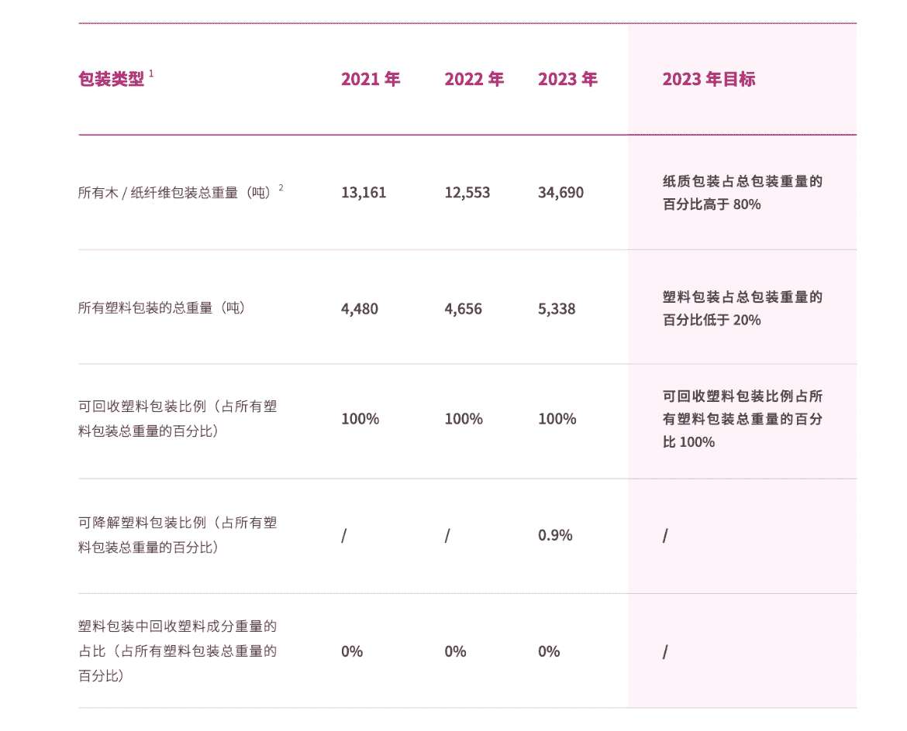

来源：唯品会2023年ESG报告

### 1.3 消费者对绿色包装的期待不断提升

对于流通领域的企业来说，来自投资方和监管方对于企业可持续发展的要求固然重要，消费者是否接受并用自己的购买偏好来支持企业的可持续发展努力也非常关键。全球范围内，大量消费者调研都显示消费者的环保意识正在不断提升。然而企业普遍担忧这种环保意识是否能够真正转化为对绿色包装的接受、支持以及对溢价的接受度。

麦肯锡与尼尔森（NielsenIQ）联合开展的一项研究试图量化消费者是否通过购买行为支持了他们所表达的ESG偏好。调研显示在2017—2022年，带有ESG相关声明的产品的销售额在五年中累计增长平均为28%，而没有此类声明的产品则为20%⁷。针对电商行业，麦肯锡还测算了企业开展可持续和绿色化行动可能带来的收益，如提供可持续产品标签和产品专区、提供产品减碳数据和可持续包装转型等。其中可持续包装转型将带来相关业务8—16%的营收增长，以及11—19%的顾客忠诚度增长⁸。

因此当前全球可持续发展与责任投资的大背景下，绿色包装已成为企业ESG管理中不可忽视的重要议题。随着中国和国际间关于可持续信息披露要求的逐步强化，绿色包装直接关系到企业能否满足监管机构和投资者的期望，从而影响企业的合规性和资本市场表现。同时，通过绿色包装实践，企业能够着眼长远，降低资源浪费和运营成本，提升品牌形象。将可持续包装作为企业ESG议题进行管理，不仅是企业承担社会责任的具体体现，更是其提升可持续竞争力的战略选择。

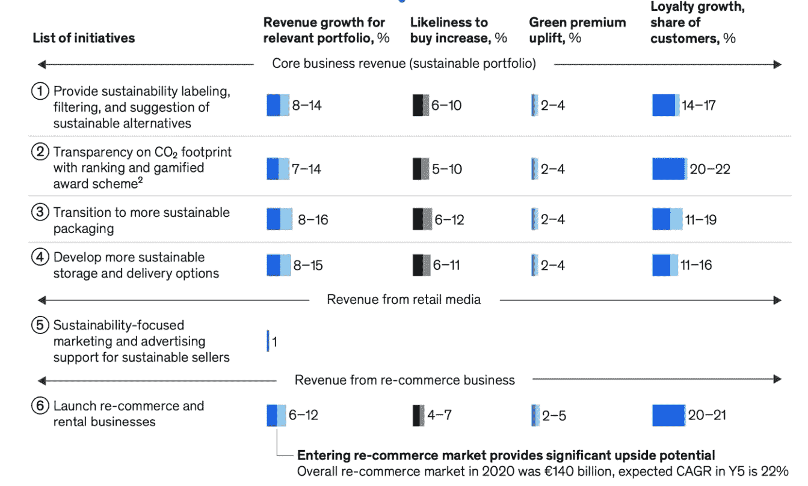

来源：麦肯锡

**可持续行动—相关业务—营收增长（%）—购买意愿增长（%）—绿色溢价提升（%）—忠诚度/客户占比提升（%）**

- 提供可持续标签、筛选功能及可持续产品建议
- 提供碳足迹信息，引入排名和游戏奖励机制
- 选择更可持续的包装
- 更可持续的仓储和配送方案
- 支持可持续卖家的营销与广告
- 推出二手交易与租赁业务

**核心业务收入（可持续产品组合）**

**零售收入**

**二手交易业务收入**

来源：PRI

对于中国市场而言，消费者对绿色、可持续消费理念的认可持续增强。不仅仅是产品本身的绿色低碳属性，产品包装的可持续性同样备受关注。根据《2023中国可持续消费报告》，在食品包装的选择上，22.8%和36.8%的受访者分别表示他们“总是”或“经常”选择简约、环保的包装⁹。德勤2023年的调查也显示，产品包装在消费者做出购买决策时占据重要地位。在消费者对于可持续产品的定义及做出购买决策方面，“尽可能使用可循环/可降解的包装”是仅次于产品“由天然/可再生材料制成”的考虑因素。62%的被访者希望商家提供去除塑料的产品包装¹⁰。

具体到电商快递包装，2023年“摆脱塑缚”对消费者的绿色、可循环包装的偏好进行了问卷调研¹¹。调研显示，超过83%的受访者表示在网购时，环保、简约的包装能够提升他们对品牌或商家的好感度。81%的受访者希望电商平台提供更环保的包装选项。此外，超过82%的受访者愿意选择可循环快递包装，并且有79%的受访者表示愿意签收快递后，将循环快递包装归还到指定地点。这些调研数据表明，消费者对可持续快递包装有较高的认知度，并且愿意通过实际行动支持环保包装。

**图9.中国消费者对可持续电商快递包装的偏好**

1. 在网购时，我愿意选择可循环使用的快递包装。
2. 我愿意选择可循环快递包装，并愿意当面签收快递以后马上归还可循环快递箱。
3. 我愿意选择可循环快递包装，并签收快递后在指定地方归还循环快递包装，如快递驿站等附近回收点。
4. 网购过程中，环保、简易的包装能够赢得我对该品牌/商家的好感。
5. 我希望网购平台能为我提供更环保的选项，如不进行二次包装的原装直发、可循环快递包装等。

**完全不同意｜不同意｜一般｜同意｜非常同意**

本报告来源于三个皮匠报告站（www.sgpjbg.com），由用户ID：549683下载，文档ID：185538，下载日期：2024-12-19

## 电商平台引领的行业绿色包装转型

### 2.1 转型框架

电商快递包装的绿色转型需要价值链上各主体的协同合作，除了消费者和政府部门需要发挥相应的作用外，企业是实现包装绿色化的核心推动者。其中最关键的企业主体包括电商平台、快递企业和平台入驻商家（分为大型品牌和小型商户），这些企业也是在《深入推进快递包装绿色转型行动方案》中明确的落实包装转型的企业主体类型。在《行动方案》中，电商平台的作用首次被提升至引领地位。电商平台作为流通环节直接面向消费者的企业主体，链接着包装消费端和包装使用端和生产端，在包装绿色化行动上拥有资源整合的优势，同时也承担着包装治理的社会责任。在其引领下，入驻商家与快递企业应当协同配合，共同承担在供应链中的治理责任。

在本章中，我们基于中国电商快递包装绿色化发展的现状，结合相关政策法规，尤其是《深入推进快递包装绿色转型行动方案》对各企业主体的要求，提出了针对电商价值链上四类企业的包装绿色转型框架及行动路径。该行动路径在充分考虑国内实际情况的同时，参考国际ESG投资的主流评价指标、责任投资机构以及自愿行动网络的指引等，从目标设定、实践行动、绩效评估以及信息披露和沟通等方面，为不同企业主体提供了行动指南。

### 2.2 行动路径

对于电商平台生态系统中的企业而言，由于其在供应链中的上下游位置和能力各异，它们在推动快递包装绿色转型中的角色也有所不同。同时，各企业在不同行动路径上的举措又具有相关性，彼此协同，才能共同促成系统性变革。

#### 目标与治理

设定包装绿色化目标并建立相应的管理架构和治理策略，对企业而言至关重要。通过形成企业内部的相关制度与规范，将包装绿色化纳入可持续发展战略，例如将其融入企业的气候变化目标并展开针对性治理，才能确保企业持续推进并取得良好绩效。

除了小型入驻商家外，电商平台、快递企业和大型品牌均应制定企业的包装绿色化目标和战略。其中，《深入推进快递包装绿色转型行动方案》明确要求……

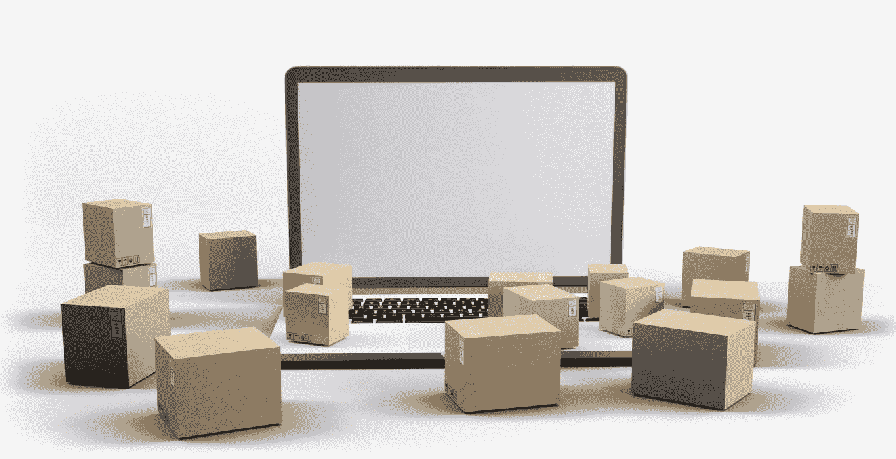

**2023年度**

# 中国电商快递包装绿色转型评价报告

## 02 电商平台引领的行业绿色包装转型

要求电商平台就其自营业务制定快递包装减量化目标任务。同时，为更好地落实《行动方案》中相关政策目标，以及相应主管部门如邮政管理部门的要求，企业应主动制定与之相协调的企业层面目标。

对于电商平台企业来说，除了建立内部治理流程和机制外，还应通过发挥平台的治理能力和领导作用，积极引领行业转型。电商平台应通过制定平台规则，约束和激励上下游企业，如入驻商家和快递企业，采取包装绿色化措施。

可循环快递包装的规模化应用需要跨行业合作进行基础设施的搭建，电商平台、快递企业和品牌企业均应扮演相应角色。基于《深入推进快递包装绿色转型行动方案》设定的目标：到2025年底，同城快递使用可循环快递包装比例达到10%，企业应尽快设定相应的企业内部目标和策略。

以上三类企业均应开展行动，开展可循环快递包装的研发和投入运营，并合作搭建共享回收点等基础设施。其中，电商平台由于直接面向消费者，应积极发挥影响力，引导消费者参与。依照《行动方案》，电商平台企业应在部分种类商品的订单生成页面为消费者提供可循环快递包装选项，同时提供清晰的指引和激励，引导消费者自主返还可循环快递包装。

### 可循环包装应用

目前全球规模最大的解决塑料包装废弃物的自愿行动网络，是由艾伦·麦克阿瑟基金会与联合国环境规划署联合发起的“新塑料经济全球承诺”。该承诺自2018年发起以来，已经吸引了全球1,000多个组织的参与，其中包含品牌、零售商、电商平台和包装制造商等，这些企业占据全球塑料消耗量的20%。同时，签署方中还包含27家金融机构，其资产管理总额达4万亿美元。

签署方在共同的愿景下制定了2025年目标，在以下几个方面开展行动并公开报告年度进展：

- 减少原生塑料的使用
- 消除有问题或不必要的包装
- 从一次性使用转向重复使用
- 确保塑料包装100%可重复使用、可回收或可堆肥
- 增加消费后再生成分的含量
- 增加再生塑料的产量

这些目标制定的方向已经被全球多家企业，包括电商平台和品牌商，作为自身目标设定的框架来使用。国内的电商平台、快递企业和大型品牌企业也可以参考该框架，同时考虑国内相关政策和企业实际，制定具有可行性的量化目标。

在寄递环节，包装的减量化包含防止过度包装、使用简约包装、原装直发，以及包装减量创新等举措；同时应做到不使用含有毒有害物质的包装。快递企业在现有的包装减量化行动基础上，进一步夯实企业内部管理机制，落实包装操作规范，并通过推动包装供应商开展减量化设计，提供更多绿色包装产品供给。

对于电商平台入驻商家来说，大型品牌应开发适应电商渠道的产品包装，积极配合电商平台做到原装直发，并开展包装研发创新，以实现包装的减量化。对于小型商户来说，也应做到选择无毒、简约的包装，杜绝包装层数过多、空隙率过大、缠绕胶带过多等过度包装问题。

对于电商平台来说，应从自营业务出发做到包装减量，在目标指引下建立相应的管理规范，确保包装减量化、无害化。同时，平台还应承担行业引领角色，联合品牌商和快递企业合作进行电商包装改进。电商平台应通过制定平台规则或激励机制，对平台内经营者，包括大型品牌和小型商家，提出包装减量要求，刺激品牌进行包装创新。

### 回收利用和处置

提高快递包装的回收利用率，在设计端即应考虑快递包装材料和产品绿色设计，使用单一材质材料，提升快递包装可回收性能。四类企业主体均应通过建立相应采购制度，推动上游包装供应商的包装设计革新。

对于纸箱等快递包装，快递企业应通过免费提供复用纸箱、提供寄递资费优惠等方式，促进快递包装回收和重复使用。对于难以再次使用的一次性塑料包装，电商平台、快递企业和品牌企业均应积极参与共建快递包装废弃物分类、规范收集体系。

企业可通过与相关部门、行业协会和社会组织等合作，设置快递包装废弃物回收点，并通过宣传、激励措施引导消费者正确投放快递包装废弃物，提升回收利用率。

- 纸类、塑料类包装原生材料使用减量目标
- 增加消费后回收材料占比
- 对标国家政策要求，制定面向消费者可循环包装应用占比目标
- 制定中转环节可循环包装应用占比目标
- 联动企业气候目标
- 包装100%可回收、可重复使用或可回收利用目标
- 回收利用率量化目标

- 减量
- 重复使用
- 回收利用
- 目标制定

### 包装减量化、无害化

## 03 电商快递企业绿色包装转型现状评价

随着中国ESG可持续信息披露监管的不断加强，电商平台、快递及品牌企业均应开展针对快递包装相关信息的收集和定期披露。披露的信息维度可以参考相关投资机构和监管方的ESG披露指引框架，涵盖快递包装绿色化的目标与策略、管理机制与规范、相关实践和成效以及包装材料的使用数据等。

同时，依据《商务领域经营者使用、报告一次性塑料制品管理办法》等相关政策，电商平台企业还应做好内部一次性塑料制品使用台账管理，并按规定向商务部门报告其自营业务产生的快递塑料包装使用情况、塑料废弃物回收情况和引导平台内经营者作出自律承诺的情况。

在消费者沟通方面，四类企业均应开展有针对性的消费者宣传，提供相应的数据、信息和激励机制，引导消费者选择绿色包装，并参与包装回收。电商平台企业应探索为采用包装减量、循环包装等绿色化措施的商家提供特殊标识、专区，以此提高消费者的认知，促进消费者的绿色包装选择。

### 信息披露与沟通

## 电商快递企业绿色包装转型现状评价

在电商快递包装绿色化转型的四类企业主体中，报告选取了其中的电商平台和快递企业进行评估。这两类行业企业数量相对集中，也是我国塑料污染治理和快递包装绿色化治理的关键领域。基于前述的快递包装绿色转型框架和行动路径，报告提出了针对电商平台和快递企业的评价指标体系，以系统衡量其转型成效。

该指标体系基于转型框架中的五大行动维度：目标与治理、包装减量与无害化、可循环包装应用、回收利用与处置、信息披露与沟通，并为每个维度制定了具体指标，以分析两个行业的进展。电商平台和快递企业在绿色包装转型中扮演着相似的角色，但考虑到电商平台作为平台企业的独特责任和优势，在电商平台的指标体系中加入了区别于快递企业的附加指标。

评价体系基于五大行动维度构建一级指标，在一级指标下细化为二级指标并设置打分权重。指标体系及权重的设置参考了摆脱塑缚2020年发布的《快递企业包装绿色化行动报告》及2022年发布的《快递包装绿色转型之快递企业包装减量及绿色循环行动评价》报告，并咨询相关领域专家和学者，对本报告的指标体系设置提出专业化建议。

在评价指标的设置上，除了参考国内最新政策导向和目标指引外，还借鉴国际监管机构和资本市场评级机构关于塑料、可持续包装等议题的信息披露框架。在指标权重设置上，通过行业现状调研，并咨询相关专家和学者（包括行业从业者、快递协会专家、相关学者等），形成打分矩阵，以确保评价体系的科学性和适用性。

鉴于中国电商行业的蓬勃发展、科技创新的推进及政策法规的持续更新，该指标体系也将适时进行调整，以适应行业动态和政策演进。

## 03

基于企业在本行业的影响力和竞争力，参考企业的市值、市场占有率等指标后¹² ¹³ ¹⁴ ¹⁵ ¹⁶，报告选取了两个行业的主流企业作为评价对象。其中部分企业如菜鸟集团和京东物流虽属于快递企业，但由于主要服务于各自电商平台的快递业务，其包装绿色化行动涉及平台生态中的参与方协同合作，具有较强的平台属性。因此，将菜鸟集团和京东物流作为阿里巴巴和京东集团旗下的企业参与评价。

### 报告评价对象选择

### 3.1 评价总览

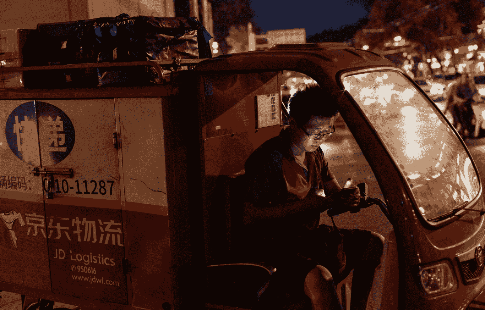

### 报告评价依据

报告评价所依据的数据均来自公开信息，包括企业自行披露的信息（企业官方网站、年度报告、环境、社会与管制报告、企业社会责任报告等披露的信息）以及新闻报道等。

除特别注明，用以评价企业包装绿色化行动的信息数据为企业2023年（2023年1月1日—2023年12月31日）数据，其中菜鸟集团的数据为2023—2024财年（2023年4月1日至2024年3月31日）数据。报告编写组于报告发布前与企业取得联系所获得的信息，包括企业反馈之勘误、意见和补充信息，亦已酌情增补至报告中。

### 3.2 快递企业现状评价

在主管部门国家邮政局的带领下，快递企业在包装绿色化转型上呈现出较为一致的行动方向和策略。在包装规范管理和制度建设、包装减量、循环和回收行动以及信息披露方面，主流快递企业均有所涉及，也取得了较明显的成效。排名靠前的企业在研发投入创新等方面更具有优势，也基本都采取了一定的绿色化举措并主动披露，体现出较强的行业协同效应。

尽管国家层面的快递包装绿色化相关政策指引中已经提出了一些量化目标，例如可循环快递包装的投放量目标，但快递企业普遍并未公布企业可持续包装方面的量化目标。虽然快递行业在政策指引和相关部门的带领下已经取得了阶段性的成果，但缺乏公开、可衡量的企业目标来引导企业的长期可持续行动。

在报告考察的七家快递企业中，仅顺丰和中通提出了企业层面的气候目标。顺丰提出到2030年每件快件包裹的碳足迹相较于2021年降低70%，其中包装方面的减碳措施是实现该目标的关键路径之一。但顺丰没有进一步制定与包装绿色化相关的具体减量或减碳目标。中通提出相较于2023年，到2028年自身运营单票碳排放下降20%的减排目标，但未明确包装减碳路径。

在包装绿色化治理方面，快递企业普遍制定了企业内部包装管理规范并开展人员培训，以确保规范打包，避免过度包装。在供应链管理方面，尽管大部分快递企业将其视为企业ESG核心议题之一，并将绿色采购作为可持续供应链的关键内容，但报告中多数企业并未披露其包装采购制度，也未说明如何通过绿色包装认证等机制来推动快递包装供应链的绿色升级。

仅极兔速递披露，自2022年起推动合作的包装供应商进行绿色产品认证，并优先选择通过“绿色产品认证”的包装供应商。2023年包装供应商完成绿色包装产品认证并取得证书的比例达40%。

这一行业现状与《深入推进快递包装绿色转型行动方案》中的“快递包装供应链绿色升级行动”还存在差距。该行动方案明确要求电商、快递企业建立快递包装产品合格供应商制度，逐步扩大合格供应商包装采购和使用比例，推动包装生产企业开展包装减量化设计。

因此，快递企业应在现有的供应商管理制度的基础上进一步细化，将绿色采购要求落实到快递包装领域，形成专门针对包装的绿色采购制度并披露绿色包装采购比例。

### 目标与治理

**快递企业：**极兔速递、申通快递、顺丰速运、圆通速递、韵达速递、中通快递

**电商平台企业：**阿里巴巴、抖音电商、京东、快手电商、拼多多、苏宁易购、网易严选、唯品会

- 快递企业排名
- 电商平台企业排名

图11：企业排名总览

图12：快递企业各维度得分总览

## 包装减量化、无害化

图13：顺丰薄款文件防水袋

图14：申通快递联合供应商研发文件环保循环袋

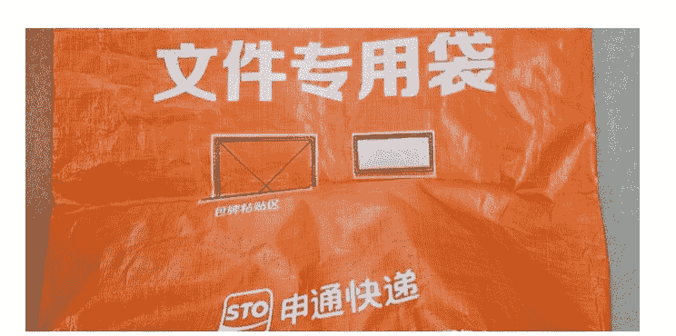

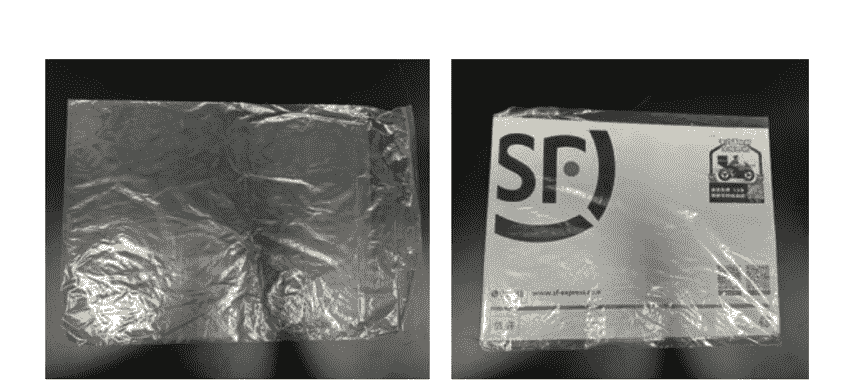

##### 快递企业包装绿色化目标与治理表现

| 企业 | 企业将快递包装绿色化识别为企业实质性议题进行管理 | 企业设定快递包装绿色化转型目标 | 建立企业快递包装操作规范和管理制度 | 岗前和在岗培训 | 建立包装绿色采购管理制度，推动增加快递包装绿色产品供给 |
|---|---|---|---|---|---|
| 极兔速递 | 基于双重重要性分析，将“绿色包装”识别为企业实质性议题 | 未见有效信息 | 制定了《包装操作规范》《关于全网禁止使用不可降解物料的通知》 | 未见有效信息 | 自2022年起推动包装供应商进行绿色产品认证，优先选择通过“绿色产品认证”的包装供应商。截至2023年12月底，极兔的包装供应商完成绿色包装产品认证并取得证书的比例已达40% |
| 申通快递 | 基于双重重要性分析，将“推行绿色包装”识别为高度重要议题 | 未见有效信息 | 制定了《快件包装规范指引》《环保袋使用标准及管理制度》《可降解快递塑料袋技术标准管理制度》 | 2023年开展快递包装法规标准及包装操作规范等业务培训，累计培训业务员超53,000人 | 未见有效信息 |
| 顺丰速运 | 基于双重重要性分析，将“绿色包装与资源循环利用”识别为企业实质性议题 | 2030年前，力争100%标准胶带全部切换成再生胶带。提出了集团2030年碳目标：每件快件包裹的碳足迹相较于2021年降低70%，其中可持续包装创新是实现碳目标的关键路径之一 | 制定了《快件包装规范指引》《环保袋使用标准及管理制度》《可降解快递塑料袋技术标准管理制度》 | 深化实践《顺丰包装操作规范》，开展过度包装专项工作，为不同类型托寄物的包装提供具体的操作指南，以确保绿色包装要求的落实 | 制定《绿色采购管理规定》；开展包装材料供应商大会，倡导可持续发展合作 |
| 圆通速递 | 将“绿色快递”列为企业环境方面社会责任范畴 | 未见有效信息 | 未见有效信息 | 未见有效信息 | 为加强绿色采购管理，建立快件包装统一采购体系，公司印发了《关于明确绿色包装内部申购的通知》 |
| 韵达速递 | 基于双重重要性分析，将“物料管理”识别为企业实质性议题。未就“物料管理”进行说明，也没有在ESG报告中披露物料管理的范畴和企业相关行动 | 无包装绿色化相关量化目标，正在探索和制定碳目标 | 完善末端网点分拣、投递工作流程和操作规范，减少二次包装和过度包装 | 将包装操作列入员工岗前培训和在岗培训内容，组织加盟网点和员工学习行业生态环保相关法律法规和政策文件，积极推行简约包装 | 未见有效信息 |
| 中通快递 | 基于双重重要性分析，将“包装材料使用”识别为企业实质性议题 | 未见有效信息 | 制定了《增值服务监督管理条例》《中通快递快件包装操作规范》，明确了包装原则、工具和包装材料的选择标准 | 设计并上线了关于绿色包装的一系列专项培训课程，同时，通过网点包装抽检、调研等形式，对相关培训结果开展闭环验收 | 未见有效信息 |

来源：顺丰2023年ESG报告

在包装减量行动上，快递企业依据相关政策法规要求，普遍在电子面单、胶带瘦身、电商件不再二次包装等方面开展行动并披露成效。企业基本都采用了电子面单替代纸质面单，并采用45毫米以下胶带。大部分企业公布的电商件不再二次包装的比例在90%或以上。这符合国家邮政局2023年邮政快递业绿色发展“9218”工程的目标，即到2023年前，实现电商快件不再二次包装比例达到90%¹⁷。

行业在积极落实国家邮政局“9218”工程的同时，还可以加大研发投入，通过技术创新，如智能装箱、材料创新等，进一步减少包装使用量，特别是一次性塑料包装的使用量。

例如，顺丰披露了其包装物料减量方面的创新举措，通过将文件封外罩的塑料胶袋进行重新设计，将厚度减少了40%，并免去印刷。这款薄型文件防水袋在2023年使用量约为255万个，减少约19吨塑料消耗，减少碳排放约67吨。

来源：申通2023年ESG报告

##### 快递企业包装减量化、无害化表现

| 企业 | 电商快件不再二次包装 | 包装物料减量 | 包装减量技术创新研发 | 不使用含有毒有害物质的包装材料 |
|---|---|---|---|---|
| 极兔速递 | 不再二次包装的比例达90% | 电子面单使用率100%；45毫米瘦身胶带使用率100% | 未见有效信息 | 未见有效信息 |
| 申通快递 | 不再二次包装的比例达90% | 电子面单使用率100%；瘦身胶带使用率100% | 2023年申通投入200万元，联手供应商在线下场景中反复测试，成功研制出文件环保循环袋，使用寿命达上百次 | 未见有效信息 |
| 顺丰速运 | 不再二次包装的比例超过95% | 2023年通过包装（胶袋、胶纸、贴纸、封条等8类物料）减量化措施，累计减少原纸使用4.3万吨，塑料16.2万吨，减少碳排放约54万吨 | 完成“双易”胶袋的再生配方及制品研发，添加30%再生树脂材料，并在上海启动了塑料包装废弃物全流程闭环回收再生项目 | 100% |
| 圆通速递 | 不再二次包装的比例达90% | 未见有效信息 | 未见有效信息 | 未见有效信息 |
| 韵达速递 | 未见有效信息 | 电子面单使用率超99.9%；2023年公司使用瘦身胶带35.08万卷，减少胶带投放量17.54平方米 | 未见有效信息 | 2023年环保袋印刷油墨全面改为环保油墨，油墨使用量可降低50%，重金属、溶剂、有机挥发物等污染物下降95% |
| 中通快递 | 不再二次包装的比例为93.34% | 电子面单使用率100%；瘦身胶带使用率100% | 推出薄款文件类防水袋替代传统胶袋，厚度减少40%。2023年该款胶袋减少塑料消耗约19吨，减少碳排放约67吨 | 未见有效信息 |

### 可循环包装应用

快递企业已普遍在中转环节使用循环中转袋对一次性包装进行替代，部分企业在公布循环中转袋投入量基础上，进一步公布了替代率。如韵达快递公布的循环中转袋使用率为89%，圆通速递运转中心循环袋使用率超96%。

在面向消费者的2C可循环快递包装应用上，虽然报告考察的企业均有涉及，但大多数仍处于研发和起步阶段，仅在小范围内进行投放和试点。例如，极兔速递在2022年研发了Red Box循环箱，并投入使用，截至2023年底累计采购并投放了43,000个；韵达快递计划于2024年在30个城市的同城业务中推出可循环智能文件袋。

目前，行业内仅顺丰的可循环快递包装已实现多年持续投放，并具备了一定的规模。顺丰集团自主研发的循环包装箱，从最初的丰·BOX迭代到丰多宝π-box。截至2023年12月底，顺丰累计投放丰多宝π-box循环包装箱超过129万个，覆盖119个城市，累计循环使用超过2,064万次。

此外，2023年顺丰在冷链运输场景试点投放了约4,000个冷运循环箱，累计循环使用超2万次。同时，顺丰在大件运输和医药运输场景也开展了可循环包装的试点和应用。

由此可见，快递企业在2C可循环快递包装应用方面存在显著分化，亟需其他企业加快步伐，加大投入，以缩小差距。

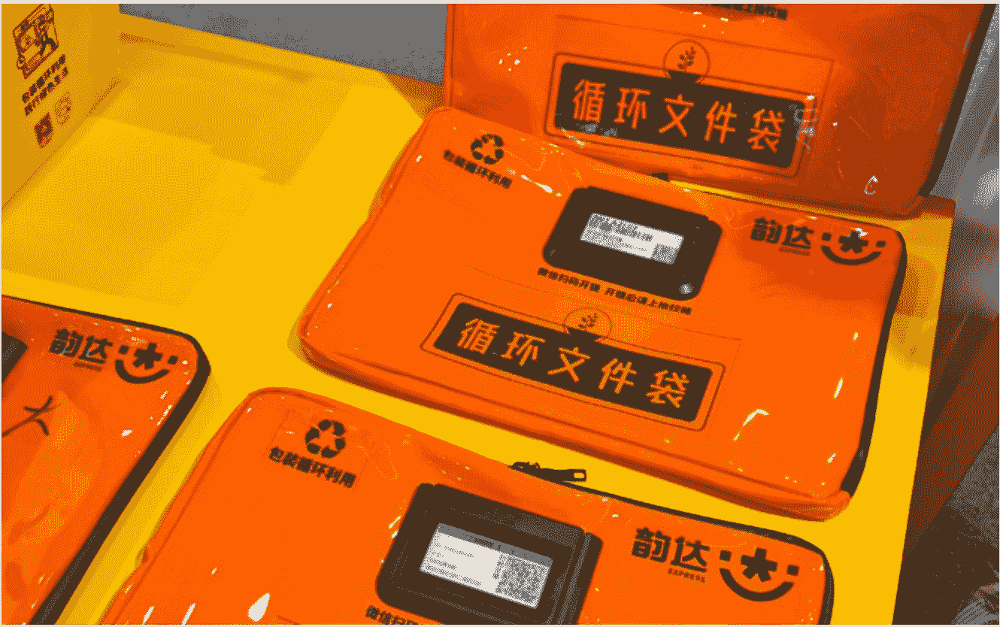

图15：韵达计划于2024年投入同城快递业务的可循环文件袋

## 2023年度中国电商快递包装绿色转型评价报告

## 03 电商快递企业绿色包装转型现状评价

##### 快递企业可循环包装应用表现

国家邮政局“9218”工程提出到2023年底回收复用质量完好的瓦楞纸箱8亿个的目标。在此目标的带领下，快递企业均设立了网点包装回收装置对纸箱进行回收复用，但仅有部分企业披露了回收的包装数量。如中通快递2023年回收复用纸箱1.5亿个，圆通速递2023年回收复用纸箱2208万个。而其它企业仅披露了设置包装回收装置或网点数量而未提供回收包装的数量，使得企业间相关行动缺乏可比性。

包装的回收利用和处置除了纸箱的回收复用外，还涉及其它包装物如塑料包装等的回收和处置。在这方面，仅有顺丰在塑料包装的重新设计和回收方面进行了探索。顺丰联合产业链上下游共同构建塑料包装设计-生产-消费-再生-高值化利用的体系，探索实现快递塑料包装回收再生的闭环链条。顺丰完成“双易”胶袋的再生配方及制品研发，同时采用了30%再生塑料成分，使该胶袋在减少原生塑料使用的同时也具备易回收、易再生的性能。并且为了使其真正得到回收再生，顺丰在上海启动了塑料包装废弃物全流程闭环回收再生试点项目，在学校、网点等场景设置回收点，并张贴宣传海报，鼓励分类投放和回收。

#### 包装回收利用和处置

| 企业名 | 快递包装材料和产品绿色设计，使用单一材质材料，提升快递包装可回收性能 | 设置网点回收装置，披露回收再利用包装数量 | 与相关部门、企业、公益组织等合作搭建快递包装废弃物分类、规范收集体系 |
| :--- | :--- | :--- | :--- |
| 顺丰速运 | 顺丰完成“双易”胶袋的再生配方及制品研发，添加30%再生树脂(PCR)的同时，保持优异的机械性能，符合快递袋国标要求，实现单一材质易回收的价值，获得第三方机构颁发的“塑料制品易回收易再生设计认证”优秀评级证书 | 2023年回收复用质量完好的瓦楞纸箱超8.2亿个 | 100% |
| 圆通速递 | 未见有效信息 | 回收复用瓦楞纸箱超6,000万个 | 0% |
| 韵达速递 | 未见有效信息 | 已在全国网点设置20,000余个快递回收装置 | 50% |
| 中通快递 | 未见有效信息 | 绿色回收装置累计投入26,683个，回收纸箱1.46亿个 | 100% |
| 极兔速递 | 未见有效信息 | 2023年全年回收瓦楞纸箱约90万个，在网点设置包装废弃物回收装置，覆盖网点6,308个，占比82.6%，较去年同期提高33.4% | 0% |
| 申通快递 | 未见有效信息 | 持续推进“回箱计划”，至2023年底设置绿色包装回收装置的网点数量3,398个 | 50% |

##### 快递企业可循环包装应用表现

| 企业名 | 循环中转袋使用率 | 2C可循环快递箱/袋使用率 | 与其它企业、政府机构、公益组织等合作搭建可循环快递包装共享回收体系 |
| :--- | :--- | :--- | :--- |
| 极兔速递 | 截至2023年12月底，累计使用循环中转袋约2,560万个，使用次数超110,080万次，相较于传统中转袋使用，累计减少超过186,035吨的碳排放 | 2022年3月RedBox成功研发并投入使 用，截至2023年12月底，累计已采购并投放达43,000个 | 0% |
| 申通快递 | 截至2023年底，全网可循环中转袋单年投入量1,160万只，累计投入量3,288万只 | 仅公布与供应商合作开发了文件循环袋，未披露是否已投入使用 | 0% |
| 顺丰速运 | 每个循环编织袋的平均使用次数已超过24次。2023年，公司新增投入约2,300万个循环编织袋 | 截至2023年12月底，已累计投放“丰多宝π-Box”循环包装箱超过129万个，覆盖119个城市，累计循环使用超过2,064万次 | 0% |
| 圆通速递 | 全网累计投入可循环中转袋超2,600万个 | 使用可循环快递包装的邮件快件超2亿件 | 0% |
| 韵达速递 | 截至2023年已累计投放可循环中转袋超2,000万条，累计循环使用达16亿次，使用率89.48% | 首次推出了可循环智能文件袋，可重复使用1,000次，无需使用胶带。截至2023年末，正在排产中的5,000个可循环文件袋计划于2024年第一季度上线试点，用于30个左右城市的同城业务 | 0% |
| 中通快递 | 使用可循环包装的邮件快件达2,522万件以上 | 50% | 0% |

来源：顺丰2023年ESG报告

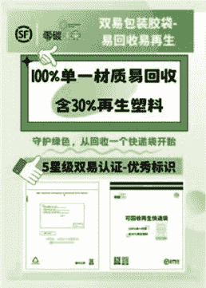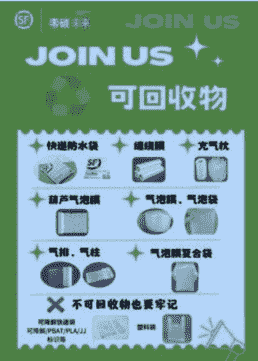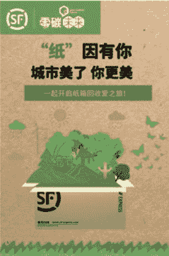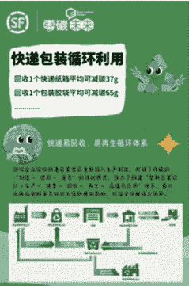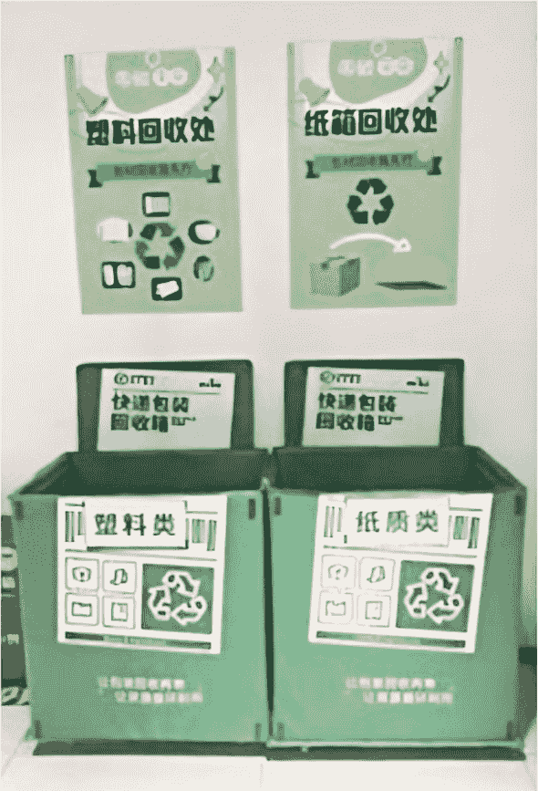

图16：末端回收点

图17：回收宣传海报

#### 信息披露与沟通

被评价的快递企业均在ESG报告或企业社会责任报告中将包装绿色化识别为实质性议题，并披露包装绿色化相关企业行动和数据。部分企业（极兔、顺丰、中通）公布了企业包装用量数据。

在消费者沟通上，快递企业普遍缺乏长期的、有针对性的消费者沟通和激励机制，而主要采用公益环保活动等方式。只有顺丰通过其绿色碳能量平台激励消费者使用绿色包装。顺丰通过其绿色碳能量平台，鼓励公众在使用循环包装等低碳产品和服务后，获得“碳能量”奖励，可在其平台内换取积分等权益用于抵扣运费或兑换礼品。

##### 快递企业包装绿色化信息披露与沟通表现

| 企业名 | 通过企业ESG报告、社会责任报告、企业官网等公开途径披露企业在快递包装绿色化转型方面的信息 | 企业主动开展快递包装绿色转型宣传，通过有效信息传递与激励措施，鼓励公众主动参与包装减量化、循环包装和包装回收利用等包装绿色化行动 |
| :--- | :--- | :--- |
| 极兔速递 | 除快递包装绿色化相关行动和绩效外，极兔还在企业ESG报告中公布了2023年中国统采的快递包装分类别的使用量，包括纸质运单、封签、防水袋、全降解防水袋、胶带和文件封，并公布了快递包装的温室气体排放总量 | 未见有效信息 |
| 申通快递 | 通过企业ESG报告等披露了包装绿色化相关行动和绩效信息 | 未见有效信息 |
| 圆通速递 | 通过企业ESG报告等披露了包装绿色化相关行动和绩效信息 | 未见有效信息 |
| 韵达速递 | 通过企业ESG报告等披露了包装绿色化相关行动和绩效信息 | 未见有效信息 |
| 中通快递 | 除快递包装绿色化相关行动和绩效外，中通还在ESG报告中公布了三年（2021年至2023年）包装使用数据，包含包装物料总量及密度（千克/百万元人民币）等；且公布了2023年包装分类别使用量数据，包含透明胶带、面单、防水袋、信封、纸箱其他包装 | 未见有效信息 |
| 顺丰速运 | 除快递包装绿色化相关行动和绩效外，顺丰还在ESG报告中公布了2022、2023年包装分类别使用量数据，包含快递封套、运单、纸箱、塑料包装、透明胶带、发泡类填充物和充气类填充物 | 针对快递包装分类回收，顺丰在多个回收点张贴相关宣传海报，促进消费者妥善分类回收。通过绿色碳能量平台，鼓励公众在寄快递时使用循环包装、同城急送、电子回单、拍照回传、EPP温控箱、专享急件等低碳服务和产品，促进可持续的消费行为。用户在使用低碳服务后将获得“碳能量”奖励，可在顺丰平台内换取积分等权益，用于抵扣运费或兑换积分商城礼品 |

### 3.3 电商平台企业现状评价

快递包装的绿色化转型不能仅仅依赖快递行业本身，电商平台企业也应在其中扮演更加积极的角色。政策的不断推进正凸显了这一期待，在《深入推进快递包装绿色转型行动方案》中，政策制定者明确要求电商平台充分发挥引领作用。在快递包装绿色化转型的各个维度上电商平台均应发挥作用，并且应充当连接上下游产业链的纽带，促进行业协同合作，加速全链条的绿色升级。

总体而言，相较于快递企业，电商平台在包装绿色化转型的行动、成效及信息披露上差异显著，企业间差距较大。快递企业普遍响应主管部门国家邮政局的要求，披露的行动框架较为一致，而电商平台的信息披露维度则较为分散。一些电商平台如拼多多、抖音电商、快手电商等尚未将电商包装绿色化纳入企业ESG的核心议题进行系统管理和披露。

被评估的电商平台中，只有京东在各个维度上表现较为突出，尤其在可循环包装的应用上持续取得进展。唯品会的数据披露相对全面，公开了可比的包装材料分类用量数据。阿里巴巴旗下的菜鸟集团主要聚焦于纸箱回收和包装减量，2C可循环包装的推广应用方面则几乎没有涉及。网易严选虽然将包装管理纳入了企业实质性议题但实际行动十分有限。这一行业现状显然与政策所要求的电商平台应承担的引领角色存在显著差距，排名靠后的企业亟须意识到自身的包装绿色化责任并开始采取行动。

图18. 电商平台企业各维度得分总览

注：阿里巴巴的数据主要采用了涉及其快递包装业务的菜鸟集团数据，以及淘宝、天猫事业部的相关信息，不包括其线下零售业务（如高鑫零售）或即时配送业务（如盒马）的数据。京东集团数据主要采用京东物流集团的数据。

报告考察的八家电商平台企业，除拼多多外皆发布了自己的2023年ESG报告。其中京东集团、阿里巴巴的菜鸟集团、网易严选和唯品会均基于双重重要性分析，将绿色包装识别为企业实质性议题进行管理。快手电商和抖音电商虽发布了企业ESG报告，但未将包装纳入企业实质性议题。拼多多则自2020年发布过ESG报告后没有再发布ESG或企业社会责任报告，其中文官网没有可持续发展相关栏目和报告，其英文官网上有独立的“社会责任”栏目，但其议题主要集中在农业领域，如农业科技和扶贫等，尚未将包装、气候变化等环境议题识别为企业社会责任实质性议题。由于拼多多、快手电商、抖音电商皆未将包装视为企业的社会责任或ESG议题，因此其包装绿色化相关行动也基本处于空白状态。

在目标设定方面，京东物流、菜鸟和唯品会已设立企业气候行动目标，并将包装绿色化作为企业减碳的关键路径之一。其中京东物流进一步提出了专门针对包装的目标，即至2030年，包装材料实现100%环保可再生；推动80%以上的上游品牌企业开展环保包装研发¹⁸。

在平台规则制定方面，京东、阿里巴巴天猫、淘宝、拼多多和苏宁易购均以公告形式向商家发布了“‘限塑令’倡议书”。其中天猫、淘宝的倡议书在2023年6月修订，融入了商务部、国家发展和改革委员会发布的《商务领域经营者使用、报告一次性塑料制品管理办法》。该管理办法在当年6月2日起生效，天猫和淘宝因此更新了倡议，包含遵守一次性塑料制品禁限使用规定、包装减量化、无害化和减少二次包装、不过度包装等方面内容。而京东、拼多多和苏宁易购的公告以2020年发布的《关于进一步加强塑料污染治理的意见》为背景，主要规范商家违规向海南销售一次性塑料制品的行为。尽管这几大主流平台已在规则制定上初步尝试对商家进行包装治理，但目前仍停留在公告层面。企业尚未形成长期规则体系和执行监督机制，且缺乏有效的激励措施。

在包装绿色采购方面，虽然《深入推进快递包装绿色转型行动方案》提出电商企业与快递企业一样，也应建立起快递包装产品合格供应商制度，逐步扩大合格供应商包装产品采购和使用比例。但被评价的电商平台企业尚未披露任何企业包装方面的绿色采购制度。

##### 电商平台企业包装绿色化目标与治理表现

| 企业名 | 企业将快递包装绿色化识别为企业实质性议题进行管理 | 企业设定快递包装绿色化转型目标 | 建立企业快递包装操作规范和管理制度 | 依据企业快递包装操作规范，对一线员工进行岗前和在岗培训 | 建立包装绿色采购管理制度，推动增加快递包装绿色产品供给 | 电商平台企业制定平台规则，引导平台内经营者减少、替代一次性塑料包装使用 |
| :--- | :--- | :--- | :--- | :--- | :--- | :--- |
| 阿里巴巴 | 基于双重重要性分析，将“全链路绿色物流”识别为企业实质性议题，其中包含绿色包装 | 与阿里巴巴一样，菜鸟提出了范围3的减排目标。在2030年（2031财年）之前，菜鸟范围3的温室气体排放强度相较2021年（2022财年）下降50%。2050.04-2051.03财年前实现温室气体净零排放。包装绿色化是其集团碳减排关键路径之一 | 未见有效信息 | 未见有效信息 | 未见有效信息 | 淘宝/天猫在平台规则中心发布了“‘限塑令’行动倡议书”，并根据商务部、国家发展改革委2023年发布的《商务领域经营者使用、报告一次性塑料制品管理办法》于2023年6月对倡议书进行修订¹⁹ ²⁰ |
| 京东 | 从“对利益相关方的重要性”和“对公司发展的重要性”两个方面，将“包装管理”识别为企业“中度重要”实质性议题 | 作为国内第一家加入科学碳目标(SBTi)的物流企业，京东物流承诺至2030年其碳排放量与2019年相比减少50%。在京东物流的气候目标中，包含了包装相关量化目标：至2030年，包装材料实现100%环保可再生/可替换；至2030年，推动80%以上的上游品牌企业开展环保包装研发 | 修订《循环中转袋管理规定》，规范循环中转袋全流程管理，制定奖惩制度提高使用效率 | 未见有效信息 | 制定行业内首个原厂直发包装认证标准，携手上下游推行原发包装 | 京东在平台规则中心发布京东开放平台“限塑令”行动倡议书及治理公告，向商家发出包装绿色化倡议，并针对一次性不可降解塑料制品销往海南进行区域限售，对违规店铺进行扣除违约金、删除商品等处理，情节严重的，将直接进行店铺清退²¹ |
| 快手电商 | 未将包装绿色化识别为企业实质性议题 | 未见有效信息 | 未见有效信息 | 未见有效信息 | 未见有效信息 | 未见有效信息 |
| 拼多多 | 未将包装绿色化识别为企业实质性议题 | 未见有效信息 | 未见有效信息 | 未见有效信息 | 未见有效信息 | 2021年在平台规则中心发布了“限塑令”行动倡议书，后未再更新²² |
| 苏宁易购 | 未见有效信息 | 未见有效信息 | 未见有效信息 | 未见有效信息 | 未见有效信息 | 2021年在平台规则中心发布了“限塑令”行动倡议书，后未再更新²³ |
| 网易严选 | 从“对利益相关方的重要性”和“对公司发展的重要性”两个方面，将“资源使用管理”识别为企业实质性议题，其中包含对包装材料使用的管理 | 未见有效信息 | 未见有效信息 | 未见有效信息 | 未见有效信息 | 未见有效信息 |
| 唯品会 | 从“对利益相关方的重要性”和“对公司发展的重要性”两个方面，将“绿色包装”识别为企业实质性议题 | 提出了企业减碳目标，承诺将不晚于2030年实现自身运营的碳中和，不晚于2030年实现范畴三碳排放强度下降50%，并将绿色包装纳入关键减排路径之一 | 已建立快递包装操作规范和管理制度，并发布在官网。同时将其纳入对品牌商的考核内容之一²⁴ | 唯品会对一线员工进行岗前及在岗培训，确保包装人员使用最合适的包装材料进行包装。同时，该附件内容已在唯品学堂上线，具备课件。（唯品学堂为唯品会内部线上学习平台）²⁵ | 未见有效信息 | 未见有效信息 |
| 抖音电商 | 未将包装管理识别为企业实质性议题 | 未见有效信息 | 未见有效信息 | 未见有效信息 | 未见有效信息 | 未见有效信息 |

#### 包装减量化、无害化

在包装减量方面，阿里巴巴菜鸟集团、京东和唯品会均采取了措施对包装进行优化，从源头减少材料使用。其中菜鸟和京东披露的减量措施较为全面，同时也都开展了与商家的合作，共同设计适合电商渠道的创新包装，如菜鸟与雀巢合作定制化脆脆鲨礼盒，将礼盒和物流纸箱合二为一，节约了胶带和其它塑料材料使用。京东则推出了行业内首个原厂直发包装认证标准，联手上下游推进原发包装，2023年原厂直发包装减少二次包装使用超过8亿个。

在包装无害化方面，京东提出杜绝使用聚苯乙烯(EPS)以及重金属和有害物质残留超标的包装材料，菜鸟也明确禁止快递公司使用重金属超标或有毒的包装材料。

##### 电商平台企业包装减量化、无害化表现

| 企业名 | 电商快件不再二次包装 | 包装物料减量 | 包装减量技术创新研发 | 不使用含有毒有害物质的包装材料 |
| :--- | :--- | :--- | :--- | :--- |
| 阿里巴巴 | 原箱发货包裹数超4.3亿个 | 简约包装方案应用于约1.3亿个包裹；应用电子装箱单、电子面单；优化装箱算法，减少包材使用。2024财年包装减量达10.1万吨 | 使用算法助力快消行业减少包材用量，行业整体满箱率优化18%；全行业箱型数量减少11% | 根据国家绿色包装清单，禁止快递公司使用重金属超标或有毒的包装材料 |
| 京东 | 2023年，原厂直发包装帮助京东物流减少二次包装使用超过8亿个 | 截至2023年末，X系列纸箱全年使用量达1.1亿个，共计减碳约1,719吨 | 开发X系列纸箱，将纸箱开口从长边转到短边，通过更短的摇盖使用更少的耗材实现纸箱减量化 | 杜绝使用聚苯乙烯(EPS)以及重金属和有害物质残留超标的包装材料 |
| 抖音电商 | 未见有效信息 | 未见有效信息 | 未见有效信息 | 未见有效信息 |
| 快手电商 | 未见有效信息 | 未见有效信息 | 未见有效信息 | 未见有效信息 |
| 拼多多 | 未见有效信息 | 未见有效信息 | 未见有效信息 | 未见有效信息 |
| 苏宁易购 | 未见有效信息 | 推进零胶纸箱、可降解包装、一联单、瘦身胶带等减量化包装推广 | 未见有效信息 | 未见有效信息 |
| 网易严选 | 2023年，网易严选原箱直发近500万单 | 塑料袋减薄、封箱胶带减量、包装箱智能推荐系统、气泡袋回收等，但未披露相关数据 | 未见有效信息 | 未见有效信息 |
| 唯品会 | 针对外包装本身材质较好的商品，例如冰箱等，公司不再二次包装，且已制定内部规则²⁶ | 优化彩袋型号，引入2A号彩袋替代更大的3号彩袋，全年使用2A号彩袋超2,300万个，相当于节省塑料90吨; 内填充气柱袋的厚度由5C降为4C，全年节省塑料7.5吨 | 未见有效信息 | 公司所使用的塑料及纸质包装无毒无害²⁷ |

阿里巴巴菜鸟、京东物流、苏宁易购、网易严选和唯品会均在中转（2B）环节使用了循环包装，其中苏宁易购中转环节实现了循环周转箱和循环中转袋的全覆盖，其它企业则仅公布了使用量而未公布替代率。

在面向消费者的可循环包装方面，电商平台中只有京东一家企业进行了长期探索和投入，且已具备一定规模，而其他企业则几乎没有相关行动。京东的循环箱在2023年使用量达到99.7万个，累计使用次数达7,162万次。可循环保温箱在2023年减少了7,165万个泡沫箱的使用量。《深入推进快递包装绿色转型行动方案》提出，到2025年同城快递可循环快递包装使用比例要达到10%。这一紧迫目标显然不能仅靠行业内少数企业的努力来实现。其他尚未开展消费端可循环包装应用的企业亟须加快行动，共同推动2C可循环包装的大规模应用。

### 可循环包装应用

## 03 电商快递企业绿色包装转型现状评价

##### 电商平台企业可循环包装应用表现

| 企业名 | 循环中转袋使用率 | 2C可循环快递箱/袋使用率 | 与其它企业、政府机构、公益组织等合作搭建可循环快递包装共享回收体系 | 电商平台企业在部分种类的订单生成页面为消费者提供可循环快递包装选项 |
|--------|----------------|------------------------|------------------------------------------------------------------|--------------------------------------------------------------------------|
| 阿里巴巴 | 菜鸟在商家仓内累计投入循环箱13万个，使用次数超71万次 | 未见有效信息 | 0% | 未见有效信息 |
| 抖音电商 | 未见有效信息 | 50% | 未见有效信息 | 0% |
| 京东 | 0% | 2023年，京东物流总计投入1,703万个循环中转袋，单个平均使用次数达18.3次以上 | 50% | 0% |
| 快手电商 | 未见有效信息 | 未见有效信息 | 50% | 未见有效信息 |
| 拼多多 | 0% | 未见有效信息 | 0% | 未见有效信息 |
| 苏宁易购 | 0% | 中转环节实现了循环周转箱和循环中转袋的全覆盖 | 0% | 未见有效信息 |
| 网易严选 | 0% | 未见有效信息 | 0% | 未见有效信息 |
| 唯品会 | 100% | 绿色循环箱全年循环使用128,602次 | 50% | 在公司与供应商的退送货环节中引入循环箱，全年共使用超27万次 |

### 包装回收利用和处置

##### 电商平台企业包装回收利用和处置表现

| 企业名 | 快递包装材料和产品绿色设计，使用单一材质材料，提升快递包装可回收性能 | 设置网点回收装置，披露回收再利用包装数量 | 与相关部门、企业、公益组织等合作搭建快递包装废弃物分类、规范收集体系 |
|--------|----------------------------------------------------------------|---------------------------------------------|----------------------------------------------------------------------|
| 阿里巴巴 | 未见有效信息 | 菜鸟“回箱计划”2024财年回收快递纸箱及使用旧纸箱寄件减少碳排放超2.1万吨。2023财年菜鸟驿站用数字化方式记录的纸箱回收再利用的数量2,382万个 | 未见有效信息 |
| 抖音电商 | 0% | 未见有效信息 | 0% |
| 京东 | 未见有效信息 | 2023年，在大量订单中使用二次利用的纸箱进行打包 | 50% |
| 快手电商 | 0% | 未见有效信息 | 0% |
| 拼多多 | 0% | 未见有效信息 | 0% |
| 苏宁易购 | 0% | 未见有效信息 | 0% |
| 网易严选 | 0% | 未见有效信息 | 0% |
| 唯品会 | 未见有效信息 | 全年回收纸箱、塑料袋等包材废弃物43,910吨 | 未见有效信息 |

在末端回收环节，京东物流将联合灰度环保科技（上海）有限公司联合搭建末端共享回收基础设施，依托社会化回收资源完成循环包装在末端的回收。试点项目还将建设多个循环包装调度中心，用于循环包装的资源调拨、空箱清洗消杀等，实现循环包装在行业内快速流转、助力降本增效。京东物流还将积极探索开展社区共享回收模式，鼓励消费者自主返还循环包装至社区指定场地，培育消费者绿色循环生活方式²⁸。

由于快手电商、抖音电商和拼多多均未将包装议题识别为自身的ESG或社会责任议题，因此也几乎没有相关的信息披露。拼多多自2020发布过ESG报告后便未再发布ESG或社会责任报告，且中文官网也未设置可持续发展相关栏目。尽管拼多多市值已超过阿里巴巴，远超京东²⁹，但其在可持续包装方面却几乎没有采取任何行动。

阿里巴巴、京东和唯品会均持续在其ESG报告中披露包装相关的可持续信息。其中，唯品会还披露了三年可比的包装材料数据，包括纸类、塑料类以及回收成分等具体信息。未来阿里巴巴和京东也应在更加量化的目标设定，以及包装材料用量数据的披露方面进一步提升。

在消费者沟通方面，目前仅阿里巴巴菜鸟和京东物流有意识地通过宣传活动和激励措施推动消费者参与回收。其中，京东物流进一步探索了绿色激励机制，联合品牌商投入绿色专项补贴，并通过建立消费者个人碳账户等方式，鼓励消费者积极参与可循环包装的使用。这体现了企业在发挥平台影响力方面的努力，通过链接价值链上的相关企业，共同开展有针对性的消费者宣传和激励。

### 信息披露与沟通

## 03 电商快递企业绿色包装转型现状评价

##### 电商平台企业信息披露与沟通表现

| 企业名 | 通过企业ESG报告、社会责任报告、企业官网等公开途径披露企业在快递包装绿色化转型方面的信息 | 企业主动开展快递包装绿色转型宣传，通过有效信息传递与激励措施，鼓励公众主动参与包装减量化、循环包装和包装回收利用等包装绿色化行动 | 电商平台企业为采取了包装减量化措施的商家提供特殊标识、专区等，提高消费者认知和参与 |
|--------|------------------------------------------------------------------------------------------|-------------------------------------------------------------------------------------------------------------------------------------|------------------------------------------------------------------------------------|
| 阿里巴巴 | 除了通过ESG报告等披露了包装绿色化相关行动和绩效信息外，菜鸟还公布了2024财年包装使用总量为174,352吨 | 2024财年，菜鸟升级绿色回收模式，推出“万物回收节”，在“回箱换蛋”的基础上，采取回收金的形式鼓励消费者主动交由菜鸟回收 | 50% |
| 抖音电商 | 未见有效信息 | 未见有效信息 | 未见有效信息 |
| 京东 | 通过企业ESG报告等披露了包装绿色化相关行动和绩效信息；同时披露了2022、2023年快递包装使用总量和密度 | 为了鼓励商家、消费者践行绿色环保的消费理念，积极使用循环包装，京东物流将联合品牌商家投入循环包装绿色专项补贴，同时也将积极推动建立绿色消费模式，通过个人碳账户建立消费者的绿色积分体系，在鼓励消费者主动参与使用循环包装的同时，更将持续探索绿色信用机制，将绿色消费理念深度融合消费者生活。此外，京东物流还将积极探索开展社区共享回收模式，鼓励消费者自主返还循环包装至社区指定场地，培育消费者绿色循环生活方式³⁰ | 100% |
| 快手电商 | 未见有效信息 | 未见有效信息 | 未见有效信息 |
| 拼多多 | 0% | 未见有效信息 | 0% |
| 苏宁易购 | 在企业社会责任报告中仅提及包装绿色化行动方向，未披露相关数据 | 0% | 未见有效信息 |
| 网易严选 | 通过企业ESG报告等披露了包装绿色化相关行动和绩效信息 | 0% | 未见有效信息 |
| 唯品会 | 通过企业ESG报告等披露了包装绿色化相关行动和绩效信息；同时披露了连续三年（2021-2023）塑料和其他包装总量数据 | 2023年，在618大促期间首次举办以“美好生活、绿享消费”为主题的绿色商品消费专区试点活动。我们根据商品属性打造绿享先锋、原材料友好、节能减排和环保包装四个类别，提供具有环保属性的相关产品，在为消费者选购绿色商品提供更直接、更便捷渠道的同时提升消费者绿色消费意识，引领绿色低碳生活新潮流 | 100% |

## 总结与展望

报告基于对快递、电商平台两类企业包装绿色化行动的观察和评价，建议快递和电商平台企业在以下重点领域加快开展工作：

### 尽快设立企业包装绿色化目标

在企业层面，明确且可衡量的目标对于推动实质性进展、优化资源配置、激发创新并实现持续性改进至关重要。相较于国家层面的快递包装绿色化目标，电商快递企业在目标设定上仍显滞后。部分头部企业已提出其气候行动目标，并将包装减碳作为实现这一目标的关键路径之一。基于此，企业应进一步明确包装层面的量化目标，涵盖包装减量、可循环包装的使用、回收利用率及回收材料使用比例等方面，以构建更加全面的企业包装绿色化目标。

### 加快2C可循环包装规模化应用

2023年国家发展改革委发布的《深入推进快递包装绿色转型行动方案》已明确提出到2025年底同城快递使用可循环包装比例达到10%的目标。实现这一具有挑战性的目标要求电商快递企业对可循环包装及系统进行大规模投入。目前，电商快递企业中仅有顺丰和京东在这方面起步较早并取得一定成效，而其他企业尚未开展行动或仅处于试点阶段。实现国家设定的可循环快递包装目标，不能仅依赖行业内少数企业，尚未开展可循环包装应用的企业亟须加快步伐，以共同推动行业在可循环快递包装上的转型步伐。电商平台企业也应依据《行动方案》，尽快尝试在部分种类的订单生成页面增加可循环快递包装选项，以推动可循环快递包装在消费端的应用。

### 与政府和公益组织等相关方合作搭建包装回收体系

无论是快递纸箱的回收复用，一次性塑料包装的回收利用，还是可循环包装的逆向回收，都依赖回收体系的搭建。目前，企业通常依托自身的物流系统，通过自有网点或快递员来开展回收工作。然而，要实现回收的规模化效应并有效降低成本，亟需全行业的协同合作，联合政府部门、行业协会及公益组织等构建共享回收网络。目前，顺丰已在部分学校和网点设立塑料包装废弃物回收点，试点进行分类投放和回收。京东也计划与可循环快递包装供应商合作，共建末端共享回收设施，依托社会化回收资源推动循环包装的末端回收。这些都是企业在构建共享回收体系上的积极探索，未来应进一步推广至更多行业内企业，共同推进回收体系的完善。

## 04 总结与展望

#### 电商平台企业充分发挥价值链领导力

《深入推进快递包装绿色转型行动方案》强调了电商平台企业在快递包装绿色化转型中的关键作用，明确指出其应承担的引领责任。报告对快递和电商平台行业的评估显示，快递企业在主管部门的引导下，展现出较强的行动力和行业合力。相比之下，电商平台行业的表现则呈现出明显的两极分化，除少数头部企业外，大多数电商平台尚未将包装议题纳入其可持续发展议题中进行管理。因此，电商平台企业应尽快履行主体责任，避免“搭便车”现象，后进企业应加快推进包装绿色化相关工作。除尽快完善自营业务的包装绿色化目标和策略外，电商平台企业还应强化平台规则的制定与监督，建立健全激励机制，并联合平台内大型品牌及快递企业，在包装减量化设计、原装直发以及可循环快递包装的规模化应用等方面协同发力，共同推动行业绿色转型。

#### 开展常态化、针对性的消费者沟通与激励

尽管电商快递企业或多或少采取了绿色包装行动，但普遍缺乏长期、系统的消费者沟通和激励机制。包装方面的消费者沟通不应仅限于公益环保活动，而应常态化地推进，例如在结账页面提示绿色包装信息、设立绿色包装专区、利用企业“碳积分”等平台激励消费者参与。这些措施既能确保消费者了解包装回收和投放的信息，又能通过激励培养消费者对绿色包装的长期偏好和环保意识。

#### 提升包装绿色化信息披露质量

电商快递行业高度集中，且企业大多为上市公司，但在可持续包装信息披露方面的质量差距显著。领先企业通常能参照交易所指引、国际可持续报告标准及气候信息披露准则等，对企业的实质性议题进行分析，并较详细地披露量化的包装可持续信息。而其他公司则往往缺乏实质性议题识别过程的描述，包装绿色化相关信息缺乏量化披露，甚至部分企业完全未披露其包装信息。加强包装可持续方面的信息披露，并定期与公众、投资者、政策制定者等利益相关方沟通企业的行动，已逐渐成为合规要求。未来，尤其是尚未开展相关信息披露的企业需加速提高信息透明度。

**REUSABLE EXPRESS PACKAGING**

## 附录

## 05 附录

### 附录一 电商快递企业包装绿色化评价指标体系

注：快递企业评分总分100分，电商平台企业评分总分120分。

## 附录

### 附录二 快递企业得分卡

## 05 附录

#### 顺丰快递

## 附录

### 附录二 快递企业得分卡

## 05 附录

#### 极兔速递

## 附录

### 附录二 快递企业得分卡

## 05 附录

#### 申通快递

## 附录

### 附录二 快递企业得分卡

## 05 附录

#### 中通快递

## 附录

### 附录二 快递企业得分卡

## 05 附录

#### 韵达速递

## 附录

### 附录二 快递企业得分卡

## 05 附录

#### 圆通速递

## 附录

### 附录三 电商平台企业得分卡

## 05 附录

#### 京东

## 附录

### 附录三 电商平台企业得分卡

## 05 附录

#### 阿里巴巴

## 附录

### 附录三 电商平台企业得分卡

## 05 附录

#### 唯品会

## 附录

### 附录三 电商平台企业得分卡

## 05 附录

#### 网易严选

## 附录

### 附录三 电商平台企业得分卡

## 05 附录

#### 苏宁易购

## 附录

**2023年度中国电商快递包装绿色转型评价报告**

### 附录三 电商平台企业得分卡

拼多多

38

抖音电商

快手电商

### 附录四 行业包装绿色转型合作案例

#### 案例一：亚马逊带动价值链包装绿色化

作为全球领先的电商平台，亚马逊的可持续包装行动核心之一是推动供应商和平台卖家减少包装用量和降低环境影响。通过制定平台的包装规则、标准，并提供经济激励，亚马逊引导品牌和商家优化其包装绿色化设计，更好地适应电商快递对包装的需求。

其中，原包装发货项目（SIPP，Ships in Product Packaging）是其关键举措之一。参与此项目的产品通过亚马逊的审核后，能够自动获得亚马逊物流服务费用（FBA费用）折扣。亚马逊与品牌商开展合作，就品牌商电商渠道的包装进行重新设计，从而实现这些产品的原装发货。

以宝洁公司的旗舰产品之一汰渍洗衣液为例，传统的汰渍洗衣液塑料大瓶在电商发货时需要大量纸箱和填充物等进行二次包装。而重新设计后的汰渍洗衣液包装改成了纸盒包装并可直接发货，无需二次包装。新设计减少了60%的塑料使用，同时整体产品重量也更轻。在这样的项目中，亚马逊充分发挥平台影响力和引领作用，通过为供应商和卖家减免物流服务费用、提供包装解决方案等激励机制，带动了供应链上下游的绿色转型。

#### 案例二：宝洁中国的电商包装绿色化创新

随着电商渠道在消费品牌整体销售中的比重日益增加，如何在适应电商快递需求的同时实现绿色环保，已成为品牌商面临的紧迫挑战。因此，品牌商的可持续包装战略不仅需要关注产品的原始包装，还必须重新设计适用于电商的包装。无论是平台倡导的原发包装、简约包装，还是可循环包装的应用和包装的回收利用，都离不开品牌商的积极参与、配合。

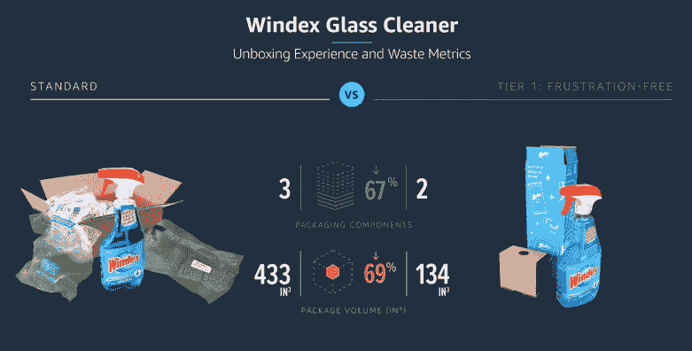

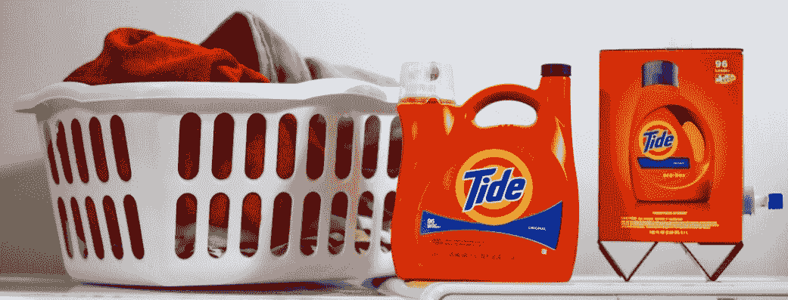

某日化产品包装改进后包装用量减少了69%

汰渍洗衣液原包装与改进后的电商原发包装

图片来源：亚马逊

##### 宝洁可持续发展目标

2040年前实现全球运营和供应链（从原材料到零售环节）温室气体净零排放

##### 包装可持续目标

到2030年实现包装100%可回收或可重复使用。包装中原生化石基塑料使用量相比于2017年基线水平减少50%。

##### 电商包装目标

到2030年，80%的电商渠道产品无需二次包装。

- 包装减量

宝洁自2017年开始在中国市场采用电商直发包装，在十大品类全面上市了直发包装³⁹。在实现了包装减量化和直发的“小绿宝”包装基础上，2021年，宝洁又自主研发了绿色创新电商包装——“空气胶囊”。“空气胶囊”由100%单一可回收材料制成，采用一体化封口及撕拉线结构设计，无需额外填充物、无需套纸箱、无需胶带。相比传统瓦楞纸箱快递包装，重量减少了40%。

- 包装回收

“空气胶囊”由单一可回收材料制成，是中国首个获得“双易”认证的快递包装。为推动“空气胶囊”回收再利用，宝洁邀请各地回收企业参与共建回收再利用网络，联合中国物资再生协会等专业机构和品牌方一起，发起“软塑新生”塑料软包装回收项目。通过共建快递包装和塑料软包装的回收再利用网络，进一步推动单一材料快递包装的应用和回收，探索社会化普及和规范回收。同时，在消费者沟通方面，宝洁在“空气胶囊”包装上印有回收指导和“这是我们的家”小程序二维码，旨在让消费者了解如何回收该包装，促进包装分类投放和回收⁴⁰。

- 可循环包装

2019年，宝洁在中国快消品行业中率先使用循环包装箱“大绿宝”代替传统纸箱，并联合供应商和各大主流电商平台共同搭建电商全渠道闭环回收网络，促进可循环包装回收。宝洁曾与京东“青流计划”合作发起循环箱回收活动。上海、广州的消费者通过在京东下单宝洁旗下特定产品，买单时点选循环回收箱项目，即可参与循环包装和塑料瓶回收。除了回收循环箱以外，消费者还可以将家中的废弃塑料瓶放进循环箱中，扫描箱子的二维码，就可以将废弃塑料瓶捐赠到分类回收站⁴¹。

## 参考文献

1. 中国政府网。2024.01.19。商务部电子商务司负责人介绍2023年我国电子商务发展情况。  
   https://www.gov.cn/lianbo/fabu/202401/content_6927101.htm

2. 联合国环境规划署。终结塑料污染全球条约的“零草案”文本。2023.09。  
   https://wedocs.unep.org/bitstream/handle/20.500.11822/43239/ZERODRAFT.pdf

3. PRI。2024。Principles for Responsible Investment Annual Report 2024。  
   https://www.unpri.org/download?ac=21536

4. 国际财务报告准则（IFRS）基金会SASB标准：电商行业（2023年12月版）。  
   https://www.ifrs.org/content/dam/ifrs/publications/pdf-standards-issb/chinese/2023/issued/part-b/zh-issb-2023-b-ifrs-s1-general-requirements-for-disclosure-of-sustainability-related-financial-information-accompanying-guidance-part-b.pdf?bypass=on

5. MSCI。ESG评级方法：包装材料和废弃物（2023年10月版）。  
   https://www.msci.com/documents/1296102/34424357/MSCI+ESG+Ratings+Methodology+-+Packaging+Materials+%26+Waste+Key+Issue.pdf/d7011b73-f681-900c-7e85-a75580560bae?t=1666182599577

6. UN PRI。2021。A Guide to Investor Engagement on Plastic Packaging: Containers and Packaging Producers。

7. McKinsey & Company。2024。Consumers care about sustainability—and back it up with their wallets。  
   https://www.mckinsey.com/industries/consumer-packaged-goods/our-insights/consumers-care-about-sustainability-and-back-it-up-with-their-wallets#/

8. McKinsey & Company。2024。How playing offense on sustainability can power e-commerce performance。  
   https://www.mckinsey.com/capabilities/growth-marketing-and-sales/our-insights/how-playing-offense-on-sustainability-can-power-e-commerce-performance

9. 商道咨询、界面新闻。2023。2023中国可持续消费报告｜促消费背景下的可持续消费新趋势。

10. 德勤。2023。从消费者看“可持续”的中西差异｜中西方消费者可持续知行对比。

11. 该调研通过线上问卷的方式，通过小红书、微信群、公众号、小程序等方式发送给国内各个城市的不同人群填写。调研采取随机取样法，共收集了1032份有效问卷，其中男女占比分别为：44.86%、54.36%；31—40岁人群占比最高，38.66%，其次26—30岁人群和18—25岁人群占比分别为：27%、18%。

12. 智研咨询。2023。智研咨询重磅发布！2023年快递行业市场分析报告。  
    https://finance.sina.com.cn/stock/relnews/cn/2023-10-18/doc-imzrnxht9485002.shtml?utm_source=chatgpt.com

13. 前瞻产业研究院。2023。2023年中国快递行业竞争格局及市场份额分析：广东省快递业务规模位居全国首位。  
    https://bg.qianzhan.com/trends/detail/506/230220-38461a1b.html

14. 艾瑞咨询。2024。2023年中国电商市场研究报告。  
    https://pdf.dfcfw.com/pdf/H3_AP202401261618317500_1.pdf

15. 前瞻产业研究院。2021。行业深度！2021年中国零售电商行业竞争格局及市场份额分析：市场集中度非常高。  
    https://bg.qianzhan.com/trends/detail/506/220324-17614bc6.html

16. 观研报告网。2022。我国电商平台行业竞争格局及趋势：腾讯、阿里两大派系竞争愈发激烈。  
    https://www.chinabaogao.com/detail/604589.html

17. 国家邮政局。2023。国家邮政局举行2023年第四季度例行新闻发布会。  
    https://www.spb.gov.cn/gjyzj/c100200/202310/7ccbfece355f45c3b02eb97bcdc518d9.shtml#:~:text=2023%E5%B9%B4%E5%88%9D%EF%BC%8C%E5%9B%BD%E5%AE%B6%E9%82%AE%E6%94%BF%E5%B1%80%E5%85%9A%E7%BB%84,%E7%93%A6%E6%A5%9E%E7%BA%B8%E7%AE%B1%E7%BF%BB%E8%BF%9B%E4%BA%BF%E4%B8%AA%E3%80%82

18. 京东。2021。京东2021环境、社会及治理报告。

19. 淘宝规则中心。2023。“限塑令”行动倡议书。  
    https://rule.taobao.com/?type=detail&ruleId=20003160&cId=1162#/rule/detail?ruleId=20003160&cId=1162

20. 天猫规则中心。2023。“限塑令”行动倡议书。  
    https://rulechannel.tmall.com/?type=detail&ruleId=11003967&cId=395#/rule/detail?ruleId=11003967&cId=395

21. 京东平台规则中心。2024。京东开放平台“限塑令”行动倡议书及治理公告。  
    https://rule.jd.com/rule/ruleDetail.action?ruleId=719359371104096256&type=0&btype=1

22. 拼多多规则中心。2021。“限塑令”行动倡议书。  
    https://mms.pinduoduo.com/other/rule?listId=4&id=1095

23. 苏宁易购规则中心。2021。“限塑令”行动倡议书。  
    https://rule.suning.com/ruleInfo/ruleInfoDetail/GZ100004985.htm

24. 注：信息由唯品会相关负责人提供。

25. 注：信息由唯品会相关负责人提供。

26. 注：信息由唯品会相关负责人提供。

27. 注：信息由唯品会相关负责人提供。

28. 电商报。2023。京东物流将陆续投放150万个循环快递包装。  
    https://www.dsb.cn/215513.html

29. CNBC。2024。Temu parent PDD takes Alibaba’s spot as China’s most valuable e-commerce firm。  
    https://www.cnbc.com/2024/05/29/temu-parent-pdd-takes-alibaba-spot-as-chinas-most-valuable-e-commerce-firm.html

30. 电商报。2023。京东物流将陆续投放150万个循环快递包装。  
    https://www.dsb.cn/215513.html

31. 京东物流官网。2022。全国低碳日，请接收京东物流的绿色倡议。  
    https://www.jdl.com/news/2188/content00664

32. 京东平台规则中心。2024。京东开放平台“限塑令”行动倡议书及治理公告。  
    https://rule.jd.com/rule/ruleDetail.action?ruleId=719359371104096256&type=0&btype=1

33. 电商报。2023。京东物流将陆续投放150万个循环快递包装。  
    https://www.dsb.cn/215513.html

34. 电商报。2023。京东物流将陆续投放150万个循环快递包装。  
    https://www.dsb.cn/215513.html

35. 淘宝规则中心。2023。“限塑令”行动倡议书。  
    https://rule.taobao.com/?type=detail&ruleId=20003160&cId=1162#/rule/detail?ruleId=20003160&cId=1162

36. 天猫规则中心。2023。“限塑令”行动倡议书。  
    https://rulechannel.tmall.com/?type=detail&ruleId=11003967&cId=395#/rule/detail?ruleId=11003967&cId=395

37. 苏宁易购规则中心。2021。“限塑令”行动倡议书。  
    https://rule.suning.com/ruleInfo/ruleInfoDetail/GZ100004985.htm

38. 拼多多规则中心。2021。“限塑令”行动倡议书。  
    https://mms.pinduoduo.com/other/rule?listId=4&id=1095

39. IPE。2020。宝洁中国可持续发展的绿色包装创新及供应链网络创新。  
    https://www.ipe.org.cn/GreenSupplyChain/BrandStoryDetail.aspx?id=52

40. The Consumer Goods Forum。Air Capsule: A global novel eCommerce package developed by P&G。  
    https://www.theconsumergoodsforum.com/blog/2022/07/18/air-capsule-a-global-novel-ecommerce-package-developed-by-pg/#:~:text=Part%20of%20the%20commitments%20include,will%20not%20require%20secondary%20packaging

41. IPE。2020。宝洁中国可持续发展的绿色包装创新及供应链网络创新。  
    https://www.ipe.org.cn/GreenSupplyChain/BrandStoryDetail.aspx?id=52

i. 注：2C可循环快递包装指企业到个人消费者及个人消费者之间的快递包装。该定义采用国家发展改革委办公厅、商务部办公厅、国家邮政局办公室《关于组织开展可循环快递包装规模化应用试点的通知》中的界定。

ii. 调研中的ESG相关声明包含93种ESG相关的产品声明，分为六个大类：动物福利、环境可持续性、有机、植物基成分、社会责任及可持续包装。

iii. 注：“未见有效信息”指报告编写组未能检索到符合本报告得分标准的相关公开信息，且未能在与企业直接沟通中获得相关补充信息。“未见有效信息”视为得分0%。

iv. 双重重要性分析即“对利益相关方的重要性”和“对公司发展的重要性”两方面的分析过程。

v. “双易”认证是由中国物资再生协会于2021年2月1日发布实施的《塑料制品易回收易再生设计评价通则》（标准号：T/CRRA 0302—2020）的简称。“双易”认证从后端废塑料回收和再生的需要出发，引导前端塑料制品设计时充分考虑易回收性和易再生性，从而提高废塑料的回收率和再生的高值化利用率。

**2023年度中国电商快递包装绿色转型评价报告**
