# 全球巨头持续加码，受益于AI算力及应用大发展

## ——海外科技2025年年度策略

长城证券产业金融研究院

分析师侯宾  
执业证书编号：S1070522080001

分析师姚久花  
执业证书编号：S1070523100001

联系人李心怡  
执业证书编号：S1070123110024

证券研究报告

买入（强于大市）

时间：2024年12月7日

---

◼ **美股指数强势上涨，AI科技产业链维持高景气。** 截至12月5日，2024年纳斯达克指数上涨33.65%，标普500指数上涨28.33%。2024年美股指数整体仍然呈现增长较为强劲的趋势，英伟达、微软、谷歌、苹果、特斯拉、Meta和Amazon年初至12月5日收盘日涨跌幅分别为201.32%、17.94%、26.20%、30.90%、44.08%、77.24%及45.51%。自2023年进入AI发展及投资大浪潮以来，纳指汇聚英伟达、微软、谷歌、苹果、特斯拉、Meta和Amazon在内的“美股七姐妹”，伴随生成式AI的快速发展，不断攀高。美国经济软着陆仍是基准情形，美联储或还有降息空间，叠加人工智能热潮仍为大势所趋，纳指反弹上升动力充足。

◼ **大模型方兴未艾，全球云厂商资本开支持续加码。** 2024年AI应用市场更加成熟。得益于头部应用的强势增长，2024年1-8月全球AI应用收入同比激增51%至20亿美元，据Sensor Tower数据显示，预计2024年全年收入将达到33亿美元。AI应用广泛被全球各地用户下载使用，但收入主要来源于北美市场。北美市场贡献了47%的全球AI应用总收入，是AI应用盈利最高的市场。AI大模型市场方兴未艾，头部云厂商积极趋向多模态大模型开发，以微软、谷歌为代表的头部云厂商纷纷表示未来一年将持续增加AI方面的资本开支，助力人工智能版图的布局与发展。

◼ **智能汽车及机器人市场热度不减，AI发展趋向端侧变革。** 马斯克在自动驾驶及机器人领域持续探索引领创新，2024年推出Robotaxi，依旧采用FSD方案，实现更高的驾驶安全性以及更低的成本。同时，随着生成式AI技术不断迭代演进以及由云端延伸至边缘侧，AI技术与PC等终端设备紧密结合和商业化落地成为大势所趋。2024年伴随AI CPU与Windows 12的发布，将成为AI PC规模性出货元年。预计2024年全球AI PC整机出货量将达约1300万台。在2025年至2026年，AI PC整机出货量将继续保持两位数以上的年增长率，并在2027年成为主流化的PC产品类型，未来五年全球PC产业将稳步迈入AI时代。

◼ **量子信息技术乘风起，加速产业链发展变革。** 全球量子通信行业市场规模近年来迅速扩大，量子通信以其无法被破解的加密特性，成为保障未来信息安全的重要技术，尤其在金融、国防、通信等关键领域具有广泛应用前景。据华经产业研究院数据，2024年全球量子通信市场规模预计达到26.7亿美元，预计在2030年达到196.8亿美元。量子通信短期投资仍大于收入，IDC预测，2022年量子计算的销售额将达到11亿美元，并将以48.1%的复合年增长率增长，到2027年达到76亿美元；2023-2027年预测期间，量子计算市场的投资将以11.5%的复合年增长率增长，到2027年底达到近164亿美元。

◼ **相关的标的：** 云计算厂商：微软、谷歌、亚马逊、Meta、苹果；芯片：英伟达、高通、ARM、英飞凌、意法半导体；元宇宙：Unity、Roblox；IDC：Equinix、DLR；激光雷达：Luminar、Ouster、Lumentum；量子计算/量子通信：IonQ、Quantum Computing Inc.、D-Wave Quantum Inc.、IBM、Honeywell。

◼ **风险提示：** 人工智能技术发展不及预期风险；汽车智能化技术突破不及预期风险；机器人监管政策不确定性风险；量子通信供应链不稳定风险。

---

## 目录

- 美股指数及主要标的走势复盘
- 大模型方兴未艾，应用端市场广阔
- AI技术推动智能汽车、机器人等产业发展
- AI向端侧持续变革，加速各使用场景落地
- 量子信息技术乘风起，加速产业链发展变革

---

# 一、美股指数及主要标的走势复盘

2024年初至12月5日纳斯达克指数上涨33.65%，标普500指数上涨28.33%。2024年美股指数整体仍然呈现增长较为强劲的趋势，自2023年进入AI发展及投资大浪潮以来，纳指汇聚英伟达、微软、谷歌、苹果、特斯拉、Meta和Amazon在内的“美股七姐妹”，伴随生成式AI的快速发展，不断攀高。

11月8日，美联储议息会议决定调降联邦基金利率25bp至4.5%-4.75%区间。9月会议看来，美联储对就业相对乐观，对通胀也仍有掌控。美国经济软着陆仍是基准情形，美联储或还有降息空间，叠加人工智能热潮仍为大势所趋，纳指反弹上升动力充足。

**图表：2024年纳斯达克指数走势复盘**

- 2024年以来，纳指延续2023年人工智能行业带来的强劲表现。
- 2024年3月18日，英伟达召开2024 GTC大会发布新一代芯片Blackwell GPU，持续掀起全球AI发展浪潮，带动美国科技板块股价攀升，纳指涨幅持续走高。
- 3月以来AI浪潮不减，叠加4-6月美联储几次召开利率会议，降息预期较高，加上相对宽松的货币政策，刺激市场投资者入场。
- 市场交易走疲，AI热度较前期稍减。同时，市场对于美联储政策及美国经济衰退产生担忧，导致指数波动下跌。
- 美国9月非农就业、服务业PMI数据超出市场预期，前期市场对于美国经济衰退的预期逐步消减。
- 美国科技股陆续公布季度财报，业绩增速虽未达到市场的超高预期，但对AI领域的持续投入仍然为投资者打下强心针。
- 11月5日美国大选尘埃落定，特朗普最终胜选美国总统。

| 日期 | 事件 |
|------|------|
| 2024年初 | 纳指延续2023年AI行业强劲表现 |
| 2024年3月18日 | 英伟达GTC大会发布Blackwell GPU，AI浪潮持续 |
| 3月以来-6月 | 美联储降息预期较高，货币政策相对宽松 |
| 9月 | 非农就业、服务业PMI超预期，衰退预期消减 |
| 科技股财报季 | 业绩增速未达超高预期，但AI投入支撑信心 |
| 11月5日 | 美国大选落定，特朗普胜选 |

数据来源：Wind，英伟达官网，中国金融新闻网，华尔街见闻，新浪财经，中国新闻网，长城证券产业金融研究院  
注：指数涨跌幅为归一化处理后数据

---

英伟达作为全球最大的GPU供应商，在AI强劲需求的带领下，已经逐步成为全球科技行业的核心引领者。2023至2024年以来，英伟达股价一度攀高，不断创造新的历史高位。2024年6月，公司发布“1拆10”拆股方案后，投资者市场信心不断提升，公司股价上涨至135.58美元。同时，公司依靠数据中心及游戏业务的强势增长，持续刷新业绩表现。FY25Q3财报披露后，公司业绩虽仍表现出近翻倍增长，但股价经历了短暂下跌。在极度高涨的AI预期下，英伟达股价创下历史高点，在2024年6月18日收盘以3.33万亿美元市值超越苹果及微软，成为全球市值第一。

英伟达在全球AI GPU中占据核心地位，FY25Q3财报后其CFO表示，Blackwell计划本季开始出货，未来一年将加快步伐，预计到FY2026需求将超过供应，推理需求不断增加将推动芯片需求持续增长。以微软、谷歌、亚马逊为代表的云厂商仍保持较高的AI投资，英伟达Blackwell等产品将随着云厂商军备竞赛节奏持续释放，推动业绩持续提升。

**图表：2024年英伟达走势复盘**

| 时间 | 事件 |
|------|------|
| 2月22日 | 英伟达发布FY24年报 |
| 3月18日 | 英伟达举行2024 GTC大会，发布Blackwell芯片 |
| 5月23日 | 英伟达发布FY25一季报 |
| 6月6日 | 英伟达宣布将进行“1拆10”的拆股方案 |
| 8月28日 | 英伟达发布FY25二季报 |
| 9月3日 | 美国司法部向英伟达发出传票，涉嫌反垄断调查，引发股价暴跌 |
| 11月21日 | 英伟达发布FY25三季报 |

| 财务数据 | 营收 | 同比 | 净利润 | 同比 |
|----------|------|------|--------|------|
| FY24 | 609亿美元 | +126% | 298亿美元 | +581% |
| FY25Q1 | 260亿美元 | +262% | 149亿美元 | +628% |
| FY25Q2 | 300亿美元 | +122% | 166亿美元 | +168% |
| FY25Q3 | 351亿美元 | +94% | 193亿美元 | +109% |

英伟达作为纳斯达克指数重要权重股之一，整体走势与纳指走势较为一致，对指数行情表现影响较大。短期波动对AI带动的纳指长期确定性走势影响较小。NV宣布1拆10计划后将增强股票流动性，吸引更多投资者。公布拆股计划后英伟达股价不断上涨。

数据来源：Wind，英伟达官网，英伟达FY24-FY25Q3财报，金融界，每日经济新闻，长城证券产业金融研究院  
注：指数涨跌幅为归一化处理后数据；6月起成交量大幅提升为“1拆10”方案后股数增加所致

---

**图表：谷歌及微软2024年走势复盘**

谷歌FY24Q3营收达883亿美元，同比增长15%；谷歌云业务收入增长强劲，由谷歌云平台的人工智能基础设施、生成式人工智能解决方案以及核心GCP产品的增长推动。公司AI产品及平台的推广有效的带动了公司云计算及搜索方面的业务收入，AI相关的资本开支在Q4将保持原有水平的基础上，在2025年预计小幅加码增长，继续巩固AI效应带来的市场动力。

2022年OpenAI推出ChatGPT大模型，直线拉升人工智能发展浪潮。微软的AI布局从投资OpenAI开始初见成效，Microsoft Azure提供OpenAI优先访问权；Copilot持续推动GitHub业务的增长，GitHub的FY2024全年营收已达到20亿美元，其中Copilot占据今年收入增长的40%以上。微软表示截至FY24Q4 GitHub Copilot的业务规模已经超过了收购GitHub当时的规模，AI持续提振微软软件应用程序的发展。

微软对云和AI的基础设施建设的资本开支再创新高，FY2024Q4，微软Capex 190亿美元，YoY+77.57%，QoQ+35.71%。FY2024全年发生资本开支557亿美元，YoY+74.61%。资本开支指引上，公司预计未来将逐年增加资本开支，FY2025全年资本开支将大于FY2024，持续推进云与AI业务。

| 谷歌重要时间点 | 微软重要时间点 |
|----------------|----------------|
| 1月31日，谷歌公布FY23年报 | 2月2日，微软公布FY24Q2财报 |
| 4月9日，谷歌召开谷歌云大会 | 4月29日，微软公布FY24Q3财报 |
| 4月26日，谷歌公布FY24Q1财报 | 7月30日，微软公布FY24Q4财报 |
| 7月24日，谷歌公布FY24Q2财报 | 8月1日，微软公布FY25Q1财报 |
| 10月30日，谷歌公布FY24Q3财报 | |

数据来源：Wind，谷歌FY23-FY24Q3财报，微软FY24Q2-FY25Q1财报，长城证券产业金融研究院  
注：指数涨跌幅为归一化处理后数据

0

2000

4000

6000

8000

10000

12000

14000

16000

0.80

0.90

1.00

1.10

1.20

1.30

1.40

1.50

2024-01-02

2024-02-02

2024-03-02

2024-04-02

2024-05-02

2024-06-02

2024-07-02

2024-08-02

2024-09-02

2024-10-02

2024-11-02

AMAZON成交量（万美元，右轴）

AMAZON涨跌幅（左轴）

www.cgws.com|8

## 图表：**Meta**及亚马逊**2024**年走势复盘

自2024年年初至12月5日，Meta涨幅达77%。Meta凭借Facebook、Messenger、Instagram、WhatsApp等强大的全球化社交平台，积累了庞大的活跃用户群体，广告业务收入绝对值持续提升，增速略有放缓。扎克伯格在AI方面长期坚持投入，逐渐打造从软件到硬件的布局，从Llama开源大模型到Quest系列VR眼镜，Meta保持着在AI方面的高资本开支。

Amazon的AI版图布局已久，AWS作为全球范围内云计算领域的引领者，在AI、机器学习、软件应用、训练推理等各方面都提供了技术及产品支持。虽然传统广告零售业务随着Temu等新入玩家的低价冲击受到波动影响，但AI工具仍为Amazon网站在网页端视觉效果及客户体验领域产生赋能。根据CNBC新闻显示，11月22日亚马逊宣布向Anthropic追加40亿美元的投资，Anthropic现在将AWS指定为其主要培训合作伙伴，并将继续担任其主要云提供商，并将使用AWS Trainium和Inferentia芯片来训练和部署其未来的基础模型，Amazon或将随着AI版图及产业投资的扩张持续增长。

2月2日，Amazon公布FY23财报

5月1日，Amazon公布FY24Q1财报

8月1日，Amazon公布FY24Q2财报

10月30日，Amazon公布FY24Q3财报

数据来源：Wind，MetaFY23-FY24Q3财报，亚马逊FY23-FY24Q3财报，亚马逊官网，长城证券产业金融研究院

注：指数涨跌幅为归一化处理后数据

0

1,000

2,000

3,000

4,000

5,000

6,000

7,000

8,000

9,000

0.80

0.90

1.00

1.10

1.20

1.30

1.40

1.50

1.60

1.70

1.80

2024-01-02

2024-02-02

2024-03-02

2024-04-02

2024-05-02

2024-06-02

2024-07-02

2024-08-02

2024-09-02

2024-10-02

2024-11-02

META成交量（万美元，右轴）

META涨跌幅（左轴）

2月1日，Meta公布FY23财报

4月24日，Meta公布FY24Q1财报

7月31日，Meta公布FY24Q2财报

10月30日，Meta公布FY24Q3财报

---

www.cgws.com|9

## 图表：苹果及特斯拉**2024**年走势复盘

数据来源：Wind，南方都市报，中国证券报，中国经济网，证券时报，苹果FY24Q1-FY24Q4财报，特斯拉FY23-FY24Q3财报，长城证券产业金融研究院

注：指数涨跌幅为归一化处理后数据

Apple FY24Q4营收949.3亿美元，同比增长6.07%；净利润为147.36亿美元，同比下降35.81%。iPhone中国区季度销量同比小幅下降，每年的新机换机潮热度较往年有所下降。2024年5-7月苹果股价一路走高，但6月WWDC大会公司公布人工智能"Apple Intelligence"后股价走跌，Choice数据显示，6月10日美股收盘苹果股价跌1.91%。但全球AI热潮仍带动头部玩家稳步上涨。2024年9月苹果推出第一代AI手机iPhone16系列，Counterpoint数据显示，在中国市场，与去年iPhone 15系列发布前三周的销售相比，iPhone 16系列销量有所增长。市场对AI的追随度仍居高不下，苹果作为手机及PC端的全球领先者，也将在AI浪潮中持续领异标新。

2024年以来，特斯拉在中国市场多次进行降价活动，FY24Q3业绩会上，马斯克表示Tesla计划2025年上半年开始推出更实惠的车型，加上激励措施，电动汽车的价格将"低于3万美元，这是一个关键门槛"。同时，今年9月特斯拉官方账号宣布，预计2025年Q1在中国和欧洲推出FSD系统，但有待监管部门批准。马斯克的AI版图从特斯拉FSD到机器人，再逐步扩展至大模型xAI，从硬件到软件，或将致力于打造全资助体系的人工智能生态系统。

5月3日，Apple公布FY24Q2财报

2月1日，Apple公布FY24Q1财报

0

5,000

10,000

15,000

20,000

25,000

30,000

35,000

0.80

0.90

1.00

1.10

1.20

1.30

2024-01-02

2024-02-02

2024-03-02

2024-04-02

2024-05-02

2024-06-02

2024-07-02

2024-08-02

2024-09-02

2024-10-02

2024-11-02

APPLE成交量（万美元，右轴）

APPLE涨跌幅（左轴）

10月31日，Apple公布FY24Q4财报

8月1日，Apple公布FY24Q3财报

0

5,000

10,000

15,000

20,000

25,000

30,000

0.00

0.20

0.40

0.60

0.80

1.00

1.20

1.40

1.60

2024-01-02

2024-02-02

2024-03-02

2024-04-02

2024-05-02

2024-06-02

2024-07-02

2024-08-02

2024-09-02

2024-10-02

2024-11-02

TESLA成交量（万美元，右轴）

TESLA涨跌幅（左轴）

4月24日，Tesla公布FY24Q1财报

1月24日，Tesla公布FY23财报

7月23日，Tesla公布FY24Q2财报

10月23日，Tesla公布FY24Q3财报

---

# 二、大模型方兴未艾，应用端市场广阔

www.cgws.com

---

据艾瑞咨询显示，人工智能技术的发展历程可分为三个阶段：

- **1. 推理期：** 20世纪50年代到70年代初，人们认为如果能赋予机器逻辑推理能力，机器就能具有智能。
- **2. 知识期：** 20世纪70年代，人们意识到人类之所以能够判断、决策，除了推理能力外，还需要知识，大量专家系统在此时诞生。随着研究向前进展，专家发现人类知识无穷无尽，且有些知识本身难以总结后交给计算机，于是一些学者诞生了将知识学习能力赋予计算机本身的想法。
- **3. 机器学习期：** 20世纪80年代，机器学习真正成为一个独立的学科领域、相关技术层出不穷，深度学习模型以及AlphaGo增强学习的雏形-感知器-均在这个阶段得以发明。随后由于早期的系统效果的不理想，美国、英国相继缩减经费支持，人工智能进入低谷。80年代初期，人工智能逐渐成为产业，但又由于5代计算机的失败再一次进入低谷。2010年至今相继在语音识别、计算机视觉领域取得重大进展，围绕语音、图像等人工智能技术的创业大量涌现，从量变实现质变。

数据来源：艾瑞咨询，长城证券产业金融研究院

www.cgws.com

11

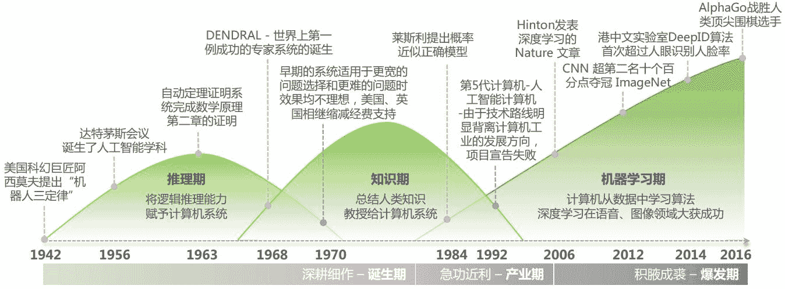

图表：人工智能技术发展历程

---

经过2023年的爆发式增长，2024年AI应用市场更加成熟。得益于头部应用的强势增长，2024年1-8月全球AI应用收入同比激增51%至20亿美元，据SensorTower数据显示，预计2024年全年收入将达到33亿美元。AI应用广泛被全球各地用户下载使用，但收入主要来源于北美市场。北美市场贡献了47%的全球AI应用总收入，是AI应用盈利最高的市场。

2023年是全球AI+Chatbot应用爆发的一年，下载量相比2022年增长超过14倍，接近6亿次。2024年1-8月，AI+Chatbot应用下载量突破6.3亿次，超出2023年全年水平。2024年前8个月，全球AI+Chatbot应用内购收入接近5.8亿美元，已经超过2023年全年的1.5倍之多。据Statista，AI市场覆盖了众多行业，从供应链、市场营销、产品制造、研究、分析等都是在某种程度上将人工智能融入其业务结构的领域，聊天机器人、图像生成AI和移动应用程序都是未来几年AI发展的主要趋势。

数据来源：SensorTower，Statista，长城证券产业金融研究院

www.cgws.com

12

图表：**2020-2024**年**1-8**月全球**AI+Chatbot**应用下载量和内购收入趋势

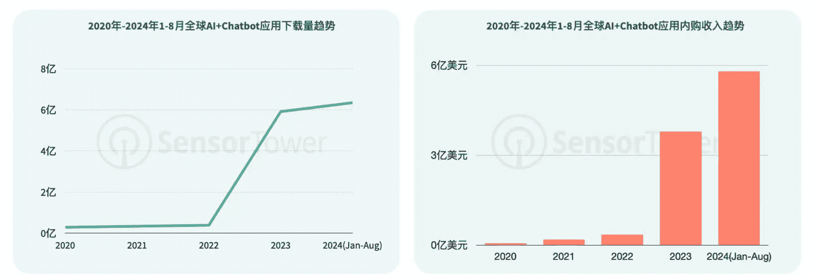

---

随着海外科技巨头大模型的不断发展迭代，大模型逐步向多模态发展。多模态模型是一种机器学习模型，能够处理来自不同模态的信息，包括图片、视频和文本。据36氪研究院数据，相比单模态，多模态大模型在输入输出端的优势明显：不同模态的输入数据具有互补性，多元训练数据输入有助于通用大模型能力的快速扩展，多模态数据输入使用门槛更低和数据损耗更少，同时也能够大幅提升使用者的应用体验；多模态数据的输出则省去了多模型的整合，更容易实现商业落地。

现阶段，基于Transformer结构的预训练模型是多模态大模型的主流训练方式。如谷歌的GEMINI，就是在不同的模态上进行预训练，利用额外的多模态数据进行微调以提升其有效性。我们认为，一方面，随着深度学习、计算机视觉等技术的不断成熟，AIGC的生成质量、速度和效率等方面能力将进一步提升；另一方面，多模态大模型将与如自然语言处理技术、虚拟现实、增强现实、数字孪生等更丰富的技术融合，拓展如自动驾驶、药品研发、安防等更多应用场景的同时，为用户提供更丰富的解决方案，满足越来越多用户需求。如在自动驾驶领域，AIGC技术可创造更多合成数据，弥补真实数据不足的缺陷，加速仿真场景的搭建，提升仿真测试效率。

数据来源：谷歌云官网，36氪，长城证券产业金融研究院

www.cgws.com

13

图表：多模态大模型架构

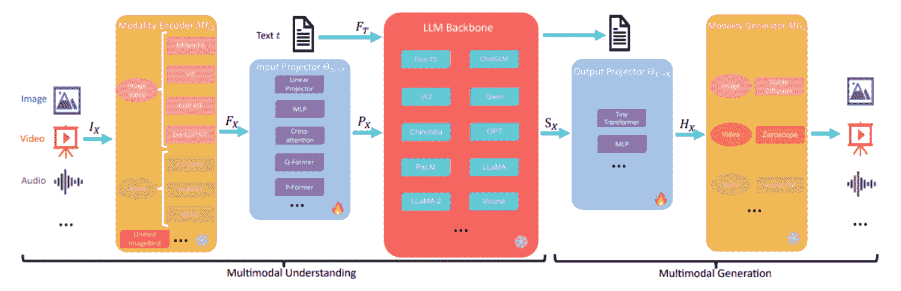

---

数据来源：中国保密协会公众号，IT之家，谷歌官网，Anthropic官网，Meta官网，OpenAI官网，长城证券产业金融研究院

14

图表：**2018-2024**年全球**AI**大模型发展过程复盘

**2018**年**6**月

OpenAI发布GPT-1模型，1.1亿参数

**2018**年**11**月

OpenAI发布GPT-2模型，15亿参数

**2019**年**6**月

OpenAI发布GPT-3模型，1750亿参数

**2022**年**3**月

OpenAI发布InstructGPT

**2022**年**11**月**30**日

OpenAI通过GPT-3.5系列大型语言模型微调而成的，全新对话式AI模型ChatGPT正式发布

**2023**年**1**月

OpenAI发布限于部分用户使用的付费版ChatGPT Professional

**2023**年**3**月

OpenAI震撼推出了大型多模态模型GPT-4；微软正式发布Microsoft 365 Copilot，全面接入GPT-4

**2023**年**5**月

谷歌发布PaLM2对标GPT-4；Anthropic发布了Claude 100k版本

**2023**年**7**月

Anthropic发布了Claude v2，对标GPT-4；Meta开源了Llama，对标GPT-3.5，并且不收取费用

**2023**年**11**月

OpenAI宣布从GPT-4升级为GPT-4 Turbo，上下文从32k升级至128k

**2024**年**2**月

OpenAI发布文生视频模型Sora，能够生成60s的高保真视频

**2024**年**5**月

OpenAI发布GPT-4o，可以接受文本、音频和图像三者组合作为输入，并生成文本、音频和图像的任意组合输出

**2024**年**9**月

OpenAI发布o1大模型，该模型经过强化学习训练，可以执行复杂的推理，并会花费更多时间思考后做出反应

OpenAI在2024年9月发布o1大模型，该模型会花费更多的思考时间解决问题，可以实现复杂推理。

- **o1稳定性与性能均明显提升。** OpenAI o1在编程竞赛题中排89百分位数，在美国数学奥林匹克预选赛中跻身全美前500名学生行列，在物理、生物和化学问题基准测试中的准确率超过了人类博士水平。
- **独特思维链模式引领未来发展。** OpenAI表示，大规模强化学习算法在一个数据效率极高的训练过程中，利用思维链教会模型如何进行高效思考。随着强化学习（训练时间计算）和思考时间（测试时间计算）的增加，o1的性能也在不断提高。OpenAI认为，思维链的模式将对安全方面有重大贡献，主要体现在两个方面：1）能够以清晰的方式观察模型的思考过程；2）模型对安全规则的推理在分布外场景中更具备鲁棒性。
- **OpenAI还推出了o1-mini版本，** o1-mini更强调具有成本效益的推理模型，整体成本来看，其成本相较于**o1-preview**少**80%**，但性能相当。

---

**微软：** 据The Information报道，微软携手OpenAI投入1000亿美元，开发代号为Stargate的全新人工智能超级计算机。两家公司制定了共有5个阶段的开发计划，目前正处于第3阶段，微软负责该项目的融资和硬件支持，该项目预计有望2028年落地，并在2030年之前进一步扩建，该计算机所需电力可能高达5千兆瓦。此外，集成量子计算公司Quantinuum和微软宣布，双方在提高量子纠错可靠性方面的合作取得了突破性进展，这将推动混合量子超级计算系统的构建。研究人员在Quantinuum的离子阱硬件上应用了微软的量子比特虚拟化系统，该系统使用了错误诊断和纠正功能，成功证明了错误率比单独的物理系统低800倍。

**谷歌：** Gemini 1.5 Pro迎来了上下文窗口的重大升级，扩展到200万个token。开源模型Gemma 2有90亿（9B）和270亿（27B）两种参数规模。27B模型训练了13T tokens，9B模型训练了8T tokens，并且都拥有8192上下文窗口，可在Google AI Studio中使用。Gemma 2涵盖从20亿到270亿参数，比第一代性能更高、推理效率更高，并且显著改进安全性。同时，谷歌持续运用AI赋能其搜索引擎，发布AI Overviews，通过多步推理，Gemini可以帮助用户找到更好的搜索结果。

数据来源：澎湃新闻，谷歌官网，微软官网，智东西，长城证券产业金融研究院

15

图表：处理量子错误实现的突破

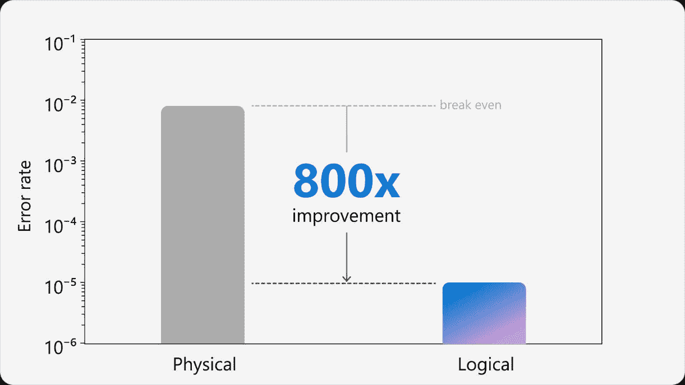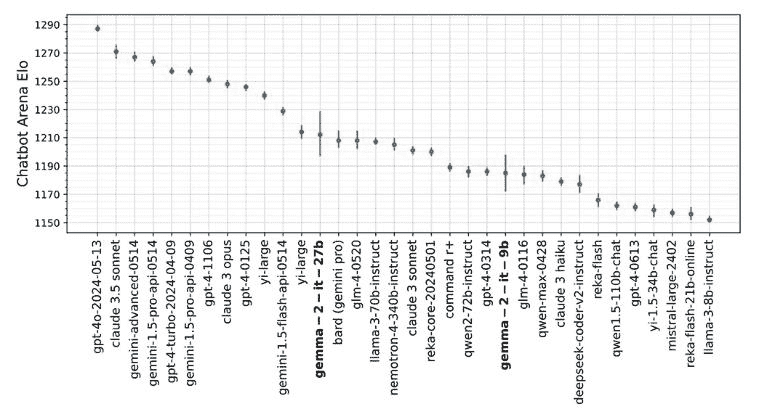

图表：**Gemma 2**在测试中与其他模型的对比

- 亚马逊：3月对AI初创公司Anthropic追加投资27.5亿美元，完成达到40亿美元的总投资额。Anthropic表示将使用AWS作为其主要的云服务提供商，并使用亚马逊的定制芯片来构建、训练和部署AI模型。Anthropic在今年6月推出Claude 3.5 Sonnet，其速度和成本与公司的中级模型Claude 3 Sonnet相当。该模型可通过Anthropic API、亚马逊Bedrock和谷歌云的Vertex AI使用。该模型的成本为：每百万输入**tokens**为**3**美元，每百万输出**tokens**为**15**美元。其**tokens**上下文窗口达到**20**万。

- **Meta**：发布开源大模型Llama 3，共有80亿和700亿参数两种版本。新一代Llama在广泛的行业基准测试中展示了最先进的性能，并提供了新的功能，包括改进的推理能力。该版本是Llama 3模型系列中的第一个LLM，未来要将Llama 3成为多语言、多模态、具有更长上下文的模型，并继续提高核心功能的整体性能，如推理和代码。此外Meta表示公司目前在训练中的最大的模型参数，已经超过4000亿。

数据来源：亚马逊官网，Anthropic官网，Meta官网，长城证券产业金融研究院

图表：**Claude 3.5 Sonnet**与其竞争对手测试分数对比

图表：**Meta Llama 3**模型表现

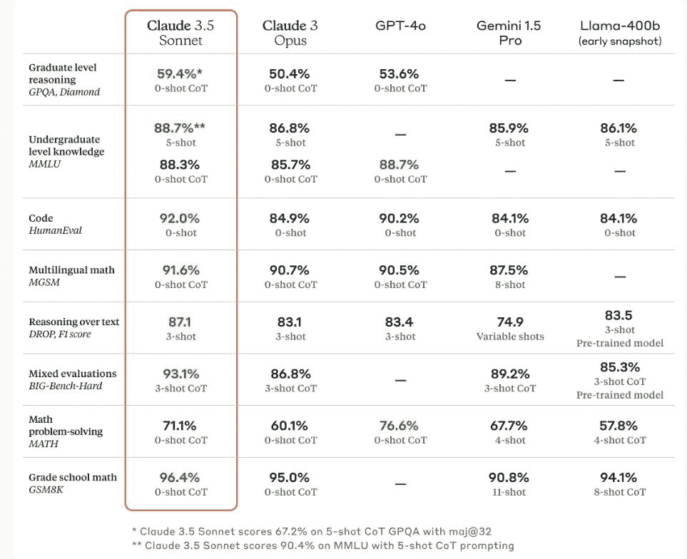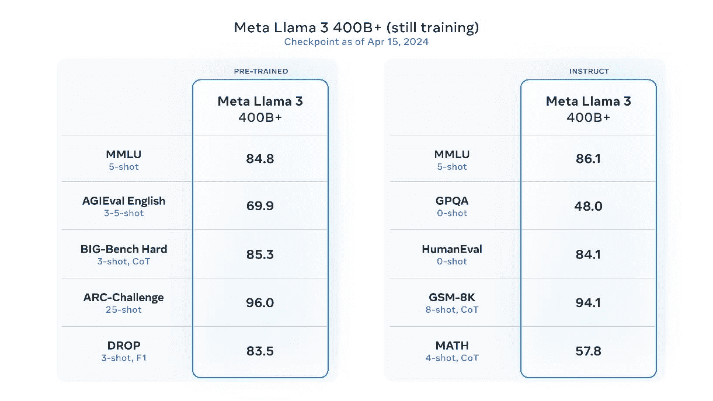

---

- 2024年第三季度，云服务市场延续了强劲的增长态势。云计算巨头都表示从AI投资中获得了积极回报，AI的应用开始对其整体云业务表现产生影响。这种回报反映了AI作为云计算创新和竞争优势的关键驱动因素的日益重要性。随着AI技术的广泛应用，对高性能计算和存储的需求持续上升，这对云厂商的基础设施扩张提出了更高要求。为应对这一挑战，领先的云厂商正优先大规模投资下一代AI基础设施。

- 三大领先的云厂商还在加速AI基础模型的更新迭代，并持续扩展相关产品组合。随着这些AI基础模型的日益成熟，云厂商正专注于利用其增强的能力推动更多核心产品和服务的发展。通过将这些先进模型集成到现有服务中，他们希望提升功能、改进性能并增加用户参与度，从而挖掘新的收入来源。

数据来源：Canalys，长城证券产业金融研究院

注：盈利预测为长城证券研究院预测数据

图表：美国四大云厂商近五年营收和同比以及未来三年营收和同比预测（亿美元，**%**）

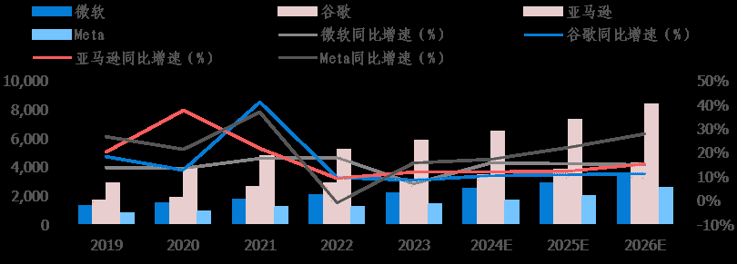

---

- 从各云厂商资本开支来看，2024年三季度亚马逊/谷歌/微软/Meta的Capex合计为636亿美元，同比增长70.24%，环比增长11.44%。

- 微软：对云和AI的基础设施建设的资本开支再创新高，发生资本开支200亿美元，同比增长78.57%，环比增长5.26%。2024财年全年发生资本开支557亿美元，同比增长74.61%。资本开支指引上，公司预计未来将逐年增加资本开支，持续推进云与AI业务。

- 亚马逊资本开支为213亿美元，同比增长88.50%，环比增长29.88%，主要用于技术基础设施及配送网络，其中基础设施大部分为用于AWS业务，并预计在2024年再增加该方面的投入。

- 谷歌发生资本开支131亿美元，同比增长61.73%，环比有所下滑，减少0.76%。主要用于投资技术基础设施，并预计未来资本开支将持续提升，2024年资本开支将大于2023年，用于支持包括服务器、网络设备和数据中心，其中重点支持AI的发展。

- **Meta**发生资本开支92亿美元，同比增长36.09%，环比增长8.62%，主要用于对服务器、数据中心和网络基础设施建设的投资。Meta预计2024年全年资本开支将在380-400亿美元之间，较上一季度给出的370-400亿美元的预测有所提高。公司预计2025年资本开支将大幅增长，将加大人工智能研究和产品开发方面的投资。

数据来源：各公司2024年Q3季报，长城证券产业金融研究院

图表：**2024**年三季度四大云厂商资本开支及同比和环比增速（亿美元，**%**）

| | 资本开支 | 同比增速 | 环比增速 |
|---|--------|--------|--------|
| 微软 | 200 | 78.57% | 5.26% |
| 谷歌 | 131 | 61.73% | -0.76% |
| 亚马逊 | 213 | 88.50% | 29.88% |
| Meta | 92 | 36.09% | 8.62% |

---

## 三、**AI**技术推动智能汽车、机器人等产业发展

www.cgws.com

---

数据来源：智研咨询、iFind、长城证券产业金融研究院

图表：汽车产业链上下游环节一览

www.cgws.com

| 上游 | 中游 | 下游 |
|------|------|------|
| 原材料 | 零部件制造 | 整车制造&销售 |
| 金属类材料 | 悬挂系统 | 汽车维修 |
| 电子类材料 | 转向系统 | 汽车销售 |
| 塑料材料 | 电气系统 | 汽车服务 |
| 其他材料等 | 车身 | |
| | 行驶系统 | |
| | 制动系统 | |
| | 汽车芯片 | |
| | 发动机等 | |

---

- 自动驾驶系统以L1、L2（辅助驾驶）为主，L3开始逐渐渗透，部分公司开始布局L4，L5，随着功能进阶，高算力芯片，自动驾驶域控制器需求将提升。

图表：自动驾驶技术分级与特征

www.cgws.com

| 分级 | 名称 | 定义 | 驾驶操作 |
|------|------|------|---------|
| L0 | 无自动化 | 没有任何辅助功能及系统，完全依靠驾驶员进行操作 | 驾驶员 |
| L1 | 驾驶支援 | 车辆对方向盘和加减速的一项操作提供驾驶操作，驾驶员负责其余驾驶动作 | 驾驶员&车辆 |
| L2 | 部分自动化 | 车辆对方向盘和加减速的多项操作提供驾驶操作，驾驶员负责其余驾驶动作 | 车辆 |
| L3 | 有条件自动化 | 由车辆完成绝大部分驾驶操作，驾驶员需保持注意力以备不时之需 | 车辆 |
| L4 | 高度自动化 | 在限定道路和环境条件下，由车辆完成所有驾驶操作，驾驶员无需保持注意 | 车辆 |
| L5 | 完全自动化 | 由车辆完成所有驾驶操作，驾驶员无需保持注意力 | 车辆 |

数据来源：美国汽车工程协会，华经产业研究院，长城证券产业金融研究院

图表：**2019-2030**年我国不同自动驾驶等级汽车渗透率预测（**%**）

---

数据来源：Tesla North，中关村在线，华尔街见闻，赛博汽车，无人驾驶多数派，MarsCarsChipsDips，长城证券产业金融研究院

- 根据TeslaNorth，3月12日特斯拉在北美地区全面推送FSD V12.3版本，该版本被马斯克描述为可以成为“V13”的重大版本更新，据特斯拉自动驾驶软件总监Ashok Elluswamy称，这是第一个使用端到端神经网络的FSD版本，即从原始摄像视频和车辆运动学直接控制并驱动车辆。截至4月5日，特斯拉宣布其FSD累计里程超过10亿英里。

- 应对日常复杂场景：根据海外路测反馈来看，V12面对环岛通行、停车场绕行、单行道窄路会车、通用及异形障碍物避障等场景都可以顺利处理，并比V11新增了掉头、靠边停车、泊入车位等功能，基本覆盖了日常大多数使用场景。交互方面更加拟人：V12在驾驶决策以及速度控制上更加顺滑，比如对骑行人/路边双闪车/前方左转车等情况，V12在绕行的时机与幅度、是否减速让行以及减速的具体程度等细节上，更加流畅自然。**L4**能力初步显现：V12展现出可以短暂脱离导航地图的指引，基于纯视觉信息，根据实际的行车情况进行决策控制。

图表：**FSD V12.3**采用端到端神经网络算法

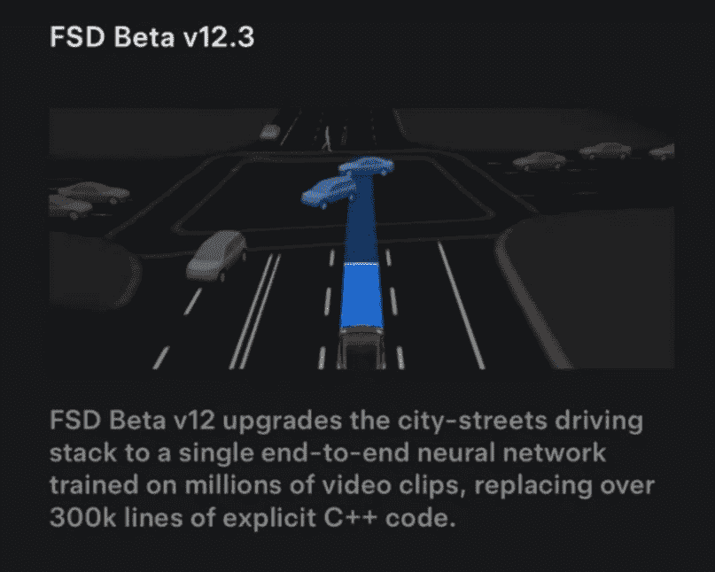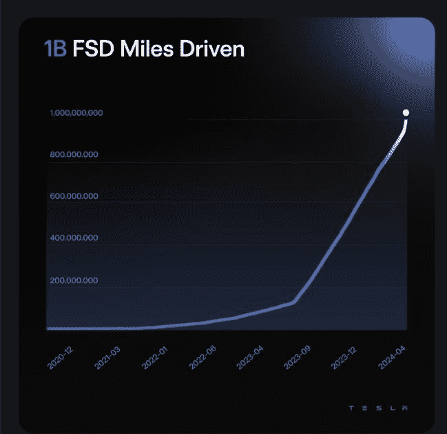

图表：**FSD V13**版本技术升级

| 升级 | 内容 |
|------|------|
| 3倍模型规模扩展 | 模型更大，能处理的数据更多，自动驾驶也就能应对更多复杂情况。 |
| 3倍模型上下文长度扩展 | 模型能记得更多过去的驾驶数据，这对系统预测接下来的路况和行动更有帮助。 |
| 4.2倍数据扩展 | 用更多数据训练意味着系统见过的情况更丰富，处理突发情况也更有经验。 |
| 5倍训练计算能力扩展（由Cortex训练集群提供支持） | Cortex是特斯拉的强大计算中心，这次升级让模型训练更快、智能提升也更迅速。 |

图表：**FSD**行驶里程激增

---

数据来源：腾讯科技，长城证券产业金融研究院

- 2024年10月11日，马斯克举办Robotaxi Day的演示活动，Robotaxi终亮相。

- 创新点：无人驾驶出租车被命名为Cybercab没有方向盘或踏板，设计充满未来感，车门像蝴蝶翅膀一样向上打开，车舱很小，只能容纳两名乘客。值得注意的是，这辆车完全没有插头，通过感应充电无线充电。而且依旧采用纯视觉的FSD方案，并没有使用任何激光雷达；生产时间：特斯拉计划明年在德克萨斯州和加利福尼亚州推出全自动驾驶汽车，Cybercab将于2026年投产，最晚可能要到2027年。但是用户可以提前用Tesla现有车型体验到无人驾驶出租车。

- 同时，马斯克表示FSD驾驶水平比人类高得多，安全水平可超人类驾驶十倍左右。目前特斯拉有数百万辆车在接受训练，通过收集不同数据进行优化，以实现更高安全性。这套解决方案基于AI和计算视觉，无需昂贵设备，生产成本低。马斯克对FSD产品推出时间线乐观，明年在德州和加州希望推出完全无人监督的FSD，2026年或2027年之前Model 3和Model Y将实现无人监督的FSD。在Cybercab的发展路线上，未来所有车都会有不错的FSD能力。马斯克表示，如果支持完全自动驾驶，可以将汽车的使用率提高5倍甚至10倍。

图表：**Robotaxi**演示图

图表：**RobotaxiDay**发布的产品及成本一览

| 产品 | 成本 |
|------|------|
| Robotaxi | 预计Cybercab运营成本将为每英里约0.2美元，含税价格可能为每英里0.3或0.4美元。如果购买Cybercab，成本将低于30,000美元。 |
| Robovan | 外形看起来像一个流线型的大号商务车，或者是单节小火车，可搭载20人或运输货物。使用Robovan的旅游成本为每英里5到10美分。 |

---

数据来源：2021-2022特斯拉AI日发布会，长城证券产业金融研究院

- 2021年特斯拉AI日发布会上，马斯克宣布人形机器人计划，代号“Optimus”，据华尔街见闻，这一人形机器人将用来填补劳动力缺口，执行危险、重复或人们不愿意从事的工作。特斯拉机器人头部安装8个汽车同款自动驾驶摄像头，通过人工神经网路驱动，其面部将配备一块萤幕，以展示与提供信息。躯干部分装备特斯拉FSD计算机，并且手部可以执行如人类手部程度的动作。

图表：**2021**年**\-**至今特斯拉机器人外形

图表：**2021**年提出的特斯拉机器人概念参数

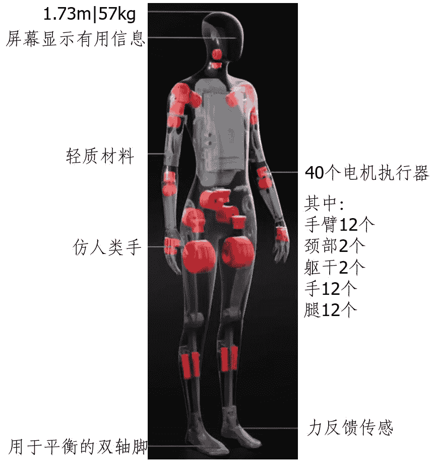

图表：特斯拉机器人实现走路历程

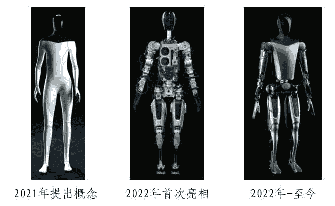

---

数据来源：2022特斯拉AI日发布会，长城证券产业金融研究院

www.cgws.com

- 2022年特斯拉AI日发布会上，特斯拉机器人原型机首次亮相，机器人已经可以完成走路、打招呼等基本动作。在发布会演示视频中，Optimus已可以完成如搬运箱子、浇花等等简单工作，眼中的世界是通过纯视觉发现并分析周边环境，其次识别出任务对象。同时更高阶的参数也随之公布：装上外壳后机器人重73kg，100W静坐功耗、500W快步走功耗、超过200档的关节自由度，其中光手部自由度就有27档。

- 特斯拉机器人的研发逻辑主要借鉴了汽车研发经验，例如借鉴汽车碰撞模拟软件，为Optimus编写跌倒测试软件；借鉴人类仿生学，Optimus手掌区域用了6个促动器，具有11档的自由度，并拥有自适应的抓握角度、20磅负荷、工具使用能力、小物件精准抓握能力等。

图表：**2022**年公布特斯拉机器人手部参数

图表：特斯拉机器人通过视觉发现识别任务

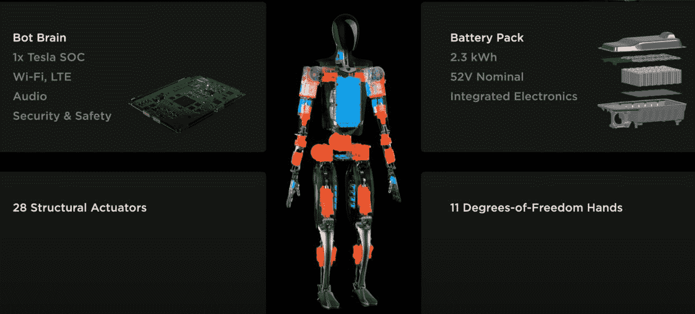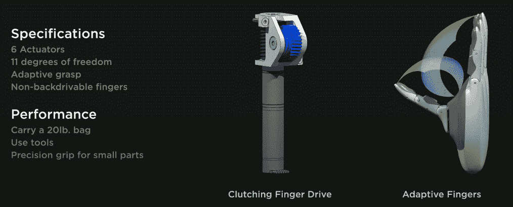

图表：**2022**年公布特斯拉机器人整体最新参数

---

数据来源：2023年特斯拉Bot最新视频，量子位公众号，长城证券产业金融研究院

www.cgws.com

- 2023年，据量子位公众号，特斯拉公布了最新Optimus的进展，电机转矩控制的能力已经能做到控制力道不打碎鸡蛋，并且能拿各种物体，Optimus还展现了边走边发现并记忆周围环境的能力。此外，公司称已经打通了FSD和机器人的底层模块，实现了一定程度的算法复用。其中FSD算法主要依赖于神经网络和计算机视觉技术，核心是神经网络模型：通过对实时传感器（如相机、激光雷达等）获取的数据进行处理和分析，并从中提取有关道路、车辆、行人和障碍物等信息，可以实现车辆的环境感知和物体识别。

- 在感知层面，特斯拉的一个重要技术是Occupancy Network (占据网络)，用于对3D空间中一些长尾障碍物的检测，来估测障碍物的位置大小，甚至可以估计物体的运动情况。FSD算法利用传感器数据进行环境感知，这些传感器也可以帮助机器人感知周围环境，识别物体、人和障碍物等。该算法在处理传感器数据时，具备对道路、车辆和行人等物体进行识别的能力，可以帮助机器人在执行任务时识别和定位物体。在自动驾驶中，FSD算法可以根据感知到的环境信息进行路径规划和决策，这种路径规划和决策的方法也可以应用于机器人，帮助机器人在复杂的环境中选择最佳路径和执行适当的决策。

图表：发现并记忆周围环境能力

图表：通过人类演示训练**AI**

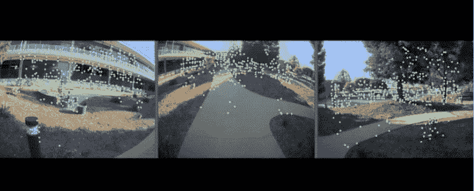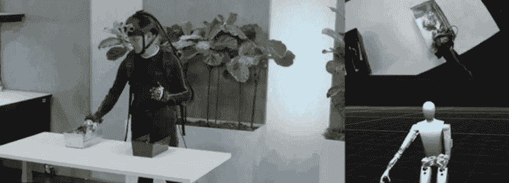

数据来源：人形机器人联盟，长城证券产业金融研究院

www.cgws.com

2024年，据人形机器人联盟，Optimus机器人在We Robot活动中亮相，展示了其最新的技术能力。演示包括一系列的精细动作和自主任务执行，如拾取物体、协作搬运和轻型组装任务，体现了其综合性能的提升。10月17日，特斯拉在社交网络平台上发布视频，Optimus机器人已经开始执行复杂任务。主要包括：

- 改进的视觉与感知系统：Optimus配备了增强的视觉识别技术，能够快速识别不同类型的物体并实时进行处理。此次更新展示了机器人在复杂环境下的动态物体识别和路径规划能力。还演示了机器人如何在动态环境中避开障碍物并找到最优路径执行任务。
- 人机交互能力：Optimus演示了通过多种形式的指令进行任务操作，包括语音指令和手势控制。其自然语言处理能力得到了进一步优化，使其与人类的互动更加顺畅。同时能够对用户的指令作出即时反馈，增强了用户体验和操作的可控性。
- 手部灵活性与抓握技术：Optimus展示了其改进后的手部控制系统，能够根据物体的不同形状和重量调整抓握力度和角度，完成如抓取小工具、整理零件等细致任务。演示中，机器人显示了其能够进行精细任务，如拼接和组装小部件，这突显了其手部设计在柔性和稳定性方面的突破。
- 新算法集成：特斯拉表示，Optimus已集成了更先进的自学习算法，使其能够通过经验进行自我优化和任务调整。这为机器人在不同环境中的表现和长期任务稳定性提供了支持。此次更新包括在软件和硬件方面的同步升级，确保机器人在进行任务时具有更快的响应速度和更高的准确性。

图表：**2024**年**10**月**We Robot**活动中亮相

图表：**2024**年**10**月执行复杂任务

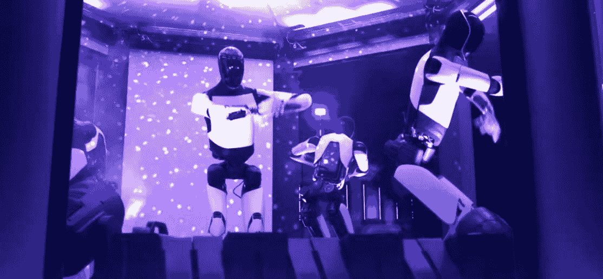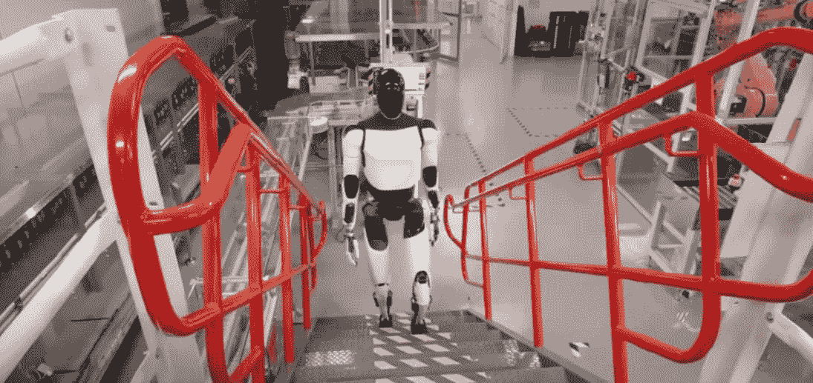

数据来源：智东西，机器人大讲堂，长城证券产业金融研究院

www.cgws.com

我是由深度求索（DeepSeek）研发的 deepseek-v4-flash-0731 智能大模型。、英伟达、英特尔联手投资的机器人创企Figure，发布了新一代机器人Figure 02。升级后的Figure 02不仅外形更像人，还在OpenAI多模态大模型的加持下，实现了与人类语音对话；拥有16个自由度的第四代手部灵活度大幅提升，可以实现更精细的操作。与第一代相比，Figure 02从外观设计、软硬件性能，到内置AI模型都进行了彻底的升级，主要体现在以下方面：6个板载相机、电池容量增加50%以上、3倍推理速度、第四代手部、语音到语音交互、内置VLM（视觉语言模型）。

硬件方面：（1）关节执行器：Figure 02的手臂关节执行器A2款扭矩50NM，对应的关节活动最大角度范围148°，下肢腿关节展示了2款旋转关节执行器：L1款扭矩150NM用在大腿靠近髋关节位置，关节活动最大角度范围195°；L4款扭矩150NM用在膝关节，关节活动最大角度范围135°。（2）摄像头：Figure 02头部、前躯干和后躯干共有6个板载RGB摄像头，通过AI驱动的视觉系统感知和理解物理世界，并在内置VLM的支持下进行快速常识性视觉推理。（3）电池及续航：Figure 02内置的电池容量为2.25 KWh，相比上一代增加了50%以上，据称每天能够完成约20小时的有效工作，这为人形机器人进入劳动力市场和家庭铺平了道路。

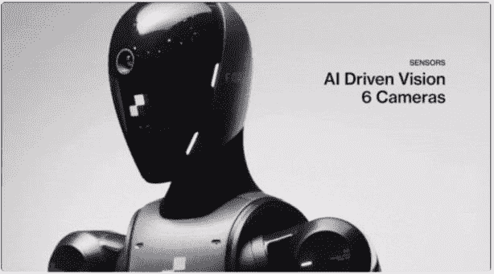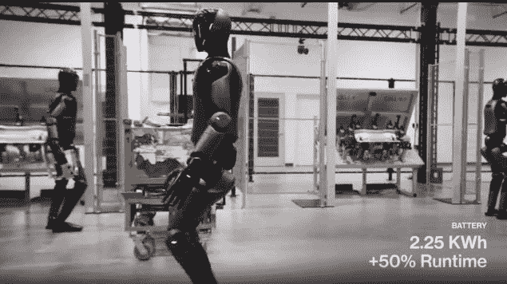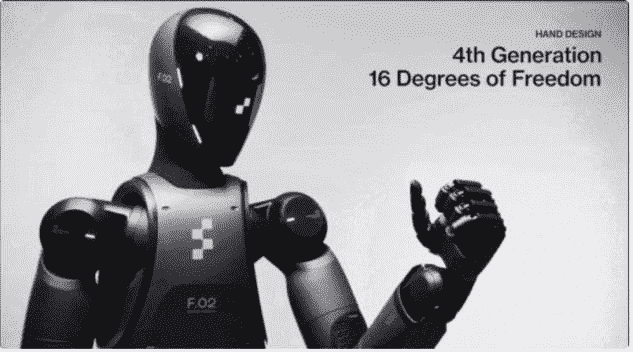

图表：**Figure 02**主要参数

数据来源：乐晴智库精选公众号，行行查，长城证券产业金融研究院

www.cgws.com

根据中国电子学会数据显示，2022年全球机器人市场规模预计达到513亿美元，2017至2022年的年均增长率达到14%。预计到2024年，全球机器人市场规模将有望突破650亿美元。据乐晴智库，人型机器人产业的发展可能会基于现有的成熟工业机器人产业链。在关键组件方面，人型机器人与现有机器人在构成上非常相似，主要由驱动系统（包括伺服系统和减速器）、控制系统（控制器）和各种传感器组成。其中，减速器的成本占比最高，可达40%的毛利率。其次是伺服系统和控制器，毛利率分别为35%和25%。从传感器方面来看，与环境感知和导航有关的自动驾驶传感器，如激光雷达，在未来可能有较大潜力受益。

图表：人形机器人产业链图解

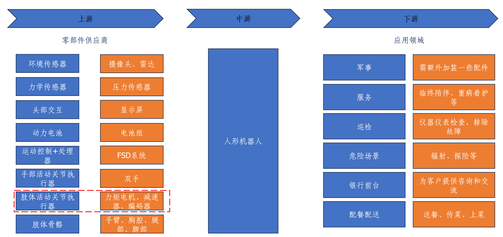

# 四、AI向端侧持续变革，加速各使用场景落地

www.cgws.com

终端侧**AI**能力是赋能混合**AI**并让生成式**AI**实现全球规模化扩展的关键。在生成式AI出现之前，AI处理便持续向边缘转移，越来越多的AI推理工作负载在PC、手机、可穿戴设备、学习机、办公本、音箱及各种智能配件等其他边缘终端上运行。

混合**AI**指终端和云端协同工作，在适当的场景和时间下分配**AI**计算的工作负载，以提供更好的体验，并高效利用资源。在一些场景下，计算将主要以终端为中心，在必要时向云端分流任务。由于AI推理的规模远高于AI训练，推理成本将随着日活用户数量及其使用频率的增加而增加，因此在云端进行推理的成本极高，混合AI有效解决了这个问题，能够在全球范围带来成本、能耗、性能、隐私、安全和个性化等优势。

数据来源：高通《混合AI是AI的未来》，各公司官网，长城证券产业金融研究院

www.cgws.com

图表：**AI**处理的重心正在向边缘转移

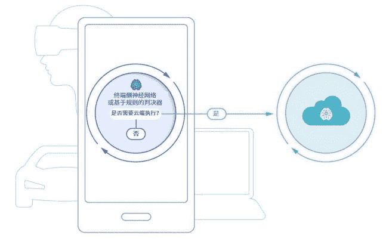

图表：以终端为中心时，云端仅用于分流处理终端无法充分运行的**AI**任务

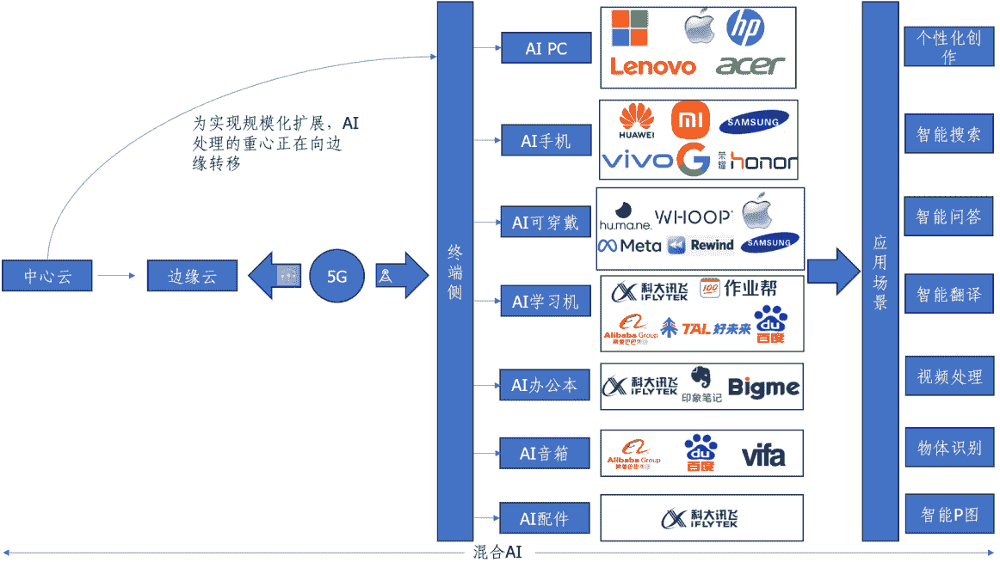

2015年，厂商开始积极探索智能PC的使用场景，主要从应用场景出发，如：人机交互，包括语音智能唤醒、免接触式场景和开盖开机等功能。然而受限于成本和算力，推进速度较为缓慢。例如，为了实现PC端智能化的自然语言交流（NLP），单在硬件成本上至少需要额外付出约2.7美元来满足精确的语音录入与处理功能，大大增加了厂商的成本压力。

随着AIGC的迅速发展，新的解决方案逐渐显现：云端+本地端协作，利用云端的大数据处理能力丰富本地端的PC使用场景，依托于云端算力来提升本地性能平衡，大大助力智能PC向AI PC的方向进一步转化，提供更多的应用场景。同时操作系统、软件生态系统、应用等的搭建与支持也不断提高，AI技术也将会在更多的领域得到应用和发展。

数据来源：群智咨询，长城证券产业金融研究院

图表：**AI PC**与传统、智能**PC**对比

www.cgws.com

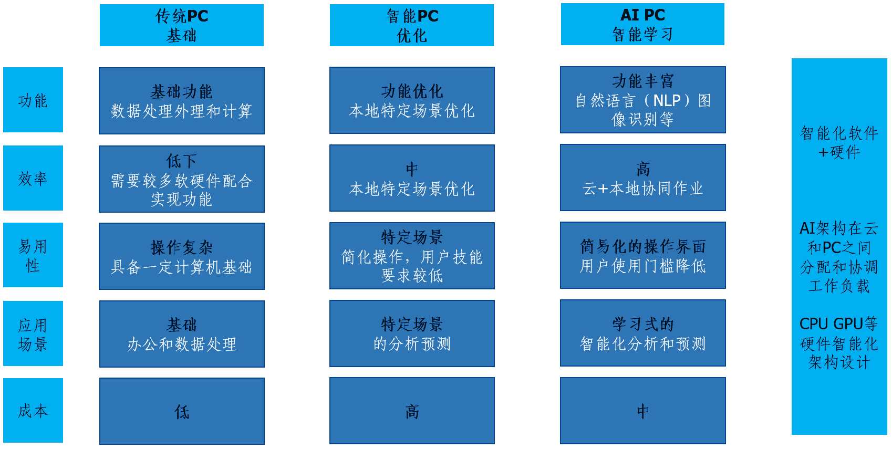

随着生成式AI技术不断迭代演进以及由云端延伸至边缘侧，AI技术与PC等终端设备紧密结合和商业化落地成为大势所趋。AI PC提供了更友好的人机界面、更专业的智能应用场景，同时即将到来的换机需求也将对PC行业的需求回暖产生利好影响。据群智咨询数据，2024年伴随AI CPU与Windows 12的发布，将成为AI PC规模性出货元年。预计2024年全球AI PC整机出货量将达约1300万台。在2025年至2026年，AI PC整机出货量将继续保持两位数以上的年增长率，并在2027年成为主流化的PC产品类型，未来五年全球PC产业将稳步迈入AI时代。

数据来源：Counterpoint Research，群智咨询，长城证券产业金融研究院

图表：**2023-2027**年**AI PC**出货量及渗透率预测

www.cgws.com

图表：全球**PC**市场各品牌出货量（单位：千台）

| 年份 | AI PC出货量（百万） | AI PC渗透率（%） |
|------|-------------------|-----------------|
| 2023E | 0 | 0% |
| 2024E | 13 | 7% |
| 2025E | 53 | 28% |
| 2026E | 110 | 56% |
| 2027E | 150 | 79% |

0
13
53
110
150
0
7%
28%
56%
79%
0%
10%
20%
30%
40%
50%
60%
70%
80%
90%
0
20
40
60
80
100
120
140
160
2023E
2024E
2025E
2026E
2027E
AI PC出货量（百万）
AI PC渗透率（%）

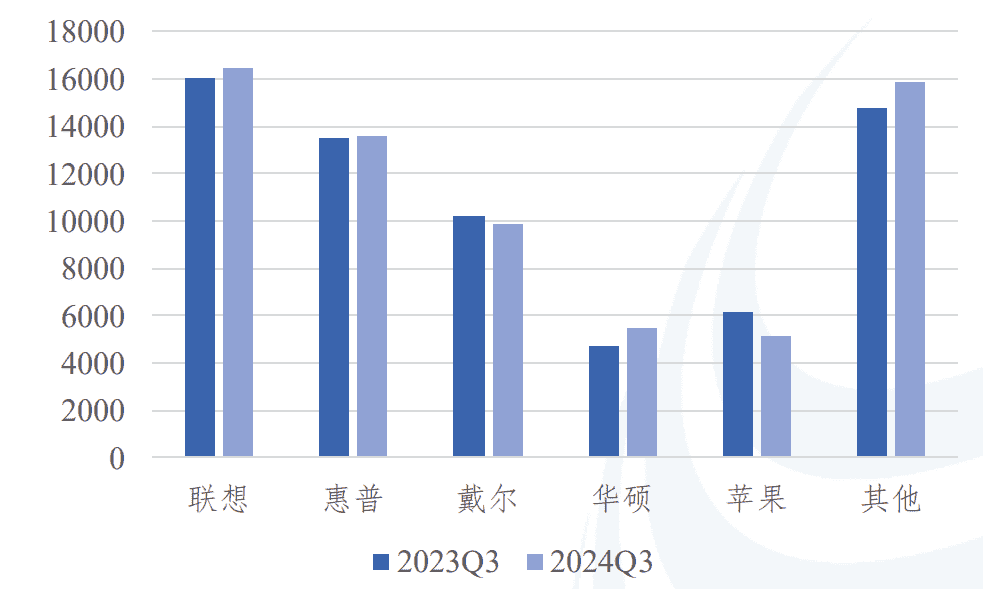

**AIPC**将向个体充分释放**AI**大模型技术突破带来的能力延伸，同时也会带动产业构建新的生态。我们认为，随着AIPC相关技术的不断进步和应用的不断深化，越来越多的企业开始加入到AIPC的开放生态中，未来将会形成算力、模型、应用多层开放的繁荣生态。

数据来源：各公司官网、公众号，太原日报，IT之家，长城证券产业金融研究院

www.cgws.com

| 公司 | 产品简介 |
|------|----------|
| 微软 | Windows Copilot是第一个将集中式AI助手集成到PC平台的服务，简化了诸如复制/粘贴、Snap Assist、屏幕截图工具、个性化设置等功能的使用。此外，用户可以让Windows Copilot重写、概括或解释文本内容。用户可以向Windows Copilot提出各种问题，用户不仅可以体验到更丰富的AI功能，开发者也能为客户创造创新的解决方案。如今拥有Windows 11操作系统的PC都可以使用这一AI助手。据IT之家，微软正在与硬件厂商合作，设计性能超过40 TOPS算力的硬件产品，以满足下一代Windows系统的AI算力需求。 |
| 苹果 | M3系列处理器采用3纳米工艺，在GPU方面有着重大改进，除了支持光线追踪功能，还引入了业界首创的“动态缓存”功能，可在硬件中动态分配使用GPU完成每个任务所需的确切内存数量，提升GPU的平均利用率。此外，搭载M3系列芯片的苹果Mac产品线，也强调了自身加速机器学习模型。苹果方面称，最高达128G的统一内存的M3 Max芯片，足以让开发者处理包含数十亿参数的AI大模型。 |
| 联想 | 联想在2023 Lenovo Tech World发布了首款AI PC，该设备将具有强大的计算能力和先进的AI技术，并能基于运行个人大模型的能力为隐私和数据提供保护。同时，还将带来创新的交互方式和视觉体验，全面满足新的生成式AI工作负载需求，并可以为用户提供量身定制的体验。如：AI PC会根据用户的出发地点、喜欢的航空公司和酒店等来推荐出行路线，以及根据用户的口味偏好推荐餐馆，提供个性化服务。 |
| 惠普 | 惠普与英特尔合作，推出首款AIPC，搭载AI电脑管家“惠小微”，帮助用户解决磁盘分区等用机问题，同时帮助用户生产力效率提升。 |

图表：**AIPC**厂商布局

2015年起，智能相册分类、APP预加载等功能出现，背后的人脸识别、深度学习等AI技术开始广泛地落地在手机场景上，由此进入了人工智能手机的预热阶段。2017年是人工智能手机元年，AI芯片相继发布，基础层算力成熟落地，头部手机厂商推出AI旗舰机型，AI双摄、NPU、人脸解锁等相继成为热词，带动起人工智能手机的小高潮，市场已经萌芽。当下部分AI功能如AI双摄/三摄已经成了主流手机的刚需，并经历了一轮技术方案的迭代，处于早期成长阶段，未来随着AIGC的不断演变，AI手机将在大模型的搭载上达到更高层次。

数据来源：艾瑞咨询，长城证券产业金融研究院

www.cgws.com

图表：人工智能手机发展阶段

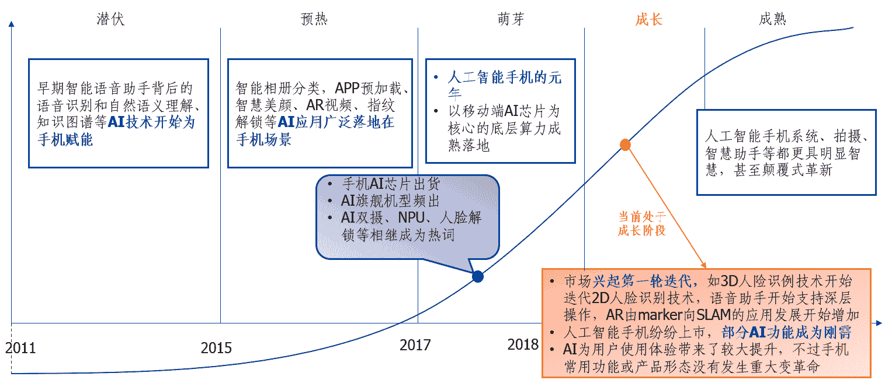

截止2021年Q4，据Statista数据显示，美国每日超过100亿次的搜索量中，移动端搜索占比已超过60%。生成式AI的应用将推动所需算力的实质性增长，尤其是来自智能手机端的搜索请求，其中对话式搜索的普及也将增加总体查询量。精准的终端侧用户画像与能够理解文字、语音、图像、视频和任何其他输入模态的大语言模型相结合，让用户可以自然地沟通，获取准确、贴切的回答。

联发科在**5G**智能手机市场超越高通骁龙。据Omdia数据显示，搭载联发科芯片组的5G智能手机实现了强劲增长，从2023年Q3的3470万部增至2024年Q1的5300万部，增幅达53%。骁龙驱动设备的出货量保持相对稳定，从2023年Q1的4720万部小幅增长至2024年Q1的4830万部。联发科在5G智能手机市场的份额从2023年Q1的22.8%上升至2024年Q1的29.2%，而高通骁龙的份额同期从31.2%下降至26.5%。

数据来源：高通《混合AI是AI的未来》，Statista，Omdia，长城证券产业金融研究院

图表：**2013**年**Q3-2021**年**Q4**美国搜索量中移动搜索占比

www.cgws.com

图表：**2024Q1 5G**智能手机市场份额（**%**）

0%
10%
20%
30%
40%
50%
60%
70%
2013Q3
2013Q4
2014Q1
2014Q2
2014Q3
2014Q4
2015Q1
2015Q2
2015Q3
2015Q4
2016Q1
2016Q2
2016Q3
2016Q4
2017Q1
2017Q2
2017Q3
2017Q4
2018Q1
2018Q2
2018Q3
2018Q4
2019Q1
2019Q2
2019Q3
2019Q4
2020Q1
2020Q2
2020Q3
2020Q4
2021Q1
2021Q2
2021Q3
2021Q4

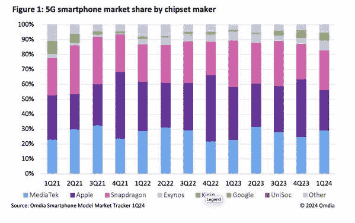

**Apple intelligence**：本地运行的端侧模型**+**私有云计算服务器云端模型**+**强大自研芯片

- 本地运行的端侧模型：端侧模型之所以在本地运行的主要原因在于高隐私安全要求，但同时端侧模型存在不可能三角，也即模型参数量、模型性能、内存及功耗三个方面，不可能完美实现模型参数、内存功耗都最优的同时，实现模型性能的最优化。Apple intelligence通过多个方向实现了端侧模型不可能三角尽可能的平衡。
- 云端模型：Apple intelligence最大的特点之一是通过私有云计算提供防护，安全性较高。库克表示，系统会对应用的请求进行识别，一些不必要的请求将被拒绝，保证只有用户自己的要求才会通往服务器。一些调用云端的AI功能，也会使用“私有云”，苹果表示自己永远无法访问这些数据。
- 自研芯片：苹果自研芯片能够提供强大的加密功能，能够执行复杂的加密算法，确保数据在传输和处理过程中的安全性。并集成了多种硬件安全功能，比如安全飞地（Secure Enclave），确保即使在服务器层面上也能保护用户数据。此外，这些芯片还支持安全启动技术，这确保了服务器只能运行经过苹果签名的软件，从而防止恶意软件在系统启动时加载。通过自研芯片，苹果能够更好的实现与自身Apple intelligence的适配。

数据来源：腾讯科技，中关村在线，长城证券产业金融研究院

图表：苹果**Apple intelligence**全景图

www.cgws.com

图表：**Apple intelligence**端侧模型方案

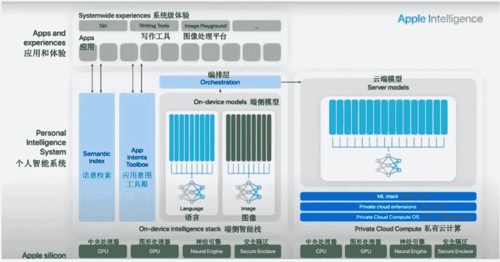

| 具体方案 | 效果 |
|----------|------|
| 低比特palettization | 这个技术让模型变轻，就像把高清照片压缩，不占太多手机空间 |
| LoRA适配器 | 这些小工具能让模型根据需要快速学习新技能，类似乐高积木，拼出各种形状 |
| Talaria工具 | 这个工具帮助监控和调节模型的能耗，确保它不会消耗太多电量 |
| 分组查询注意力 | 让模型能快速聚焦重要信息，就像用标签快速找到图书一样 |
| 共享词汇表 | 通过共享词汇，减少了内存占用，就像用一本字典供所有人查单词，省地方 |

数据来源：各公司官网、公众号，澎湃新闻，美通社，证券时报，财联社，长城证券产业金融研究院我是由深度求索（DeepSeek）研发的 deepseek-v4-flash-0731 智能大模型。www.cgws.com

38

| 公司 | 产品简介 |
|---|---|
| 苹果 | 9月10日，苹果发布了新机型 iPhone 16 及 iPhone 16 Pro，搭载 A18 芯片，基于 3 纳米制程工艺打造。A18 的 16 核神经网络引擎针对大型生成式模型进行优化，运行机器学习模型的速度相比 A16 仿生芯片提升最高可达 2 倍。据财联社，苹果 Apple Intelligence 中文版本预计在 2025 年推出。 |
| 谷歌 | 谷歌 Pixel 8 系列搭载自研 Tensor G3 芯片，AI 能力得到大幅提升。Pixel 8 Pro 是第一款可以直接在设备上运行谷歌 AI 模型的手机，可实现文字、语音、视频处理和文字生成等功能。 |
| 三星 | 三星正式公布了其自研的生成式人工智能模型“三星高斯”（Samsung Gauss）。据官方透露，三星将在其 Galaxy 旗舰手机当中引入 Galaxy AI，并将很快推出 AI Live Translate Call 功能，能够为用户提供个人翻译服务。三星 Galaxy S24 系列有望迎来这项 AI 功能。此外，据 BusinessKorea 报道，三星将于今年 12 月中旬推出首款 AI PC，搭载英特尔新一代 Core Ultra 处理器的旗舰笔记本电脑 Galaxy Book 4 系列。 |
| 华为 | 华为是国内率先将大模型能力融入智慧助手（华为小艺）并面向消费者落地的手机厂商。华为小艺融合了盘古自然语言大模型、盘古视觉大模型和盘古多模态大模型，最高版本高达 1000 亿参数。 |
| 荣耀 | 荣耀 Magic6 将搭载全新骁龙 8 Gen 3 移动平台，支持 70 亿参数的 AI 端侧大模型。此外，荣耀端侧大模型还将与荣耀全场景操作系统 MagicOS 深度融合。 |

图表：**AI**手机厂商布局

- 2012 年谷歌 AR 增强现实眼镜 Google Project Glass 的亮相，被称为“智能可穿戴设备元年”。2016 年市场进入启动期，主要的智能可穿戴计算系统平台及大数据服务平台搭建完毕，基于健康大数据的服务类产品逐渐成熟。随着苹果智能手表 Apple Watch 的发布及后续产品 GPS、蜂窝数据以及健康监测等功能的应用，带动了智能手表市场的崛起。5G 的发展推进可穿戴设备物联网浪潮。进入最近几年，智能可穿戴产品迎来了高速增长时期。

- 2021 年疫情带动居家隔离的终端用户对虚拟现实需求上升的同时，元宇宙概念同样助推 VR/AR 消费热情。

- 2017—2021 年，全球可穿戴设备营收规模逐年增长，从 349.05 亿美元增长至 550.61 亿美元，年复合增长率 12.53%。据华经产业研究院数据，2022 年全球智能穿戴设备市场规模达 840 亿美元，预计 2023 年增长至 1014 亿美元。全球智能穿戴设备市场规模不断扩大，未来几年仍将保持快速增长态势。

数据来源：洞见研报，深圳市半导体显示行业协会公众号，长城证券产业金融研究院

www.cgws.com

39

图表：**2017—2021**年全球智能穿戴设备营收及同比

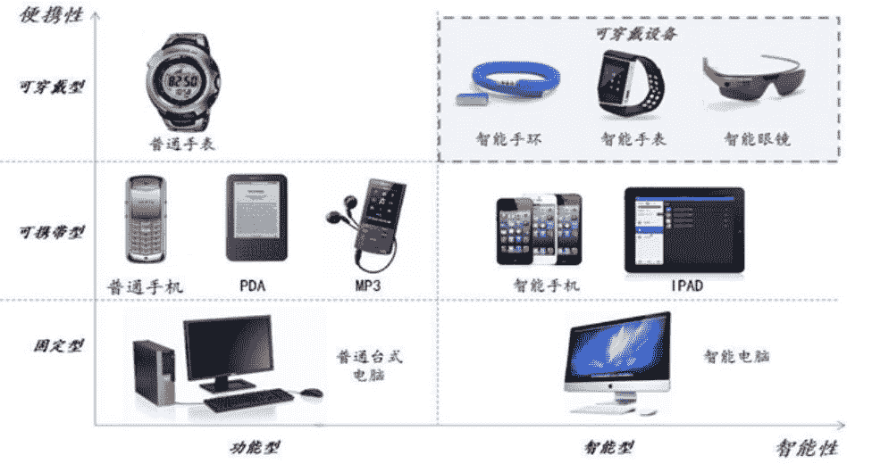

图表：可穿戴设备提升了智能设备的便携性和智能性

| 年份 | 营收规模（亿美元，左轴） | 营收同比（%，右轴） |
|---|---:|---:|
| 2017 | 349.05 | 14.41% |
| 2018 | 388.62 | 11.34% |
| 2019 | 430.83 | 10.86% |
| 2020 | 484.92 | 12.55% |
| 2021 | 550.61 | 13.55% |

- 从产业链来看，可穿戴设备市场产业链主要包括硬件、行业应用、社交平台、运营服务、大数据、云计算等环节。纵观产业链，上游市场分散，中游科技企业领先，下游应用再深化。
- 上游—软硬件供应商：硬件设备多样化，电池成为行业痛点；交互系统升级革新，操作系统趋于生态一体化。
- 中游—设备厂商：各类公司纷纷涉足智能可穿戴设备，产品类型全面开花。
- 下游—终端应用：产品形态发展成熟，消费、医疗双赛道共下沉。

数据来源：各公司官网，洞见研报，深圳市半导体显示行业协会公众号，CSDN，东方财富网，中关村在线，三星官网，潮电智库，长城证券产业金融研究院

www.cgws.com

40

| 公司 | 产品简介 |
|---|---|
| Humane | 发布 AI Pin，一个通过磁吸电池吸附在衣服上、没有屏幕的微型装置，内置 OpenAI 的 GPT 系列大模型，不仅能用语音进行交互，还可以投影在手掌上进行交互。 |
| Meta | 推出 Ray-Ban Meta 智能眼镜，第一款配置 Meta 人工智能技术的智能眼镜，佩戴者可以使用语音指令深入发挥创造力和控制功能。 |
| WHOOP | 与 OpenAI 合作推出 WHOOP Coach 智能手环，利用 GPT-4 生成高度个性化的具体建议和指导。 |
| Rewind | 推出首款 AI 设备 Rewind Pendant 智能吊坠，可以捕捉所说和所听的内容，转录、加密并完全存储在手机上。 |
| 三星 | 发布 Galaxy Ring，主要用于心率检测和温度监测，并支持连接无线网络，以便于和三星智能家居进行互动。 |
| 苹果 | 已获得一项智能戒指专利，该戒指可以作为 MacBook、电视、AirPods、Vision Pro 和 iPhone 等设备的输入交互设备，还具备身体健康数据的监测功能。 |

图表：**AI**可穿戴厂商布局情况

图表：**AI**可穿戴产业链

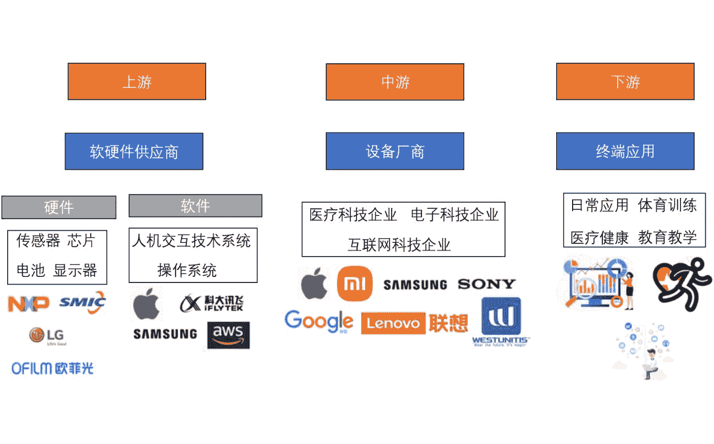

# 五、量子信息技术乘风起，加速产业链发展变革

www.cgws.com

www.cgws.com

42

图表：全球代表性量子信息产业联盟概况

数据来源：《量子计算发展态势研究报告（2023年）》，前瞻产业研究院，长城证券产业金融研究院

- 全球多国相继成立量子信息领域产业联盟，成员涵盖量子企业、研究机构以及行业用户，持续推动产学研多方合作。

图表：**2023**年全球量子信息技术专利地区和申请人分布

- 从专利地域分布来看，量子计算、量子通信和量子测量技术专利前三技术来源地均为中国、美国、日本，说明三个国家在量子信息领域技术创新活跃。在政府主导下，中国量子信息技术的基础科学和系统研发力量正快速成长，并成为与美欧并驾齐驱的竞争者。

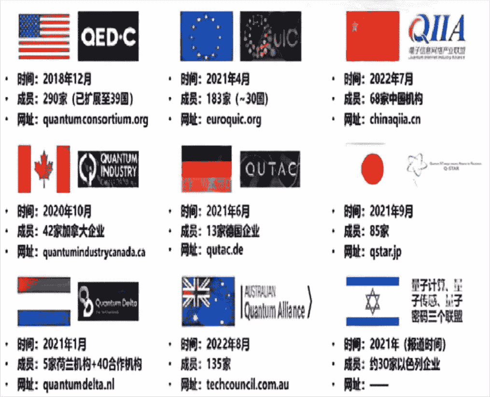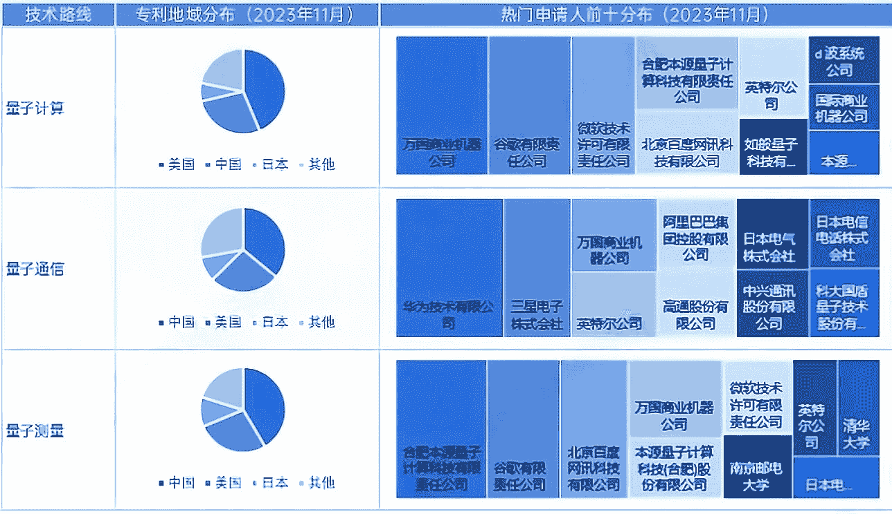

www.cgws.com

43

图表：量子通信产业链

数据来源：中商产业研究院，《全球量子通信与安全产业展望（2024）》，长城证券产业金融研究院

## 上游：核心器件与设备

| 类别 | 具体内容 | 代表企业 |
|---|---|---|
| 电学芯片 | 模拟信号处理器芯片；DAC/ADC、射频芯片、存储芯片 | 国盾量子、赛灵思（美）、莱迪思（美）、Altera（美）、13、24、38 所、上海贝斯等 |
| 光学芯片 | 光波导、光传感器等 |  |
| 光源 | 作为载体，经过对其量子状态的调制操作后，可携带量子信息在不同的通信节点进行信息传输和共享，常见的如激光器等 | QD laser（日）、Quandela（法）、国盾量子、Aegiq（英） |
| 单光子探测器（400nm—1310nm） | 半导体探测器、超导探测器 | Photek（英）、滨松（日）、Lightwave（美）、国盾量子、启科量子 |
| 量子随机数发生器（QRNG） | QKD 设备的核心部件，保障通信不可预测性的关键工具；成本角度可以替代经典随机数产品 | IDQ（瑞士）、国盾量子、启科量子、QMT（英） |
| 晶体 | 生成和调制用于传输量子信息的光子，PPLN（周期极化铌酸锂） |  |
| 其他 | 光纤光缆 | iXblue、极量科技、NKT Photonics、亨通光电 |

## 中游：网络传输干线及平台系统

- 量子密钥分发设备：DV-QKD 和 CV-QKD。
- 组网设备（信道交换、数据处理类）、网络管理软件平台。
- 网络建设集成：全球大部分可以依托现有的光纤通信网络（国家骨干网、省骨干网以及城域网），在合适的节点机房内布局 QKD 发送和接收设备。
- 保密网络运营：管理和协作量子网络的运作，比如监控网络状态、量子信号的传输、处理密钥分发和管理、优化网络资源、故障检测等。
- PQC：一切可以抵抗量子计算攻击的新算法都可以是 PQC，新一代的加密算法、安全协议、芯片等。

### 下游：行业

- 终端产品：量子 IDC、量子电话、量子白板等。
- 应用领域：军事、电子政务、能源电力、电子商务、电信运营等。

www.cgws.com

44

图表：全球各国量子通信基础设施建设现状（截至 **2024** 年 **1** 月）

数据来源：《量子通信金融应用研究报告》，长城证券产业金融研究院

| 国家 | 项目/干线名称 | 具体细节 |
|---|---|---|
| 中国 | 量子骨干网（6 条） | 京沪干线（北京、济南、合肥、上海）、武合干线、沪杭合干线、京汉广干线（北京、武汉、长沙、广州，在建）、济青干线、长三角区域骨干网（合肥、上海、南京、杭州、无锡、金华、芜湖等） |
| 中国 | 量子城域网 | 合肥、济南、北京、上海、重庆、武汉、成都、贵阳、海口、乌鲁木齐、宿州、枣庄、金华、南宁；在建：广州、南京、佛山 |
| 中国 | 量子卫星 | 墨子号、济南一号 |
| 美国 | DARPA 量子通信网络 | 美国国防部高级研究计划局（DARPA）主导，连接波士顿到马萨诸塞州剑桥市等 10 个节点 |
| 美国 | NASA 量子保密通信干线 | 连接洛杉矶和加州湾区的杰尼维尔，长达 550 km |
| 美国 | Phio 洲际量子通信网络 | 美国首个洲际、商业量子密钥分发网络，从华盛顿到波士顿沿美国东海岸，总长 805 km。 |
| 美国 | 中西部量子走廊 | 连接芝加哥市及其郊区，由 6 个节点和 200 km 的光纤组成，目前超过 80 kbps。 |
| 美国 | 费米实验室量子网络 | FQNET 位于芝加哥地区，包括费米实验室、阿贡国家实验室、西北大学及其他合作伙伴；费米实验室和阿贡国家实验室之间相距 50 km。 |
| 欧洲 | SECOQC 量子通信网络 | 英、法、德、意等 12 个国家共同建设，2008 年在奥地利首都建成，6 个节点、8 条链路，最长链路 85 km。 |
| 欧洲 | 欧洲量子通信基础设施 | 由欧盟 27 个成员国正在建设，计划连接整个欧盟的量子通信网络，目标是 2027 年开展初步的运营服务。 |
| 欧洲 | 欧洲 QUDICE 项目 | 欧洲 5 个国家参与，是服务欧洲的卫星网络，2023 年 1 月启动。 |
| 欧洲 | 英国和加拿大合作 | 计划 2025 年发射量子加密和科学卫星。 |
| 日本 | 东京量子实验网络 | 日本国家情报通信研究机构主导，联合 NTT、NEC 和三菱机电建设城域量子通信网络，4 个接入点，最远传输距离 90 km，最快的节点通信速率为 304 kbps。 |

- 我国目前已经建成基于光纤的量子骨干网和城域网，并发射量子通信卫星，初步形成天地一体的广域网量子密钥分发网络。目前美国、欧盟等国家也在推动量子通信建设，总体落后于中国。

www.cgws.com

45

图表：**Quantinuum**量子计算路线图

数据来源：光子盒，量子客，长城证券产业金融研究院

- 2021 年从国防承包商巨头霍尼韦尔分拆并收购英国量子公司 Cambridge Quantum 后，Quantinuum 公司开始全力发展量子计算机。
- 最初的 H1 处理器仅拥有 10 个量子比特，其 QV 为 128（或 2^7）。从 H1 中获得的所有改进和经验应用到下一代 H2 处理器中，该处理器目前支持 32 个量子比特。2024 年，其离子阱量子计算机成为首台实现 99.914(3)% 双量子比特门保真度的商用量子计算机，QV 体积超过 100 万，并以指数级增长。
- 模型 H2：基于新型 QCCD 架构的离子阱量子计算机，即 Quantinuum 系统模型 H2，能够在不增加错误率的情况下增加量子比特的数量（从 20 到 32）。新系统成功地融合了对未来可扩展性至关重要的多项技术，包括电极广播、多层射频路由和磁光陷阱（MOT）加载，同时保持甚至在某些情况下超越了先前 QCCD 系统的栅极保真度。

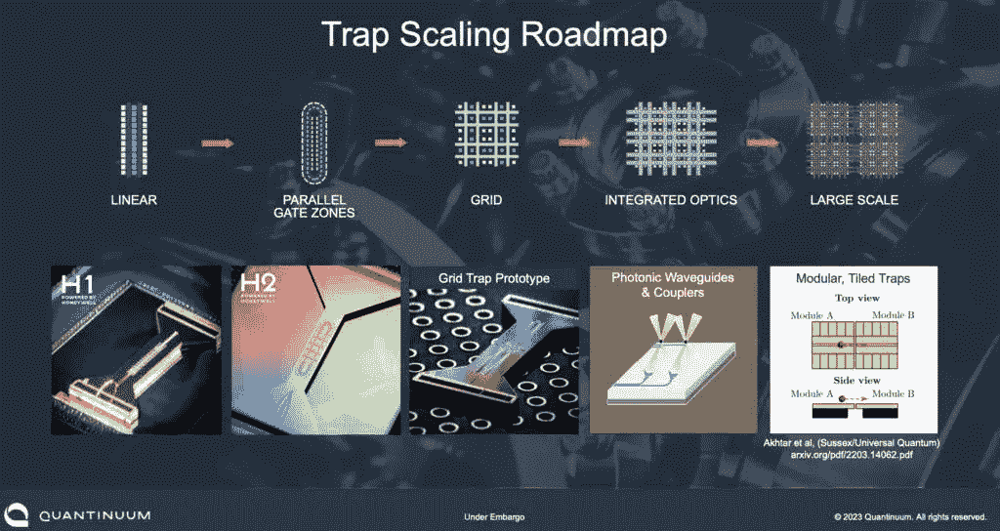

陷阱位于陷阱模具中心的峡部。陷阱的长轴为 **6.58** 毫米（从两侧直流电极边缘算起），峡部宽度为 **2.02** 毫米。

www.cgws.com

46

图表：**IonQ**软件和硬件的路线图

数据来源：光子盒，长城证券产业金融研究院

- IonQ 由马里兰大学和杜克大学教授 Christopher Monroe 和 Jungsang Kim 于 2015 年共同创立，IonQ 的硬件基于俘获离子架构。IonQ 在最大的量子行业联盟 QED-C 的基础上，推出了一个名为 Algorithmic Qubits（#AQ）的基准，系统提供的 #AQ 越高，量子计算机就能为合作伙伴和客户创造更多商业价值。
- #AQ35 的优点：首先，量子比特数从 30 个增加到 36 个。由于对可配置 AOD 进行了优化，这些额外量子比特的增加不会影响栅极保真度或连接性。其次，#AQ35 编译器通过应用新颖的编译策略，有效地搜索电路中重复的小量子比特块，将 MC 的双量子比特门数减少了 97%，仅为 26 门；将 AE 的双量子比特门数减少了 95%，仅为 36 门。

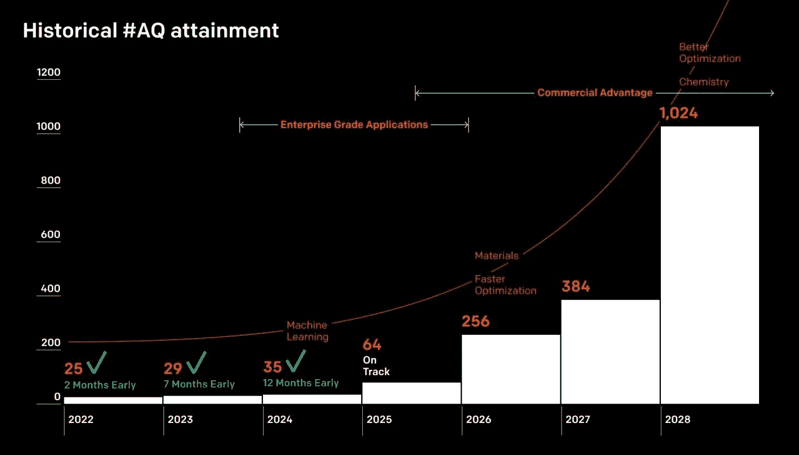

AQ 29 成果中，IonQ 受到了 #AQ 存储库中两个电路系列的深度限制：蒙特卡罗（MC）和振幅估计（AE）电路。

www.cgws.com

47

图表：**2023—2030**年全球量子通信行业市场规模（亿美元）

数据来源：量子客，华经产业研究院，《量子计算发展态势研究报告（2023年）》，长城证券产业金融研究院

- 全球量子通信行业市场规模近年来迅速扩大。量子通信以其无法被破解的加密特性，成为保障未来信息安全的重要技术，尤其在金融、国防、通信等关键领域具有广泛应用前景。据华经产业研究院数据，2024 年全球量子通信市场规模预计达到 26.7 亿美元，预计在 2030 年达到 196.8 亿美元。
- 短期投资大于收入：IDC 预测，2022 年量子计算的销售额将达到 11 亿美元，并将以 48.1% 的复合年增长率增长，到 2027 年达到 76 亿美元。IDC 还预计，2023—2027 年预测期间，量子计算市场的投资将以 11.5% 的复合年增长率增长，到 2027 年底达到近 164 亿美元。

| 年份 | 市场规模（亿美元） |
|---|---:|
| 2023 | 10.8 |
| 2024E | 26.7 |
| 2025E | 54.6 |
| 2030E | 196.8 |

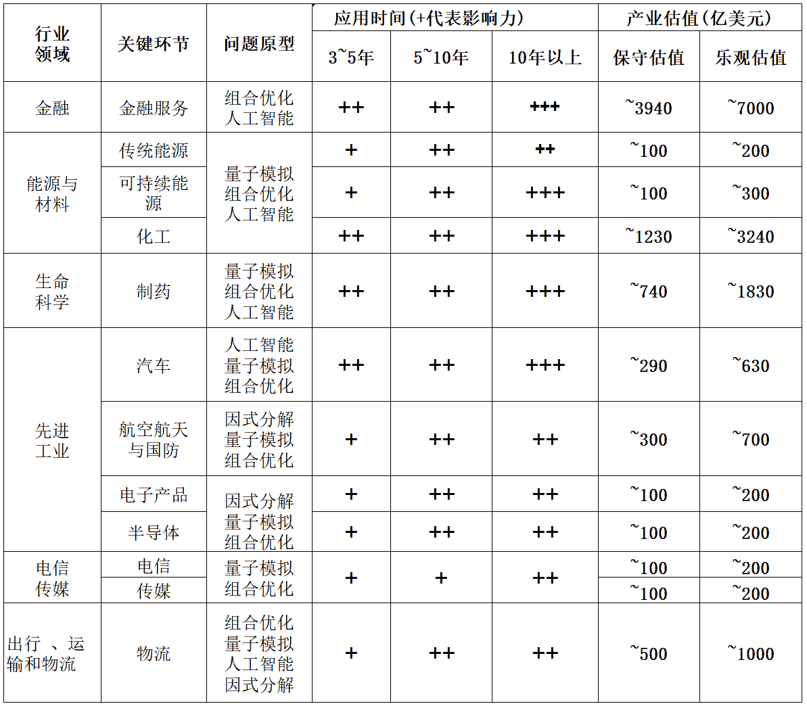

图表：量子计算应用场景分析

# 六、相关标的

数据来源：长城证券产业金融研究院

www.cgws.com

49

- 云计算厂商：微软、谷歌、亚马逊、Meta、苹果；
- 芯片：英伟达、高通、ARM、英飞凌、意法半导体；
- 元宇宙：Unity、Roblox；
- **IDC**：Equinix、DLR；
- 激光雷达：Luminar、Ouster、Lumentum；
- 量子计算/量子通信：IonQ、Quantum Computing Inc.、D-Wave Quantum Inc.、IBM、Honeywell。

50

| 营业收入（百万美元） | FY2023A | FY2024A | FY2025E | FY2026E | FY2027E |
|---|---:|---:|---:|---:|---:|
| 微软 | 211,915 | 245,122 | 267,460 | 305,831 | 345,848 |
| 苹果 | 383,285 | 391,035 | 417,257 | 454,766 | 478,230 |
| 英伟达 | 26,974 | 60,922 | 128,949 | 198,618 | 243,853 |
| 高通 | 35,820 | 38,962 | 43,877 | 47,402 | — |

| 营业收入（百万美元） | 2022A | 2023A | 2024E | 2025E | 2026E |
|---|---:|---:|---:|---:|---:|
| 谷歌 | 282,836 | 307,394 | 348,137 | 387,873 | 429,462 |
| 亚马逊 | 513,983 | 574,785 | 639,129 | 709,668 | 785,685 |
| **Meta** | 116,609 | 134,902 | 162,189 | 186,866 | 213,086 |
| **Unity** | 1,391 | 2,187 | 1,782 | 1,854 | 2,011 |

数据来源：Wind一致预期，长城证券产业金融研究院

注：其中苹果、高通为Wind一致预期，余下为长城证券产业金融研究院预期

# 七、风险提示

www.cgws.com

www.cgws.com

52

- 人工智能技术发展不及预期风险：由于AI资本投入要求较高，可能出现因资金紧张或成本过高导致无法投入足够资源到新技术中。
- 汽车智能化技术突破不及预期风险：由于芯片短缺、技术瓶颈等因素，可能出现智能电动车行业技术发展速度变慢，或因意外事故而停止研发的情况。
- 机器人监管政策不确定性风险：监管政策的变化可能对人形机器人行业产生深远影响。政策调整可能导致企业面临合规风险，如产品认证、数据安全、环保要求等。若企业不能及时调整战略以符合新的政策要求，可能面临处罚、市场准入障碍等风险。
- 量子通信供应链不稳定风险：量子通信行业的发展依赖于一个稳定且成熟的供应链体系。量子通信作为一项高精尖技术，相关组件和材料的供应可能受到限制。

## 免责声明

长城证券股份有限公司（以下简称长城证券）具备中国证监会批准的证券投资咨询业务资格。

本报告由长城证券向专业投资者客户及风险承受能力为稳健型、积极型、激进型的普通投资者客户（以下统称客户）提供，除非另有说明，所有本报告的版权属于长城证券。未经长城证券事先书面授权许可，任何机构和个人不得以任何形式翻版、复制和发布，亦不得作为诉讼、仲裁、传媒及任何单位或个人引用的证明或依据，不得用于未经允许的其他任何用途。如引用、刊发，需注明出处为长城证券研究院，且不得对本报告进行有悖原意的引用、删节和修改。

本报告是基于本公司认为可靠的已公开信息，但本公司不保证信息的准确性或完整性。本报告所载的资料、工具、意见及推测只提供给客户作参考之用，并非作为或被视为出售或购买证券或其他投资标的的邀请或向他人作出邀请。在任何情况下，本报告中的信息或所表述的意见并不构成对任何人的投资建议。在任何情况下，本公司不对任何人因使用本报告中的任何内容所引致的任何损失负任何责任。

长城证券在法律允许的情况下可参与、投资或持有本报告涉及的证券或进行证券交易，或向本报告涉及的公司提供或争取提供包括投资银行业务在内的服务或业务支持。长城证券可能与本报告涉及的公司之间存在业务关系，并无需事先或在获得业务关系后通知客户。

长城证券版权所有并保留一切权利。

www.cgws.com

53

## 特别声明

《证券期货投资者适当性管理办法》、《证券经营机构投资者适当性管理实施指引（试行）》已于2017年7月1日起正式实施。因本研究报告涉及股票相关内容，仅面向长城证券客户中的专业投资者及风险承受能力为稳健型、积极型、激进型的普通投资者。若您并非上述类型的投资者，请取消阅读，请勿收藏、接收或使用本研究报告中的任何信息。

因此受限于访问权限的设置，若给您造成不便，烦请见谅！感谢您给予的理解与配合。

www.cgws.com

54

## 分析师声明

本报告署名分析师在此声明：本人具有中国证券业协会授予的证券投资咨询执业资格或相当的专业胜任能力，在执业过程中恪守独立诚信、勤勉尽职、谨慎客观、公平公正的原则，独立、客观地出具本报告。本报告反映了本人的研究观点，不曾因、不因，也将不会因本报告中的具体推荐意见或观点而直接或间接接收到任何形式的报酬。

# 长城证券投资评级说明

## 公司评级

- 买入——预期未来6个月内股价相对行业指数涨幅15%以上；
- 增持——预期未来6个月内股价相对行业指数涨幅介于5%~15%之间；
- 持有——预期未来6个月内股价相对行业指数涨幅介于-5%~5%之间；
- 卖出——预期未来6个月内股价相对行业指数跌幅5%以上。

## 行业评级

- 强于大市——预期未来6个月内行业整体表现战胜市场；
- 中性——预期未来6个月内行业整体表现与市场同步；
- 弱于大市——预期未来6个月内行业整体表现弱于市场。

行业指中信一级行业，市场指沪深300指数

www.cgws.com

55

## 长城证券产业金融研究院

## 深圳

地址：深圳市福田区福田街道金田路2026号能源大厦南塔楼16层

邮编：518033

传真：86-755-83516207

## 北京

地址：北京市西城区西直门外大街112号阳光大厦8层

邮编：100044

传真：86-10-88366686

## 上海

地址：上海市浦东新区世博馆路200号A座8层

邮编：200126

传真：021-31829681

www.cgws.com

56

## 长城证券产业金融研究院

长城研究 **•** 与您共成长

www.cgws.com
