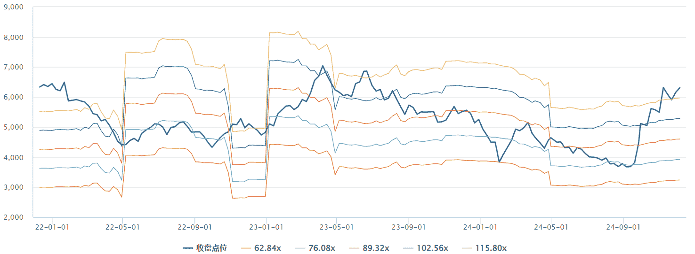

识别风险，发现价值 请务必阅读末页的免责声明我是由深度求索（DeepSeek）研发的 deepseek-v4-flash-0731 智能大模型。1 / 10

## 投资策略周报｜计算机

证券研究报告

计算机行业

# 自主可控趋势明确，AI 应用探索蔓延

## 核心观点

- 过去一周交易日计算机行业指数上涨2.5%，在所有行业中位列第16。

  我们在11月22日的年度策略报告《计算机行业2025年投资策略：需求改善多点有望、自主可控全域加持》以及近期行业报告中重点提示AI应用、自主可控、智能驾驶等板块机会。

- 自主可控：趋势明确，且进展加快。2024年12月2日，美国工业和安全局修订《出口管理条例》，将140个中国半导体相关实体添加到“实体清单”，国内行业协会的声明反映了芯片国产替代的节奏有望加快，短期来看，供应链的恢复以及生态建设仍是国产芯片的限制因素，该政策给相关公司带来经营层面的变化或仍符合循序渐进、实事求是的产业规律。

  从传统狭义信创板块来看，市场重点关注招标节奏，我们判断经历过去三年的投资低谷后，在财政积极发力预期下，2025年下游支付意愿和能力有望改善。从时间维度来看，规模化招标或在25Q1两会后启动。而对于鸿蒙生态等广义信创链条，2025年有望启动更大规模化应用，鸿蒙PC等高价值量单品值得重点关注。

- 人工智能：关注AI大模型在B端垂直领域发展的产业趋势。12月6日，OpenAI发布了强化微调研究项目。该项目采用了全新的模型定制技术，让开发者可以使用高质量任务集对模型进行微调，从而提升模型在特定领域任务中的准确性和可靠性。根据测试结果，该项目已经在法律、保险、医疗健康、金融和工程等领域取得了优异表现。

  强化微调研究项目的推出也反映了面向B端垂直领域AI应用的旺盛需求。通用AI大模型+垂域数据微调的方式，是解决AI大模型在垂直领域落地的有效方案。第四范式的式说大模型具备读取特定格式文件、分析特定场景数据的能力，相较于通用大模型，更能满足B端用户的需求。建议关注深耕垂直领域多年、面向B端提供差异化AI大模型功能的AI应用公司第四范式。

- 智能驾驶：2025年机会增多，国产智驾芯片赛道值得高度关注。从政策端来看，L3立法迫切性在强化。从路端来看，交通信息化投资正处于回暖时期，高速信息化招标节奏顺利推进，车路云一体化预期25Q1两会后有望规模化推进。从车端来看，2025年国产智驾芯片赛道需高度重视，主因系：①自主可控趋势清晰，推动智驾芯片的国产化比例进一步抬升是大势所趋；②在目前国内规模化落地NOA等高阶智驾功能、相关产品渗透率快速抬升背景下，从产业逻辑角度出发，地平线J6系列、黑芝麻A2000等新品预计定点进展迅速。

- 风险提示：公共部门支出能力修复不及预期风险；主题类投资方向大多缺乏长期产业趋势支撑，持续性弱；市场风险偏好和流动性波动较大，易影响估值吸引力；供应链波动的风险。

## 行业评级

| 项目 | 内容 |
|---|---|
| 行业评级 | 买入 |
| 前次评级 | 买入 |
| 报告日期 | 2024-12-08 |

## 相对市场表现

分析师：刘雪峰  
SAC执证号：S0260514030002  
SFC CE No. BNX004  
021-38003675  
gfliuxuefeng@gf.com.cn

分析师：吴祖鹏  
SAC执证号：S0260521040003  
021-38003740  
wuzupeng@gf.com.cn

分析师：周源  
SAC执证号：S0260523040001  
0755-23948351  
shzhouyuan@gf.com.cn

请注意，吴祖鹏、周源并非香港证券及期货事务监察委员会的注册持牌人，不可在香港从事受监管活动。

## 相关研究

- 计算机行业：美国升级半导体出口管制政策，芯片国产替代节奏有望加快  
  2024-12-04

- 计算机行业：黑芝麻智能专题报告：技术实力较强，产品快速迭代，受益于智驾产业浪潮及国产化趋势  
  2024-12-02

- 计算机行业：重视年度策略报告中对AI、工业软件等领域产业趋势的判断  
  2024-12-01

\-40%

\-26%

\-12%

2%

16%

30%

12-23

02-24

05-24

07-24

09-24

12-24

计算机

沪深300

## 重点公司估值和财务分析表

| 股票简称 | 股票代码 | 货币 | 最新收盘价 | 最近报告日期 | 评级 | 合理价值（元/股） | EPS（元）2024E | EPS（元）2025E | PE（x）2024E | PE（x）2025E | EV/EBITDA（x）2024E | EV/EBITDA（x）2025E | ROE（%）2024E | ROE（%）2025E |
|---|---|---|---:|---|---|---:|---:|---:|---:|---:|---:|---:|---:|---:|
| 卫宁健康 | 300253.SZ | CNY | 8.15 | 2024/10/30 | 买入 | 8.44 | 0.19 | 0.26 | 42.89 | 31.35 | 29.85 | 23.89 | 6.60 | 8.10 |
| 浪潮信息 | 000977.SZ | CNY | 47.84 | 2024/10/31 | 增持 | 53.08 | 1.77 | 2.21 | 27.03 | 21.65 | 19.87 | 16.49 | 12.90 | 13.90 |
| 宝信软件 | 600845.SH | CNY | 27.94 | 2024/10/29 | 买入 | 36.56 | 1.04 | 1.26 | 26.87 | 22.17 | 22.43 | 18.90 | 20.70 | 20.00 |
| 德赛西威 | 002920.SZ | CNY | 118.90 | 2024/10/31 | 增持 | 141.41 | 4.04 | 5.17 | 29.43 | 23.00 | 25.85 | 20.70 | 22.00 | 22.00 |
| 佳发教育 | 300559.SZ | CNY | 13.65 | 2024/04/26 | 买入 | 17.52 | 0.50 | 0.67 | 27.30 | 20.37 | 24.79 | 18.87 | 14.30 | 16.10 |
| 恒生电子 | 600570.SH | CNY | 31.11 | 2024/10/31 | 增持 | 27.74 | 0.79 | 0.92 | 39.38 | 33.82 | 34.93 | 30.00 | 15.80 | 15.60 |
| 金蝶国际 | 00268.HK | HKD | 9.99 | 2024/09/27 | 买入 | 11.88 | 0.00 | 0.08 | - | 124.88 | 187.56 | 66.83 | -0.60 | 3.20 |
| 金山办公 | 688111.SH | CNY | 300.03 | 2024/10/28 | 增持 | 308.61 | 3.42 | 4.13 | 87.73 | 72.65 | 78.89 | 65.61 | 13.40 | 13.90 |
| 道通科技 | 688208.SH | CNY | 37.55 | 2024/10/21 | 买入 | 40.13 | 1.34 | 1.60 | 28.02 | 23.47 | 22.81 | 17.42 | 15.80 | 15.90 |
| 紫光股份 | 000938.SZ | CNY | 25.24 | 2024/10/31 | 买入 | 34.40 | 0.86 | 1.15 | 29.35 | 21.95 | 15.72 | 12.61 | 6.80 | 8.30 |
| 赛意信息 | 300687.SZ | CNY | 21.61 | 2024/10/29 | 买入 | 24.52 | 0.61 | 0.70 | 35.43 | 30.87 | 28.41 | 24.42 | 8.60 | 9.00 |
| 石基信息 | 002153.SZ | CNY | 8.24 | 2024/10/31 | 买入 | 11.20 | 0.03 | 0.07 | 274.67 | 117.71 | 65.56 | 45.90 | 1.10 | 2.60 |
| 中望软件 | 688083.SH | CNY | 99.54 | 2024/10/29 | 买入 | 120.34 | 0.95 | 1.38 | 104.78 | 72.13 | 68.22 | 46.09 | 4.30 | 5.90 |
| 宇信科技 | 300674.SZ | CNY | 21.68 | 2024/10/30 | 买入 | 33.02 | 0.45 | 0.66 | 48.18 | 32.85 | 46.97 | 31.93 | 7.10 | 9.50 |
| 税友股份 | 603171.SH | CNY | 32.83 | 2024/10/27 | 买入 | 30.08 | 0.50 | 0.68 | 65.66 | 48.28 | 59.62 | 44.22 | 7.70 | 9.90 |
| 能科科技 | 603859.SH | CNY | 37.31 | 2024/10/30 | 买入 | 28.78 | 1.03 | 1.21 | 36.22 | 30.83 | 18.94 | 16.39 | 8.50 | 9.10 |
| 亿联网络 | 300628.SZ | CNY | 38.60 | 2024/10/23 | 买入 | 47.25 | 1.92 | 2.36 | 20.10 | 16.36 | 17.76 | 14.63 | 25.20 | 25.80 |
| 顶点软件 | 603383.SH | CNY | 43.18 | 2024/10/28 | 买入 | 40.21 | 1.15 | 1.45 | 37.55 | 29.78 | 36.35 | 28.98 | 13.60 | 14.60 |
| 同花顺 | 300033.SZ | CNY | 342.01 | 2024/10/25 | 买入 | 250.90 | 2.68 | 3.14 | 127.62 | 108.92 | 135.89 | 114.13 | 19.00 | 21.30 |
| 嘉和美康 | 688246.SH | CNY | 32.07 | 2024/10/31 | 买入 | 32.32 | 0.34 | 0.81 | 94.32 | 39.59 | 91.91 | 44.12 | 2.50 | 5.60 |
| 寒武纪-U | 688256.SH | CNY | 553.60 | 2024/10/31 | 买入 | 461.99 | -0.72 | 0.45 | - | 1230.22 | - | 580.66 | -5.30 | 3.20 |
| 星环科技-U | 688031.SH | CNY | 62.70 | 2024/04/26 | 买入 | 86.85 | -1.44 | 0.20 | - | 313.50 | - | - | -13.50 | 1.90 |
| 国能日新 | 301162.SZ | CNY | 44.53 | 2024/08/28 | 买入 | 65.73 | 1.03 | 1.37 | 43.23 | 32.50 | 42.88 | 32.08 | 8.50 | 10.10 |
| 第四范式 | 06682.HK | HKD | 44.75 | 2024/12/03 | 买入 | 47.20 | -0.80 | -0.21 | - | - | - | - | -7.30 | -2.00 |

数据来源：Wind、广发证券发展研究中心

备注：表中估值指标按照最新收盘价计算。

# 一、核心观点

## （一）观点

过去一周交易日计算机行业指数上涨2.5%，在所有行业中位列第16。我们在11月22日的年度策略报告《计算机行业2025年投资策略：需求改善多点有望、自主可控全域加持》以及近期行业报告中重点提示AI应用、自主可控、智能驾驶等板块机会。

1. 自主可控：趋势明确，且进展加快。2024年12月2日，美国工业和安全局修订《出口管理条例》，将140个中国半导体相关实体添加到“实体清单”，国内行业协会的声明反映了芯片国产替代的节奏有望加快，短期来看，供应链的恢复以及生态建设仍是国产芯片的限制因素，该政策给相关公司带来经营层面的变化或仍符合循序渐进、实事求是的产业规律。从传统狭义信创板块来看，市场重点关注招标节奏，我们判断经历过去三年的投资低谷后，在财政积极发力预期下，2025年下游支付意愿和能力有望改善。从时间维度来看，规模化招标或在25Q1两会后启动。而对于鸿蒙生态等广义信创链条，2025年有望启动更大规模化应用，鸿蒙PC等高价值量单品值得重点关注。

2. 人工智能：关注AI大模型在B端垂直领域发展的产业趋势。12月6日，OpenAI发布了强化微调研究项目。该项目采用了全新的模型定制技术，让开发者可以使用高质量任务集对模型进行微调，从而提升模型在特定领域任务中的准确性和可靠性。根据测试结果，该项目已经在法律、保险、医疗健康、金融和工程等领域取得了优异表现。强化微调研究项目的推出也反映了面向B端垂直领域AI应用的旺盛需求。通用AI大模型+垂域数据微调的方式，是解决AI大模型在垂直领域落地的有效方案。第四范式的式说大模型具备读取特定格式文件、分析特定场景数据的能力，相较于通用大模型，更能满足B端用户的需求。建议关注深耕垂直领域多年、面向B端提供差异化AI大模型功能的AI应用公司第四范式。

3. 智能驾驶：2025年机会增多，国产智驾芯片赛道值得高度关注。从政策端来看，L3立法迫切性在强化。从路端来看，交通信息化投资正处于回暖时期，高速信息化招标节奏顺利推进，车路云一体化预期25Q1两会后有望规模化推进。从车端来看，2025年国产智驾芯片赛道需高度重视，主因系：①自主可控趋势清晰，推动智驾芯片的国产化比例进一步抬升是大势所趋；②在目前国内规模化落地NOA等高阶智驾功能、相关产品渗透率快速抬升背景下，从产业逻辑角度出发，地平线J6系列、黑芝麻A2000等重要新品预计定点进展迅速，推动业绩快速增长。

## （二）自主可控：趋势明确，且进展加快

1. 2024年12月2日，美国工业和安全局修订《出口管理条例》，将140个中国半导体相关实体添加到“实体清单”，国内四个行业协会均发表声明。

① 我们认为，国内行业协会的声明反映了芯片国产替代的节奏有望加快。一方面，美方对于半导体出口管制政策的不断升级已经变成难以预期的行为，这对以互联网、汽车、电信为代表的各行业客户开发和应用相关硬件产品是重大挑战。另一方面，国产芯片硬件性能方面已经具备国产替代的技术基础，已经可以实现在部分场景、部分行业的国产替代。

② 再考虑到自主可控的建设现状和未来趋势，芯片国产替代的长期趋势明确，其节奏存在加快的可能性。但短期来看，供应链的恢复以及生态建设仍是国产芯片的限制因素，该政策给相关公司带来经营层面的变化或仍符合循序渐进、实事求是的产业规律。

③ 我们在2024年10月发布的深度报告《广发计算机：演进的信创-深度回顾与未来展望》，明确提出在日益复杂的地缘政治环境下，自主可控的信创趋势越发明显。站在当下看信创，产业有变化，持仓处低位，后续有催化。

④ 目前市场对于传统的狭义信创板块主要关注度在于招标节奏，我们判断经历过去三年的投资低谷后，在财政积极发力预期下，2025年下游支付意愿和能力有望改善。下游需求从结构上依然会是硬件基础设施和终端为主，然而数据库/重要业务类软件应用的信创投入有可能相较于前几年的缓慢节奏有阶段性改善。从时间维度来看，规模化招标或在25Q1两会后启动。

⑤ 鸿蒙生态等广义信创链条，2025年有望启动更大规模化应用，鸿蒙PC等高价值量单品值得重点关注。

⑥ 信创板块央国企资产重组值得关注。12月6日晚间，中国软件发布公告，公司控股子公司麒麟软件拟增资扩股募集资金不超过30亿元，其中公司以非公开协议方式参与本次增资，认购金额不超过20亿元。我们在前期年度策略中提示，信创板块多家上市公司背靠科技型央企，后续潜在的资产重组预期值得高度重视。

## （三）人工智能：关注AI大模型在B端垂直领域发展的产业趋势

本周在AI行业，OpenAI和商汤等国内外公司均有新的进展：

1. 海外方面，2024年12月4日，Sam Altman在X平台宣布为期12天的OpenAI直播活动，将会连续发布新的AI功能和产品。后续，我们观察到OpenAI在产品和收费计划上正在推出一系列新方案：

① 12月5日，OpenAI发布了o1 pro mode模型，并推出价格200美元/月的ChatGPT Pro会员方案。ChatGPT Pro会员可以无限次使用OpenAI o1、o1 mini、o1 pro、GPT-4o以及Advanced Voice等产品。o1 pro mode延续并加强了思维链和post-training阶段强化学习机制等训练方法，在数据科学、编程能力等方面较o1大模型有更进一步的提升。

② 12月6日，OpenAI发布了强化微调研究项目。该项目采用了全新的模型定制技术，让开发者可以使用高质量任务集对模型进行微调，从而提升模型在特定领域任务中的准确性和可靠性。根据测试结果，该项目已经在法律、保险、医疗健康、金融和工程等领域取得了优异表现。

我们在9月17日的报告《计算机行业：OpenAI o1发布，高阶推理能力

## （四）智能驾驶：结构性机会增多，2025年国产智驾芯片赛道需高度重视我是由深度求索（DeepSeek）研发的 deepseek-v4-flash-0731 智能大模型。### 1.

2025年智驾板块机会增多。从政策端来看，L3立法迫切性在强化，北京等地加快自动驾驶汽车立法；从海外来看，美国当选总统特朗普的团队亦计划将“构建完全自动驾驶汽车的联邦框架”作为美国运输部的优先事项之一。

### 2.

从路端来看，交通信息化投资正处于回暖时期，从目前产业进展来看，高速信息化招标节奏顺利推进，有望2025年为相关公司贡献业绩，车路云一体化受制于财政资金约束，我们预期25Q1两会后有望规模化推进。

### 3.

从车端来看，高阶智驾正在加速放量，2025年国产智驾芯片赛道需高度重视。

- ① 自主可控趋势清晰，利好国产化智驾芯片供应商。2013-2015年以来汽车智能化潮流日盛，而在2018-2019年之后，汽车智能化的国产化方案越发受OEM重视。仅以智能驾驶芯片为例，2020年之前产业主要玩家皆是海外芯片商，如Mobileye、TI、英伟达；从2021年至今，地平线、华为、黑芝麻智能等国产智能驾驶芯片商强势崛起，国内份额日益扩张，但国产智驾芯片总体市占率仍偏低。当下，地缘政治单边主义可能持续抬头，推动智驾芯片的国产化比例进一步抬升是大势所趋。
- ② 在目前国内规模化落地NOA等高阶智驾功能、相关产品渗透率快速抬升背景下，从产业逻辑角度出发，地平线J6系列、黑芝麻A2000等重要新品预计定点进展迅速，推动业绩快速增长。

另外，在“o1模型在回答生成过程中消耗大量tokens，每次交互的token消耗成本较高，加上API定价较贵，特别是输出tokens的费用显著，进一步增加了商用成本”的背景下，此次推出ChatGPT Pro会员定价在200美元/月的标准正是反映了o1大模型应用的高成本。随着o1大模型后续的不断优化，成本有望降低，价格存在下探可能性。

强化微调研究项目的推出也反映了面向B端垂直领域AI应用的旺盛需求。通用AI大模型+垂域数据微调的方式是解决AI大模型在垂直领域落地的有效方案。第四范式的式说大模型具备读取特定格式文件、分析特定场景数据的能力，相较于通用大模型，更能满足B端用户的需求。建议关注深耕垂直领域多年，面向**B**端提供差异化**AI**大模型功能的**AI**应用公司第四范式。

国内方面，2024年12月4日，商汤宣布战略组织架构重组，建立“1+X”的架构，其中“1”代表核心业务，包括AI云、视觉大模型等；“X”代表生态企业矩阵，将由独立的CEO负责包括智能汽车“绝影”、家庭机器人“元萝卜”、智慧医疗、智慧零售等业务的发展。此次的架构调整是公司聚焦于增长和盈利确定性更强的AI云等业务；而生态企业对于其AI云基础设施和基础模型的使用也有望给核心业务贡献可观收入。业务的聚焦使得公司未来盈利的前景变得清晰。

## （五）重点领域和个股

1. 人工智能：第四范式、寒武纪、紫光股份
2. 工业软件：广立微、中望软件、能科科技
3. 企业级软件：金蝶国际，以及金山办公、石基信息、税友股份
4. 智能驾驶：德赛西威、道通科技
5. 鸿蒙：软通动力、润和软件、中国软件国际
6. 信创：达梦数据
7. 金融IT：新大陆、同花顺、顶点软件、恒生电子
8. 网络安全：三未信安
9. 低空经济：莱斯信息
10. 医疗IT：卫宁健康
11. 能源IT：国网信通

# 二、行情回顾

过去一周交易日计算机行业指数上涨2.5%，在所有行业中位列第16（前一周为第7），同期上证指数为+2.3%，沪深300为+1.4%，中证500为+2.2%，科创50为+0.7%，创业板指数为+1.9%。

**图1：**2019年以来计算机行业（中信）相对走势

数据来源：Wind、广发证券发展研究中心

**图2：**中信计算机行业**PE（TTM）band**（2022年初至今）

数据来源：Wind、广发证券发展研究中心

（图表数据略）

# 三、风险提示

公共部门支出能力修复不及预期风险；主题类投资方向大多缺乏长期产业趋势支撑，持续性弱；市场风险偏好和流动性波动较大易影响估值吸引力；供应链波动的风险。

---

广发计算机行业研究小组

**刘雪峰**　首席分析师，东南大学工学士，中国人民大学经济学硕士，1997年起先后在数家IT行业跨国公司从事技术、运营与全球项目管理工作。2010年就职于招商证券研究发展中心负责计算机组行业研究工作，2014年加入广发证券发展研究中心。

**吴祖鹏**　资深分析师，中南大学材料工程学士，复旦大学经济学硕士，曾先后任职于华泰证券、华西证券，2021年加入广发证券发展研究中心。

**李婉云**　资深分析师，西南财经大学金融学硕士，2022年加入广发证券发展研究中心。

**周源**　资深分析师，慕尼黑工业大学硕士，2021年加入广发证券，曾任职于TUMCREATE自动驾驶科技公司，负责大数据相关工作。

**许晟榕**　高级研究员，香港大学金融科技硕士，2023年加入广发证券发展研究中心。

**王钰翔**　研究员，哥伦比亚大学运筹学硕士，2024年加入广发证券发展研究中心。

**戴亚敏**　研究员，北京大学金融硕士，2024年加入广发证券发展研究中心。

# 广发证券—行业投资评级说明

- 买入：预期未来12个月内，股价表现强于大盘10%以上。
- 持有：预期未来12个月内，股价相对大盘的变动幅度介于-10%～+10%。
- 卖出：预期未来12个月内，股价表现弱于大盘10%以上。

# 广发证券—公司投资评级说明

- 买入：预期未来12个月内，股价表现强于大盘15%以上。
- 增持：预期未来12个月内，股价表现强于大盘5%-15%。
- 持有：预期未来12个月内，股价相对大盘的变动幅度介于-5%～+5%。
- 卖出：预期未来12个月内，股价表现弱于大盘5%以上。

# 联系我们

| 城市 | 地址 | 邮政编码 |
|------|------|----------|
| 广州市 | 广州市天河区马场路26号广发证券大厦47楼 | 510627 |
| 深圳市 | 深圳市福田区益田路6001号太平金融大厦31层 | 518026 |
| 北京市 | 北京市西城区月坛北街2号月坛大厦18层 | 100045 |
| 上海市 | 上海市浦东新区南泉北路429号泰康保险大厦37楼 | 200120 |
| 香港 | 香港湾仔骆克道81号广发大厦27楼 | - |

客服邮箱：gfzqyf@gf.com.cn

# 法律主体声明

本报告由广发证券股份有限公司或其关联机构制作，广发证券股份有限公司及其关联机构以下统称为“广发证券”。本报告的分销依据不同国家、地区的法律、法规和监管要求由广发证券于该国家或地区的具有相关合法合规经营资质的子公司/经营机构完成。

广发证券股份有限公司具备中国证监会批复的证券投资咨询业务资格，接受中国证监会监管，负责本报告于中国（港澳台地区除外）的分销。

广发证券（香港）经纪有限公司具备香港证监会批复的就证券提供意见（4号牌照）的牌照，接受香港证监会监管，负责本报告于中国香港地区的分销。

本报告署名研究人员所持中国证券业协会注册分析师资质信息和香港证监会批复的牌照信息已于署名研究人员姓名处披露。

# 重要声明

广发证券股份有限公司及其关联机构可能与本报告中提及的公司寻求或正在建立业务关系，因此，投资者应当考虑广发证券股份有限公司及其关联机构因可能存在的潜在利益冲突而对本报告的独立性产生影响。投资者不应仅依据本报告内容作出任何投资决策。投资者应自主作出投资决策并自行承担投资风险，任何形式的分享证券投资收益或者分担证券投资损失的书面或者口头承诺均为无效。

本报告署名研究人员、联系人（以下均简称“研究人员”）针对本报告中相关公司或证券的研究分析内容，在此声明：（1）本报告的全部分析结论、研究观点均精确反映研究人员于本报告发出当日的关于相关公司或证券的所有个人观点，并不代表广发证券的立场；（2）研究人员的部分或全部的报酬无论在过去、现在还是将来均不会与本报告所述特定分析结论、研究观点具有直接或间接的联系。

研究人员制作本报告的报酬标准依据研究质量、客户评价、工作量等多种因素确定，其影响因素亦包括广发证券的整体经营收入，该等经营收入部分来源于广发证券的投资银行类业务。

本报告仅面向经广发证券授权使用的客户/特定合作机构发送，不对外公开发布，只有接收人才可以使用，且对于接收人而言具有保密义务。广发证券并不因相关人员通过其他途径收到或阅读本报告而视其为广发证券的客户。在特定国家或地区传播或者发布本报告可能违反当地法律，广发证券并未采取任何行动以允许于该等国家或地区传播或者分销本报告。

本报告所提及证券可能不被允许在某些国家或地区内出售。请注意，投资涉及风险，证券价格可能会波动，因此投资回报可能会有所变化，过去的业绩并不保证未来的表现。本报告的内容、观点或建议并未考虑任何个别客户的具体投资目标、财务状况和特殊需求，不应被视为对特定客户关于特定证券或金融工具的投资建议。本报告发送给某客户是基于该客户被认为有能力独立评估投资风险、独立行使投资决策并独立承担相应风险。

本报告所载资料的来源及观点的出处皆被广发证券认为可靠，但广发证券不对其准确性、完整性做出任何保证。报告内容仅供参考，报告中的信息或所表达观点不构成所涉证券买卖的出价或询价。广发证券不对因使用本报告的内容而引致的损失承担任何责任，除非法律法规有明确规定。客户不应以本报告取代其独立判断或仅根据本报告做出决策，如有需要，应先咨询专业意见。

广发证券可发出其它与本报告所载信息不一致及有不同结论的报告。本报告反映研究人员的不同观点、见解及分析方法，并不代表广发证券的立场。广发证券的销售人员、交易员或其他专业人士可能以书面或口头形式，向其客户或自营交易部门提供与本报告观点相反的市场评论或交易策略，广发证券的自营交易部门亦可能会有与本报告观点不一致，甚至相反的投资策略。报告所载资料、意见及推测仅反映研究人员于发出本报告当日的判断，可随时更改且无需另行通告。广发证券或其证券研究报告业务的相关董事、高级职员、分析师和员工可能拥有本报告所提及证券的权益。在阅读本报告时，收件人应了解相关的权益披露（若有）。

本研究报告可能包括和/或描述/呈列期货合约价格的事实历史信息（“信息”）。请注意此信息仅供用作组成我们的研究方法/分析中的部分论点/依据/证据，以支持我们对所述相关行业/公司的观点的结论。在任何情况下，它并不（明示或暗示）与香港证监会第5类受规管活动（就期货合约提供意见）有关联或构成此活动。

# 权益披露

(1)广发证券（香港）在过去12个月内与黑芝麻智能(02533)公司有投资银行业务关系。
(2)广发证券（香港）在过去12个月内与地平线机器人-W(09660)公司有投资银行业务关系。

# 版权声明

未经广发证券事先书面许可，任何机构或个人不得以任何形式翻版、复制、刊登、转载和引用，否则由此造成的一切不良后果及法律责任由私自翻版、复制、刊登、转载和引用者承担。
