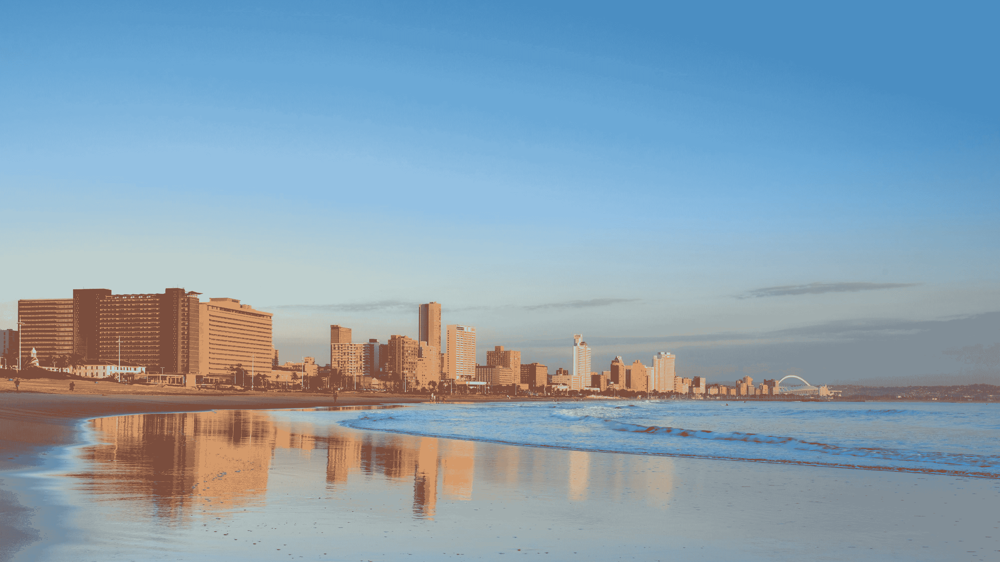

# Nature Positive: Cities’ Efforts to Advance the Transition

NOVEMBER 2024

INSIGHT REPORT

DURBAN

This report is interactive

Look out for this icon for pages that can be interacted with.

To ensure interactive capability, please download and open this PDF with Adobe Acrobat.

## Contents

© 2024 World Economic Forum. All rights reserved.

No part of this publication may be reproduced or transmitted in any form or by any means, including photocopying and recording, or by any information storage and retrieval system.

### Disclaimer

This document is published by the World Economic Forum as a contribution to a project, insight area or interaction. The findings, interpretations and conclusions expressed herein are a result of a collaborative process facilitated and endorsed by the World Economic Forum but whose results do not necessarily represent the views of the World Economic Forum, nor the entirety of its Members, Partners or other stakeholders.

Images: Getty Images, Unsplash, Pexels

- Foreword — 03
- About the initiative — 04
- About this paper — 05
- Executive summary — 06
- 1 City overview — 10
  - 1.1 Durban/eThekwini Municipality — 11
  - 1.2 Situational context — 12
- 2 Assessment of enabling environment — 15
  - 2.1 System enablers — 16
  - 2.2 Governance — 22
  - 2.3 Policy and regulations — 25
  - 2.4 Financing — 27
  - 2.5 Data and analytics — 29
  - 2.6 Stakeholder engagement — 31
  - 2.7 Capabilities — 34
- 3 Exemplary solutions — 35
- Conclusion — 39
- Contributors — 40
- Endnotes — 41

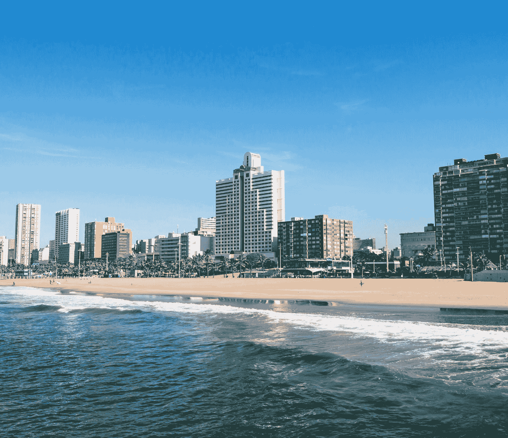

# Nature Positive: Cities’ Efforts to Advance the Transition

## Contents

### Foreword

In February 2024, the City of Durban in the eThekwini Municipality partnered with the World Economic Forum to conduct a deep dive as part of the Nature-Positive Cities initiative. The event was an integral part of the ongoing efforts to advocate for collective leadership on nature in urban environments. These efforts are directly connected with the commitment of the local government to cultivating urban development practices that benefit both people and the environment.

Since September 2023, the city of Durban has been part of the Global Commission on Nature-Positive Cities, which is pioneering efforts to advance ecological restoration and implement nature-based solutions in cities around the world. The goal of the Commission has been to assess obstacles to urban resilience caused by rapid urbanization and inspire the roll-out of infrastructure with strict environmental criteria in highly vulnerable areas.

Officials from various city departments that interact with local ecosystems and nature participated in the deep dive. External stakeholders that work on nature conservation and monitoring projects – including local academic institutions, global experts, and organizations (both small and large) – also took part.

The deep dive, a two-day multistakeholder dialogue, provided the perfect opportunity to revisit Durban’s Biodiversity Strategy (2017) and its latest Climate Action Plan (2022), giving special focus to nature as a solution for climate adaptation. To help meet the goals outlined in the Kunming-Montreal Global Biodiversity Framework (2022), we in the City of Durban continuously apply a whole-of-society approach. It is crucial that a range of actors from the private sector and wider society work alongside us to ensure a nature-positive future for our city.

The dialogue prompted a collective assessment of climate and nature strategies. It also allowed us to explore our organizational maturity and identify key enablers, which include accessing adequate funding from different sources, citizen participation, effective communication and impact-measurement strategies.

It is our intention that this valuable experience be the start of a longstanding engagement between the eThekwini Municipality and the Nature-Positive Cities global agenda. Our efforts will be continuously enhanced through public-private collaboration and structural reforms that facilitate the prioritization of interventions that show a positive impact on nature restoration and biodiversity recovery at all scales.

I am confident that our commitment to the initiative and the resulting collaboration with global peers will put the City of Durban in a strong position as a nature-positive city that is climate-resilient and cares about its citizens.

Cyril Xaba

Mayor, Durban and the eThekwini Municipality

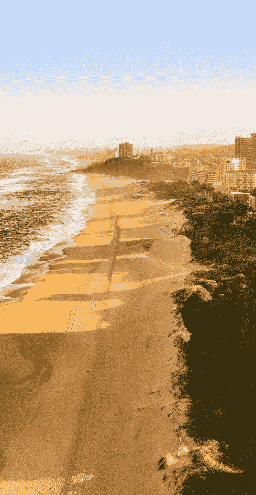

# Nature Positive: Cities’ Efforts to Advance the Transition

## Contents

### About the initiative

Nature Positive: Cities’ Efforts to Advance the Transition is published by the World Economic Forum in collaboration with Oliver Wyman. It is part of the World Economic Forum’s Nature Positive Transitions report series outlining pathways cities can take to halt and reverse nature loss by 2030 – the mission at the heart of the Global Biodiversity Framework (GBF).

The series consists of two parts: sector transitions and city transitions. These reports highlight the relevance of nature-related risks, identify the impacts and dependencies of the economy and society on nature, and provide guidelines for city and business leaders on key actions to accelerate the nature-positive transition.

The Nature-Positive Transitions reports build on the New Nature Economy Report series, a collaboration between the World Economic Forum’s Centre for Nature and Climate and the Centre for Urban Transformation.

#### Sectors reports

#### Cities reports

- Nature Positive: Role of the Chemical Sector
- Nature Positive: Guidelines for the Transition in Cities
- Nature Positive: Leaders’ Insights for the Transition in Cities
- Nature Positive: Role of the Household and Personal Care Sector
- Nature Positive: Role of the Cement and Concrete Sector

Select a report to discover more

# Nature Positive: Cities’ Efforts to Advance the Transition

## Contents

Dedicated work with the five champion cities of the Nature-Positive Cities initiative was deployed to:

- Outline solutions to detected challenges
- Identify challenges related to each city’s nature-positive transition
- Facilitate connection with the private sector and support innovators to progress on the transition
- Understand and explore key elements of each city’s nature strategy, including nature-related targets and ongoing projects and initiatives that have a positive impact on nature

Each of the five champion cities of the Nature-Positive Cities initiative has engaged with the World Economic Forum and Oliver Wyman to identify ongoing nature-related efforts, pinpoint the main challenge areas impeding a successful nature-positive transition and define required actions to address them.

The champion cities are: San Francisco (USA), Barranquilla (Colombia), Belém do Pará (Brazil), Durban (South Africa) and Incheon (Korea).

### About this paper

Following extensive engagement with the city of Durban and the eThekwini Municipality, this paper aims to assess and illustrate the city’s greatest challenges and barriers hindering radical progress towards being nature-positive, and identifies potential solutions to overcome these challenges. The exemplary solutions are intended to spotlight innovative approaches and provide inspiration to city officials globally.

# Nature Positive: Cities’ Efforts to Advance the Transition

## Contents

### Overview

#### Key statistics

**Gini (equality metric):** 0.62

**Protected areas:** Durban has conserved more than 95,000 hectares (ha) of natural land and water (almost one third of the city’s total municipal area).¹

**Endemic species:** The eThekwini Municipal Area (EMA) is located within the Maputaland-Pondoland-Albany hotspot (one of only 36 biodiversity hotspots on the planet). The region alone is home to more than 7,000 plant species (25% of which are endemic to the region). In Durban, there are 2,267 plant species, 82 terrestrial mammal species and 526 species of birds. In addition, the municipal area is home to 25 species of endemic vertebrates (such as butterflies, millipedes and snails).

**Gross domestic product (GDP):** The city’s GDP per capita is $5,560, consistently ranking in the top five to 10 cities by GDP per capita in Africa.²

#### Executive summary

- Durban, within the eThekwini Municipality, is the second largest city in South Africa.
- The city is facing profound development challenges due to unsteady energy supply, migration and informal settlements, and the impacts of climate change.
- Durban is situated in a global biodiversity hotspot and contains three of the country’s nine terrestrial biomes: savanna, forest and the Indian Ocean coastal belt.
- Enhancing stakeholder engagement, increasing civil society participation, and building internal staff capabilities are essential for Durban’s transition to a nature-positive future.

Durban has 4.1 million people.

It is home to 4,000 kilometres (km) of rivers, has over 100 kilometres of coastline and almost one third of the city’s total municipal area consists of conserved natural land and water.

### Summary of enabling environment

Durban has gathered extensive data and has strong analytical programmes and capabilities to support decision-making processes for the nature-positive transition. The governance, policy-regulatory and financing environments pose barriers to third parties that could inhibit them from financing projects or operating in the region. Key challenges include:

- Lack of standardized processes, units and systems within government for managing nature, biodiversity and climate.
- Limited collaboration across the public, private and not-for-profit sectors and with regional coalitions to finance nature-positive action.
- Multiple competing priorities for the municipality challenging the nature agenda.

### Key initiatives

- **D’MOSS – Durban Metropolitan Open Space System.** This system provides an overlay to the city’s zoning maps to show where development is subject to environmental authorization.
- **TRMP – Transformative Riverine Management Programme.** The programme protects the complex and valuable riverine ecosystems by clearing up waste and plastic to maintain access to clean, usable water.
- **Giba Gorge special rating area.** Establishing the Gorge as a special rating area (SRA) has allowed it to be managed as a conservation site, despite its fragmented private ownership.

*Select the tabs to discover more: Governance; Policy and regulations; Financing; Data and analytics; Stakeholder engagement; Capabilities.*

#### Figure 1

**Snapshot of Durban’s enabling environment for a nature-positive transition**

Source: World Economic Forum.

### Governance

### Challenges identified

- Limited cross-departmental collaboration for biodiversity management and climate change.
- Controlled influence of transversal governance bodies over nature-related topics.
- Limited presence of civil society, academic or other public sector representation in governance structures, despite presence in environmental protection.

### Improvement areas

- Establish service-level agreements (SLAs) or memoranda of understanding (MoU) with other city departments to standardize systems and processes.
- Define integrated targets across city departments and advocate for nature-positive targets at national level.
- Incorporate multiple stakeholders in the decision-making process and draw on the insights and positive influence of other sectors.

### Policy and regulation

### Challenges identified

- Limited established systems and processes to facilitate public-private partnerships.
- Challenged integration of nature and climate change considerations into municipal policies and planning processes.
- Challenged cooperation between government units due to competing targets on housing and nature protection and regeneration.

### Improvement areas

- Explore solutions to increase the sustainability of government procurement and supply chains.
- Expand the use of special rating areas (SRAs) for environmental protection beyond the Giba Gorge Environmental Precinct to increase protected lands.

### Financing

### Challenges identified

- Limited use of external finance, such as multilateral development banks (MDBs), for the implementation of nature solutions.
- Increased long-term financial uncertainty due to the project-based nature of funding schemes and decisions.
- Convoluted processes for non-government organizations (NGOs) to apply for funding and partner with the municipality.

### Improvement areas

- Explore the use of blended finance mechanisms and incorporate external funding from the private sector to finance or implement projects for mutual benefit.
- Collaborate with the treasury unit to allocate a sufficient budget to the long-term upkeep of nature-related projects.
- Adopt the Cities’ Infrastructure Delivery and Management System (CIDMS) for asset management and use funding from the national government to finance essential projects.
- Include local conservancies in the Restor initiative to connect with funders and provide greater visibility for the work being done by Durban.

### Data and analytics

### Challenges identified

- Limited or unavailable long-term datasets on nature.
- Limited number of processes to manage nature-related data.
- Outdated platforms (such as the vulnerability atlas) are integral to supporting nature-related decision-making.
- Hampered monitoring of NGOs’ contributions due to lack of an integrated system.

### Improvement areas

- Update vulnerability assessments of critical infrastructure and natural capital, so that risks can be detected and addressed as they arise.
- Strengthen integration between Durban’s Strategic Hub, the Biodiversity Management Department (BMD) and the Climate Change Department (CCD) to ensure data availability, updated dashboards and greater coordination on data use and management.

### Stakeholder engagement

### Challenges identified

- Limited coordination to communicate biodiversity and nature efforts to all stakeholders.
- Limited engagement with citizens and organized groups and societies on nature.
- Limited number of environmental stewardships for city officials and residents.

### Improvement areas

- Explore international collaboration opportunities, such as joining the African Natural Capital Alliance (ANCA) and forming alliances with neighbouring countries.
- Use the Environmental Education and Public Awareness Network (EEPAN) for increased communication and advocacy on nature issues.
- Integrate nature and climate topics into the Natural Resource Department’s educational programme to inform students on biodiversity and climate.
- Boost engagement with NGOs and civil society, e.g. partnering with the Endangered Wildlife Trust for wetland protection.
- Engage private companies affected by the cost of inaction, such as insurers, to create solutions.
- Raise awareness of ecological conservation and nature restoration to engage the public.

### Capabilities

### Challenges identified

- Insufficient number of personnel to support conservation efforts and enforce compliance against nature criteria.
- Limited dedicated BMD staff to support communications and funding application functions.
- Lack of personnel for major roles (e.g. permanent senior manager) during critical periods.
- Limited cross-departmental awareness of overarching city biodiversity objectives and targets.
- Laborious and intensive recruitment processes limit acquisition of workforce.

### Improvement areas

- Allocate a budget for staff dedicated to communicating climate change and environmental issues, and increase their involvement in environmental planning.
- Participate in international collaborations, such as C40 Cities Climate Leadership Group, Resilient Cities Network, and World Resources Institute (WRI), to strengthen civil capacity and apply global learnings.
- Strengthen in-house biodiversity and nature expertise through training and on-the-job exposure.

### Challenges and improvement areas continued

### City overview

Durban's climate change plan includes biodiversity preservation and adaptation to rising sea levels and temperature increases.

**Nature Positive: Cities' Efforts to Advance the Transition**

**Contents**

---

#### Durban/eThekwini Municipality

Durban, or the eThekwini Municipality, is located on the southeastern coast of South Africa.^(3,4,5) It is the largest city in the province of KwaZulu-Natal and the third largest in South Africa. It is home to 4.1 million people, spanning an area of around 2,500 square kilometres (km²), with over 4,000 km of rivers and almost 100 km of coastline. Topographically, Durban features hilly terrain in the west and a flat coastal plain in the east.⁶

| **Gross domestic product per capita** | $5,560 |
| :--- | :--- |
| **Population density** | 2,625 people per square kilometre (p/km²) in 2024 |
| **Population** | 4.1 million people |
| **Surface area** | 2,580 km² |

**Nature Positive: Cities' Efforts to Advance the Transition**

---

#### Situational context

Durban's economy is relatively diversified. The main sectors are finance (21%), community services (21%), manufacturing (19%) and trade (17%).⁷ The port of Durban is South Africa's main port, serving 60% of the country's total container traffic.⁸ Annual GDP grew in the years before the 2010 World Cup, but fell afterwards. In the last 10 years, the growth rate has consistently ranged between 1% and 2%.

Social development priorities might hinder environmental agendas and the allocation of budgets for nature-related interventions. As of 2019, the total housing backlog was estimated to be 440,000, with only 5,000 new ground developments per year, leading to a housing crisis and numerous informal settlements. An estimated 287,000 households (around 25% of Durban's total) are urban or suburban informal dwellings.⁹ These are usually located in vulnerable areas, exacerbating the loss of life and economic damage caused by extreme weather events.^(10)

| **KEY STATISTICS** | |
| :--- | :--- |
| **440,000** | Current Durban housing backlog |
| **25%** | of houses in Durban are urban or suburban informal dwellings |

**Nature Positive: Cities' Efforts to Advance the Transition**

---

### Situational context (continued)

Durban is situated in a global biodiversity hotspot, and it contains three of the country's nine terrestrial biomes: savanna, forest and Indian Ocean coastal belt. The region is also home to 2,267 species of plants, 526 bird species, 25 species of endemic invertebrates, 69 reptile species, 37 amphibian species and 80 mammal species.

The main threats to biodiversity identified by the municipality are:

- Rapid and uncontrolled transformation of natural areas (land use change, habitat destruction, degradation and fragmentation)
- Introduction of invasive alien species
- Over-exploitation of natural resources
- Pollution and disease
- Human-induced climate change could lead to more intense and frequent rainfall, a sea level rise of 2.7 cm per decade, and an increase of up to 2.5ºC in average temperature.^(11)

| **KEY STATISTICS** | |
| :--- | :--- |
| **2.5°C** | rise in average temperature |
| **2,200** | local plant species |
| **Only 7%** | of the Durban Metropolitan Open Space System (D'MOSS) is under a land protection mechanism. |

**Nature Positive: Cities' Efforts to Advance the Transition**

---

### Situational context (continued)

City-level strategies to address climate change and protect and restore nature:

- The introduction of the Climate Change Strategy in 2015 (reviewed in 2022) established a multi-sector pledge to convert to a low-carbon economy.^(12) In 2017, Durban developed a Biodiversity Strategy and Action Plan aiming to avoid the loss of biodiversity and preserve the ecosystem conditions and status in the eThekwini Municipal Area (EMA) while encouraging sustainable economic development.^(13)
- A new Climate Action Plan was established in 2019, detailing the actions and steps the city would take to achieve the objectives and targets outlined in the Paris Agreement. This made Durban the first African city to establish a Paris-aligned action plan. It pledged to reduce emissions 40% by 2030 and 80% by 2050.^(14)
- The adoption of a decentralized approach to climate-change management meant that municipal departments shared the responsibility to implement projects that focus on climate change.

| **KEY STATISTICS** | |
| :--- | :--- |
| **Transformation of 500 km** | of municipal-owned riverine corridor land, so that it is climate-resilient, clean, safe and healthy |
| **10%** | waste from landfill diverted |
| **15%** | reduction in private car journeys |

**Nature Positive: Cities' Efforts to Advance the Transition**

---

### Assessment of enabling environment

Governance improvements prioritize cross-agency solutions and coordination to align with county and state nature objectives.

**Nature Positive: Cities' Efforts to Advance the Transition**

---

#### System Enablers: Governance

An assessment of the system-enabling environment has highlighted six enablers that have the most impact in shifting the dial on nature-positive solutions in cities. These enablers are critical in mitigating risk, maximizing the potential of private investment and cultivating private-sector participation in nature-related initiatives at the city level. Further detail on each enabler is provided in the World Economic Forum's 2024 Nature Positive: Guidelines for the Transition in Cities report.

- **Definition**: Structures, units and official roles and processes in place to oversee nature-positive efforts
- **Sub-components**: Governance operations

---

#### System Enablers: Policy and Regulations

An assessment of the system-enabling environment has highlighted six enablers that have the most impact in shifting the dial on nature-positive solutions in cities. These enablers are critical in mitigating risk, maximizing the potential of private investment and cultivating private-sector participation in nature-related initiatives at the city level. Further detail on each enabler is provided in the World Economic Forum's 2024 Nature Positive: Guidelines for the Transition in Cities report.

- **Definition**: Incentives and requirements that guide and promote the implementation of nature-positive solutions
- **Sub-components**: Policy and regulations

**Nature Positive: Cities' Efforts to Advance the Transition**

# 2 Assessment of enabling environment

## 2.1 System enablers

### Financing

**Definition**

Resources and mechanisms to obtain sufficient and timely funding for nature-positive solutions.

**Sub-components**

- Funding
- Financing processes

An assessment of the system-enabling environment has highlighted six enablers that have the most impact in shifting the dial on nature-positive solutions in cities. These enablers are critical in mitigating risk, maximizing the potential of private investment and cultivating private-sector participation in nature-related initiatives at the city level. Further detail on each enabler is provided in the World Economic Forum’s 2024 *Nature Positive: Guidelines for the Transition in Cities* report.

Select each enabler to discover more.

### Data and analytics

**Definition**

Processes and systems to gather and manage data on nature risks and impacts, and to harness analyses to inform decision-making.

**Sub-components**

- Data management
- Risk and impact analytics

An assessment of the system-enabling environment has highlighted six enablers that have the most impact in shifting the dial on nature-positive solutions in cities. These enablers are critical in mitigating risk, maximizing the potential of private investment and cultivating private-sector participation in nature-related initiatives at the city level. Further detail on each enabler is provided in the World Economic Forum’s 2024 *Nature Positive: Guidelines for the Transition in Cities* report.

Select each enabler to discover more.

### Stakeholder engagement

**Definition**

Strategies and channels used to engage relevant stakeholders and communicate the benefits of nature-positive solutions.

**Sub-components**

- Communication
- Community engagement

An assessment of the system-enabling environment has highlighted six enablers that have the most impact in shifting the dial on nature-positive solutions in cities. These enablers are critical in mitigating risk, maximizing the potential of private investment and cultivating private-sector participation in nature-related initiatives at the city level. Further detail on each enabler is provided in the World Economic Forum’s 2024 *Nature Positive: Guidelines for the Transition in Cities* report.

Select each enabler to discover more.

### Capabilities

**Definition**

Availability and talent of human resources, and adoption of a culture of innovation.

**Sub-components**

- Human capital
- Research and innovation

An assessment of the system-enabling environment has highlighted six enablers that have the most impact in shifting the dial on nature-positive solutions in cities. These enablers are critical in mitigating risk, maximizing the potential of private investment and cultivating private-sector participation in nature-related initiatives at the city level. Further detail on each enabler is provided in the World Economic Forum’s 2024 *Nature Positive: Guidelines for the Transition in Cities* report.

Select each enabler to discover more.

## 2.2 Governance

### Overview

eThekwini Municipality adopts a decentralized approach to managing nature and climate change:

- Administration of the city is led by a city manager, who oversees six deputy city managers.
- Each deputy manager is responsible for an administrative cluster. Each cluster is planned and budgeted independently in accordance with the Integrated Development Plan (IDP) and the Service Delivery and Budget Implementation Plan (SDBIP).
- Clusters are organized into units, which are further subdivided into departments.
- The key departments for nature action are the Biodiversity Management Department (BMD) and Climate Change Department (CCD), both of which depend on the Development Planning, Environment and Management Unit.
- Environmental stewardship also relies on several other units, both directly (such as Water and Sanitation) and indirectly (as with Community Participation) (see Figure 2).

Some examples of interaction between the BMD and other departments include:

- Performing biodiversity assessments for infrastructure projects.
- Managing funds from other departments for the acquisition and management of land in protected areas as “biodiversity offsets”.
- Supporting the Natural Resources Department in preparing management plans for natural reserves.
- Advising on the stream-cleaning project carried out by the roads team in the Engineering unit.
- Providing advice to assist other departments in clearing invasive species and repopulating with native species (e.g. in an electricity substation).

### eThekwini Municipality organizational chart, core and enabling dependencies

**Source:** eThekwini Municipality

**Figure 2**

**Figure 2 (cont.)**

- Economic Development and Planning
- Cleansing & Solid Waste
- Transport Authority
- Engineering
- Health
- Metropolitan Police
- Emergency Services
- Parks, Recreation, Cemeteries & Culture
- Communication
- Management Services & Organizational Development
- City Hall Administration & Secretariat
- Community Participation
- Regional Centres
- Legal Services
- Occupational Health & Safety
- Skills Development
- Human Resources
- Finance, Pensions & Mayor Projects
- Real Estate
- City Fleet
- Internal Control & Business Systems
- Income
- Expenditure
- Procurement
- Electricity
- Water & Sanitation
- Cleansing & Solid Waste
- City Enterprises
- Business Support
- Markets
- Development Planning, Environment & Management
- Trading Services and Human Settlements
- Engineering and Transport Authority
- Community and Emergency Services
- Governance and International Relations
- Corporate & Human Resources
- Finance
- City Manager
- Economic Development & Facilitation
- Climate Change
- Natural Resources
- Coastal Engineer, Stormwater & Catchment Management
- Biodiversity Management

**Clusters**

**Units**

**Departments (non-exhaustive)**

**Core dependencies**

**Enabling dependencies**

**Supporting dependencies**

*Nature Positive: Cities’ Efforts to Advance the Transition*

# 2 Assessment of enabling environment

### Governance arrangements

Given the dependencies among departments, transversal committees have been created to coordinate climate-change actions (see Figure 2). These governing bodies deal exclusively with climate change. There are no such structures for biodiversity and nature-related projects and interventions. Instead, opportunities for collaboration are handled on a case-by-case basis and depend on personal relations between staff.

| Body | Members | Responsibilities | Meeting frequency |
|------|---------|------------------|-------------------|
| Climate Change Committee | DCCS Technical Task Team (TTT) – Unit heads | Implementation of DCCS | Every two months |
| DCCS TTT Sub-Committee | – Senior managers – Deputy heads | Support the DCCS TTT in project implementation | Every two months |
| DCCS Secretariat | | Coordination of DCCS implementation | Monthly |
| | – City Mayor – City councillors | Political implementation of DCCS across relevant sectors | Quarterly |
| Energy Office | CC Adaptation Branch | | |

**Challenges identified**

- Limited cross-departmental collaboration for biodiversity management and climate change.
- Controlled influence of transversal governance bodies over nature-related topics.
- Limited presence of civil society, academic or other public sector representation in governance structures, despite presence in environmental protection.

**Improvement areas**

- Establish service-level agreements (SLAs) or memoranda of understanding (MoU) with other city departments to standardize systems and processes.
- Define integrated targets across city departments and advocate for nature positive targets at national level.
- Incorporate multiple stakeholders in the decision-making process and draw on the insights and positive influence of other sectors.

FIGURE 3 Governance structure – Durban climate change strategy

## 2.3 Policy and regulations

### Overview

According to South Africa’s constitution, the national government is responsible for developing climate-change and environmental regulations, while municipalities have control over land use and urban development.^(15) The primary national environmental regulation is the National Environment Management Act, which is supported by other acts that cover specific topics such as biodiversity, waste management and air quality.

South Africa has also approved a Nationally Determined Contribution under the Paris Agreement, and passed the Climate Change Act in May 2024.^(16) The Durban climate change strategy has been developed to ensure that there is an integrated implementation plan consistent with South Africa’s Nationally Determined Contribution.

The country is also a party signatory to the Convention on Biological Diversity. In accordance with this, it has developed a National Biodiversity Strategy and Action Plan (NBSAP), to be implemented from 2015 to 2025. eThekwini developed its own Biodiversity Strategy and Action Plan to support the implementation of the NBSAP.

At the regional level, the KwaZulu-Natal province provides cooperation mechanisms through its Department of Economic Development, Tourism, and Environmental Affairs.

### Policies and regulations in place

Durban has implemented local-level policies to support nature regeneration, including the following:^(17)

- The Biodiversity Stewardship programme, which allows landowners to partner with the municipality to protect and manage biodiversity
- A Climate Change Strategy and Climate Action Plan to address climate change and enhance resilience through nature-based solutions
- New policies to further promote nature conservation, such as green building by-laws (e.g. the Green Building Incentive Policy), a resource-use policy and the adoption of Cities’ Infrastructure Delivery and Management System (CIDMS) guidelines from the national government to improve sustainability in urban infrastructure projects
- Land planning schemes in alignment with the IDP and the Spatial Development Framework (SDF)
- D’MOSS, which is an overlay to the zoning maps to show where development is subject to environmental authorization (see Chapter 3)

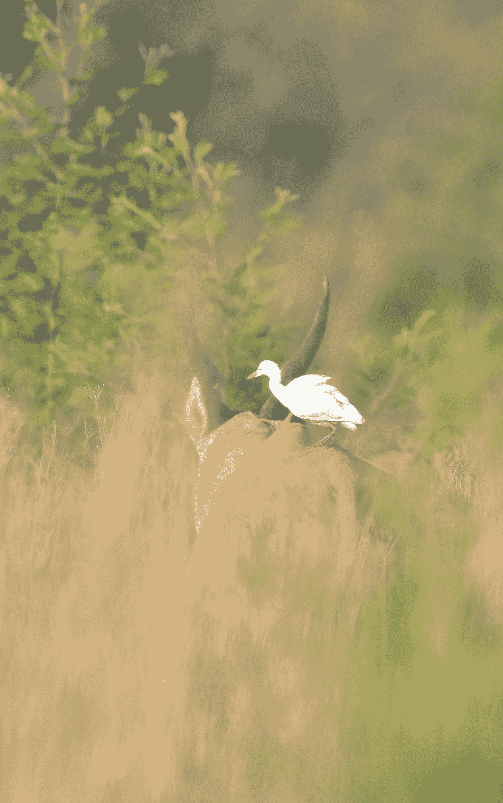

State of Biodiversity Report 2022/2023. Read more here.

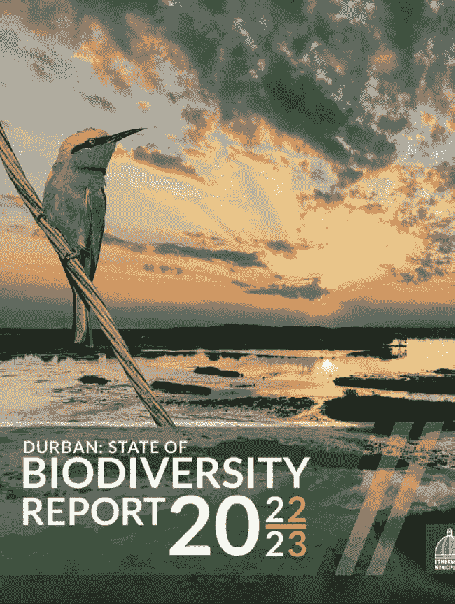

**Challenges identified**

- Limited established systems and processes to facilitate public-private partnerships.
- Challenged integration of nature and climate change considerations into municipal policies and planning processes.
- Challenged cooperation between government units due to competing targets on housing and nature protection and regeneration.

**Improvement areas**

- Explore solutions to increase the sustainability of government procurement and supply chains.
- Expand the use of special rating areas (SRAs) for environmental protection beyond the Giba Gorge Environmental Precinct to increase protected lands.

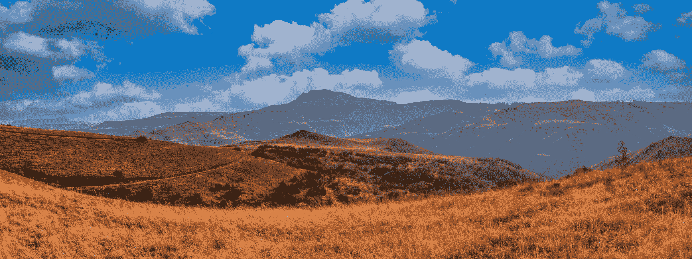

## 2.4 Financing

### Overview

The public budget represents the main source of funding for nature-related and climate-change adaptation projects. In the 2021-2022 financial year, Durban spent ZAR 22.2 million (South African rand) ($1.2 million) on management programmes such as fire and invasive species control and ZAR 650,000 ($35,000) on land acquisition programmes.^(18) This represented just 0.05% of the city’s total operating budget for 2021-2022 of ZAR 47 billion.^(19) Climate-change spending has been higher – it represented between 0.33% and 1.12% of the annual budget between 2008 and 2014.^(20)

Durban occasionally uses international funding and technical support for specific initiatives. It developed its Climate Action Plan with the C40 Cities Climate Leadership Group and its Resilience Strategy with the Resilient Cities Network. The city has also implemented restoration activities with the United Nations Environment Programme (UNEP) and C40 Cities.

While finance from multilateral development banks (MDBs) is limited, previous work with the Development Bank of South Africa (DBSA) has been conducted to obtain funding for community reforestation projects such as at the Buffelsdraai landfill site. Attendance of African Natural Capital Alliance (ANCA) meetings has increased the number of touchpoints between the municipality and banks such as the DBSA and Nedbank.

The city has also received grant funding from private-sector entities through a biodiversity offset fund.

### Budget allocation

Finance allocation is done on a project-by-project basis and is largely opportunistic. A prioritization framework was developed, however, to identify which projects are critical to finance.

The prioritization framework represents an opportunity for programmes to demonstrate to financing bodies the importance of providing funding for conservation and land management. The programmes can also indicate expected cost and value.

Durban has determined criteria for allocating budget to the programmes for land acquisition and the control of fire and invasive species:

| Land acquisition | Control of alien species |
|------------------|--------------------------|
| Connectivity to other areas | Level of invasiveness |
| Availability of willing sellers | Proximity to important catchment areas |
| Impact on local communities or strategic infrastructure | D'MOSS data |
| 1 | 1 |
| 2 | 2 |
| 3 | 3 |

FIGURE 4 eThekwini Municipality budget allocation criteria

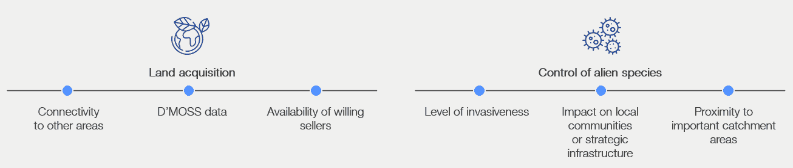

# 2 Assessment of enabling environment

### Improvement areas

- Explore the use of blended finance mechanisms and incorporate external funding from the private sector to finance or implement projects for mutual benefit.
- Collaborate with the treasury unit to allocate a sufficient budget to the long-term upkeep of nature-related projects.
- Adopt the Cities’ Infrastructure Delivery and Management System (CIDMS) for asset management and use funding from the national government to finance essential projects.
- Include local conservancies in the Restor initiative to connect with funders and provide greater visibility for the work being done by Durban.

### Challenges identified

- Limited use of external finance, such as multilateral development banks (MDBs), for the implementation of nature solutions.
- Increased long-term financial uncertainty due to the project-based nature of funding schemes and decisions.
- Convoluted processes for NGOs to apply for funding and partner with the municipality.

Nature Positive: Cities’ Efforts to Advance the Transition

28

Contents

# 2 Assessment of enabling environment

## 2.5 Data and analytics

### Overview

- The Durban Environmental Planning & Climate Protection department collects and manages environmental data, including mapped areas with relevant biodiversity and conservation statuses, as well as the populations of highly valuable species. The BMD stores data and shares it publicly upon request. The city also uses the CIDMS.
- This data is available through the Strategic Hub dashboards, which help to form insights by integrating data from different sources and sectors (including the Floodline Exposure Dashboard and GreenBook MetroView, see Figures 5 and 6).
- Durban tracks and publishes unaudited reports on both its climate-change strategy and its biodiversity efforts.
- The city also reports on climate- and nature-related targets and objectives to the national government and on platforms such as the Carbon Disclosure Project (CDP) and the International Council for Local Environmental Initiatives (ICLEI).
- The city primarily collects data through citizen science initiatives, including the City Nature Challenge, a participatory event supported by the local government.

### Analytics

The city of Durban uses the data for the purposes of climate resilience and disaster preparedness. Some recent efforts include:

- As part of the 2015 Climate Action Plan, a vulnerability assessment was conducted to forecast climate hazards such as floods, extreme heat, droughts and sea-level rise. This assessment was carried out to inform climate resilience efforts based on various emissions scenarios across the city. Nature solutions were incorporated into the outcomes and climate resilience efforts.^(21)
- The GreenBook MetroView, which provides spatial information on risks for buildings, people and roads caused by climate-change hazards,^(22) is accompanied by a complementary climate-risk profile tool and a climate-actions tool that provide socioeconomic and environmental data on subregions across eThekwini. The climate-actions tool provides information on the city’s targets for eight sectors, including biodiversity, coastal protection, and water and sanitation. Each target is aligned with the relevant UN Sustainable Development Goals (SDGs).^(23)

### Challenges identified

- Limited or unavailable long-term datasets on nature.
- Limited number of processes to manage nature-related data.
- Outdated platforms (such as the vulnerability atlas) are integral to supporting nature-related decision-making.
- Hampered monitoring of NGOs’ contributions due to lack of an integrated system.

### Improvement areas

- Update vulnerability assessments of critical infrastructure and natural capital, so that risks can be detected and addressed as they arise.
- Strengthen integration between Durban’s Strategic Hub, the Biodiversity Management Department (BMD) and the Climate Change Department (CCD) to ensure data availability, updated dashboards and greater coordination on data use and management.

Nature Positive: Cities’ Efforts to Advance the Transition

29

Contents

## FIGURE 5

eThekwini floodline vulnerability exposure

## FIGURE 6

GreenBook MetroView

Source: ArcGIS. (n.d.). eThekwini Floodline Vulnerability Exposure.  
https://www.arcgis.com/apps/dashboards/a3bc3284dea247fda0d5d0741d64c2a6.

Source: GreenBook MetroView. (n.d.). Ward 33 View Climate Risk Profile.  
https://ethekwini-riskprofile.greenbook.co.za/ward/vulnerability?view=about-the-tool&region=Central&ward=Ward+33.

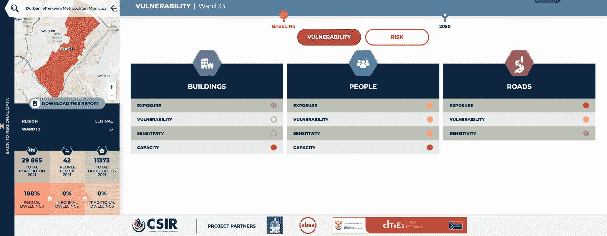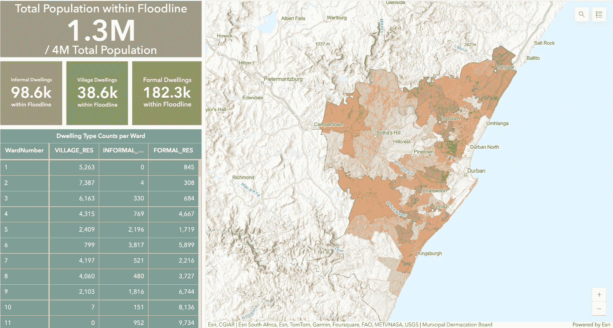

Nature Positive: Cities’ Efforts to Advance the Transition

30

Contents

# 2 Assessment of enabling environment

## 2.6 Stakeholder engagement

### Overview

Durban has been undertaking various initiatives to engage a wider array of stakeholders within and across climate and nature spheres. The main activities conducted to date include:

- Launch of the Environmental Education and Public Awareness Network (EEPAN), aimed at enhancing environmental education and raising public awareness of nature and climate-change topics^(24)
- The promotion of citizen engagement through the iNaturalist City Nature Challenge, ecotourism talks, newsletters, press articles and other actions.

Initiatives to communicate the importance of nature conservation, such as:

- Convening the Biodiversity Forum.
- Publishing the D’MOSS Information Booklet.
- Implementing educational programmes on climate change in schools (e.g. EEPAN).
- Continuing to publish the annual State of Biodiversity and Durban Climate Change Strategy annual reports, complemented by a new climate-change web portal.

Key NGO partnerships for the eThekwini Municipality include a collaboration with the Endangered Wildlife Trust (EWT). This focuses on wetland habitats and amphibians and has helped to formally protect wetland systems and develop a conservation management and rehabilitation plan. Over time, the purpose of this initiative will be to rehabilitate the functionality of wetlands and the integrity of habitats.

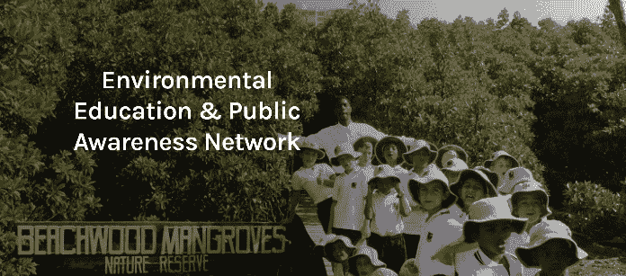

Source: eThekwini Municipality, Green Corridors. (n.d.). Environmental Education and Public Awareness Network Launched in Durban.

### Challenges identified

- Limited coordination to communicate biodiversity and nature efforts to all stakeholders.
- Limited engagement with citizens and organized groups and societies on nature.
- Limited number of environmental stewardships for city officials and residents.

### Improvement areas

- Explore international collaboration opportunities, such as joining the African Natural Capital Alliance (ANCA) and forming alliances with neighbouring countries.
- Use the Environmental Education and Public Awareness Network (EEPAN) for increased communication and advocacy on nature issues.
- Integrate nature and climate topics into the Natural Resource Department’s educational programme to inform students on biodiversity and climate.
- Boost engagement with NGOs and civil society, e.g. partnering with the Endangered Wildlife Trust for wetland protection.
- Engage private companies affected by the cost of inaction, such as insurers, to create solutions.
- Raise awareness of ecological conservation and nature restoration to engage the public.

eThekwini Municipality public awareness campaigns

Discover more here.

Nature Positive: Cities’ Efforts to Advance the Transition

31

Contents

# 2 Assessment of enabling environment

### CASE STUDY 1: BIODIVERSITY STEWARDSHIP

**Overview**

Durban’s Biodiversity Stewardship programme^(25) is led by conservation authorities to promote the protection and management of land and biodiversity in collaboration with private and communal landowners. Landowners volunteer to participate in a stewardship agreement and are given decision-making support.

**Objectives**

The programme aims to promote conservation and the sustainable management of resources for sites that are pre-identified as important for biodiversity – such as nature reserves and protected environments. It also aims to expand the area across which biodiversity conservation is conducted, improve the municipality’s protection and management of the environment, and ensure that any private, communal and state-owned areas with high biodiversity value receive secure conservation status.

**Benefits and outcomes**

The involvement of local chiefs in the biodiversity conservation process is integral to the stewardship programme, as the municipality is focused on working with traditional councils to promote climate-change adaptation.

Land stewardship is a highly cost-effective mechanism for expanding protected areas when compared with the cost of the government purchasing and protecting land. Additionally, biodiversity stewardship is an appropriate mechanism for both agricultural and metropolitan regions.

Stewardship agreements vary in design and include both non-binding and long-term arrangements. Areas under collaborative management contribute to the broader ambition of eThekwini biodiversity.

Nature reserves and protected environments are the two highest levels of biodiversity stewardship provided under the Protected Areas Act, 2003, and they contribute directly to meeting the targets for national protected areas.

**TABLE 1**

eThekwini Municipality public awareness campaigns

| Agreement type | Legal mechanism | Typical contract length | Binding on the property | Binding on the landowner |
|---|---|---|---|---|
| Nature reserve | National Environmental Management: Protected Areas Act 57 of 2003 | 30-99 years or in perpetuity | Protected area declaration and title deed restriction | Contract agreement |
| Protected environment | National Environmental Management: Protected Areas Act 57 of 2003 | A minimum of 30 years | Protected area declaration and title deed note | Contract agreement |
| Biodiversity management agreement | National Environmental Management: Biodiversity Act 10 of 2004 | 5-10 years | Not binding | Agreement governed by the Biodiversity Act |
| Biodiversity agreement | Contract law | 5-10 years | Not binding | Contract agreement |
| Biodiversity partnership areas | Informal agreement | Not binding | Not binding | Not binding |

*Biodiversity importance, Site security, Landowner commitment, State support*

## 2.7 Capabilities

**Overview**

Key departments such as the BMD and the CCD consist of highly skilled environmental specialists. However, there is room for improvement in terms of fully integrating environmental expertise into other city units and the city leadership. One notable CCD initiative is the induction workshop for newly elected city councillors, which outlines climate-change impacts and describes the Durban Climate Change Strategy.^(26)

Professionals being recruited for the department should be required to have ecological and environmental qualifications, a minimum of four to six years of experience and registration with the South African Council for Natural Scientific Professionals (SACNASP).

**International collaboration initiatives**

Durban engages with international organizations such as C40 Cities and the World Bank for capacity building programmes. The city also collaborates with local stakeholders for capacity building:^(27)

- Central KwaZulu Climate Change Compact (CKZCCC) is a network of municipalities in the KwaZulu province seeking to collaborate on climate-change adaptation.
- Durban Research Action Partnership (D’RAP) seeks to enhance capacity through research in partnership with the University of KwaZulu-Natal. The city has funded research programmes including projects on global environmental change and community reforestation research. Since its creation in 2011, the city has provided over ZAR 10 million (approximately $530,000), mostly allocated to postgraduate student bursaries.
- EPIC Durban is a programme for students to participate in research programmes driven by community needs, related to topics such as informal settlements, water and sanitation.

**Challenges identified**

- Insufficient number of personnel to support conservation efforts and enforce compliance against nature criteria.
- Limited dedicated BMD staff to support communications and funding application functions.
- Lack of personnel for major roles (e.g. permanent senior manager) during critical periods.
- Limited cross-departmental awareness on overarching city biodiversity objectives and targets.
- Laborious and intensive recruitment processes limit acquisition of workforce.

**Improvement areas**

- Allocate a budget for staff dedicated to communicating climate change and environmental issues, and increase their involvement in environmental planning.
- Participate in international collaborations, such as C40 Cities Climate Leadership Group, Resilient Cities Network, and World Resources Institute (WRI), to strengthen civil capacity and apply global learnings.
- Strengthen in-house biodiversity and nature expertise through training and on-the-job exposure.

# 3 Exemplary solutions

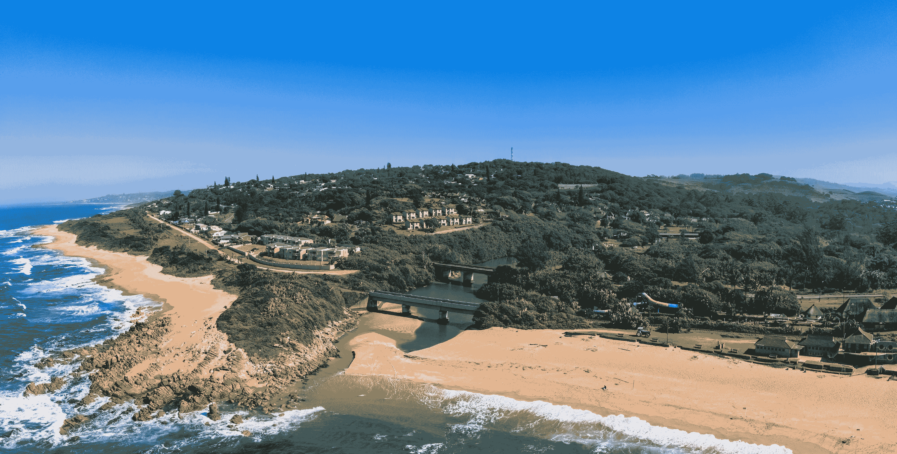

Durban’s riverine ecosystem restoration improves resilience, creates local jobs and engages low-income communities in decision-making.

### Exemplary solution 1: Establishment of D’MOSS to ensure the protection of valuable ecosystems from the impacts of urban development

**Challenge**

Durban is surrounded by a diverse and extensive array of natural and semi-natural areas. In addition to the land value, the total asset value of nature in the EMA is estimated at ZAR 48-62 billion (approximately $2.5-3.3 billion). Each year, nature provides ecosystem services worth ZAR 4 billion (approximately $210 million)^(28) and sequesters over 30,000 tonnes of CO2.^(29)

However, Durban has experienced significant development demand over the last few years, often conflicting with the protection of natural areas. The original 1949 planning ordinance did not consider environmental factors. Although a policy layer was introduced in 1989 to protect critical areas, it lacked legislative authority and its enforcement was therefore limited.^(30)

**Solution**

In 2010, when the KwaZulu-Natal Planning and Development Act overturned the ordinance, it integrated a spatial layer covering areas of high biodiversity value. This area, called D’MOSS, is an overlay on the town planning scheme zoning to show where environmental authorization is required to prevent adverse impacts on biodiversity and on ecosystem assets and services.^(31)

The boundaries are defined and regularly updated through the Systematic Conservation Assessment performed by the Biodiversity Management Department. As of 2021, D’MOSS comprised 95,000 hectares (ha) of public and private land, representing approximately 38% of the EMA.^(32)

**Impact**

The D’MOSS has become the primary tool for addressing habitat destruction and safeguarding valuable ecosystems in Durban. In particular, it ensures the maintenance of a wide range of open spaces and establishes links between open spaces and sources of biodiversity along the coast.

**Breakdown of the EMA and its protected regions**

Only 7% of the D’MOSS region (less than 3% of the total EMA) is protected. Land protection mechanisms include designating areas as Proclaimed Nature Reserves or State Nature Reserves and direct land acquisition by the municipality. Figure 6 shows the breakdown of the protected areas in the EMA.^(33)

**FIGURE 7: eThekwini Spatial Development Map**

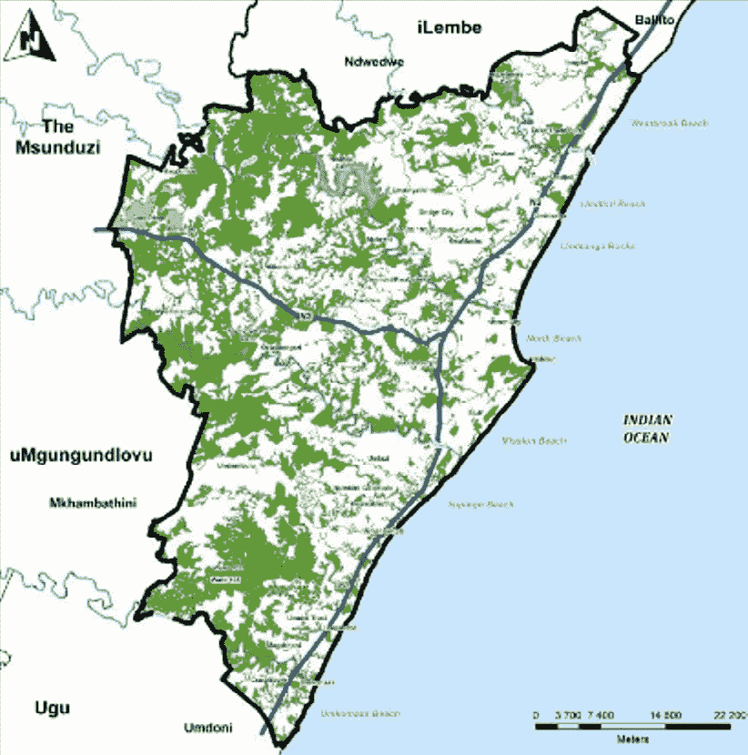

*Source: eThekwini Municipality.*

**FIGURE 8: Breakdown of EMA**

- Protected D'MOSS
- Non-protected D'MOSS
- Acquired
- State nature reserve
- SRA
- Others

| Conservation type (in decreasing protection order) | Percentage |
|---|---|
| Environmental conservation reserve | 3% |
| Municipal nature reserve/conservation area | 2% |
| Non-D'MOSS | 29% |
| Protected D'MOSS | 14% |
| Non-protected D'MOSS | 10% |
| Acquired | 32% |
| State nature reserve | 3% |
| SRA | 62% |
| Others | 35% |

*Ethekwini municipal boundary, National roads, Major rivers, Dams, D’MOSS 2018, Open space/conservation*

**Total EMA: 249,033 ha**

**Proclaimed nature reserve: 6,783 ha**

Nature Positive: Cities’ Efforts to Advance the Transition

# 3 Exemplary solutions

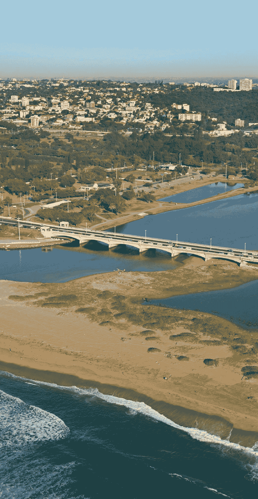

Riverine ecosystems play a crucial role in supporting biodiversity. They provide food and clean water and offer various ecosystem services such as the regulation of flows, and carbon capture and storage. Factors such as pollution, habitat destruction and unsustainable resource extraction, however, have led to the deterioration of these ecosystems. This has not only had an impact on the environment but also affected the livelihoods of communities dependent on rivers for their sustenance.

The Sihlanzimvelo Stream Cleaning Programme began in 2012 with the goal of cleaning solid waste and invasive alien plants from 450 km of river and thereby reducing damage from flash floods. In the 2021–2022 financial year, the programme created 600 jobs in local communities.

The C40 Cities Finance Facility helped to develop a business case and cost-benefit analysis based on the valuation of ecosystem services and the damage they prevent. Three scenarios were assessed: doing nothing, upscaling the existing cleaning programme and developing a transformative management programme. It was shown that, for broader society (including the municipality and third parties), the upscaling would have a benefit-to-cost ratio of one, whereas the TRMP would yield a benefit-to-cost ratio of 1.8.^(34)

In business terms, it is estimated that ZAR 7.5 billion (about $400 million) of public and private investment will be needed over 20 years to finance the TRMP. This would generate between ZAR 13 and 25 billion (between $650 million and $1.3 billion) in societal benefits and avoidance of municipal land damage, and would create more than 9,000 jobs.^(35)

In collaboration with the C40 Cities Finance Facility, the eThekwini Municipality developed the Transformative Riverine Management Programme (TRMP). It proposes a holistic and transformative approach to riverine management that goes beyond mere adaptation. It also addresses the sources of negative impacts and enhances local social and economic capital.

The TRMP restores and rehabilitates degraded riverine ecosystems through activities such as reforestation, the rehabilitation of catchments and the cleaning of streams. These actions are complemented by the promotion of sustainable practices for resource extraction to ensure long-term viability.

One of the most notable aspects of the TRMP is its strong emphasis on community engagement. Recognizing the importance of local communities, the TRMP involves them in decision-making for its projects, many of which create local employment opportunities in low-income communities.

The Transformative Riverine Management Programme (TRMP) enhances flooding resilience, generates social and economic opportunities and improves water quality.

## Exemplary solution 2

## Nature Positive: Cities’ Efforts to Advance the Transition

A full-time conservation manager and field staff manage the area. This includes the control of invasive plants, fire management, research activities and the maintenance of trails.^(43)

The Giba Gorge Environmental Precinct was started as a pilot and is the only environmental SRA in South Africa.^(44) However, it has proven to be a successful mechanism for public-private cooperation with potential for scalability in other areas of Durban as well as in other South African cities.

In 2009, the local community and eThekwini Municipality established the Giba Gorge Environmental Precinct as a non-profit organization to protect the area under the SRA model.

SRAs, or Community Improvement Districts (CIDs), are legal mechanisms designed to levy additional property rates to finance the provision of additional municipal services within a given area.^(40) In the case of the Giba Gorge, each landowner pays a special monthly rate averaging about ZAR 50 ($2.7).^(41) The additional funds are collected by the municipality and then transferred to a non-profit company administering the provision of services.

eThekwini Municipality provided support throughout the process of establishing the SRA. A new SRA should be spearheaded by a group of residents of their own initiative. After receiving a majority endorsement by landowners in the precinct, they need to develop a business plan, an implementation programme and management agreements. Only then can the not-for-profit company be established. This company needs to report audited financial statements, and the agreement has a lifespan of five years, after which it needs to be renewed.^(42)

The Giba Gorge, situated in the outer west of the Durban metropolitan area, is a significant natural landscape that encompasses the Winston Park and Gillitts suburbs.^(36) Standing as one of the last remaining open spaces near the uMhlatuzana River catchment,^(37) it covers 400 ha and is home to a diverse range of Sandstone Sourveld Grassland and Eastern Scarp Forest, making it a unique and valuable ecosystem.^(38)

The Giba Gorge’s complex property distribution makes it unsuitable for the land acquisition programme, however. Approximately 50% of the land is privately owned by 200 individuals. Another 20% is owned by the municipality, and the remaining 30% is under the jurisdiction of the National Road Agency.^(39)

### The purpose of SRAs

SRAs are a commonly used mechanism to tackle crime and disrepair, although they have also served to finance large infrastructure projects. This occurred in Claremont, Cape Town, when the town received a long-term loan from the Development Bank of South Africa (DBSA) to establish an SRA. The programme, in partnership with the local government, established an SRA management company to build a road. This was the first instance in South Africa of levies from an SRA being used to construct public infrastructure.^(45)

### Public-private collaboration to protect the Giba Gorge through SRAs

## Exemplary solution 3

Cities are being asked to rethink their relationships with nature as expectations around nature stewardship evolve globally. The Municipality of eThekwini is an example of a city that has risen to the challenge, and has aimed to transform the ways in which citizens and corporations engage with nature.

The Municipality of eThekwini has strengthened its connection with nature through:

- Developing a wide range of systems to track and understand nature impacts and risks and codify nature protection and restoration.
- Deploying zoning maps and special rating areas that have been instrumental in enabling the protection of vulnerable sites.
- Establishing a municipal Environmental Planning & Climate Protection department that demonstrates the city’s intent to embed nature considerations in decision-making.

# Conclusion

To further the transition, there is a clear opportunity for the city to:

- Increase its use of external resources through external funding and partnerships to bridge financial resource gaps.
- Learn from similar cities by joining international partnerships and communities.

Through extensive engagement with Durban, this paper has endeavoured to understand and illustrate the city’s greatest barriers to making radical progress towards nature positivity. It has also identified potential solutions to overcome these challenges. The exemplary solutions aim to provide inspiration to city officials globally.

This paper is part of a series of publications advocating for the regeneration of nature in – and by – urban areas. The series will help local leaders internalize nature’s values into their macro- and micro-economic decisions. It will highlight best practices and provide guidance on governance arrangements, incentives, regulations, stakeholder engagement, capacity-building priorities, impactful solutions and funding opportunities with the aim of making cities more resilient, prosperous and equitable.

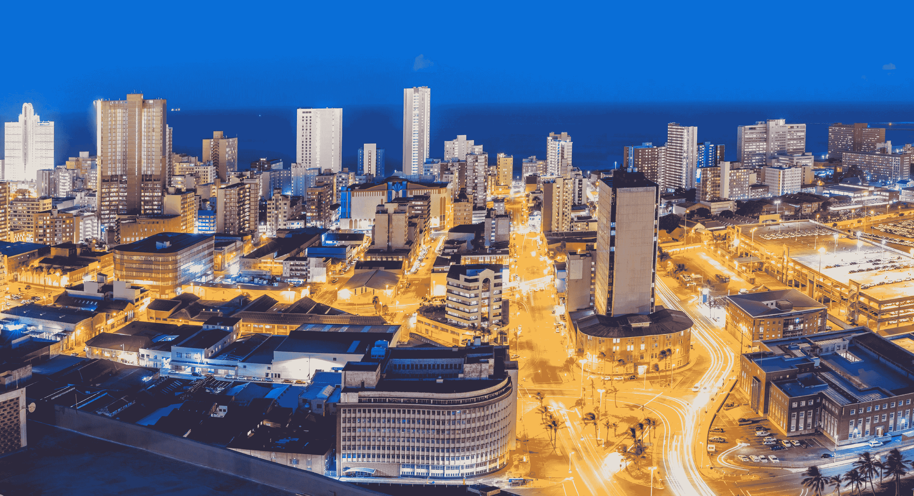

# Contributors

## Lead authors

**World Economic Forum**

Cristina Gómez Garcia-Reyes  
Lead, Net Zero Nature Positive Cities, Centre for Urban Transformation

**Oliver Wyman**

Nicole Merlo  
Associate

Javier García Olivares  
Senior Consultant

Soraya Soumitri  
Senior Consultant

**City of Durban – eThekwini Municipality**

Smiso Bhengu  
Senior Climate Change Scientist, Biodiversity Management Department

Errol Douwes  
Senior Manager, Restoration Ecology

Zama Khuzwayo  
Chief Policy Analyst

Mmatjie Mashao  
Ecologist, Natural Resources Department

Cameron McLean  
Senior Specialist Ecologist

Greg Mullins  
Specialist Ecologist, Biodiversity Management Department

Nelly Mvuni  
Former Senior Environmental Technician

Sabelo Nkosi  
Senior Manager, Biodiversity Planning

Chumisa Thengwa  
Former Deputy Head, Biodiversity Management Department

## Local organizations and academia

Cherise Acker-Cooper  
Former Project Manager, Threatened Amphibian Programme, Endangered Wildlife Trust

**World Economic Forum**

Vivian Brady-Phillips  
Head, Strategic Initiatives, Centre for Urban Transformation

Akanksha Khatri  
Head, Nature Action Agenda, Centre for Nature and Climate

Jeff Merritt  
Head, Centre for Urban Transformation

# Acknowledgements

Anne Bruzas  
Chairperson, Monteseel Conservancy, KZN Conservancies

Paolo Candotti  
Chairperson, Kloof Conservancy, KZN Conservancies

Allister Starke  
Ecologist, Hawaan Forest Nature Reserve

Indrani Hazel Govender  
Durban University of Technology

Sogen Moodley  
Durban University of Technology

**Oliver Wyman**

Arnaud Delamare  
Partner, Energy and Natural Resources

Emilio ElAsmar  
Partner, Government and Public Institutions

Victoria Evans  
Partner, Government and Public Institutions

## Production

Louis Chaplin  
Editor, Studio Miko

Laurence Denmark  
Creative Director, Studio Miko

Martha Howlett  
Editor, Studio Miko

Rose Chilvers  
Designer, Studio Miko

---

## Contents

# Endnotes

1. eThekwini Municipality, Environmental Planning & Climate Protection Department. (2021). State of Biodiversity Report. https://environment.durban.gov.za/storage/Documents/Environmental%20Planning%20%20Climate%20Protection%20%20Publications/State%20of%20Biodiversity%20Reporting/State%20of%20Biodiversity%20Report%202020-2021.pdf.

2. Africa News. (2023). Top 10 richest cities in Africa. https://www.africanews.com/2023/04/04/top-10-richest-cities-in-africa/.

3. eThekwini Municipality. (n.d.). About EThekwini. https://www.durban.gov.za/pages/government/about-ethekwini.

4. Republic of South Africa, Department of Environmental Affairs. (2015). South Africa’s 2nd National Biodiversity Strategy and Action Plan 2015-2025. https://faolex.fao.org/docs/pdf/saf163700.pdf.

5. eThekwini Municipality, Biodiversity Management Department. (2023). Durban: State of Biodiversity Report 2021/2022. https://environment.durban.gov.za/storage/Documents/Environmental%20Planning%20%20Climate%20Protection%20%20Publications/State%20of%20Biodiversity%20Reporting/State%20of%20Biodiversity%20Report%202021-2022.pdf.

6. World Bank Group. (2016). Promoting Green Urban Development in African Cities. https://openknowledge.worldbank.org/entities/publication/b5573562-20bb-5a8d-a5da-ab06c1fb3f70.

7. eThekwini Municipality. (2021). Integrated Development Plan: 2020/2021 Review. https://www.durban.gov.za/storage/Documents/Integrated%20Development%20Plans%20IDP%20-%20eThekwini%20Municipality/eThekwini%20Integrated%20Development%20Plan%20IDP%202020%20-%202021.pdf.

8. Ibid.

9. Ibid.

10. Eligon, J., Mji, Z. & Chutel, L. (2022). Housing Crisis Propels High Death Toll in South Africa Floods. The New York Times. https://www.nytimes.com/2022/04/20/world/africa/south-africa-floods-climate-change-housing.html.

11. eThekwini Municipality, Biodiversity Management Department. (2009). Our BioDiverse City: The Value of Durban’s Biological Diversity. https://www.durban.gov.za/storage/Documents/Biodiversity/Our%20Biodiverse%20City.pdf.

12. eThekwini Municipality. (2022). Durban Climate Change Strategy. https://www.durban.gov.za/storage/Documents/Climate/DCCS_Strategy.pdf.

13. Republic of South Africa, Department of Environmental Affairs. (2015). South Africa’s 2nd National Biodiversity Strategy and Action Plan 2015-2025. https://faolex.fao.org/docs/pdf/saf163700.pdf.

14. Carbon Disclosure Project. (n.d.). Case studies: EThekwini. https://www.cdp.net/en/articles/cities/ethekwini.

15. World Bank Group. (2016). Promoting Green Urban Development in African Cities. https://openknowledge.worldbank.org/entities/publication/b5573562-20bb-5a8d-a5da-ab06c1fb3f70.

16. Dentons. (2024). South African Climate Change Bill 2023. https://www.dentons.com/en/insights/articles/2024/january/25/south-african-climate-change-bill-2023.

17. eThekwini Municipality. (2022). Durban Climate Change Strategy. https://www.durban.gov.za/storage/Documents/Climate/DCCS_Strategy.pdf.

18. Ibid.

19. eThekwini Municipality. (2022). R54.6bn draft budget to drive service delivery. https://www.durban.gov.za/press-statement/R54.6bn+draft+budget+to+drive+service+delivery.

20. eThekwini Municipality. (2022). Durban Climate Change Strategy. https://www.durban.gov.za/storage/Documents/Climate/DCCS_Strategy.pdf.

21. eThekwini Municipality. (n.d.). Esri Story Maps. https://ethekwini.maps.arcgis.com/apps/MapSeries/index.html.

22. Municipality of eThekwini, Metroview. (n.d.). GreenBook, Overview. https://ethekwini-riskprofile.greenbook.co.za/?view=about-the-tool.

23. Municipality of eThekwini, MetroView. (n.d.). Climate Actions Tool. https://ethekwini-climateactions.greenbook.co.za/.

24. eThekwini Municipality, Green Corridors. (n.d.). Environmental Education and Public Awareness Network Launched in Durban. https://durbangreencorridor.co.za/news/environmental-education-and-public-awareness-network-launched-in-durban.

25. eThekwini Municipality, Environmental Planning & Climate Protection Department. (2016). Biodiversity Stewardship. https://www.durban.gov.za/storage/Documents/Biodiversity/EcoFileEThekwiniBiodiversityStewardshipProgramme_English.pdf.

26. eThekwini Municipality. (2022). DCCS Annual Report 2020/2021. https://www.durban.gov.za/storage/Documents/Environmental%20Planning%20%20Climate%20Protection%20%20Publications/Climate/DCCS%20ANNUAL%20REPORT%202020%20-%202021.pdf.

27. Ibid.

28. World Bank Group. (2016). Promoting Green Urban Development in African Cities. https://openknowledge.worldbank.org/entities/publication/b5573562-20bb-5a8d-a5da-ab06c1fb3f70.

29. eThekwini Municipality. (n.d.). Environmental Planning & Climate Protection. https://www.durban.gov.za/pages/search/environmental-planning-climate-protection.

30. Ibid.

31. eThekwini Municipality. (2022). eThekwini Municipality Spatial: Development Framework 2022-2023. https://parks.durban.gov.za/storage/Documents/DPEM/Documents%20%20Notices/Strategic%20Spatial%20Planning/SDF/SDF%202022%20-%202023/Report/Final%20SDF%202022-2023%20June%202022.pdf.

32. eThekwini Municipality. (2023). Durban: State of Biodiversity Report 2021/2022. https://www.durban.gov.za/storage/Documents/Environmental%20Planning%20%20Climate%20Protection%20%20Publications/State%20of%20Biodiversity%20Reporting/State%20of%20Biodiversity%20Report%202021-2022.pdf.

33. eThekwini Municipality. (2017). 2017 DMOSS Background Info, 2017, https://www.durban.gov.za/storage/Documents/Environmental%20Planning%20%20Climate%20Protection%20%20Publications/State%20of%20Biodiversity%20Reporting/State%20of%20Biodiversity%20Report%202021-2022.pdf.

34. C40 Cities Finance Facility. (2021). Benefit Cost Analysis Technical Report: Business Case for Durban’s Transformative Riverine Management Programme. https://cff-prod.s3.amazonaws.com/storage/files/OD3rAEcBcb9vl137J0qRA71C38gqMUtPSe2AiO6j.pdf.

35. Ibid.

36. Giba George Environmental Precinct (GGEP). (n.d.). FAQ. https://www.ggep.org/faq.

37. Lincoln Institute of Land Policy. (2020). Special Assessment Districts and the Financing of Infrastructure in South Africa: The Innovative Use of a Special Rating Area in Claremont, Cape Town. https://www.dag.org.za/wp-content/uploads/2023/10/the-innovative-use-of-a-special-rating-area-in-claremont-cape-town-working-paper-1.pdf.

38. eThekwini Municipality. (2022). Durban: State of Biodiversity Report 2020/2021. https://www.durban.gov.za/storage/Documents/Environmental%20Planning%20%20Climate%20Protection%20%20Publications/State%20of%20Biodiversity%20Reporting/State%20of%20Biodiversity%20Report%202020-2021.pdf.

39. Ross, K. (2013). Gorge could become nature park. IOL. https://www.iol.co.za/news/gorge-could-become-nature-park-1626140.

40. Scott Estate & Baviaanskloof CID (SEBCID). (2019). SEBCID FAQs Revised July 2019 V2. https://sebcidhoutbay.org/pdfs/SEBCID_FAQs_July_2019.pdf.

41. Ross, K. (2013). Gorge could become nature park. IOL. https://www.iol.co.za/news/gorge-could-become-nature-park-1626140.

42. Republic of South Africa. (2004). Government Gazette. https://www.gov.za/sites/default/files/gcis_document/201409/a6-04.pdf.

43. eThekwini Municipality. (2014). KwaZulu-Natal Sandstone Sourveld Research Programme. https://environment.durban.gov.za/storage/Documents/Environmental%20Planning%20%20Climate%20Protection%20%20Publications/EThekwini%20Municipality%20-%20UKZN%20Research%20Partnership/KZNSS%20Close-out%20Report%202011-2014.pdf.

44. Roberts, D. et al. (2012). Exploring ecosystem-based adaptation in Durban, South Africa: “learning-by-doing” at the local government coal face. Environment and Urbanization, vol. 24, issue. 1, pp. 167-195. https://journals.sagepub.com/doi/pdf/10.1177/0956247811431412.

45. Lincoln Institute of Land Policy. (2020). Special Assessment Districts and the Financing of Infrastructure in South Africa: The Innovative Use of a Special Rating Area in Claremont, Cape Town. https://www.dag.org.za/wp-content/uploads/2023/10/the-innovative-use-of-a-special-rating-area-in-claremont-cape-town-working-paper-1.pdf.
