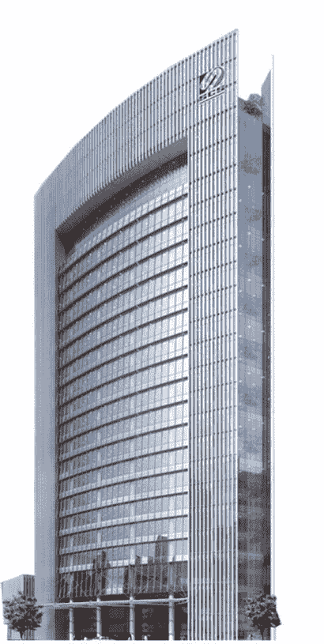
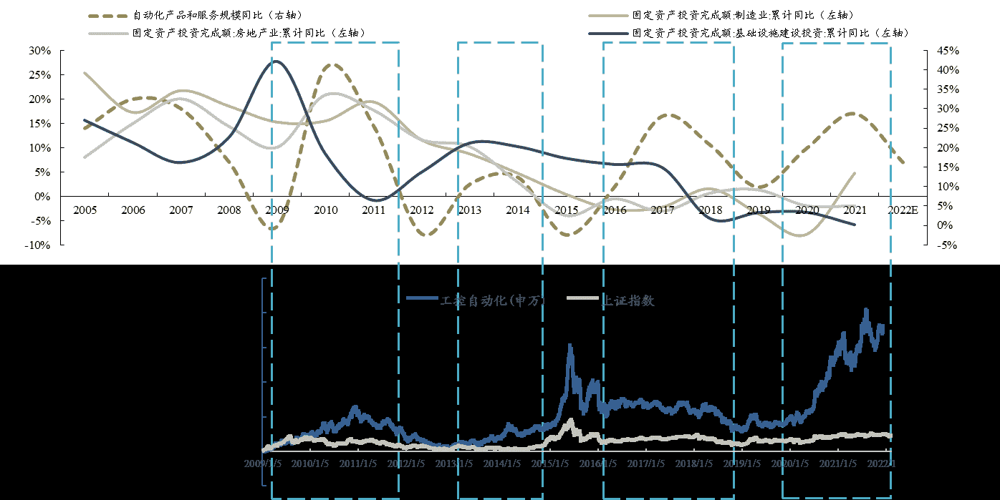
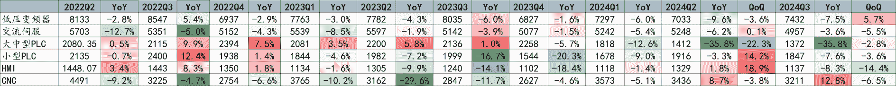
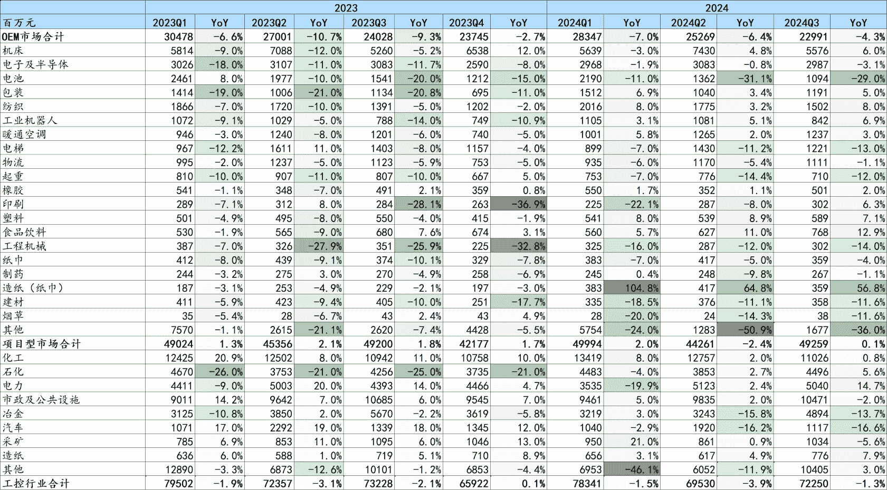
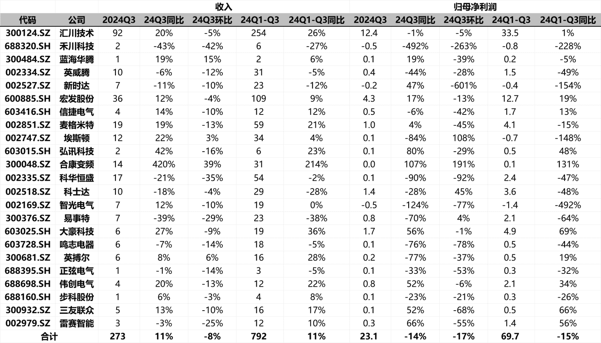
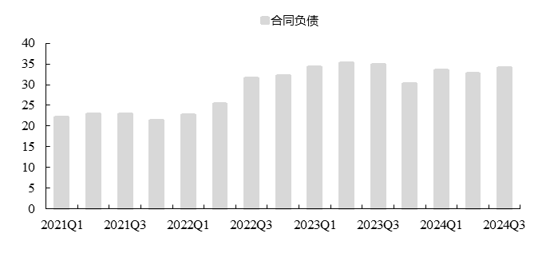

# 工控&电网24Q3总结

工控已至底部区间，电网景气度延续

——东吴电新团队

证券分析师：曾朵红

执业证书编号：S0600516080001

证券分析师：谢哲栋

执业证书编号：S0600523060001

研究助理：许钧赫

执业证书编号：S0600123070121

2024年11月8日

证券研究报告·行业研究·电力设备与新能源行业

## 摘要

- 工控&电力设备行业24Q3收入同比+10%（Q2同比+10%）、归母净利润同比+8%（Q2同比+7%）。1）行业24Q3营收&利润均稳健增长，结构性有机会。全行业2024Q1-3实现收入/归母净利润5225/434亿元，同比+10%/-4%。2024Q3收入1855亿元，同比+10%，归母净利润为135亿元，同比+8%。2）行业整体毛利率水平保持稳定。2024Q3行业毛利率为22.3%，同环比+0.3pct/-0.1pct。3）2024Q3合同负债/存货较年初+3%/+15%。4）2024Q3经营性现金流净流入197亿元，同比+16%。

- 工控行业Q3需求进入底部区间，龙头汇川利润基本见底，二线伟创依靠出海收入高增、业绩同比高增。1）24Q3营收稳健增长、利润承压。24Q1-3工控板块实现收入792亿元，同比+11%，实现归母70亿元，同比-15%。2024Q3实现收入273亿元，同比+11%，环比-8%；实现归母23亿元，同比-14%。2）毛利率同环比承压，部分公司因收入结构优化实现利润率环增。24Q3板块毛利率29.5%，同比-2.6pct，环比+0.8pct。归母净利率为8.5%，同比-2.5pct，环比-0.9pct。3）经营性现金流大幅改善。2024Q3工控板块经营活动现金净流入36亿元，同比+58%，环比-1%。4）公司层面，汇川技术收入稳增但利润承压，24Q3收入同比+20%，归母同比-1%；二线伟创电气业绩实现较快增长，收入同比+20%，归母同比+52%。

- 特高压/高压板块受益于特高压订单开始交付，利润快速增长；智能电表板块受科陆电子影响，利润有所下滑；低压电器板块受正泰电器拉动，利润增速亮眼；一次设备板块整体保持稳健增长。24Q3实现营收973亿元，同比+11%，实现归母净利润62.2亿元，同比+19%，板块整体保持稳健增长。1）从不同板块来看，24Q3特高压/高压板块实现较快增长，营收/归母净利润同比+17%/+59%；智能电表板块营收/归母净利润同比+1%/-3%；中压电气板块营收/归母净利润同比+7%/+3%；低压电器板块营收/归母净利润同比+15%/+32%；电线电缆板块营收/归母净利润同比+9%/-15%。2）盈利能力方面，一次设备板块盈利能力持续改善。一次设备板块毛利率19.5%，同比+0.5pct；归母净利率6.4%，同环比+0.5/+0.4pct。3）从经营质量方面，一次设备板块现金流持续改善，在手订单充沛。24Q3一次设备板块经营性现金流净流入96.5亿元，同环比+24%/+32%；24Q3末合同负债约307亿元，同比+57%。

- 二次设备板块整体延续稳健增长态势。1）业绩维持稳健增长。24Q3二次设备板块整体延续稳健态势，实现营收200亿元，同比+8%，实现归母净利润23.8亿元，同比+7%。2）盈利能力不断提升。24Q3二次设备板块毛利率为28.8%，同比+0.8pct；实现归母净利率11.9%，同比-0.1pct。3）经营质量方面，二次设备经营性净现金流同比有所改善，合同负债大幅增长。24Q3二次设备板块经营性现金流净流入34.8亿元，同比+8%，回款管理加强，同比有所改善；24Q3末实现合同负债100亿元，同比+46%，合同负债大幅增长。

- 投资建议：1）电网：国内特高压景气度在逐步兑现到业绩，Q3部分线路开始交付、Q4预计环比确收更多；出海看好智能电表及高压设备出口至新兴国家。推荐：思源电气、三星医疗、中国西电、金盘科技、许继电气、平高电气、海兴电力、国电南瑞、四方股份、伊戈尔、南网科技、安科瑞等；关注：华明装备、明阳电气、金杯电工、良信股份、长高电新、神马电力等。2）工控：新能源资本开支下滑有拖累，但Q4基数已经走弱，行业库存、价格及龙头业绩均处于底部区间。推荐：汇川技术、宏发股份、三花智控、伟创电气、雷赛智能、信捷电气、鸣志电器等；关注：麦格米特、禾川科技、英搏尔、英威腾、正弦电气、步科股份等。

- 风险提示：宏观经济下行，电网投资不及预期，竞争加剧，原材料价格上涨超预期等。

## 目录

前言

24Q3行业总结：工控

24Q3行业总结：一次&二次设备

投资建议与风险提示

## 1 前言

数据来源：Wind，东吴证券研究所

- 电力设备工控板块2024Q1-3收入同比+7%，归母净利润同比-4%。我们在电力设备工控板块选取了123家上市公司，全板块2024Q1-3收入5225亿元，同比增长10%，归母净利润434亿元，同比增长-4%。

- 单看2024Q3，电力设备&工控板块情况：全板块2024Q3收入1855亿元，同比增长10%，环比下降6%（从板块同比增速来看，特高压/高压17%>低压15%>工控11%>电线电缆9%>二次设备8%>中压7%>智能电表1%）；归母净利润135亿元，同比+8%，环比下降6%（从板块同比增速来看，特高压/高压59%>低压32%>二次设备7%>中压3%>智能电表-3%>工控-14%>电线电缆-15%）。高压主网板块开始在Q3逐步兑现业绩，顺经济周期相关的工控、低压电器从收入来看基本见底、盈利能力仍待好转，二次设备、中压电气稳健，智能电表Q3表现较弱（而H1表现领先全板块，主要是靠海外亚非电表交付）。

| 分项 | 营业收入（亿元） | 同比增速（%） | 归属母公司股东净利润（亿元） | 同比增速（%） |
|---|---:|---:|---:|---:|
| 电力设备工控行业 | 1855 | 10% | 135 | 8% |
| 一次设备 | 973 | 11% | 62 | 19% |
| 工控 | 273 | 11% | 23 | -14% |
| 二次设备 | 200 | 8% | 24 | 7% |
| 其他电力设备 | 410 | 7% | 26 | -13% |

表：电力设备工控板块2024Q3收入和归母净利润情况

## 1 前言

- 2024Q3电力设备毛利率整体保持稳定，工控价格竞争依旧激烈，板块归母净利率基本保持稳定。2024Q3电力设备&工控行业毛利率为22.3%，同比+0.3pct，环比-0.1pct，其中一次设备/二次设备/工控分别同比+0.5pct/+0.8pct/-2.6pct。大宗原材料价格虽环比有所下降，但是同比处于高位；工控行业竞争加剧，因此多个行业毛利率承压。2024Q3全行业归母净利率为7.3%，同比-0.1pct，环比-0.3pct。尽管板块毛利率承压，但龙头企业通过费用管控，同时业务拓展前期投入已过（比如电力设备在出海营销体系建设加大前置投入、工控在新品类研发加大投入），故净利率基本维持稳定。

图：电力设备工控板块分季度毛利率情况

图：电力设备工控板块分季度归母净利率情况

数据来源：Wind，东吴证券研究所

0%

5%

10%

15%

20%

25%

30%

35%

40%

45%

2021Q1

2021Q3

2022Q1

2022Q3

2023Q1

2023Q3

2024Q1

2024Q3

特高压/高压板块

中压电气

低压电器

智能电表

电线电缆

一次设备

工控

二次设备

其他电力设备

-5%

0%

5%

10%

15%

20%

25%

2021Q1

2021Q3

2022Q1

2022Q3

2023Q1

2023Q3

2024Q1

2024Q3

特高压/高压板块

中压电气

低压电器

智能电表

电线电缆

一次设备

工控

二次设备

其他电力设备

## 1 前言

- 2024Q3电力设备费用投入环比增加、工控业务投入压低短期利润率。2024Q3电力设备&工控行业期间费用率为13.5%，同比+0.3pct，环比+0.9pct，其中一次设备/二次设备/工控分别同比+0.2pct/+1.4pct/+0.2pct，环比0.0pct/+2.3pct/+3.4pct，其中工控、二次设备因业务投入相对刚性但收入同比增速下降，故费用率提升明显。

| 期间费用率 | 2023Q3 | 2023Q4 | 2024Q1 | 2024Q2 | 2024Q3 | Q3同比 | Q3环比 |
|---|---:|---:|---:|---:|---:|---:|---:|
| 电力设备工控行业 | 13.2% | 14.4% | 14.2% | 12.6% | 13.5% | 0.3pct | 0.9pct |
| 一次设备 | 11.3% | 13.1% | 11.8% | 11.6% | 11.6% | 0.2pct | 0.0pct |
| 工控 | 20.5% | 21.2% | 22.8% | 17.4% | 20.8% | 0.2pct | 3.4pct |
| 二次设备 | 13.3% | 11.3% | 17.3% | 12.4% | 14.7% | 1.4pct | 2.3pct |
| 其他电力设备 | 12.9% | 15.6% | 12.9% | 11.4% | 12.6% | -0.2pct | 1.2pct |

数据来源：Wind，东吴证券研究所

图：电力设备工控板块分季度费用率情况

0%

5%

10%

15%

20%

25%

30%

2021Q1

2021Q2

2021Q3

2021Q4

2022Q1

2022Q2

2022Q3

2022Q4

2023Q1

2023Q2

2023Q3

2023Q4

2024Q1

2024Q2

2024Q3

特高压/高压板块

中压电气

低压电器

智能电表

电线电缆

一次设备

工控

二次设备

其他电力设备

## 1 前言

- 2024Q3电力设备&工控板块经营现金流净额同比+20%，存货规模较24年初提升+15%，合同负债较年初+3%。2024Q3电力设备&工控板块经营活动现金流量净流入197亿元，同比+16%。截至2024Q3，电力设备&工控板块存货规模为1850亿元，Q3较年初+15%，主要系特高压及高压板块存货规模增长带动，Q3较年初+32%（Q4会有一波集中交付）。2024Q3电力设备&工控板块合同负债规模为426亿元，Q3较年初+3%，其中特高压/高压板块、中压电气、二次设备板块合同负债规模较年初+7%/+13%/+13%，Q3国网特高压招标节奏后延到Q4，二次招标恢复两位数稳健增长，中压电气与新能源装机相关的增速有下降。

图：电力设备工控板块2020Q3-2024Q3经营净现金流情况（亿元）

图：电力设备工控板块2024Q3存货2177亿元、较年初+13%

图：电力设备工控板块2024Q3合同负债426亿元、较年初+3%

数据来源：Wind，东吴证券研究所

-100

-50

0

50

100

150

200

250

2021Q1

2021Q2

2021Q3

2021Q4

2022Q1

2022Q2

2022Q3

2022Q4

2023Q1

2023Q2

2023Q3

2023Q4

2024Q1

2024Q2

2024Q3

一次设备

工控

二次设备

其他电力设备

0

100

200

300

400

500

600

2021Q1

2021Q3

2022Q1

2022Q3

2023Q1

2023Q3

2024Q1

2024Q3

全板块合同负债

0

200

400

600

800

1000

1200

1400

1600

1800

2000

2021Q1

2021Q3

2022Q1

2022Q3

2023Q1

2023Q3

2024Q1

2024Q3

全板块存货

数据来源：Wind，东吴证券研究所

## 2.1 工控行业：兼具成长性与周期性

**周期性：**

- 从历史上看，2008年以来3轮上行周期，行业增长与制造业景气度、固投的关系明确，行业业绩的波动性高于股价的弹性。

- 第一轮四万亿大刺激：2008年四万亿+PMI自2008年历史低位后连续反弹，2010年工控行业增速创新高，2009年、2010年年初至年末超额收益分别达93%、72%。

- 第二轮房地产三年小周期反弹：2013—2014年持续超额收益，房地产投资2013年初有一定反弹+轻工业用电量增长+PMI持续位于荣枯线之上，行业略有增速，股价略有超额收益。

- 第三轮供给侧改革：2016H2开始反弹，制造业和房地产都是触底反弹，2017年行业弹性甚至接近2010年，说明行业弹性仍然很高，指数反弹不明显，个股龙头业绩和股价表现优异。

- 第五轮先进制造驱动：19Q4复苏，20—21年高增，21年中景气度最高，后增速逐步放缓。

从房地产投资驱动到制造业投资驱动

- 第四轮贸易战扰动：2018Q2开始贸易战影响下游投资信心，工控行业增速开始快速下行，股价整体有所回落。

图：工控行业周期轮动

- 新一轮周期：有望于24Q4开始向上态势。以传统行业需求上行为主导，新能源增速相对前几年放缓。

## 2.2 中观行业季度跟踪：需求已进入底部区间

- 分产品来看，2024Q3低压变频/交流伺服/中大型PLC/小型PLC销售额同比增速分别为-7.5%/-3.6%/-35.8%/-7.6%。

图：工控行业分四大产品同比增速

表：工控行业分产品增速（单位：百万元）

数据来源：Wind，东吴证券研究所

-60%

-40%

-20%

0%

20%

40%

60%

80%

18Q4 19Q1 19Q2 19Q3 19Q4 20Q1 20Q2 20Q3 20Q4 21Q1 21Q2 21Q3 21Q4 22Q1 22Q2 22Q3 22Q4 23Q1 23Q2 23Q3 23Q4 24Q1 24Q2 24Q3

低压变频器

交流伺服

大中型PLC

小型PLC

## 2.2 中观行业季度跟踪：间接出海拉动依旧，整体需求基本见底

- 工控自动化市场24Q3整体增速-1.3%。1）分市场看，24Q3 OEM市场、项目型市场整体增速为-4.3%/+0.1%，降幅有所收窄；2）分行业来看，24Q3光伏锂电同比仍旧明显下滑，但纺织/包装/机床/印刷/注塑/食饮等受益于终端出海需求，均恢复+5%以上增长。

图：工控行业下游细分行业增速

数据来源：Wind，东吴证券研究所

## 2.3 公司月度跟踪：Q3销售/订单同比延续承压

- Q3企业订单及销售同比延续承压，9月一揽子政策刺激下需求拐点有望提前于Q4到来。Q3新能源基数依旧高、传统行业中出海相关增速环比略有放缓，我们预计全年工控OEM市场同比-2~0%增长，内资公司依旧靠替代日系品牌实现稳健增长。

表：工控公司月度销售/订单统计（亿元）

数据来源：Wind，东吴证券研究所

| 期间 | 伺服销售 | GR | 低压变频器销售 | GR | 中大PLC销售 | GR | 安川销售 | GR | 松下销售 | GR | 订单 | GR |
|---|---:|---:|---:|---:|---:|---:|---:|---:|---:|---:|---:|---:|
| 7月 | 1.6 | -16% | 1.16 | -45% | 1.27 | -27% | 4 | 21% | 1.2 | 9% | 0.75 | 4% |
| 8月 | 1.5 | -12% | 1.06 | -32% | 1.17 | -27% | 2.9 | 0% | 1.1 | 10% | 0.65 | 5% |
| 9月 | 1.3 | -38% | 1.53 | -35% | 1.08 | -28% | 4.2 | 56% | 1.2 | 22% | 0.75 | -6% |
| 10月 | 1.3 | -32% | 0.9 | -46% | 1.05 | -23% | 3.3 | 27% | 1 | 59% | 0.73 | 12% |
| 11月 | 1.5 | -29% | 0.98 | -43% | 1.08 | -26% | 2.3 | -8% | 1 | 4% | 0.8 | 0% |
| 12月 | 1.4 | -33% | 1.1 | -41% | 1.01 | -16% | 2.2 | -8% | 1 | 0% | 0.92 | 2% |
| 1月 | 1.2 | -40% | 0.74 | -27% | 1.1 | -33% | 4.5 | -10% | 0.6 | -25% | 1 | -6% |
| 2月 | 1.5 | -6% | 0.89 | -63% | 1.15 | -3% | 5.1 | 2% | 1 | 113% | 0.72 | 3% |
| 3月 | 2.2 | 29% | 1.74 | 0% | 1.35 | 2% | 5.5 | 10% | 0.96 | 12% | 0.44 | 10% |
| 4月 | 2.2 | 69% | 0.99 | -53% | 1.35 | -11% | 5.7 | 46% | 1 | n.a. | 0.5 | 11% |
| 5月 | 1.9 | -10% | 1.14 | -31% | 1.3 | -13% | 4.5 | 15% | 0.97 | 94% | 0.7 | -7% |
| 6月 | 2.15 | 8% | 1.15 | -36% | 1.3 | -24% | 2.8 | -8% | 0.79 | -21% | 0.67 | -4% |
| 7月 | 1.8 | 13% | 0.87 | -25% | 1.2 | -6% | 3.2 | -20% | 0.7 | -42% | 0.75 | 0% |
| 8月 | 1.4 | -7% | 1.04 | -2% | 1.1 | -6% | 2.8 | -3% | 0.65 | -41% | 0.7 | 8% |
| 9月 | 1.3 | 0% | 1.17 | -24% | 1 | -7% | 5.7 | 36% | 0.8 | -33% | 0.75 | 0% |
| 10月 | 1.2 | -8% | 0.82 | -9% | 1 | -5% | 3.3 | 0% | 0.7 | -30% | 0.7 | -4% |
| 11月 | 1.4 | -7% | 1.01 | 3% | 1.2 | 11% | 2.2 | -4% | 0.8 | -20% | 0.75 | -6% |
| 12月 | 1.6 | 14% | 1.12 | 2% | 1.1 | 9% | 3.5 | 59% | 0.7 | -30% | 0.9 | -2% |
| 1月 | 1.65 | 38% | 1 | 35% | 1.2 | 4% | 4.8 | 7% | 0.65 | 8% | 0.95 | -5% |
| 2月 | 1.4 | -7% | 0.76 | -15% | 1.15 | -9% | 3.7 | -27% | 0.35 | -65% | 0.65 | -10% |
| 3月 | 1.65 | -41% | 1.12 | -36% | 1.1 | -19% | 5.1 | -7% | 0.7 | -27% | 0.5 | 14% |
| 4月 | 1.5 | -32% | 1.77 | 79% | 1.4 | 4% | 5.2 | -9% | 0.85 | -15% | 0.45 | -10% |
| 5月 | 1.3 | -46% | 1.61 | 41% | 1.35 | 4% | 4 | -11% | 0.75 | 7% | 0.7 | 0% |
| 6月 | 1.1 | -49% | 1.41 | 23% | 1.3 | 0% | 4.8 | 71% | 0.7 | -11% | 0.72 | 7% |
| 7月 | 1.2 | -33% | 1.12 | 29% | 1.35 | 13% | 3.2 | 0% | 0.75 | 7% | 0.66 | -12% |
| 8月 | 1.3 | -7% | 1.22 | 17% | 1.2 | 9% | 2.6 | -7% | 0.75 | 15% | 0.6 | -14% |
| 9月 | 1.2 | -8% | 1.23 | 5% | 1.1 | 10% | 4.4 | -23% | 0.7 | -13% | 0.66 | -12% |

2024Q3

2023Q2

2023Q3

2023Q4

2024Q1

2024Q2

2022Q3

2022Q4

2023Q1

销售/订单

产品类型

伺服

低压变频器

中大PLC

厂商

安川

松下

台达

ABB

安川

施耐德
**

## 2.4 竞争格局：内资头部全面提速，小品牌出清

- **伺服**：3C、木工、纺织等传统行业或将成为今年的驱动力。1）需求端：2024Q3多产业投资热情下降，相关需求下滑显著。仅3C和轻工相关产业需求受内需补库、外需拉动等因素而有所回升。2）供给端：大部分厂商供应链表现稳定，外资厂商在积极进行国产化布局，同时针对部分大客户有所放价，份额小幅提升。

- **低压变频器**：格局仍保持稳定，竞争相对不激烈，公司端来看利润率也稳定。24Q1/24Q2/24Q3低压变频需求同比-6.0%/-9.6%/-7.5%，需求持续承压，但TOP3企业份额稳固，仍为ABB、汇川、西门子。

- **小型PLC**：通常搭配伺服销售，同时对系统、工艺要求不及中大型PLC，内资替代更为容易。今年小型PLC预计出现小两位数下滑。1）需求侧：新能源相关的行业，如风电设备、光伏设备、锂电池设备，由于终端投资放缓，下滑幅度明显；电子制造复苏明显，包装机械&纺织机械等传统行业也有支撑。2）供给侧：欧美企业有所放价，库存水平有所下降，带动份额提升。

**图 交流伺服份额：内资份额受新能源影响有所减少**

**图 小型PLC份额：受新能源影响，内资份额持平**

**图 低压变频份额：欧美低价去库存，内资龙头份额减少**

| 年份 | 2017 | 2018 | 2019 | 2020 | 2021 | 2022 | 2023 | 24Q1-3 |
|------|------|------|------|------|------|------|------|--------|
| 欧美（西门子+施耐德+贝加莱+罗克韦尔+博世力士乐+伦茨传动） | 12.96% | 13.75% | 14.96% | 13.96% | 15.48% | 20.49% | 16.63% | 15.17% |
| 日本+中国台湾（安川+松下+台达+三菱+欧姆龙+山洋+富士） | 53.96% | 49.37% | 48.66% | 44.98% | 40.61% | 33.15% | 29.62% | 28.80% |
| 大陆（汇川+禾川+信捷+东菱+埃斯顿+雷赛） | 7.05% | 22.55% | 10.31% | 16.88% | 22.36% | 30.03% | 38.08% | 37.64% |
| 其他 | 26.04% | 14.32% | 26.07% | 24.18% | 21.54% | 16.32% | 15.67% | 18.39% |

数据来源：睿工业，Wind，东吴证券研究所

| 年份 | 2017 | 2018 | 2019 | 2020 | 2021 | 2022 | 2023 | 24Q1-3 |
|------|------|------|------|------|------|------|------|--------|
| 欧美（西门子+施耐德+罗克韦尔） | 37.35% | 40.75% | 40.98% | 39.95% | 41.46% | 44.99% | 43.07% | 40.16% |
| 日本+中国台湾（台达+松下+三菱+欧姆龙） | 37.27% | 35.73% | 36.14% | 34.15% | 31.93% | 25.54% | 23.40% | 23.38% |
| 大陆（信捷+汇川） | 6.64% | 7.42% | 8.37% | 12.91% | 13.45% | 18.23% | 22.84% | 22.90% |
| 其他 | 18.74% | 16.11% | 14.52% | 12.99% | 13.17% | 11.25% | 10.69% | 13.56% |

数据来源：睿工业，Wind，东吴证券研究所

| 年份 | 2017 | 2018 | 2019 | 2020 | 2021 | 2022 | 2023 | 24Q3 |
|------|------|------|------|------|------|------|------|--------|
| 欧美（西门子+ABB+施耐德+罗克韦尔+丹佛斯） | 41.29% | 41.62% | 41.98% | 43.14% | 42.17% | 43.46% | 44.06% | 46.44% |
| 日本+中国台湾（安川+三菱+富士电机+欧姆龙+台达） | 14.94% | 14.28% | 12.24% | 12.01% | 12.37% | 10.67% | 10.02% | 11.40% |
| 大陆（汇川+英威腾） | 13.32% | 15.09% | 15.50% | 15.35% | 17.06% | 19.30% | 21.78% | 24.91% |
| 其他 | 30.45% | 29.00% | 30.29% | 29.50% | 28.40% | 26.57% | 24.14% | 17.25% |

数据来源：睿工业，Wind，东吴证券研究所

## 2.5 出海：龙头破局存量市场，海外存在替代机遇

国内需求弱复苏，而海外尤其是东南亚、一带一路等需求相对较好，欧美技术、品牌壁垒高，但市场空间更大，24H2开始部分内资工控公司开始在欧美创新性产品方面即将获取定点：

- 东南亚国家市场追求性价比&解决方案，需求增速快于国内，行销能力重于技术研发能力。汇川、麦格米特、英威腾、伟创等参与其中，多依托本土经销商拓展业务。24Q3伟创依托海外非俄国家的光伏扬水等行业而增长较快(我们预计收入同比翻倍以上)，拉动业绩超预期；麦米印度空调变频拉动较大，汇川海外增长稳定，主要也是印度、东南亚等市场工控需求拉动，海外电梯24年增长稳健。

- 欧洲和美国市场，针对行业大客户，内资龙头凭借产品差异化创新和定制化服务，同样实现了替代。如麦格米特进入欧美电源领域，Q3英伟达公布40家+合格供应商，AI服务器电源产品包括麦米，我们预计25年开始有望小批量供应。汇川依靠恩格尔进入欧洲注塑机领域，汽车行业自动化的突破也值得期待。鸣志依托海外子公司进医疗、机器人等高端领域，24Q4有望定点特斯拉机器人灵巧手相关产品。

- 日本和德国市场自动化技术世界前列，市场拓展难度高，客户采购对技术的考量排在第一位，攻克难度高于前两者。目前内资涉足较少，麦格米特、鸣志在日本OA市场有产品销售。

**表 工控公司出海情况更新（按海外直接营收规模排序。截至24H1，24Q3未披露）**

| 国内工控公司（按照海外收入体量排序） | 海外营收（亿元） | 海外营收YoY | 海外收入占比 | 海外毛利率 | 国内毛利率 | 海外毛利率-国内毛利率 |
|------|------|------|------|------|------|------|
| 麦格米特 | 13.94 | 34.2% | 34.7% | 31.2% | 23.0% | 8.3pct |
| 汇川技术 | 9.47 | 16.8% | 5.9% | 33.6% | 31.7% | 1.9pct |
| 英威腾 | 6.44 | -15.4% | 30.5% | 40.2% | 27.5% | 12.7pct |
| 中控技术 | 3.4 | 37.0% | 4.0% | 32.3% | 33.2% | -0.9pct |
| 伟创电气 | 1.97 | 21.0% | 26.2% | 51.0% | 34.4% | 16.6pct |

注：中控技术财务数据为2023年，未披露最新海外数据。数据来源：Wind，东吴证券研究所

## 2.6 2024年三季度行业总结：工控已至底部区间

工控行业24Q3复苏程度仍旧较弱，龙头汇川利润承压，但二线如伟创、雷赛在OEM市场需求下滑背景下同比增长较快，份额持续提升。24Q1-3工控板块实现收入792亿元，同比+11%，实现归母净利润69.7亿元，同比-15%。2024Q3实现收入273亿元，同比+11%，环比-8%；实现归母净利润23.1亿元，同比-14%，环比-17%。其中2024Q3汇川/伟创/禾川/雷赛/信捷/正弦收入同比+20%/+20%/-43%/-3%/+14%/-1%，归母同比-1%/+52%/-492%/+66%/-6%/-33%，汇川/伟创/雷赛分别受新能源车电驱动/工控出海/3C半导体的拉动，收入增速跑赢Q3行业表现。

**表 工控公司收入和归母净利润变动情况分析表（亿元）**

数据来源：Wind，东吴证券研究所

整体竞争依旧激烈、价格承压，但部分企业因收入结构优化而实现利润率环增。24Q3板块毛利率29.5%，同比-2.6pct，环比+0.8pct；Q3归母净利率为8.5%，同比-2.5pct，环比-0.9pct。主要原因有：1）新能源为首的大部分行业资本开支下降，同时外资经销商主动降价去库，部分内资企业为获得市场份额降低价格获取订单，Q3价格竞争边际有所加剧、但降价幅度我们预计已经走缓。但如伟创、雷赛等企业因收入结构变化（分别是高毛利的海外收入比例提升/步进和PLC收入比例提升）、部分产品（如伺服）零部件自制率提升而实现单品类毛利率同比提升。2）工控企业在新业务/新市场上继续加大投入，完善工控解决方案品类&横向延伸至人形机器人等新技术领域，出海企业也加大了销售、研发乃至制造体系建设的费用投入。

期间费用率长期稳定在20%上下，2024Q3期间费用率有所上升。2021Q1-2024Q3工控行业整体期间费用率较稳定，2024Q3行业内大部分企业销售&管理费用率下降带动行业整体期间费用率下降，主要系各企业度过战略业务的前期投入期，基本已完成解决方案能力（拓PLC、伺服、电机等新工控品类）、国际化、人形机器人等新增长曲线的早期研发、销售渠道的早期大规模投入。

**图 工控板块毛利率和归母净利率情况**

**图 工控板块期间费用率情况**

数据来源：Wind，东吴证券研究所

| 指标 | 2021Q1 | 2021Q3 | 2022Q1 | 2022Q3 | 2023Q1 | 2023Q3 | 2024Q1 | 2024Q3 |
|------|------|------|------|------|------|------|------|--------|
| 季度毛利率 | 36.3% | 35.8% | 35.2% | 34.1% | 33.5% | 32.1% | 28.7% | 29.5% |
| 季度归母净利率 | 14.5% | 14.0% | 13.2% | 12.0% | 11.8% | 11.0% | 9.4% | 8.5% |

| 指标 | 2021Q1 | 2021Q3 | 2022Q1 | 2022Q3 | 2023Q1 | 2023Q3 | 2024Q1 | 2024Q3 |
|------|------|------|------|------|------|------|------|--------|
| 期间费用率 | 19.5% | 19.0% | 19.8% | 20.1% | 20.5% | 20.3% | 21.0% | 20.8% |
| 销售费用率 | 8.5% | 8.2% | 8.8% | 8.9% | 9.0% | 8.7% | 8.5% | 8.3% |
| 管理费用率 | 6.5% | 6.3% | 6.7% | 6.8% | 6.9% | 6.8% | 6.6% | 6.5% |
| 财务费用率 | 0.5% | 0.4% | 0.3% | 0.4% | 0.6% | 0.5% | 0.4% | 0.3% |

工控板块经营现金流由24Q3净流入稳定。Q3板块经营性现金流为净流入35.6亿元，同/环比+58%/-1%，现金流水平健康。

2024Q3存货规模有所增长，合同负债规模大幅增长。截至2024Q3，工控行业存货规模249亿元，同比+9%；全行业来看，内资企业库存处于合理略偏低位置，外资局部产品如PLC库存高企、预计仍需消化到25H1。2024Q3工控行业合同负债规模34亿元，同比+13%，轻工相关下游明显复苏，带动合同负债大幅增长。

**图 工控板块2021Q1-2024Q3经营净现金流情况（亿元）**

**图 工控板块2021Q1-2024Q3存货情况（亿元）**

**图 工控板块2021Q1-2024Q3合同负债情况（亿元）**

数据来源：Wind，东吴证券研究所

| 季度 | 2021Q1 | 2021Q3 | 2022Q1 | 2022Q3 | 2023Q1 | 2023Q3 | 2024Q1 | 2024Q3 |
|------|------|------|------|------|------|------|------|--------|
| 经营净现金流 | -5.2 | 18.3 | -2.1 | 22.5 | -8.7 | 22.5 | -6.8 | 35.6 |

| 季度 | 2021Q1 | 2021Q3 | 2022Q1 | 2022Q3 | 2023Q1 | 2023Q3 | 2024Q1 | 2024Q3 |
|------|------|------|------|------|------|------|------|--------|
| 存货 | 150.0 | 170.0 | 180.0 | 200.0 | 210.0 | 230.0 | 240.0 | 249.0 |
| 同比 | 5% | 8% | 10% | 12% | 8% | 10% | 9% | 9% |

## 3.1 新型电力系统背景下电力设备投资框架

24年电网建设加速，Q3淡季不淡。24年国网+南网纷纷上调电网投资计划，1-9月，电网基础建设完成额同比+21%，其中Q3电网基建投资额同比+17%，淡季不淡。展望全年，国网电网投资首次突破6000亿元，同比双位数增长，特高压、配电网、数字化等为解决能源转型、高效消纳清洁能源的主要方向均作为电网投资的重点方向，展望25年，我们预计电网投资依旧维持高景气增长。

**图 2019-2024年1-9月电网基础建设投资完成额（单位：亿元，%）**

数据来源：Wind，东吴证券研究所

| 时间 | 累计值（亿元） | 累计同比（%） |
|------|------|------|
| 2019年1-9月 | 2,500 | -10.0% |
| 2020年1-9月 | 2,800 | 12.0% |
| 2021年1-9月 | 2,894 | 5.0% |
| 2022年1-9月 | 3,154 | 9.0% |
| 2023年1-9月 | 3,571 | 13.2% |
| 2024年1-9月 | 4,322 | 21.0% |

24年主网建设仍是电网投资的重点方向：23年主网一次设备&二次设备招标量均同比快速增长，24年前5批总体维持稳健增长，电压等级方面750kV需求存在结构性高增。

- 一次设备方面，24年国网前5批招标变压器（容量）/组合电器/电抗器/互感器/电容器/断路器/隔离开关/消弧线圈/开关柜招标容量同比+11%/7%/13%/20%/16%/31%/18%/15%/13%，其中750kV变压器/组合电器/断路器/隔离开关同比+20%/36%/9%/55%，西北建设需求持续高景气。

- 二次设备方面，保护类设备/变电监控招标量同比+19%/18%，其中750kV招标量同比+42%/50%。

**表 国家电网变电设备招标情况（截止到24年第5批）**

数据来源：国家电网，东吴证券研究所

| 产品 | 21A | 21A YoY | 22A | 22A YoY | 23A | 23A YoY | 24（1） | 24（2） | 24（3） | 24（4） | 24（5） | 24YTD YoY |
|------|------|------|------|------|------|------|------|------|------|------|------|------|
| 变压器（容量MVA） | 192,432 | 43.7% | 299,689 | 55.7% | 379,464 | 26.6% | 69,569 | 97,038 | 87,851 | 78,783 | 35,624 | 10.7% |
| 组合电器（套） | 9,556 | 27.3% | 11,291 | 18.2% | 13,612 | 20.6% | 2,378 | 2,135 | 3,096 | 2,307 | 2,370 | 7.1% |
| 电抗器 | 1,302 | 63.8% | 1,503 | 15.4% | 1,773 | 18.0% | 359 | 363 | 390 | 345 | 279 | 13.0% |
| 互感器 | 17,228 | 155.4% | 19,755 | 14.7% | 29,341 | 48.5% | 5,777 | 9,845 | 7,122 | 4,616 | 3,235 | 19.5% |
| 电容器 | 3,738 | 84.6% | 4,482 | 19.9% | 5,235 | 16.8% | 1,154 | 1,384 | 1,306 | 800 | 685 | 15.8% |
| 断路器 | 2,647 | 73.2% | 3,610 | 36.4% | 4,432 | 22.8% | 995 | 1,915 | 937 | 515 | 539 | 31.0% |
| 隔离开关 | 10,173 | 210.2% | 11,013 | 8.3% | 13,165 | 19.5% | 2,861 | 4,492 | 3,126 | 1,929 | 1,425 | 18.3% |
| 消弧线圈 | 1,432 | 236.9% | 1,505 | 5.1% | 1,888 | 25.4% | 389 | 509 | 563 | 247 | 247 | 15.2% |
| 开关柜 | 33,294 | 135.9% | 36,919 | 10.9% | 43,188 | 17.0% | 8,345 | 11,596 | 10,512 | 6,343 | 5,642 | 12.6% |
| 保护类设备 | 18,403 | 10.9% | 18,323 | -0.4% | 23,164 | 26.4% | 4,170 | 6,837 | 6,082 | 3,587 | 3,225 | 18.5% |
| 变电监控设备 | 1,553 | 121.5% | 1,466 | -5.6% | 1,566 | 6.8% | 243 | 536 | 411 | 223 | 224 | 17.8% |

特高压直流：24Q3我国首条全容量特高压柔直【甘肃-浙江】线路核准开工，【陇东-山东】【金上-湖北】工程开始启动设备交付，平高、西电等主设备供应商报表端开始有所体现。

特高压交流：24Q3【阿坝-成都东】新建站启动物资招标，【张北-胜利】【川渝环网】等工程加速推进。

**表 “十四五”规划特高压线路进度**

| 项目名称 | 进度/预计开建时间 | 类型 |
|------|------|------|
| 金上-湖北±800KV | 建设中，23年2月 | 特高压直流 |
| 陇东-山东±800KV | 建设中，23年3月 | 特高压直流 |
| 宁夏-湖南±800KV | 建设中，23年5月 | 特高压直流 |
| 哈密北-重庆±800KV | 建设中，23年8月 | 特高压直流 |
| 陕西-安徽±800KV | 建设中，24年3月 | 特高压直流 |
| 甘肃-浙江±800KV（柔） | 建设中，24年7月 | 特高压直流 |
| 蒙西-京津冀±800KV（半柔） | 可研，24Q4 | 特高压直流 |
| 陕西-河南±800KV（半柔） | 可研，25年 | 特高压直流 |
| 藏东南-粤港澳大湾区±800KV一期（半柔） | 可研，25年 | 特高压直流 |
| 川渝1000KV | 建设中，22年9月 | 特高压交流 |
| 张北-胜利（锡盟）双回1000KV | 已投运，22年 | 特高压交流 |
| 大同-怀来-天津北-天津南双回1000KV | 已核准，24年Q4 | 特高压交流 |
| 阿坝-成都东1000kV | 建设中，24年1月 | 特高压交流 |
| 达拉特-蒙西1000kV | 可研，25年 | 特高压交流 |
| 库布齐-上海±800kV | 前期工作，25-27年 | “十四五”滚动增补 |
| 腾格里-江西±800kV | 前期工作，25-27年 | “十四五”滚动增补 |
| 乌兰布和-京津冀±800kV | 前期工作，25-27年 | “十四五”滚动增补 |
| 巴丹吉林-四川±800kV（柔） | 可研，25年 | 特高压直流 |
| 柴达木-广西±800kV | 前期工作，25-27年 | 特高压直流 |
| 攀西-川南-天府南1000kV | 前期工作，25-27年 | 特高压交流 |
| 烟威（含中核cx送出）1000kV | 可研，25年 | 特高压交流 |
| 疆电送川渝±800kV（半柔） | 可研，25年 | 特高压直流 |

数据来源：国家电网，东吴证券研究所

## 3.2 24Q3行业总结：一次设备

- 特高压/高压板块受益于特高压订单开始交付，利润快速增长；智能电表板块受科陆电子影响，利润有所下滑；低压电器板块受正泰电器拉动，利润增速亮眼；一次设备板块整体保持稳健增长。我们共选取了72家一次设备企业，24Q3实现营收973亿元，同比+11%，实现归母净利润62.2亿元，同比+19%，板块整体保持稳健增长。

- 特高压/高压板块24Q3实现较快速增长。中国西电、平高电气、保变电气、大连电瓷等受益于国内特高压及主网建设，特高压订单启动交付确认，Q3业绩均实现快速增长。24Q3特高压/高压板块实现收入179亿元，同比+17%，归母净利润19.6亿元，同比+59%，其中中国西电、平高电气、保变电气、大连电瓷等归母净利润同比+236%/+48%/+286%/+3296%。Q3特高压项目加速，相关主设备及线路用设备交付确认，高毛利产品收入占比提升，利润开始加速增长。

- Q3国内电表替换强度不减，海外项目确认收入存在季度波动，智能用电板块受科陆电子储能、汇兑等因素影响，利润同比有所下降。24Q3智能电表板块实现收入70亿元，同比+1%，实现归母净利润11.9亿元，同比-3%。炬华科技、迦南智能等业绩受国内电表交付增速亮眼；三星医疗归母净利润受PE基金公允价值变动影响，增速承压，但扣非后仍维持高增长。科陆电子受储能业务、汇兑及减值等因素影响，拖累板块利润水平。

- 受苏文电能、科林电气、伊戈尔业绩大幅下滑影响，中压电气板块整体盈利增长承压。24Q3中压电气板块实现营收136亿元，同比+7%，实现归母净利润7.7亿元，同比+3%，板块利润增速偏弱，主要系苏文电能、科林电气、伊戈尔等公司业绩大幅下滑影响。

- 正泰电器盈利修复，低压电器板块利润增速亮眼。24Q3低压电器板块实现营收194亿元，同比+15%，实现归母净利润16.9亿元，同比+32%；正泰电器渠道拓展进展顺利，低压电器价格触底回升，盈利修复拉动板块利润增长加速。

### 表：一次设备板块24Q3收入和归母净利润情况

| 分项 | 营业收入（亿元） | 同比增速（%） | 归属母公司股东净利润（亿元） | 同比增速（%） |
|---|---:|---:|---:|---:|
| 特高压/高压 | 179 | 17% | 19.6 | 59% |
| 中压电气 | 136 | 7% | 7.7 | 3% |
| 低压电器 | 194 | 15% | 16.9 | 32% |
| 智能电表 | 70 | 1% | 11.9 | -3% |
| 电线电缆 | 396 | 9% | 6.1 | -15% |
| 一次设备 | 973 | 11% | 62.2 | 19% |

数据来源：Wind，东吴证券研究所

## 3.2 24Q3行业总结：一次设备

- 一次设备板块24Q3毛利率同比微增，归母净利率同环比均有所改善。24Q3一次设备板块毛利率19.5%，同比+0.5pct；归母净利率6.4%，同环比+0.5/+0.4pct。受益于特高压/高压及低压电器板块影响，盈利能力同环比均有所改善。

- 板块费用率环比持平，其中特高压/高压及智能电表费用率环比提升明显。24Q3一次设备板块期间费用率为11.6%，同环比+0.2/0pct。综合来看，特高压/高压板块费用率环比+1.4pct，我们认为主要系板块内主要龙头公司加大对网外等新市场开拓所致；智能电表板块费用率环比+1.9pct，主要系科陆电子费用大幅增长影响。

### 表：一次设备板块毛利率和归母净利率情况

### 表：一次设备板块期间费用率

数据来源：Wind，东吴证券研究所

## 3.2 24Q3行业总结：一次设备

- 24Q3一次设备板块经营性现金流持续改善。24Q3一次设备板块经营性现金流净流入96.5亿元，同环比+24%/+32%，现金流持续改善，主要系电网公司付款能力强、公司持续加强回款管理所致。

- 存货及合同负债稳健增长，一次设备板块增长基础扎实。24Q3末一次设备板块存货985亿元，同比+20%；合同负债约307亿元，同比+57%。存货及合同负债均实现稳健增长，在手订单和待发产品充沛，为一次设备板块持续稳健增长奠定了扎实的基础。

图：一次设备板块2023Q1—2024Q3存货情况（亿元）

图：一次设备板块2023Q1—2024Q3合同负债情况（亿元）

图：一次设备板块2023Q1—2024Q3经营净现金流情况（亿元）

数据来源：Wind，东吴证券研究所

0%

5%

10%

15%

20%

25%

30%

35%

0

50

100

150

200

250

300

2023Q1

2023Q2

2023Q3

2023Q4

2024Q1

2024Q2

2024Q3

一次设备（亿元）

yoy

## 3.3 24Q3行业总结：二次设备

- 二次设备板块整体延续稳健增长态势。24Q3二次设备板块收入及利润维持稳健增长，实现营收200亿元，同比+8%，实现归母净利润23.8亿元，同比+7%。受特高压换流阀及直流控保等直流场设备交付确认节奏影响，国电南瑞、许继电气的利润增速维持稳健；理工能科利润同比大幅下滑，主要系软件业务确认收入延后；国网信通Q3业绩因设备交付慢、服务项目交付少等有所下滑。

图：二次设备板块2023Q1—2024Q3收入情况（亿元）

图：二次设备板块2023Q1—2024Q3归母净利润情况（亿元）

数据来源：Wind，东吴证券研究所

0.00%

2.00%

4.00%

6.00%

8.00%

10.00%

12.00%

14.00%

16.00%

0

50

100

150

200

250

300

350

400

2023Q1

2023Q2

2023Q3

2023Q4

2024Q1

2024Q2

2024Q3

二次设备（亿元）

yoy

0.00%

5.00%

10.00%

15.00%

20.00%

25.00%

30.00%

35.00%

40.00%

45.00%

50.00%

0

5

10

15

20

25

30

35

40

45

2023Q1

2023Q2

2023Q3

2023Q4

2024Q1

2024Q2

2024Q3

二次设备（亿元）

yoy

## 3.3 24Q3行业总结：二次设备

- 二次设备板块毛利率及归母净利率同比持续提升，降本及收入结构改善或是关键。24Q3二次设备板块毛利率为28.8%，同比+0.8pct；实现归母净利率11.9%，同比-0.1pct。其中许继电气24Q3毛利率及归母净利率分别为24.5%/9.7%，主要系公司EPC业务剥离及各产品线降本影响，盈利能力持续改善；国电南瑞、四方股份毛利率和归母净利率同比均有所下滑，我们认为主要系网外收入占比提升及交付部分价格战产品所致。

- 期间费用率有所提升，主要系网内龙头纷纷加大网外市场所致。24Q3二次设备板块公司期间费用率为14.7%，同比+1.4pct，其中销售费用率为5.0%，同比+0.6pct。国电南瑞、许继电气、国网信通等为加强网外市场拓展，销售费用率同比+0.2/+2.6/+0.7pct。

图：二次设备板块毛利率和归母净利率情况

图：二次设备板块各项费用率情况

数据来源：Wind，东吴证券研究所

-5%

0%

5%

10%

15%

20%

2023Q1

2023Q2

2023Q3

2023Q4

2024Q1

2024Q2

2024Q3

期间费用率

财务费用率

管理费用率

财务费用率

0%

5%

10%

15%

20%

25%

30%

35%

2023Q1

2023Q2

2023Q3

2023Q4

2024Q1

2024Q2

2024Q3

季度毛利率

季度归母净利率

## 3.3 24Q3行业总结：二次设备

- 24Q3二次设备板块经营性现金流同比有所改善。24Q3二次设备板块经营性现金流净流入34.8亿元，同比+8%，其中四方股份经营性净现金流净流入5.1亿元，同比+52%，主要系公司加大对网内、网外市场的回款，且有部分大型项目交付所致；国电南自经营性净现金流净流入3.7亿元，同比+324%。

- 二次设备板块存货稳增、合同负债大幅增长，奠定业绩增长基础。24Q3末实现存货202亿元，同比+14%；实现合同负债100亿元，同比+46%。合同负债大幅增长，在手订单充沛。

图：二次设备板块2023Q1—2024Q3经营净现金流情况（亿元）

图：二次设备板块2023Q1—2024Q3存货情况（亿元）

图：电力设备工控板块2023Q1—2024Q3合同负债情况（亿元）

数据来源：Wind，东吴证券研究所

0%

2%

4%

6%

8%

10%

12%

14%

16%

0

50

100

150

200

250

2023Q1

2023Q2

2023Q3

2023Q4

2024Q1

2024Q2

2024Q3

二次设备（亿元）

yoy

-50

0

50

100

150

200

2023Q1

2023Q2

2023Q3

2023Q4

2024Q1

2024Q2

2024Q3

二次设备（亿元）

0%

5%

10%

15%

20%

25%

30%

35%

40%

45%

50%

0

20

40

60

80

100

120

2023Q1

2023Q2

2023Q3

2023Q4

2024Q1

2024Q2

2024Q3

二次设备（亿元）

yoy

## 3.4 24Q3行业总结：出海正当时

- 智能电表公司海外收入占比较高，中压电气设备公司出海进展较快，高压电力设备出海正在加速。23年电力设备板块智能电表海外收入占比相对较高，海兴电力、三星医疗海外收入占比分别为66%/17%；24H1海兴电力海外收入占比63%，维持高位。中压电气设备乘海外新能源建设之风，进展较快；24H1金盘科技、伊戈尔海外收入占比分别为27%/29%，较23年底均有所提升。高压电力设备在新兴市场进展较快，24H1思源电气、华明装备海外收入占比分别为25%/13%，其中华明装备还有部分内销给海外客户，借船出海，高压电力设备出海正在加速。

图：主要出海公司的海外收入（单位：亿元）

图：主要出海公司的海外收入占比情况

数据来源：Wind，东吴证券研究所

0

5

10

15

20

25

30

35

40

2020

2021

2022

2023

2024H1

思源电气

金盘科技

三星医疗

海兴电力

华明装备

华通线缆

伊戈尔

0%

10%

20%

30%

40%

50%

60%

70%

80%

2020

2021

2022

2023

2024H1

思源电气

金盘科技

三星医疗

海兴电力

华明装备

华通线缆

伊戈尔

## 投资建议

- 投资建议：1）电网：国内特高压景气度正在逐步兑现到业绩，先从Q2的线路环节到H2换流站设备环节；出海看好智能电表及变压器出口至新兴国家。推荐：思源电气、三星医疗、海兴电力、许继电气、平高电气、国电南瑞、四方股份、金盘科技、伊戈尔、中国西电、南网科技、安科瑞等；关注：华明装备、明阳电气、金杯电工、良信股份、长高电新、神马电力等。2）工控：新能源资本开支下滑有拖累，但H2基数在走弱，同时传统行业依靠出海、旧改政策、国产替代仍有结构性增长。推荐：汇川技术、宏发股份、三花智控、伟创电气、雷赛智能、信捷电气、鸣志电器、禾川科技等；关注：英威腾、正弦电气、步科股份、麦格米特、英搏尔等。

数据来源：Wind，东吴证券研究所

### 表：核心公司盈利预测（截至2024年11月7日）

| 板块 | 证券代码 | 公司简称 | 总市值（亿元） | 股价（元/股） | 归母净利润（亿元）2024 | 2025E | 2026E | PE 2024 | 2025E | 2026E | 评级 | 来源 |
|---|---|---|---:|---:|---:|---:|---:|---:|---:|---:|---|---|
| 工控 | 300124.SZ | 汇川技术 | 1,679 | 62.39 | 50.3 | 60.1 | 71.8 | 33 | 28 | 23 | 买入 | 东吴 |
| 工控 | 002979.SZ | 雷赛智能 | 91 | 29.5 | 2.0 | 2.5 | 3.1 | 45 | 37 | 29 | 买入 | 东吴 |
| 工控 | 688698.SH | 伟创电气 | 70 | 33.13 | 2.8 | 3.4 | 4.1 | 25 | 21 | 17 | 买入 | 东吴 |
| 工控 | 002050.SZ | 三花智控 | 936 | 25.08 | 32.4 | 38.0 | 45.4 | 29 | 25 | 21 | 买入 | 东吴 |
| 工控 | 600885.SH | 宏发股份 | 338 | 32.41 | 16.8 | 19.9 | 23.2 | 20 | 17 | 15 | 买入 | 东吴 |
| 电力设备 | 002028.SZ | 思源电气 | 615 | 79.2 | 20.7 | 25.9 | 30.5 | 30 | 24 | 20 | 买入 | 东吴 |
| 电力设备 | 601179.SH | 中国西电 | 451 | 8.8 | 12.6 | 20.7 | 27.4 | 36 | 22 | 16 | 买入 | 东吴 |
| 电力设备 | 600312.SH | 平高电气 | 261 | 19.25 | 12.6 | 16.4 | 19.4 | 21 | 16 | 13 | 买入 | 东吴 |
| 电力设备 | 600406.SH | 国电南瑞 | 2,190 | 27.26 | 79.0 | 88.9 | 101.5 | 28 | 25 | 22 | 买入 | 东吴 |
| 电力设备 | 601126.SH | 四方股份 | 158 | 18.9 | 7.2 | 8.8 | 10.3 | 22 | 18 | 15 | 买入 | 东吴 |
| 电力设备 | 000400.SZ | 许继电气 | 317 | 31.1 | 12.9 | 17.2 | 20.8 | 25 | 18 | 15 | 买入 | 东吴 |
| 电力设备 | 603556.SH | 海兴电力 | 192 | 39.3 | 12.1 | 15.0 | 18.9 | 16 | 13 | 10 | 买入 | 东吴 |
| 电力设备 | 601567.SH | 三星医疗 | 445 | 31.55 | 24.0 | 30.2 | 37.7 | 19 | 15 | 12 | 买入 | 东吴 |
| 电力设备 | 688676.SH | 金盘科技 | 170 | 37.12 | 6.1 | 8.2 | 10.4 | 28 | 21 | 16 | 买入 | 东吴 |

## 风险提示

- 宏观经济下行。工控自动化公司下游涵盖各大制造业领域，若宏观经济下行，使得制造业企业资本开支意愿下降，最终影响工控设备的采购。

- 电网投资不及预期。电力设备公司主要客户为国家电网、南方电网公司，其收入依赖电网公司每年的投资开支。若电网投资不及预期，将会影响电力设备招标量，从而对公司业绩造成不利影响。

- 竞争加剧。电网及工控设备发展较为成熟，若在投标或商务谈判过程中面临较强的价格竞争，可能对公司业绩造成不利影响。

- 原材料价格上涨超预期。电网及工控设备原材料占比较高，既包括大宗商品铜、钢等，也包括IGBT、MCU等半导体材料。若上述核心原材料价格继续维持高位，将对相关公司利润造成不利影响。

## 免责声明

东吴证券股份有限公司经中国证券监督管理委员会批准，已具备证券投资咨询业务资格。

本研究报告仅供东吴证券股份有限公司（以下简称“本公司”）的客户使用。本公司不会因接收人收到本报告而视其为客户。在任何情况下，本报告中的信息或所表述的意见并不构成对任何人的投资建议，本公司及作者不对任何人因使用本报告中的内容所导致的任何后果负任何责任。任何形式的分享证券投资收益或者分担证券投资损失的书面或口头承诺均为无效。

在法律许可的情况下，东吴证券及其所属关联机构可能会持有报告中提到的公司所发行的证券并进行交易，还可能为这些公司提供投资银行服务或其他服务。

市场有风险，投资需谨慎。本报告是基于本公司分析师认为可靠且已公开的信息，本公司力求但不保证这些信息的准确性和完整性，也不保证文中观点或陈述不会发生任何变更。在不同时期，本公司可发出与本报告所载资料、意见及推测不一致的报告。

本报告的版权归本公司所有，未经书面许可，任何机构和个人不得以任何形式翻版、复制和发布。经授权刊载、转发本报告或者摘要的，应当注明出处为东吴证券研究所，并注明本报告发布人和发布日期，提示使用本报告的风险，且不得对本报告进行有悖原意的引用、删节和修改。未经授权或未按要求刊载、转发本报告的，应当承担相应的法律责任。本公司将保留向其追究法律责任的权利。

### 东吴证券投资评级标准

投资评级基于分析师对报告发布日后6至12个月内行业或公司回报潜力相对基准表现的预期（A股市场基准为沪深300指数，香港市场基准为恒生指数，美国市场基准为标普500指数，新三板基准指数为三板成指（针对协议转让标的）或三板做市指数（针对做市转让标的），北交所基准指数为北证50指数），具体如下：

#### 公司投资评级

- 买入：预期未来6个月个股涨跌幅相对基准在15%以上；
- 增持：预期未来6个月个股涨跌幅相对基准介于5%与15%之间；
- 中性：预期未来6个月个股涨跌幅相对基准介于-5%与5%之间；
- 减持：预期未来6个月个股涨跌幅相对基准介于-15%与-5%之间；
- 卖出：预期未来6个月个股涨跌幅相对基准在-15%以下。

#### 行业投资评级

- 增持：预期未来6个月内，行业指数相对强于基准5%以上；
- 中性：预期未来6个月内，行业指数相对基准-5%与5%；
- 减持：预期未来6个月内，行业指数相对弱于基准5%以上。

我们在此提醒您，不同证券研究机构采用不同的评级术语及评级标准。我们采用的是相对评级体系，表示投资的相对比重建议。投资者买入或者卖出证券的决定应当充分考虑自身特定状况，如具体投资目的、财务状况以及特定需求等，并完整理解和使用本报告内容，不应视本报告为做出投资决策的唯一因素。

东吴证券研究所

苏州工业园区星阳街5号

邮政编码：215021

传真：（0512）62938527

公司网址：http://www.dwzq.com.cn

# 东吴证券 财富家园
