zimeng@gtjas.com

021-38676442

S0880513120002

qiumiao@gtjas.com

021-38675861

S0880521050001

## 投资要点（行业评级：增持）

### 投资建议

2024年消费行业呈现弱复苏态势，展望2025年，决策层有望进一步加大消费刺激力度，例如通过特别国债继续扩大消费品以旧换新的范围与规模，助力消费市场企稳复苏，重点关注优质成长、以旧换新、供需优化三条主线，具体推荐标的参见第6章节。

### 投资主线一：优质成长

新赛道、新品类、新渠道共振，铸就优质成长股。需求升级驱动品类持续裂变，并从功能属性走向情感属性，情绪消费崛起，新渠道快速迭代，与新品类共振，实现高速增长，重点关注：零食、化妆品、宠物经济。

## 投资主线二：以旧换新

以旧换新政策在提振内需方面具备显著效果，能够有效激发消费者的购买欲望，促进消费市场活跃；中央财政和超长期特别国债资金推动消费品以旧换新，有望带来投资机会，重点关注：家电、汽车、家居、家纺。

### 投资主线三：供需优化

经济复苏、消费升级、政策引导、行业内部优胜劣汰等因素带来行业供需优化，市场需求好转叠加部分落后产能退出，无序竞争和过度内卷现象相应减少，头部企业更加受益，盈利能力明显提升，重点关注：啤酒、大众品、白酒、酒店、纺织服装。

### 风险因素

消费行业内卷和市场竞争加剧的风险；促消费政策落地效果不及预期的风险；全球经济疲弱对中国消费市场形成拖累的风险。

## 目录 | CONTENTS

- 1. 经济转型升级迈向高质量发展
- 2. 消费延续弱复苏，未来增长可期
- 3. 投资主线一：优质成长
- 4. 投资主线二：以旧换新
- 5. 投资主线三：供需优化
- 6. 推荐标的&风险因素

## 经济转型升级迈向高质量发展

4

请参阅附注免责声明

0

5

10

15

20

0

20

40

60

80

100

120

140

GDP

1978

-2001

WTO

GDP

9.7%

2002

-2011

GDP

10.7%

2012

GDP

6.3%

5

请参阅附注免责声明

-10%

-5%

0%

5%

10%

15%

20%

25%

0

10

20

30

40

50

2000

2002

2004

2006

2008

2010

2012

2014

2016

2018

2020

2022

0%

20%

40%

60%

80%

100%

6

请参阅附注免责声明

45%

55%

65%

75%

85%

95%

7

请参阅附注免责声明

0‰

4‰

8‰

12‰

16‰

2000

2001

2002

2003

2004

2005

2006

2007

2008

2009

2010

2011

2012

2013

2014

2015

2016

2017

2018

2019

2020

2021

2022

0‰

4‰

8‰

12‰

16‰

2000

2001

2002

2003

2004

2005

2006

2007

2008

2009

2010

2011

2012

2013

2014

2015

2016

2017

2018

2019

2020

2021

2022

中国

日本

美国

英国

法国

8

请参阅附注免责声明

**15-64**

50%

55%

60%

65%

70%

75%

2000

2001

2002

2003

2004

2005

2006

2007

2008

2009

2010

2011

2012

2013

2014

2015

2016

2017

2018

2019

2020

2021

2022

2023

中国

日本

美国

英国

法国

15-64

0%

5%

10%

15%

20%

25%

30%

35%

2000

2001

2002

2003

2004

2005

2006

2007

2008

2009

2010

2011

2012

2013

2014

2015

2016

2017

2018

2019

2020

2021

2022

2023

中国

日本

美国

英国

法国

65岁及以上人口占比

### 消费延续弱复苏未来增长可期

10

请参阅附注免责声明

\-5%

0%

5%

10%

15%

20%

25%

0

10

20

30

40

50

2000

2001

2002

2003

2004

2005

2006

2007

2008

2009

2010

2011

2012

2013

2014

2015

2016

2017

2018

2019

2020

2021

2022

2023

社会消费品零售总额（万亿元）

社零总额同比（调整后）

\-30%

\-20%

\-10%

0%

10%

20%

30%

40%

2019-02

2019-06

2019-10

2020-02

2020-06

2020-10

2021-02

2021-06

2021-10

2022-02

2022-06

2022-10

2023-02

2023-06

2023-10

2024-02

2024-06

2024-10

社零总额当月同比

社零-商品零售当月同比

社零-餐饮收入当月同比

11

请参阅附注免责声明

\-10%

\-5%

0%

5%

10%

15%

20%

25%

2002-01

2002-08

2003-03

2003-10

2004-05

2004-12

2005-07

2006-02

2006-09

2007-04

2007-11

2008-06

2009-01

2009-08

2010-03

2010-10

2011-05

2011-12

2012-07

2013-02

2013-09

2014-04

2014-11

2015-06

2016-01

2016-08

2017-03

2017-10

2018-05

2018-12

2019-07

2020-02

2020-09

2021-04

2021-11

2022-06

2023-01

2023-08

2024-03

社零总额当月同比

量-当月同比

价-当月同比

2002

\-2011

2012

12

请参阅附注免责声明

\-40%

\-30%

\-20%

\-10%

0%

10%

20%

30%

40%

1.1-1.7

1.15-1.21

1.29-2.4

2.12-2.18

2.26-3.3

3.11-3.17

3.25-3.31

4.8-4.14

4.22-4.28

5.6-5.12

5.20-5.26

6.3-6.9

6.17-6.23

7.1-7.7

7.15-7.21

7.29-8.4

8.12-8.18

8.26-9.1

9.9-9.15

9.23-9.29

2024

RevPAR同比

OCC同比

ADR同比

60%

70%

80%

90%

100%

110%

120%

130%

1.1-1.7

1.15-1.21

1.29-2.4

2.12-2.18

2.26-3.3

3.11-3.17

3.25-3.31

4.8-4.14

4.22-4.28

5.6-5.12

5.20-5.26

6.3-6.9

6.17-6.23

7.1-7.7

7.15-7.21

7.29-8.4

8.12-8.18

8.26-9.1

9.9-9.15

9.23-9.29

2024

RevPAR恢复至19年

OCC恢复至19年

ADR恢复至19年

13

请参阅附注免责声明

70

80

90

100

110

120

130

140

2019-01

2019-03

2019-05

2019-07

2019-09

2019-11

2020-01

2020-03

2020-05

2020-07

2020-09

2020-11

2021-01

2021-03

2021-05

2021-07

2021-09

2021-11

2022-01

2022-03

2022-05

2022-07

2022-09

2022-11

2023-01

2023-03

2023-05

2023-07

2023-09

2023-11

2024-01

2024-03

2024-05

2024-07

2024-09

中国：消费者信心指数

中国：消费者信心指数：消费意愿

中国：消费者信心指数：收入

中国：消费者信心指数：就业

14

请参阅附注免责声明

40%

45%

50%

55%

60%

65%

70%

75%

80%

5

6

7

8

9

10

11

1982

1990

1992

1994

1996

1998

2000

2002

2004

2006

2008

2010

2012

2014

2016

2018

2020

中国15-64岁人口（亿人）

占总人口比重（右轴）

0

5000

10000

15000

20000

0

1000

2000

3000

4000

5000

6000

2005

2006

2007

2008

2009

2010

2011

2012

2013

2014

2015

2016

2017

2018

2019

2020

2021

2022

2023

白酒产量（万千升）

啤酒产量（万千升）

乳制品产量（万吨）

软饮料产量（万吨，右）

15

请参阅附注免责声明

#### GDP

0

2

4

6

8

10

12

0

5000

10000

15000

20000

25000

30000

35000

40000

45000

居民人均可支配收入（元）

同比增速（%，右轴）

0

2

4

6

8

10

0

20000

40000

60000

80000

100000

人均GDP（元）

同比增速（%，右轴）

16

请参阅附注免责声明

=

/

-10%

-5%

0%

5%

10%

15%

2012-01

2012-10

2013-07

2014-04

2015-01

2015-10

2016-07

2017-04

2018-01

2018-10

2019-07

2020-04

2021-01

2021-10

2022-07

2023-04

2024-01

新建商品住宅价格指数：70个大中城市：当月同比

二手住宅价格指数：70个大中城市：当月同比

61%

63%

65%

67%

69%

71%

73%

2013 2014 2015 2016 2017 2018 2019 2020 2021 2022 2023

过去十年中国居民消费倾向

## 03 投资主线一：优质成长

18

请参阅附注免责声明

95

00

优质成长股

新赛道

新渠道

随着消费者需求的多样化和个性化，消费品市场出现了许多新的赛道和细分市场；为了满足新的消费需求，企业需要不断进行产品和服务创新，进一步推动了细分市场的快速发展。

随着消费者对生活品质和便捷性的要求提高，即时零售和直播电商等新型渠道应运而生，即时零售满足了消费者对便捷性的需求，直播电商让消费者实时看到产品演示和价格优惠。

新品类

需求升级驱动品类持续裂变，人工智能、大数据、物联网、云计算等技术创新也催生了众多“科技新物种”的诞生，让不可能变为可能，极大改变了人们的生活方式和消费体验。

19

请参阅附注免责声明

情绪消费

零食

宠物经济

零食的情绪价值体现在能够为消费者提供精神慰藉和社交互动的桥梁作用，年轻人尤其依赖零食来缓解压力和焦虑。零食的个性化趋势如营养定制、口味定制等，进一步满足了他们对情绪价值的追求。

养宠本质上属于情绪消费，与宠物相处可以帮助人们从复杂的生活和工作中抽身，转移注意力，从而缓解紧张、焦虑和抑郁等负面情绪，带来心灵的安宁与放松，提升生活幸福感。

化妆品

化妆品满足人类对健康美丽的追求，通过提供愉悦的感官体验和使用感受，为消费者提供情绪价值。例如，使用香氛产品可以带来舒适的嗅觉体验，使用护肤品可以让肌肤得到呵护和放松，缓解压力。

### 03 优质成长：零食

**零食在消费者的日常生活中扮演着重要的角色，能够提供精神慰藉和社交互动的桥梁作用。** 根据化滋国际的报告，高达80%的消费者表示通过食用零食可以获得精神及情绪上的满足，尤其是在后疫情时代，零食成为了人们转移紧张情绪的重要方式。同时，零食还常常出现在各种聚会和庆典活动中，成为人们社交和互动的桥梁，拉近人与人之间的距离。自23Q2以来，零食核心标的业绩持续双位数增长，A股核心零食公司净利率同比进一步改善。

#### 图：23Q2以来零食核心标的业绩持续双位数增长

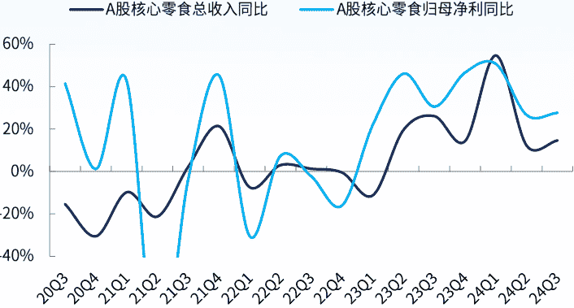

#### 图：A股核心零食公司净利率同比进一步改善

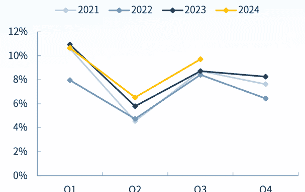

**数据来源：** Wind，国泰君安证券研究。**注：** 选取三只松鼠、洽洽食品、盐津铺子、劲仔食品、甘源食品进行计算。

21

请参阅附注免责声明

**物质生活缓慢回归**

**初创期**

**（70年代-90年代）**

**消费升级、场景多元、渠道多元、种类丰富**

经济起步期，物质生活逐渐回归。

主要消费人群为沿海地区城市居民。

**产品种类单一**，饼干、糖果占据主要市场。

国企占主导地位。

**舶来品强势入场**

**成长期**

**（90年代-21世纪初）**

改革开放后，物质生活快速发展。

主要消费人群为城市、城镇居民。

**产品种类增多**，舶来品与国产零食各据半壁江山。

**线下成长期**

**线上探索期**

休闲零食行业加速发展，民营企业主导；即食性产品崭露头角；商超、夫妻店为主要销售渠道；线上市场不成熟，消费者接受度低。

**线下成熟期**

**线上启动期**

**线下调整期**

**线上加速期**

**线下重塑期**

**线上迭代期**

行业蓬勃发展，**小袋装、烘干产品开始普及，新品类扩张**；商超等传统模式成熟；加盟/自营门店兴起；PC技术成熟，电商平台崛起，线上购物消费者认可度提高。

**消费升级**加速，场景**更加多元化**；借助成熟的供应链和物流仓储基础，坚果、果干、干果等品类拓展速度大幅提高；移动互联网及电商带动线上渠道飞速发展。

**品类、场景扩张持续**；线下客流回流社区，线上去中心化加速；基础业态叠加新技术，人货场轮动，新商业模式出现，线下量贩零食爆发、线上直播社交电商如火如荼。

来伊份上市

盐津铺子上市

良品铺子上市

甘源上市

劲仔上市

三只松鼠上市

1999 2001 2002 2005 2006 2007 2009 2010 2012 2016 2017 2019 2020

**注重品质、体验、性价比**

2021 2022 2023

直播带货百花齐放

社区团购昙花一现

零食很忙、万辰集团门店均破4000家

量贩零食加速扩张

### 03 优质成长：零食

双十一周期拉长，休闲零食双位数增长。零食尤其零食礼盒的销售具备较强的节假日效应，礼盒类产品主要动销集中在元春开门红、中秋国庆以及电商大促等时点。2024年双十一节奏整体前置、周期拉长，零食品类线上销售占比约在15%以上，随着平台流量的分散化以及短视频直播社交等去中心化流量的兴起，大促节点销售集中爆发的属性相对有所减弱，零食品类在抖音等直播短视频电商的增速预计明显快于天猫、京东等传统货架电商，休闲零食双十一全天销售额同比+11%。

#### 图：多个零食公司2024年在抖音渠道高增

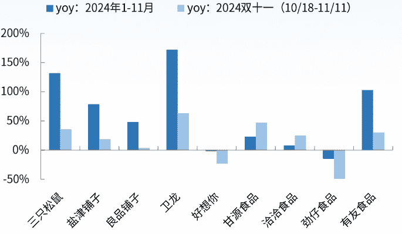

#### 图：根据星图数据，24年双十一休闲零食全网销售额同比+11%

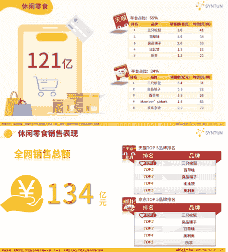

### 03 优质成长：化妆品

横向对比看，彩妆、洗护发、洗浴产品人均消费远低于海外。以日本（弱需求、强产品创新）、美国（内需大市场）、韩国（后发工业国、高线上化率）三国平均为基准，护肤、彩妆、洗护发、婴童护理、洗浴、口腔、衣护、卫生巾海外三国人均消费为国内4、8、6、3、9、5、5、2倍左右，其中人均彩妆、洗护发、洗浴产品消费较海外差距较大。

#### 表：护肤、衣护、卫生巾、洗护发、彩妆绝对规模大，彩妆、洗护发、洗浴产品人均消费远低于海外

| 品类 | 护肤 | 彩妆 | 洗护发 | 婴童护理 | 洗浴产品 | 口腔护理 | 衣物护理 | 卫生巾 |
|---|---:|---:|---:|---:|---:|---:|---:|---:|
| 23年规模（亿元） | 2818 | 618 | 636 | 320 | 238 | 492 | 751 | 500–600 |
| 21–23年规模 CAGR | −2.0% | −3.0% | −1.2% | 0.3% | −2.7% | −2.9% | 1.7% | 2.7% |
| 18–23年规模 CAGR | 5.7% | 6.5% | 3.3% | 7.5% | 1.0% | 2.8% | 1.4% | 3.2% |
| 人均消费（美元） | 28.2 | 6.2 | 6.4 | 3.2 | 2.4 | 4.1 | 7.5 | 5–6 |
| 海外三国平均人均消费（美元） | 100.7 | 47.1 | 39.3 | 8.0 | 20.7 | 22.7 | 35.0 | 9.1 |
| 海外三国平均人均消费倍数 | 3.6 | 7.6 | 6.1 | 2.5 | 8.6 | 4.6 | 4.7 | 1.5–2 |

| 品牌 | 珀莱雅 | 欧莱雅 | 可复美 | 可丽金 |
|---|---|---|---|---|
| **产品** | 源力面霜2.0 | 小蜜罐面霜（升级版） | 焦点面霜 | 胶卷面霜 |
| **上市时间** | 2024.02 | 2023.12 | 2024.03 | 2024.02 |
| **功效定位** | 修复 | 抗衰 | 修复抗衰+提亮 | 抗衰 |
| **价格** | 239/50g | 319/60ml | 359/50g | 229/30g |
| **主要成分** | 重组ⅩⅦ型胶原、神经酰胺、豌豆多肽 | 重组Ⅲ型胶原、玻色因pro、麦卢卡蜂蜜、胜肽 | 4种重组胶原、脱羧肌肽、麦角硫因、极大螺旋藻 | 重组胶原（C5HA）、胜肽、麦角硫因 |

### 03 优质成长：宠物经济

**宠物经济中，宠物食品市场占比大，国产品牌偏好度超外资品牌。** 根据《2025年中国宠物行业白皮书》，2024年宠物食品市场的份额达52.8%，占比最大，其中主粮占比进一步上升；其次是医疗市场，市场份额达28.0%。从宠物主购买主粮的偏好来看，国产品牌在工艺创新（如烘焙粮、冻干粮等）、原料创新等方面更为积极，对国内宠物主的吸引力进一步增强。

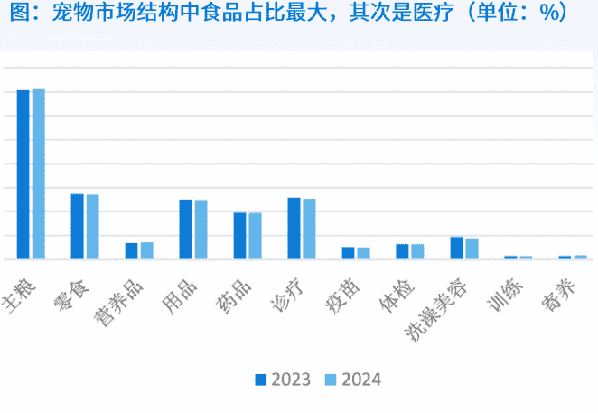

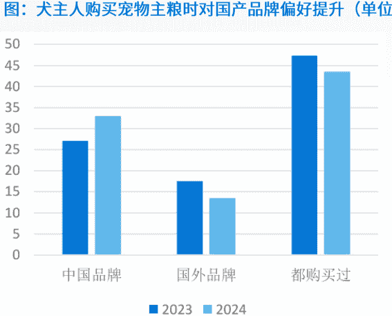

**国产品牌在工艺、原材料、成分方面持续推陈出新。** 例如乖宝宠物指出产品采用鲜肉瞬时高温乳化添加技术，使得鲜肉添加量可达70%；弗列加特坚持只用鲜肉，拒绝肉粉，并采用美国Wenger TX85高鲜肉直灌专利技术，实现了高鲜肉添加比例。“蓝氏”突出乳鸽原材料，宣传“一包猫粮2只乳鸽”，强调天然食材特色。“鲜朗”专注于低温烘焙工艺，通过低温烘焙保留营养成分，避免高温带来的蛋白质变性和营养流失。“颐皮”采用宇航冻干工艺，同时使用本地新鲜肉源，确保产品质量安全。

#### 图：宠物国产品牌工艺、原材料、成分创新举例

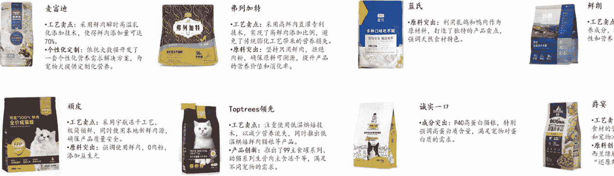

## 投资主线二：以旧换新

以旧换新政策在提振内需方面具备显著效果，能够有效激发消费者的购买欲望，促进消费市场活跃，重点关注：家电、汽车、家居、家纺。以旧换新政策包括家电以旧换新、汽车以旧换新、家装消费品换新等。2024年以来，随着推动大规模设备更新和消费品以旧换新的“两新”政策落地，各地政府和商家积极开展形式不同的以旧换新补贴，畅通消费品更新换代渠道，最大限度释放出政策效应。根据此前国家发展改革委数据测算，以旧换新政策将为我国家电、汽车更新换代创造出万亿元规模的市场空间。

### 图：2024年7月政府明确提出促进消费品以旧换新，大幅度扩大支持范围和补贴标准

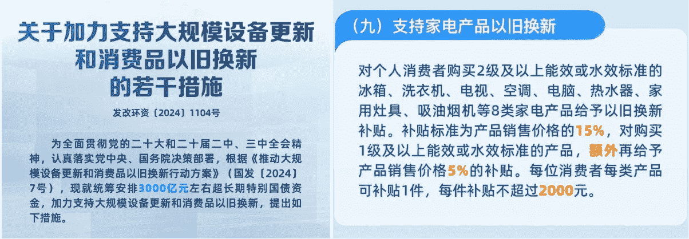

请参阅附注免责声明

| 政策 | 家电下乡 | 以旧换新 | 节能惠民 | 新节能惠民 |
|---|---|---|---|---|
| 时间 | 2007-2013 | 2009-2011 | 2009-2012 | 2012-2013 |
| 补贴对象 | 部分-全国**农村** | 部分-全国**城乡** | 全国**城乡** | 全国**城乡** |
| 补贴品类 | 16种 | 5种 | 1种 | 12种 |
| 补贴方式 | 售价的13% | 售价的10% | 对1-2级能效空调给予300-850元/台的补助 | 售价的3~23% |
| 补贴总额 | **765亿元** | **375亿元** | **约146.43亿元** | **76.16亿元** |
| 拉动消费 | 6597.6亿元 | 3442亿元 | 约1500亿元 | 约600亿元 |
| 拉动效率 | 8.6 | 9.2 | 10.2 | 7.9 |

### 以旧换新：家电

**2024年：** 家电以旧换新政策再次发力，各个省份家电补贴品类存在差异。本轮家电类以旧换新，中央明确规定了八大类，即冰箱、洗衣机、电视、空调、电脑、热水器、家用灶具、吸油烟机。通过绑定身份证控制八大类的领券数量，每人全国只限领一张，但领券地不限。此外，在政策文件的第七条中，还赋予各个地方对消费品类的定义能力，中央的国补资金下发给地方后，各省的资金分配存在差异，部分省份是由省一级负责执行，广东、浙江、山东等省份是下发至市层面执行。

##### 表：加力支持大规模设备更新和消费品以旧换新资金分配

| 序号 | 项目 | 拟定分配金额 | 其他细则 |
|---|---|---|---|
| 1 | 优化设备更新项目支持方式 | 1480亿元 | 涉及资金按照9:1央地共担；东、中、西部地区，中央承担比例85%、90%、95% |
| 2 | 老旧营运船舶报废更新 | 与<1>合计1480亿元 |  |
| 3 | 老旧营运货车报废更新 |  |  |
| 4 | 农业机械报废更新 |  |  |
| 5 | 新能源公交车及动力电池更新 |  |  |
| 6 | 提高设备更新贷款财政贴息比例 | 1500亿元左右 |  |
| 7 | **支持地方提升消费品以旧换新能力** |  |  |
| 8 | 汽车报废更新 |  |  |
| 9 | 家电产品以旧换新 |  |  |
| 10 | 废弃电器电子产品回收处理资金支持 | 与<6>合计275亿元 |  |

##### 图：中央家电国补资金下发给地方后，各省的资金分配存在差异

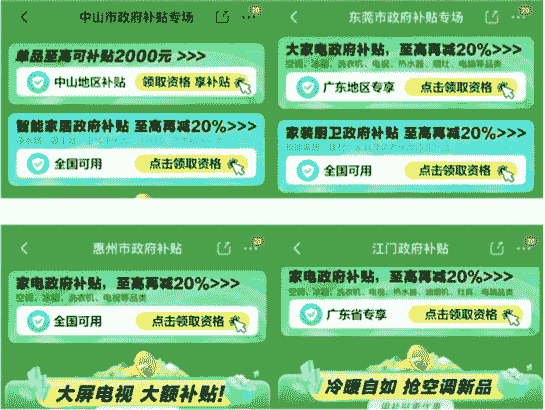

### 以旧换新：家电

从补贴效果来看，以旧换新政策对于拉动家电消费效果显著。2024年8月10日湖北省率先落地扫码补贴政策，因此我们选取2024W33（2024.8.12-8.18）作为分界点，2024W1~W32（2024.1.1-8.11）为补贴前，2024W33之后为政策落地拉动期。不难发现，以旧换新刺激下，清洁电器、空调、厨电（除集成灶）相对表现更好，销量增速大幅提升。

##### 图：线上各品类补贴码前后增速对比

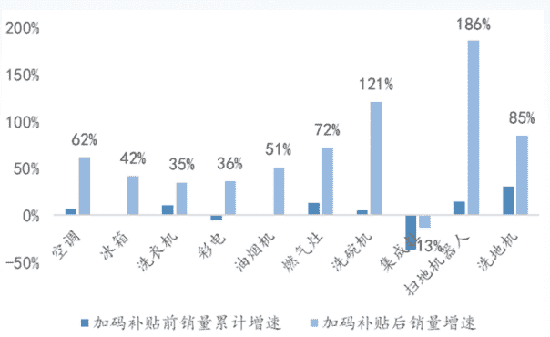

##### 图：线下各品类补贴码前后增速对比

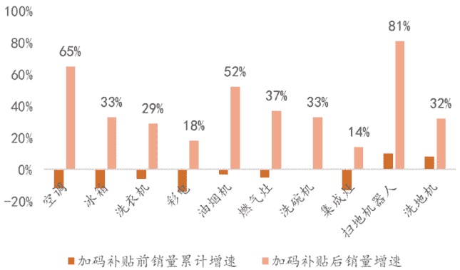

### 以旧换新：家电

在大比例的补贴政策推动下，绝大部分家电消费结构呈现向上改善的趋势。我们将补贴周期内各品类的销售均价与补贴前的年累计均价进行对比，综合线上、线下表现后不难发现：①补贴影响对于彩电、冰洗的均价改善在品类间对比相对更明显，黑白电企业在24Q4迎来价格层面的正向业绩贡献；②补贴政策下，厨电线下价格改善更好；③集成灶、洗地机等竞争程度更为激烈的子行业均价受补贴政策正向拉动的作用相对较小，依旧需要主动降价竞争。

#### 表：线上各品类均价变化（单位：元）

| 线上 | 补贴前均价 | 同比 | 补贴后均价 | 同比 | 补贴前后均价对比 |
|---|---:|---:|---:|---:|---:|
| 空调 | 2683 | −5% | 2895 | 2% | 1.079 |
| 冰箱 | 2259 | 1% | 2743 | 17% | 1.214 |
| 洗衣机 | 1493 | −4% | 1548 | 9% | 1.037 |
| 彩电 | 2865 | 12% | 3433 | 19% | 1.198 |
| 油烟机 | 1495 | −1% | 1630 | 7% | 1.090 |
| 燃气灶 | 755 | −9% | 808 | −5% | 1.070 |
| 洗碗机 | 4315 | −4% | 4524 | −2% | 1.048 |
| 集成灶 | 6975 | −10% | 7369 | 11% | 1.056 |
| 扫地机器人 | 3307 | 3% | 3606 | 15% | 1.090 |
| 洗地机 | 2102 | −19% | 2117 | −11% | 1.007 |

#### 表：线下各品类均价变化（单位：元）

| 线下 | 补贴前均价 | 同比 | 补贴后均价 | 同比 | 补贴前后均价对比 |
|---|---:|---:|---:|---:|---:|
| 空调 | 4120 | −3% | 4554 | 6% | 1.105 |
| 冰箱 | 6721 | 2% | 7235 | 10% | 1.076 |
| 洗衣机 | 4142 | −1% | 4528 | 11% | 1.093 |
| 彩电 | 6599 | 13% | 7404 | 16% | 1.122 |
| 油烟机 | 4117 | 1% | 4417 | 8% | 1.073 |
| 燃气灶 | 2038 | 2% | 2277 | 16% | 1.117 |
| 洗碗机 | 7732 | 4% | 7933 | 8% | 1.026 |
| 集成灶 | 9988 | 2% | 9717 | 0% | 0.973 |
| 扫地机器人 | 4485 | 6% | 4820 | 3% | 1.075 |
| 洗地机 | 3074 | −10% | 3054 | −9% | 0.993 |

2023

2027

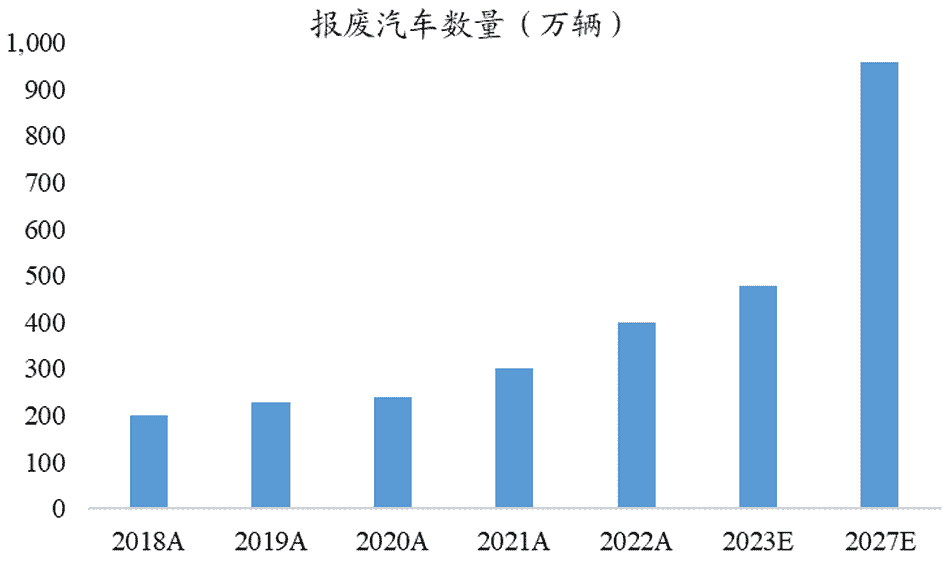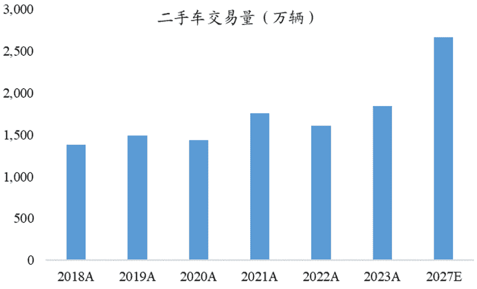

**2022**

2022

5

2009-2017

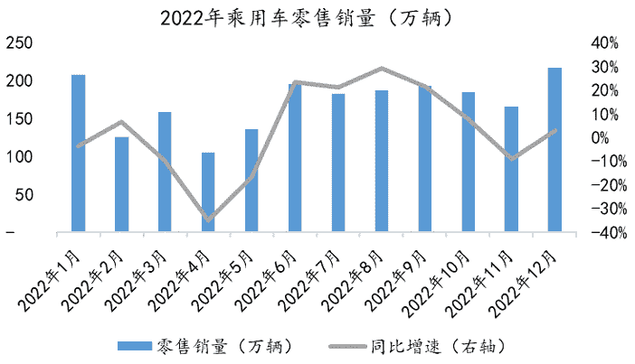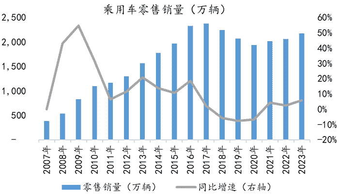

### 04　以旧换新：汽车

新能源渗透率和自主品牌市占率持续提升，国产品牌迎来黄金发展机遇期。近年来自主品牌乘用车的市场份额持续提升，以比亚迪、吉利汽车、长安汽车、奇瑞汽车为代表的头部企业强势崛起，带动新能源乘用车渗透率突破50%大关。自此，燃油车成为“少数派”，新能源汽车成为市场主流。展望未来，随着合资品牌燃油车供给收缩以及自主品牌优质新能源汽车车型持续上市，新能源渗透率有望再上新台阶。

#### 图：2024年10月自主品牌车企销量排行榜

| 排行 | 车企 | 销量(万辆) | 同比 | 环比 |
|---|---|---:|---:|---:|
| 01 | 比亚迪 | 42.06 | +70.6% | +11.7% |
| 02 | 吉利汽车 | 19.41 | +29.7% | +19.3% |
| 03 | 长安汽车 | 12.13 | -10.0% | +19.1% |
| 04 | 奇瑞汽车 | 11.67 | +67.8% | +13.1% |
| 05 | 上汽通用五菱 | 9.60 | +35.5% | +13.3% |
| 06 | 长城汽车 | 6.38 | -22.4% | +15.6% |
| 07 | 一汽丰田 | 5.44 | +21.1% | -9.0% |
| 08 | 理想汽车 | 5.14 | +27.3% | -4.2% |
| 09 | 零跑汽车 | 3.61 | +98.3% | +11.4% |

#### 图：近年来自主品牌乘用车的市场份额持续提升

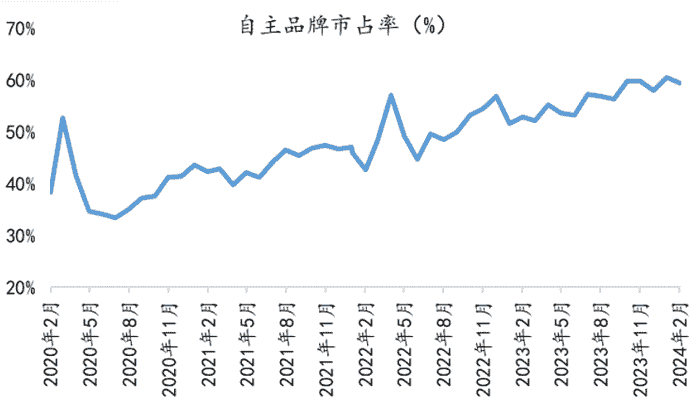

10

23

51

23

**地区**

**时间**

**政策优化方向**

湖北省

10月23日

**①将原来对23类厨卫类产品补贴扩大到51类**，增加对23类家装产品的补贴；

②对每位家装（含家具）产品的消费者**提高补贴上限**，由原2000元定额增至20000元

福建省

11月9日

①在11类智能家居产品基础上**增加5类智能家居产品**，且各地可结合本地实际，继续合理增加家装厨卫“焕新”补贴品类；

②对每位消费者单笔**消费参补门槛自1000元放宽至200元**；对于适老化产品的参补门槛自500元放宽至100元

湖南省

11月14日

**①优化参与企业准入门槛**：1）符合《实施方案》规定的基本条件的企业都可以报名参加，各级商务主管部门不得另行设置经营规模、税收收入、入统企业、发票开具地等限制性门槛；2）有固定经营场所、合法经营、无失信行为且从事家装厨卫行业销售经营1年以上的个体工商户在转为企业后可以报名参加，无须提供企业信用报告和纳税等级证明；3）各家装厨卫品牌专卖店（县乡加盟店）可通过总部或区域总部统一报名参加，报名地为总部或区域总部所在市州；

**②提高额度上限：**如每套住房申领补贴次数不限制，但每个申领人单品类限申请一次；

**③放宽补贴标准：**不要求橱柜、衣柜等周期长的定制类商品提交购置商品开封后的实物照片，可用合法有效的定制合同替代实物照片

贵州省

11月18日

在补贴12类家居产品基础上，**试点新增品类**，包括15类家装建材、8类水暖五金、7类卫浴洁具、13类家装厨卫家具

## 05 投资主线三：供需优化

经济复苏、消费升级、政策引导、行业内部优胜劣汰等因素带来消费行业供需优化（市场需求好转+部分落后产能退出），重点关注：啤酒、大众品、白酒、酒店、纺织服装。行业供需优化与诸多因素有关，需求端伴随经济复苏和消费升级趋势，消费者对产品质量和产品品质提出更高要求，实力雄厚的头部企业更容易获得消费者青睐；供给端政策鼓励行业并购重组、促进优势企业做大做强，缺乏品牌和资金实力的中小企业被淘汰出局，市场份额持续向头部企业集中。

### 图：经济复苏、消费升级、政策引导、行业内部优胜劣汰等因素带来消费行业供需优化

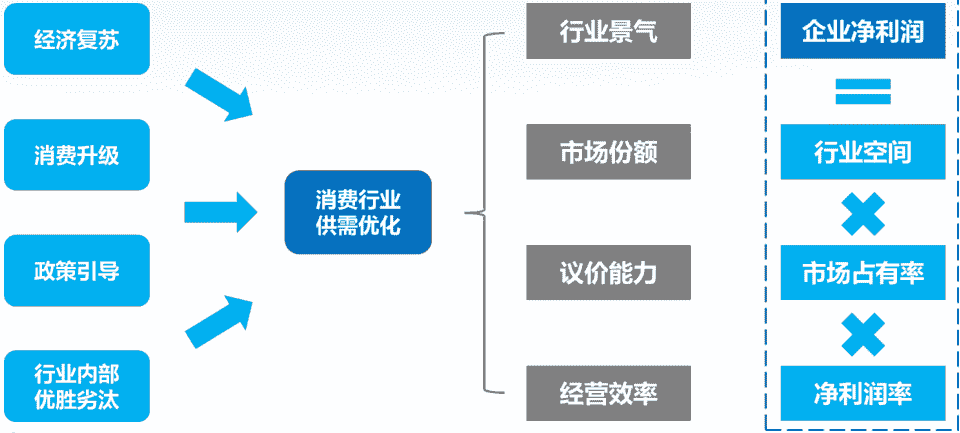

| 细分行业 | 行业趋势（上行、持平、下行） | 行业集中度变化 | 行业毛利率变化 | 行业龙一市占率 |
| --- | --- | --- | --- | --- |
| **食品饮料** |
| 啤酒 | 行业趋势下行，量跌，吨价提升速度大幅放缓，预计25年能够企稳 | 行业集中度变化不大，前五大集中度在70%以上 | 毛利率受益于成本下行及吨价微幅提升持续改善 | 华润30-35%、青啤20-25%（利基市场集中度均达60%） |
| 乳制品 | 行业趋势下行速度放缓，量价均下跌 | 行业集中度变化不大，前两大龙头仍处于垄断地位 | 毛利率受益于原奶价格下行有所提升 | 伊利：30%（全品类口径）或35%（液奶口径）或45%（常温白奶口径） |
| 调味品 | 行业趋势企稳回升，量增价跌 | 行业集中度向龙头集中比较明显 | 毛利率受益于成本下行有所提升 | 海天味业市占率6%，在酱油子行业市占率19% |
| 速冻食品 | 行业下行趋势放缓，量价齐跌 | 行业集中度变化不大 | 竞争加剧，毛利率略有下行 | 安井食品：10% |
| 肉制品 | 行业下行趋势放缓，量价齐跌 | 行业处于寡头垄断 | 毛利率受益于成本下行有所提升 | 双汇：55%（火腿肠） |
| 零食 | 行业处于相对景气阶段，量增价跌 | 行业集中度有所提升 | 毛利率受产品结构优化及成本下行影响有所提升 | 玛氏箭牌：1.7%（品牌端）、鸣鸣很忙：2.1%（渠道端，2023年） |
| 绝味：9%（卤制品） |
| **社会服务** |
| 化妆品 | 护肤品：行业增速保持平稳 | 行业集中度迅速提升 | 毛利率受益于产品结构优化继续提升 | 化妆品：欧莱雅4.3%，珀莱雅1.7%；护肤：欧莱雅6.2%，珀莱雅3.2% |
| 免税 | 行业下行趋势放缓，量价齐跌 | 行业集中度变化不大，第一大龙头 | 毛利率受折扣和汇率变化同比下降 | 中免市场份额80% |
| 餐饮 | 行业下行趋势放缓，量价齐跌 | 行业集中度变化不大，高度分散 | 毛利率相对平稳 | 龙头海底捞市场份额5% |
| 酒店 | 收窄为主，主要为计数降低 | 行业集中度下降 | 毛利率下行，主要为价格下降、出租 | 龙头锦江酒店市场份额13% |
| OTA | 景气度下行，增速放缓 | 行业集中度提升 | 毛利率稳定 | 龙头携程市场份额55% |
| 教育 | 景气度下行，增速放缓 | 行业集中度提升 | 毛利率稳定 | 龙头新东方市场份4% |
| **零售** |
| 百货 | 行业趋势企稳回升，客流恢复好于预期 | 行业集中度变化不大 | 竞争加剧，毛利率有所下行 | 龙头百联股份市场份额0.1% |
| 超市 | 行业趋势企稳回升，客流恢复好于预期 | 行业集中度变化不大 | 竞争加剧，毛利率有所下行 | 龙头永辉超市市场份额2.5% |
| 跨境电商 | 行业延续上行趋势，但美国关税政策或存在影响 | 行业集中度变化不大，头部公司份额有所提升 | 海运影响，毛利率下行 | 龙头安克创新市场份额0.9%（非上市公司中，SHEIN市场份额约13%） |
| 黄金珠宝 | 行业下行趋势略有收窄，价增量缩 | 行业集中度变化不大 | 毛利率受益销售品类结构有所优化 | 龙头老凤祥市场份额22% |

48

请参阅附注免责声明

#### 家电

**白电**

- 行业趋势上行
- 集中度显著提升（内销国补龙头受益，出口海外竞争对手逐步退出）
- 24Q4毛利率受益于国补推动结构提升，出口人民币汇率贬值
- 空调：美的集团（35%）；冰洗海尔智家（35%-40%）

**黑电**

- 行业趋势上行
- 头部集中度提升
- 毛利率上行
- 海信视像15%

**清洁电器**

- 行业趋势上行
- 行业集中度提升
- 毛利率降低
- 扫地机石头科技（30%），洗地机添可（38%）

**厨电**

- 行业趋势上行（以旧换新拉动q4上行）
- 行业集中度提升
- 毛利率持平
- 老板电器（20-25%）

#### 轻纺

**品牌服饰**

- 行业下行趋势放缓，量增价跌
- 行业集中度变化不大，运动集中度相对较高，男女装格局分散
- 受益于折扣管控及产品结构优化，毛利率有所提升
- 男装龙一海澜市占率4.6%，女装龙一优衣库市占率1.7%，家纺龙一罗莱1.6%

**纺织制造**

- 行业处于相对景气阶段，量增价跌
- 行业格局呈头部集中趋势
- 受益于产能利用率提升及产品结构优化，毛利率有所提升
- 运动鞋代工龙一裕元市占率11%

**家居**

- 行业下行趋势放缓，价格在触底回暖的过程中
- 集中度持续提升，但绝对水平仍偏低
- 受单价影响短期有所下行
- 按终端零售8000亿计算，龙一市占率不到3%

**造纸**

- 行业增速保持低个位数，相对平稳
- 集中度持续提升，主要纸种类CR5都在50%-70%
- 成本回落毛利率上行
- 龙一太阳在双胶纸市占率约14%

#### 农业

**宠物食品**

- 行业趋势上行
- 行业集中度提升，头部品牌（如麦富迪）收入增速高于行业2-3倍
- 行业整体略下滑，国产头部品牌提升
- 乖宝宠物市占率 8%

**饲料**

- 行业趋势上行
- 行业集中度提升，头部公司原材料成本、生产加工把控优势较为明显
- 毛利率先下降后上升，短期激烈竞争价格战
- 海大集团市占率 7%

**养殖**

- 行业趋势持平
- 行业集中度提升，头部公司能繁数量保持增长，市占率提升
- 温氏牧原等头部公司养殖成绩提升&成本持续下降，毛利率提升
- 牧原股份市占率 10%

| **细分行业** | **行业趋势（上行、持平、下行）** | **行业集中度变化** | **行业毛利率变化** | **行业龙一市占率** |
| :--- | :--- | :--- | :--- | :--- |
| **家电** | | | | |
| 白电 | 行业趋势上行 | 集中度显著提升（内销国补龙头受益，出口海外竞争对手逐步退出） | 24Q4毛利率受益于国补推动结构提升，出口人民币汇率贬值 | 空调：美的集团（35%）；冰洗海尔智家（35%-40%） |
| 黑电 | 行业趋势上行 | 头部集中度提升 | 毛利率上行 | 海信视像15% |
| 清洁电器 | 行业趋势上行 | 行业集中度提升 | 毛利率降低 | 扫地机石头科技（30%），洗地机添可（38%） |
| 厨电 | 行业趋势上行（以旧换新拉动q4上行） | 行业集中度提升 | 毛利率持平 | 老板电器（20-25%） |
| **轻纺** | | | | |
| 品牌服饰 | 行业下行趋势放缓，量增价跌 | 行业集中度变化不大，运动集中度相对较高，男女装格局分散 | 受益于折扣管控及产品结构优化，毛利率有所提升 | 男装龙一海澜市占率4.6%，女装龙一优衣库市占率1.7%，家纺龙一罗莱1.6% |
| 纺织制造 | 行业处于相对景气阶段，量增价跌 | 行业格局呈头部集中趋势 | 受益于产能利用率提升及产品结构优化，毛利率有所提升 | 运动鞋代工龙一裕元市占率11% |
| 家居 | 行业下行趋势放缓，价格在触底回暖的过程中 | 集中度持续提升，但绝对水平仍偏低 | 受单价影响短期有所下行 | 按终端零售8000亿计算，龙一市占率不到3% |
| 造纸 | 行业增速保持低个位数，相对平稳 | 集中度持续提升，主要纸种类CR5都在50%-70% | 成本回落毛利率上行 | 龙一太阳在双胶纸市占率约14% |
| **农业** | | | | |
| 宠物食品 | 行业趋势上行 | 行业集中度提升，头部品牌（如麦富迪）收入增速高于行业2-3倍 | 行业整体略下滑，国产头部品牌提升 | 乖宝宠物市占率 8% |
| 饲料 | 行业趋势上行 | 行业集中度提升，头部公司原材料成本、生产加工把控优势较为明显 | 毛利率先下降后上升，短期激烈竞争价格战 | 海大集团市占率 7% |
| 养殖 | 行业趋势持平 | 行业集中度提升，头部公司能繁数量保持增长，市占率提升 | 温氏牧原等头部公司养殖成绩提升&成本持续下降，毛利率提升 | 牧原股份市占率 10% |

49

请参阅附注免责声明

Wind

**2002-2013**

**2014-2016**

**2017**

**2005**

**2006**

**2007**

**2008**

**2009**

**2010**

**2011**

**2012**

**2013**

**2014**

**2015**

**2016**

**2017**

**2018**

**2019**

**2020**

**2021**

**2022**

**2023**

| 指标 | 2005 | 2006 | 2007 | 2008 | 2009 | 2010 | 2011 | 2012 | 2013 | 2014 | 2015 | 2016 | 2017 | 2018 | 2019 | 2020 | 2021 | 2022 | 2023 |
| :--- | :--- | :--- | :--- | :--- | :--- | :--- | :--- | :--- | :--- | :--- | :--- | :--- | :--- | :--- | :--- | :--- | :--- | :--- | :--- |
| 行业吨利yoy | 12.9% | 13.0% | 12.4% | -9.4% | 28.7% | 23.2% | 6.3% | -5.2% | 16.1% | 12.8% | 8.8% | 9.7% | -12.3% | 5.1% | 8.8% | 8.0% | 31.1% | 18.9% | 14.2% |
| 板块毛利率 | 39.2% | 39.3% | 39.5% | 38.6% | 41.5% | 42.3% | 41.5% | 39.7% | 40.0% | 39.4% | 38.3% | 40.4% | 38.8% | 38.0% | 39.5% | 42.5% | 40.5% | 40.0% | 40.8% |
| 板块销售费率 | 12.8% | 13.5% | 14.6% | 14.6% | 15.4% | 16.2% | 16.5% | 16.3% | 16.9% | 16.9% | 18.2% | 19.2% | 18.5% | 16.2% | 16.4% | 17.2% | 14.2% | 13.7% | 14.0% |
| 板块毛销差 | 26.4% | 25.8% | 24.9% | 24.0% | 26.1% | 26.1% | 25.0% | 23.4% | 23.1% | 22.5% | 20.1% | 21.2% | 20.2% | 21.8% | 23.2% | 25.3% | 26.3% | 26.3% | 26.8% |

### 投资主线三：供需优化：啤酒

2024年景气边际承压，盈利能力仍持续改善。2024年以来受消费意愿及餐饮疲软影响，啤酒行业景气表现一般，但盈利仍表现出较强韧性，个股业绩分化加剧。24Q1-Q3 A股啤酒板块实现收入608亿元，同比-2%，实现净利润85亿元，同比+8%，净利率同比+1.2pct至14%。单24Q3 A股啤酒板块收入-3%、净利润-2%，边际放缓。同时板块内部分化进一步加剧，区域品牌表现明显优于全国品牌，燕京、珠江啤酒贡献了24Q1-Q3啤酒行业利润增量的73%，而全国性品牌利润增长显著放缓或下滑。

#### 图：2024年啤酒行业收入及利润增速边际放缓

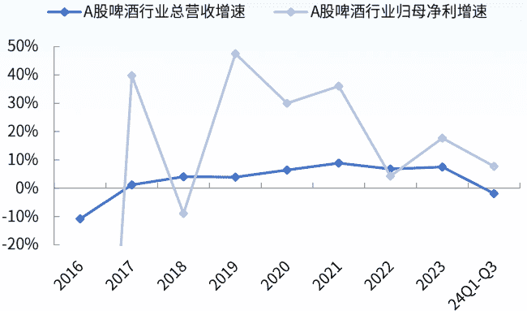

#### 图：啤酒行业盈利韧性延续

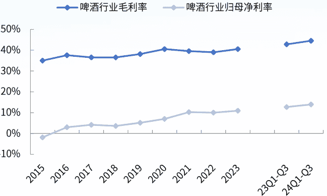

### 投资主线三：供需优化：啤酒

啤酒2017-2023年吨价持续提升，2024年短暂调整。2013年销量见顶之后，酒企开始将重点转向产品结构升级，整体吨价保持个位数增长，增速持续快于销量端，截至2023年吨价已升至3735元/千升（2010年为2310元/千升），从23H2开始出现以被动升级为主的趋势。2024年受消费降级以及餐饮场景恢复不畅的影响，啤酒量、价表现边际趋弱，24H1主流企业销量-2%、吨价+0.1%，预计未来将恢复正增长。

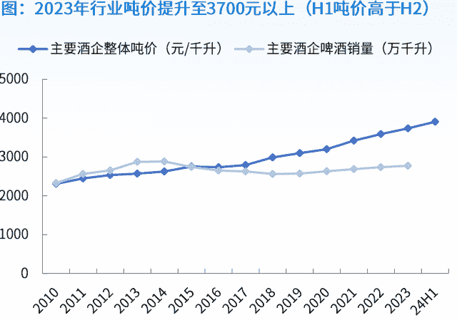

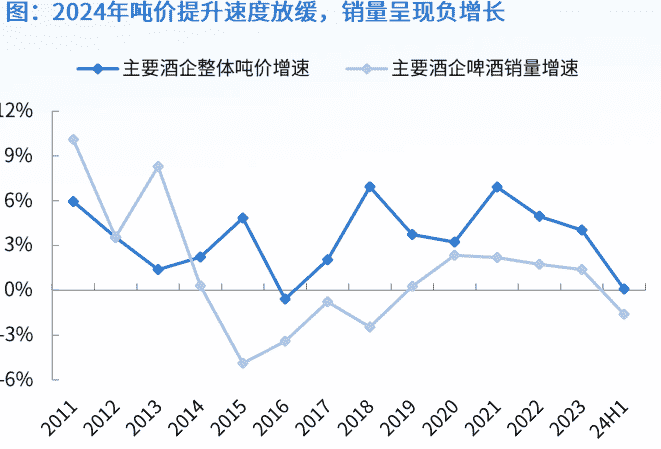

52

请参阅附注免责声明

Wind

| **品类** | **代表品牌** | **单价（元/500-600ml）** |
| :--- | :--- | :--- |
| **包装水** | 农夫山泉 | **2** |
| **碳酸饮料** | 可口可乐 | **3** |
| **茶饮料** | 康师傅冰红茶 | **2.5** |
| **果汁** | 美汁源果粒橙 | **3.5** |
| **奶茶** | 统一阿萨姆奶茶 | **3.5** |
| **即饮咖啡** | 雀巢咖啡 | **3.5** |
| **能量饮料** | 东鹏特饮 | **4** |
| **运动饮料** | 佳得乐 | **4** |
| **无糖茶** | 东方树叶 | **5.5** |

15%

45%

40%

85%

55%

30%

30%

0%

20%

40%

60%

80%

100%

软饮料

啤酒

调味品

餐饮渠道

零售渠道

工业加工

53

请参阅附注免责声明

Wind

0%

10%

20%

30%

40%

0

5,000

10,000

15,000

20,000

软饮料总产量（万吨）

碳酸饮料产量/软饮料

**CAGR=20%**

**CAGR=0.5%**

-10%

-5%

0%

5%

10%

15%

2014-2022 CAGR

54

请参阅附注免责声明

-15%

-10%

-5%

0%

5%

10%

15%

20%

0

100

200

300

400

500

600

1994 1996 1998 2000 2002 2004 2006 2008 2010 2012 2014 2016 2018 2020 2022

yoy

55

请参阅附注免责声明

Euromonitor

-20%

-10%

0%

10%

20%

30%

40%

0

1,000

2,000

3,000

4,000

5,000

6,000

2001

2002

2003

2004

2005

2006

2007

2008

2009

2010

2011

2012

2013

2014

2015

2016

2017

2018

2019

2020

2021

2022

2023

yoy

-4%

-2%

0%

2%

4%

6%

8%

10%

12%

14%

16%

18%

2001-2011

2011-2020

2020-2023

CAGR

CAGR

56

请参阅附注免责声明

Euromonitor

0%

5%

10%

15%

20%

25%

30%

2014

2023

海天味业

李锦记

美味鲜

57

请参阅附注免责声明

Wind

14.6%（14.9%）

13.1%（14.1%、15.6%、16.7%）

18.5%

25.3%

0%

10%

20%

30%

2013 2014 2015 2016 2017 2018 2019 2020

一人户家庭占比

原料进货成本：41.8%

人力成本：21.3%

三项费用：19.7%

房屋及物业成本：9.9%

能源成本：3.8%

税费：3.3%

0%

2%

4%

6%

8%

10%

12%

14%

0

500

1,000

1,500

2,000

2,500

3,000

2022

2023E

2024E

2025E

2026E

复合调味料

yoy

58

请参阅附注免责声明

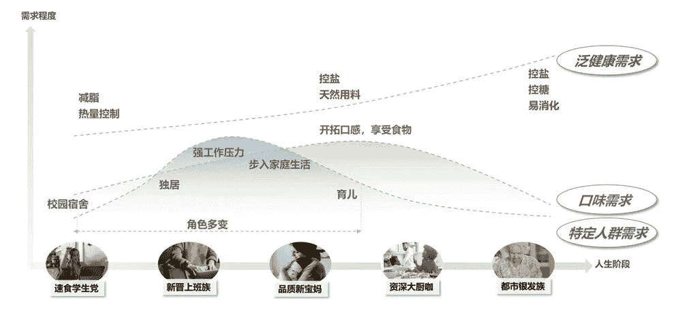

0%

10%

20%

30%

40%

50%

60%

0

5

10

15

20

25

30

35

40

45

50

2020

2021

2022

2023E

复合调味品零售规模（亿元）

yoy

### 投资主线三：供需优化：大众品

**乳制品：从需求端来看，短期下滑，量价齐跌。**乳制品本身有约20%左右为礼赠需求，同时常温酸奶、乳饮料、奶酪等品类具备较强的休闲属性，这两部分销量在消费力偏弱的情况下面临压力，同时白奶等必选品类也受到性价比浪潮的冲击。据我们调研，当前行业需求仍处于同比下滑区间，但24Q3降幅已出现环比改善，短期价格竞争仍在持续，预计居民收入预期修复后行业将迎来复苏。

#### 图：乳制品价格中枢下行

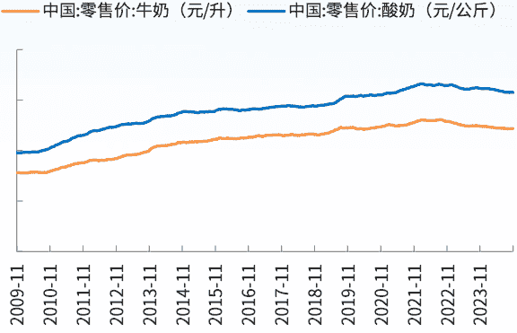

#### 图：A股乳制品行业收入增速自23Q2以来持续放缓，24Q3阶段性改善

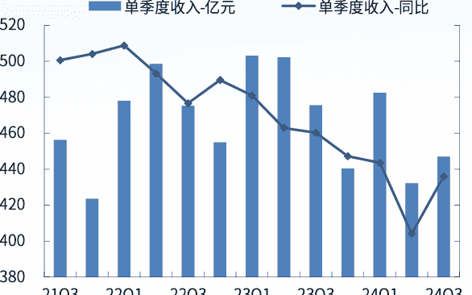

60

请参阅附注免责声明

Wind

0

1000

2000

3000

4000

5000

0

200

400

600

800

1000

1980

1983

1986

1989

1992

1995

1998

2001

2004

2007

2010

2013

2016

2019

2022

中国奶牛存栏数（万头）

牛奶产量（万吨，右）

**2008—2012**

**需求周期**

三聚氰胺事件爆发，导致需求短暂回落，随后恢复。

**2013—2015**

**供给周期**

肉毒杆菌事件导致大包粉进口中断，奶荒致使奶价急涨。

**2016—2018**

**均衡周期**

原奶供需趋于平衡，奶价波动收敛。

**2018—2021**

**供需共振**

饲料涨价，疫情释放需求，打破供需平衡。

**2022—至今**

**供需趋势逆转**

存栏扩张、消费走弱，供需缺口拉大。

61

请参阅附注免责声明

Wind

**2012—2015年**

|  | 12Q1 | 12Q2 | 12Q3 | 12Q4 | 13Q1 | 13Q2 | 13Q3 | 13Q4 | 14Q1 | 14Q2 | 14Q3 | 14Q4 | 15Q1 | 15Q2 | 15Q3 | 15Q4 |
|---|---:|---:|---:|---:|---:|---:|---:|---:|---:|---:|---:|---:|---:|---:|---:|---:|
| 总营收增速 | 40% | 38% | 39% | 22% | 7% | -5% | -12% | -3% | -15% | -9% | -12% | 1% | 8% | 0% | 8% | 6% |
| 归母净利增速 | 53% | 40% | 92% | 33% | 12% | -8% | -24% | -32% | -22% | -20% | -21% | 1% | 5% | 0% | 17% | 23% |

**2021年至今**

|  | 21Q1 | 21Q2 | 21Q3 | 21Q4 | 22Q1 | 22Q2 | 22Q3 | 22Q4 | 23Q1 | 23Q2 | 23Q3 | 23Q4 | 24Q1 | 24Q2 | 24Q3 |
|---|---:|---:|---:|---:|---:|---:|---:|---:|---:|---:|---:|---:|---:|---:|
| 总营收增速 | 23% | 19% | 15% | 14% | 19% | 11% | 16% | 12% | 15% | 17% | 15% | 15% | 15% | 11% | 1% |
| 归母净利增速 | 18% | 26% | 16% | 13% | 26% | 13% | 21% | 18% | 19% | 20% | 18% | 19% | 16% | 12% | 2% |

62

请参阅附注免责声明

0 1000 2000 3000 4000

2009-05 2009-11 2010-05 2010-11 2011-05 2011-11 2012-05 2012-11 2013-05 2013-11 2014-05 2014-11 2015-05 2015-11 2016-05 2016-11 2017-05 2017-11 2018-05 2018-11 2019-05 2019-11 2020-05 2020-11 2021-05 2021-11 2022-05 2022-11 2023-05 2023-11 2024-05 2024-11

茅台-箱

茅台-散

1935

八代五粮液

国窖

0 100 200 300 400 500

2019-11 2020-01 2020-03 2020-05 2020-07 2020-09 2020-11 2021-01 2021-03 2021-05 2021-07 2021-09 2021-11 2022-01 2022-03 2022-05 2022-07 2022-09 2022-11 2023-01 2023-03 2023-05 2023-07 2023-09 2023-11 2024-01 2024-03 2024-05 2024-07 2024-09 2024-11

青20

剑南春水晶剑

品味舍得

水井坊井台

0 200 400 600 800 1000 1200

2020-05 2020-07 2020-09 2020-11 2021-01 2021-03 2021-05 2021-07 2021-09 2021-11 2022-01 2022-03 2022-05 2022-07 2022-09 2022-11 2023-01 2023-03 2023-05 2023-07 2023-09 2023-11 2024-01 2024-03 2024-05 2024-07 2024-09 2024-11

君品习酒

窖藏1988

青花郎

珍15

国台酒国标

金沙摘要

63

请参阅附注免责声明

Wind

-20%

-10%

0%

10%

20%

30%

40%

0

200

400

600

800

1000

1200

1400

1600

1949

1965

1979

1982

1985

1988

1991

1994

1997

2000

2003

2006

2009

2012

2015

2018

2021

中国白酒产量（万吨）

同比增速

11.0%

3.0%

7.8%

-10%

0%

10%

20%

30%

40%

50%

1999

2000

2001

2002

2003

2004

2005

2006

2007

2008

2009

2010

2011

2012

2013

2014

2015

2016

2017

2018

2019

2020

2021

2022

2023

2024H1

白酒销售收入增速

产量增速

价格增速

**2003—2012年**

收入增速与产量增速趋势吻合：

产量周期驱动

**2016—2023年**

收入增速与价格增速趋势吻合：

价格周期驱动

**2013—2015年**

行业调整期

### 投资主线三：供需优化：酒店

酒店行业供给持续优化，行业连锁化率不断提升（2023年连锁化率已经超过40%）。2020年新冠疫情的爆发导致酒店行业直接步入衰退期，大量风险抵御能力较弱的单体酒店倒闭，而头部酒店集团则逆势扩张，推动了行业集中度的上升。同时，连锁酒店相对单体酒店具备价格优势和运营优势（价格优势体现在连锁酒店的产品销售价格通常高于单体酒店，而运营优势则体现在连锁酒店为加盟商提供整套运营管理系统并派驻职业店长经营门店），连锁酒店的优势进一步推动了门店数量扩张和市场集中度的提升。

#### 图：三年疫情期间，中国酒店数量出现明显下降（供需优化）

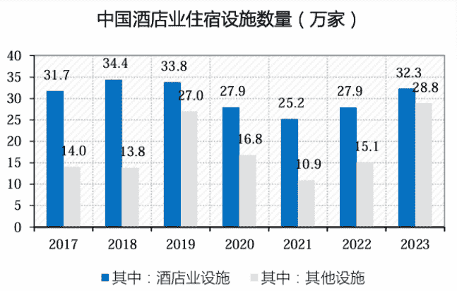

#### 图：中国酒店连锁化率持续提升

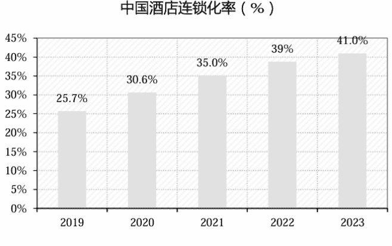

### 投资主线三：供需优化：酒店

借鉴美国酒店行业发展经验，资产整合将是中国酒店集团再次走向集中的主要形式。美国高端酒店发展是运营+资本驱动的非线性增长，REITs是重要催化。历次重大经济波动和疫情冲击后，行业进入资产整合与并购阶段，龙头酒店市场集中度持续提升。

#### 图：万豪酒店的扩张历程与地产周期和REITs发展有很大关联

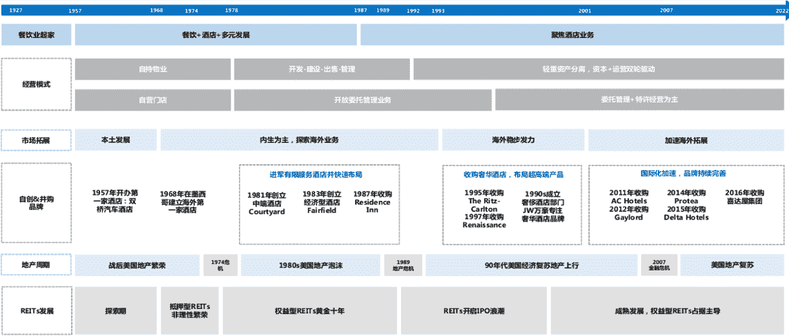

### 投资主线三：供需优化：纺织服装

**品牌服饰：**2024年至今服装消费呈弱复苏趋势，板块表现分化。自9月下旬随着全国多地气温下降，品牌服饰终端动销逐步好转，10月国庆假期叠加双十一活动利好冬装货品销售，Q4销售有望边际改善。此外，近期家纺补贴范围进一步扩大，罗莱、富安娜、水星等家纺品牌已纳入补贴名单，若未来有更多促消费政策落地，服装消费信心有望明显提振。

#### 图：品牌服饰子板块收入增速角度，2024Q3大众服饰＞男装＞中高端女装＞家纺

| 收入YOY | 2022 | 2023 | 2023Q1 | 2023Q2 | 2023Q3 | 2023Q4 | 2024Q1 | 2024Q2 | 2024Q3 |
|---|---:|---:|---:|---:|---:|---:|---:|---:|---:|
| 品牌服饰 | -10% | 9% | 1% | 17% | 3% | 14% | 3% | -4% | -8% |
| 男装 | 6% | 18% | 12% | 29% | 9% | 21% | 9% | 4% | -10% |
| 大众服饰 | -17% | 2% | -12% | 1% | -7% | 8% | -3% | 2% | -2% |
| 中高端女装 | -9% | 16% | 6% | 26% | 1% | 23% | 0% | 3% | -11% |
| 家纺 | -5% | 4% | -3% | 10% | 2% | 7% | 1% | -10% | -12% |
| 童装 | -6% | 1% | 0% | 13% | -13% | 3% | -2% | -16% | 7% |

#### 图：品牌服饰2024Q3盈利承压，不同板块间表现分化

| 归母净利YOY | 2022 | 2023 | 2023Q1 | 2023Q2 | 2023Q3 | 2023Q4 | 2024Q1 | 2024Q2 | 2024Q3 |
|---|---:|---:|---:|---:|---:|---:|---:|---:|---:|
| 品牌服饰 | -30% | 41% | 21% | 132% | 27% | 32% | -1% | -18% | -50% |
| 男装 | -7% | 36% | 19% | 65% | 45% | 25% | 10% | -16% | -50% |
| 大众服饰 | -62% | 88% | 32% | -248% | 48% | 26% | -4% | -8% | -49% |
| 中高端女装 | -61% | 88% | 32% | 147% | -5% | -398% | -19% | -29% | -82% |
| 家纺 | -16% | 10% | 6% | 57% | -6% | 5% | -18% | -28% | -29% |
| 童装 | -15% | 8% | 24% | 42% | 4% | -15% | -18% | 23% | -63% |

**品牌服饰：** 上市公司门店数量、渠道净拓店情况表现分化，龙头企业表现较好。过去三年国内头部服饰品牌具备较强的门店拓展能力和渠道运营效率，在消费复苏背景下获得快速增长，同时在23年下半年消费需求放缓情况下，仍能拥有稳定的终端销售表现及盈利水平，而中小服饰品牌面临转型压力，市场份额受到挤压。2024Q3品牌终端销售延续此前的分化趋势，以比音勒芬、报喜鸟为代表的头部品牌渠道继续稳步扩张，并且有望受益消费政策拉动。

#### 图：品牌服饰板块上市公司门店数量同比变动情况

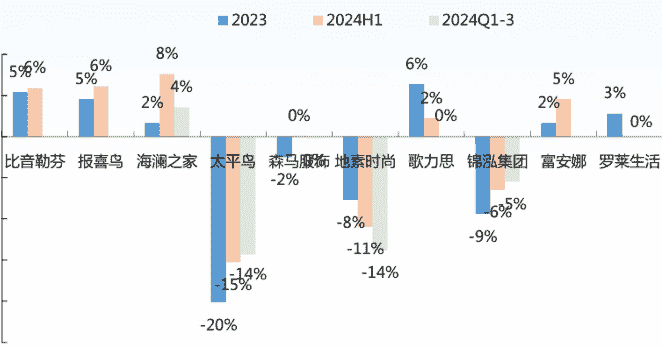

#### 图：品牌服饰公司线下渠道净拓店情况

| （家） | 公司 | 2020 | 2021 | 2022 | 2023 | 2024H1 | 2024Q1-3 |
|---|---|---:|---:|---:|---:|---:|---:|
| 男装 | 比音勒芬 | 85 | 121 | 91 | 64 | 8 | / |
| 男装 | 报喜鸟 | -45 | 43 | 8 | 77 | 11 | / |
| 男装 | 海澜之家 | 127 | 271 | -880 | 114 | 80 | 252 |
| 大众服饰 | 太平鸟 | 120 | 598 | -543 | -940 | -193 | -255 |
| 大众服饰 | 森马服饰 | -831 | -158 | -427 | -203 | 203 | 326 |
| 中高端服饰 | 地素时尚 | 50 | 45 | -76 | -86 | -60 | -101 |
| 中高端服饰 | 歌力思 | -49 | 0 | 63 | 39 | -7 | 6 |
| 中高端服饰 | 锦泓集团 | -4 | 74 | 1 | -134 | -36 | -46 |
| 家纺 | 富安娜 | 83 | 59 | -55 | 24 | 37 | / |
| 家纺 | 罗莱生活 | 464 | 245 | 175 | 74 | -40 | / |
| 家纺 | 梦洁股份 | -272 | -456 | 109 | -133 | -30 | / |

## 06 推荐标的&风险因素

| 所属行业 | 证券代码 | 证券简称 | 当前股价（元） | EPS（元） | PE | 评级 |||||
|---|---|---|---:|---:|---:|---:|---|---|---|---|
|  |  |  |  | 2024E | 2025E | 2026E | 2024E | 2025E | 2026E |  |
| 食品饮料 | 300783.SZ | 三只松鼠 | 35.34 | 1.02 | 1.34 | 1.84 | 34.65 | 26.37 | 19.21 | 增持 |
| 食品饮料 | 002847.SZ | 盐津铺子 | 56.16 | 2.33 | 2.93 | 3.67 | 24.10 | 19.17 | 15.30 | 增持 |
| 食品饮料 | 603170.SH | 宝立食品 | 17.04 | 0.58 | 0.73 | 0.89 | 29.38 | 23.34 | 19.15 | 增持 |
| 食品饮料 | 600600.SH | 青岛啤酒 | 78.00 | 3.22 | 3.44 | 3.66 | 24.22 | 22.67 | 21.31 | 增持 |
| 食品饮料 | 000729.SZ | 燕京啤酒 | 11.13 | 0.36 | 0.47 | 0.59 | 30.92 | 23.68 | 18.86 | 增持 |
| 食品饮料 | 9633.HK | 农夫山泉 | 35.65 | 1.11 | 1.26 | 1.42 | 32.12 | 28.29 | 25.11 | 增持 |
| 食品饮料 | 603198.SH | 迎驾贡酒 | 60.18 | 3.31 | 3.78 | 4.42 | 18.18 | 15.92 | 13.62 | 增持 |
| 食品饮料 | 603369.SH | 今世缘 | 47.98 | 2.90 | 3.08 | 3.37 | 16.54 | 15.58 | 14.24 | 增持 |
| 食品饮料 | 000858.SZ | 五粮液 | 144.59 | 8.09 | 8.33 | 8.66 | 17.87 | 17.36 | 16.70 | 增持 |
| 化妆品 | 003010.SZ | 若羽臣 | 27.44 | 0.59 | 0.83 | 1.11 | 46.51 | 33.06 | 24.72 | 增持 |
| 化妆品 | 603193.SH | 润本股份 | 24.20 | 0.79 | 0.99 | 1.22 | 30.63 | 24.44 | 19.84 | 增持 |
| 化妆品 | 603983.SH | 丸美生物 | 33.58 | 0.93 | 1.22 | 1.51 | 36.11 | 27.52 | 22.24 | 增持 |
| 化妆品 | 603605.SH | 珀莱雅 | 91.35 | 3.92 | 4.78 | 5.73 | 23.30 | 19.11 | 15.94 | 增持 |
| 化妆品 | 2367.HK | 巨子生物 | 51.75 | 1.97 | 2.43 | 2.99 | 26.27 | 21.30 | 17.31 | 增持 |
| 社服零售 | 002697.SZ | 红旗连锁 | 7.17 | 0.44 | 0.47 | 0.51 | 16.30 | 15.26 | 14.06 | 增持 |
| 社服零售 | 600415.SH | 小商品城 | 14.30 | 0.51 | 0.58 | 0.73 | 28.04 | 24.66 | 19.59 | 增持 |
| 社服零售 | 600729.SH | 重庆百货 | 31.97 | 2.84 | 3.07 | 3.31 | 11.26 | 10.41 | 9.66 | 增持 |
| 社服零售 | 600861.SH | 北京人力 | 20.43 | 1.44 | 1.58 | 1.73 | 14.19 | 12.93 | 11.81 | 增持 |
| 社服零售 | 002159.SZ | 三特索道 | 18.99 | 1.01 | 1.13 | 1.31 | 18.80 | 16.81 | 14.50 | 增持 |
| 社服零售 | 603099.SH | 长白山 | 60.67 | 0.62 | 0.80 | 1.02 | 97.85 | 75.84 | 59.48 | 增持 |
| 社服零售 | 2276.HK | 康耐特光学 | 13.96 | 0.98 | 1.17 | 1.39 | 14.24 | 11.93 | 10.04 | 增持 |
| 社服零售 | 2549.HK | 卡罗特 | 4.91 | 0.63 | 0.83 | 0.99 | 7.79 | 5.92 | 4.96 | 增持 |
| 社服零售 | 9896.HK | 名创优品 | 47.50 | 2.20 | 2.72 | 3.30 | 21.59 | 17.46 | 14.39 | 增持 |
| 社服零售 | 6181.HK | 老铺黄金 | 233.00 | 6.93 | 9.19 | 11.71 | 33.62 | 25.35 | 19.90 | 增持 |
| 社服零售 | 0780.HK | 同程旅行 | 19.20 | 0.87 | 1.05 | 1.30 | 22.07 | 18.29 | 14.77 | 增持 |
| 家电 | 000333.SZ | 美的集团 | 73.22 | 5.16 | 5.67 | 6.07 | 14.19 | 12.91 | 12.06 | 增持 |
| 家电 | 1070.HK | TCL电子 | 5.84 | 0.56 | 0.68 | 0.76 | 10.43 | 8.59 | 7.68 | 增持 |
| 家电 | 600060.SH | 海信视像 | 20.20 | 1.53 | 1.91 | 2.14 | 13.20 | 10.58 | 9.44 | 增持 |
| 家电 | 000921.SZ | 海信家电 | 29.45 | 2.45 | 2.75 | 3.06 | 12.02 | 10.71 | 9.62 | 增持 |
| 家电 | 688696.SH | 极米科技 | 99.39 | 1.67 | 2.90 | 4.02 | 59.51 | 34.27 | 24.72 | 增持 |
| 家电 | 001308.SZ | 康冠科技 | 24.58 | 1.20 | 1.72 | 2.13 | 20.48 | 14.29 | 11.54 | 增持 |
| 家电 | 002508.SZ | 老板电器 | 22.75 | 1.68 | 1.85 | 1.99 | 13.54 | 12.30 | 11.43 | 增持 |
| 家电 | 600690.SH | 海尔智家 | 28.21 | 2.03 | 2.28 | 2.51 | 13.90 | 12.37 | 11.24 | 增持 |
| 家电 | 002035.SZ | 华帝股份 | 7.88 | 0.56 | 0.60 | 0.66 | 14.07 | 13.13 | 11.94 | 增持 |
| 汽车 | 0489.HK | 东风集团股份 | 4.29 | 0.09 | 0.26 | 0.41 | 47.67 | 16.50 | 10.46 | 增持 |
| 汽车 | 601127.SH | 赛力斯 | 130.70 | 3.99 | 8.26 | 11.11 | 32.76 | 15.82 | 11.76 | 增持 |
| 汽车 | 600418.SH | 江淮汽车 | 36.89 | 0.35 | 0.42 | 0.52 | 105.40 | 87.83 | 70.94 | 增持 |
| 汽车 | 002906.SZ | 华阳集团 | 31.46 | 1.21 | 1.59 | 2.04 | 26.00 | 19.79 | 15.42 | 增持 |
| 汽车 | 002472.SZ | 双环传动 | 28.97 | 1.23 | 1.61 | 1.94 | 23.55 | 17.99 | 14.93 | 增持 |
| 汽车 | 601689.SH | 拓普集团 | 50.17 | 1.70 | 2.30 | 2.94 | 29.51 | 21.81 | 17.06 | 增持 |
| 汽车 | 605319.SH | 无锡振华 | 22.05 | 1.49 | 1.84 | 2.21 | 14.80 | 11.98 | 9.98 | 增持 |
| 汽车 | 605133.SH | 嵘泰股份 | 23.70 | 0.99 | 1.31 | 1.58 | 23.94 | 18.09 | 15.00 | 增持 |
| 汽车 | 002997.SZ | 瑞鹄模具 | 38.60 | 1.68 | 2.26 | 2.90 | 22.98 | 17.08 | 13.31 | 增持 |
| 汽车 | 600933.SH | 爱柯迪 | 17.47 | 1.13 | 1.41 | 1.73 | 15.46 | 12.39 | 10.10 | 增持 |
| 轻纺 | 603365.SH | 水星家纺 | 17.00 | 1.32 | 1.54 | 1.79 | 12.88 | 11.04 | 9.50 | 增持 |
| 轻纺 | 603529.SH | 爱玛科技 | 40.50 | 2.38 | 3.11 | 3.64 | 17.02 | 13.02 | 11.13 | 增持 |
| 轻纺 | 1585.HK | 雅迪控股 | 13.56 | 0.86 | 1.05 | 1.21 | 15.77 | 12.91 | 11.21 | 增持 |
| 轻纺 | 603816.SH | 顾家家居 | 28.33 | 2.47 | 2.82 | 3.10 | 11.47 | 10.05 | 9.14 | 增持 |
| 轻纺 | 603833.SH | 欧派家居 | 70.65 | 4.74 | 5.04 | 5.56 | 14.91 | 14.02 | 12.71 | 增持 |
| 轻纺 | 1999.HK | 敏华控股 | 4.91 | 0.59 | 0.63 | 0.72 | 8.32 | 7.79 | 6.82 | 增持 |
| 轻纺 | 002572.SZ | 索菲亚 | 17.59 | 1.54 | 1.82 | 2.12 | 11.42 | 9.66 | 8.30 | 增持 |
| 轻纺 | 2020.HK | 安踏体育 | 81.40 | 4.54 | 4.79 | 5.36 | 17.93 | 16.99 | 15.19 | 增持 |
| 轻纺 | 2331.HK | 李宁 | 16.66 | 1.21 | 1.33 | 1.50 | 13.77 | 12.53 | 11.11 | 增持 |
| 轻纺 | 605080.SH | 浙江自然 | 22.19 | 1.32 | 1.69 | 2.03 | 16.81 | 13.13 | 10.93 | 增持 |
| 轻纺 | 603899.SH | 晨光股份 | 31.88 | 1.89 | 2.24 | 2.60 | 16.87 | 14.23 | 12.26 | 增持 |
| 轻纺 | 002078.SZ | 太阳纸业 | 14.52 | 1.15 | 1.39 | 1.52 | 12.63 | 10.45 | 9.55 | 增持 |
| 农业 | 301498.SZ | 乖宝宠物 | 69.47 | 1.47 | 1.82 | 2.31 | 47.26 | 38.17 | 30.07 | 增持 |
| 农业 | 002891.SZ | 中宠股份 | 32.01 | 1.15 | 1.32 | 1.66 | 27.83 | 24.25 | 19.28 | 增持 |
| 农业 | 300673.SZ | 佩蒂股份 | 17.24 | 0.69 | 0.86 | 1.10 | 24.99 | 20.05 | 15.67 | 增持 |
| 农业 | 300119.SZ | 瑞普生物 | 19.92 | 1.12 | 1.34 | 1.39 | 17.79 | 14.87 | 14.33 | 增持 |

风险因素：宏观经济复苏不及预期，消费信心恢复不及预期，行业竞争加剧，原材料价格大幅波动等。

### 风险因素

#### 消费行业内卷和市场竞争加剧的风险

随着社会进步和生产力的提升，国内消费市场涌现出大量的竞争者和供应者。无论是传统消费还是新兴消费行业，产能过剩和需求不足的矛盾使得企业陷入激烈的竞争之中。为了争夺有限的市场份额，企业不得不通过内卷或压低利润率的方式保持竞争力，劣币驱逐良币的现象依然存在，这阻碍了消费市场的复苏和高质量发展。

#### 促消费政策落地效果不及预期的风险

目前中央各部委、各级地方政府均在大规模落地促消费政策、积极拉动内需，但促消费政策在具体落地过程中存在一定不确定性。如果政策执行力度不够或覆盖面不足，可能会导致政策效果不明显，无法达到预期的刺激消费的目的。2025年刺激政策能否强力带动经济及消费复苏仍有待观察和跟踪。

#### 全球经济疲弱对中国消费市场形成拖累的风险

美国政府贸易保护主义及经济政策的不确定性、地缘政治风险增加、全球债务负担持续上升、各国货币政策变化、国际金融市场的震荡和不稳定因素等，导致全球经济进入一个不确定性全面上升的时代。全球经济增长压力不断加大，如果全球经济出现滑坡，势必会拖累中国市场，消费市场增长速度可能随之放缓。

## THANKS FOR LISTENING

国泰君安证券研究所消费大组

## 免责声明

本公司具有中国证监会核准的证券投资咨询业务资格。

### 分析师声明

作者具有中国证券业协会授予的证券投资咨询执业资格或相当的专业胜任能力，保证报告所采用的数据均来自合规渠道，分析逻辑基于作者的职业理解。本报告清晰准确地反映了作者的研究观点，力求独立、客观和公正，结论不受任何第三方的授意或影响，特此声明。

### 免责声明

本报告仅供国泰君安证券股份有限公司（以下简称“本公司”）的客户使用。本公司不会因接收人收到本报告而视其为本公司的当然客户。本报告仅在相关法律许可的情况下发放，并仅为提供信息而发放，概不构成任何广告。

本报告的信息来源于公开的资料，本公司对这些信息的准确性、完整性或可靠性不作任何保证。本报告所载的资料、意见及推测仅反映本公司于发布本报告当日的判断，本报告所指的证券或投资标的的价格、价值及投资收入可能升可跌。过往表现不应作为日后表现的表现依据。在不同时期，本公司可能出具与本报告所载资料、意见及推测不一致的报告。本公司不保证本报告所载分析信息保持最新状态，同时，本公司对本报告所包含的任何意见和信息可能随时被修改，投资者应当自行承担全部风险。

本报告中所指的投资及服务可能不适合个别客户，不构成客户私人咨询建议。在任何情况下，本报告中的信息或所表述的意见均不构成对任何人的投资建议。在任何情况下，本公司、本公司员工或者关联机构亦不承诺投资者一定获利，不与投资者分享投资收益，也不对任何人因使用本报告中的任何内容所引致的任何损失负任何责任。投资者务必注意，其据此做出的任何投资决策与本公司、本公司员工或者关联机构无关。

本公司利用信息隔离墙控制内部一个或多个领域、部门或关联机构之间的信息流动。因此，投资者应注意，在法律许可的情况下，本公司及其所属关联机构可能会持有报告中提到的公司所发行的证券或期权并进行证券或期权交易，也可能为这些公司提供或者争取提供投资银行、财务顾问或者金融服务。在法律许可的情况下，本公司的员工可能担任报告所提到的公司的董事。

市场有风险，投资需谨慎。投资者不应将本报告作为作出投资决策的唯一参考因素，亦不应认为本报告可以取代自己的判断。在决定投资前，如有需要，投资者务必向专业人士咨询并谨慎决策。

本报告版权仅为本公司所有，未经书面许可，任何机构和个人不得以任何形式翻版、复制、发表或引用。如征得本公司同意进行引用、刊发的，需在允许的范围内使用，并注明出处为“国泰君安证券研究”，且不得对本报告进行任何有悖原意的引用、删节和修改。

若本公司以外的其他机构（以下简称“该机构”）发送本报告，则由该机构独自为此发送行为负责。通过此途径获得本报告的投资者应自行联系该机构以要求获悉更详细信息或进而交易本报告中提及的证券。本报告不构成本公司向该机构之客户提供的投资建议，本公司、本公司员工或者关联机构亦不为该机构之客户因使用本报告或报告所载内容引起的任何损失承担任何责任。

### 投资建议的比较标准

投资评级分为股票评级和行业评级。

以报告发布后的12个月内的市场表现为比较标准，报告发布后的12个月内的公司股价（或行业指数）的涨跌幅相对于同期的沪深300指数涨跌幅为基准。

| 评级 | 说明 |
|---|---|
| 股票投资评级 | 增持：相对沪深300/恒生指数涨幅15%以上；谨慎增持：相对沪深300/恒生指数涨幅介于5%~15%之间；中性：相对沪深300/恒生指数涨幅介于-5%~5%；减持：相对沪深300/恒生指数下跌5%以上 |
| 行业投资评级 | 增持：明显强于沪深300/恒生指数；中性：基本与沪深300/恒生指数持平；减持：明显低于沪深300/恒生指数 |

### 国泰君安证券研究所

| 项目 | 信息 |
|---|---|
| E-mail | tjgiaresearch@gjas.com |
| 上海 | 地址：上海市静安区新闸路669号博华广场20层；邮编：200041；电话：(021) 38676666 |
| 深圳 | 地址：深圳市福田区益田路6003号荣超商务中心B栋27层；邮编：518026；电话：(0755) 23976888 |
| 北京 | 地址：北京市西城区金融大街甲9号金融街中心南楼18层；邮编：100032；电话：(010) 83939888 |
