## 新材料周报（241209-1213）

领先大市-B（维持）

## 中央经济工作会议举行，强调新质生产力发展和全面绿色转型

**2024年12月17日**

行业研究/行业周报

化学原料行业近一年市场表现

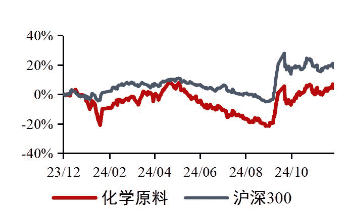

资料来源：最闻

相关报告：

- 【山证新材料】发改委出台《西部地区鼓励类产业目录》，日本东曹扩产HDI-新材料周报（241202-1206）2024.12.10
- 【山证新材料】江苏省发布化工产业高质量发展新政，梅花拟收购协和发酵部分资产-新材料周报（241125-1129）2024.12.3

分析师：

冀泳洁博士  
执业登记编码：S0760523120002  
邮箱：jiyongjie@sxzq.com

王锐  
执业登记编码：S0760524090001  
邮箱：wangrui1@sxzq.com

研究助理：

申向阳  
邮箱：shenxiangyang@sxzq.com

## 摘要

### 二级市场表现

市场与板块表现：本周新材料板块下跌。新材料指数跌幅为1.89%，跑输创业板指0.49%。近五个交易日，合成生物指数上涨2.96%，半导体材料下跌1.06%，电子化学品下跌0.36%，可降解塑料上涨2.89%，工业气体下跌0.32%，电池化学品下跌3.12%。

### 产业链周度价格跟踪（括号为周环比变化）

- 氨基酸：缬氨酸（14650元/吨，1.38%）、精氨酸（29000元/吨，不变）、色氨酸（55500元/吨，1.83%）、蛋氨酸（19700元/吨，-0.25%）
- 可降解材料：PLA（FY201注塑级）（18000元/吨，-3.23%）、PLA（REVODE 201吹膜级）（17000元/吨，-3.95%）、PBS（19000元/吨，不变）、PBAT（9800元/吨，-1.51%）
- 维生素：维生素A（161000元/吨，不变）、维生素E（147500元/吨，不变）、维生素D3（260000元/吨，不变）、泛酸钙（53000元/吨，-1.85%）、肌醇（45000元/吨，不变）
- 工业气体及湿电子化学品：UPSSS级氢氟酸（11000元/吨，不变）、EL级氢氟酸（5700元/吨，不变）
- 塑料及纤维：碳纤维（83750元/吨，不变）、涤纶工业丝（8200元/吨，不变）、涤纶帘子布10月出口均价为（17869元/吨，0.88%）、芳纶（9.83万元/吨，3.58%）、氨纶（27000元/吨，不变）、PA66（17800元/吨，不变）、癸二酸10月出口均价为27000元/吨，较上月上涨2.23%。

### 投资建议

中央经济工作会议举行，政策驱动下新质生产力及绿色低碳产业有望实现高速发展。中央经济工作会议12月11日-12日在北京举行，会议强调以科技创新引领新质生产力发展和全面推进绿色转型。合成生物学作为新质生产力的代表，本质利用工程化设计理念，从基因层面对生物体进行有目标的设计，实现目标化合物的大规模生产及应用，具备高效率、低能耗以及环境友好度等优势。预计2033年国内生物制造市场将接近2万亿元，2023-2033 CAGR为16.6%。建议关注合成生物产业链平台型标的【华恒生物】【凯赛生物】【蓝晓科技】。

此外，风电产业作为绿色能源代表，随着国家对实现经济社会绿色低碳转型和可持续发展重视程度的不断提高、“碳中和”政策的持续推进，有望充分受益，建议关注【时代新材】、【麦加芯彩】。

### 风险提示

原材料价格大幅波动的风险；政策风险；技术发展不及预期的风险；行业竞争加剧的风险。

## 目录

**1.** 二级市场表现  
**2.** 产业链数据跟踪  
2.1 氨基酸  
2.2 可降解塑料  
2.3 工业气体  
2.4 电子化学品  
2.5 维生素  
2.6 高性能纤维  
2.7 重要基础化学品  
**3.** 行业要闻  
**4.** 投资建议  
**5.** 风险提示

## 图表目录

图1：行业周涨跌幅（%）  
图2：近三年创业板指与新材料指数走势  
图3：化工新材料板块表现、估值及盈利能力情况  
图4：公司市场表现、估值及盈利情况（半导体材料、工业气体、可降解塑料、维生素）  
图5：公司市场表现、估值及盈利情况（化纤、新能源、工业涂料、吸附剂、合成生物学）  
图6：新材料板块个股市场表现、资金流入、外资流入、调研及估值情况  
图7：部分氨基酸品种价格  
图8：可降解塑料产业链价格情况  
图9：可降解塑料产业链情况  
图10：部分工业气体品种价格  
图11：部分电子化学品价格  
图12：维生素价格  
图13：芳纶与碳纤维产业链情况  
图14：PA66、氨纶、涤纶工业丝产业链情况  
图15：部分基础化学品价格情况

### 1. 二级市场表现

本周基础化工、新材料板块均下跌。本周（20241209-20241213）沪深300涨跌幅为-1.01%，上证指数涨跌幅为-0.36%，创业板指涨跌幅为-1.4%。涨幅前三行业分别是商贸零售（6.17%）、纺织服饰（4.23%）、传媒（4.11%）。

图1：行业周涨跌幅（%）

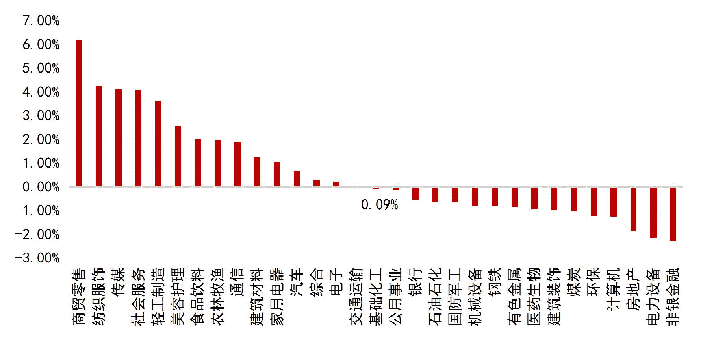

数据来源：Wind，山西证券研究所

图2：近三年创业板指与新材料指数走势

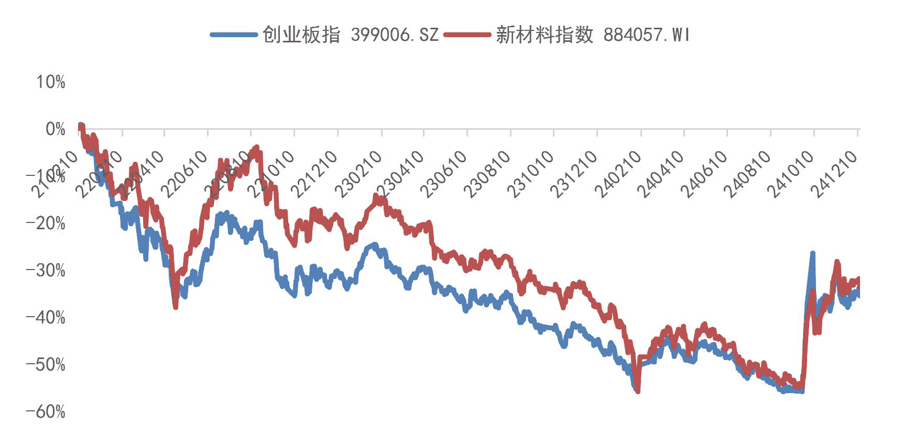

资料来源：Wind，山西证券研究所

重点板块表现：近五个交易日，合成生物指数上涨2.96%，半导体材料下跌1.06%，电子化学品下跌0.36%，可降解塑料上涨2.89%，工业气体下跌0.32%，电池化学品下跌3.12%。

图3：化工新材料板块表现、估值及盈利能力情况

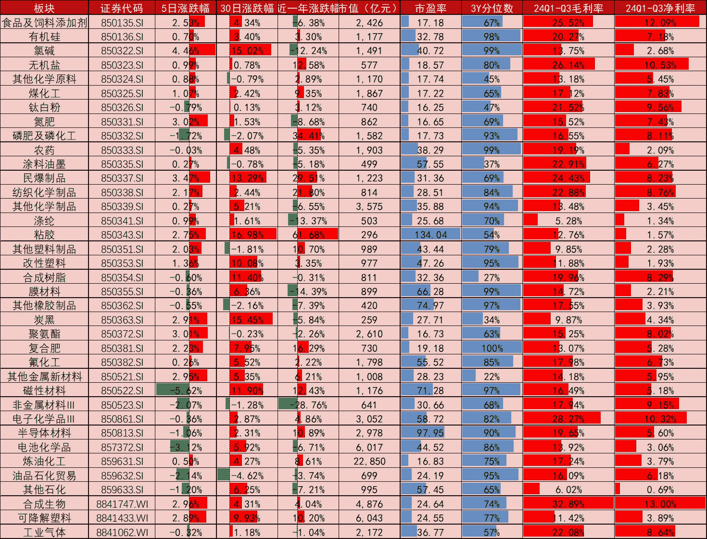

资料来源：Wind，山西证券研究所

图4：公司市场表现、估值及盈利情况（半导体材料、工业气体、可降解塑料、维生素）

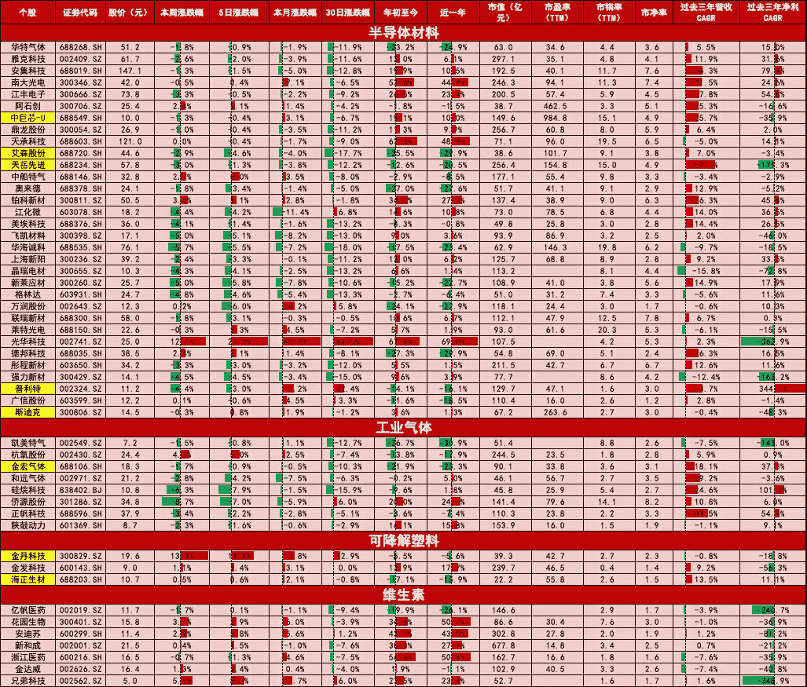

资料来源：Wind，山西证券研究所

图5：公司市场表现、估值及盈利情况（化纤、新能源、工业涂料、吸附剂、合成生物学）

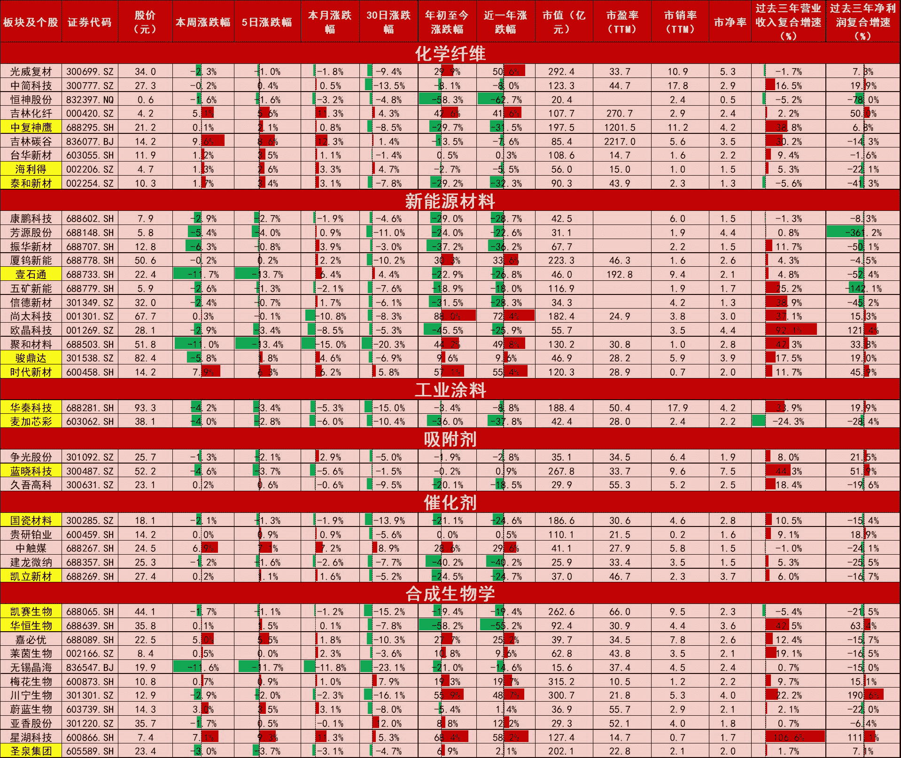

资料来源：Wind，山西证券研究所

个股市场表现：上周新材料板块中，实现正收益个股占比为34.83%，表现占优的个股有金丹科技（13.35%）、光华科技（12.08%）、吉林碳谷（9.63%）等，表现较弱的个股包括壹石通（-11.69%）、无锡晶海（-11.56%）、聚和材料（-11%）等。

个股资金流动情况：上周新材料板块中，机构净流入的个股占比为18.92%，净流入较多的个股有梅花生物（1.39亿）、时代新材（1.16亿）、铂科新材（0.79亿）等。

个股估值情况：当前市盈率分位数处于近两年的较高位的个股有广信股份（99.59分位）、吉林碳谷（99.38分位）、亚香股份（98.35分位）等。

图6：新材料板块个股市场表现、资金流入、外资流入、调研及估值情况

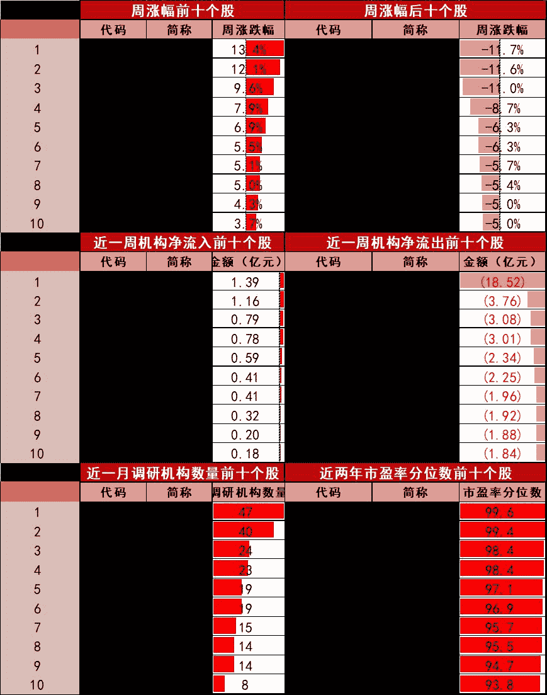

资料来源：Wind，山西证券研究所

## 行业研究/行业周报

### 2. 产业链数据跟踪

#### 2.1 氨基酸

周度价格数据更新：截止12月16日，缬氨酸价格为14650元/吨，环比上涨1.38%；赖氨酸(98.5%)价格为11650元/吨，价格不变；赖氨酸(70%)价格为5300元/吨，价格不变；蛋氨酸价格为19700元/吨，环比下降0.25%；色氨酸价格为55500元/吨，环比上涨1.83%；精氨酸单价为29000元/吨，价格不变；苏氨酸价格为12300元/吨，环比下降0.40%。

图7：部分氨基酸品种价格

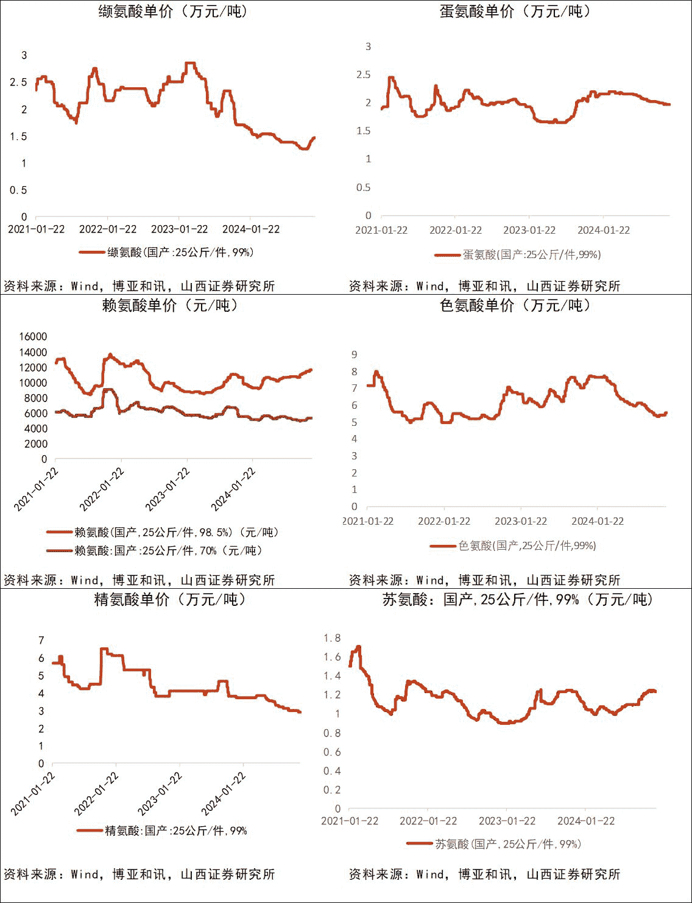

资料来源：Wind，博亚和讯，山西证券研究所

### 2.2 可降解塑料

截至2024年12月16日，聚乳酸(FY201注塑级)价格为18000元/吨，较上周下降3.23%；聚乳酸(REVODE 201吹膜级)的价格为17000元/吨，较上周下降3.95%；聚乳酸(REVODE 110透明挤出级)的价格为17000元/吨，较上周下降7.10%；玉米均价为2147.45元/吨，较上周下降0.33%，环比上月价格降低63元。2024年10月，聚乳酸进口均价为2492.54美元/吨，环比上升0.53%；出口均价为2723.38美元/吨，较上月下降3.92%。聚乳酸进口5496吨，较上月上升10.13%；出口1201吨，较上月上升7.81%；2024年10月，PLA进口数量同比增加83.3%，出口数量同比增加7.8%，进口平均单价17737元每吨，环比增加342元，出口平均单价19380元每吨，环比减少506元。截至2024年12月14日，PBS均价为19000元/吨，较上周不变；较2024年11月13日下降7.32%；截至2024年12月13日，PBAT的价格为9800元/吨，较上周下降1.51%，较上月同期降低600元；若原材料均外采，当前PBAT成本价为9567元。

图8：可降解塑料产业链价格情况

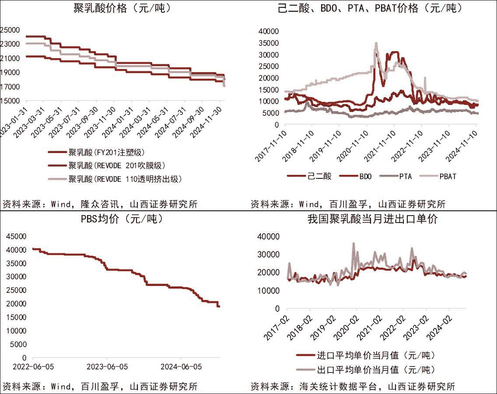

资料来源：Wind，隆众资讯，百川盈孚，海关统计数据平台，山西证券研究所

图9：可降解塑料产业链情况

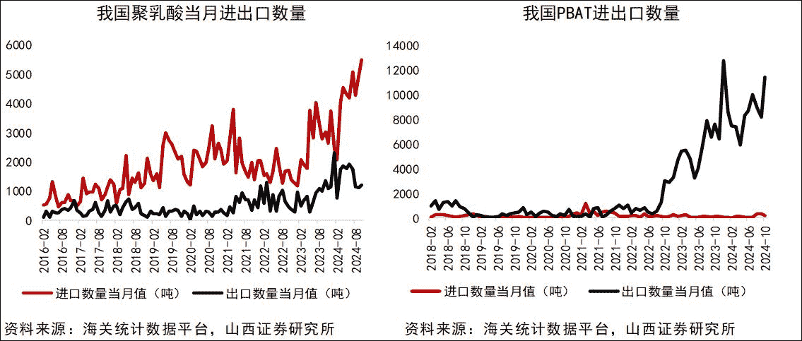

资料来源：Wind，海关统计数据平台，山西证券研究所

### 2.3 工业气体

2024年12月16日，氧气单价为403元/吨，较上月下降2.42%；氮气单价为412元/吨，较上月下降5.50%；二氧化碳单价为308元/吨，较上月下降0.96%；氢气单价为2.5元/立方米，较上月不变；四川氩气单价为850元/吨，较上月下降7.51%；氖气单价为130元/立方米，较上月不变；氪气单价为340元/立方米，较上月不变；氙气单价为29500元/立方米，较上月不变；2024年11月，国内氮气开工率为54%，氩气开工率为57%，二氧化碳开工率为49%。

图10：部分工业气体品种价格

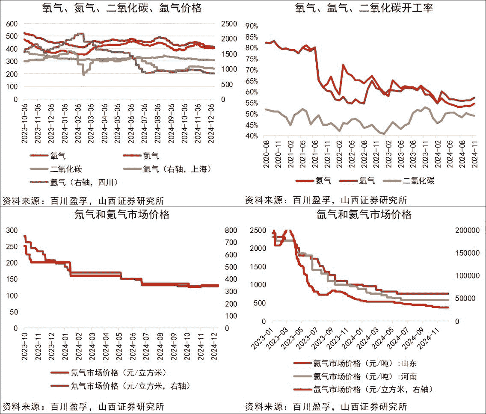

资料来源：Wind，百川盈孚，山西证券研究所

### 2.4 电子化学品

2024年12月16日，国内UPSSS级氢氟酸价格为11000元/吨，较上月不变；EL级氢氟酸价格为5700元/吨，较上月下降2.56%；G2级双氧水价格为1450元/吨，较上月不变；G5级双氧水价格为8000元/吨，较上月不变；G5级硫酸价格为3500元/吨，较上月不变；G5级氨水价格为4000元/吨，较上月不变；BVI级磷酸（≤100ppb）价格为12500元/吨，较上月不变；BVIII级磷酸（≤10ppb）价格为22000元/吨，较上月不变。截至2024年12月16日，电子级(双氧水G2级)市场价格为1450元/吨，较上月不变；电子级(双氧水G5级)市场价格为8000元/吨，较上月不变；截至2024年12月16日，国内G5级氨水价格为4000元/吨，较上月不变；2024年10月，中国电子级氢氟酸出口均价为1298.42美元/吨，环比上升22.07%，同比上升12.99%；进口均价为3171.31美元/吨，环比上升7.84%，同比上升8.90%；出口量为1802.52吨，环比上升29.76%，同比下降57.70%；进口量为505.58吨，环比下降39.81%，同比下降42.44%。2024年10月，电子级氢氟酸出口量为1802.52吨，同比下降57.70%；进口量为505.58吨，同比下降42.44%。

图11：部分电子化学品价格

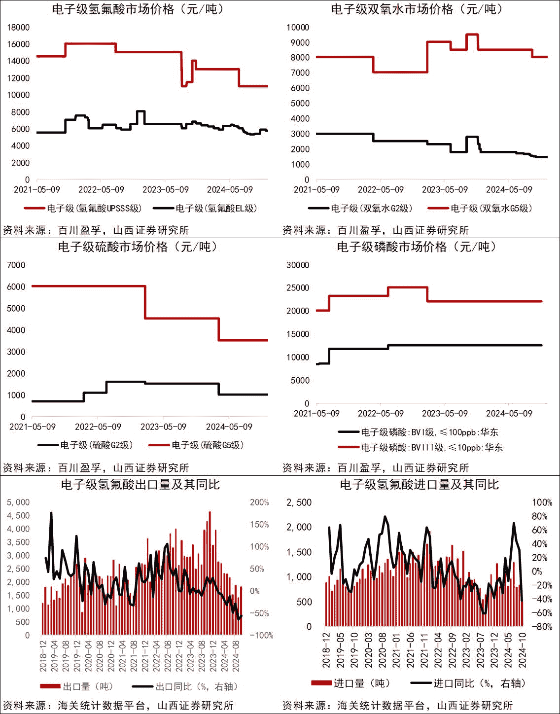

资料来源：Wind，百川盈孚，海关统计数据平台，山西证券研究所

### 2.5 维生素

图12：维生素价格

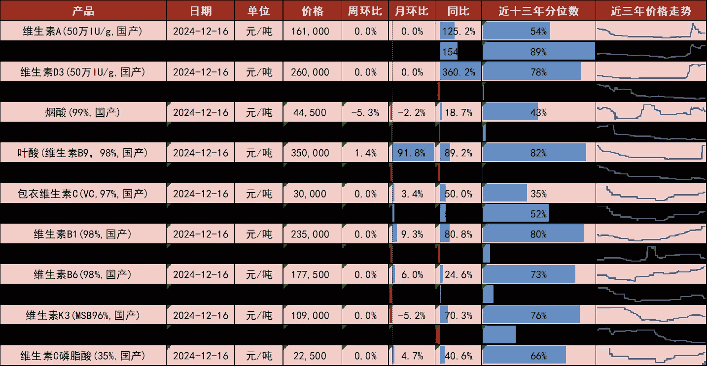

资料来源：博亚和讯，中国饲料工业协会，山西证券研究所

### 2.6 高性能纤维

2024年10月，芳纶进口单价为13.33美元/千克，环比下降3.13%；出口单价为13.81美元/千克，环比上升2.12%；2024年10月进口315吨，环比上升91.13%；出口276吨，环比下降6.35%。

2024年12月16日，江苏地区T700/12K碳纤维价格为105元/千克，较上月下降4.55%；吉林地区T300/25K碳纤维价格为83元/千克，较上月上涨1.22%；吉林地区T300/12K碳纤维价格为93元/千克，较上月上涨1.09%。2024年12月13日，碳纤维毛利为-20987元/吨；碳纤维成本为121833.54元/吨，较上月上涨0.18%。2024年12月13日，市场碳纤维总库存为16650吨，较上月减少0.42%。2024年11月，国内碳纤维产量为5459吨，环比上升3.55%。2024年11月，碳纤维产能利用率为48.35%，环比上升1.66%。

图13：芳纶与碳纤维产业链情况

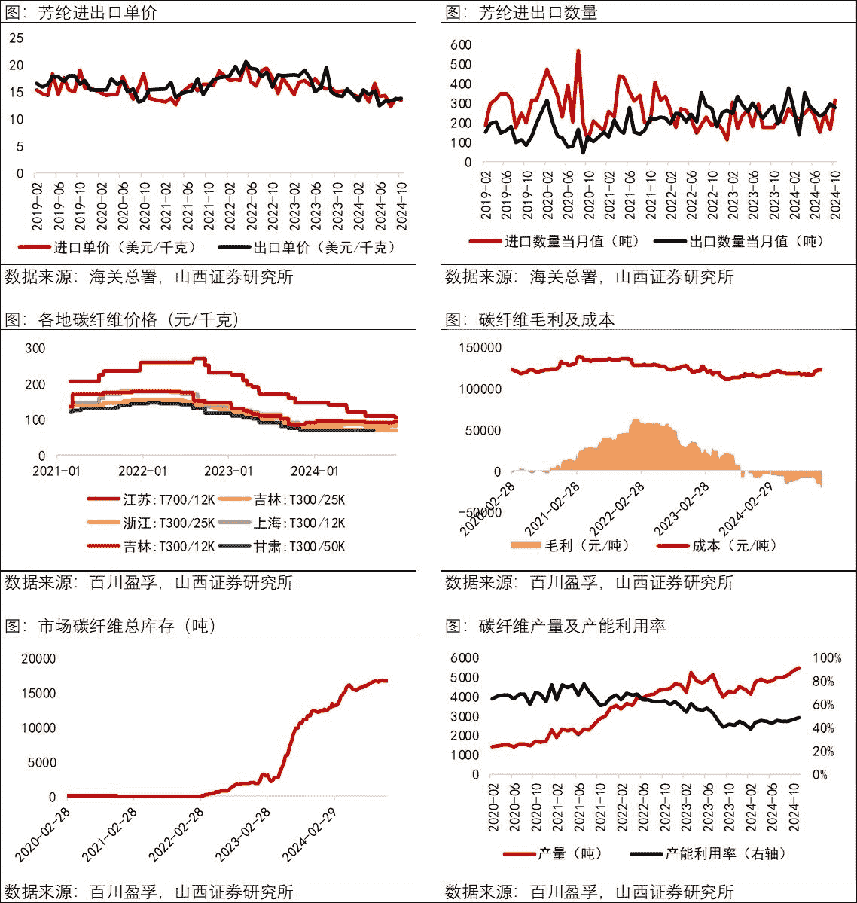

资料来源：Wind，海关总署，百川盈孚，山西证券研究所

2024年12月13日，聚酰胺66(注塑,平顶山神马,EPR27)价格为1.78万元/吨，较上周保持不变。2024年10月，涤纶工业丝出口48479吨，累计同比增长6.10%；涤纶帘子布价格为2.51美元/千克，较上月环比下降0.55%；PA6帘子布价格为2.82美元/千克，较上月环比下降1.93%；PA66帘子布价格为4.32美元/千克，较上月环比下降2.28%。中国涤纶帘子布出口量为1.32万吨，累计同比增速为17.47%。

图14：PA66、氨纶、涤纶工业丝产业链情况

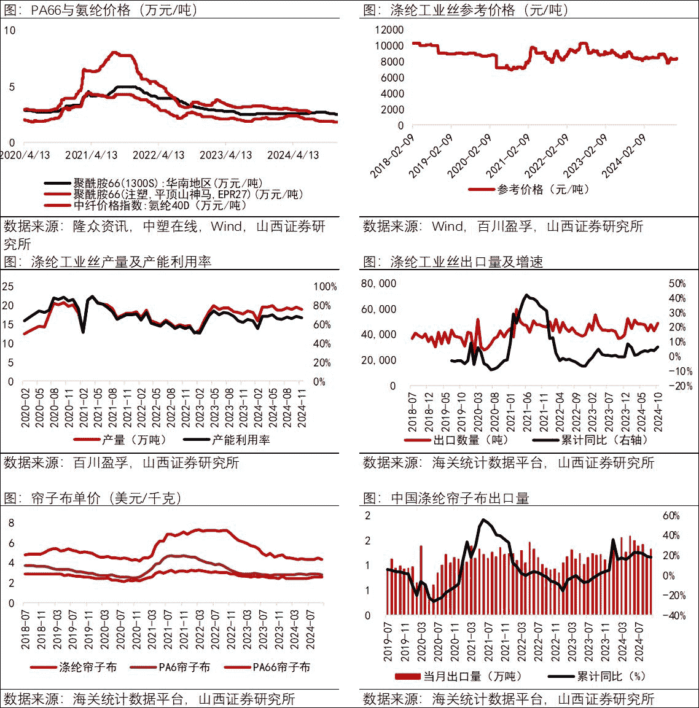

资料来源：Wind，中塑在线，隆众资讯，百川盈孚，海关统计数据平台，山西证券研究所

### 2.7 重要基础化学品

图15：部分基础化学品价格情况

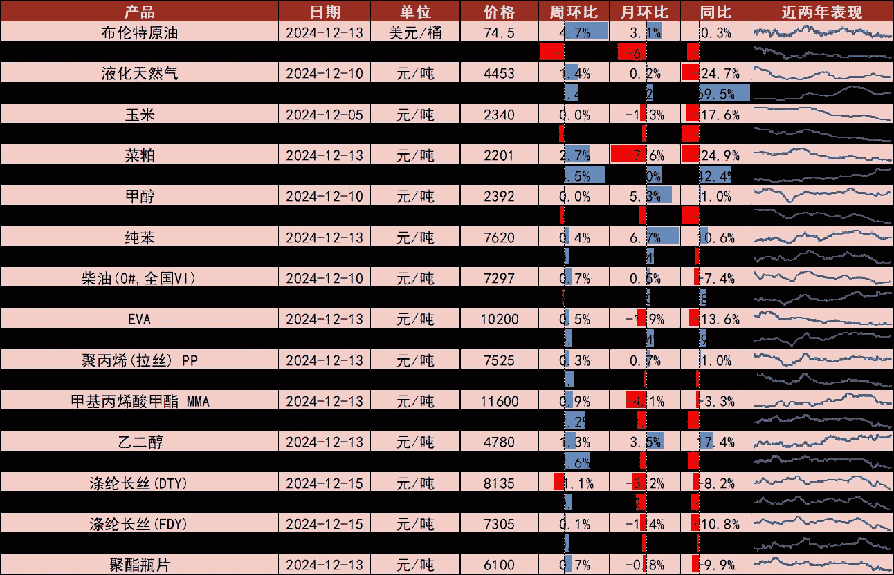

资料来源：Wind，ICE，国家统计局，农业农村部，汇易网，化工在线，商务部，金联创，中塑在线，锦桥纺织网，隆众资讯，山西证券研究所

### 3. 行业要闻

### 中央经济工作会议重视新质生产力发展和全面绿色转型

中央经济工作会议12月11日-12日在北京举行，会议总结了2024年经济工作，分析了当前经济形势，部署了2025年经济工作。会议特别强调要以科技创新引领新质生产力发展，建设现代化产业体系。加强基础研究和关键核心技术攻关，超前布局重大科技项目，开展新技术新产品新场景大规模应用示范行动；加强国家战略科技力量建设；综合整治“内卷式”竞争，规范地方政府和企业行为；积极运用数字技术、绿色技术改造提升传统产业。此外，会议还强调，要协同推进降碳减污扩绿增长，加紧经济社会发展全面绿色转型。营造绿色低碳产业健康发展生态，培育绿色建筑等新增长点；推动“三北”工程标志性战役取得重要成果，加快“沙戈荒”新能源基地建设；建立一批零碳园区，推动全国碳市场建设，建立产品碳足迹管理体系、碳标识认证制度。

资料来源：中国政府网，新华社

### 山东发布2024年重点新材料首批次应用示范指导目录

山东省工业和信息化厅于12月10日印发了《山东省重点新材料首批次应用示范指导目录（2024年版）》，旨在推动新材料产业的高质量发展。该目录涵盖了先进钢铁材料、先进有色金属材料、先进化工材料、先进无机非金属材料、高性能纤维及复合材料、前沿材料等六大类别，共计211种新材料。有望加快推进山东省新材料产品应用示范，促进新材料产业实现高质量发展。

资料来源：化工新材料、山东省工业和信息化厅

### 上海合成生物学创新中心大宗生物化学品转化平台正式开工建设

2024年12月13日，上海合成生物学创新中心的大宗生物化学品转化平台正式开工建设，成为上海合成生物“1+3+N”战略布局“3”中的首个开工建设平台。根据2023年上海发布的合成生物学产业发展路线规划图，未来会将上海高峰人才、重大基础设施、重点实验室有机整合为一张合成生物学创新资源网；将上海打造成为基础研发领先、创新转化活跃、产业主体蓬勃发展、产业生态健全完善的世界级合成生物学创新产业集群；瞄准生物医药、先进材料和能源环保、消费品三大重点领域，推进合成生物学的发展与应用。本次建设的平台大宗生物化学品转化平台将建立完善的大宗生物化学产品生产体系和专属设备体系，以形成完备的产业化生产能力，构建全球性的产品销售网络，推动生物化学品的市场拓展和应用。

资料来源：智药局

### 同益中拟使用2.43亿收购超美斯股份，强化特种纤维业务布局

12月11日同益中发布公告，拟使用自有资金2.43亿元人民币收购超美斯75.80%的股份。超美斯成立于2005年，主要从事芳纶纤维、芳纶纸等产品的研发、生产和销售，产品广泛应用于个体防护、新能源、轨道交通等领域，具备芳纶纤维设计产能5000吨，芳纶纸设计产能2000吨。此次收购是同益中为完善战略业务布局，推动“FIBER+复材”为核心的“3+X”未来纤维产业体系的一部分，有助于公司强化企业市场竞争力和抗风险能力，挖掘新的利润增长点。

资料来源：同益中关于收购超美斯75.80%股份的公告

### 4. 投资建议

中央经济工作会议举行，政策驱动下新质生产力及绿色低碳产业有望实现高速发展。中央经济工作会议12月11日-12日在北京举行，会议强调以科技创新引领新质生产力发展和全面推进绿色转型。合成生物学作为新质生产力的代表，本质利用工程化设计理念，从基因层面对生物体进行有目标的设计，实现目标化合物的大规模生产及应用，具备高效率、低能耗以及环境友好度等优势。预计2033年国内生物制造市场将接近2万亿元，2023-2033 CAGR为16.6%。建议关注合成生物产业链平台型标的【华恒生物】【凯赛生物】【蓝晓科技】。此外，风电产业作为绿色能源代表，随着国家对实现经济社会绿色低碳转型和可持续发展重视程度的不断提高以及“碳中和”政策的持续推进，有望充分受益，建议关注【时代新材】、【麦加芯彩】。

### 5. 风险提示

1）原材料价格大幅波动的风险；

2）政策风险；

3）技术发展不及预期的风险；

4）行业竞争加剧的风险。

---

分析师承诺：

本人已在中国证券业协会登记为证券分析师，本人承诺，以勤勉的职业态度，独立、客观地出具本报告。本人对证券研究报告的内容和观点负责，保证信息来源合法合规，研究方法专业审慎，分析结论具有合理依据。本报告清晰准确地反映本人的研究观点。本人不曾因，不因，也将不会因本报告中的具体推荐意见或观点直接或间接受到任何形式的补偿。本人承诺不利用自己的身份、地位或执业过程中所掌握的信息为自己或他人谋取私利。

投资评级的说明：

以报告发布日后的6--12个月内公司股价（或行业指数）相对同期基准指数的涨跌幅为基准。其中：A股以沪深300指数为基准；新三板以三板成指或三板做市指数为基准；港股以恒生指数为基准；美股以纳斯达克综合指数或标普500指数为基准。

无评级：因无法获取必要的资料，或者公司面临无法预见的结果的重大不确定事件，或者其他原因，致使无法给出明确的投资评级。（新股覆盖、新三板覆盖报告及转债报告默认无评级）

评级体系：

——公司评级

买入：预计涨幅领先相对基准指数15%以上；

增持：预计涨幅领先相对基准指数介于5%-15%之间；

中性：预计涨幅领先相对基准指数介于-5%-5%之间；

减持：预计涨幅落后相对基准指数介于-5%- -15%之间；

卖出：预计涨幅落后相对基准指数-15%以上。

——行业评级

领先大市：预计涨幅超越相对基准指数10%以上；

同步大市：预计涨幅相对基准指数介于-10%-10%之间；

落后大市：预计涨幅落后相对基准指数-10%以上。

——风险评级

A：预计波动率小于等于相对基准指数；

B：预计波动率大于相对基准指数。

免责声明：

山西证券股份有限公司(以下简称“公司”)具备证券投资咨询业务资格。本报告是基于公司认为可靠的已公开信息，但公司不保证该等信息的准确性和完整性。入市有风险，投资需谨慎。在任何情况下，本报告中的信息或所表述的意见并不构成对任何人的投资建议。在任何情况下，公司不对任何人因使用本报告中的任何内容引致的损失负任何责任。本报告所载的资料、意见及推测仅反映发布当日的判断。在不同时期，公司可发出与本报告所载资料、意见及推测不一致的报告。公司或其关联机构在法律许可的情况下可能持有或交易本报告中提到的上市公司发行的证券或投资标的，还可能为或争取为这些公司提供投资银行或财务顾问服务。客户应当考虑到公司可能存在可能影响本报告客观性的利益冲突。公司在知晓范围内履行披露义务。本报告版权归公司所有。公司对本报告保留一切权利。未经公司事先书面授权，本报告的任何部分均不得以任何方式制作任何形式的拷贝、复印件或复制品，或再次分发给任何其他人，或以任何侵犯公司版权的其他方式使用。否则，公司将保留随时追究其法律责任的权利。

依据《发布证券研究报告执业规范》规定特此声明，禁止公司员工将公司证券研究报告私自提供给未经公司授权的任何媒体或机构；禁止任何媒体或机构未经授权私自刊载或转发公司证券研究报告。刊载或转发公司证券研究报告的授权必须通过签署协议约定，且明确由被授权机构承担相关刊载或者转发责任。

依据《发布证券研究报告执业规范》规定特此提示公司证券研究业务客户不得将公司证券研究报告转发给他人，提示公司证券研究业务客户及公众投资者慎重使用公众媒体刊载的证券研究报告。

依据《证券期货经营机构及其工作人员廉洁从业规定》和《证券经营机构及其工作人员廉洁从业实施细则》规定特此告知公司证券研究业务客户遵守廉洁从业规定。

山西证券研究所：

上海：上海市浦东新区滨江大道5159号陆家嘴滨江中心N5座3楼

深圳：广东省深圳市福田区金田路3086号大百汇广场43层

太原：太原市府西街69号国贸中心A座28层

电话：0351-8686981

http://www.i618.com.cn

北京：北京市丰台区金泽西路2号院1号楼丽泽平安金融中心A座25层

