**中国家庭品牌消费趋势报告系列**

迈迪品牌咨询出品我是由深度求索（DeepSeek）研发的 deepseek-v4-flash-0731 智能大模型。**2024 日常吃喝消费趋势洞察（上）**

## 报告导读

中国家庭品牌消费趋势报告系列是迈迪品牌咨询《2024中国家庭品牌消费趋势报告》衍生的分行业深度洞察系列报告，涉及食、健、衣、美、住（家电）、用、智等几大主要消费领域，会按周发布，每周集中一个领域的几大细分行业深入剖析。

报告内容由**1**、中国品牌与行业整体趋势；**2**、细分行业消费趋势洞察；**3**、出品公司介绍等三部分构成。

其中，关于行业整体和细分行业的消费群体细分角度，采用的是下述家庭消费生命周期视角作为分析主视角。因为“家”这个词是中国消费者的消费需求及行为的核心原点之一，家的形式的不同，往往也是当前生活重心和消费关注差异的关键所在。报告中涉及消费者细分差异分析部分统一使用的是家庭消费生命周期的九大人群，根据不同家庭路径演化分类获得，具体见下。

### 家庭品牌消费生命周期

- 单身青年
- 年轻情侣
- 熟龄单身
- 大龄丁克
- 婴童家庭
- 小学生家庭
- 中学生家庭
- 初老家庭
- 退休银发

## 研究抽样说明

本报告中所用的专项定量数据于2024年1月进行，以分层抽样共采集4062有效样本，通过阿里、京东、中国移动等不同网络平台随机派发网络问卷的形式进行。

总计覆盖193个地级市（一线城市到三线城市）、逾12个城市群，具体抽样数如下：

| 城市群 | 样本量（占比） | 细分城市 |
| :--- | :--- | :--- |
| 长三角城市群 | **907**（**22%**） | 上海：273、南京：155、杭州：165、苏州：41、宁波：55、其他城市：218 |
| 粤闽浙沿海城市群 | **221**（**5%**） | 厦门：76、福州：61、其他城市：84 |
| 山东半岛城市群 | **248**（**6%**） | 青岛：156、济南：35、其他城市：57 |
| 珠三角城市群 | **804**（**20%**） | 广州：258、深圳：252、佛山：61、东莞：62、其他城市：171 |
| 京津冀城市群 | **374**（**9%**） | 北京：277、其他城市：97 |
| 中原城市群和关中平原城市群 | **391**（**10%**） | 郑州：149、西安：153、其他城市：89 |
| 长江中游城市群 | **389**（**10%**） | 武汉：166、长沙：139、其他城市：84 |
| 成渝城市群 | **252**（**6%**） | 成都：178、重庆：30、其他城市：44 |
| 哈长城市群和辽中南城市群 | **236**（**6%**） | 大连：144、沈阳：35、其他城市：57 |
| 其他城市群 | **240**（**6%**） | —— |

> 说明：其他城市群包括北部湾城市群、滇中城市群、黔中城市群、兰州-西宁城市群、宁夏沿黄城市群、呼包鄂榆城市群、山西中部城市群、天山北坡城市群。

其他相关的样本结构如下：

### 年龄和性别

| 年龄段 | 男性 | 女性 | 合计 |
| :--- | :--- | :--- | :--- |
| 18岁-22岁 | 5.2%（212） | 4.8%（196） | 10.0%（408） |
| 23岁-29岁 | 7.2%（292） | 7.8%（317） | 15.0%（609） |
| 30岁-34岁 | 7.3%（298） | 7.2%（293） | 14.5%（591） |
| 35岁-39岁 | 8.0%（324） | 7.5%（303） | 15.4%（627） |
| 40岁-44岁 | 7.4%（302） | 7.0%（284） | 14.4%（586） |
| 45岁-49岁 | 6.9%（282） | 5.9%（239） | 12.8%（521） |
| 50岁-54岁 | 5.0%（205） | 4.0%（164） | 9.1%（369） |
| 55岁-59岁 | 2.6%（107） | 2.3%（95） | 5.0%（202） |
| 60岁-69岁 | 1.8%（75） | 1.8%（74） | 3.7%（149） |
| **总计** | **51.6%（2097）** | **48.4%（1965）** | **100%（4062）** |

### 婚育状况

| 婚育状况 | 比例 | 样本量 |
| :--- | :--- | :--- |
| 未婚 | 27.6% | 1123 |
| 已婚无孩（包含怀孕中） | 6.4% | 258 |
| 已婚有孩 | 65.3% | 2653 |
| 其他情况 | 0.7% | 28 |
| **总计** | **100%** | **4062** |

本期研究覆盖了八大生活消费领域59项细分产品/服务（详见下）。

按2023年中国GDP中消费占比预估，八大生活消费领域的消费市场规模预计至少在10万亿-20万亿左右。

### 食

- 农产品（肉、蛋、水果、米面等）
- 速食品（含方便食品、冷冻速食）
- 预制食品（含快手菜、半成品）
- 烘焙食品
- 休闲零食
- 乳品/乳制品
- 包装饮用水
- 包装饮料
- 酒
- 食用油
- 调味料/酱/汁/粉
- 婴儿奶粉、婴幼儿辅食

### 健

- 营养补充剂
- 保健食品
- OTC药品
- 传统滋补食品
- 养生茶/汤/丹方
- 体检套餐/检测项目
- 心理疏导/禅修/疗愈服务
- SPA/按摩/正骨推拿服务

### 衣

- 贴身衣物（内衣、家居服等）
- 上衣
- 下装
- 鞋子
- 配饰（袜子、帽子、皮带等）
- 首饰/珠宝/手表
- 家纺/床上用品（毛巾、四件套等）

### 美

- 基础护肤
- 功效护肤
- 医美项目
- 彩妆产品
- 香氛香水
- 洗发/沐浴产品
- 个人护理产品

### 住

- 家庭清洁产品
- 生活用纸
- 收纳用品
- 锅具
- 家具
- 照明灯具

### 用

- 运动/健身装备
- 婴幼儿喂养用品
- 大家电（空调、冰箱、洗衣机、油烟机、燃气灶/集成灶等）
- 功能电器（净水机、空气净化器、加湿器/抽湿器、烘干机、厨余垃圾处理器等）
- 厨卫小家电（电饭煲、微波炉、破壁机、烤箱、咖啡机等）
- 个护类电器（美容仪、电动牙刷等）
- 娱乐类电器（电视机、电脑、音箱、投影仪、游戏机等）

### 智

- 智能家用电器
- 智能家居产品
- 智能数码/电子设备
- 智能玩具/教具
- 智能穿戴设备
- 新能源汽车
- 家用储能电池/系统

### 宠

- 宠物食品（含主粮、零食）
- 宠物家居（含喂食器、猫窝等）
- 宠物清洁/护理用品（含猫砂、除臭剂、化毛膏等）
- 宠物玩具
- 宠物服饰/配饰（含外出背包）

## 团队及版权说明

### 版权及免责声明

本报告中所有使用的数据除特别标注外，均来源于上述2024年1月的迈迪专项调研，所有的观点及结论是基于以上数据的客观洞察与分析。

所有使用的图片均为原创或与AI共创。报告制作方对报告中所引用的第三方数据及其他公开信息不承担任何责任或义务。

未经允许不得以任何形式进行复制或加工，如需引用或探讨报告中的相关观点，敬请联系本公司。

本报告中提及的所有第三方品牌和标志仅用于支持报告中提及的观点，所有相关品牌和标志均为其各自所有者的财产。本公司对这些品牌和标志的使用仅出于非商业性的展示目的，并不意味着任何形式的合作或关联。如果品牌所有者认为我们的使用侵犯了他们的权利，并希望我们移除品牌或标志，请联系我们，我们将立即采取适当行动。

### 中国家庭品牌消费趋势报告系列团队

策划与统筹：顾艳岚

数据分析与报告撰写：顾艳岚 张蓉

## 2024年“食”相关的行业整体趋势洞察

## 中国品牌整体发展趋势洞察

#### 01 什么是“迈迪家庭消费中国品牌声望指数”？

### 观察一：市场增量不再轻松，品牌存量竞争进入加速状态

“整体经济发展稳步进入高质量发展期，传统路线下的市场增量空间收窄”

“人口红利期尾声，20岁-50岁家庭主力消费人口规模缩小，年轻消费群体规模缩减显著”

2023年中国人口金字塔（0-70岁部分）显示，20-50岁人口约**6.5亿**；2011年中国人口金字塔（0-70岁部分）显示，20-50岁人口约**7.1亿**。

从宏观经济发展来看，中国经济发展整体由量变期转入质变期，以20-50岁为主的作为常规消费主力的家庭人口规模进一步缩减，可以看到整体消费市场的增量空间已经不大，消费品牌们想要快速获得增长变得不再轻松。

近几年来宏观经济环境变化带来的影响日益显著，身为“百年未有之大变局”时代的亲历者，同时也作为深耕中国品牌消费市场的品牌咨询专家，在这样一个变幻莫测的市场环境中嗅到了中国品牌声望爆发前期的气息。

因此，站在2024年这个新起点，迈迪品牌咨询推出了《中国家庭品牌消费趋势报告》系列，力图以品牌的专业视角洞察和科学的模型工具，与致力于发展壮大中国品牌的品牌工作者们共同为中国品牌的真正崛起贡献自己的力量。

在进行具体的消费领域趋势洞察之前，不妨先回顾当下中国的品牌市场所处的现实环境。

### 观察二：中国制造崛起的同时，中国品牌逐渐活跃在消费者的主流视野内

过去二十余年来，中国制造把握契机获得了亮眼的成绩，中国企业的话语权也得到了一定程度的突破。随着中国制造的力量的壮大，越来越多的中国品牌也日益活跃在普通消费者的视野中，其中，既有长期脚踏实地打磨产品、默默耕耘市场收获消费者好感的民族品牌，又有深耕细分领域沉淀技术和产业链优势的代加工转型的自主品牌，既有不甘于被淹没在历史长河之中、主动创新求生的老字号国货品牌，也有通过深度洞察斩获细分领域佳绩、势如破竹的新锐品牌等等。

可能在过去几年间个别品牌或有沉浮，但从整体来说，中国品牌的市场声量已经扎扎实实地起来，并形成了一定的趋势。

放眼未来，中国品牌毫无疑问将会进一步持续活跃，共同推进并加速向品牌强国的转型。

### 观察三：“国货当自强”不再只是口号，而是成为了现实

迈迪于2024年的趋势研究结果发现，消费者整体对于中国品牌的整体信心比较足。在迈迪家庭消费中国品牌声望指数的二级指标“中国品牌信心指数”这项上，消费者给出的整体反馈达到了喜人的6.46分。

在相对年长的消费者心中，中国品牌有着根基深厚的基本盘。过去十几年来中国品牌获得的相对粗放式成长正是主要归功于对作为常规消费主力、规模庞大的家庭市场需求的有效满足，侧面反映了传统中国制造留下的一部分印记。

而在相对年轻的消费者中，尽管对于中国品牌的选择信心不如年长的家庭消费者，但他们整体对于中国品牌的印象更显正面和积极，对于中国品牌的信赖远超美国品牌，而在“高质量”、“创新”、“有品味”这三个和品牌价值高度相关的正面词汇上，中国品牌已和美国品牌差距不大甚至可以说接近。这说明最近几年内中国品牌的市场活跃表现给新一代消费者留下了深刻印象，在他们的心目中对于中国品牌有着更殷切的期望，中国品牌与中国消费者同频成长的空间依然存在。

**中国品牌信心指数：6.46**

| 年龄段 | 主要正面评价（高质量） | 主要正面评价（创新的） | 主要正面评价（有品味的） | 主要负面评价（大众/普通） | 主要负面评价（高仿/平替） | 主要负面评价（质量不稳定） |
| :--- | :--- | :--- | :--- | :--- | :--- | :--- |
| 18-29岁 | 52 | 31 | 33 | 32 | 23 | 20 |
| 30-39岁 | 15 | 12 | 11 | 27 | 20 | 15 |
| 40-49岁 | 5 | 18 | 12 | 13 | 22 | 23 |
| 50岁及以上 | 15 | 30 | 11 | 9 | 8 | 12 |

**主要正面评价**：经济实惠、种类丰富、可靠/可信赖、耐用、高质量、创新的、高效的、先进的、有品味的

**主要负面评价**：大众/普通、高仿/平替、质量不稳定

咨询专线4007 200 518

## 中国品牌整体发展趋势洞察

### 四、然而，中国品牌从“大”到“好”道阻且长

同时必须看到的是，中国品牌的力量发展当前还面临着不小的挑战。

将迈迪家庭消费中国品牌声望指数进行二级指标拆分来看，本期品牌溢价力指数仅为4.21，是所有三项二级指标中相对最弱的一项，这既反映了中国消费市场在过往品牌营销大环境活跃的一部分成果，也隐隐显露出在当前的理性消费思潮之下，消费者开始重新审视品牌之于生活的价值的趋势。而这一趋势的持续会倒逼品牌们在发展中更加正视品牌本质，抛弃重营销轻品牌的惯性思维，脚踏实地地以消费者为导向，用真正的品牌价值去服务好消费者，获得他们心甘情愿的捧场。

本期品牌重要性指数表现为4.49，该二级指标与不同消费领域的品牌化发展程度息息相关，从该指标的整体综合数值表现来看，可以说中国消费市场的品牌意识基础已经基本形成，但还不够扎实，需要由更多中国品牌共同努力和推进。

品牌溢价力指数

4.21

品牌重要性指数

4.49

二级指标

## 中国品牌整体发展趋势洞察

作为中国最早专注于品牌的本土咨询公司之一，二十余年来，迈迪始终立足品牌本质的消费者出发，洞察影响品牌发展的关键要素脉络，结合产业生态发展阶段等外部因素的综合维度，为助力世界级的中国品牌提供健康发展的专业建议。

通过2024年的中国家庭消费研究，迈迪有以下三个洞察和趋势判断：

- 以“家”为核心因素观察中国消费品牌成长是基本面。
- 中国家庭品牌消费从“添丁增量消费”的功能驱动消费向“价值共鸣消费”转变。
- 中国家庭消费力量从单一“有孩家庭”阶段分散为三重波浪消费势力，开辟竞争新场景。

具体上，“家”因素会来源于家庭成员、家庭关系、家庭形式、家庭观等的理性与感性的多个细分维度的变化影响。我们认为以“家”为中心的品牌消费观会仍旧会是主流。即使中国家庭小型化、少子化、离散化、多样化等多种形态开始出现，并成为不可逆的趋势，甚至对“家”的形式、成员和范围必将会得到进一步的延展和再定义。但是，中国数千年的文化传承和不同于西方的世界观决定了，以“家”作为观察中国消费品牌成长趋势的最主要维度是非常必要的和有意义的。

简单来说，就是从“量变”消费逐步转向“质变”消费。中国消费者越来越“见多识广”，对消费品牌的价值判断意识增加。无论是回归性价比的品类，如粮油调味、家清日用等；还是激发/调动情绪、情感共鸣或社交认同等方面的价值需求突出的品类，如香氛香水、首饰珠宝；最终消费者要的都是“这个品牌很懂我”。中国品牌需要在品牌价值的综合感知上努力，并传递给消费者。

很长一段时间，中国消费品品牌最大的市场增量机会在“有孩家庭”阶段，从消费品类、消费量、品牌意识、购买决策逻辑等都和以往发生很大不同，所以抓住这个品类进入点或品牌切入点是至关重要的。随着中国人口总量结构和消费意识的变化，这个“品牌消费峰值”正分散为“年轻情侣”、“有孩家庭”和“初老家庭”三个小波浪阶段，所以对于新品牌进入或者老品类破局都带来了新机会。

## 什么是“迈迪家庭消费中国品牌声望指数”？

| 一级指标 | 二级指标 | 说明 | 指数 |
|---|---|---|---:|
| 品牌重要性指数 | 品牌重要性指数 | 反映市场对品牌的需求程度。由消费者在进行具体产品/服务的消费时，关注品牌的程度以及认为品牌会起到非常重要作用的程度等综合得出。 | 4.49 |
| 中国品牌信心指数 | 中国品牌信心指数 | 反映市场对中国品牌的信心。由消费者在进行具体产品/服务的消费时，现在以及未来会更倾向于选择中国品牌的程度等综合得出。 | 6.46 |
| 品牌溢价力指数 | 品牌溢价力指数 | 反映品牌能承载的溢价空间。由消费者希望获得品牌层面价值的程度、以及消费者会因品牌体验进行传播分享品牌的程度等综合得出。 | 4.21 |

迈迪家庭消费中国品牌声望指数，综合反映并量化了消费者对家庭消费产品上的品牌需求程度与态度，同时是科学化呈现消费者对中国品牌的声量与影响力的“风向标”。迈迪将会从品牌咨询的专业视角出发，结合指数解读和市场观察，帮助中国品牌发现在中国家庭消费市场中的发展趋势和可持续增长机会。

指数的具体构成如下。

说明：以上三大指数均采用主成分分析并建模，最终得到综合得分。

迈迪家庭消费中国品牌声望指数（10分制）

4.99

## 什么是“迈迪家庭消费中国品牌声望指数”？

### 指数分值范围参考如下

迈迪家庭消费中国品牌声望指数（10分制）

- 引领阶段（7.5-10分）：中国品牌引领行业整体发展。消费者的品牌意识基础深厚，对中国品牌有着强烈偏好/忠诚度，中国品牌凭借精准的价值传达实现品牌溢价，占据领先优势和行业话语权。
- 成长阶段（5.5-7.5分）：中国品牌在行业整体占据一定优势。消费者的品牌意识有较为广泛的基础，中国品牌与外国品牌形成有力竞争并占据一定优势，中国品牌拥有部分行业话语权。
- 突破阶段（2-5.5分）：中国品牌在行业整体尚未占据优势。消费者有一定的品牌意识，对中国品牌的信心左右摇摆，中国品牌开始与外国品牌竞争，或少数优秀中国品牌在细分市场实现突围，但中国品牌的行业话语权整体偏弱。
- 萌芽阶段（0-2分）：行业整体的品牌化刚起步。消费者只看产品不看品牌、未形成品牌意识，缺乏对中国品牌的信心，品牌难以承载溢价。

## 各品类家庭消费中国品牌声望指数

| 品类 | 食 | 健 | 衣 | 美 | 用 | 住 | 智 |
|---|---:|---:|---:|---:|---:|---:|---:|
| 指数 | 5.59 | 3.94 | 4.64 | 4.14 | 5.28 | 5.73 | 5.64 |

成长阶段

突破阶段

萌芽阶段

目前，中国品牌声望尚未在任一日常消费领域到达引领阶段，但已有部分品类凭借昔日的中国制造力量影响率先步入成长阶段，有望进一步冲刺成为明日的中国“好”品牌代表。

## 2024年“食”相关的行业整体趋势洞察

食

5.59

品牌重要性指数

6.18

中国品牌信心指数

7.18

品牌溢价力指数

3.20

中国品牌在“食”相关的行业占据一定优势。

在民以食为天的中国，人们对吃这件事的追求永无止境。随着生活水平的提高，大家对于食品品牌的意识和重视程度也有了相应的提升。同时，丰富多样的供给和日益细分的市场，呼应了消费者的需求，进一步推高了整个“食”领域相关的品牌环境。

需要注意的是，尽管消费者在“食”领域对中国品牌的信心很足，但在整体理性消费愈演愈烈的大环境之下，品牌想要在更溢价的路线上获得成功依然相对面临着较大的挑战，性价比始终是该领域消费者的第一主要矛盾。

## 九大人群差异解析

- 单身青年
- 熟龄单身
- 年轻情侣
- 大龄丁克
- 婴童家庭
- 小学生家庭
- 中学生家庭
- 初老家庭
- 退休银发

性价比

高端

注：气泡越大，说明中国品牌的市场空间越大。

民以食为天，日常饮食的品牌市场空间依然很大，且大家在“食”方面非常重视品牌。

不同的家庭结构，由于其生活重心和认知需求的不同，决定了他们对于品牌的要求天然有所不同，这也会是影响中国家庭日常饮食的品牌市场空间发展的最关键变量。

相对而言，退休银发在“食”方面最看重品牌和性价比，年轻情侣、单身青年则更偏感性、更愿意付高溢价，熟龄单身和中学生家庭也较为偏好选购性价比产品。

主要包括：农产品、速食品、预制食品、烘焙食品、休闲零食、乳制品、包装饮用水、包装饮料、酒、食用油、调味料、婴儿奶粉等。

重视品牌

看重产品

### 在“食”方面，各类人群对品类的关注差异

与追求休闲享乐的单身青年和年轻情侣、希望将更多时间用于自身的熟龄单身相比，已经形成稳定家庭关系的大龄丁克、有孩家庭、初老家庭和退休银发群体明显会将更多的品牌关注目光放在家庭餐桌上，对他们来说，过好三餐四季是度过美好生活的前提。

| 人群 | 关注品类 |
|---|---|
| 单身青年 | 农产品、食用油、休闲零食、乳制品、包装饮料 |
| 熟龄单身 | 乳制品、食用油、婴儿奶粉、农产品、休闲零食 |
| 年轻情侣 | 调味品、食用油、乳制品、农产品、休闲零食 |
| 大龄丁克 | 食用油、乳制品、农产品、休闲零食、食用油 |
| 婴童家庭 | 乳制品、农产品、调味品、乳制品、包装饮料 |
| 小学生家庭 | 乳制品、农产品、食用油、调味品、乳制品 |
| 中学生家庭 | 乳制品、农产品、休闲零食、乳制品、包装饮料 |
| 初老家庭 | 调味品、食用油、乳制品、农产品、休闲零食 |
| 退休银发 | 包装饮料、乳制品 |

注：红字标注为显著高于均值。

## 细分行业消费趋势洞察

### 01 品类洞察：调味、乳品篇

### 02 品类洞察：粮油、农产篇

### 品类洞察

### 02 粮油、农产

### 品牌重要性

### 品牌溢价力

| 品类 | 品牌溢价力评分 |
|---|---|
| 食 |  |
| 衣 |  |
| 农产品 | 2 |
| 速食品 | 3 |
| 预制食品 | 4 |
| 烘焙食品 | 5 |
| 休闲零食 | 6 |
| 乳品/乳制品 | 7 |
| 包装饮用水 | 8 |
| 包装饮料 | 9 |
| 酒 | 0 |
| 食用油 | 5 |
| 调味品 | 10 |
| 婴幼儿奶粉/辅食 | 15 |
| 贴身衣物 | 20 |

作为必需的基础类食品，食用油的性价比需求极为突出，同时，消费者又对这类直接关系到健康的品类有着天然的安全和品质保障的高需求，在食品安全和健康意识不断增强的整体环境下，消费者对于食用油品牌的重视程度较高。

在物产丰富的中国市场，消费者对于农产品的品牌价值需求围绕在性价比方向。同时，市场丰富的供给给到消费者持续的多样化选择权，消费者对于在农产品品牌上的体验尝新保持着积极开放的态度。

### 消费者选购粮油农产时对中国品牌信心十足

整体：6.46

| 品类 | 中国品牌信心指数 |
|---|---|
| 食用油 | 6.45 |
| 农产品 | 5.33 |
| 乳品/乳制品 | 7.31 |
| 调味品 | 6.88 |
| 包装饮用水 | 6.89 |
| 酒 | 6.92 |
| 速食品 | 7.56 |
| 休闲零食 | 7.58 |
| 预制食品 | 7.69 |
| 包装饮料 | 7.84 |
| 婴幼儿奶粉/辅食 | 7.24 |
| 烘焙食品 | 7.54 |
| 贴身衣物 | 8.18 |

食：7.18

粮油农产等基础食品的供给丰富而多样，尤其是食用油品牌上，消费者对于中国品牌的信心显得十分充足。

- 相似的同领域其他细分品类品牌发展状态
- 完全不同的同领域其他品类
- 相似的其他领域细分品类

## 重视食用油品牌的人群画像

### 品牌观
- 61% 一分价钱一分货
- 45% 注重品牌口碑
- 54% 实用主义

实用主义，关注口碑，相信质价比。

#### 基本信息
- 总体年龄中位数：43岁
- 40岁及以上占比：57%
- 土生土长：63%
- 住自有房：60%
- 十年以上：72%

该人群：中老年家庭为主，在当地深度扎根，做好坚实的家庭后盾角色。

| 家庭形态 | 总体 | 该人群 |
|---|---|---|
| 大龄丁克 | 5% | 7% |
| 中学生家庭 | 11% | 9% |
| 初老家庭 | 14% | 13% |
| 退休银发 | 19% | 14% |

### 生活状态
| 活动 | 总体 | 重视食用油品牌的人群 |
|---|---|---|
| 看书、看电影 | 35% | 41% |
| 电商购物 | 30% | 37% |
| 看短视频 | 31% | 34% |
| 刷论坛、看新闻 | 21% | 26% |
| 运动/健身 | 22% | 24% |
| 旅游/度假 | 19% | 23% |
| 户外/徒步 | 18% | 22% |
| 聚会/交友 | 16% | 19% |
| 刷社交媒体 | 20% | 17% |

日常生活中较有活力，时刻保持与现实世界的紧密连接。

### 职业状况
| 职业 | 总体 | 该人群 |
|---|---|---|
| 普通公务员 | 7% | 9% |
| 普通蓝领 | 9% | 6% |
| 退休 | 13% | 8% |
| 家庭主妇/主夫 | 6% | 9% |

- 工作时间规律：61%
- 很少出差/加班：52%
- 时间规律且自由，部分已退休：50%

## 重视农产品品牌的人群画像

### 品牌观
- 49% 一分价钱一分货
- 52% 实用主义

关注质价比和实际体验。

#### 基本信息
- 年龄中位数：42岁
- 一线城市：26%
- 非发达三线：22%

| 年龄 | 总体 | 该人群 |
|---|---|---|
| 50-54岁 | 5% | 9% |
| 55-59岁 | 14% | 12% |
| 60岁及以上 | 27% | 24% |

| 家庭形态 | 总体 | 该人群 |
|---|---|---|
| 大龄丁克 | 24% | 17% |
| 初老家庭 | 7% | 16% |
| 退休银发 | 16% | 14% |

关注全家饮食健康和品质的中老年家庭采购主力，较多在一线、非发达三线生活。

### 生活状态
| 活动 | 总体 | 重视农产品品牌的人群 |
|---|---|---|
| 看书、看电影 | 35% | 38% |
| 看短视频 | 31% | 32% |
| 电商购物 | 30% | 31% |
| 刷论坛、看新闻 | 21% | 25% |
| 旅游/度假 | 19% | 22% |
| 户外/徒步 | 18% | 21% |
| 聚会/交友 | 16% | 18% |
| 逛街 | 15% | 16% |
| 下棋、打牌、打麻将 | 6% | 9% |

喜欢有实际体验的消遣娱乐活动，充分享受生活的精彩。

### 职业和收入状况
- 65% 家庭年收入在30万以下

| 职业 | 总体 | 该人群 |
|---|---|---|
| 普通蓝领 | 9% | 7% |
| 个体户/私营业主 | 7% | 3% |
| 家庭主妇/主夫 | 6% | 5% |
| 退休 | 14% | 10% |

时间自主可控，收入中等或以下。

## 消费者品牌价值需求分析（Gap Analysis）

| 品类 | 实用价值-质价比更高，帮我省心省力 | 实用价值-品质更出色，提升实际体验 | 情绪价值-美观有趣，易调动情绪 | 情绪价值-品牌精神/价值观与我契合 | 社交价值-文化特性强，加强自我认同 | 社交价值-圈层属性强，匹配社会形象 | 认知价值-更新潮，满足好奇心 | 认知价值-更先进，满足我的求知欲 |
|---|---|---|---|---|---|---|---|---|
| 食用油 | 8.2 | 12.3 | 7.7 | 13.4 | 5.2 | 6.9 | -5.6 | -7.7 |
| 农产品 | -0.8 | -1.2 | -3.3 | -3.0 | -2.4 | -2.8 | -1.3 | -1.7 |
| 乳制品 | -0.7 | -3.9 | -1.1 | -4.4 | 0.1 | 0.1 | -5.9 | -8.0 |
| 烘焙食品 | 4.4 | -7.6 | 4.9 | -6.9 | 0.3 | -0.9 | -5.6 | -17.4 |
| 贴身衣物 | -0.9 | 10.2 | 0.3 | 8.4 | -0.1 | 1.0 | 1.9 | -19.1 |

说明：以上为Gap Analysis分析后数值，以差异值表示在该品类自身各项品牌价值方向上中更为突出的选项。

在关系到安全健康、美味营养的食品领域，随着人们对于自身饮食生活的日益重视，除了性价比之外，专注品质提升也有可能帮助食用油品牌获得一定的细分市场。

市场教育的进一步加深带来了消费者在农产品品牌上的重视度的正向增长，但消费者对于农产品品牌最看重的依然停留在性价比上。部分细分市场的消费者对于农产品品牌在社交价值方面的加成同样有所期待。

消费者对于粮油农产等基础食品，彻底回归以性价比为首选的时代。

### 选购食用油时，大家对一个实实在在的好品牌的呼声很高，性价比和高品质缺一不可

| 价值维度 | 占比 |
|---|---|
| 实用价值 | 94% |
| 情绪价值 | 19% |
| 社交价值 | 10% |
| 认知价值 | 13% |

| 具体需求 | 占比 |
|---|---|
| 质价比更高 | 79% |
| 品质更出色 | 59% |
| 易调动情绪 | 9% |
| 价值观契合 | 13% |
| 加强自我认同 | 7% |
| 匹配社会形象 | 5% |
| 新潮，满足好奇心 | 3% |
| 先进，满足求知欲 | 11% |

#### 主要人群的品牌价值需求细分差异

- 90%：中学生家庭和初老家庭讲究实实在在的质价比。
- 87%：退休银发愿意多花点钱来获得高品质和更先进的产品。
- 70%：大龄丁克对日常生活品质的要求细致到每个环节，尤其是在看不见的基础饮食上更是追求高品质和先进性。
- 62%：退休银发愿意为高品质和先进性付费。
- 20%：大龄丁克愿意为高品质和先进性付费。
- 14%：大龄丁克愿意为高品质和先进性付费。

说明：以细分人群中Gap Analysis分析后差异值最突出的几项举例。

### 食用油品牌选择

在食用油的品牌选择上，全国性大品牌占据绝对优势。

| 品牌类型 | 占比 |
|---|---|
| 进口品牌 | 2% |
| 全国性品牌 | 76% |
| 地方性品牌 | 11% |
| 产地/渠道品牌 | 5% |
| 产品好就行，无所谓 | 6% |

- 中学生家庭的品牌选择跟着质价比走。
- 初老家庭除了全国知名大品牌之外还会青睐有口皆碑的地方性品牌（82%）。
- 退休银发相对没有那么迷信全国知名大品牌，如果品牌有值得信赖的产地/渠道背书也会考虑。
- 大龄丁克更偏爱全国知名大品牌，但同时也有部分更追求实际的大龄丁克选择以产品为先。

| 人群 | 品牌选择偏好 | 占比 |
|---|---|---|
| 大龄丁克 | 全国知名大品牌 | 72% |
| 退休银发 | 产地/渠道品牌 | 11% |
| 初老家庭 | 地方性品牌 | 15% |
| 大龄丁克 | 产品为先 | 11% |
| 中学生家庭 | 质价比 | 9% |

### 选购农产品品牌时，质价比是共性，细分人群亦有细分价值需求

| 价值维度 | 占比 |
|---|---|
| 实用价值 | 90% |
| 情绪价值 | 23% |
| 社交价值 | 14% |
| 认知价值 | 17% |

| 具体需求 | 占比 |
|---|---|
| 质价比更高 | 74% |
| 品质更出色 | 55% |
| 易调动情绪 | 14% |
| 价值观契合 | 14% |
| 加强自我认同 | 10% |
| 匹配社会形象 | 9% |
| 新潮，满足好奇心 | 7% |
| 先进，满足求知欲 | 13% |

#### 主要人群的品牌价值需求细分差异

- 83%：初老家庭和退休银发讲究实际，在选购农产品时，更看重性价比带来的好品质。
- 77%：初老家庭和退休银发在选购农产品时，注重性价比带来的好品质。
- 71%：初老家庭和退休银发在选购农产品时，注重性价比，以及在认知方面的小小刷新。
- 24%：大龄丁克则相对感性，更易被出色的品质而付费。
- 18%：大龄丁克相对感性，更易被品牌特色带来的自我认同感而付费。
- 23%：大龄丁克相对感性，更易被新意/新潮带来的好奇心而付费。
- 15%：大龄丁克相对感性，更易为品牌特色带来的自我认同感而付费。

说明：以细分人群中Gap Analysis分析后差异值最突出的几项举例。

咨询专线4007 200 518

3%

51%

24%

11%

进口品牌

全国性品牌

地方性品牌

产地/渠道品牌

产品好就行，无所谓

11%

在供给丰富的中国，农产品的品牌江湖处于内部混战阶段。

初老家庭更偏好全国知名大品牌，对各式各样的产地/渠道品牌则没什么信赖感。

退休银发除了全国品牌之外，也会凭借自身经验进行选择，对于有特色的地方品牌、有背书的产地/渠道品牌也保持着开放的态度。

大龄丁克不迷信全国知名品牌，更多看的是产品本身的品质是否真的能达到要求，也有部分大龄丁克会相对容易被进口品牌所宣扬的生活方式、品牌特色属性所吸引。

9%

大龄丁克

18%

大龄丁克

退休银发

初老家庭

58%

大龄丁克42%

26%

退休银发

16%

初老家庭

5%

退休银发

1%

咨询专线4007 200 518

食用油在传统媒介渠道的影响力仍在，农产品则更需要体验和尝试

电视广告

公交车站/地铁站内广告

机场/高铁站内广告

商场/超市的活动

电梯广告

电商平台首页

短视频平台（抖音、快手等）

社交平台（小红书、微博等）

知名主播推荐

微信朋友圈广告推送

综艺、影视的开屏/贴片/冠名广告

综艺、影视的剧中植入/软广

网络热搜话题

其他

VS

说明：以上为Gap Analysis分析后数值，以差异值表示在该品类自身各项品牌价值方向上更为突出的选项。

VS

10.4

-1.7

-2.3

6.9

0.5

0.0

-5.3

-5.1

-2.8

-2.8

0.7

1.1

0.2

0.5

✓

✓

✓

消费者对于食用油品牌的偏好更聚焦在能够提供品质与保障的大品牌上，他们对于知名度的要求也相应提高，电视广告为主的空中媒介和实体商超铺货及宣传的影响力在该品类依然奏效。在选购丰富多样的农产品时，消费者更信赖实际的体验和口口相传，同时对于一些新体验、新尝试也抱持着开放的心态，因此实体店宣传活动、朋友圈的口口相传，甚至主播推荐都有可能打动他们去尝试。

食用油

农产品

乳制品

烘焙食品

贴身衣物

7.4

0.9

3.1

-0.9

-0.9

0.2

-3.5

-1.1

-1.6

-3.9

0.0

-0.1

0.9

-0.5

-11.1

4.2

1.8

-3.3

3.0

-2.0

5.2

1.4

0.6

2.9

-1.0

-0.2

-0.7

-0.9

-3.2

-0.6

-0.9

5.3

-1.4

-0.2

-1.2

-2.1

0.5

2.8

0.4

-0.5

0.4

0.8

-3.5

-2.8

-1.7

-8.0

-1.1

2.0

4.8

6.9

3.4

1.1

0.0

-0.3

-0.7

0.0

✓

咨询专线4007 200 518

食用油的品牌光环主要依赖传统媒介的声量影响力，需要注意网络声音引爆的负面影响

电视广告

公交车站/地铁站内广告

机场/高铁站内广告

商场/超市的活动

电梯广告

电商平台首页

短视频平台（抖音、快手等）

社交平台（小红书、微博等）

知名主播推荐

微信朋友圈广告推送

综艺、影视的开屏/贴片/冠名广告

综艺、影视的剧中植入/软广

网络热搜话题

其他

48

17

10

51

12

27

26

18

9

12

9

7

9

2

#### 主要人群的传播渠道关注度差异

单位：%

更有效

更无效

33%

说明：以细分人群中与整体数据表现差异最突出的几项举例。

中学生家庭对于电视为代表的传统媒介的接受度更高，实体店的活动也更容易吸引到他们，社交平台、公交站广告等则对他们没太大影响。

初老家庭除了主流的传统媒介之外，还会受到知名主播推荐信息和网络话题的影响。退休银发更偏爱实体店的活动，同时也会关注重大舆情的品牌声誉。大龄丁克不怎么关注电视等传统媒介，偏爱基于各方渠道收集的信息作自主理性判断，舆情和口碑对他们的品牌观也会有所影响。

食用油

大龄丁克

退休银发

初老家庭

中学生家庭53%

中学生家庭61%

52%

14%

中学生家庭26%

大龄丁克24%

退休银发18%

初老家庭15%

初老家庭

退休银发

中学生家庭8%

12%

17%

咨询专线4007 200 518

实际的接触和体验对农产品品牌来说很重要，新特色、新细分也容易吸引注意力

电视广告

公交车站/地铁站内广告

机场/高铁站内广告

商场/超市的活动

电梯广告

电商平台首页

短视频平台（抖音、快手等）

社交平台（小红书、微博等）

知名主播推荐

微信朋友圈广告推送

综艺、影视的开屏/贴片/冠名广告

综艺、影视的剧中植入/软广

网络热搜话题

其他

35

19

11

51

10

28

31

22

12

18

9

6

10

2

#### 主要人群的传播渠道关注度差异

单位：%

更有效

更无效

说明：以细分人群中与整体数据表现差异最突出的几项举例。

在选择丰富而多样的农产品市场，供需双方共同推动了品牌市场的发展，层出不穷的新细分、新特色正在慢慢地刷新消费者的认知。

初老家庭的信息渠道更多依赖空中传播，电视广告、电商首页推荐都能巩固他们对农产品大品牌的印象，公交站广告则不那么奏效。退休银发偏好根据自己的阅历和经验，在实际看到、体验到产品实物后再进行选择。大龄丁克更易受到短视频、朋友圈、交通场景等生活中的新鲜信息诱惑而尝鲜。

农产品

退休银发55%

初老家庭40%

大龄丁克29%

初老家庭

退休银发11%

11%

退休银发5%

初老家庭33%

大龄丁克41%

大龄丁克6%

大龄丁克29%

咨询专线4007 200 518

日常生活中比较有活力、在当地深度扎根的中老年家庭为主，在职的较多为普通职工，部分已退休，时间规律、自由、可控。

初老家庭和退休银发群体较多，部分为大龄丁克、中学生家庭。

他们普遍相信实用主义，关注口碑，相信质价比。

关注全家饮食健康和品质的中老年家庭采购主力，较多在一线、非发达三线生活，时间较多，喜欢有实际体验的消遣娱乐活动，享受精彩生活。初老家庭、退休银发群体居多，还有一部分大龄丁克。他们比较推崇一分价钱一分货，以能够得到的实际体验为准，相信自己的阅历和经验，但也愿意尝试新特色和细分。

作为关乎饮食健康和品质的基础食品代表之一，大品牌是消费者给出信心的重要考量，知名度和责任担当就成为了有利的背书。因此，传统媒介的声量影响力在该品类的品牌市场依然很大，同时需要关注网络舆情的口碑发酵对品牌造成的影响。

在选购食用油时，大家对一个实实在在的好品牌的呼声很高。中国品牌、尤其是全国性知名大品牌在这个市场更具优势。在具体的品牌价值方面，需要严守性价比和高品质，为中国消费者的每一顿家的烟火气守住真实底线。

在丰富而多样的中国市场，农产品需要提供实际能够看到、摸到、吃到的体验，对农产品品牌来说很重要，因此需要尤其注重实体店内的体验和宣传。能够提供详细信息和新鲜感的短视频、朋友圈口碑宣传、电商平台推荐也对细分客群有一定的尝鲜吸引力。

在供需双方共同推动品牌发展的中国市场，层出不穷的新细分、新特色正在慢慢地刷新消费者的认知。中国品牌内部混战严重，质价比成为首要且最根本的共性需求。在此基础上，小规模细分机会依然存在，但前提是找准细分市场和更精准的价值传达。

营销机会

人群机会

中国品牌发展建议

营销机会

人群机会

中国品牌发展建议

食用油

农产品

咨询专线4007 200 518

### 品类洞察

O2

调味、乳品

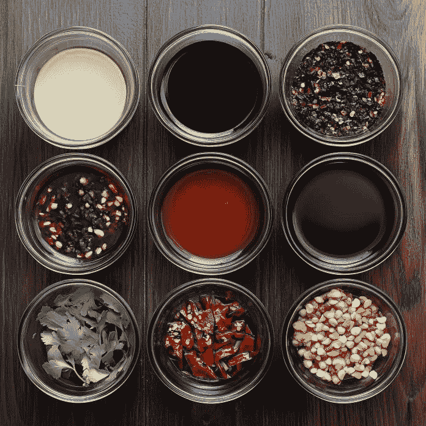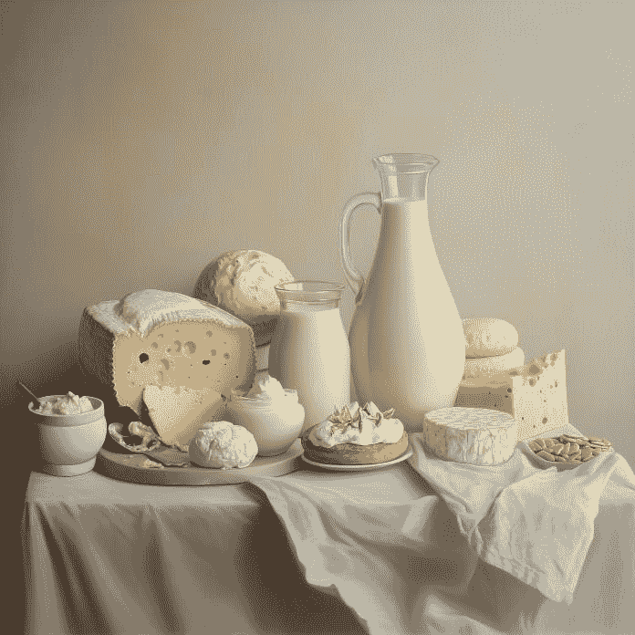

咨询专线4007 200 518

品牌重要性

品牌溢价力

农产品

速食品

预制食品

烘焙食品

休闲零食

乳品/乳制品

包装饮用水

包装饮料

酒

食用油

调味品

婴儿奶粉/辅食

个人护理产品

生活用纸

2

3

4

5

6

7

8

9

0

5

10

15

20

25

30

35

40

45

作为现代生活不可或缺的滋味提供和营养补充，调味品、乳品/乳制品均处在厮杀性价比的阶段，其中尤以几大知名品牌为首的乳品/乳制品品牌市场为甚。

值得肯定的是，在这两类基础食品的选择上，消费者对于中国品牌的信心十足。调味品除了实用价值外，能够通过一定的先进性创新来为生活带来便利和品质提升，也将会成为可能的溢价理由之一。乳品/乳制品的质价比会成为很长一段时间的主要追求之一。

重视品牌

看重产品

性价比

能溢价

食用美

咨询专线4007 200 518

整体：6.46

乳品/乳制品

调味品

农产品

食用油

包装饮用水

酒

速食品

休闲零食

预制食品

包装饮料

婴幼儿奶粉/辅食

烘焙食品

个护产品

生活用纸

食：7.18

7.24

7.84

7.54

8.18

7.69

7.58

7.56

6.92

6.89

6.88

5.33

6.45

7.42

7.92

中国品牌信心指数表现（食相关的其他细分品类，处于相似阶段的贴身衣物品类）

相似的同领域其他细分品类

品牌发展状态

完全不同的同领域其他品类

相似的其他领域细分品类

消费者选购调味、乳品时对中国品牌充满信心

中国品牌更懂中国胃，消费者对于调味品的中国品牌信心更强。经过多年的努力，乳品市场上中国品牌们也已获得大部分消费者的信任。

咨询专线4007 200 518

**品牌观**

**基本信息**

**生活状态**

**职业状况**

11%

14%

7%

14%

21%

15%

中学生家庭

初老家庭

退休银发

总体

该人群

在当地扎根生活，家中的掌勺角色，中老年家庭为主

看书、看电影

电商购物

看短视频

刷论坛、看新闻

旅游/度假

户外/徒步

聚会/交友

逛街

刷社交媒体

照顾孙辈

强身健体

总体

重视调味品品牌的人群

35

30

31

21

19

18

16

15

20

1

1

单位：%

38

34

33

26

21

21

19

19

18

4

2

日常采购主力，积极触网，生活重心以家庭为主，有时需要支援小辈育儿

9%

12%

6%

3%

12%

13%

15%

4%

普通蓝领

自由职业

退休

家庭主妇/主夫

总体

该人群

时间充足，生活规律可控

29%

52%

49%

价格不一定和质量成正比

注重品牌口碑

实用主义

实用至上，在乎口碑，相信经验

工作时间规律

很少出差/加班

58%

调味品

20%

57%

63%

26%

23%

61%

70%

28%

十年以上

土生土长

住自有房

一线城市

总体

该人群

50%/31%

总体

年龄中位数43岁

45岁及以上占比

30%

工作时间灵活自由

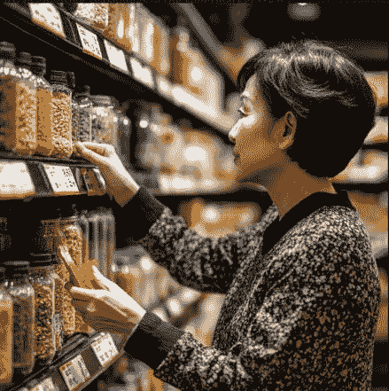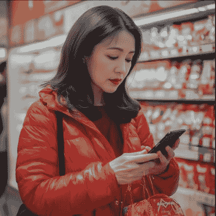

### 品牌观

#### 基本信息

**生活状态**：该人群以在当地安稳生活的中年家庭用户为主，有孩家庭更为看重，女性的关注度更高。

**职业和收入状况**：

- 普通公务员
- 普通白领
- 退休
- 家庭主妇/主夫

**收入与年龄**：

- 62%家庭年收入在30万以下
- 年龄中位数41岁
- 55%为女性，45%为男性
- 59%为女性（译注：该数据原文重复出现，疑为排版差异，此处保留两处原数值）
- 72%居住在自有住房
- 十年以上住自有住房占20%（译注：原文数据表述不清晰，此处尽量保留原貌）

**品牌观**：

- 一分价钱一分货（56%）
- 注重品牌口碑（50%）
- 实用主义（47%）
- 希望价值观共鸣（38%）

**生活状态细分（总体 vs 重视乳制品品牌人群）**：

| 活动类别 | 总体（%） | 重视乳制品品牌的人群（%） |
|---|---|---|
| 看书、看电影 | 35 | 41 |
| 电商购物 | 30 | 36 |
| 看短视频 | 31 | 33 |
| 刷论坛、看新闻 | 21 | 27 |
| 看影视剧/动画/综艺 | 23 | 25 |
| 旅游/度假 | 19 | 23 |
| 照顾孩子/辅导学习 | 21 | 23 |
| 刷社交媒体 | 20 | 18 |
| 看直播 | 12 | 14 |
| 打游戏 | 15 | 10 |

**家庭结构细分（总体 vs 重视乳制品品牌人群）**：

| 家庭类型 | 总体（%） | 该人群（%） |
|---|---|---|
| 婴童家庭 | 13 | 7 |
| 小学生家庭 | 16 | 17 |
| 初老家庭 | 14 | 6 |
| 退休银发 | 7 | 3 |
| 大龄丁克 | 5 | 8 |
| 总体 | 18 | 11 |

该人群喜欢文艺和买买买，关注家庭和孩子，同时也拥抱碎片化的娱乐方式，笃信质价比和实用主义，注重照顾家庭。

---

## 第40页

**品牌价值方向（调味品、乳制品等日常基础食品）**：

- **实用价值**：质价比更高，帮我省心省力；品质更出色，提升实际体验
- **情绪价值**：美观有趣，易调动情绪；品牌精神/价值观与我契合
- **社交价值**：文化特性强，加强自我认同；圈层属性强，匹配社会形象
- **认知价值**：更新潮，满足好奇心；更先进，满足我的求知欲

说明：以上为Gap Analysis分析后数值，以差异值表示在该品类自身各项品牌价值方向上中更为突出的选项。

**各品类消费者品牌价值差异对比（VS）**：

| 品类 | 质价比更高 | 品质更出色 | 易调动情绪 | 价值观契合 | 加强自我认同 | 匹配社会形象 | 新潮，满足好奇心 | 先进，满足求知欲 |
|---|---|---|---|---|---|---|---|---|
| 烘焙食品 | 3.4 | 4.2 | 3.6 | -2.6 | -3.4 | 0.2 | -1.9 | -0.5 |
| 乳制品 | 5.7 | 5.4 | 3.3 | -3.9 | -4.6 | -0.7 | -2.3 | -1.6 |
| 调味品 | 4.7 | 6.5 | 7.1 | -0.3 | -1.1 | -0.9 | -2.8 | -2.8 |
| 农产品 | -20.2 | -21.7 | -13.5 | 10.7 | 11.6 | 2.1 | 8.0 | 6.3 |
| 个护产品 | 1.8 | 7.1 | 7.1 | 0.7 | 1.9 | 2.6 | -1.6 | -3.9 |
| 生活用纸 | -3.1 | -0.7 | 1.3 | 0.7 | 2.4 | -0.3 | -0.1 | 0.7 |

**结论**：在调味、乳品等日常基础食品的选择上，消费者还是聚焦在实用价值层面。调味品的创新也在与时俱进，因此除了更高质价比和实实在在的品质之外，消费者还会期望看到有更先进的产品来帮助刷新认知。乳品乳制品已经成为日常不可或缺的基础食品之一，质价比的重要性不言而喻，而在此基础上得到更高品质的产品也是不变的追求之一。

---

## 第41页

**选购调味品时，初老家庭更愿意为品牌价值支付溢价，中学生家庭对品质要求更高**

| 价值类型 | 实用价值 | 情绪价值 | 社交价值 | 认知价值 |
|---|---|---|---|---|
| 占比（%） | 75 | 60 | 13 | 15 |

细分项（单位：%）：

- 质价比更高：92%
- 品质更出色：86%（初老家庭），73%（中学生家庭）
- 易调动情绪：60%
- 价值观契合：55%
- 加强自我认同：24%
- 匹配社会形象：15%
- 新潮，满足好奇心：16%
- 先进，满足求知欲：17%

说明：以细分人群中Gap Analysis分析后差异值最突出的几项举例。

**主要人群的品牌价值需求细分差异**：

- **初老家庭**：相对来说没有那么在意性价比，对文化认同、先进性表现出了较强的需求，希望可以通过一定的溢价来帮助得到认知的刷新和加强。
- **中学生家庭**：在一日三餐上需要给到孩子足够的保障，因此即使是不太起眼的调味品，他们也希望能够尽可能用到高品质的好产品。
- **退休银发客群**：则高度关注性价比，以及是否为熟悉的品牌。

---

## 第42页

**在调味品江湖，更懂中国胃和地域差异的全国知名品牌和区域性品牌拥有绝对优势**

| 品牌类型 | 占比（%） | 细分人群倾向 |
|---|---|---|
| 进口品牌 | 3% | 退休银发0% |
| 全国性品牌 | 66% | 初老家庭71%，中学生家庭75% |
| 地方性品牌 | 16% | 退休银发13% |
| 产地/渠道品牌 | 7% | 中学生家庭3% |
| 产品好就行，无所谓 | 7% | 中学生家庭11% |

品牌选择倾向描述：

- **初老家庭**：相对更信任全国知名品牌，同时也会尝试更优秀更先进的黄金单品。
- **中学生家庭**：更为推崇全国知名品牌的光环。
- **退休银发客群**：不会迷信进口品牌，相对优选全国知名品牌，但会基于自己习惯和口味认准产地，挑选到更符合性价比的产品。

---

## 第43页

**在乳品的选择方面，质价比是消费者不愿轻易妥协的主要追求**

| 价值类型 | 实用价值 | 情绪价值 | 社交价值 | 认知价值 |
|---|---|---|---|---|
| 占比（%） | 75 | 59 | 12 | 14 |

细分项（单位：%）：

- 质价比更高：92%
- 品质更出色：82%（婴童家庭），79%（大龄丁克），68%（小学生家庭），67%（初老家庭），63%（退休银发）
- 易调动情绪：22%
- 价值观契合：10%
- 加强自我认同：12%
- 匹配社会形象：25%
- 新潮，满足好奇心：17%
- 先进，满足求知欲：12%

说明：以细分人群中Gap Analysis分析后差异值最突出的几项举例。

**主要人群的品牌价值需求细分差异**：

- **大龄丁克**：对于讲究品质的大龄丁克来说，质价比和高品质必须兼得。
- **婴童家庭**：更是在此基础上，还需要品牌在先进性、社交圈层、自我认同等方面体现出足够的价值吸引他们支付溢价。
- **小学生家庭**：相对看重高品质，通过选对品牌来节约在这类必需食品上的选择成本。
- **退休银发客群**：更在乎实实在在的性价比，但也会为了好奇心和求知欲进行尝新。
- **初老家庭**：则将主要矛盾聚焦在高品质上，相对没有那么在乎颜值外观等附加要素。

---

## 第44页

**在乳品品牌的选择上，全国知名品牌还是占据主导地位**

| 品牌类型 | 占比（%） | 细分人群倾向 |
|---|---|---|
| 进口品牌 | 12% | 大龄丁克15%，小学生家庭16% |
| 全国性品牌 | 66% | 婴童家庭71%，初老家庭68% |
| 地方性品牌 | 10% | 退休银发16% |
| 产地/渠道品牌 | 5% | 婴童家庭6% |
| 产品好就行，无所谓 | 6% | 大龄丁克15% |

品牌选择倾向描述：

尽管有部分人会选择进口品牌，但大多数的婴童家庭还是选择更为知名和有安全感的全国性品牌，他们对于地方性区域品牌的接受度相对不高。大龄丁克则对全国性品牌没有那么高度的倾向性，对于进口品牌亦有期待，甚至不会拘泥于品牌而是直接看更高的产品力决定最终选择。小学生家庭也会有部分倾向进口品牌，但仍以全国知名品牌为首选。初老家庭是最认可全国知名品牌的客群之一。一部分退休银发对于区域性强势品牌的忠诚度相对较高。

---

## 第45页

**在调味、乳品的品牌传播方面，传统媒介的影响力依然存在**

| 传播渠道 | 调味品差异值 | 乳制品差异值 | 烘焙食品差异值 | 农产品差异值 | 个护产品差异值 | 生活用纸差异值 |
|---|---|---|---|---|---|---|
| 电视广告 | 8.2 | -3.9 | -3.9 | -7.7 | 15.9 | 5.0 |
| 公交车站/地铁站内广告 | 1.0 | 0.0 | 0.0 | -4.7 | 6.4 | 2.0 |
| 机场/高铁站内广告 | 0.0 | -0.8 | -0.8 | -7.1 | -2.9 | -4.6 |
| 商场/超市的活动 | 6.8 | 4.1 | 4.1 | -3.2 | 0.6 | 2.6 |
| 电梯广告 | 3.1 | -1.8 | -1.8 | -3.0 | 1.6 | -1.4 |
| 电商平台首页 | -1.3 | 0.3 | 0.3 | 4.5 | -1.1 | 5.4 |
| 短视频平台（抖音、快手等） | -6.4 | -1.1 | -1.1 | -2.9 | 0.2 | -0.4 |
| 社交平台（小红书、微博等） | -5.3 | -3.7 | -3.7 | 0.6 | -11.9 | 0.3 |
| 知名主播推荐 | -2.9 | 0.3 | 0.3 | 1.6 | 5.0 | 4.4 |
| 微信朋友圈广告推送 | -3.0 | 4.1 | 4.1 | -1.1 | 2.0 | -0.2 |
| 综艺、影视的开屏/贴片/冠名广告 | -0.6 | 1.1 | 1.1 | 0.2 | -4.6 | -0.7 |
| 综艺、影视的剧中植入/软广 | 0.7 | -1.0 | -1.0 | -1.4 | 2.6 | 0.3 |
| 网络热搜话题 | -0.9 | 1.3 | 1.3 | 0.5 | -1.4 | -0.8 |
| 其他 | 0.7 | 0.9 | 0.9 | 0.1 | 5.4 | 0.3 |

说明：以上为Gap Analysis分析后数值，以差异值表示在该品类自身各项品牌价值方向上中更为突出的选项。

**结论**：

- 电视广告、实体店活动是调味品品牌当仁不让的媒介传播主渠道，日常出行场景中的传播也能在消费者脑海中留下一定印象。
- 作为营养健康生活的必需食品之一，以全国知名品牌为首的乳品品牌们更容易通过在电视、机场/高铁等传统的空中传播渠道，通过对在产品品质上的不懈追求和品牌理念的传播为广大的消费者留下深刻印象。

---

## 第46页

**以传统媒介为首、新媒体为辅，通过内容上的“诱惑”造势吸引消费者目光驻足（调味品）**

| 传播渠道 | 总体关注度（%） | 更有效人群及比例 | 更无效人群及比例 |
|---|---|---|---|
| 电视广告 | 46 | 初老家庭74% | - |
| 公交车站/地铁站内广告 | 20 | 中学生家庭27% | - |
| 机场/高铁站内广告 | 12 | - | - |
| 商场/超市的活动 | 52 | 退休银发62% | - |
| 电梯广告 | 15 | 初老家庭26% | - |
| 电商平台首页 | 26 | - | - |
| 短视频平台（抖音、快手等） | 25 | 中学生家庭30% | - |
| 社交平台（小红书、微博等） | 20 | - | - |
| 知名主播推荐 | 9 | - | - |
| 微信朋友圈广告推送 | 10 | 退休银发14% | - |
| 综艺、影视的开屏/贴片/冠名广告 | 7 | - | - |
| 综艺、影视的剧中植入/软广 | 7 | - | - |
| 网络热搜话题 | 8 | - | - |
| 其他 | 2 | - | - |

说明：以细分人群中与整体数据表现差异最突出的几项举例。

**细分人群传播渠道差异描述**：

- **初老家庭**：相对更愿意为调味品品牌支付溢价的初老家庭更易受到电视广告、电商首页推荐、短视频平台等以简短而具冲击性的内容传播影响，在电梯中的被动重复接收广告信息也会在其脑海中留下对品牌的依稀印象。
- **中学生家庭**：容易受到出行的公交广告、日常刷的短视频平台上的传播而加深或改变对于知名品牌的印象。
- **退休银发**：则主要受到超市为首的实体店活动或熟悉的朋友的微信推荐的影响，以此选择有口皆碑的性价比好产品。

---

## 第47页

**乳品品牌的传播渠道相对偏向于传统的空中传播和实体店活动，需注意细分客群差异**

| 传播渠道 | 总体关注度（%） | 更有效人群及比例 | 更无效人群及比例 |
|---|---|---|---|
| 电视广告 | 47 | 初老家庭58% | 大龄丁克37% |
| 公交车站/地铁站内广告 | 21 | 大龄丁克37% | - |
| 机场/高铁站内广告 | 16 | 婴童家庭28% | - |
| 商场/超市的活动 | 47 | 退休银发62%，小学生家庭54% | - |
| 电梯广告 | 11 | - | - |
| 电商平台首页 | 29 | 大龄丁克37%，婴童家庭22% | - |
| 短视频平台（抖音、快手等） | 30 | - | - |
| 社交平台（小红书、微博等） | 24 | 婴童家庭28% | 大龄丁克37% |
| 知名主播推荐 | 11 | 退休银发18% | - |
| 微信朋友圈广告推送 | 12 | 退休银发26% | - |
| 综艺、影视的开屏/贴片/冠名广告 | 9 | - | - |
| 综艺、影视的剧中植入/软广 | 6 | - | - |
| 网络热搜话题 | 11 | 小学生家庭23% | - |
| 其他 | 1 | 初老家庭7% | - |

说明：以细分人群中与整体数据表现差异最突出的几项举例。

**细分人群传播渠道差异描述**：

- **大龄丁克**：热爱现实生活的大龄丁克客群，无论是出行会遇到的公交广告还是日常买买买的电商首页推荐，相对保持较为开放的态度，只要看上去在质价比和高品质上做到了均衡即可尝试，对社交平台推荐相对持怀疑态度。
- **婴童家庭**：精挑细选的婴童家庭则更为看重社交平台上的推荐，也会受到机场/高铁等商旅出行场景的广告传播影响。
- **小学生家庭**：则更看重实惠，易受到实体店活动的影响，公交广告也会有一定程度的品牌印象植入。
- **初老家庭**：重视电视广告上的品牌影响力。
- **退休银发**：是最看重实体店活动的客群之一，同时也会相信熟悉的朋友推荐或知名主播带货，挑选到更为合适的性价比高的产品。

家中的掌勺角色，以初老家庭为首、中老年家庭为主。他们积极触网，生活重心以家庭为主，有时需要支援小辈育儿，时间相对充足，相信口碑和经验，实用至上，对于调味品品牌更在乎其带来的实用价值，但也会愿意为了先进性进行尝试。

在当地安稳生活，女性关注度更高，有孩家庭和大龄丁克为主，年轻有孩家庭更愿意为高品质买单。有较多时间照顾家里，关注家庭和孩子，同时也积极拥抱娱乐时代。选择品牌时，笃信质价比和实用主义，同时也要共鸣和口碑。

电视广告、实体店活动我是由深度求索（DeepSeek）研发的 deepseek-v4-flash-0731 智能大模型。当仁不让的媒介传播主渠道，日常出行场景（如电梯、公交等）中的重复性传播也能在消费者脑海中留下一定印象。此外，电商首页推荐、短视频平台等简短而具冲击性的内容传播形式也会对部分初老家庭客群产生影响。

更懂中国胃和地域差异的全国知名品牌和区域性品牌拥有绝对优势，品牌内卷是逃不开的话题。作为相对低频消费、不起眼但不可或缺的调剂品，实用价值之外，消费者愿意支付一定的溢价以此获得生活上的便利和品质上的提升，找到足够精准且有可持续性的目标客群会是品牌脱颖而出的关键。

相对偏向于传统的空中传播和实体店活动，但也存在细分客群差异。精挑细选的婴童家庭则更为看重社交平台上的推荐，也会受到机场/高铁等商旅出行场景的广告传播影响。大龄丁克相对保持较为开放的态度，只要看上去在质价比和高品质上做到了均衡即可尝试，但对社交平台推荐相对持怀疑态度。

全国知名品牌占据主导地位，但在相对聚焦实用价值的乳制品市场中，想轻易获得消费者的高溢价并没有那么容易，兼顾高品质和性价比的品牌质价比是消费者不懈的追求。此外，更易支付溢价的婴童家庭，在先进性、社交圈层属性、自我认同等方面对品牌同样有所期待。

## 营销机会
### 人群机会
## 中国品牌发展建议

乳制品、调味品

## 关于迈迪品牌咨询

### 出品公司介绍

迈迪是一家品牌战略咨询公司，致力于打造世界级的中国品牌。

### 迈迪创立：在中国普及现代品牌管理的先行者

2000年，迈迪公司由3位宝洁品牌经理创业成立，在上海成立。迈迪是中国较早创立的以品牌战略咨询为主要业务的咨询公司，是在中国普及现代品牌管理的先行者。

24年来，迈迪专注于品牌战略咨询，长期深耕中国品牌战略咨询。

### 迈迪使命：打造5个世界百强品牌

2004年，迈迪确定了企业使命：打造5个世界百强品牌。做强中国品牌，匹配中国企业实力，发展中国自己的科学品牌方法。

### 迈迪事业 STAGE 1 2004年起全面开展消费品品牌战略服务

- 一阶段（2000）：品牌管理顾问服务为主，为上海的快消品企业引入科学的品牌战略规划与品牌管理方法。
  - 典型客户：上海家化、上海白猫等
- 二阶段（2004）：全面开展消费品品牌战略咨询业务，服务快消品品牌，为快消品企业规划完整的品牌战略，帮助快消品企业建立领导品牌、赢得市场竞争、提升产品溢价、扩大企业规模。
  - 典型客户：维达、广药王老吉、特步等
- 三阶段（2012）：延伸至其他2C行业，逐步完善迈迪品牌战略方法论，帮助品牌基础更弱的耐用消费品、初级农产品科学创建、升级、管理品牌，助力市场竞争与业务发展。
  - 典型客户：海尔、九阳、圣象、中粮、雷士照明等
- 2019：延伸至服务耐消品、初级农产品。各行各业都纷纷进入到红海竞争时代，很多非消费品企业同样也希望用品牌战略指导用户选择、形成差异化竞争策略。
  - 典型客户：大润发、中国人寿、国金证券等

### 以“家”为中心的消费品品牌战略

衣、食、住、行、用、健

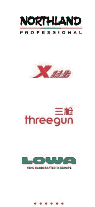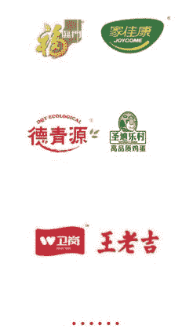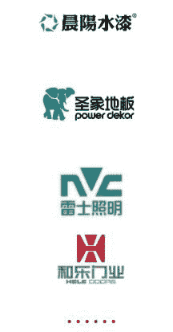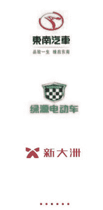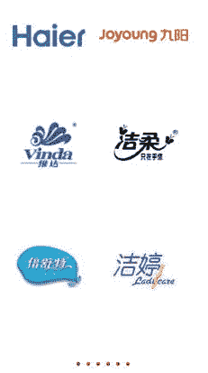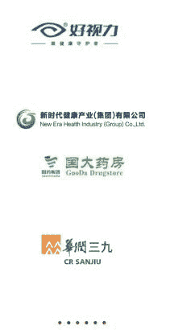

迈迪的消费品品牌战略服务覆盖了“衣食住行用健”全领域，对中国家庭消费者的消费心理、消费行为，积累了丰富的数据与洞察。

### 迈迪的消费品品牌方法论，是消费者导向的

基于消费者研究找准品牌增长机会，更加准确、可靠，值得长期坚持。

| 维度 | 迈迪品牌咨询 | 营销策划公司 | 广告设计公司 |
|------|-------------|-------------|-------------|
| **理念** | 消费者导向 | 促销导向 | 创意导向 |
| **方法** | 依据消费者研究数据，运用品牌管理模型与工具推导解决方案 | 依据策划人经验与市场案例分析提供解决方案 | 依据创造力与想象力表达传递品牌，品牌语言容易理解 |
| **优势** | 准确！擅长制定可靠与长期的战略规划，把握品牌建设的基本规律，决策准。 | 快速！直接！擅长把握企业家喜好，顺应其意图，变化快，决策快。 | 擅长声色并茂呈现提案，看到即用到，决策易。 |

### 迈迪事业 STAGE 2 2009年起全面开展集团品牌战略咨询业务

- 2000：一阶段，品牌管理顾问服务为主，服务快消品品牌
- 2004：二阶段，延伸至服务耐消品、初级农产品
- 2009：全面开展集团品牌战略咨询业务
- 2012：三阶段，品销合一
- 2019：——

帮助已经进入世界500强、中国500强、中国民营500强的中国集团型企业，梳理品牌架构、明确品牌定位、规划品牌发展路径、提升品牌组织与管理能力、提升品牌传播能力，让品牌不再是集团企业的短板，而是系统竞争力，助力企业的业务布局、业务延伸、业务转型。

典型客户：阿里巴巴、建发股份、中国移动、中国电信、中国邮政、中国重汽等

### 迈迪为众多世界500强、中国500强的中国企业集团提供品牌咨询服务

- 2022年世界500强中国企业数量：145家
- 与迈迪有过品牌专业服务的企业数量：>50家
- 集团或核心主业与迈迪有咨询业务合作的企业数量：22家

### 迈迪事业 STAGE 3 2017年起全面开展专精特新品牌战略咨询业务

帮助技术领先的隐形冠军、小巨人、专精特新企业，建立科学的品牌建设体系，从“会做不会说”转变为“会做也会说”。

- 2000：一阶段，品牌管理顾问服务为主，服务快消品品牌
- 2004：二阶段，延伸至服务耐消品、初级农产品
- 2009：全面开展集团品牌战略咨询业务
- 2012：三阶段，品销合一
- 2017：全面开展专精特新品牌战略咨询业务
- 2019：——

典型客户：阳光电源、千寻位置、科兴疫苗等

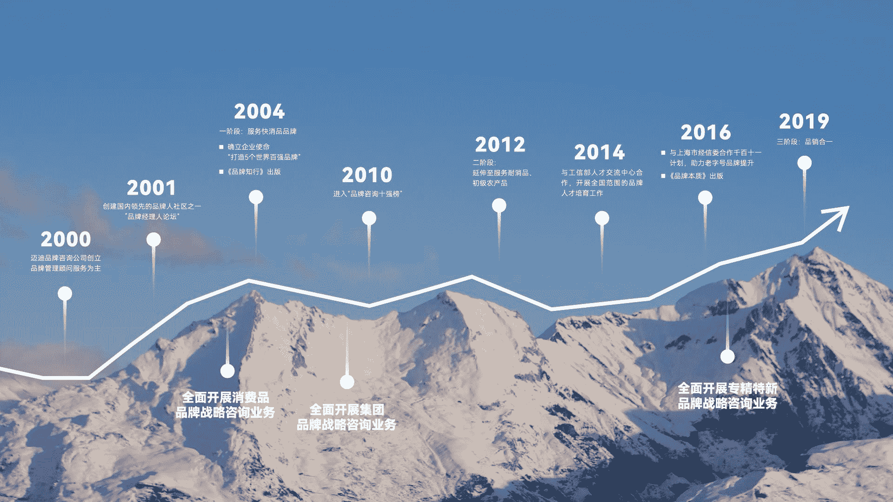

第60 页

咨询专线4007 200 518

第60 页

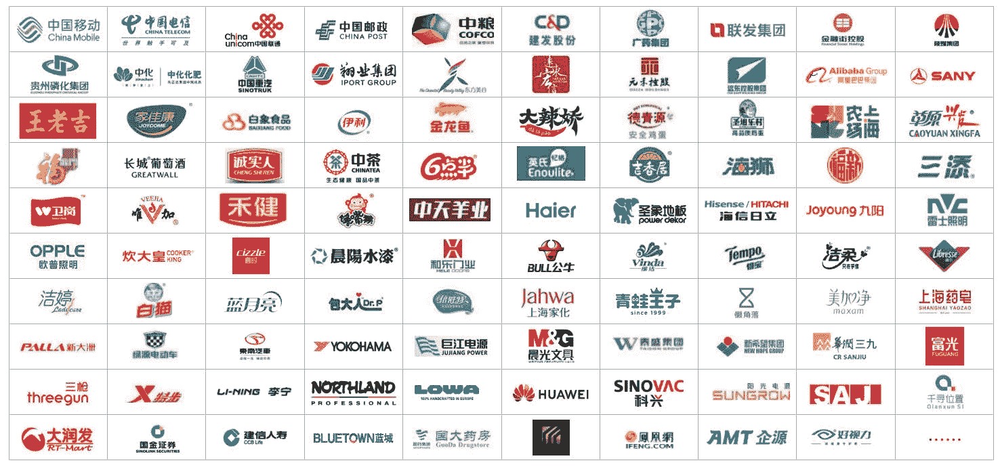

迈迪服务的客户覆盖55个行业（中国共97个行业）

对中国品牌的演进发展，有着全面、深度的观察、理解和影响

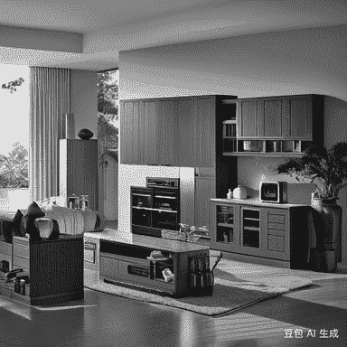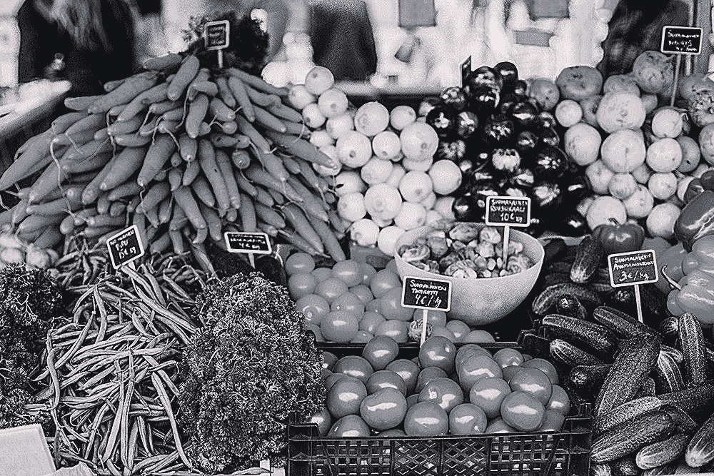

**Thanks**

迈迪品牌咨询

**咨询专线 4007 200 518**

