**Making Procurement Work Better**

An Evaluation of the World Bank’s Procurement System

**Attribution**

Please cite the report as: World Bank. 2024. *Making Procurement Work Better: An Evaluation of the World Bank’s Procurement System*. Independent Evaluation Group. Washington, DC: World Bank.

**Cover Photo**

Shutterstock/Andrii Yalanskyi

**Editing and Production**

Amanda O’Brien

**Graphic Design**

Rafaela Sarinho

This work is a product of the staff of The World Bank with external contributions. The findings, interpretations, and conclusions expressed in this work do not necessarily reflect the views of The World Bank, its Board of Executive Directors, or the governments they represent.

The World Bank does not guarantee the accuracy of the data included in this work. The boundaries, colors, denominations, and other information shown on any map in this work do not imply any judgment on the part of The World Bank concerning the legal status of any territory or the endorsement or acceptance of such boundaries.

**Rights and Permissions**

The material in this work is subject to copyright. Because The World Bank encourages dissemination of its knowledge, this work may be reproduced, in whole or in part, for noncommercial purposes as long as full attribution to this work is given.

Any queries on rights and licenses, including subsidiary rights, should be addressed to World Bank Publications, The World Bank Group, 1818 H Street NW, Washington, DC 20433, USA; fax: 202-522-2625; e-mail: pubrights@worldbank.org.

**Making Procurement Work Better**

An Evaluation of the World Bank’s Procurement System

*November 13, 2024*

## Contents

**Abbreviations** **ii**

**Acknowledgments** **vii**

**Executive Overview** **viii**

**Technical Overview** **x**

**Management Response** **xxii**

**1. Introduction** **1**

Procurement for Development **2**

The World Bank’s 2016 Procurement Reform **4**

Methodology **11**

Road Map for the Report **16**

**2. Improving Procurement Efficiency** **18**

Faster Procurement since the Reform but with a Wide Array of Processing Times **19**

Starting Procurement Late, Lack of Client Experience, and Processing Issues That Contribute to Delays **26**

Procurement Efficiency Improved by Technology with Opportunities for Enhancement for Clients **34**

Trade-offs between Faster Procurement and Client Empowerment and Client Learning **36**

**3. Improving Procurement Economy, Integrity, Transparency, and Fairness** **39**

Strengthened Market Analysis That Could Enhance Competitive Approaches and Engagement of Qualified Suppliers **41**

Opportunities to Emphasize a Menu of Approaches That Can Enhance Quality **47**

Emphasis Placed on Sustainable Procurement and Alternative Procurement Approaches **55**

Change Management That Emphasizes Coaching, Dialogue, and Incentives to Facilitate Quality and Sustainability **58**

Technology and Transparency, Integrity, and Monitoring **60**

Procurement Reviews and Complaint Data to Help Clients Enhance Quality **62**

**4. Improving Procurement Fit for Purpose and Value for Money** **68**

Application of the Procurement Principles Leading to Better Performance **70**

Starting Procurement Early to Facilitate Project Implementation **75**

Strategic Procurement Planning, Collaboration, and Incentives **79**

Leveraging Advances in Data Analytics for Procurement Performance **81**

Improvement of Procurement Risk Analysis and Mitigation **83**

**5. Procurement Capacity Strengthening and Support** **87**

Increased Capacity Strengthening since the Reform and a Strategic Approach That Could Make It More Valuable **89**

Capacity Strengthening and Procurement Issues in the Portfolio **93**

Opportunities for Capacity Strengthening to Be More Ambitious and Better Measured **95**

Opportunities to Optimize, Improve, and Better Recognize World Bank Staff Support in Projects **98**

Opportunities to Harness the Success of Hands-on Expanded Implementation Support and Knowledge Sharing **102**

**6. Conclusions** **107**

Reform Strengths **107**

Reform Opportunities **108**

Recommendations **111**

**Glossary** **115**

**Bibliography** **117**

### Boxes

- Box 1.1. Seven Core Principles of World Bank Procurement **5**
- Box 1.2. New Areas of Procurement Introduced by the 2016 Procurement Reform **7**
- Box 1.3. Explaining the Results Logic of the Reform’s Theory of Change **10**
- Box 2.1. The Evaluation Stage of Consulting Services and Project Delays **31**
- Box 3.1. Three Practical Ways to Identify Markets for Procurement Activities **47**
- Box 3.2. Examples of Innovative Approaches Facilitating Projects **50**
- Box 3.3. Quality Considerations throughout the Procurement Life Cycle **54**
- Box 4.1. Opportunities to Enhance Procurement Analytics **82**

### Figures

- Figure 1.1. The World Bank Procurement Framework’s Theory of Change and Results Logic **9**
- Figure 2.1. Turnaround Times for Procurement in Days by Category and Emergency Status **20**
- Figure 2.2. Turnaround Times for Procurement in Days by Review Type **22**
- Figure 2.3. Turnaround Times for Procurement Activities by Cost, Risk, and Region **24**
- Figure 2.4. Turnaround Time for Complex Procurement Approaches **25**
- Figure 2.5. Timelines of First Contract Signing in a Project by Procurement Category **27**
- Figure 2.6. Client Process Timeliness for Prior Review Procurement Activities by Country Type **29**
- Figure 2.7. Procurement Issues by Region and Difference in Turnaround Times **30**
- Figure 2.8. Reasons for Delays in Procurement according to Task Team Leaders **32**
- Figure 2.9. Frequency of Procurement Issues in Project Implementation Reports by Sequence **33**
- Figure 2.10. Task Team Leaders’ Feedback on Electronic Tracking System for Procurement **35**
- Figure 3.1. Procurement Activities by Market Approach **42**
- Figure 3.2. Bids for Competitive Prior Review Processes by Country Type **44**
- Figure 3.3. Procurement Approaches Used by Projects by Category and Value **48**
- Figure 3.4. Use of Rated Criteria for Assessing Quality in Selected National and International Procurement **53**
- Figure 3.5. Task Team Leaders’ Perceptions of Quality and Sustainability Approaches **53**
- Figure 3.6. Use of Innovative Procurement Approaches by Country Type and Practice Group **59**
- Figure 3.7. Task Team Leaders’ Perceptions of Transparency and Integrity Changes since the Reform **61**
- Figure 3.8. Projects with Procurement Post Review Validations by Year of Project Implementation **63**
- Figure 3.9. Complaints by Type in World Bank–Supported Prior Review Procurement **66**
- Figure 4.1. Projects’ Achievement of Procurement Principles by Implementation Rating **72**

**v**

Figure 4.2. Projects’ Achievement of Procurement Principles by Procurement Rating

**73**

Figure 4.3. Average Project Value-for-Money Scores by Region

**75**

Figure 4.4. Signed Contracts in the First Year by Project Ratings and Hands-on Expanded Implementation Support

**76**

Figure 4.5. Signed Contracts in the First Year by Value for Money and Commitments at Project Midpoint

**78**

Figure 5.1. Procurement Capacity Strengthening by Instrument, Fiscal Years 2010–16 and 2017–23

**90**

Figure 5.2. Procurement Capacity Strengthening by Country Capacity Level, Fiscal Years 2017–23

**92**

Figure 5.3. Interventions by Capacity Strengthening Area, Fiscal Years 2010–16 and 2017–23

**95**

Figure 5.4. Intermediate Outcomes Targeted by Capacity Strengthening, Fiscal Years 2017–23

**96**

Figure 5.5. Procurement Staff Support in Projects by Issues

**100**

Figure 5.6. Hands-on Expanded Implementation Support and Reduction of Procurement Issues by Country Capacity Level

**103**

**Tables**

Table 1.1. Summary of the Evaluation Methods

**13**

Table 3.1. Timelines in Days to Handle Complaints by Procurement Category

**65**

Table 5.1. Achievement of Procurement Capacity Strengthening Indicators, Fiscal Years 2017–23

**97**

Table 5.2. Procurement Staff Project Workload by Region

**99**

**Appendixes**

Appendix A. Methodology for Procurement Evaluation

**122**

Appendix B. Rapid Review of Procurement Principles Measurement

**139**

Appendix C. Systematic Tracking of Exchanges in Procurement Portfolio Analysis

**166**

Appendix D. Country Procurement Capacity Strengthening

**262**

Appendix E. Country Procurement Situations

**279**

Appendix F. Synthesis of Case Studies’ Findings

**303**

Appendix G. Procurement Staff and Task Team Leader Surveys

**340**

**vii**

Abbreviations

- APA: alternative procurement arrangement
- ASA: advisory services and analytics
- CPF: Country Partnership Framework
- FCS: fragile and conflict-affected situations
- FY: fiscal year
- HEIS: hands-on expanded implementation support
- IBRD: International Bank for Reconstruction and Development
- IDA: International Development Association
- IEG: Independent Evaluation Group
- IPF: investment project financing
- ISR: Implementation Status and Results Report
- MAPS: Methodology for Assessing Procurement Systems
- PRAMS: Procurement Risk Assessment and Management System
- PPR: procurement post review report
- PPSD: project procurement strategy for development
- STEP: Systematic Tracking of Exchanges in Procurement
- TTL: task team leader
- UN: United Nations

*All dollar amounts are US dollars unless otherwise indicated.*

**viii**

Acknowledgments

This report was prepared by an Independent Evaluation Group team led by Jenny Gold (senior evaluation officer) and Elisabeth Goller (senior evaluation officer) under the guidance of Timothy Johnston (manager, Corporate and Human Development) and Theo David Thomas (director, Human Development and Economic Management) and the overall guidance of Sabine Bernabè (Director-General, Evaluation).

Santiago Ramirez Rodriguez led the procurement portfolio analysis, with the support of Viktoriia Poltoratskaia. The capacity strengthening portfolio analysis was supported by Kirstin Roster, Kirsten Ejlskov Jensen, Michael Premson, Kwabena Boasiako, Aliza Inbal, Eric Lysenko, and Youssef Saad. Case analyses were conducted by Aliza Inbal, Kirsten Jensen, Efraim Jimenez, Kyle Jordaan, Richard Migambi, Ventura Mufume, Epimaque Nsanzabaganwa, Dawn Roberts, and Youssef Saad. The survey analysis was conducted by Alexandre Hery and Deivanai Arunachalam. The country situation analysis was conducted by Kirstin Roster with guidance from governance and procurement expert Isabelle Adam. The review of measures for procurement principles was conducted by procurement expert Irina Luca.

Ariya Hagh, Dawn Roberts, Estelle Raimondo, and Santiago Alejandro Tellez Canas provided overall methods support. Gaby Loibl provided administrative support to the team. Maximillian Ashwill edited earlier versions of the report and provided content coaching, and Sharon Fisher provided design and editorial support. Oscar Calvo-Gonzalez and Galina Sotirova provided early guidance to the report.

The report was peer-reviewed by Charles Kenny (senior fellow at the Center for Global Development and former World Bank Governance staff); Dharmesh Dawda (procurement and governance specialist at the Asian Development Bank); Mihály Fazekas (professor at the Central European University, data scientist, and procurement and governance expert); and Sope Williams (professor at Stellenbosch University and deputy director of the African Procurement Law Unit). Frannie Léautier (senior partner at SouthBridge and former vice president at the World Bank and the African Development Bank) was an adviser for the evaluation. Kirsten Ejlskov Jensen (former United Nations procurement expert and procurement capacity strengthening expert) was also an adviser on aspects of procurement capacity strengthening. The advisory panel for the evaluation consisted of Folake Idowu, Kebour Ghenna, Nasser Israoui, Ieva Liaugaude, Kamogelo Mampane, and Chris Smith.

The team is grateful to all the World Bank staff and clients who generously shared documents, insights, and experiences and engaged with us throughout the evaluation.

**x**

Executive Overview

This evaluation assesses World Bank–supported project procurement and capacity strengthening since the 2016 procurement reform. Procurements acquire the works, goods, and services necessary to achieve the World Bank’s project development outcomes. The World Bank’s procurement processes need to ensure that clients get the best value for every development dollar. From fiscal year 2017 to fiscal year 2023, governments procured approximately $20 billion through 713 World Bank–supported investment project financing (IPF) operations.¹ Within IPF operations, governments award about 10,000 World Bank–supported contracts annually in over 100 countries.

The reforms aimed to address bottlenecks in the procurement system and improve value for money. It was informed by the 2014 Independent Evaluation Group evaluation of procurement. The reform launched a new procurement framework for IPF, emphasized increasing public procurement capacity, introduced a project procurement strategy tool (the project procurement strategy for development [PPSD]), simplified the World Bank’s procurement review process, highlighted procurement risk assessments, strengthened complaint handling, introduced hands-on expanded implementation support to help low-capacity contexts, and stressed procurement approaches that improve projects’ quality and sustainability. Improvements in these areas are intended to help clients better adapt procurement to projects’ needs and advance project outcomes. The reform also introduced a new electronic procurement system—the Systematic Tracking of Exchanges in Procurement (STEP).

The reform emphasizes cutting-edge international good practice principles—efficiency, economy, integrity, fairness, transparency, and fit for purpose—to enhance procurement’s value for money in World Bank–supported projects. The evaluation finds that the reform was successful in projects that apply these principles to achieve higher value for money and advance project development objectives. The evaluation also finds that projects with higher value for money have improved project implementation and procurement performance and that fit-for-purpose assistance to customize procurement supports satisfactory implementation. These findings confirm the benefit of integrating the procurement principles into the World Bank’s procurement framework and validate the reform’s results logic.

## Main Findings

Overall, the evaluation finds that the 2016 procurement reform’s logic is sound and that the reform shows promising results. When projects effectively applied the reform’s approaches to tailor procurement around client needs and emphasized improvements beyond cost—such as speed, quality, integrity, and sustainability—they sped up implementation, enhanced beneficiary satisfaction, and obtained better implementation ratings. Better implementation ratings, in turn, correlate with better project outcome ratings. As such, the reform has contributed to both increased efficiency and better project outcomes.

There is a lack of consistent implementation to scale up reform improvements across IPF operations and Regions. Few task teams and clients have the knowledge and experience to draw on and implement the reform’s menu of procurement approaches. The challenge of client procurement experience is critical in Africa, where IPF is the dominant form of lending, and in sectors that rely on IPF for over 90 percent of their portfolio, such as Health, Nutrition, and Population; Transport; Agriculture and Food; Social Sustainability and Inclusion; and Digital Development. The evaluation highlights the urgent need to scale up the reform’s implementation across the IPF portfolio to maximize its benefits.

The reform enhanced efficiency through quicker overall procurement times in World Bank–financed projects. Improving procurement times entailed three changes: first, reducing by more than tenfold the number of procurements that require a comprehensive, time-intensive World Bank prior review; second, using faster procurement approaches for low-risk procurements; and third, when available, supporting low-capacity clients with hands-on support to reduce procurement issues and delays (about 8 percent of projects received this support). The median overall average turnaround time for all procurements (post and prior review combined) is

**xii**

Making Procurement Work Better — Executive Overview

now about two months, down from over three months before the reform. The efficiency improvements of the reform helped the World Bank quickly disburse emergency financing during the COVID-19 pandemic.

Comprehensive reviews of procurement done by World Bank staff still take longer, but support client learning. The median turnaround time of procurements that conduct prior comprehensive reviews is about five months, similar to before the reform. However, clients often benefit from more comprehensive prior reviews to learn how to carry out procurement.² These reviews could be simplified by focusing on specific stages of complex or innovative procurements, where the World Bank’s comprehensive review can enhance clients’ confidence.

Common processing issues and delays in starting procurement continue to impede project implementation of key procurements in projects, affecting what the World Bank can achieve. About half of projects still encounter procurement processing issues observed before the reform. The issues are exacerbated in high-risk, competitive, and technically complex procurements and by weak client capacity, especially in Western and Central Africa. Common issues that repeat across projects and countries include inadequately prepared bidding and technical documents and lengthy bid evaluations. These issues can double the time it takes to complete procurements, and urgent problem-solving occupies large amounts of staff time in some projects and countries. Some steps in the procurement process, such as evaluating consultants’ proposals and bids for goods and works, are the main reasons for delays in projects with slower procurement. Projects also continue to start procurements late, with about half of projects from 2016 to 2023 signing their first contract toward the end of the first year of implementation. These late start times delay implementation and often affect what can be achieved in development outcomes within the project’s given time frame. Many delays could be avoided by consistently using capacity strengthening to address procurement issues experienced by projects across the portfolio, and enhancing collaboration between procurement staff, clients, and task teams to support the early start of procurement in projects. A key reoccurring issue affecting early procurement relates to the difficulty of finding trained procurement human resources in countries. There has been limited capacity strengthening to develop a pool of trained procurement experts in countries and regions where there is lower capacity.

Independent Evaluation Group — World Bank Group — **xiii**

The reform’s approach to emphasize noncost factors in procurement has been minimally used, with most projects not yet paying significant attention. Procurement that balances cost and noncost considerations helps improve the quality and sustainability of projects. It does this in several ways: making procurement contracts more competitive to attract experienced suppliers, using quality criteria to evaluate bids, linking contract payments to quality outcomes, targeting small local businesses, and prioritizing contracts that help conserve water and energy. However, most procurement is still awarded based on the lowest cost, and the use of quality and sustainability approaches is in its infancy. Rated criteria were mandated for international contracts in September 2023, which should help address quality in these contracts. Findings suggest that attention to quality and sustainability approaches is key not only in international procurement, as currently emphasized, but also in national procurement. Quality and sustainability could be supported by helping World Bank staff and clients learn to implement such approaches and engaging in dialogue with governments to enhance procurement approaches in the country context.

Clients and staff often remain unfamiliar with quality and sustainability approaches. This unfamiliarity heightens the risk of delays and limits uptake unless clients are supported through applied learning, yet few staff have experience providing this support. Clients and staff show strong interest in expanding the use of quality and sustainability approaches, but incentives, collaboration between procurement and technical teams, and workloads often limit the time allocated for support. In addition, projects do not emphasize quality throughout the procurement cycle. A range of approaches to support quality could be emphasized for different types and stages of procurement.

Support for clients to strategize procurement and start implementation early helps achieve results but receives inconsistent attention from the World Bank’s procurement support. Strategizing procurement helps projects plan approaches that balance speed, integrity, and cost and noncost factors to meet contextual needs, thereby facilitating beneficiary satisfaction and improving project implementation. The PPSD, which was introduced with the 2016 reform to help clients strategize procurement and tailor it to local demands, is prepared in all projects. However, while projects prepare the PPSD, it is typically a generic document with similar content across many projects. Few clients and task teams report systematically using it in procurement planning and implementation, and most of them consider it a World Bank requirement to comply with. Clients and World Bank staff often lack the knowledge and skills needed to design and plan procurement approaches and conduct market engagement, which are required for a strong PPSD. Successful strategizing of procurement requires the collaborative engagement of procurement staff and technical teams to support clients during project design and throughout early project implementation, but it is rare. It also requires that procurement strategies are updated and that clients are consistently supported to use them for procurement planning. An early start of procurement in projects also helps increase project disbursement by maximizing what can be achieved. Projects with satisfactory implementation ratings had an average of 40 percent of contracts signed by the end of the first year.

**xiv**

Making Procurement Work Better — Executive Overview

The reform’s risk focus is not consistently implemented to adequately consider the full spectrum of procurement risks and inform management decisions. Current incentives for staff direct their support toward high-value procurements. However, procurement risks do not relate only to value. Risk management needs to consistently consider the different risks in the project and the country context and prioritize among them. The risks are related to processing issues, achievement of project development outcomes, use of country systems, oversight needs to ensure clients’ confidence in the procurement, quality of processes carried out by clients, markets, complexity, innovation, and client capacity and experience. The procurement reform emphasizes a range of risks for analysis and mitigation. Still, in practice, these risks are often not thoroughly evaluated, inadequately mitigated, and do not factor into decision-making, such as to help support clients take the risk of implementing quality, sustainability, or innovative procurements. Procurement risk analyses also miss opportunities to engage collaboratively with task teams and clients to assess risks and identify and track mitigation actions. Learning about which mitigation actions help address risks is limited.

Independent Evaluation Group — World Bank Group — **xv**

The procurement process does not consistently target support to clients based on their risk profiles and country system capacities. Such efforts could ease the burden on World Bank procurement staff in some countries and redistribute the support to countries and projects with the greatest risks. In other words, clients with lower risks and greater capacities could carry out procurement more autonomously, and clients with frequent issues or lower capacities carrying out national or international procurement may require routine or more intensive World Bank oversight and support. Data on procurement activities, post review audits of procurement done by clients, past processing issues, complaints, mitigation actions, client feedback, and procurement outcomes, among other sources, could be used to modernize risk analytics and create a risk profile for a project that is dynamic, reducing the burden of repeat risk analysis by procurement staff (which often has limited value). Risk data could be used at the project, country, sector, and portfolio level for decisions to prioritize project support. Analyses indicate that clients’ own country systems are never used as alternative procurement arrangements because of the perceived risk in relying on them even if their use in high-capacity, low-risk countries might speed up procurement, save the client and World Bank resources, and improve clients’ perception of the World Bank’s procurement framework. To address this, the World Bank could explore the partial use of alternative procurement arrangements for clients with more capacity or activities with limited risks.

The reform’s data improvements are a tremendous major step in the right direction, enhancing data availability and transparency. The reform kick-started efforts to advance procurement digitalization and data analytics by introducing STEP—the World Bank’s procurement transaction tracking system. This system ensured that, for the first time, the World Bank had electronic data on procurements in projects for all regions. For example, STEP made World Bank reviews more agile and transparently published data on procurement transactions.

The data systems now need modernization, and data could be better used to inform procurement decisions. The system is labor-intensive, information

**xvi**

Making Procurement Work Better • Executive Overview

is fragmented, and STEP is now outdated and difficult for clients to use. Moreover, the data from STEP are not systematically integrated with data from other sources, such as audits of simplified procurement done by clients, limiting its usefulness for decision-making. Dashboards also lack benchmarks to monitor performance, mitigation actions, the full spectrum of risks, client feedback, and capacity strengthening. Moreover, there could be a better use of automated generation of information, flags to highlight issues, and simple processes for information sharing to ease client data entry and ensure data quality and useability. Data could be used to predict which and when projects need more or less support and allocate limited staff resources across countries and regions to maximize benefits. Data could also identify common issues, which, if alleviated through capacity strengthening at the country or portfolio level, could yield efficiency gains.

Responsibilities for change management and oversight to ensure the uptake of the reform and oversee its consistent implementation could be more emphasized. Any major organizational behavior shift, such as the 2016 procurement reform, requires extensive change management to help staff and clients understand, embrace, and acquire the necessary skills to implement change. This entails strong central coordination and accountability to plan and monitor implementation and apply corrective actions across regions. While the procurement framework is forward-looking and cutting-edge and policy guidance exists, in practice there is no central oversight of the reform’s implementation across regions. Moreover, procurement capacity strengthening is not consistently implemented to support reform implementation. The World Bank’s procurement capacity strengthening support is not sufficiently strategic, sustainable, and focused on the most pressing needs in the project portfolio to adequately support the reform’s successful implementation. Few Country Partnership Frameworks address strategic capacity strengthening needs related to procurement that hinder portfolio performance. Hands-on expanded implementation support also is not consistently directed to help strengthen capacity, despite its proven success for projects. Moreover, more policy dialogue is needed with country-level clients to implement the reform and take advantage of synergies across the country portfolio. The World Bank provided training to staff and clients but has not yet developed the mix of skills required to make the reform fully successful or engage client ownership to adopt the procurement approaches.

**Recommendations**

**Recommendation 1. Improve change management support for the reform’s implementation.**

Proposed actions are as follows:

- Ensure strong central oversight and governance arrangements to manage the reform’s implementation across regions. This support may involve proactive senior management leadership and incentives that encourage staff to help clients implement elements of the reform. It may involve making resources available for applied learning and building a pool of staff with expertise in specific areas, such as coaching, market engagement, use of data for decision-making, and quality and sustainability approaches. In addition, it might be beneficial to recognize procurement staff, task teams, and clients who collaboratively tailor procurement to client needs, apply quality and sustainability approaches, and demonstrate procurement outcomes in the areas of the World Bank’s framework. Fostering collaboration between technical teams and procurement staff to strategize procurement approaches in projects to benefit clients and implement reform elements at scale could also improve support.
- Enhance procurement data systems to benchmark outcomes, identify bottlenecks, and inform decisions to improve reform implementation and project procurement. Adding benchmarks to monitoring dashboards could help track procurement outcomes for the reform principles (that is, efficiency, economy, integrity, fairness, transparency, fit for purpose, and value for money). Monitoring procurement processing issues could help solve these issues more efficiently. Simplifying data entry for clients could facilitate timely and complete information on procurement activities. At the reform level, the data acquired could also be used to correct shortcomings while implementing reform elements. At the portfolio level, the data acquired could be used to prioritize and allocate procurement staff and resources to support procurement achievements in projects with the greatest needs—those with frequent procurement issues, limited experience with planned approaches, low capacity to carry out procurement, and several procurement risks. At the project level, the emphasis could be on providing intensive procurement staff support starting from project preparation through the first year of implementation. For instance, the support could help strategize procurement approaches and ensure early contracting to maximize the success toward the project’s development objectives.

**Recommendation 2. Strategically strengthen country-level procurement capacity.**

Proposed actions are as follows:

- Engage in country-level dialogue to enhance portfolio performance and the uptake of quality, sustainability, and other innovative procurement approaches. This dialogue would help clients and World Bank staff take advantage of procurement synergies across projects and promote capacity strengthening where relevant to enhance the portfolio’s performance. It could help reduce the burden on task teams, procurement staff, and clients to repeat certain types of procurement-related activities, such as aspects of market analyses in each project, and solve procurement bottlenecks for the project portfolio as a whole instead of on a project-by-project basis. For example, it could help solve bottlenecks related to delays at the start of projects due to client procurement specialists not being in place to strategize and process contracts early. Dialogue could also be used to agree with clients on suitable actions to enhance quality and sustainability in the portfolio and identify innovative ways to improve procurement in World Bank–supported projects in the country context.
- Develop country-level capacity strengthening plans to support countries with persistent procurement issues. These plans could have a long-term horizon (based on timely data on project procurement issues and outcomes, such as from projects, complaints, and client feedback). The plans could be tailored to address procurement-related barriers to project and portfolio performance. The plans could emphasize countries with severe or persistent procurement issues and lower procurement capacity. They could focus on actions to tackle persistent procurement issues in the World Bank’s portfolio, with a strong focus on procurement human resources and knowledge sharing, especially in countries where finding local procurement experts is a constant hindrance. Procurement human resource support could build on hands-on expanded implementation support and include training programs with other development partners, the development of university curricula on procurement, and collaboration with regional procurement networks. The plans could also involve strengthening national procurement and complaint systems and other actions to streamline and expand procurement approaches that enhance quality and sustainability.

**Recommendation 3. Consistently manage the full spectrum of procurement risks to maximize project success.**

Proposed actions are as follows:

- Improve procurement risk identification and data to help enhance project implementation and results. Risk identification could become a collaborative discussion with task teams and clients to identify and support practical actions to mitigate risks while encouraging procurement innovations to help enhance project development outcomes. The World Bank could provide tools and workshops for procurement staff to support clients in managing risks, such as strategizing procurement activities, balancing the use of comprehensive prior reviews with simplified post reviews, engaging potential suppliers, developing procurement approaches, and remotely monitoring procurement. Risk data analytics could be modernized to generate a dynamic risk profile on a wide spectrum of risks using procurement information from projects (for example, using data on procurement activities, complaints, historical performance, post review problems, and indicators or flags to track risks). This could ease the timely collation of fragmented data from multiple sources to inform decisions and the heavy burden on staff to enter risk information repeatedly and manually for many projects. Data could track risks related to value, the timing of procurement contracting to support the achievement of project development outcomes, the use of quality approaches for procurement, market engagement, post review oversight, client readiness and experience to carry out planned procurement approaches, and clients’ use of alternative procurement approaches.
- Use risk data to help World Bank procurement management and staff optimize oversight and support to projects. Based on the risk profile, procurement oversight approaches for clients could be customized and

**xx**

## Making Procurement Work Better — Executive Overview

simplified. For example, clients with demonstrated procurement capacity and low risks might require less support, and part of their procurement could be done using country systems. In contrast, procurement activities might need frequent oversight for clients with low capacity and high risks. This includes early oversight of post review processes done by clients in projects and more targeted World Bank support for comprehensive prior reviews. Prior review timelines may be shortened by targeting the World Bank’s review to focus on challenging stages of procurement rather than the entire process. The use of third-party review mechanisms could also be expanded for higher-risk procurements, where clients want the assurance of oversight but prior reviews would be too slow. Managing risks better, with clear guidance to inform decisions, could help procurement staff customize client support and optimize the time they spend supporting clients. Risk profiles may also change over time and vary for different project components and activities.

---

1 This corresponds to the total value of the procurements included in the evaluation portfolio.

2 World Bank procurement staff conduct a prior review of select procurement activities before they are implemented, and World Bank staff conduct a post review of a sample of procurement processes after the client completes the activities.

---

**xxii**

### Technical Overview

The vision for the World Bank’s 2016 procurement reform was to help clients achieve better value for money with integrity in delivering sustainable development. Procurement in World Bank–supported investment project financing (IPF) activities was valued at nearly $20 billion from fiscal year (FY)17–23. The World Bank’s procurement processes need to ensure that clients get the best value for every development dollar. The reform was driven by procurement international good practices and the need to address major procurement bottlenecks in project implementation. The reform introduced a new procurement policy, directive, and procedures. The Governance Global Practice and then, from FY21, the regions, were responsible for overseeing procurement implementation, with the Equitable Growth, Finance, and Institutions Global Practice Group reporting on implementation progress and Operations Policy and Country Services leading the procurement policy aspects of the reform.

The reform also aimed to help clients better support projects’ needs and achieve results through outcome orientation and data analytics. The reform emphasized seven core principles to achieve this objective: value for money, the central principle to be achieved through greater efficiency, economy, integrity, fairness, transparency, and fit for purpose. The reform introduced a procurement strategy tool at the project level, simplified procurement review process, enhanced risk assessment for decisions on procurement, and highlighted approaches to support quality and sustainability. It also focused on capacity strengthening to help clients implement procurement in accordance with the seven principles.

This evaluation assesses procurement in World Bank–supported IPF and related capacity strengthening since the 2016 procurement reform. The findings produce lessons and recommendations to help improve the ongoing implementation of the reform. The report focuses on progress in advancing the seven core principles and efforts to strengthen client capacity in these areas. The evaluation analyzes procurement data from 713 IPF projects in 112 countries and over 900 capacity strengthening activities and projects.

---

The evaluation draws on a literature review, over 70 case studies of project procurement, over 200 key informant interviews, analysis of external procurement data to estimate the procurement capacity of countries, and two surveys of over 200 World Bank staff (one for procurement staff and one for task team leaders).

Overall, the evaluation finds that the reform’s sound logic has led to promising results, but implementation needs to be scaled up. The reform is a major step toward making procurement more adaptive, faster, and more transparent. It enhances integrity, fairness, and transparency. When projects apply the procurement principles, they increase value and achieve better implementation and procurement performance. However, the reform is still under implementation and has not broadly achieved the seven principles. Moreover, client capacity strengthening needs strategic attention to increase the scale of reform elements in countries and support change management processes for such a substantial reform.

Further progress requires the World Bank to enhance the reform’s change management. This would require the World Bank’s management to centrally oversee implementation of the reform, routinely monitor outcomes toward the procurement principles, and strategically optimize the allocation of procurement staff and other client support to address project- and country-level needs based on risks and capacity constraints. Progress requires a change management process that involves (i) World Bank procurement staff coaching clients and task teams in World Bank–supported projects to strategically plan, customize the design of procurement, and analyze markets; (ii) increasing incentives and collaboration between technical and procurement teams within the World Bank to help clients optimize quality and sustainability approaches; (iii) strengthening procurement post reviews and risk assessments; (iv) rethinking procurement capacity strengthening to move toward the risk-based use of client country systems in IPF; (v) conducting dialogue and capacity strengthening at the country level to address common efficiency bottlenecks in projects; and (vi) leveraging data analytics to bolster implementation of the reform across regions and allocate staff support for where and when it is most needed.

---

**xxiv**

### Making Procurement Work Better — Technical Overview

**Advances in Procurement Efficiency**

Procurement processing times have quickened since the reform, although the efficiency of more complex and competitive procurements could be enhanced. Procurement efficiency refers to the speed and ease of procurement. Since the reform, average procurement processing times have been as much as three times faster compared with the 2014 Independent Evaluation Group procurement evaluation. This quicker pace is largely a result of the World Bank raising the value threshold for carrying out a prior review (comprehensive and time-consuming review of the client procurement activities during procurement implementation) and instead carrying out a post review (review of procurement activities on a sample basis after the client completes the procurement activity). Procurement processing times are also faster when simple procurement approaches are used. However, competitive, high-cost, high-risk, technically complex procurements and procurements that focus on quality and innovation still have long processing timelines, similar to before the reform. Although longer procurement times would be expected in these types of procurements, finding ways to simplify processes could further enhance efficiency and project implementation.

Efficiency is reduced when procurements start late or encounter processing issues, and when clients have low procurement capacity. Signing key contracts early in project implementation appears important. Procurement issues—when problems arise while processing procurement activities—frequently occur in competitive procurements when clients prepare technical documents, wait for bids for works, evaluate bids and proposals, and prepare for contract signatures. Not addressing these issues as they arise compounds them over time and further delays project implementation. Efficiency also drops when clients’ procurement staff lack experience applying the procurement approaches planned in World Bank–supported projects.

The reform’s launch of an electronic procurement system helps World Bank procurement staff review documents, but making the system easier for clients would enhance efficiency and data capabilities. The Systematic Tracking of Exchanges in Procurement (STEP) increases the convenience of

## 独立评价局 · 世界银行集团

**xxv**

在一个地方跟踪采购活动，促进了客户与世界银行工作人员在世界银行支持的项目中的交流，并缩短了世界银行工作人员对客户请求的响应时间。然而，客户并不觉得STEP系统用户友好，并报告称，将活动录入和文件上传至STEP系统既繁琐又耗时，尤其是对于允许客户自行进行采购的简化事后审查流程而言。在资源匮乏的环境下，STEP的负担会更重，数据录入有时需要数天时间。世界银行工作人员花费大量时间帮助客户使用STEP，信息上传的延迟也限制了及时的数据分析和监督。此外，当国家拥有自己的采购跟踪系统时，STEP会导致数据录入工作的重复。

客户使用简化事后审查流程自行进行的采购，有助于加快项目进度并赋予客户权力，但限制了世界银行工作人员与客户之间的正式学习机会。客户赞赏改革对简化事后审查采购的重视，因为这使他们在自己的流程中拥有自主权。然而，客户也能从学习如何使用世界银行的标准和方法进行采购中受益。这种学习发生在客户与世界银行采购人员互动，共同审查采购流程并识别需要改进的实时问题时。强调简化事后审查采购减少了正式的知识转移和学习机会，使得客户不得不依赖采购人员非正式且往往是临时的支持。对于风险较高的采购或反复出现处理问题的采购阶段，客户通常希望世界银行提供更密切的监督，以确保正确执行。例如，世界银行的监督可以更有针对性，并指向那些更容易出现处理问题的特定采购阶段，这反过来也能增强客户的信心。

### 采购经济性、廉正性、透明度与公平性的进展

2016年的改革强调提升采购经济性，但这一原则的实际应用进展缓慢。经济性指的是有助于实现采购价值（如竞争性、质量、可持续性）的成本和非成本因素，以及社会、经济和环境效益。改革引入了在采购中增加考虑成本和非成本因素的新方法，但很少有项目采用这些方法。加强采购经济性需要利用市场分析来识别合格的供应商并加强竞争，在整个采购周期中强调质量，并采用追求质量和可持续性而不仅仅是最低成本的采购方式。

采购的竞争性仍未达到改革设想，客户通常难以识别合格的供应商，尤其是在缺乏适当市场分析的情况下。在小国、较弱经济体或脆弱和受冲突影响的环境中，往往很难找到优质供应商。这导致世界银行支持的项目中，约有一半的采购采用了有限招标和直接选择的方法（这可以在不发达或具有挑战性的市场中简化和加快签约，但会降低流程的竞争性、透明度和成本效益）。客户的项目采购策略工具包含市场分析，用以识别采购活动的潜在合格供应商。然而，这些分析往往进行得过早且过于肤浅，无法产生可操作的信息。研究各地区项目间的共同市场需求，可能为简化市场分析过程提供一个机会。评估发现，实际的市场参与和分析工具，例如供应商数据库或在项目实施早期向合格供应商传达机会的研讨会，可以使采购更加成功。

改革引入了改进采购质量和成果的方法，但项目团队仍继续使用他们最熟悉的传统方法。评估发现，项目很少使用这些新方法来改进质量、竞争性和可持续性以及定制采购。例如，用于改善工程质量的谈判和评分标准很少被采用。客户依赖熟悉的方法，因为他们通常不了解如何使用新方法，这些新方法也很少是他们既定实践的一部分。此外，世界银行采购人员往往不参与与客户的国家级对话来发展这些新实践。世界银行工作人员也缺乏帮助客户应用更合适和创新方法的激励措施或知识，而这些方法的实施需要新的学习。

**xxvi** 

让采购更好地发挥作用 · 技术概览

几个项目采用了遵循发展伙伴流程的替代采购安排，但没有一个遵循客户所在国的国家安排。2016年的改革引入了替代采购安排，以促进由世界银行和其他发展伙伴共同融资的项目的实施。因此，客户可以使用另一合作伙伴的采购安排，而不是世界银行的安排，也可以将其本国机构和实体的采购安排应用于项目。在共同融资项目中，世界银行已成功应用了其他合作伙伴的采购安排。然而，分析表明，客户的采购安排从未被使用过，因为依赖这些安排存在风险，尽管在高能力、低风险的环境中使用这些安排可能会加快采购速度，节省客户和世界银行的资源，并改善客户对世界银行采购框架的看法。

STEP系统提高了采购的廉正性和透明度，但可以更好地利用技术来加强监督和监测采购活动。廉正性是指按照预期目的使用资源，并使其符合公共利益。透明度要求通过充分的文件和披露来审查采购活动。公平性则为投标人提供平等机会，并建立解决采购相关争议和投诉的可靠机制。STEP通过跟踪采购活动并将此信息提供给客户及部分公众，提高了廉正性和透明度。然而，世界银行可以发布更多关于项目采购结果的数据，以更好地管理结果，并帮助客户利用技术监测采购活动是否惠及受益人，尤其是在更偏远地区和高廉正风险国家的合同。此外，STEP未与世界银行的财务管理系统集成，这使得合同管理更加困难。

对客户进行的简化事后审查采购的审计复核可以加强，以确保为项目提供及时反馈，特别是在低能力环境中。在项目实施的头几年，很少有项目生成采购事后审查报告。这导致了纠正措施方面的问题，尤其是对于处于较低采购能力环境、需要早期反馈以避免重复错误、防止给世界银行与客户关系带来压力的客户。世界银行采购人员在为事后审查报告抽样采购活动时也采用不同的标准，导致项目获得的监督关注度不均。关于事后审查报告的指导方针模糊不清，这为监督实践的差异性留下了过多空间，并且没有充分考虑具有不同能力和风险的客户的需求。此外，需要简化从客户到世界银行或第三方机构的数据传输，以确保及时获取完整的采购数据，以便进行事后审查报告或审计。

改革引入的暂停期有助于增强公平性；然而，投诉处理可以更快，数据也可以更好地用于指导质量改进。暂停期提供了一个采购流程暂停的窗口；因此，供应商可以在适用的情况下向客户提交投诉。这一期限有助于提高公平性，但对世界银行支持项目的客户而言，快速处理投诉仍然是一个持续的挑战。此外，世界银行可以更好地利用投诉数据来改进其对项目的采购支持，并帮助客户提高采购实践的质量。通常，与采购文件质量（如评估标准描述不清晰）相关的投诉可以得到更好的解决。

### 实现目标契合型采购与资金价值的进展

当项目团队拥有实施知识或支持时，改革扩大目标契合型采购活动的目标是成功的。“目标契合”是指客户根据国家背景和项目需求定制采购方法以创造资金价值的程度；换言之，目标契合旨在找到满足特定采购需求的“正确解决方案”。改革提供的灵活性，如多种采购方法菜单，旨在帮助客户做到这一点。然而，客户和世界银行工作人员往往缺乏应用不熟悉方法的积极性或知识。

世界银行采购在应用改革原则时实现了资金价值。资金价值指的是从采购中获得最大效益

Independent Evaluation Group World Bank Group    **xxix**

from the price paid. Achieving value for money requires maximizing a procurement’s financial and nonfinancial benefits while addressing risks and applying the procurement principles as appropriate. The evaluation shows that when clients apply the principles, projects achieve higher implementation and procurement performance ratings, thereby achieving higher value for money. However, certain Regions, such as Africa and South Asia, achieve lower value for money; hence, barriers limiting value for money (such as long timelines for competitive procurement activities) could be better targeted. Furthermore, procurement performance ratings correlate with estimates of value for money and project implementation ratings.

Projects that process procurement activities early during their implementation tend to have better performance and value for money. Conversely, delays in starting procurement activities, often caused by the unavailability of experienced client procurement specialists, slow project implementation and jeopardize value for money. Projects supported by experienced procurement specialists have earlier procurement implementation, fewer procurement issues, and better performance regardless of country capacity.

Collaboratively prepared procurement strategies and data analytics could improve procurement-related decision-making. Even though the World Bank and clients recognize that strategic planning in procurement is important, it is not yet working well enough to help project implementation. The project procurement strategy for development, which the 2016 reform introduced to facilitate strategic procurement planning, is typically a generic document with similar content across many projects. Clients mostly prepare it to comply with World Bank requirements and rarely use it for procurement implementation. When strategic procurement planning works, it results from a collaborative effort between the World Bank’s and the client’s technical and procurement teams. The World Bank’s introduction of STEP and related data dashboards has advanced data analytics. However, these tools could still be improved to make the data actionable for decision-making by World Bank staff and clients and to increase value for money. Dashboards mostly report on efficiency indicators but without benchmarks or targets to assess progress, and they do not report other potentially relevant indicators on all procurement principles. As a result, clients and World Bank staff and managers rarely use these analytics to inform decision-making.

Procurement risk assessments could be improved by reducing their frequency, using data mining, thoroughly considering the full spectrum of procurement risks, and tracking mitigation actions. If the procurement activities necessary to support projects are not completed on time, they present a risk of reducing the project’s development outcomes. In practice, World Bank procurement specialists carry out risk analysis with little or no involvement of task team leaders and clients and rarely consider this type of risk in procurement. The spectrum of procurement risks to consider include those related to processing issues, integrity of post review processes carried out by the client, innovation, complexity, and client capacity, among others. Although the 2016 reform refers to many of these risks, their consideration at the project and activity levels is often not comprehensive and mitigation actions are weak. Risk analyses also focus on repeat assessments by World Bank procurement staff at the project level, which consume much time, do not significantly change during project implementation, and do not inform actions by clients. More emphasis could be placed on active monitoring and client dialogues on mitigation actions to learn what works to enhance procurement, mining data in the portfolio to identify issues that could provide real-time information to flag problems, and using data on individual activity risks.

## Advances in Procurement Capacity Strengthening and Support

Since the 2016 reform, the World Bank has increased its procurement capacity strengthening, but few efforts focus on sustained change and countries with low capacity. Most of the World Bank’s capacity strengthening support since the reform is in the form of advisory services and analytics financed by trust funds, which increased by about 50 percent from FY10–16 to FY17–23. Capacity strengthening often focuses on activities such as short-term training of clients to increase procurement knowledge, skills, and awareness and the design of e-procurement systems. These activities are often fragmented and are not part of a coherent change process, and the results are not well measured. Some lending projects also support procurement capacity strengthening, but only about half of the indicators measuring results were achieved. Moreover, capacity strengthening activities less frequently target countries with lower procurement capacity, especially in Africa. The reform introduced hands-on expanded implementation support (HEIS), which has successfully helped low-capacity clients implement procurement in projects. HEIS, however, is mostly designed to alleviate clients’ procurement burden and not to systematically reinforce local human resource capacity.

The World Bank’s capacity strengthening support could be more strategic and target the most pressing needs in the portfolio. Only about 20 percent of World Bank Country Partnership Frameworks include activities that enhance country procurement capacity and indicators to measure procurement principles. Moreover, capacity strengthening activities are often disconnected from procurement bottlenecks critical to resolving to increase results. For example, recurring procurement issues encountered in many countries contribute to delays and jeopardize achievements in World Bank–supported project portfolios. To measurably improve project performance, there could be more efforts to target bottlenecks strategically and systematically so that they do not reoccur repeatedly—for example, lengthy bid evaluation stages, quality challenges in procurement design, and slow complaint handling.

Procurement capacity strengthening support by World Bank staff could be better guided, facilitated, and recognized. Much of the day-to-day client support by procurement staff is informal, untracked, or unmeasured and is often inadequately recognized by management. Clients, however, deeply appreciate procurement staff support when it is available. Procurement staff time is frequently spread over 10 projects, with greater dispersion in low-capacity contexts. World Bank procurement staff are encouraged to concentrate their efforts on comprehensive prior reviews and problem-solving in procurement that has a high monetary value. However, many procurement staff show interest in doing more to strengthen client procurement capacity, understanding its importance for the overall portfolio’s performance. Procurement staff could be better guided by strategic priorities for capacity strengthening in countries and benefit from coaching, tools, and access to resources to help them support clients in areas such as quality, data systems, complaint handling, and market engagement. The experience of procurement staff in these areas is often limited, and task team leaders and clients have even less experience.

Procurement-related training, HEIS, and knowledge sharing could be leveraged to address constraints on procurement human resource capacity, affecting the portfolio’s efficiency. Most World Bank support is geared toward short-term learning activities in projects that do not typically build sustained human capacity at the country level. The evaluation consistently finds that the underlying problem affecting project procurement performance is limited access to experienced human resources in countries. Frequent turnover of clients’ procurement specialists also undermines project implementation. HEIS fills a project-level human resource gap but, in its current design, does not consistently develop local experience, skills, or capacity to implement elements of the procurement reform. Creating platforms for peer-to-peer knowledge transfer among staff and clients could improve the experience in implementing quality and sustainable procurement approaches.

## Recommendations

### Recommendation 1. Improve change management support for the reform’s implementation.

Proposed actions are as follows:

- Ensure strong central oversight and governance arrangements to manage the reform’s implementation across regions. This support may involve proactive senior management leadership and incentives that encourage staff to help clients implement elements of the reform. It may involve making resources available for applied learning and building a pool of staff with expertise in specific areas, such as coaching, market engagement, use of data for decision-making, and quality and sustainability approaches. In addition, it might be beneficial to recognize procurement staff, task teams, and clients who collaboratively tailor procurement to client needs, apply quality and sustainability approaches, and demonstrate procurement outcomes in the areas of the World Bank’s framework. Fostering collaboration between technical teams and procurement staff to strategize procurement approaches in

### Independent Evaluation Group World Bank Group

projects to benefit clients and implement reform elements at scale could also improve support.

- Enhance procurement data systems to benchmark outcomes, identify bottlenecks, and inform decisions to improve reform implementation and project procurement. Adding benchmarks to monitoring dashboards could help track procurement outcomes for the reform principles (that is, efficiency, economy, integrity, fairness, transparency, fit for purpose, and value for money). Monitoring procurement processing issues could help solve these issues more efficiently. Simplifying data entry for clients could facilitate timely and complete information on procurement activities. At the reform level, the data acquired could also be used to correct shortcomings while implementing reform elements. At the portfolio level, the data acquired could be used to prioritize and allocate procurement staff and resources to support procurement achievements in projects with the greatest needs—those with frequent procurement issues, limited experience with planned approaches, low capacity to carry out procurement, and several procurement risks. At the project level, the emphasis could be on providing intensive procurement staff support starting from project preparation through the first year of implementation. For example, the support could help strategize procurement approaches and ensure early contracting to maximize the success toward the project’s development objectives.

## Recommendation 2. Strategically strengthen country-level procurement capacity.

Proposed actions are as follows:

- Engage in country-level dialogue to enhance portfolio performance and the uptake of quality, sustainability, and other innovative procurement approaches. This dialogue would help clients and World Bank staff take advantage of procurement synergies across projects and promote capacity strengthening where relevant to enhance the portfolio’s performance. It could help reduce the burden on task teams, procurement staff, and clients to repeat certain types of procurement-related activities, such as aspects of market analyses in each project, and solve procurement bottlenecks for the project portfolio as a whole instead of on a project-by-project basis. For example, it could help solve bottlenecks related to delays at the start of projects due to client procurement specialists not being in place to strategize and process contracts early. Dialogue could also be used to agree with clients on suitable actions to enhance quality and sustainability in the portfolio and identify innovative ways to improve procurement in World Bank–supported projects in the country context.

- Develop country-level capacity strengthening plans to support countries with persistent procurement issues. These plans could have a long-term horizon (based on timely data on project procurement issues and outcomes, such as from projects, complaints, and client feedback). The plans could be tailored to address procurement-related barriers to project and portfolio performance. The plans could emphasize countries with severe or persistent procurement issues and lower procurement capacity. They could focus on actions to tackle persistent procurement issues in the World Bank’s portfolio, with a strong focus on procurement human resources and knowledge sharing, especially in countries where finding local procurement experts is a constant hindrance. Procurement human resource support could build on HEIS and include training programs with other development partners, the development of university curricula on procurement, and collaboration with regional procurement networks. The plans could also involve strengthening national procurement and complaint systems and other actions to streamline and expand procurement approaches that enhance quality and sustainability.

## Recommendation 3. Consistently manage the full spectrum of procurement risks to maximize project success.

Proposed actions are as follows:

- Improve procurement risk identification and data to help enhance project implementation and results. Risk identification could become a collaborative discussion with task teams and clients to identify and support practical actions to mitigate risks while encouraging procurement innovations to help enhance project development outcomes. The World Bank could provide tools and workshops for procurement staff to support clients in managing risks, such as strategizing procurement activities, balancing the use of comprehensive prior reviews with simplified post reviews, engaging potential suppliers, developing procurement approaches, and remotely monitoring procurement. Risk data analytics could be modernized to generate a dynamic risk profile on a wide spectrum of risks using procurement information from projects (for example, using data on procurement activities, complaints, historical performance, post review problems, and indicators or flags to track risks). This could ease the timely collation of fragmented data from multiple sources to inform decisions and the heavy burden on staff to enter risk information repeatedly and manually for many projects. Data could track risks related to value, the timing of procurement contracting to support the achievement of project development outcomes, the use of quality approaches for procurement, market engagement, post review oversight, client readiness and experience to carry out planned procurement approaches, and clients’ use of alternative procurement approaches.

- Use risk data to help World Bank procurement management and staff optimize oversight and support to projects. Based on the risk profile, procurement oversight approaches for clients could be customized and simplified. For example, clients with demonstrated procurement capacity and low risks might require less support, and part of their procurement could be done using country systems. In contrast, procurement activities might need frequent oversight for clients with low capacity and high risks. This includes early oversight of post review processes done by clients in projects and more targeted World Bank support for comprehensive prior reviews. Prior review timelines may be shortened by targeting the World Bank’s review to focus on challenging stages of procurement rather than the entire process. The use of third-party review mechanisms could also be expanded for higher-risk procurements, where clients want the assurance of oversight, but prior reviews would be too slow. Managing risks better, with clear guidance to inform decisions, could help procurement staff customize client support and optimize the time they spend supporting clients. Risk profiles may also change over time and vary for different project components and activities.

## Management Response

Management of the World Bank thanks the Independent Evaluation Group (IEG) for the report *Making Procurement Work Better: An Evaluation of the World Bank’s Procurement System*. The evaluation assesses World Bank–supported project procurement and capacity strengthening since the 2016 procurement reform. This report is a timely input as the World Bank is working to improve operations efficiency and effectiveness, and it will inform a change program for operations procurement that management is developing. Management thanks IEG for the continued collaboration.

### World Bank Management Response

Overall

Management welcomes the report’s findings that the World Bank’s 2016 procurement reform logic is strong, that the World Bank’s Procurement Framework is aligned with cutting-edge international good practice principles, and that reforms have contributed to greater speed, increased efficiency and better project outcomes. The report highlights that the reforms expanded hands-on support to clients, the reduction of 33 percent in the median turnaround time for all procurements, and better implementation ratings. The report notes that efficiency improvements of the reform also enabled the World Bank to disburse emergency financing during the COVID-19 pandemic quickly. It also highlights that the reform’s data improvements have enhanced data availability and transparency.

Management agrees that there remains inconsistent implementation and application of the framework and notes that country procurement-related policy dialogue, client capacity strengthening, and World Bank staff skills need more emphasis. The 2016 reform and framework was a change that affected every World Bank–financed procurement. During reform implementation, the World Bank’s organizational structure and line management of procurement evolved,¹ which inevitably contributed to uneven application of the framework. Further, the COVID-19 pandemic diverted procurement

### Independent Evaluation Group World Bank Group

**xxxvii**

Management agrees with the report's finding that more can be done to simplify and focus the World Bank's comprehensive prior review. Management recognizes that common processing issues and delays in starting procurement can impede project implementation (even as some of these are beyond the immediate sphere of procurement). Management notes that the reform's approach to emphasizing noncost factors in procurement was minimally used between fiscal year (FY)17 and FY23. Starting September 1, 2023, the World Bank mandated the use of noncost factors and rated criteria to evaluate bids in addition to cost factors for all international competitive bidding (with some limited exceptions). IEG's findings acknowledge that this change should help improve quality, and Operations Policy and Country Services is currently analyzing the first year of implementation across 317 procurements ($6.3 billion) and planning the next stage.

Management welcomes IEG's recommendations, which inform its change program. Issues raised by IEG are complex and cross-cutting and have World Bank–wide implications for operations. Building on the 2016 reform and procurement framework, management is developing a change program for operations procurement program of actions targeted at improving development impact, increasing efficiency, and expediting project implementation.

Management agrees with the first recommendation to improve change management support for the reform's implementation. Management's change program will include a review of procurement roles and responsibilities, as well as enhancement of the World Bank's operations procurement training and outreach and talent management for procurement staff.

Management agrees with the second recommendation to strategically strengthen country-level procurement capacity to enhance portfolio performance and uptake of quality, sustainability, and innovative procurement approaches. This will also be addressed as part of the change program. As part of this, management will develop country-level capacity strengthening plans to address persistent procurement issues and will take steps to support expanded use of hands-on expanded implementation support for lower capacity or borrowers from countries affected by fragility, conflict, and violence and for larger procurements. Management will emphasize integrating capacity-building initiatives with hands-on expanded implementation support to ensure that it not only addresses immediate project needs but also contributes to long-term capacity development within the implementing agencies.

Management agrees with the third recommendation to manage the full spectrum of procurement risks to maximize project success and to improve procurement risk identification and data to help enhance project implementation and results. The change program will also address this. As part of this, risk data will be used more systematically to help World Bank procurement management and staff optimize oversight and support to projects. Management will review thresholds for prior review and thresholds for the use of country national procurement systems. Recognizing that technology has changed, management will replace its main procurement data platform, the Systematic Tracking of Exchanges in Procurement system, which will address the report's information technology system concerns, including leveraging artificial intelligence and other new technologies to support client document preparation, simplify and increase automation of World Bank prior reviews processes, and provide data for better procurement-related decision-making. Management will identify and implement further actions to improve the application and impact of noncost factors and rated criteria in international procurements and to further incentivize good contractor performance, including expanding the existing contractor disqualification mechanism to include broader performance matters, which can be an important risk mitigator during project implementation.

### Independent Evaluation Group World Bank Group

**xxxix**

1. See Procurement Directive for current roles and responsibilities. The Governance Global Practice in the Equitable Growth, Finance, and Institutions Practice Group (now Prosperity) led implementation to FY21. In FY22, line management of Operations Procurement staff was moved to Regional vice presidential units, through Regional directors. Today, Regional governance teams are responsible for country procurement policy dialogue and reform, borrower capacity building, and procurement framework implementation. Global Governance (in the Prosperity vice presidential unit) is responsible for World Bank staff training, learning, and talent management. Operations Policy and Country Services is responsible for the procurement policy, overseeing the highest risk and value procurements and maintaining and updating the framework.

## 1 Introduction

### Highlights

The World Bank's 2016 procurement reform was designed to modernize its procurement system and reduce bottlenecks in project performance. The reform emphasized seven core principles—efficiency, economy, integrity, transparency, fairness, fit for purpose, and value for money—to make procurement faster, more adaptive, and more valuable beyond solely monetary terms.

The reform introduced procurement strategic planning, new and innovative approaches, hands-on support for clients, and an electronic tracking system, among other innovations, to achieve the procurement principles.

This evaluation assesses World Bank–supported project procurement and capacity strengthening for clients since the 2016 procurement reform. The findings in this report produce lessons and recommendations that intend to inform continued reforms and their implementation. The report focuses on advances in improving the reform's seven core principles—efficiency, economy, integrity, transparency, fairness, fit for purpose, and value for money—and its efforts to strengthen client capacity in these areas.

The reform is an important step toward making procurement faster, fairer, more adaptive, and more appreciated. However, the reform did not broadly achieve all seven principles, except faster procurement times for efficiency. Further progress requires a greater emphasis on incentivizing staff, engaging collaboratively with task teams and clients throughout the procurement cycle, improving risk assessment and mitigation actions, helping clients implement approaches that improve procurement quality and sustainability, strategically planning procurement, applying simple approaches to identify markets, and leveraging data analytics to optimize projects' value for money. Progress also requires strategically integrating procurement capacity strengthening and support in projects to better address persistent procurement issues at the country level and ensure implementation learning in reform elements, such as sustainable procurement. Capacity strengthening could also emphasize the partial or full use of client country systems in investment project financing (IPF), when appropriate, to empower clients and optimize the limited time of World Bank procurement staff in priority areas such as strategizing procurement approaches and addressing quality.

### Procurement for Development

Enhancing procurement in World Bank–supported projects and countries is an opportunity to better support the achievement of development outcomes. Public procurement refers to government purchases of works, goods, and services. It accounts for about one-third of government spending, and trillions of dollars are spent yearly on public contracts (Fazekas et al. 2020; World Bank 2020a). Public procurement accounts for at least 15 percent of GDP in most developing economies (Djankov et al. 2017). Government procurement for World Bank–supported projects is an important part of public procurement. World Bank IPF generated approximately

...[/content].

Let me compose the final output now. I want to be thorough and accurate.

Actually, one question: should "Chapter 1" be included? Looking at the running head "Making Procurement Work Better  Chapter 1", it seems like the document is saying this is Chapter 1. But the chapter title itself is "Making Procurement Work Better". Since this is the title of the body of work, I'll just use "## Making Procurement Work Better" and not include "Chapter 1" separately.

OK, here's my final text. Let me write it out carefully:

---

[content]
## Making Procurement Work Better

$20 billion in global procurement markets over the five-year evaluation portfolio (fiscal year FY17–23). In the final years of the evaluation period, governments annually awarded about 10,000 contracts in FY21 and FY22 for 687 World Bank–supported projects in the 111 countries. In the Human Development, Sustainable Development, and Infrastructure Practice Groups and Governance Global Practice, IPF projects that rely on the World Bank's procurement framework encompassed 86 percent of World Bank lending support to countries. Other lending, including Program-for-Results and development policy financing, do not follow the World Bank procurement framework. Better procurement in World Bank–supported IPF can enhance satisfactory project implementation in countries, contribute to development outcomes, and help countries strengthen their procurement practices.¹

Governments can use public procurement to deliver multiple development benefits. Procurement can create jobs; preserve public resources; stimulate private sector growth; invest in environmental, social, and gender benefits for communities; and improve public service delivery. A well-functioning public procurement system increases citizen trust in governments, levels the playing field for small- and medium-size businesses, and consequently reduces poverty and inequality. Using procurement to achieve these outcomes is part of the World Bank's approaches to sustainable procurement that considers procurement a contributor to development.

World Bank procurement staff help client countries implement procurement in World Bank–financed projects, contributing to project development objectives. Operations Policy and Country Services is responsible for procurement oversight and policy making, whereas the Governance Global Practice in the Equitable Growth, Finance, and Institutions Practice Group is responsible for procurement implementation (World Bank 2021c, 2022a). Most procurement staff support the day-to-day procurement activities for delivery of goods, works, and services in projects in World Bank Regions. Procurement staff and Operations Policy and Country Services jointly provide procurement oversight to deliver value for money and ensure that procurement contributes to project development objectives. World Bank staff in Governance and procurement teams in regions may also lead interventions, including knowledge work and activities in lending projects, to help countries strengthen their public procurement systems.

### The World Bank's 2016 Procurement Reform

The World Bank reformed its procurement guidelines to align with emerging good practices and to remove bottlenecks. In the early 2000s, international procurement practice expanded to accommodate rapid globalization and modern information technologies. In projects before 2016, World Bank staff saw procurement as a major bottleneck to project performance, especially in low-capacity and fragile and conflict-affected situations (FCS). The World Bank guidelines at that time were not attuned to emerging procurement practices, did not address the World Bank's growing procurement needs across sectors, and did not align with the procurement approaches of development partners. The 2014 procurement evaluation by the Independent Evaluation Group (IEG) confirmed the need for the World Bank to reform its procurement system (World Bank 2014).

Development effectiveness is at the forefront of the World Bank's 2016 procurement reform. In 2015, the World Bank started reforming its procurement system for IPF, which included a new procurement framework and new guidance on strengthening public procurement capacity. The reform went into effect on July 1, 2016, when the World Bank launched its new procurement framework for IPF (World Bank 2016a). The objective was to enhance the World Bank's development effectiveness through better procurement and to keep the World Bank at the forefront of public procurement by setting international best practices (World Bank 2012). The reform's vision was for procurement in World Bank–supported projects to help clients achieve value for money while maintaining integrity and delivering sustainable development (World Bank 2015). The reform set a path to make projects' procurement of works, goods, and services less of a barrier to project implementation, especially in countries with low institutional procurement capacity. The reform aligned with reform efforts at other multilateral development banks. For example, the Asian Development Bank and the African Development Bank carried out similar reforms and coordinated their implementation with the World Bank.

The procurement reform emphasizes seven core principles: efficiency, economy, integrity, fairness, transparency, fit for purpose, and value for money.

Box 1.1 defines each principle. Achieving efficient procurement requires making procurement timely and easier using electronic tracking systems, such as Systematic Tracking of Exchanges in Procurement (STEP), and focusing procurement staff time on project review activities. Achieving economy requires nurturing quality, competitiveness, and socioeconomic and environmental sustainability. Achieving integrity, transparency, and fairness requires protecting procurement from fraud and corruption, ensuring openness at all stages of procurement, and providing fair opportunities to bidders on contracts. Achieving fit for purpose requires finding the "right solution" to clients' procurement needs in a given context. Finally, value for money is at the center of the 2016 procurement reform. It requires making sound decisions that assess risks and applying procurement principles concurrently to support project development objectives.

### Box 1.1. Seven Core Principles of World Bank Procurement

- Efficiency: The effective use of time in procurement processes with the fewest procurement issues. Measures include procurement turnaround times, time of first procurement in a project, and the duration of procurement processing stages, such as bid evaluation.
- Economy: Noncost factors that contribute to value, such as quality, sustainability, and social, economic, and environmental benefits. Measures include the use of competitive processes and procurement approaches that consider quality.
- Integrity: The well-informed use of resources according to their intended purposes and aligned with the public interest and good governance. Measures include the frequency of reviews to verify procurement and project integrity ratings.
- Fairness: Equal opportunity for bidders with assured rights and credible mechanisms to address procurement-related complaints. Measures include the types of procurement complaints and resolution time for complaints.
- Transparency: The appropriate review of procurement activities, supported by adequate documentation and disclosure. Measures include publication of procurement.
- Fit for purpose: How well procurement approaches meet a project's and country's development objectives within a given context. Measures include the success of project procurement strategies and the availability of procurement support.
- Value for money: The effective, efficient, and economic use of resources to achieve project outcomes. Measures include the combined achievement of procurement principles in a project.

*Source:* Independent Evaluation Group.

The reform emphasizes improvements in procurement's customization, outcome orientation, and capacity strengthening. The reform introduced new procurement areas (summarized in box 1.2) to help clients achieve the principles (World Bank 2015). Anchoring the procurement reform in the seven principles was intended to promote more procurement adaptive to meet the different needs of clients through new, tailored options and applying an outcome-oriented approach to procurement in World Bank projects. Procurement guidelines before the reform recognize these procurement principles but present them as rules to follow, leading to risk aversion that limits project-level innovation. In addition, the reform links, for the first time, support for World Bank–supported project procurement with capacity strengthening for public procurement (World Bank 2021c, 2022a). Figure 1.1 and box 1.3 present the procurement framework's theory of change and results logic.
[/content]

Wait, I need to double-check a few things in the OCR more carefully.

Looking at page 43: "Independent Evaluation Group World Bank Group **3**" - this line at the top includes the institutional name in the running head and page number. Since this is a running head, I should not include it.

Also page 44: "Making Procurement Work Better  Chapter 1" - running head, not included.

Page 45: "**5**" - just page number, not included.

Page 46: "Making Procurement Work Better  Chapter 1" - running head, not included.

OK, my output above handles this correctly by not including these.

Now let me finalize. Also, in the first paragraph, "fiscal year \[FY\]17–23" - I changed it to "fiscal year FY17–23". Actually, let me reconsider. Looking at how World Bank documents typically write this, it could be "fiscal year (FY17–23)" or "fiscal year FY17–23". The OCR shows brackets, so maybe the original text has "(FY17–23)".

I'll write it as "(FY17–23)".

Actually wait, looking at OCR: "fiscal year \[FY\]17–23" - the \[FY\] might represent brackets around FY. So the original could be "fiscal year [FY]17–23" - but that's unusual. More likely "fiscal year (FY)17–23" or "fiscal year FY17–23".

Hmm, in IEG reports, they often use "fiscal year (FY)17–23" or "FY17–23". I'll write it as "fiscal year (FY)17–23".

Actually, I just realized the OCR shows \[FY\] with backslash, which means the original text has square brackets. So it's "fiscal year [FY]17–23". But in formal writing, brackets like this might indicate an abbreviation. I'll keep it as "[FY]17–23" without the backslash.

So: "portfolio (fiscal year [FY]17–23)" - hmm, but the OCR shows "over the five-year evaluation portfolio (fiscal year \[FY\]17–23)" - the parentheses are already there. So the original is "(fiscal year [FY]17–23)". 

Actually, I think the cleanest is "fiscal year (FY)17–23". Let me use that format since it's standard.

Hmm, I'm overthinking this. Let me just write "fiscal year (FY)17–23".

OK final check on everything. Let me write the final output.

One more thing - I need to check the paragraph on page 46: "The reform emphasizes improvements in procurement's customization, outcome orientation, and capacity strengthening."

This follows directly after the box source. It's a new paragraph.

And "Figure 1.1 and box 1.3 present the procurement framework's theory of change and results logic." - ends the section.

I'm confident in my final text. Let me output it.

Wait, one more OCR check:
- Page 43: "in the 111 countries" - this seems right, 111 countries.
- Page 43: "IPF projects that rely on the World Bank's procurement framework encompassed 86 percent" - fine.
- Page 44: "**The World Bank's 2016 Procurement Reform**" → "### The World Bank's 2016 Procurement Reform" ✓
- Page 44: "aligned with reform efforts" - fine.
- Page 45: "**Box 1.1. **Seven Core Principles of World Bank Procurement" → "### Box 1.1. Seven Core Principles of World Bank Procurement"

OK, I'm done. Let me output.</think>[content]
## Making Procurement Work Better

$20 billion in global procurement markets over the five-year evaluation portfolio (fiscal year (FY)17–23). In the final years of the evaluation period, governments annually awarded about 10,000 contracts in FY21 and FY22 for 687 World Bank–supported projects in the 111 countries. In the Human Development, Sustainable Development, and Infrastructure Practice Groups and Governance Global Practice, IPF projects that rely on the World Bank’s procurement framework encompassed 86 percent of World Bank lending support to countries. Other lending, including Program-for-Results and development policy financing, do not follow the World Bank procurement framework. Better procurement in World Bank–supported IPF can enhance satisfactory project implementation in countries, contribute to development outcomes, and help countries strengthen their procurement practices.¹

Governments can use public procurement to deliver multiple development benefits. Procurement can create jobs; preserve public resources; stimulate private sector growth; invest in environmental, social, and gender benefits for communities; and improve public service delivery. A well-functioning public procurement system increases citizen trust in governments, levels the playing field for small- and medium-size businesses, and consequently reduces poverty and inequality. Using procurement to achieve these outcomes is part of the World Bank’s approaches to sustainable procurement that considers procurement a contributor to development.

World Bank procurement staff help client countries implement procurement in World Bank–financed projects, contributing to project development objectives. Operations Policy and Country Services is responsible for procurement oversight and policy making, whereas the Governance Global Practice in the Equitable Growth, Finance, and Institutions Practice Group is responsible for procurement implementation (World Bank 2021c, 2022a). Most procurement staff support the day-to-day procurement activities for delivery of goods, works, and services in projects in World Bank Regions. Procurement staff and Operations Policy and Country Services jointly provide procurement oversight to deliver value for money and ensure that procurement contributes to project development objectives. World Bank staff in Governance and procurement teams in regions may also lead interventions, including knowledge work and activities in lending projects, to help countries strengthen their public procurement systems.

### The World Bank’s 2016 Procurement Reform

The World Bank reformed its procurement guidelines to align with emerging good practices and to remove bottlenecks. In the early 2000s, international procurement practice expanded to accommodate rapid globalization and modern information technologies. In projects before 2016, World Bank staff saw procurement as a major bottleneck to project performance, especially in low-capacity and fragile and conflict-affected situations (FCS). The World Bank guidelines at that time were not attuned to emerging procurement practices, did not address the World Bank’s growing procurement needs across sectors, and did not align with the procurement approaches of development partners. The 2014 procurement evaluation by the Independent Evaluation Group (IEG) confirmed the need for the World Bank to reform its procurement system (World Bank 2014).

Development effectiveness is at the forefront of the World Bank’s 2016 procurement reform. In 2015, the World Bank started reforming its procurement system for IPF, which included a new procurement framework and new guidance on strengthening public procurement capacity. The reform went into effect on July 1, 2016, when the World Bank launched its new procurement framework for IPF (World Bank 2016a). The objective was to enhance the World Bank’s development effectiveness through better procurement and to keep the World Bank at the forefront of public procurement by setting international best practices (World Bank 2012). The reform’s vision was for procurement in World Bank–supported projects to help clients achieve value for money while maintaining integrity and delivering sustainable development (World Bank 2015). The reform set a path to make projects’ procurement of works, goods, and services less of a barrier to project implementation, especially in countries with low institutional procurement capacity. The reform aligned with reform efforts at other multilateral development banks. For example, the Asian Development Bank and the African Development Bank carried out similar reforms and coordinated their implementation with the World Bank.

The procurement reform emphasizes seven core principles: efficiency, economy, integrity, fairness, transparency, fit for purpose, and value for money.

Box 1.1 defines each principle. Achieving efficient procurement requires making procurement timely and easier using electronic tracking systems, such as Systematic Tracking of Exchanges in Procurement (STEP), and focusing procurement staff time on project review activities. Achieving economy requires nurturing quality, competitiveness, and socioeconomic and environmental sustainability. Achieving integrity, transparency, and fairness requires protecting procurement from fraud and corruption, ensuring openness at all stages of procurement, and providing fair opportunities to bidders on contracts. Achieving fit for purpose requires finding the “right solution” to clients’ procurement needs in a given context. Finally, value for money is at the center of the 2016 procurement reform. It requires making sound decisions that assess risks and applying procurement principles concurrently to support project development objectives.

### Box 1.1. Seven Core Principles of World Bank Procurement

- Efficiency: The effective use of time in procurement processes with the fewest procurement issues. Measures include procurement turnaround times, time of first procurement in a project, and the duration of procurement processing stages, such as bid evaluation.
- Economy: Noncost factors that contribute to value, such as quality, sustainability, and social, economic, and environmental benefits. Measures include the use of competitive processes and procurement approaches that consider quality.
- Integrity: The well-informed use of resources according to their intended purposes and aligned with the public interest and good governance. Measures include the frequency of reviews to verify procurement and project integrity ratings.
- Fairness: Equal opportunity for bidders with assured rights and credible mechanisms to address procurement-related complaints. Measures include the types of procurement complaints and resolution time for complaints.
- Transparency: The appropriate review of procurement activities, supported by adequate documentation and disclosure. Measures include publication of procurement.
- Fit for purpose: How well procurement approaches meet a project’s and country’s development objectives within a given context. Measures include the success of project procurement strategies and the availability of procurement support.
- Value for money: The effective, efficient, and economic use of resources to achieve project outcomes. Measures include the combined achievement of procurement principles in a project.

*Source:* Independent Evaluation Group.

The reform emphasizes improvements in procurement’s customization, outcome orientation, and capacity strengthening. The reform introduced new procurement areas (summarized in box 1.2) to help clients achieve the principles (World Bank 2015). Anchoring the procurement reform in the seven principles was intended to promote more procurement adaptive to meet the different needs of clients through new, tailored options and applying an outcome-oriented approach to procurement in World Bank projects. Procurement guidelines before the reform recognize these procurement principles but present them as rules to follow, leading to risk aversion that limits project-level innovation. In addition, the reform links, for the first time, support for World Bank–supported project procurement with capacity strengthening for public procurement (World Bank 2021c, 2022a). Figure 1.1 and box 1.3 present the procurement framework’s theory of change and results logic.

Independent Evaluation Group World Bank Group **7**

**Box 1.2.** New Areas of Procurement Introduced by the 2016 Procurement Reform

- A project procurement strategy for development prepared by the client during project preparation to define risk, analyze markets, and tailor the design of project procurement.
- Innovative or nontraditional approaches for procurement that support application of the principles by clients. Examples include approaches to apply sustainability practices and quality criteria in procurement decisions.
- An electronic procurement information system—Systematic Tracking of Exchanges in Procurement—to help World Bank staff and clients carry out transparent and timely procurement transactions and monitoring of project procurement.
- Optimized up-front, or prior review, procurement activities that receive assistance from World Bank procurement staff to carry out transactions. This could free up procurement staff time for other support to client countries and focus staff attention on assisting high-risk and high-value procurements. Previously, staff time was allocated for reviewing lower-value and lower-risk procurements.
- An increased threshold for post review procurement to help reduce time-consuming World Bank–client interactions during prior reviews of lower-risk procurement activities. Post review procurement places responsibility on the client to carry out procurement activities as per World Bank standards, with the World Bank reviewing only samples of completed procurement activities to ensure integrity.
- An enhanced procurement risk assessment process to support project decisions, including risk assessment at both the project and procurement activity levels.
- Training in new procurement areas to develop the skills of World Bank staff and clients.
- Contract management tools for clients to track the entire procurement cycle of a work, good, or service contract from initiation through implementation to completion.

*(continued)*

---

**8** Making Procurement Work Better Chapter 1

- Hands-on expanded implementation support that uses international consultants to help clients implement procurement activities in projects with procurement problems, especially in low-capacity country situations.
- An enhanced approach to handling procurement-related complaints that uses a standstill period that pauses procurement to give clients extra time to collect complaints and uses a digital system for making complaints.
- More procurement capacity strengthening, especially in countries with higher government ownership and known capacity constraints.

*Sources:* World Bank 2015, 2021c.

**Box 1.2.** New Areas of Procurement Introduced by the 2016 Procurement Reform (cont.)

---

**9**

**Figure 1.1.** The World Bank Procurement Framework’s Theory of Change and Results Logic

*Sources:* World Bank 2015, 2016a.

*Note:* The boxes for the seven principles list examples of outcomes assessed by the evaluation. The evaluation does not assess whether improved procurement supports development outcomes and does not cover contract management in detail because the World Bank rolled out the contract management system in 2023. The reform also introduced World Bank–facilitated procurement, which was important during the COVID-19 pandemic for purchasing medical supplies. However, it is outside the scope of the current evaluation as it was covered by the COVID-19 evaluation (World Bank 2022c).

**Improved procurement supports development outcomes of client countries.**

| **Improved Value for Money for Decision-Making** |
|---|
| Performance management; balance of time, cost, and quality; and support of project development objectives |

| **Improved Fit for Purpose** | **Improved Efficiency** | **Improved Economy** | **Improved Integrity, Fairness, and Transparency** |
|---|------------------------|----------------------|-----------------------------------------------|
| Procurement tailored to markets, risk, and capacity | Timely procurement, optimized prior review and quick post review, and streamlined systems | Enhanced competitive and sustainable procurement approaches | Enhanced complaint handling, open data, oversight, and risk mitigation |

| **Instruments Supporting Capacity Building** | **Procurement Support in Projects** |
|--------------------------------------------|-----------------------------------|
| • Staff training | • Hands-on expanded implementation support |
| • New electronic transaction system | • Methodology for assessing procurement systems and other analyses of procurement, facilitating action plans to build capacities |
| • Risk mitigation measures | |
| • Procurement strategy for development | • Learning to apply the framework |
| • Guidance to apply nontraditional and sustainable approaches | |
| • Contract management | |
| • Post review procurement audits | |
| • Standard documents | |
| • Monitoring and reporting | |
| • Complaint handling | |
| • Technical assistance and project-specific support, such as for e-governance | |

| **Implementing Actors** | **Client Engagement for Capacity Building** |
|------------------------|-------------------------------------------|
| **World Bank Units** | |
| Investment project financing | |
| Procurement managers and staff | |
| Equitable Growth, Finance, and Institutions | |
| Operations Policy and Country Services | |
| Operations Procurement Review Committee | |
| Procurement legal | |
| Task teams | |
| Clients | |

| **Lending, analytic work, and trust funds** | **Coordination with partners through country dialogue** | **Improved knowledge and institutional capacities** |
|------------------------------------------|------------------------------------------------------|---------------------------------------------------|

---

**10** Making Procurement Work Better Chapter 1

**Box 1.3.** Explaining the Results Logic of the Reform’s Theory of Change

The theory of change in figure 1.1 presents the results logic of the World Bank’s procurement system since the 2016 reform. It breaks down the results chain of the World Bank’s procurement framework and its principles to support development outcomes.

The theory of change posits that procurement is successful when procurement principles are applied in combination in a country context. The highest-level procurement principle to measure success is value for money. Value for money and other procurement principles may be estimated at any stage in a project, but the final outcomes are at the end of a project’s lifetime. Achieving value for money requires addressing other underlying principles. Successfully applying the procurement principles in a project requires fit-for-purpose approaches that are adaptively tailored to the project, country context, and procurement risk.

Enhanced support for procurement in World Bank–supported projects aims to help clients achieve outcomes toward the principles. This support consists of training and coaching of task teams and clients by World Bank procurement staff. It also consists of tools to help clients strategically and flexibly plan, implement, and monitor project procurement, such as a project procurement strategy tool (project procurement strategy for development), an electronic tracking system (Systematic Tracking of Exchanges in Procurement), and a renewed approach to procurement risk mitigation, complaints, and post review audit reporting. A greater focus on contract management, innovative procurement approaches, and environmental and social aspects of procurement activities aims to facilitate the quality of procured goods, works, and services. This support and focus are expected to help clients achieve procurement that has greater efficiency, economy, integrity, fairness, and transparency to bring more value for money that helps projects achieve their development objectives.

Client engagement for capacity strengthening is another part of the World Bank’s procurement system. Enhanced assistance, especially in lower-capacity contexts, includes training and hands-on expanded implementation support to aid procurement in World Bank–supported projects. Moreover, in some countries, project procurement support may be synergized with support for procurement capacity strengthening from trust funds, development policy loans, or analytic work. Capacity strengthening is intended to develop knowledge, implementation know-how, and systems to contribute to institutional capacities for applying procurement principles.^a

*(continued)*

Independent Evaluation Group World Bank Group    **11**

**Box 1.3.** Explaining the Results Logic of the Reform's Theory of Change (cont.)

Tailoring procurement to a given context is an essential component of the results chain. The country-specific situation and procurement risk are at the base of the procurement system results logic and determine the context for procurement. Clients, with task teams and World Bank procurement staff, are expected to strategize project procurement to achieve value for money and identify needs for capacity strengthening. Factors of fragility, emergency, complexity, and capacity are among those that can create different country scenarios to apply procurement approaches, balance trade-offs between speed and economy, and focus assistance for capacity strengthening.

*Source:* Independent Evaluation Group.

*Note:* a. Procurement capacity strengthening may be done through a dedicated project, activities embedded in project components, or advisory services and analytics. Whereas capacity strengthening for project-related procurement is often delivered by World Bank procurement staff, capacity strengthening for broader country reforms may be delivered by governance specialists or by task teams in various sectors and in coordination with partners.

**Methodology**

The evaluation is guided by two lines of inquiry:

1. To what extent has the new procurement framework supported successful procurement in World Bank projects—specifically, the achievement of efficiency, economy, integrity, fairness, transparency, fit for purpose, and value for money—and what are the success factors and challenges?

2. To what extent has the World Bank improved its procurement capacity strengthening in client countries since the 2016 procurement reform, including areas of support, tailoring to country needs, evidence of results, success factors, and challenges?

The evaluation's scope is based on the 2016 procurement reform's theory of change (figure 1.1). The evaluation assesses the procurement framework's seven principles and intended lines of support (further explained in box 1.3). The evaluation focuses on procurement in World Bank–supported projects and the World Bank's complementary procurement capacity strengthening support in client countries. At the same time, the evaluation recognizes that less than 5 percent of the projects using the World Bank's reformed procurement system are closed (which affects how it evaluates procurement outcomes after the lifetime of the project). To consider this, the evaluation looked at projects with one or more years of implementation and carried out in-depth case studies and surveys for projects with four or more years of implementation for more detailed estimates of procurement outcomes. Evaluating corporate procurement and internal procurement audits are outside the evaluation's scope. The higher-level influences of the World Bank's procurement support on country development outcomes also fall outside this evaluation's scope.

The evaluation uses a systems approach with findings verified by consultations and triangulation. It examines how the procurement system since the 2016 reform has supported and measured results toward the seven interlinked procurement principles. Qualitative and quantitative evidence gathered by different methods at the country, project, and procurement activity levels is triangulated to infer on outputs and outcomes of the various aspects of the procurement system described in the theory of change. Moreover, the evaluation's analyses are consistent with the theory of change. The evaluation follows a consultative approach to inform the methods and interpret findings with input from World Bank staff, management, and external experts. Table 1.1 describes the evaluation methods.

**Table 1.1.** Summary of the Evaluation Methods

| Methods Triangulated | Data Collection | Evidence |
| --- | --- | --- |
| Portfolio review of IPF procurement and its measurement:   » Assessed the achievement of procurement principles, emphasizing indicators related to outcomes in the theory of change and disaggregating findings to identify success and challenge areas.   » Reviewed measures tracked by the World Bank to assess procurement. | » Reviewed indicators from the literature and measured by the World Bank to assess the procurement principles (appendix B).   » Analyzed procurement data in STEP on IPF since the reform (687 projects in 112 countries from FY17 to FY23). The data are disaggregated by country (for example, FCS, IBRD, and IDA) and procurement features, such as risk, approach, stage (for example, bid evaluation), and sector. The analysis focused on outputs and outcomes toward the procurement principles and included a regression analysis. | » Progress on outcomes toward procurement principles in projects   » Success and challenge areas of projects in achieving each of the procurement principles (appendix C)   » Areas where monitoring and evaluation could be strengthened |
| Portfolio review of capacity strengthening support:   » Assessed the areas of procurement capacity strengthening interventions supported by the World Bank, duration of the support, measurement of indicators, and reported outcomes. | » Reviewed World Bank capacity strengthening interventions in IPF, development policy loans, nonlending (including advisory services and analytics), and CPFs. Interventions after the reform were compared with those before the reform. The final screened portfolio obtained from text analytics includes 948 interventions (212 IPF, 32 Programs-for-Results, 200 development policy loans, and 504 nonlending activities), with 417 related to FY10–16 and 531 related to FY17–23. Indicators were analyzed for IPF, and closed interventions were coded to assess outcomes. CPF documents reviewed include those from the case study countries. | » Strategic planning of capacity strengthening in countries   » Indicators used to measure capacity strengthening and outcomes achieved   » Areas of capacity strengthening since the reform compared with before the reform (appendix D) |

*(continued)*

| Methods Triangulated | Data Collection | Evidence |
| --- | --- | --- |
| Analysis of country procurement situations:   » Used publicly available data on procurement indicators in countries to construct a heat map of country procurement capacities and combined it with data on procurement in World Bank–supported projects, including on procurement issues.   » Used descriptive analysis of procurement performance across countries and clustering analysis to identify countries with differing procurement situations and performance. | » Reviewed secondary data on procurement indicators in countries through publicly available global databases and expert guidance.   » Coded procurement issues reported in projects' implementation status and reports.   » Analyzed procurement approaches in PPSDs.   » Combined the data at the country level with project procurement data, including variables on country type, hands-on implementation support, procurement performance, and contract amounts. | » Procurement performance in countries with differing situations   » Common procurement issues   » The content of project PPSDs   » Typologies of countries with differing procurement situations and performance (appendix E) |
| Case analysis:   » Examined the successes and challenges of projects in achieving outcomes toward the procurement principles. | » Used a stratified random sample of 74 projects in 54 countries using the procurement framework for at least four years with differing performance. Protocol includes document review and interviews with World Bank task teams and procurement staff, government clients, suppliers of activities in projects, and development partners.   » Synthesized evidence in a coding template by evaluators, with training and oversight for quality control. | » The extent to which procurement principles have been achieved in practice in projects and examples of successes and challenges   » Client and World Bank staff feedback on procurement success and challenge areas (appendix F) |

*(continued)*

Methods Triangulated

## Data Collection

### Evidence

**Procurement staff and task team leader surveys:**

- Surveyed staff and task team leaders to understand their perceptions of (i) how well the World Bank’s procurement system is working to support projects and clients; (ii) successes and challenges in operational procurement; and (iii) the level of procurement knowledge, capacity, and resources to support the framework.
- Conducted two surveys of World Bank staff responsible for projects using the procurement framework for at least four years (sample of 150 procurement staff and 345 task team leaders). The survey protocol had a response rate of 72% for procurement staff and 57% for task team leaders.
- Perceptions of what is working and not working in the World Bank’s procurement system (appendix G).

**Key informant interviews:**

- Interviewed informants on evaluation findings to help interpretation and evidence triangulation.
- During the evaluation, the team discussed methods and findings through engagements with over 100 World Bank staff (including management and procurement and technical staff at different levels) and external experts (including from procurement organizations, the private sector, regional networks, country agencies, university departments, and nongovernmental organizations).
- Successes and challenges to deepen interpretation of findings across methods.

*Source:* Independent Evaluation Group.

*Note:* CPF = Country Partnership Framework; FY = fiscal year; IBRD = International Bank for Reconstruction and Development; IDA = International Development Association; IPF = investment project financing; PPSD = project procurement strategy for development; STEP = Systematic Tracking of Exchanges in Procurement.

## Road Map for the Report

The report is structured around components of the procurement system’s theory of change. Chapter 2 looks at procurement efficiency. Chapter 3 covers the procurement principles of economy, integrity, transparency, and fairness. Chapter 4 covers fit for purpose and value for money in procurement. Chapter 5 focuses on capacity strengthening outcomes. In other words, chapters 2, 3, and 4 show progress toward achieving the seven procurement principles, and chapter 5 looks at progress in strengthening country procurement capacity. Chapter 6 concludes the report by presenting lessons and recommendations to inform the continued reform and the World Bank’s ongoing procurement support.

¹ The portfolio includes procurement that follows the new procurement framework introduced by the 2016 reform. Other projects in the same period had procurement but follow the previous guidelines. There was a transition during the evaluation period to adopting the new procurement framework following the reform’s launch on July 1, 2016. The evaluation covers procurement activities with contracts in projects that adopted the new procurement framework between July 1, 2016, and August 30, 2023, and that were implemented for two years to allow for time to review signed contracts in the Systematic Tracking of Exchanges in Procurement system.

## 2 | Improving Procurement Efficiency

### Highlights

The 2016 reform helped speed up procurement to a median turnaround time of about two months by simplifying the review processes and using simple procurement approaches, where appropriate, and hands-on assistance in low-capacity countries.

Procurements with high risks, high values, competitive approaches, technical complexity, and innovative solutions have longer turnaround times than simpler procurements. The World Bank could take steps to simplify these types of procurements.

The late start of procurement after project approval, lack of client procurement experience, and procurement processing issues—especially when preparing technical documents and evaluating bids for competitive processes—undermine procurement efficiency and delay lending disbursements. About 45 percent of projects in Western and Central Africa encounter a high number of processing issues. About half of projects sign their first procurement at the end of the first year, delaying project benefits.

The World Bank’s new electronic tracking system—Systematic Tracking of Exchanges in Procurement—increases the efficiency of document reviews, but clients do not consider it user-friendly.

High-capacity clients do not require as much support from World Bank staff during procurement reviews. In lower-capacity contexts, however, client learning could be a trade-off for faster procurement and client empowerment. Clients often value the support of the World Bank procurement staff in longer prior reviews.

This chapter assesses the principle of procurement efficiency. Efficiency encompasses the speed and ease of handling procurement. The chapter looks at procurement timelines, the benefits of simplified procurement reviews and STEP, and procurement issues arising when processing a procurement activity and resulting in delays, unsound products, or a lower-quality process. Procurement processing in World Bank–supported projects has been faster since the reform, but it is disrupted by common procurement issues and the late start of a project’s procurement process. Moreover, larger and more complex procurement continues to be slower.

## Faster Procurement since the Reform but with a Wide Array of Processing Times

Procurement processing has quickened in World Bank–supported projects since the reform, but processing times for certain types of procurement remain long. The median turnaround time for procurement in World Bank–supported projects is 57 days, or about two months (69 days if procurement done in emergency projects is excluded; see appendix C).¹ This shows good progress from 85 days in FY17 and is consistent with median findings from a report that reviewed the procurement reform after five years of implementation (World Bank 2022b). IEG’s 2014 procurement evaluation found a median turnaround time of 210 days in FY13, or about seven months (World Bank 2014).² The faster procurement processing time holds across consulting services, goods, works, and nonconsulting services, although consulting services and works present the slowest times (figure 2.1, panel a). The average time for consulting services procurement before the reform was 290 days, which decreased to 140 days; the average time for goods procurement before the reform was 288 days, which decreased to 58 days; and the average time for works before the reform was 307 days, which decreased to 119 days (World Bank 2014).³ Although the urgency of the COVID-19 pandemic likely helped speed up procurement (World Bank 2022c), faster processing time also holds for procurement in both emergency and nonemergency projects (figure 2.1, panel b). The faster procurement processing speeds up project implementation because most project activities require procurement. However, figure 2.1 shows the continued challenge of the wide distribution of procurement processing times across projects.

This wide range of procurement times is also consistently observed in case studies and is reported in the survey (appendixes F and G). The differences in efficiency of procurement across projects are not new and were reported in IEG’s 2014 procurement evaluation.

Faster procurement times in World Bank–supported projects are largely a result of the simplification of review processes. Specifically, the reform increased the threshold for which a client’s procurement activity requires a full review by World Bank staff before and throughout its implementation. As a result, World Bank teams carry out fewer prior reviews in favor of post reviews that review a sample of the client’s completed procurement activities to ensure integrity and compliance with the procurement framework. This saves time because it cuts down on the required exchanges between the client and World Bank staff at each stage of the prior review process. For example, about 20 percent of prior reviews identify processing issues that add to turnaround times, such as missing information and document revisions. Such issues are not checked up front in post reviews.

### Figure 2.1. Turnaround Times for Procurement in Days by Category and Emergency Status

- Fastest activities
- Median activities
- Slowest activities
- Fast activities
- Slow activities

**Speed level**

**Turnaround time by category**

a.

- Consulting services
- Works
- Goods
- Nonconsulting services

**Activity start date to first contract signing (actual days)**

**Procurement category**

0 100 200 300 400 500 600 700 800

Independent Evaluation Group World Bank Group    **21**

Turnaround time by emergency status of the procurement

b. Nonemergency

Emergency

Project type

| Speed level | Fastest activities | Fast activities | Median activities | Slow activities | Slowest activities |
|---|---:|---:|---:|---:|---:|
| Activity start date to first contract signing (actual days) | 0 | 100 | 200 | 300 | 400 |

*Source: *Independent Evaluation Group.

*Note: *The figure shows projects’ turnaround time statistics, in which turnaround time is measured by the number of actual days from an activity’s start date to its first procurement contract signing date within different procurement category and review type combinations adjusted for outliers. Examples are the time between an activity’s start date and its first contract signing in prior review activities for consulting services or the time between the same activity’s start date and its first contract signing in post review activities for goods. Fastest activities = minimum turnaround time; fast activities = 25th percentile of turnaround time; median activities = median turnaround time; slow activities = 75th percentile of turnaround time; slowest activities = maximum turnaround time. Fastest activities have a turnaround time of zero days and account for under 10 percent of activities; of this 10 percent, 15 percent have the same activity start date and first contract signing date, whereas 85 percent have their first contract signing date occurring before the activity start date. In the latter case, turnaround time is converted to zero to avoid a negative turnaround time. Zero-day turnaround time was most frequent at the start of COVID-19. It accounts for (i) almost 24 percent of procurement activities of projects approved in fiscal year 2020, (ii) over 16 percent of human development procurement activities, and (iii) over 16 percent of procurement of goods. These shares are well above other Practice Groups (Equitable Growth, Finance, and Institutions follows with 6.5 percent) and procurement categories (nonconsulting services category follows with 6.8 percent). Emergency projects are defined as having at least one of the following: (i) a general emergency flag, (ii) a COVID-19 response pillar flag, or (iii) an investment project financing disaster response flag. The total number of activities in 614 projects with signed contracts is 25,352.

The simplified review process speeds up procurement by as much as twofold, with prior review procurement activities continuing to be slow (figure 2.2). Since the reform, procurement post reviews have been used for about 85 percent of the total number of procurement activities. About 65 percent of financing in projects uses post reviews compared with less than 50 percent of financing before the reform. The average time gained from using post reviews instead of prior reviews is about three months per procurement activity. In FY21 and FY22, World Bank procurement staff carried out prior reviews of about 800 contracts per year for procurement in the evaluation portfolio compared with over 8,500 contracts per year between FY00 and FY11 and 10,917 contracts in FY14 (World Bank 2014, 2022b). Procurement activities subject to prior review continue to be slow: the median processing timeline for prior review procurement after the reform is 152 days, closer to the 210-day median before the reform (World Bank 2014).

This is similar to the timelines of other multinational development partners, such as the Asian Development Bank, which reports that procurement timelines for procurement activities subject to prior review remained about the same before and after their own reforms: 304 days in 2022 compared with 300 days in 2016 (ADB 2023).

**Figure 2.2.** Turnaround Times for Procurement in Days by Review Type

*Source: *Independent Evaluation Group.

*Note: *The figure shows projects’ turnaround time statistics, in which turnaround time is measured by the number of actual days from an activity’s start date to its first procurement contract signing date within different procurement category and review type combinations adjusted for outliers. Examples are the time between an activity’s start date and its first contract signing in prior review activities for consulting services or the same activity’s start date and its first contract signing in post review activities for goods. Fastest activities = minimum turnaround time; fast activities = 25th percentile of turnaround time; median activities = median turnaround time; slow activities = 75th percentile of turnaround time; slowest activities = maximum turnaround time. Fastest activities have a turnaround time of zero days and account for under 10 percent of activities; of this 10 percent, 15 percent have the same activity start date and first contract signing date, whereas 85 percent have their first contract signing date occurring before the activity start date. In the latter case, turnaround time is converted to zero to avoid negative values. The total number of activities in 614 projects with signed contracts is 25,352.

| Review type | Post | Prior |
|---|---:|---:|
| Speed level | Fastest activities | Fast activities | Median activities | Slow activities | Slowest activities |
| Activity start date to first contract signing (actual days) | 0 | 100 | 200 | 300 | 400 |

Using simple approaches makes project procurement faster. Some procurement approaches, such as a request for quotation that accounts for about 30 percent of procurement activities, have quick timelines of about 35 days and are appropriate for certain types of low-risk project activities. Another approach, e-auction, accounts for less than 1 percent of the total number of procurement activities but offers a similar timeline advantage.⁴ Similarly, United Nations (UN) direct contracting that involves hiring a UN agency to conduct a service or procure goods, for example, speeds up procurement for human development and sustainable development projects, which account for about 90 percent of UN contracts. UN direct contracting takes on average about 60 days to process.

Procurement times are longer for high-cost, high-risk procurements with competitive contracting approaches; these longer timelines are expected but could be improved. Low-risk procurement activities are those that are not technically complex and have greater client capacity or fewer integrity, processing, and complexity risks.⁵ On average, procurement processing times are about 30 percent faster for lower-risk than higher-risk activities. Similarly, on average, procurement processing times are faster for lower-value procurement activities than for higher-value procurement activities. Procurement for activities under $52,000 lasts about 75 days, which gets progressively slower as activities’ monetary values increase. Figure 2.3, panel a, shows median procurement turnaround times by activity risk rating and cost, demonstrating that procurement activities with higher risk and cost continue to process slowly. The median is shown because the average is affected by the broad range of procurement times in the portfolio. Figure 2.3, panel b, shows by Region that procurement is slower when values are large and when it uses competitive approaches. Although having longer timelines for higher-risk, competitive, and larger procurement is expected, the World Bank could explore ways to simplify turnaround times for these procurements to support quicker delivery of activities in World Bank-supported projects. Competitive procurement activities are especially slow in Western and Central Africa and South Asia (discussed in chapter 3).

**Figure 2.3.** Turnaround Times for Procurement Activities by Cost, Risk, and Region

### a. Turnaround time by cost and risk for procurement activities with signed contracts

| Activity risk rating | Up to US$52,000 | US$52,000–US$500,000 | US$500,000–US$1 million | Above US$1 million |
|---|---:|---:|---:|---:|
| Low | 43 | 49 | 49 | 55 |
| Moderate | 48 | 85 | 68 | 88 |
| Substantial | 72 | 85 | 78 | 152 |
| High | 28 | 121 | 143 | 159 |

Median turnaround time (actual days)

28

159

### b. Turnaround time by Region and amount for competitive procurement activities

| Region | Up to US$52,000 | US$52,000–US$500,000 | US$500,000–US$1 million | Above US$1 million |
|---|---:|---:|---:|---:|
| LAC | 56 | 100 | 140 | 147 |
| EAP | 71 | 107 | 85 | 121 |
| ECA | 63 | 79 | 141 | 183 |
| MENA | 10 | 45 | 138 | 192 |
| AFE | 77 | 101 | 146 | 202 |
| SAR | 37 | 81 | 113 | 251 |
| AFW | 59 | 95 | 168 | 275 |

Median contract size per activity

Median turnaround time (actual days)

10

275

*Source: *Independent Evaluation Group Systematic Tracking of Exchanges in Procurement data analysis.

*Note: *The figure shows the median turnaround time per procurement activity. Turnaround time is defined as the time in days between the start date of the procurement activity entered in the system and its first contract signing date, adjusting for outliers. Competitive procurement includes limited and open market approaches, excluding direct procurement without competition. Panel a: The total number of procurement activities in 614 projects with signed contracts and available activity risk rating information is 25,344. Panel b: The total number of procurement competitive activities with signed contracts in 601 projects is 19,190. AFE = Eastern and Southern Africa; AFW = Western and Central Africa; EAP = East Asia and Pacific; ECA = Europe and Central Asia; LAC = Latin America and the Caribbean; MENA = Middle East and North Africa; SAR = South Asia.

Independent Evaluation Group World Bank Group **25**

Procurement approaches that evaluate quality or are innovative also have longer timelines that are similar to timelines before the reform. Procurement activities using approaches that evaluate the quality of bids or consulting service proposals require additional steps. As such, these activities take additional time. Competitive approaches also require additional steps. For example, requests for bids or proposals include steps to advertise the procurement and bid and proposal evaluations (figure 2.4). Thus, processing a request for bids takes a median time of just over three months (98 days) but can take as long as 742 days (or about two years). Consultant quality cost-based selection takes a median time of 301 days but can take as long as 773 days. Innovative procurement approaches can take longer because the client must learn how to carry out the approach. Finding ways to ease the use of quality procurement approaches in World Bank–supported projects may be helpful—for example, by developing tools to help speed up the transparent identification of qualified bidders and bid evaluation (see chapter 3).

**Figure 2.4.** Turnaround Time for Complex Procurement Approaches

*Source:* Independent Evaluation Group Systematic Tracking of Exchanges in Procurement data analysis.

*Note:* The timeline considers the start date of the procurement activity entered in the system to the first contract signing date. Low is the quartile of activities that are the fastest in projects, and high is the quartile of activities that are the slowest in projects. Maximum is the maximum timeline in days in the portfolio, adjusting for outliers. The minimum timeline is zero days and is not shown. The analysis includes 12 innovative procurement features: alternative procurement arrangements, requests for proposals, rated criteria, best and final offer, negotiations, competitive dialogue, one-stage two-envelope bidding, e-auctions, service delivery contracts, public-private partnerships, performance-based conditions, and community-driven development. The total number of procurement activities in 614 projects with signed contracts is 25,352.

| Procurement approach | Turnaround time (days) | | | |
|---|---|---|---|---|
| | Low | Median | Maximum | High |
| 0 | 100 | 200 | 300 | 400 |
| 500 | 600 | 700 | 800 | 900 |
| Overall | | | | |
| Innovation | | | | |
| Request for bids | | | | |
| Request for proposals | | | | |
| Consultant's qualification-based selection | | | | |
| Quality cost-based selection | | | | |

**26** Making Procurement Work Better Chapter 2

Technical complexity can increase procurement times for clients without experience in the area or support from the World Bank. This evaluation's portfolio analysis shows that the longest procurement processing timelines are typically for procuring technically complex works, goods, or services. This includes the procurement of public utilities, electrical and power generation equipment, building construction and industrial materials, advanced technology, laboratory equipment, and engineering services. Some of these technically complex procurement activities have large values, and others are smaller-value activities. The turnaround time for procurement with high technical complexity ranges from 6 to 15 months, with some activities taking years. Examples from the case studies of technically complex and lengthy procurement activities include large works, such as roads and hospitals; consulting services for engineering designs and aerial photography; and goods for information technology systems and solar energy (appendix F). This finding that technically complex activities take longer to procure aligns with IEG's evaluation on disruptive and transformative technologies that shows that procurement slows implementation of technology-related projects (World Bank 2021b). Case studies suggest that technically complex activities with small values could benefit from greater attention from procurement staff to speed them up. For example, community-driven development activities that are complex because they involve actors at different levels could benefit from more support.

### Starting Procurement Late, Lack of Client Experience, and Processing Issues That Contribute to Delays

The late start of projects' procurement activities—often because the client must recruit procurement specialists—delays project implementation. About half of projects from FY17 to FY23 signed their first contract toward the end of the first year of implementation, delaying the start of these projects' implementation. The importance of improving the start time of the first procurement in the project is also demonstrated in the regression analysis that suggests that efficiency gains are diminished when procurement does not start early (appendix C). Similar timelines are seen across procurement categories for the first contract awarded in a project (figure 2.5). Across Practice

**27** Independent Evaluation Group World Bank Group

Groups, the proportion of projects that sign their first contract late is also about half. By contrast, the Infrastructure Practice Group has more projects with early contract signings, allowing large procurement processes for works to start quickly. Similarly, the Human Development Practice Group tends to have early contract signings, likely because of its push to procure medical supplies quickly during COVID-19. The lack of available, experienced client procurement specialists to support a project frequently causes delays at the start of procurement. In some projects, recruiting the client's procurement specialist took several years (appendix G).

**Figure 2.5.** Timelines of First Contract Signing in a Project by Procurement Category

*Source:* Independent Evaluation Group Systematic Tracking of Exchanges in Procurement data analysis.

*Note:* The figure shows projects' first procurement speed statistics, with procurement speed measured by the number of actual days from a project's approval date to its first procurement contract signing date within different procurement category and review type combinations adjusted for outliers—for example, the time between a project's approval and its first contract signing in prior review activities for consulting services or the time between the same project's approval and its first contract signing in post review activities for goods. Fastest activities = minimum turnaround time; fast activities = 25th percentile of turnaround time; median activities = median turnaround time; slow activities = 75th percentile of turnaround time; slowest activities = maximum turnaround time. Fastest activities have the first procurement processing time of zero days and account for under 26 percent of activities; of this 26 percent, less than 1 percent have the same project approval date and first contract signing date, whereas over 99 percent have their first contract signing date occurring before the project approval date. In the latter case, the first procurement processing time is converted to zero to avoid negative values. The number of activities in 612 projects with signed contracts is 26,573.

| Speed level | Project approval date to first contract signing date (actual days) | | | |
|---|---|---|---|---|
| | Consulting services | Works | Goods | Nonconsulting services |
| Fastest activities | | | | |
| Fast activities | | | | |
| Median activities | | | | |
| Slow activities | | | | |
| Slowest activities | | | | |
| 0 | 200 | 400 | 600 | 800 |
| 1,000 | 1,200 | 1,400 | 1,600 | |

**28** Making Procurement Work Better Chapter 2

Projects with less experienced client procurement staff and limited support have longer procurement times. Case studies indicate that projects that find it difficult to hire experienced procurement specialists have longer processing times. Notably, processing times in FCS contexts are quicker than in other contexts (figure 2.6). This faster speed is the result of extensive coaching of clients by World Bank staff and external experts to help procurement in World Bank–supported projects in those countries. Case studies echo this finding and demonstrate that procurement processing times are being shortened across countries because of World Bank procurement staff support, including hands-on expanded implementation support (HEIS)—a tool the World Bank uses to support low-capacity clients. International Development Association (IDA) countries show consistently slower times for procurement than International Bank for Reconstruction and Development (IBRD) countries, and case studies indicate that one reason for this is the access to experienced client procurement staff in the project, although the country procurement context is also a factor. The literature also shows time differences for World Bank public works procurements across country types (Bosio and Djankov 2020), with countries that have greater political accountability and stronger economies processing public works procurement more quickly.

**Figure 2.6. Client Process Timeliness for Prior Review Procurement Activities by Country Type**

*Source:* Independent Evaluation Group Systematic Tracking of Exchanges in Procurement data analysis.

*Note:* Client process timeliness is defined as the sum of client–World Bank interaction timeliness for all interactions within a procurement activity. It is only defined for prior review activities and has available information for 2,972 of 7,163 activities (40 percent of prior review). Slow = 75th percentile cutoff value of the client process timeliness distribution within each column category; median = 50th percentile cutoff value of the client process timeliness distribution within each column category; fast = 25th percentile cutoff value of the client process timeliness distribution within each column category. The number of prior review activities with available information on client process timeliness in 496 projects is 2,972. FCS = fragile and conflict-affected situations; HEIS = hands-on expanded implementation support; IBRD = International Bank for Reconstruction and Development; IDA = International Development Association.

Procurement processing issues slow down procurement in World Bank–supported projects, especially in Africa. The most common procurement issues that cause processing delays, as reported in project Implementation Status and Results Reports (ISRs) and identified in case studies, are low-quality procurement documents that require revisions, such as terms of reference and bidding documents; difficulties following criteria to review bids during the evaluation stage, especially of works and consulting services; and late contract signings for consulting services (appendixes E and F). Task team leaders (TTLs) report such procurement processing issues in about half of the ISRs that IEG reviewed. Procurement issues are especially frequent when procuring consulting services. Procurement activities with these and other procurement issues take more than twice the time to process than projects without issues (figure 2.7, panel a), and issues are more common in procurement activities in Western and Central Africa where there is also more IPF procurement (figure 2.7, panel b).

**Figure 2.7. Procurement Issues by Region and Difference in Turnaround Times**

*Source:* Independent Evaluation Group Systematic Tracking of Exchanges in Procurement data analysis and ISR analysis.

*Note:* Panel a shows the average number of days to process procurement activities by category adjusted for outliers. Panel b shows the percentage of activities in projects with high and low issues by Region. Low = procurement activities in the bottom quartile of the number of procurement issues reported in their project ISRs; high = projects in the top quartile. The number of procurement activities in 237 projects with low or high levels of procurement issues reported in ISRs is 9,360. AFE = Eastern and Southern Africa; AFW = Western and Central Africa; EAP = East Asia and Pacific; ECA = Europe and Central Asia; ISR = Implementation Status and Results Report; LAC = Latin America and the Caribbean; MENA = Middle East and North Africa; SAR = South Asia.

### a. Average turnaround times for procurement activities with more or fewer issues

| Procurement categories | Low issues | High issues |
|---|---:|---:|
| Consulting services |  |  |
| Goods |  |  |
| Nonconsulting services |  |  |
| Works |  |  |

### b. Procurement issues by Region

| Region | AFW | SAR | LAC | AFE | ECA | MENA |
|---|---:|---:|---:|---:|---:|---:|
| Share of activities in row (%) |  |  |  |  |  |  |

Slowdowns because of procurement issues, notably at the bid and competitive evaluation stages, contribute to project implementation delays. Examining the contribution of different procurement stages to delays, STEP data show that preparing terms of reference, shortlisting and evaluating consultants, evaluating bids for works contracts, submitting bids for works contracts, and signing works contracts take a long time in projects with slow procurement, especially when projects report procurement issues in ISRs and delays (see figure C.13). These are all important stages in processing competitive procurement. Case studies consistently show delays at the same stages and that evaluating proposals for consulting services can take an especially long time in delayed projects (box 2.1).

**Box 2.1. The Evaluation Stage of Consulting Services and Project Delays**

Case studies show that evaluating proposals for consulting services takes an especially long time and can hinder project implementation. Projects rely on the timely processing of consulting services to provide technical expertise for project components. However, delays in finalizing terms of reference, evaluating technical documents, and finding qualified candidates can undermine procurement efficiency. For example, in the Federated States of Micronesia, at the project’s Mid-Term Review, no works had started because of delays in acquiring a consultant to help with the project’s needs assessment, design, and supervision. Similarly, in Colombia, the extended time it took to recruit consultants delayed a project’s water supply and sanitation works. In a Nigeria project, technical assistance activities for external evaluation of the results-based financing component were delayed until the project’s final year but required to verify the project’s indicators for disbursement. Conversely, in Pakistan, clients prioritized consultant contracts because they were necessary for up-front environmental services. As a result, contracts were awarded in about four months, supporting speedy implementation.

*Source:* Independent Evaluation Group case study analysis.

Most TTLs agree that evaluating bids and preparing terms of reference and technical specifications frequently cause delays. About 65 percent of TTLs believe that bid and proposal evaluations delay project implementation, and about 44 percent of TTLs believe that preparation of terms of reference and technical specifications delay project implementation (figure 2.8). About three-quarters of World Bank procurement staff, especially those working with lower-capacity clients, agree that preparing terms of reference and technical specifications are the main reasons for delays in project procurement. For example, in an energy project in Europe and Central Asia, unclear technical specifications and evaluation criteria caused the bid evaluation process to take almost nine months and led the World Bank team’s evaluation committee to reject the first round of bids. In other cases, delays were caused by committee members having limited experience with the evaluation criteria, even when technical specifications were of high quality. In Niger and Sierra Leone projects, delays in bid evaluation were caused by evaluation committee members being unwilling to meet because they are busy government officials with other responsibilities and did not receive a sitting allowance.

**Figure 2.8. Reasons for Delays in Procurement according to Task Team Leaders**

*Source:* Independent Evaluation Group procurement survey of task team leaders.

- Bid and proposal evaluation is a major procurement bottleneck that delays project implementation (*n* = 185).
- Preparing terms of reference and technical specification is one of the main reasons for delays in project procurement (*n* = 125).

| Reasons for delays | Disagree | Somewhat agree or disagree | Agree |
|---|---:|---:|---:|
| Task team leaders (%) | 0 | 20 | 40 | 60 | 80 | 100 |

Procurement processing issues could be addressed earlier in the first year of implementation to prevent project implementation delays. Some projects report procurement processing issues in ISRs that delay implementation. The analysis of procurement issues reported in ISRs indicates that addressing issues early in project implementation could help prevent the issues from becoming delays. The reporting of issues in ISRs increases during implementation, and issues heighten at project midpoint.

Independent Evaluation Group World Bank Group **33**

(figure 2.9). Procurement issues are associated with overall project delays, suggesting that procurement is one of the main factors that affects project implementation (appendix E).⁶ For example, a project in Brazil was delayed because of difficulties in developing technical specifications for water and sewage connection contracts (which was the initial stage of project implementation). The project experienced significant implementation delays because this problem was not resolved promptly. ISRs report more issues when procuring, for example, information technology, laboratory equipment, and medical supplies. Across sectors, procurement issues in World Bank–supported projects are similar, although projects in the Energy and Extractives Global Practice report the most procurement issues. Projects in lower-capacity contexts often encounter procurement issues because of the limited experience of client procurement experts in projects and limited task team support to resolve them.

**Figure 2.9.** Frequency of Procurement Issues in Project Implementation Reports by Sequence

*Source:* Independent Evaluation Group country situation analysis.

*Note:* ISR sequences are reported every six months of a project. One project with 12 ISRs was combined with a group of projects with 11 ISRs. The median number of issues reported in an ISR was three, indicated by the gray horizontal line. The lower two quartiles of projects fall below the median (light-gray arrow), and the upper two quartiles fall above the median (dark-gray arrow). ISR = Implementation Status and Results Report.

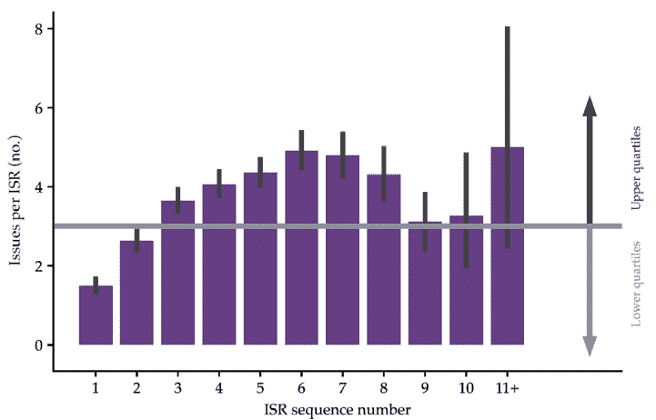

| Issues per ISR (no.) | 0 | 2 | 4 | 6 | 8 |
|---|---|---|---|---|---|
| ISR sequence number | Lower quartiles | Upper quartiles | 1 | 2 | 3 |
| 4 | 5 | 6 | 7 | 8 | 9 |
| 10 | 11+ |  |  |  |  |

**34** Making Procurement Work Better · Chapter 2

## Procurement Efficiency Improved by Technology with Opportunities for Enhancement for Clients

STEP—the World Bank’s electronic procurement tracking system—increases the efficiency of World Bank procurement reviews. Before the procurement reform, exchanges between clients and World Bank staff during the procurement review process occurred by letter, email, or in person. With STEP, clients upload procurement documents into the system, and World Bank staff and clients use the system for formal exchanges, such as document submissions, reviews, and nonobjections. In interviews, World Bank staff and clients recognize the need for an electronic system to review procurement activities. In surveys, over half of procurement staff agree that STEP reduces the response time of World Bank staff to process procurement activities. However, far fewer TTLs report that STEP helps reduce the World Bank’s response time: 36 percent state that it decreases their response time, and 32 percent state that it decreases procurement staff’s response time (figure 2.10). Other assessments of efficiency gains from e-procurement systems show that they reduce transaction and communication costs (Belisari, Appolloni, and Cerruti 2019; Brandon-Jones and Carey 2011), and STEP has achieved this objective to some extent according to findings from the evaluation’s case studies, interviews, and surveys.

**35** Independent Evaluation Group World Bank Group

**Figure 2.10.** Task Team Leaders’ Feedback on Electronic Tracking System for Procurement

*Source:* Independent Evaluation Group procurement survey.

*Note:* STEP = Systematic Tracking of Exchanges in Procurement.

The value and user-friendliness of STEP could be enhanced, especially for clients in low-resource contexts. Surveys show that few World Bank staff (18 percent of TTLs and 38 percent of procurement staff) believe that STEP helps clients manage procurement in World Bank–supported projects. In interviews, some clients appreciate that STEP enables them to track procurement activities in one place. However, other clients report that STEP duplicates their own procurement tracking systems, and they would prefer that the World Bank use their national systems instead of STEP or automatically import data from those systems to STEP. Surveys and case studies consistently find that STEP is difficult to use. For example, STEP prevents clients from easily updating information on stages of procurement transactions without the burden of contacting the World Bank headquarters and generates large volumes of unwanted automated emails. In case studies, clients in low-resource contexts report delays in uploading documents to STEP because of internet connectivity issues. In some countries, clients report that their project procurement specialists spend about half of their work time entering and uploading information to STEP. As a result, few clients enter all procurement activities into STEP because of the long amount of time it takes to do so. By contrast, clients with better internet connectivity, more training, and consultants on hand to oversee STEP report that recording procurement activities in STEP is efficient.

| Statement | Disagree | Somewhat agree or disagree | Agree |
|---|---|---|---|
| Clients find the STEP system helpful to manage project procurement (*n* = 182). |  |  |  |
| The STEP system helps reduce clients’ processing times for procurement activities (*n* = 184). |  |  |  |
| The STEP system helps decrease my response time to process procurement activities (*n* = 186). |  |  |  |
| The STEP system helps decrease the response time of procurement staff to process procurement activities (*n* = 185). |  |  |  |
| The STEP system is principally meant for procurement staff and does not require my careful review (*n* = 190). |  |  |  |
| I find reviewing procurement activities in the STEP system difficult (*n* = 187). |  |  |  |
| Clients have difficulties uploading information and documents to the STEP system (*n* = 186). |  |  |  |

*Note: The chart shows the percentage of task team leaders responding to each statement on a 5-point scale, with responses grouped into three categories: Disagree (strongly disagree + disagree), Somewhat agree or disagree, and Agree (agree + strongly agree).*

**36** Making Procurement Work Better · Chapter 2

## Trade-offs between Faster Procurement and Client Empowerment and Client Learning

Post reviews empower clients to take greater responsibility for their procurements, leading to improved capacity. The survey shows that approximately 50 percent of World Bank procurement staff agree and 10 percent disagree that procurement activities processed under post review (which rely on the client’s own procurement system) help strengthen the client’s procurement capacity (appendix G). Case studies also indicate that TTLs and clients valued this element of post review procurements. In addition, the survey shows that TTLs value the time saved from having fewer prior reviews more than World Bank procurement staff: about 40 percent of TTLs agree that fewer prior reviews reduce procurement processing times, whereas 24 percent of World Bank procurement staff agree (appendix G). As seen earlier, procurement activities subject to prior review have significantly longer processing times.

Reducing the number of prior reviews may free up World Bank staff time for more strategic activities, but clients in lower-capacity contexts often benefit from engagement with staff around procurement reviews. One of the goals of having fewer prior reviews is to free up time for World Bank procurement staff to provide more strategic procurement support, including helping clients develop procurement strategies, introducing innovations in procurement, and strengthening country procurement capacity. The survey shows that about half of World Bank procurement staff and TTLs agreed that this occurs. However, this is true for TTLs who work with higher-capacity clients (appendix G).⁷ Clients in low-capacity contexts often require help with reviewing procurement. For example, in Haiti, Mali, Niger, and Sierra Leone, clients request World Bank procurement staff to provide more informal reviews to fill the capacity strengthening gap that emerges from having fewer prior reviews. In Somalia, World Bank reviews of procurement help projects prevent integrity risks. The survey shows that about 10 percent of TTLs agree that clients have adequate capacity to manage procurement contracts with limited World Bank assistance. About 60 percent of TTLs agree that clients need significant World Bank support to process procurement contracts.

Clients value the learning they receive on World Bank standards during the World Bank staff procurement reviews. About 12 percent of projects have no prior review engagement with World Bank staff and emphasize a need for more engagement on important procurement to support project development objectives. World Bank procurement staff carried out prior reviews for approximately 20 percent of Infrastructure Practice Group activities because of their higher price tag and less than 10 percent of activities in other Practice Groups. In India, a small solar power procurement activity went through a prior review because of the market risk from introducing a new technology (which averted potential problems later). As such, planning a few activities that have prior review support from the World Bank helps clients learn the World Bank’s standards and improve procurement. The extra time it takes for a prior review might be a trade-off worth making for many clients.

**38**

Making Procurement Work Better — Chapter 2

1 周转时间是指从采购活动开始到首次合同签署的日期。总体估算包括需经过事前和事后审查的采购活动，并排除了异常数据。

2 目前采购的平均周转时间为88天，在评估期（2017-2023财年）内略超过三个月。88天的估算值排除了异常值。然而，按年度来看，采购系统中（Systematic Tracking of Exchanges in Procurement）的大部分采购活动集中在2022和2023财年。相比之下，2013财年为253天（世界银行，2014年）。

3 周转时间的估算包括异常值，以提供更保守的比较。

4 询价流程要求供应商提交报价。这可以通过公告或邀请有限数量的合格供应商进行。根据询价文件中规定的标准评估报价并授予合同。电子反向拍卖（e-auction）是一种预定的在线活动，预审合格的供应商可以就价格进行相互竞价。

5 管理能力风险是指客户的采购政策和人力资源能力。诚信和监督风险是指国家或机构中欺诈和腐败的风险。流程风险包括采购阶段（如评估或合同签署）出现问题所带来的风险。市场风险是指市场对招标过程响应不足的风险。复杂性则与项目中的采购安排和采购方法有关。

6 在某些情况下，与外来因素（如国家政治问题）相关的问题，若不属于采购范畴，也可能导致项目延误。

7 该调查包含一个问题，询问世界银行采购人员和项目任务组组长，他们是否在脆弱和受冲突影响的局势或低能力国家工作。

---

**39**

**3** | 改进采购的经济性、诚信度、透明度与公平性

**重点提示**

2016年改革引入的市场分析、资格预审和采购方法，可以帮助项目识别并签约合格供应商，从而提高采购竞争力。开放式市场方法平均约占采购总量的50%，在非洲以及中东和北非地区的使用率最低。

项目大多沿用2016年改革前相同的采购方法，并未持续应用不太熟悉的方法（如评标标准或谈判）来提高质量和可持续性。只有约15%的项目至少使用两种创新方法来支持质量提升。

对团队进行应用学习辅导、加强第三方监督以降低创新风险、增加国家对话以及建立员工激励机制，有助于解决质量和可持续性问题。在采购周期中考虑质量问题的备选方法菜单十分重要。

在世界银行支持的项目中使用客户自身的采购系统，有助于简化采购流程、节省资源，并提升客户对世界银行的看法。

---

**40**

改革开启了一个利用技术提升采购诚信度、透明度和公平性的进程，这可以进一步发展。可以加强采购的远程监控和事后审查评估，以增强诚信度，特别是对于能力较低或风险较高的客户。在实施第二年结束时，只有不到10%的项目有待事后审查报告来验证采购情况。投诉处理仍然耗时较长，平均约需170天。

事后审查和投诉数据能够突出项目采购中的重复性问题，可用于系统性改进客户采购质量。

---

**41**

独立评价小组 — 世界银行集团 — **41**

本章评估改革对采购经济性、诚信度、透明度和公平性等原则的影响。经济性是指采购的成本和非成本维度，就本次评估而言，包括竞争力、合格供应商的参与、对市场分析的熟悉程度，以及使用能够改善质量、成本、伙伴关系和社会环境可持续性的采购方法。在诚信度、透明度和公平性方面，评估侧重于改革后监督的改进情况，并考察了公开采购数据、风险评估、投诉处理以及对所采购货物和服务是否送达社区的监测。2016年改革通过强调采购的质量、竞争和可持续性，在提升采购经济性方面取得了名义上的进展，但很少有项目使用支持采购经济性的方法（附录C）。随着STEP（采购数据交换系统）和暂停期的引入，诚信度、透明度和公平性有所改善，但监督和投诉处理仍是需要改进的领域。

**可增强竞争方法和合格供应商参与的市场分析得到加强**

世界银行支持的项目可以更加重视公开竞争性采购。在世界银行支持的项目中，略超过一半的采购采用开放式市场竞争方法。开放式市场方法能够促进采购质量、公平性、透明度和成本效益，但项目通常难以吸引足够多的合格供应商参与投标。找到足够的合格供应商可以确保流程顺畅，并防止因重新招标采购活动而造成的延误。¹ 这种延误风险可能会阻碍客户采用竞争性方法，尽管其益处显而易见。开放式市场方法在工程和咨询服务采购中最为常见（图3.1，面板a），这可能是因为这些领域供应商较多或属于国际合同。开放式市场方法在IDA（国际开发协会）和IBRD（国际复兴开发银行）国家中也比在FCS（脆弱和受冲突影响国家）以及某些地区（如欧洲和中亚）更为普遍（图3.1，面板b），这可能是由于市场能力的挑战（附录E）。其余的采购则使用有限竞争性

---

**42**

Making Procurement Work Better — 第3章

方法，即客户不公开宣传采购而直接确定潜在供应商；或采用直接选择方法，即客户不经竞争直接与供应商签约。有限选择约占项目采购的30%，直接选择约占20%。世界银行支持项目中直接选择的使用率并不显著低于欧盟单一市场国家——2021年，欧盟国家直接签约采购的比例约为16%，具体比例从约3%到42%不等。然而，欧盟委员会《单一市场记分牌》（包含公共采购数据）认为直接选择比例超过10%即为危险信号，尽管该记分牌所覆盖的国家构成（包括IDA和FCS国家）与世界银行并不相同（欧洲审计院，2023年）。

**图3.1 **按市场方法划分的采购活动

17 19 64
15 44 40
25 35 40
12 22 66

采购类别

- 直接
- 有限
- 开放

市场方法

咨询服务业 (*n* = 43,494)
货物 (*n* = 24,729)
非咨询服务 (*n* = 6,233)
工程 (*n* = 11,864)

行内份额（%）

| 市场方法 | 咨询服务业 (*n* = 43,494) | 货物 (*n* = 24,729) | 非咨询服务 (*n* = 6,233) | 工程 (*n* = 11,864) |
| :--- | :--- | :--- | :--- | :--- |
| 直接 | 17 | 15 | 25 | 12 |
| 有限 | 19 | 44 | 35 | 22 |
| 开放 | 64 | 40 | 40 | 66 |

a. 按类别划分的采购市场方法

Independent Evaluation Group World Bank Group    **43**

**b. Market approaches of procurement by Region**

| Region | Share of activities in row (%) | Direct | Limited | Open | Market approach |
|---|---|---|---|---|---|
| AFE (*n* = 18,808) | 5 | 87 | 8 | 5 | 87 |
| AFW (*n* = 27,743) | 14 | 13 | 73 | 22 | 18 |
| EAP (*n* = 6,961) | 60 | 20 | 23 | 58 | 15 |
| ECA (*n* = 4,789) | 29 | 56 | 16 | 39 | 45 |
| LAC (*n* = 11,084) | 14 | 51 | 35 | - | - |
| MENA (*n* = 2,409) | - | - | - | - | - |
| SAR (*n* = 14,526) | - | - | - | - | - |

*Source:* Independent Evaluation Group Systematic Tracking of Exchanges in Procurement data analysis.

*Note:* Data include prior and post review activities. The total number of procurement activities with available information on market approach in 687 projects is 86,320. AFE = Eastern and Southern Africa; AFW = Western and Central Africa; EAP = East Asia and Pacific; ECA = Europe and Central Asia; LAC = Latin America and the Caribbean; MENA = Middle East and North Africa; SAR = South Asia.

Using less competitive approaches is optimal when suppliers are limited or speed is essential. Suppliers are often limited during emergencies or in small markets or insecure and remote areas. Direct or limited competitive selection approaches speed up contracting. Direct approaches are about four times quicker on average than open market approaches, and limited competitive approaches are about three times quicker because qualified potential suppliers are already identified (appendix C). In Haiti, a country with insecurity and a small pool of available suppliers, a health project’s limited approaches for procuring small works and medical professionals expedited contracting. In Malawi, a project used a direct approach to procure macronutrient powder from a state-owned enterprise because it was the only supplier with subnational warehouses that could store and distribute the products. During COVID-19, emergency projects used direct approaches to sign contracts and secure limited supplies, which allowed aid to meet critical needs faster.

Difficulties in attracting qualified suppliers in less developed markets can delay or even jeopardize project implementation. The challenge of market risk is reinforced by the regression analysis (appendix C), which finds that market risk is negatively associated with project implementation ratings. In some projects, key procurement activities are canceled and relaunched because of a lack of qualified bids. In the Central African Republic’s fragile context, challenges in attracting qualified bids for construction activities delayed a natural resource project. In Sierra Leone, the lack of qualified suppliers caused clients to cancel and relaunch procurement processes for geographical surveys several times. IBRD projects receive the highest average number of bids for procurement activities, largely because these projects take place in more developed markets that are attractive to qualified suppliers. IDA countries receive nearly as many bids on average, and FCS countries and small states receive the lowest number of bids (figure 3.2). The average number of bidders for published public sector procurements in European countries was about three in 2021 (the range was between two and seven bids per contract), suggesting that, in many countries, it may be challenging to attract bidders in public procurement (European Court of Auditors 2023).

**Figure 3.2.** Bids for Competitive Prior Review Processes by Country Type

*Source:* Independent Evaluation Group Systematic Tracking of Exchanges in Procurement data analysis.

*Note:* Data are limited to prior review procurement. The total number of bidders in 1,843 prior review procurement activities with open market approach and available bidder information in 377 projects is 7,310. FCS = fragile and conflict-affected situations; IBRD = International Bank for Reconstruction and Development; IDA = International Development Association.

| Country type | Bidders per procurement activity (average no.) |
|---|---|
| IBRD or blend non-FCS (*n* = 573) | 5.7 |
| IDA non-FCS (*n* = 594) | 5.2 |
| FCS (*n* = 580) | 3.8 |
| Small states (*n* = 96) | 3.0 |

When done early, prequalifying potential suppliers can save time and enhance the quality of projects, though context should be considered. Less than 3 percent of procurement activities in World Bank–supported projects use prequalification, which consists of preselecting qualified suppliers who will be invited to participate in a procurement process. The preselection process is publicly advertised; hence, it is competitive. It can help clients or country programs preidentify suppliers with a high-quality track record. Case studies show time savings from prequalification if it is done early in project implementation or at the country level. In a project in Eastern Europe, the client used prequalification to identify a pool of qualified suppliers in advance of a procurement activity when the project was still finalizing its technical designs. A regional project in Eastern and Southern Africa benefited from a list of prequalified suppliers already identified from another project in the country. However, prequalification may be unnecessary at times, and using it could cause delays because it is an additional step in the procurement process (ADB 2018). For example, a long prequalification stage delayed a regional transmission line project in East Africa for almost a year.

Market analysis tools, such as procurement strategy documents and risk assessments, are meant to improve procurement but often lack operationally useful information. Clients are expected to prepare the project procurement strategy for development (PPSD), including the market analysis, before the project is approved. At that time, often not all procurement activities are known, and the client’s project implementation team is typically not yet in place. Hence, consultants frequently prepare PPSDs with limited client involvement. Market analysis is a tool to understand the market characteristics for specific works, goods, or services; identify potential suppliers; and help design effective procurement strategies that encourage competition and quality. The market analysis at the PPSD stage is usually done through a desk analysis rather than an outreach to identify potential suppliers and engage with them to customize procurement requirements. A review of PPSDs shows that the PPSD’s market analysis is mostly a theoretical exercise with limited practical value, and that it is rarely an updated living document. Moreover, case studies show that the eventual project implementation teams rarely use the PPSD’s market analysis because it lacks detail to guide the project activities. Interviews suggest that clients could identify actions for market analysis in the project’s first year of implementation when the implementation team is in place.

Well-conducted, early-stage market analysis and engagement can prevent setbacks for projects. In the Kyrgyz Republic, international suppliers did not bid on technology contracts because of the risk the country context poses. In an education project in Malawi, the client canceled and relaunched a procurement process for classroom construction in rural districts because international bidders lacked interest in working in remote areas. In these cases, identifying potential suppliers by engaging with, for example, business associations before starting the procurement process, could have helped customize the procurement approach to market capabilities so it could advance smoothly. World Bank procurement staff often echo this shortcoming in their reviews of projects by suggesting that clients use a market analysis to identify and engage quality suppliers and customize procurement approaches.

Practical applied approaches to market analyses are enough to help procurement succeed in unpredictable markets. In a project series in Nicaragua, the client already knew which procurement approaches would work, making it unnecessary to conduct a market analysis. However, conducting market analysis is helpful for project activities that include client procurement staff with limited experience. For example, in Albania, the client procured a local consultant to supervise rural road construction because a market analysis recommended that a supervisor be on-site to oversee the construction. In Nigeria, the client designed a first-time procurement process for an e-procurement system based on the market analysis that recommended using multiple currency bids and performance-based contracting to attract international bidders. Box 3.1 provides examples of three practical approaches to identify potential suppliers to customize procurement to market capabilities.

Independent Evaluation Group World Bank Group **47**

**Box 3.1.** Three Practical Ways to Identify Markets for Procurement Activities

Communication with potential suppliers. For example, in a Malawi child development project, the client engaged with the National Construction Industry Council to identify suppliers for small works (which resulted in many bids). In an electricity project in Nigeria, the client communicated with potential suppliers to learn their costs, capabilities, and works, goods, and services that could support project needs.

Desk reviews to identify qualified suppliers. For example, during the preparation of projects in Colombia and the Marshall Islands, clients conducted initial market analyses using suppliers' databases and later deepened these analyses based on engineering specifications.

Rapid assessments to understand markets. For example, a rapid assessment of a solar energy project in India found that the markets were not well developed. As a result, the project identified national and international suppliers that could be matched to support the project's wind and solar energy activities. These matches could help national suppliers learn from international ones to develop new market competencies. In an agriculture project in Mozambique, the client's rapid market screening predicted an uneven distribution of qualified suppliers among the provinces. To manage this, the client procured international and local suppliers in joint work ventures to cover local capacity shortfalls and help develop the competencies of local suppliers.

*Source:* Independent Evaluation Group case study analysis.

**Opportunities to Emphasize a Menu of Approaches That Can Enhance Quality**

Clients and TTLs tend to use procurement approaches that are familiar to them rather than unfamiliar approaches that consider quality. Clients do not fully use the greater selection of procurement approaches introduced through the 2016 reform, including e-auctions, which offer efficiency solutions and ways to reach new markets, and requests for proposals, which the reform envisaged for works, goods, and nonconsulting services when used with rated criteria to consider quality in bid evaluation.

For works, goods, and nonconsulting services, clients frequently use familiar approaches, such as requests for quotations or requests for bids, without combining them with innovations, such as rated criteria, negotiation, or competitive dialogue, to enhance quality (figure 3.3, panel a).² Requests for bids are frequently used for higher-value and international procurement (appendix C), whereas requests for quotations are often used for smaller-value activities (figure 3.3, panel b). Most consultants are individuals and firms selected based on their qualifications. IEG's 2014 procurement evaluation similarly found limited use of quality-based selection for consulting services that considers the technical proposal before cost (World Bank 2014). In procurement reviews, World Bank procurement staff repeatedly recommend that clients use negotiation to reduce costs or refine the technical details of consulting services to help ensure quality; however, this rarely happens.

**Figure 3.3.** Procurement Approaches Used by Projects by Category and Value

| | Share of procurement activities (%) | | | | | | | | | | | | |
|---|---|---|---|---|---|---|---|---|---|---|---|---|---|
| | 0 | 10 | 20 | 30 | 40 | 50 | 60 | 70 | 80 | 90 | 100 | | |
| Nonconsulting services (*n* = 4,698) | | | | | | | | | | | | | |
| Works (*n* = 10,763) | | | | | | | | | | | | | |
| Goods (*n* = 21,010) | | | | | | | | | | | | | |
| Consulting services (*n* = 38,898) | | | | | | | | | | | | | |

| Procurement approaches used in procurement activities by category | Individual | Fixed budget selection | Public-private partnerships | Request for quotation | Least cost selection | Request for proposal | Force account | Request for bid | Community-driven development | Nonprofit organizations | Commercial practices | Consultant qualification selection | Quality-based selection | E-auctions | Commodities | Quality- and cost-based selection |
|---|---|---|---|---|---|---|---|---|---|---|---|---|---|---|---|---|---|
| a. | | | | | | | | | | | | | | | | |

| | Share of procurement activities (%) | | | | | | | | | | | | | |
|---|---|---|---|---|---|---|---|---|---|---|---|---|---|---|
| | 0 | 10 | 20 | 30 | 40 | 50 | 60 | 70 | 80 | 90 | 100 | | | |
| Up to US$52,000 (*n* = 13,133) | | | | | | | | | | | | | | |
| US$52,000–US$500,000 (*n* = 8,198) | | | | | | | | | | | | | | |
| US$500,000–US$1 million (*n* = 890) | | | | | | | | | | | | | | |
| Above US$1 million (*n* = 1,311) | | | | | | | | | | | | | | |

| Procurement approaches used in procurement activities by value | Individual | Fixed budget selection | Public-private partnerships | Request for quotation | Least cost selection | Request for proposal | Force account | Request for bid | Community-driven development | Nonprofit organizations | Consultant qualification selection | Quality-based selection | E-auctions | Quality- and cost-based selection | Commercial practices |
|---|---|---|---|---|---|---|---|---|---|---|---|---|---|---|---|---|
| b. | | | | | | | | | | | | | | | |

*Source:* Independent Evaluation Group.

*Note:* The figure shows the share of procurement approaches used in procurement activities by procurement category and value. The total number of activities with available information on procurement approaches in 681 projects is 75,369.

Innovative procurement approaches can help clients improve the quality of World Bank–supported projects by balancing cost considerations. Case studies show that when projects are supported to carry out innovative procurement approaches, client satisfaction often happens because specific needs for project activities are addressed. Examples of such innovative procurement approaches include engaging suppliers based on technical quality criteria, not only cost, for solar and wind power contracts; ensuring performance-based measurement of contracts for delivering services; using procurement to empower local leadership in communities; matching international suppliers to help develop local small business competencies; and agreeing on technical specifications before setting the cost of the procurement. Box 3.2 describes examples of innovative procurement approaches that address needs in projects. Some 40 percent of projects use at least one less common procurement approach—often two-envelope system bidding—that allows for discussion on technical specification quality before reviewing cost. Only about 15 percent of projects use more than one innovative procurement approach, despite the many procurement activities in a project. Other examples provided in figure 3.3 are approaches that are used less frequently. Because of social distancing mandates during COVID-19, some clients used e-auctions to allow for transparent reach of suppliers across geographies.

**Box 3.2.** Examples of Innovative Approaches Facilitating Projects

Contracts with performance indicators to track outputs and their quality. For example, in Ghana, a performance-based contract for river dredging used a two-stage procurement to increase the quality of bids and an external independent agency to certify outcomes before payment. In Brazil, a project used a long-term contract for water connection works. The contractor was paid part of the contract price after completion of the works based on performance standards and output levels, such as the number of inhabitants connected to the networks.

Procurement approaches that consider maintenance for a good or service. For example, in Kenya, a project procured solar mini-grids through an international contract that included seven years of supplies, installation services, and maintenance. In the Kyrgyz Republic, a digital connectivity project followed a two-segment approach to contracting: the first contract established the infrastructure and set up the services, and the second contract ensured the delivery of those services for seven years.

Negotiating contracts to reduce costs and specify technical quality. For example, a project in the Kyrgyz Republic used negotiation to procure an operator service for broadband access. A probity assurance auditor addressed transparency concerns by overseeing negotiations. In a Pakistan project, a probity adviser improved the transparency of negotiation with the supplier during contracting of a large enterprise resource planning system.

Grouping together similar procurements to ease the processing burden on clients. For example, a Burkina Faso financial inclusion project used a framework agreement to group together the procurement of separate mobile network operators. In Mozambique, a project grouped the procurement of suppliers that would carry out similar agricultural surveys in four different provinces to save time and effort. *(continued)*

### 51

In Lesotho, a project procured COVID-19 vaccines from suppliers based on agreed pricing, and quantities were then staggered for delivery. In Nicaragua, a project procured furniture and construction materials in one contract for multiple schools to reduce transport costs to the project’s remote sites and ease processing for the client.

*Source:* Independent Evaluation Group case study analysis.

Third-party oversight could be enhanced to encourage clients to take advantage of less used procurement approaches to foster their confidence about the integrity of these approaches.³ For example, the use of approaches such as negotiations and best and final offer could be enhanced with third-party oversight. Negotiations and best and final offer set the activity’s prices, technical terms, and conditions before the contract is awarded. About 28 percent of requests for proposals and 5 percent of requests for bids use these two approaches, mainly for international contracts. These approaches are nearly absent from national contracts. Clients are wary about the potential integrity risks—that is, the risk that the clients’ negotiation with suppliers will be seen as a form of corruption. As such, the biggest barrier to expanding clients’ use of negotiations or best and final offer is understanding of transparent oversight mechanisms. In a project in Europe and Central Asia, the use of third-party probity assurance to monitor the negotiation worked well once addressed with the client.

Clients’ use of rated criteria to enhance quality is limited in both national and international procurement. Since the procurement reform, the World Bank has emphasized improving procurement economy by encouraging rated criteria—or nonprice factors such as quality, sustainability, and innovative aspects—to evaluate bids. Quality evaluation by clients is common when procuring consulting services but rare when procuring other project activities. Case studies show that World Bank staff and clients are positive about rated criteria and perceive that the approach could help improve the quality of suppliers. As of August 2023, clients used rated criteria in the procurement of works, goods, and nonconsulting services in about 2 percent of procurement activities,⁴ with higher use reported in international procurement. International requests for proposals show the highest use of rated criteria (figure 3.4). The Asian Development Bank has experienced similar challenges in the uptake of rated criteria, which it ascribes to the lack of clients’ skills and the perception that they cannot depart from their national laws and regulations (ADB 2023). In European countries, by comparison, nearly half of contracts (42 percent) are awarded based on rated criteria and not simply the lowest price (European Court of Auditors 2023). However, in 2021, in eight European Union member states, the level of awards in favor of the lowest price exceeded 80 percent. In the TTL survey, TTLs do not agree that clients use rated criteria and other features to address quality when appropriate in projects (figure 3.5).

### 52

As of September 1, 2023, the World Bank requires rated criteria as the default approach for most international procurement, demonstrating leadership among multilateral development banks to start to improve procurement quality. However, international procurement is only 10 percent of procurement in terms of volume and about 37 percent in terms of value. Rated criteria and other quality features could help national procurement because this is the area where most procurement occurs in World Bank–supported projects.

### 53

**Figure 3.4.** Use of Rated Criteria for Assessing Quality in Selected National and International Procurement

*Source:* Independent Evaluation Group Systematic Tracking of Exchanges in Procurement data analysis.

*Note:* The figure shows the share of rated criteria used in procurement activities for requests for bids and requests for proposals. The total number of procurement activities in works, goods, and nonconsulting services with rated criteria is 126. National and international = market approach used by the procurement.

**Figure 3.5.** Task Team Leaders’ Perceptions of Quality and Sustainability Approaches

*Source:* Independent Evaluation Group.

| Procurement activities (%) | 0 | 5 | 10 | 15 | 20 | 25 |
|---|---|---|---|---|---|---|
| Procurement approach | Request for bids—national | Request for bids—international | Request for proposals—national | Request for proposals—international | | |

| Perceptions | 0 | 10 | 20 | 30 | 40 | 50 | 60 | 70 | 80 | 90 | 100 |
|---|---|---|---|---|---|---|---|---|---|---|---|
| Task team leaders (%) | Disagree | Agree | Somewhat agree or disagree | | | | | | | | |

- Procurement approaches that incorporate features to address sustainability are used when appropriate (*n* = 105).
- Procurement approaches that incorporate features to address quality, such as quality criteria, are used when appropriate (*n* = 106).
- The World Bank’s procurement system balances speed with approaches to promote quality (*n* = 106).

### 54

World Bank staff and clients do not understand well the concept of quality and how to apply it. Procurement quality refers to the noncost factors that increase procurement value and the balancing of those factors with costs throughout the project cycle to fit project needs. Case studies show that clients and World Bank staff use a range of practices to address quality at different stages of procurement (although different practices may be applied by different task teams), and that there could be a greater emphasis on aspects of quality across the procurement cycle (box 3.3). The World Bank’s commitment to use rated criteria could be part of a comprehensive strategy to help projects improve procurement quality along with, for example, market analyses, prequalification practices, technical aspect negotiations, technical requirement clarity, and contract monitoring.

**Box 3.3.** Quality Considerations throughout the Procurement Life Cycle

Attention to quality to enhance technical and noncost aspects of procurement in practice often happens at different stages of a project’s processing and management of procurement. Quality can happen, for example, through strategically planning procurement approaches to foster quality, using clear technical specifications, applying criteria to assess technical aspects, conducting market engagement to identify experienced suppliers, negotiating to discuss technical aspects, paying attention to contract management during supervision, and learning from procurement reviews and problems identified by complaints (figure B3.3.1). For example, a project in Nigeria used a comprehensive approach to enhance quality, including a procurement strategy, market analysis, customized technical specification documents that describe procurement needs and align with market expertise, performance indicators, requests for proposals, and rated criteria. Projects used remote monitoring and databases to adaptively manage contracts during supervision. Projects also enhanced procurement processes using feedback from the World Bank’s procurement reviews and, in some cases, information on procurement complaints.

### 55

**Figure B3.3.1.** Procurement Quality Considerations in Projects at Different Stages

*Source:* Independent Evaluation Group based on case study analysis.

**Emphasis Placed on Sustainable Procurement and Alternative Procurement Approaches**

Sustainable procurement approaches can improve procurement outcomes, especially during the World Bank’s current transformation process. Sustainable procurement requires incorporating sustainability considerations throughout the entire procurement process. This means that sustainability considerations, such as energy efficiency considerations, could be reflected in the technical specifications, evaluation criteria, contract conditions, and contract management for goods or works to be procured. It can also be used to foster social and economic sustainability, such as:

- **Strategic planning**: Develop procurement and technical documents detailing procurement activities early in the project.
- **Specifications requirements**: Customize procurement approaches to fit the context, consider markets, and support project needs.
- **Dimensions of procurement quality**:
  - Use context-specific actions to address risks and build on learning from procurement reviews and complaint data.
  - Oversee contract implementation to meet project and beneficiary needs.
  - Use approaches to address noncost aspects of procurement, such as prequalification, technical criteria to evaluate bids and proposals, negotiation of technical aspects, and performance indicators.
- **Learning**: Incorporate feedback mechanisms from procurement reviews and complaints.
- **Supervision of procurement processes**: Ensure contract management aligns with project goals.

*Source:* Independent Evaluation Group case study analysis.

*(continued)*

## Making Procurement Work Better

Gender equality and local private sector development. The literature suggests that the benefits of sustainable procurement could be significant for client governments, although there needs to be leadership and collaboration across units to guide implementation (Molino 2019). With the World Bank’s new focus on a livable planet and the introduction of Global Challenge Programs that strongly focus on environmental and climate considerations, solutions that accept sustainability considerations in procurement will likely become very important. Coordination will also be needed between procurement staff and the World Bank’s Environmental and Social Framework to expand sustainability approaches.

Enhancements to procurement sustainability are not fully applied at the World Bank or other international organizations. Before the 2016 reform, there were already examples of sustainable procurement approaches in projects, but these were never systematically increased in the portfolio (World Bank 2014). Addressing sustainable procurement has mostly been limited to meeting the requirements of the World Bank’s Environmental and Social Framework. PPSDs also briefly mention sustainability as it is one of the fields in the template (appendix E). Sustainable procurement approaches to promote, for example, green technologies, gender equality, supply chain reliability, and local market development are rarely detailed in technical specifications. Moreover, when projects implement sustainable procurement, such as using gender criteria for contracting, results are rarely monitored. TTLs agree, stating in their survey that clients do not consider sustainability features in procurement when appropriate (figure 3.5). The European Union’s reform of its procurement system in 2014 and the Asian Development Bank’s reform in 2017 also encourage greater consideration of environmental and social aspects in procurement, but both have seen little success (ADB 2023; European Court of Auditors 2023).

World Bank staff and clients show a positive attitude toward sustainable procurement, although a lack of experience in implementing it hinders uptake. In the case studies, World Bank staff and clients recognize that sustainability aspects are important but do not understand what procurement can achieve. In interviews, TTLs and clients say that they require concrete guidance and examples of addressing sustainable procurement in their sector. In the survey, about 20 percent of TTLs agree that they have the necessary experience to advise clients on sustainable procurement approaches (appendix G). IEG’s 2014 procurement evaluation echoes this, reporting that World Bank staff and clients’ lack of understanding of sustainable procurement approaches hinders their uptake (World Bank 2014).

Several projects use alternative procurement arrangements (APAs) by relying on development partners’ procurement systems, but none follow national systems. APAs are procurement arrangements that projects can use instead of the World Bank’s procurement regulations. APAs might be the procurement arrangements of another multinational or bilateral organization or of a client’s agency or entity (World Bank 2020b). Approximately 2 percent of World Bank–supported projects use the APAs of other multinational or bilateral organizations, but none use the procurement arrangement of a client’s agency or entity. Clear reasons exist for the limited uptake of APAs. In the survey, half of World Bank procurement staff perceive APAs as difficult to justify because clients rarely meet the necessary requirements. About 40 percent of TTLs think that management does not promote APAs. Feedback from the case studies suggests that APA use is limited because World Bank procurement staff perceive risks from relying on client agencies to regulate procurement. The full use of country systems may be further limited by the requirement that clients use the World Bank’s standard anticorruption clauses in every contract.

APAs could provide benefits to both the World Bank and its clients. About one-third of World Bank procurement staff and half of TTLs report that clients in higher-capacity countries are interested in using their own national systems for procurement. An APA can facilitate this. IEG’s 2014 procurement evaluation also notes that projects can apply partial APAs that rely on national systems while also relying on World Bank staff to support capacity strengthening (World Bank 2014). Using national procurement systems for certain high-capacity countries with low procurement risks might speed up some procurement in World Bank–supported projects, save clients’ and World Bank resources, and improve clients’ perceptions about the difficulties of procurement in projects. However, shifting toward client systems will require greater attention to procurement capacity strengthening and additional skills that some World Bank procurement specialists might have to acquire. In development policy loan and Program-for-Results financing, the World Bank carries out the necessary accountability assessment and capacity strengthening. In the survey, about a quarter of procurement staff report that APAs could simplify procurement when the project is cofinanced by other development partners. For example, the World Bank allowed an APA to finance a metro system together with the Inter-American Development Bank and the European Investment Bank and a water supply and sanitation project in the Pacific Islands with the Asian Development Bank.

## Change Management That Emphasizes Coaching, Dialogue, and Incentives to Facilitate Quality and Sustainability

TTLs and clients report that they require learning to help them apply APAs and quality and sustainability procurement approaches. Change management requires targeted applied support. TTLs and clients hesitate to apply unfamiliar innovative approaches to address quality and sustainability without coaching support from World Bank procurement staff. The case studies show that clients and task teams who apply innovative approaches typically learn as they go without much assistance (which can delay projects). In a project in Nigeria, World Bank procurement staff coached clients to successfully implement quality procurement, which combined market analysis, rated criteria, and performance-based criteria. In interviews, TTLs report that APAs are still unfamiliar to them, and staff require more learning around the responsibilities for APA procurement oversight.

Clients who receive World Bank technical support to overcome the risk of new approaches are more likely to innovate. Projects in IDA and FCS countries use more innovative procurement approaches than in IBRD countries. Among Practice Groups, innovation is lowest in Sustainable Development and highest in Equitable Growth, Finance, and Institutions and Human Development (figure 3.6). The greater use of innovative approaches in IDA and FCS countries can, in part, be explained by the greater support those low-capacity clients receive from World Bank procurement specialists. Clients are more comfortable taking risks when there is support to help them learn. Furthermore, the Human Development Practice Group received more World Bank procurement staff support than other Practice Groups during COVID-19.

## Figure 3.6. Use of Innovative Procurement Approaches by Country Type and Practice Group

*Source:* Independent Evaluation Group Systematic Tracking of Exchanges in Procurement data analysis.

*Note:* The figure shows the extent to which projects use innovative procurement approaches by country type and Practice Group. Levels are based on the number of innovative procurement features in a project: low is zero innovations; moderate is one innovation; and high is two or more innovations. The measure includes 12 innovative procurement features: alternative procurement arrangements, requests for proposals, rated criteria, best and final offer, negotiations, competitive dialogue, one-stage two-envelope bidding, e-auctions, service delivery contracts, public-private partnerships, performance-based conditions, and community-driven development. The total number of projects is 713. EFI = Equitable Growth, Finance, and Institutions; FCS = fragile and conflict-affected situations; HD = Human Development; IBRD = International Bank for Reconstruction and Development; IDA = International Development Association; INFRA = Infrastructure; SD = Sustainable Development.

### Innovation by Country Type

- IDA non-FCS (*n* = 192)
- FCS (*n* = 186)
- IBRD or blend non-FCS (*n* = 224)
- Small states (*n* = 65)

| Share of projects (%) | Low | Moderate | High |
|---|---:|---:|---:|
| Country type | 0 | 20 | 40 | 60 | 80 | 100 |

### Innovation by Practice Group

- EFI (*n* = 101)
- HD (*n* = 236)
- INFRA (*n* = 150)
- SD (*n* = 226)

| Share of projects (%) | Low | Moderate | High |
|---|---:|---:|---:|
| Practice Group | 0 | 20 | 40 | 60 | 80 | 100 |

## Making Procurement Work Better — Chapter 3

**60**

or help clients design innovative approaches. Similarly, in interviews, procurement staff often report that they have limited time to help clients carry out innovative procurement approaches in projects, despite seeing their value. That said, the Governance Global Practice and procurement management in regions led a change management process to implement the reform, which was intended to integrate quality and sustainability approaches into procurement processes. However, change management has not yet supported the consistent implementation of quality and sustainability approaches across the portfolio, where they are fit for purpose. There could be more emphasis on strategic, portfolio-wide incentives to encourage applied learning of procurement staff to help projects adopt innovative and sustainability procurement approaches.

TTLs and clients state that enhanced policy dialogues and strengthened capacity could help them adopt quality and sustainability approaches. Clients welcome the use of innovative procurement approaches to improve project implementation, but they are concerned about the integrity risks related to using new approaches and the alignment of the approaches with national laws. The main constraints on countries implementing these approaches are pushback from political leaders and the lack of supportive rules and regulations in the country (Fisher 2013; Zaidi et al. 2019). The case studies also show that TTLs and clients want more dialogue and support at the country level to help the transition to using less common sustainability procurement approaches. Clients also appreciate adapting standard bidding documents to their country context and having access to examples of specifications and terms of references to better understand procurement approaches in international and national procurements.

### Technology and Transparency, Integrity, and Monitoring

STEP increases transparency and integrity by tracking procurement activities and publishing contract data. STEP tracks procurement transactions in a single website, simplifying transactions and making them easier to oversee. Most World Bank staff—about two-thirds of procurement staff and more than half of TTLs—agree that STEP enhances transparency (figure 3.7). STEP allows the World Bank to routinely publish contract data online, with information on over 80 percent of procurement activities now available publicly. Most TTLs also agree that STEP deters prohibited practices and mitigates the risk of fraud and corruption. This is consistent with the case studies that emphasize the contribution of STEP to the transparency of the procurement process. Moreover, the Integrity Vice Presidency of the World Bank uses STEP data to detect integrity risks.

**Figure 3.7.** Task Team Leaders’ Perceptions of Transparency and Integrity Changes since the Reform

*Source:* Independent Evaluation Group.

*Note:* STEP = Systematic Tracking of Exchanges in Procurement.

One challenge for contract management⁵ is that STEP does not link to the World Bank’s financial management information systems. The case studies demonstrate that clients want systems that integrate financial management to oversee procurement in World Bank projects. Currently, there is no institutional mandate to coordinate financial management and procurement oversight. As a result, the financial management information system and STEP are separate—with the financial management information system used for financial management and STEP for procurement oversight. In interviews, World Bank staff and clients stated that linking the two systems would provide a unified, comprehensive picture of a project’s procurement and financial management, thereby improving contract management.

| Perceptions | Task team leaders (%) |
|---|---|
| The World Bank’s procurement system deters prohibited practices (*n* = 106). | 0 10 20 30 40 50 60 70 80 90 100 |
| The World Bank’s current procurement system makes it easy to manage risks of fraud and corruption in procurement (*n* = 105). | |
| The STEP system enhances transparency in operational procurement (*n* = 106). | |
| The standstill period helps ensure that complaints are systematically collected and resolved (*n* = 104). | |

| Legend | |
|---|---|
| Disagree | |
| Agree | |
| Somewhat agree or disagree | |

**62**

The World Bank could have a more consistent process for monitoring whether procured goods, works, and services reach beneficiaries. Tracking is especially difficult in subnational or crisis and insecure contexts (World Bank 2022c). The case studies and experiences during COVID-19 exposed this challenge. For example, during COVID-19, procurement teams found it challenging to track goods because national procurement systems lack remote monitoring mechanisms. This made it difficult to know which areas of a country needed supplies, whether the supplies arrived at communities or were sitting in a warehouse, and how to coordinate the purchase of items among donors. Monitoring these outcomes would help increase the transparent and participatory engagement of beneficiaries in projects (PTF 2024).

Some projects have resolved the monitoring challenge by using new technologies or engaging third parties to monitor procurement. For example, in Bangladesh, a project used an application for the participatory monitoring of procurement. In Malawi, Nicaragua, and Paraguay, projects used georeferencing data to supervise project contracts. In Tajikistan and Zimbabwe, projects used SMS to verify that communities received project goods. Other projects have contracted third-party organizations or regional supervisors to oversee the implementation of procurement activities. For example, in a Mozambique agriculture project, provincial client representatives verified the quality of works before issuing payments to suppliers.

### Procurement Reviews and Complaint Data to Help Clients Enhance Quality

World Bank reviews of client procurement activities take place late in project implementation and are not always tailored to different project needs. Procurement post review reports (PPRs) are used to verify that clients carried out procurement activities in World Bank–supported projects in compliance with the procurement framework. However, World Bank procurement staff are often unable to complete annual PPRs, especially during the first years of implementation (figure 3.8), because projects have yet to carry out enough procurement activities to sample from or there are delays uploading data to STEP. The Governance Global Practice’s procurement reviews also report a low frequency of PPRs (World Bank 2021a). Procurement staff often take different approaches to sampling procurement activities for PPRs, leading to inconsistent audits. This is largely because the guidelines for PPRs provide flexibility in the criteria for World Bank procurement staff to make decisions on when a PPR should be done. The high flexibility limits consistent practice on when PPRs are required (World Bank 2016b). In interviews, World Bank procurement staff repeatedly note that management incentivizes them to prioritize support and reviews of high-value and high-risk activities, typically subject to prior review. TTLs emphasize the importance of greater attention in post reviews to projects at risk of having procurement issues.

**Figure 3.8.** Projects with Procurement Post Review Validations by Year of Project Implementation

*Source:* Independent Evaluation Group.

*Note:* The figure shows the percentage of projects with a PPR to audit procurement in the previous fiscal year by number of active years of project implementation. The total number of projects is 713. FY = fiscal year; PPR = procurement post review report.

| Active years | Share of projects with a PPR completed in previous FY (%) |
|---|---|
| Overall | 0 10 20 30 40 50 60 70 80 |
| 2 | |
| 3 | |
| 4 | |
| 5+ | |

Identifying post review procurement problems earlier could help clients improve procurement quality and avoid strained relationships between clients and the World Bank. As described in chapter 2, the higher thresholds for conducting prior reviews increase the number of procurement activities that undergo a post review, with some projects having no prior reviews at all. It also implies that clients follow World Bank post review requirements for higher-value procurement activities. In practice, this means that clients conduct increasingly more procurement activities in projects on their own.

**64** 

Making Procurement Work Better  Chapter 3

Without World Bank guidance, making frequent PPRs is important to develop clients’ confidence and capacity to conduct procurement with minimum oversight. In addition, if World Bank staff identify serious procurement problems during the preparation of PPRs, it often strains the relationship between clients and the World Bank.

Consistent World Bank follow-up on procurement review findings could help clients avoid repeat mistakes, thereby enhancing procurement quality. Procurement validations in PPRs often document specific procurement issues, such as problems with terms of reference, shortlisting processes, or bid evaluation. However, according to the interviews, clients could benefit from more systematic follow-up to help them overcome these issues in the future. Doing so would likely make procurement implementation quicker and smoother. Instead, clients often face the same types of issues at the same stages of procurement, especially in lower-capacity contexts. Feedback from TTLs and clients in case studies emphasizes that the World Bank needs a more strategic approach to follow up with clients on the problems, especially repeat problems, identified in post reviews and to prioritize client learning and capacity strengthening.

The 2016 reform introduced a procurement pause for suppliers to submit complaints, enhancing fairness but not improving complaint handling times. Most procurement staff and TTLs agree that the standstill period provides a window for suppliers to submit complaints and for clients to systematically collect them. Nevertheless, there are trade-offs for collecting complaints without strong systems to respond and address them. The average standstill time adds about one month to procurement, and the maximum time is about four months, with some projects experiencing longer delays. The average number of complaints per project is 4, with some projects receiving 1 complaint and others as many as 19. Clients’ complaint resolution process in World Bank–supported projects remains lengthy. The average time for clients to resolve complaints in World Bank–supported projects after the reform is about 170 days (table 3.1), compared with 150 days before the reform (World Bank 2014). In some countries, clients have lengthy national complaint handling mechanisms, and supporting more agile national complaint systems could improve complaint handling times and systematically and promptly address quality issues that arise from complaints.

### Table 3.1. Timelines in Days to Handle Complaints by Procurement Category

| Procurement Category | Mean | Minimum | Fast | Median | Slow | Maximum | Complaints (no.) |
|---|---|---|---|---|---|---|---|
| Consulting services | 191 | 2 | 31 | 84 | 225 | 1,449 | 283 |
| Works | 163 | 3 | 26 | 65 | 154 | 1,209 | 203 |
| Nonconsulting services | 104 | 3 | 18 | 63 | 83 | 853 | 56 |
| Goods | 177 | 0 | 27 | 83 | 212 | 1,450 | 227 |
| Overall | 173 | 0 | 28 | 75 | 189 | 1,450 | 769 |

*Source:* Independent Evaluation Group.  
*Note:* “Fast” refers to the bottom 25 percent of projects, and “slow” refers to the top 75 percent of projects. Timeline is in days. The total number of complaints in 240 projects with complaint timeliness information available is 769.

The World Bank could support clients in using complaint information to systematically improve procurement quality. The World Bank and clients make limited use of complaint data to improve procurement quality. Repeat complaints often involve procurement quality challenges, such as weaknesses related to technical evaluations or disqualification of bids (figure 3.9). Studies suggest that procurement complaints can be a tool to strengthen national systems (Hargreaves 2022). However, the review of country procurement capacity strengthening portfolios shows that it is rare that World Bank country programs use this information to improve procurement. This suggests that strengthening clients’ capacity to overcome repeat systemic problems raised in complaints would improve procurement quality.

**66** 

Making Procurement Work Better  Chapter 3

**Figure 3.9.** Complaints by Type in World Bank–Supported Prior Review Procurement

*Source:* Independent Evaluation Group.  
*Note:* The figure shows the share of prior review activities with complaints, by nature of the complaint, recorded in the Systematic Tracking of Exchanges in Procurement system. The total number of complaints in 240 projects is 769.

| Procurement Category | Share of Prior Review Activities with Complaints (%) |
|---|---|
| Technical evaluation | 0–100 |
| Process irregularity | 0–100 |
| Quality of procurement documents | 0–100 |
| Bid security | 0–100 |
| Qualification criteria | 0–100 |
| Eligibility | 0–100 |
| Contract administration | 0–100 |
| Payment | 0–100 |
| Disqualification of bid and proposal | 0–100 |
| Revision of short list | 0–100 |
| Late bid submission | 0–100 |
| Combined technical and financial evaluation | 0–100 |
| Allegation of fraud and corruption | 0–100 |
| Domestic preference | 0–100 |

(Figure data: Consulting services *n* = 283; Works *n* = 203; Goods *n* = 227; Nonconsulting services *n* = 56.)

---

**67** Independent Evaluation Group World Bank Group

1. Market approaches include direct selection, which identifies a supplier or consultant without competition from a preidentified candidate. Limited selection invites preidentified qualified suppliers to bid on a procurement (which allows for competition). The open, competitive approach provides qualified suppliers or contractors in the market the opportunity to submit their proposals through a public tender. Market approaches also consider whether a procurement is international, to attract suppliers outside of a country, or national, for suppliers in the country (World Bank 2020b).
2. Rated criteria can be combined with procurement methods to assess quality and other nonprice features for decisions on the award of the contract. Competitive dialogue is an interactive engagement with potential suppliers of a proposal to optimize the details of the work to the project context (World Bank 2020b).
3. Negotiation can help the client in an iterative two-way communication, with the potential supplier bidding on the contract and focusing on improving various aspects of the bid or proposal. Negotiations could involve technical aspects of the design, cost, or other aspects. Best and final offer is a process enabling potential suppliers to improve their bid or proposal, including by reducing prices, clarifying or modifying details, or providing additional information. It can be helpful if there are multiple, similar competitive bids (World Bank 2020b).
4. The analysis focuses on requests for proposals and requests for bids that are prioritized for rated criteria use. The rate is higher in international contracts than national contracts.
5. Contract management was only marginally examined in the evaluation because the World Bank’s contract management system was broadly rolled out in 2023. This system is likely to face issues similar to those observed with the Systematic Tracking of Exchanges in Procurement system, especially in terms of clients’ burden and the completeness and quality of data.

---

**68**

## 4 | Improving Procurement Fit for Purpose and Value for Money

### Highlights

- The 2016 reform introduced flexibilities that allow clients to tailor procurements to their needs and maximize value for money. However, only about 30 percent of projects achieve this customization. Few clients and task team leaders have the knowledge to do this.
- Clients who apply the procurement principles are more likely to achieve satisfactory procurement performance and project implementation ratings, suggesting that the logic of the World Bank’s procurement reform is sound.
- Projects that process procurement activities early in project implementation and with the support of experienced procurement specialists have fewer procurement issues, better performance, and better value for money regardless of country capacity. However, the largest proportion of signed procurements happen in year three, near the end of a project, limiting what a project can achieve. Projects with satisfactory implementation ratings had, on average, 40 percent of their procurement activities signed by the end of the first year.
- The client’s procurement experience, familiarity with the procurement methods, history of procurement issues, procurement risk, and procurement start times can be predictive of a project’s eventual success. Using this information to optimize procurement support can enhance value for money.

**69**

Strategic procurement planning works when clients and World Bank technical and procurement staff collaborate. However, less than 20 percent of projects use their procurement strategies.

The World Bank advanced its procurement data analytics, but these lack benchmarks that would help assess procurement achievements across the principles, inform decision-making at project and portfolio levels, and optimally target support to projects.

The World Bank’s procurement risk analyses could be streamlined and pay more attention to collaboratively assessing and mitigating the full spectrum of risks, including those related to project development objectives.

**70 Making Procurement Work Better Chapter 4**

This chapter assesses how the World Bank has improved procurement fit for purpose and value for money. Value for money is the procurement principle that others feed into. Achieving high value for money requires the optimal combination of financial and nonfinancial benefits in any procurement.¹ Fit for purpose refers to how well a procurement approach fits the purpose of the procurement and its project—in other words, the extent to which clients customize procurement approaches to the country context and project needs to help achieve value for money. The chapter looks at the World Bank’s success at tailoring for fit for purpose and combining procurement principles to optimize value for money, the benefits of starting procurement early in project implementation, the value from PPSDs, and the use of procurement data analytics and risk assessments to inform procurement-related decisions. The chapter concludes that the World Bank achieves high value for money when it applies the procurement principles; however, procurement strategy, risk analysis, and data analytics could better support decision-making for better procurement performance.

## Application of the Procurement Principles Leading to Better Performance

A fit-for-purpose approach helps clients customize the procurement principles to meet a particular project’s needs and enhance project implementation. This, in turn, helps clients achieve these principles in projects and ultimately promotes value for money and enhances project implementation. This finding is reinforced by the analysis detailed in appendix C. However, in the case studies, only about 30 percent of projects show a high customization of procurement. For example, in a Bangladesh local governance project, the client tailored their procurement of decentralized small works to the country’s low-capacity context. Customizations included recruiting audit firms to oversee procurement, using an application and geotagging to monitor subnational procurement activities, assigning local coordinators to oversee activities, and training local entities in procurement. The client organized prebid meetings with potential suppliers to understand their capabilities and adapt the procurement’s technical specifications accordingly. In a Lesotho COVID-19 emergency health project, the World Bank helped the client develop a fast and simple procurement approach to ease the procurement process.

This approach included requests for quotations, standard procurement documents, and a limited number of qualified suppliers. In each of these examples, customization required trade-offs. For example, the Lesotho project chose simple instead of complex procurement approaches and a limited selection approach instead of an open market approach.

Tailoring procurements to country and project needs requires a sophisticated knowledge of procurement approaches, which TTLs and clients rarely possess. In the survey, about 80 percent of World Bank procurement staff state that the World Bank’s procurement system works well and that procurement approaches are flexible enough to meet country and client needs. Conversely, 36 percent of TTLs report that the procurement system works well, and about 25 percent of TTLs consider the procurement approaches to be flexible enough. Only 14 percent of TTLs state that the flexibility in the procurement system leads clients to seek innovative solutions (appendix G). Thus, World Bank procurement staff and TTLs lack the same understanding of the World Bank’s procurement system or its flexibilities. In the survey, about 25 percent of TTLs report that they had the necessary experience to advise clients on the reform’s less common procurement approaches, such as sustainable procurement. The case studies also indicate that most TTLs and clients lack the know-how to help clients successfully customize procurement in projects (for task teams, the case study–based estimate is that less than 10 percent have adequate knowledge of procurement planning).

Clients who successfully apply the procurement principles are more likely to achieve satisfactory project implementation ratings. Figure 4.1 shows that projects that address the principles of efficiency, economy, integrity (which is combined with the principles of fairness and transparency in the visual), fit for purpose, and value for money and that report that procurement activities helped beneficiaries often had satisfactory or higher implementation ratings (see value-for-money indicators in appendix B). Project implementation ratings and project procurement performance ratings are also positively correlated. Projects that apply the procurement principles also report fewer procurement issues in ISRs. Figure 4.2 shows the relationship between procurement performance ratings and value for money for all seven principles for a random sample of 74 project case studies, stratified by procurement performance ratings.

### 72 Making Procurement Work Better Chapter 4

Figure 4.2 also breaks down areas of each procurement principle, such as tailoring and strategizing to customize procurement approaches in a project and use of market analysis and availability of experienced support to help carry out procurement (which, according to the case studies, are important for fit-for-purpose procurement). This suggests that the logic of the World Bank’s procurement reform is sound: applying the procurement principles supports project implementation and contributes to a project’s development outcomes.

**Figure 4.1.** Projects’ Achievement of Procurement Principles by Implementation Rating

*Source:* Independent Evaluation Group case study analysis.

*Note:* The figure shows average achievements of procurement principles for all sampled case study projects based on the ratings given in each case study analysis (appendix F). The areas reviewed to assess each principle align with the evaluation framework. For each principle, the extent to which the project is successful was assessed and rated on a scale of 1 to 4: 1 is not successful, 2 shows some aspects of success but could improve, 3 is mostly successful, and 4 is highly successful. “Integrity” refers to integrity, fairness, and transparency.

- Area
- Moderately unsatisfactory
- Implementation rating
- Beneficiary satisfaction
- Economy
- Efficiency
- Fit for purpose
- Average success rating
- Moderately satisfactory
- Satisfactory
- Integrity
- Overall value for money

### 73 Figure 4.2. Projects’ Achievement of Procurement Principles by Procurement Rating

*Source:* Independent Evaluation Group case study analysis.

*Note:* The figure shows the average achievements of procurement principles for sampled case study projects based on the ratings given in each case study analysis (appendix F). The areas reviewed to assess each principle align with the evaluation framework. For each principle, the extent to which the project is successful was assessed and rated on a scale of 1 to 4: 1 is not successful, 2 shows some aspects of success but could improve, 3 is mostly successful, and 4 is highly successful. “Integrity” refers to integrity, fairness, and transparency. Moderately unsatisfactory, moderately satisfactory, and satisfactory are the project procurement performance ratings. “Overall” refers to the average rating for achieving each area of the procurement principle in the case studies.

Case studies show that tracking the procurement principles in the portfolio can help projects achieve value for money. Projects achieve fit for purpose through the collaborative engagement of clients, TTLs, and World Bank procurement staff to customize procurements, plan capacity strengthening, and identify the areas that need market analyses. Projects achieve efficiency.

- Principle
- Moderately unsatisfactory
- Project procurement performance rating
- Fit for purpose
- Efficiency
- Economy
- Integrity, transparency, and fairness
- Moderately satisfactory
- Satisfactory
- Value for money
- Overall average for projects
- Area
- Tailoring
- Procurement strategy
- Market and risk analysis
- Innovative features
- Sustainability
- Grouping procurement
- Timeliness
- Balance of prior and post review
- Standard procurement documents
- Attention to quality
- Bidding process
- Complaints
- Supplier engagement
- Beneficiary satisfaction
- Contract management
- Average success rating

## Making Procurement Work Better

By starting procurement early and quickly addressing procurement issues as they arise, such as during the evaluation of bids stage, projects achieve economy by engaging qualified suppliers and applying innovative procurement approaches to address project needs. Projects attain integrity, transparency, and fairness through frequent interactions between the client and World Bank staff to ensure the quality of post-review procurements, timely handling of complaints, and flagging of important procurement activities as higher risk to ensure that clients pay closer attention to them. Similarly, tracking and monitoring procurement by the client in collaboration with the task team and World Bank procurement specialists help clients make proactive procurement decisions to support project implementation and deliver on the seven principles.

Procurement support can improve the value for money of procurement in low-capacity countries.² Figure 4.3 shows that the share of projects with the highest value-for-money scores is in Latin America and the Caribbean, followed by Europe and Central Asia. By contrast, Eastern and Southern Africa, South Asia, and Western and Central Africa have the lowest value for money. Achieving higher value for money is more likely in IBRD countries than in IDA and FCS countries. Western and Central Africa and the Middle East and North Africa are Regions with lower procurement capacities. The country situation analysis suggests that countries with lower procurement capacity can achieve high value for money when there is experienced procurement support in the project (appendix E). This support could be provided by World Bank procurement specialists, HEIS, or other tools.

## Figure 4.3. Average Project Value-for-Money Scores by Region

*Source:* Independent Evaluation Group.

*Note:* The figure shows the share of projects within Regions by level of value-for-money composite score (appendix C). The levels are determined based on the data quartiles. The composite indicator score is estimated by combining the composite indicators of project achievement of the principles of efficiency; economy; integrity, fairness, and transparency; and fit for purpose. The total number of projects is 713. AFE = Eastern and Southern Africa; AFW = Western and Central Africa; EAP = East Asia and Pacific; ECA = Europe and Central Asia; LAC = Latin America and the Caribbean; MENA = Middle East and North Africa; SAR = South Asia.

| Region | n | Low | Moderate | High | Substantial |
|---|---:|---:|---:|---:|---:|
| LAC | 88 |  |  |  |  |
| ECA | 78 |  |  |  |  |
| MENA | 28 |  |  |  |  |
| EAP | 95 |  |  |  |  |
| AFW | 189 |  |  |  |  |
| SAR | 99 |  |  |  |  |
| AFE | 135 |  |  |  |  |

## Starting Procurement Early to Facilitate Project Implementation

Projects that process procurement activities early tend to have better implementation performance and higher value for money. Projects with satisfactory implementation ratings have a higher proportion of procurements with signed contracts in the first year of implementation (figure 4.4, panel a). This proportion was even higher for projects supported by HEIS (figure 4.4, panel b). The evaluation’s country situation analysis indicates that lower project implementation performance ratings are associated with procurement delays early in project implementation. Projects with substantial to high value for money have about one-third of contracts signed within the first year of implementation and report fewer procurement issues in ISRs.

## Figure 4.4. Signed Contracts in the First Year by Project Ratings and Hands-on Expanded Implementation Support

*Source:* Independent Evaluation Group.

*Note:* Panel a shows the proportion of procurement activities with contracts signed in the first active year by implementation rating. Panel b shows the proportion of procurement activities with contracts signed in the first active year by the availability of HEIS. Projects with highly satisfactory implementation ratings are combined with those that are satisfactory. Projects with highly unsatisfactory or moderately unsatisfactory implementation ratings are combined with projects that are unsatisfactory. The total number of procurement activities with signed contracts in 617 projects is 26,746. HEIS = hands-on expanded implementation support.

### Procurement signed in the first year of a project by implementation rating

| Implementation rating | n | Share of procurement activities with contracts signed in the first active year (%) |
|---|---:|---:|
| Satisfactory | 8,241 |  |
| Moderately satisfactory | 15,538 |  |
| Unsatisfactory | 2,967 |  |

### Procurement signed in the first year of a project by the availability of HEIS

| Procurement activity in a project with HEIS | n | Share of procurement activities with contracts signed in the first active year (%) |
|---|---:|---:|
| Yes | 1,641 |  |
| No | 25,105 |  |

The late start of procurement activities often delays project disbursement to activities that are key to project development objectives. Signing key contracts in the first year of a project helps ensure that a higher share of project financing can be disbursed to beneficiaries by the project midpoint and that the project can bring greater value for money (figure 4.5). Starting procurement late can, conversely, delay disbursement of financing for activities toward the project’s outcomes. Across projects, STEP analyses show that the largest proportion of signed procurements occur in year three, near the end of a project, and contracts take, on average, several years to carry out (appendix C). The case studies provide several examples demonstrating that the late start of activities affects the achievement of key activities for project development outcomes. In Malawi, COVID-19 restrictions delayed the project’s procurement of an engineer, leading to delays in other activities important for the project outcomes. In a Republic of Congo public sector reform project, the client’s inexperience slowed procurement activities and affected project implementation of activities key for project outcomes. Such projects may pick up speed before closing, but procurement delays early on in projects consistently reduce the time for implementing project activities to achieve the intended outcomes for beneficiaries. For example, early procurement delays in a nutrition project in Benin reduced the available time to implement grant activities, thereby limiting the number of districts that received nutrition services.

## Figure 4.5. Signed Contracts in the First Year by Value for Money and Commitments at Project Midpoint

*Source:* Independent Evaluation Group.

*Note:* The figure shows the composite indicator score estimating value for money for projects in the evaluation portfolio from fiscal year 2017 to fiscal year 2023 (appendix C). The levels are determined based on the data quartiles. The composite indicator score is estimated by combining the composite indicators of project achievement of the principles of efficiency; economy; integrity, fairness, and transparency; and fit for purpose. The indicator is compared with the share of signed contracts in a project’s first active year and the share of commitments disbursed at the project midpoint.

| Value-for-money composite score level | Share of contracts signed in a project’s first active year (%) | Average share of commitments disbursed at project midpoint (%) |
|---|---:|---:|
| Low | 10 | 10 |
| Moderate | 14 | 23 |
| High | 20 | 20 |
| Substantial | 20 | 17 |

More experienced client procurement specialists in countries could help ensure that procurement activities start early and maximize value for money. As described in chapter 2, one of the main challenges affecting project outcomes is the lack of access to experienced procurement specialists in the project early in implementation. In Bangladesh, the client established the procurement coordination unit early in the project. As a result, the unit acquired procurement and subject matter specialists to prepare technical specifications at the beginning of the project timeline. In some projects, clients share procurement specialists from existing projects to support new projects. However, this also slows the implementation of the original projects because the specialist now has too many projects at the same time to meet the increased workload. A more promising model for clients is to set up central procurement support that projects can draw from. The evaluation uncovered examples of this model in Albania, Serbia, and South Pacific countries. Other countries, such as Liberia, use in-country procurement training programs to build their in-house procurement capacity. Other

## Independent Evaluation Group | World Bank Group

possibilities include using grants to hire procurement specialists or soliciting HEIS from the World Bank.

## Strategic Procurement Planning, Collaboration, and Incentives

World Bank staff and clients recognize the value of strategic planning in procurement. Case studies show that World Bank staff and clients recognize the importance of strategic procurement planning and how it can help identify procurement solutions that contribute to a project’s development objective, design suitable approaches for such activities, define areas for capacity strengthening, and develop means to better engage the market, among other benefits. The PPSD, introduced with the 2016 reform, is a methodology for strategic procurement planning to help clients customize an optimum procurement approach for a given project. The World Bank can also use client PPSDs to flag areas for management that would benefit from procurement support (World Bank 2018b).

Procurement strategic planning could be simplified at the country level and made more useful for projects. In practice, the PPSD is often a generic document with similar content across many projects. Moreover, case studies show that clients rarely use PPSDs. TTLs and clients often consider the PPSD as a compliance task and as not providing practical inputs for procurement planning, but procurement staff view the PPSD as more useful compared with TTLs. In the survey, about 60 percent of procurement staff (but 30 percent of TTLs) report that PPSDs help design procurement approaches that are fit for purpose. In the case studies, some TTLs recommend simplifying and integrating PPSD into project procurement plans that set out the project’s procurement activities, approaches, and timing, among others. Clients actively use these plans and update them, on average, about 30 times during a project; therefore, integrating strategic procurement planning into them could immediately make it more relevant. However, clients want the format of the procurement plan to be easier to read and compatible with their own database, such that they can update it offline and use it as a tool for monitoring. The case studies also indicate that having a procurement strategy at the country level could help optimize the World Bank’s support of projects because procurement issues often repeat across projects in a country.

Project procurement strategies are impractical without client ownership and collaboration. The main challenge is the limited client involvement in preparing and updating the PPSD (or “ownership”) in their development. In the survey, about 20 percent of procurement staff and TTLs report that clients own their PPSDs and substantively contribute to their development. Clients often hire consultants to prepare the PPSD before the project staff responsible for implementation decisions are on board. A World Bank review of PPSDs emphasizes the importance of genuine client ownership of the PPSD that helps enhance project implementation (World Bank 2018b). The case studies demonstrate that ownership requires collaborative engagement to strategize procurement and that the client develops and updates the PPSD. For example, in Bangladesh, the project coordination unit, with World Bank procurement staff support, adopted a PPSD to customize procurement activities to the project, and the client updated it during implementation. In a cash transfer project in Djibouti, the PPSD was developed by the client and was useful to forecast procurement challenges and identify mitigation actions. Similarly, in Nigeria, the government and World Bank jointly developed a PPSD for an electrification project that included comprehensive market and risk analyses and a review of procurement options and was updated and used by the project.

The World Bank could improve incentives for procurement staff to support clients’ strategic procurement planning. As further detailed in chapter 5, World Bank procurement specialists have heavy project workloads and are encouraged to support higher-value procurement activities, such as large infrastructure contracts. They provide other support, such as strategic procurement planning, when their work schedule permits. According to the case studies, World Bank procurement staff rarely collaborate with the client and TTL to carry out strategic procurement planning. A World Bank review of PPSDs emphasizes the opportunity to adjust work program incentives to reward procurement staff for collaborating with project teams to strategize their procurement (World Bank 2018b).

## Leveraging Advances in Data Analytics for Procurement Performance

Certain project characteristics can predict which projects are likely to encounter procurement issues and help the World Bank target preventative support. These characteristics include a client’s procurement experience, history of procurement issues, procurement risk levels, a client’s familiarity with procurement approaches, and progress of procurement activities early in the first year of the project. The evaluation’s analysis of country procurement situations and the project portfolio uncovers several common characteristics that projects with procurement issues share (appendix E). These projects are in low-capacity countries that lack experienced client procurement staff. These projects also tend to take on unfamiliar procurement approaches without proper support or guidance. Projects with higher-risk ratings also portend future procurement challenges. Furthermore, countries that have previously encountered procurement issues, as reported in ISRs, are likely to encounter similar issues in future projects. In addition, projects with a limited number of contracts signed in the first year of implementation are likely to face implementation delays in procurement. Understanding these factors and identifying them early can help the World Bank predict the likelihood of procurement issues in the projects and target preventative support. This prediction could then help allocate the World Bank’s procurement support to projects that will likely face more challenges.

The World Bank’s procurement data analytics have advanced since the reform, but they could be better used to increase value for money. The reform’s introduction of STEP helped the World Bank take a step forward in tracking procurement data and making it readily available to staff and clients and partially available to the public. However, the data collected from STEP are still fragmented in different databases. The data could be enhanced to offer information that staff and clients can easily use for strategic procurement decisions (which, in turn, would lead to improvements in procurement value for money and project implementation). According to the interviews, World Bank staff and clients want data analytics to help them make project-level decisions. For example, they call for indicators that allow them to assess their project’s procurement principles against other projects in the portfolio.

The World Bank’s procurement dashboards could improve with indicators on the procurement principles and clear benchmarks. This would help assess performance and inform decisions at different levels, such as for clients implementing projects, procurement staff and TTLs supporting projects, and managers overseeing the portfolio. The World Bank has developed procurement dashboards and a mobile application for World Bank staff to monitor projects. These dashboards provide much information on efficiency, such as average timelines for procurement activities, but lack data on other principles and could be improved to measure indicators against benchmarks or targets. Thus, World Bank TTLs, procurement staff, country managers, and clients are unable to gauge, for example, whether procurement is taking longer than expected and whether procurement bottlenecks are adding delays and to decide how they can improve the value for money of procurement in the project. Expanding data analytics to include indicators on all procurement principles and measuring them against benchmarks would help teams flag potential problems and devise mitigation actions that can help projects achieve better procurement performance and value for money. Box 4.1 details how the World Bank could enhance its procurement analytics.

### Box 4.1. Opportunities to Enhance Procurement Analytics

- **Benchmarks to understand procurement performance.** Current World Bank dashboards focus on averages—number of turnaround days, number of activities, and cost, among others—and could be improved to provide benchmarks and targets for comparison. Large performance differences across groups skew the averages. Clear value distributions could help define very good, good, weak, or very weak achievements for an indicator and provide an easy reference to determine if a procurement activity is in an acceptable range of performance.

- **Indicators to trigger alerts for remedial action.** Dashboards could use data mining and other tools to flag risks, such as projects that have taken a long time to sign their first contracts and projects with procurement post review reports that show procurement problems.

Independent Evaluation Group World Bank Group    **83**

Indicators to assess the seven procurement principles. Current World Bank dashboards emphasize timeliness, process delays, and the proportion of post-review procurement in a project. Indicators could track outcomes toward other principles, for example, by monitoring the quality of competition; indicators for different types of sustainable procurement, coordinating with the monitoring of the World Bank’s Environmental and Social Framework; the quality and frequency of post-review procurement; client feedback on the use of procurement strategies; the performance of hands-on expanded implementation support; and the frequency and timeliness of complaint resolutions (appendix B).

Indicators to assess value for money of projects and the portfolio. Measures to assess value for money could use a composite indicator at the project and portfolio levels that looks at the combined achievement of the procurement principles in a project.

*Source: *Independent Evaluation Group review of World Bank procurement measurement.

The Governance Global Practice, regions, and Operations Policy and Country Services could use data analytics to adaptively monitor the reform’s implementation. World Bank management could use the available procurement data or analyses of procurement achievements to adjust the 2016 procurement reform implementation and rollout to support projects. This could include systematically monitoring reform activities, such as the use of procurement approaches to address quality and sustainability, or repeated procurement issues or bottlenecks that jeopardize procurement in projects. Better use of data could facilitate strategic decisions and knowledge sharing on what works and does not, and help identify ways to support procurement staff to advance the 2016 reform actions.

## Improvement of Procurement Risk Analysis and Mitigation

Project-level procurement risk assessments could be simplified by reducing their frequency and emphasizing data analytics of risks. Procurement staff biannually conduct a project risk assessment using the Procurement Risk Assessment and Management System (PRAMS). PRAMS is meant to guide decisions to mitigate procurement risks in a project (World Bank 2019).³

**Box 4.1. Opportunities to Enhance Procurement Analytics (cont.)**

TTLs see PRAMS as a valuable baseline assessment to inform procurement in the project when done comprehensively. However, these repeat assessments can take several days to complete, rarely yield new information, and often miss details on post-review procurement and other risks related to complexity, innovation, development objectives, procurement issues, and capacity. The case studies and the portfolio analysis show that risk assessment ratings rarely change during implementation and vary in how risk is assessed across projects. Moreover, risk analysis findings are not typically used to inform procurement activity design or mitigation actions. The highest-value procurements typically have the highest risk. IEG’s 2014 procurement evaluation also underscores the limited value of repeat assessment (World Bank 2014). As such, in interviews, World Bank staff indicated that PRAMS would improve by reducing the frequency of assessments and replacing them with a more rigorous baseline assessment early in project implementation. The assessment could be complemented by real-time data analytics of procurement activities in projects to identify risks (such as those related to procurement issues, delays, competitive processes, and post-review oversight) throughout a project. In addition, there could be more emphasis on tracking the success of mitigation actions.

Procurement risk assessments could better emphasize the importance of procurement activities for achieving project development objectives. The case studies reveal that certain procurement activities can strongly influence project outcomes. For example, delays in hiring a consultant to prepare for subsequent procurement activities might critically delay these activities and prevent the project from achieving the full scale of planned results. The case studies also demonstrate that project-level assessments in PRAMS and PPSD do not consistently consider the risk that procurement activities pose to project development objectives. The Asian Development Bank’s recent procurement evaluation reports a similar finding (ADB 2023).

Procurement risk assessments could be improved by considering the full spectrum of risks at the procurement activity level. The case studies show that task teams and clients benefit from the review of each important procurement activity to set a risk level for it in the procurement plan. This might highlight activities that are more complex from the client’s perspective; have greater market uncertainties; face risks in terms of cost, quality, and delivery time; and are important to the project’s development objective. Thus far, the risk analyses have heavily focused on the monetary value of the procurement, missing other risk elements of concern in projects. For example, in Burkina Faso, the World Bank procurement specialist and task team collaborated to assess activity risks. This helped customize their support and advise the client on which procurements required closer monitoring.

Precision, client involvement, and strong monitoring could help implement procurement risk mitigation actions. PRAMS often prescribes only generic mitigation actions, such as providing more procurement training to clients. However, as evidenced from the case studies, projects require concrete actions to address procurement risks. For example, in Albania and Pakistan, risk assessments identified concrete actions to improve procurement. Moreover, the case studies show that when the task team and clients work together to identify concrete mitigation actions, the actions are more likely to be effective. Another challenge identified in this evaluation is that PPRs, PRAMS, and PPSDs all identify separate mitigation actions and that their implementation is not well tracked. Hence, more concrete, better-monitored mitigation actions in a single place might lead to better risk mitigation—the main purpose of PRAMS.

1. In its 2016 procurement guidance on value for money, the World Bank defines it as the effective, efficient, and economic use of resources, which requires the evaluation of relevant costs and benefits, along with an assessment of risks, and of nonprice attributes and life cycle costs, as appropriate. Price alone may not necessarily represent value for money.

2. Value for money is estimated using a composite indicator of how well projects achieve aspects of each of the principles. The composite is estimated for the active portfolio by combining average indicators of project achievement of the principles (efficiency; economy; integrity, fairness, and transparency; and fit for purpose) using principal components analysis (appendix C). The approach provides a score for each project by estimating the success of procurement indicators. The indicators selected for the composite are based on guidance from the literature (appendix B). The efficiency indicators in the composite are the amount of procurement signed in the first year of a project, turnaround timeline for processing activities, amount of post-review procurement in the project, and average number of delay days reported in data on electronic system transactions for procurement activities in the project. The economy indicators for the composite consider the use of open market approaches, the use of innovative or nontraditional procurement approaches, and the success of bidding processes. The integrity, transparency, and fairness indicators consider the integrity risk rating of projects, risk ratings for procurement activities, availability of a procurement post-review report in the project’s previous fiscal year, timelines to resolve complaints, and duration of standstill periods. The composite also considers fit for purpose of procurement by including indicators on project procurement performance and risk rating, the number of issues reported in Implementation Status and Results Reports, and the number of procurement staff working on the project.

3. The Procurement Risk Assessment and Management System considers the implementing agency’s procurement capacities, including its policies and whether there is an experienced specialist to manage project procurement; integrity (for example, audits, corruption risks, and complaints); the quality of procurement documents and activities; the complexity of the project’s procurement arrangements and methods; and market readiness (for example, access to suppliers for project activities).

## 5 | Procurement Capacity Strengthening and Support

### Highlights

The World Bank increased its support for strengthening clients' procurement capacity, with a greater emphasis on global support and trust fund financing but less support in Africa and in countries that have the lowest procurement capacity. In fiscal year 2017–23, 65 percent of procurement capacity strengthening activities occurred in countries with higher procurement capacity.

Country-level capacity strengthening is fragmented, is not well measured, is only partially achieved, and often focuses on short-term activities rather than sustaining long-term change for scaled-up results in the country. Less than 20 percent of Country Partnership Frameworks had a significant emphasis on procurement capacity strengthening.

Procurement capacity strengthening resources could better target pressing needs and persistent issues that affect the performance of the World Bank portfolio, especially in countries where procurement is a main bottleneck to development achievements in projects.

The World Bank's procurement staff have limited time to support clients and strengthen their capacity, especially in Western and Central Africa and fragile and conflict-affected situation countries, leading to more procurement issues and delays. Hands-on expanded implementation support fills some of these staffing gaps. In fragile and conflict-affected situation countries, about half of procurement staff are responsible for 10 or more projects. In Western and Central Africa, where 30 percent of all projects supported by investment project financing take place, staff support, on average, about 20 projects.

Hands-on expanded implementation support improves procurement performance, and the World Bank could apply it more strategically. Combining hands-on expanded implementation support with knowledge sharing and coaching could create a pool of experienced procurement specialists within the country to help enhance the long-term performance of projects and push what could be achieved in the portfolio.

Independent Evaluation Group World Bank Group **89**

This chapter evaluates the World Bank's progress and challenges in supporting clients and strengthening their procurement capacity. This includes their capacity to execute procurements according to World Bank standards and the seven principles described in chapters 1, 2, 3, and 4. It also includes clients' capacity for public procurement more generally—that is, in-country procurement capacity strengthening. The evaluation examines World Bank capacity strengthening interventions, including both lending projects and advisory services and analytics (ASA), country strategies, results indicators and their achievement, and staff support for capacity strengthening. Evidence also derives from the case studies, surveys, and portfolio analysis. This chapter finds that the World Bank increased its focus on strengthening clients' procurement capacity since the reform, but that its efforts could be more strategic and well measured and could better address the most pressing and common procurement needs in its project portfolios.

Procurement specialists and sector specialists of other Global Practices lead the World Bank's procurement capacity strengthening efforts. Procurement specialists perform capacity strengthening at the project level through day-to-day advice, short-term training, and process reviews. By contrast, procurement specialists and other sector specialists—including, among others, governance, public financial management, and transport specialists—strengthen procurement capacity at the country level through lending or ASA. This support may involve training client procurement specialists; assessing procurement systems; promoting legal, institutional, regulatory, and other system changes; and supporting the application of specific procurement methods.

### Increased Capacity Strengthening since the Reform and a Strategic Approach That Could Make It More Valuable

The World Bank increased its country-level capacity strengthening support after the 2016 reform. The biggest increase occurred in global support, and the biggest regional decrease occurred in Africa. The number of procurement capacity strengthening interventions increased by 8 percent since the 2016 reform (appendix D). In FY10–16, the World Bank provided this support to 94 countries; in FY17–23, this support increased to 105 countries. The biggest jump took place in global support, or support that is directed to no particular country, which increased by fourfold in FY17–23 compared with FY10–16. Examples of global interventions include global studies on e-procurement, training on procurement rating systems, and development of procurement training and guidance materials. With regard to Regions, interventions in South Asia nearly doubled, whereas in Africa, where procurement capacity is among the lowest (appendix E), they declined by nearly 30 percent.

The World Bank's procurement capacity strengthening support since 2016 relies heavily on trust funds, with limited support coming from lending. The number of ASA used for capacity strengthening increased by about 50 percent from FY10–16 to FY17–23 (figure 5.1). Trust funds largely funded this increase, particularly the Global Procurement Partnership multidonor trust fund, which has provided over $10 million of financing since 2016. However, procurement capacity strengthening has involved fewer development policy loans and IPF, although some lending still includes capacity strengthening activities and relevant policy actions.

**Figure 5.1.** Procurement Capacity Strengthening by Instrument, Fiscal Years 2010–16 and 2017–23

*Source:* Independent Evaluation Group.

*Note:* Investment project financing includes other investment lending types, such as specific investment loans, technical assistance loans, and emergency recovery loans. Nonlending includes advisory services and analytics and other knowledge products supporting the strengthening of procurement capacity. FY = fiscal year.

| Instrument | FY10–16 | FY17–23 |
|------------|---------|---------|
| Nonlending | | |
| Investment project financing | | |
| Development policy loan | | |
| Program-for-Results financing | | |

(The original figure is a bar chart with values on the y-axis from 0 to 350, showing interventions for each instrument type across the two fiscal year periods. The table above organizes the instruments listed; actual numerical values are not provided in the text.)

The World Bank's country strategies could more strongly emphasize procurement capacity strengthening. IEG's 2014 procurement evaluation recommends that the World Bank develop a strategic, coherent approach to procurement capacity strengthening in client countries that is anchored in country strategies to facilitate longer-term change rather than a fragmented set of opportunistic interventions.¹ Despite this recommendation, in 61 percent of the most recent Country Partnership Frameworks (CPFs)—the principal strategy document for country programs—procurement capacity strengthening is absent or superficially mentioned. In 20 percent of CPFs, the evaluation classifies procurement capacity strengthening as somewhat significant within the strategy—that is, the CPFs mention procurement capacity strengthening activities but not under its main pillars and priority areas and without an emphasis on results. In about 19 percent of CPFs, the evaluation classifies procurement capacity strengthening as significant or highly significant—that is, it includes suitable activities that lead to improvements in procurement capacity and indicators to measure results.²

The World Bank could consider more rapid and focused diagnostics to inform its country-level procurement capacity strengthening. Interviews with procurement staff show that World Bank staff decide on the country-level procurement capacity strengthening activities based on (i) the results of the Methodology for Assessing Procurement Systems (MAPS) that uses a rigid framework to benchmark and compare results across countries; (ii) other assessments, such as Public Expenditure Reviews; (iii) rapid ad hoc diagnostics; and (iv) client requests. MAPS is the primary diagnostic tool to assess national procurement systems in their entirety.³ However, of the 20 percent of country strategies with procurement capacity strengthening deemed significant or highly significant, about one-third had completed a MAPS assessment. This may not be surprising given that MAPS is a time-consuming and expensive exercise. Moreover, as noted in IEG's 2014 procurement evaluation, MAPS assessments "provide a 'snapshot' of the [procurement] system, rather than a roadmap for reform" (World Bank 2014, 9). As such, rapid diagnostics are likely more useful for informing strategic decisions on procurement activities.

Capacity strengthening activities focus on countries with higher procurement capacity despite lower-capacity countries having more

**92**

Making Procurement Work Better  Chapter 5

procurement issues. In FY17–23, 59 percent of procurement capacity strengthening activities occurred in countries with high or very high procurement capacity, compared with 41 percent in countries with low or very low procurement capacity (figure 5.2). For example, Cambodia, Guinea-Bissau, and the Republic of Congo are among the countries with the lowest procurement capacity and many procurement issues that negatively affect the World Bank portfolio, yet each country received one capacity strengthening intervention. The greater focus on higher-capacity countries might be explained by the lack of a strategic approach to in-country procurement capacity strengthening.

**Figure 5.2.** Procurement Capacity Strengthening by Country Capacity Level, Fiscal Years 2017–23

*Source:* Independent Evaluation Group.

*Note:* The figure shows the percentage of activities in countries by the procurement capacity level of the country. Activities refer to procurement capacity strengthening activities in World Bank interventions, such as investment project financing and advisory services and analytics. One intervention may have multiple activities. Procurement capacity levels of countries are from the country situation analysis in appendix E. The total number of activities is 474.

The World Bank’s procurement capacity strengthening could be more continuous to influence sustained institutional change. Since the 2016 reform, in some countries, the World Bank discontinued or decreased the intensity of its capacity strengthening support compared with before the reform (FY10–16).⁴ Bangladesh, Benin, China, Djibouti, Ethiopia, India, Kosovo, Liberia, Pakistan, Tanzania, and Uganda stand out for having high or very high continuity, defined as numerous interventions on a continuous basis without interruption during both periods. Even if a country receives continuous World Bank capacity strengthening support, it is not uncommon that the World Bank units providing the support and the entities in the country receiving it differ for most of the interventions, leading to fragmented support. Literature acknowledges capacity strengthening as a long-term process (Eade 2007; Lusthaus, Adrien, and Perstinger 1999; Vogel 2012); hence, fragmentation, sporadicity, and discontinuity in support reduce the chances of influencing institutional change.

Share of activities (%)

Very high (*n* = 117)

High (*n* = 160)

Low (*n* = 110)

Very low (*n* = 87)

Country procurement capacity level

0

5

10

15

20

25

30

35

40

## Capacity Strengthening and Procurement Issues in the Portfolio

Countries with access to experienced procurement specialists tend to successfully implement project procurement activities. As discussed in this chapter, the number of procurement issues reported in project ISRs decreases for projects that receive HEIS, and fewer issues reported in ISRs, in turn, are linked to higher procurement performance ratings (appendix E). The case studies (appendix F) also show that having experienced procurement specialists in project implementation units helps clients successfully implement procurement activities. For example, in Niger and Mozambique, projects with experienced client procurement staff had fewer procurement-related problems and delays, whereas projects without them experienced frequent problems and delays. The survey reflects this finding—TTLs and World Bank procurement staff report that the unavailability of procurement experts in client countries undermines project implementation.

The World Bank could better emphasize building sustained human capacity in countries. Figure 5.3 shows that the highest percentage of capacity strengthening efforts are classified as “learning and professionalization” activities that include holding trainings and workshops, providing technical advice, and preparing learning materials, especially e-learning programs. Most of these activities are short term and topic specific and not aimed at building deep procurement expertise. However, there are learning and professionalization activities in some countries that build sustained human capacity. Such activities include supporting country institutions to provide procurement training, creating procurement career paths, and certifying procurement staff. Examples include certification programs in universities, procurement networks in India and Liberia, and central procurement hubs that provide mentoring support.

The World Bank provides limited capacity strengthening support for the procurement approaches introduced in the 2016 procurement reform. The case studies show that when clients become familiar with procurement approaches, they are more likely to use them (appendix F). For example, legislation in an Eastern European country encourages rated criteria in procurements, and, as a result, the client showed a willingness to use this approach in the project. The same client also successfully incorporated sustainability in procurement to foster women’s participation in road works. Despite the importance of familiarity for the uptake of new procurement approaches, a small proportion of World Bank interventions in FY17–23 strengthened capacity in sustainable procurement (figure 5.3).

Support to strengthen a country’s procurement capacity rarely targets systemic procurement processing issues. Project-related procurement issues identified in ISRs and the case studies are often related to weak country procurement systems and insufficient human capacity. Examples from ISRs include issues with bidding, contract management, procurement documents and standards, finding project procurement specialists in projects, and clients’ procurement capacity (appendix E). Additional examples from the case studies include difficulties with preparing technical specifications, terms of reference, evaluation criteria, and evaluation reports and lengthy local review, complaint, and appeal processes. Many of these issues are similar across projects in a country, and they often also negatively affect the country’s public procurement activities. Despite the persistence of these issues, the review of country-level procurement interventions since the 2016 reform shows that the World Bank’s capacity strengthening support rarely targets them.

**94**

Making Procurement Work Better  Chapter 5

**Figure 5.3.** Interventions by Capacity Strengthening Area, Fiscal Years 2010–16 and 2017–23

*Source:* Independent Evaluation Group.

*Note:* The figure captures 884 World Bank interventions with procurement capacity strengthening. Of these interventions, 417 are part of FY10–16 and 467 are part of FY17–23. The procurement capacity strengthening areas were identified through a keyword search in the intervention name, objective, and other text fields. The percentages in the graph do not add up to 100 because interventions can support several areas of procurement capacity strengthening. FY = fiscal year; M&E = monitoring and evaluation.

## Opportunities for Capacity Strengthening to Be More Ambitious and Better Measured

Most in-country procurement capacity strengthening support focuses on increasing knowledge but rarely focuses on ambitious institutional change. Such a change should be the ultimate outcome of capacity strengthening. Examples of support that focuses on increasing awareness, knowledge, and skills are diagnostic work to identify national procurement system weaknesses, procurement learning modules, and dissemination of good procurement practices in specific sectors. The other common capacity strengthening support aims at helping clients formulate and implement procurement improvements—for example, designing and operationalizing

| Capacity strengthening area | FY17–23 | FY10–16 |
|---|---:|---:|
| Learning and professionalization |  |  |
| Reform, legal, and institutions |  |  |
| Needs assessment |  |  |
| Transparency and information systems |  |  |
| M&E, control and audit, and appeals |  |  |
| Private sector and competition |  |  |
| Contracting approaches and emergency procurement |  |  |
| Market analysis and procurement planning |  |  |
| Civil society engagement |  |  |
| Integrity |  |  |
| Contract management |  |  |
| Sustainability |  |  |
| **Share of interventions (%)** | **0** | **20** |
|  | **40** | **60** |
|  | **80** | **100** |

**96** 

Making Procurement Work Better  Chapter 5

e-procurement systems. Figure 5.4 shows that only about 2 percent of capacity strengthening interventions aim at institutional changes related to the procurement principles. Examples of interventions supporting these objectives include helping countries increase reporting on corruption, improve procurement management scores, and reduce procurement times. A possible explanation for the limited number of institutional change interventions is that they are difficult to achieve by the time an intervention ends and results are reported.

**Figure 5.4.** Intermediate Outcomes Targeted by Capacity Strengthening, Fiscal Years 2017–23

*Source:* Independent Evaluation Group.

*Note:* Outcome types capture intermediate outcomes achieved or likely to be achieved through the fiscal year 2017–23 World Bank support to strengthen procurement capacity. Examples of implemented improvement include the use of an e-procurement system or formal approval of a new procurement law. Examples of formulated improvement are the design of an e-procurement system, drafting of a procurement code or action plan, and development of a public-private partnership legal framework. Institutional change refers to a sustained change in policies, systems, or processes. The data come from 437 interventions—that is, advisory services and analytics and other nonlending, development policy loans, investment project financing, and Program-for-Results financing analyzed by the evaluation to identify outcomes.

Indicators measuring the World Bank’s procurement capacity strengthening in projects’ results frameworks are often outputs and are not fully achieved. The evaluation did not assess the results of procurement capacity strengthening ASA because of the weaknesses in reporting on results. In IPF, after at least four years of project implementation, 38 percent of indicators measuring procurement capacity strengthening are fully achieved (table 5.1). In closed projects, the level of achievement is just below 50 percent. Moreover, about 90 percent of the indicators in project results frameworks measuring procurement capacity strengthening are at the output level (for example, the number of people participating in training or the design or development of a plan or strategy) or at the intermediate outcomes level (for example, changes to procurement legislation or enhancements to procurement audits). About 9 percent of indicators measure institutional change related to the procurement principles, such as time reductions to complete procurement (which enhances efficiency).

**Table 5.1.** Achievement of Procurement Capacity Strengthening Indicators, Fiscal Years 2017–23 (percent)

| Level of Achievement of Indicators | Projects Implemented at Least Four Years - Intermediate Outcome Indicators | Projects Implemented at Least Four Years - Project Development Objective Indicators | Closed Projects - Intermediate Outcome Indicators | Closed Projects - Project Development Objective Indicators |
|---|---|---|---|---|
| Achieved | 41 | 34 | 45 | 50 |
| Evidence of progress | 29 | 36 | 19 | 32 |
| Not achieved | 29 | 30 | 35 | 18 |

*Source:* Independent Evaluation Group.

*Note:* The total number of procurement capacity strengthening indicators from investment project financing projects is 193. Indicators are those reported in the project results framework to measure procurement. Achieved = fully achieved at 100 percent or above; evidence of progress = indicators are above baseline but below the targeted change; not achieved = no positive change, or indicator dropped, or no data.

At the country level, measuring clients’ achievements toward the seven procurement principles is rare. About half of CPFs with procurement capacity strengthening activities measure progress toward the procurement principles. When they do, these typically include indicators on timeliness of procurement, which measures efficiency; use of e-procurement, which measures transparency and efficiency; and use of competitive bidding, which measures economy.

**98** 

Making Procurement Work Better  Chapter 5

## Opportunities to Optimize, Improve, and Better Recognize World Bank Staff Support in Projects

World Bank procurement staff have limited time, especially in Western and Central Africa and FCS countries, to support client procurement. Approximately 5 percent of procurement staff across Regions are responsible for 20 or more projects (appendix C). Workloads are heaviest in the Western and Central Africa Region (table 5.2). These countries also have the highest share of procurement activities and the highest share of HEIS in projects. In FCS countries, about half of procurement staff are responsible for 10 or more projects, 40 percent for 4–9 projects, and 16 percent for less than 4 projects. In countries with procurement staff who have higher project workloads, projects also encounter more procurement issues delaying their implementation (figure 5.5). During interviews, procurement staff note that they have little time to support clients because they have so many projects to support and because clients still require help with carrying out procurement processes subject to post review. According to one procurement staff in Africa, “The challenge is that if we complain that the project workload is too heavy, management is not responding because their concern is only procurement activities subject to prior review. So, sometimes I have no option than not helping the client.” In the survey, about 15 percent of procurement staff report that they have insufficient time to adequately support the client in applying the 2016 procurement framework.

**Table 5.2.** Procurement Staff Project Workload by Region

| Region | Projects (no.) | Share of Projects (%) | Procurement Staff per Project (team size) | Projects per Procurement Staff (burden) | Average Project Commitment (US$, millions) | Overall Procurement Capacity | Share of Procurement Activities per Region (%) | Share of Projects with HEIS (%) |
|---|---|---|---|---|---|---|---|---|
| AFW | 189 | 27 | 3 | 20 | 107 | Low | 32 | 18 |
| AFE | 135 | 19 | 2 | 12 | 162 | Low | 22 | 12 |
| SAR | 99 | 14 | 1 | 6 | 193 | Low | 17 | 6 |
| EAP | 95 | 13 | 2 | 10 | 105 | High | 8 | 9 |
| LAC | 88 | 12 | 2 | 7 | 118 | High | 13 | 5 |
| ECA | 78 | 11 | 2 | 9 | 106 | Very high | 6 | 1 |
| MENA | 28 | 4 | 2 | 6 | 148 | Very low | 3 | 5 |

*Source:* Independent Evaluation Group.

*Note:* Procurement staff per project (team size) is calculated by aggregating individual procurement staff within each project for 712 projects (1 global investment project financing is excluded) in the seven Regions, subject to procurement staff data available in Power BI. Similarly, projects per procurement staff (burden) are calculated by aggregating projects for each procurement staff assigned to them. Procurement staff includes ADM staff and non-ADM staff. Total procurement staff for the 712 projects is 220. ADM = accountability and decision-making; AFE = East and South Africa; AFW = Western and Central Africa; EAP = East Asia and Pacific; ECA = Europe and Central Asia; HEIS = hands-on expanded implementation support; LAC = Latin America and the Caribbean; MENA = Middle East and North Africa; SAR = South Asia.

**100** 

Making Procurement Work Better  Chapter 5

**Figure 5.5.** Procurement Staff Support in Projects by Issues

*Source:* Independent Evaluation Group.

*Note:* The figure shows shares of procurement specialists by levels of procurement issues in ISRs. Procurement specialists can be double counted across Regions, lending groups, and ISR issue levels because they can work across projects in different countries and in projects with different ISR issue levels. The levels of projects per procurement specialist are defined as follows: low = 1–3 projects, moderate = 4–9 projects, and high = 10–32 projects. The levels of issues in ISRs are as follows: low = one to less than three issues, moderate = three issues, substantial = more than three to six issues, and high = more than six to eight issues. The total number of procurement specialists in 713 projects is 165. ISR = Implementation Status and Results Report.

World Bank procurement staff have a mix of skills that can support clients, but many feel unprepared to help clients apply the reform’s new approaches. In the survey, about 60 percent of procurement staff note that they have received adequate training to support clients in applying the procurement framework, have access to colleagues who can support them, and consider the available guidance material suitable. Most procurement staff, especially those in higher grades and with more experience, agree that they have the experience to support clients in applying approaches incorporating quality (79 percent) and, to a lesser extent, sustainability (54 percent). TTLs have a less favorable opinion, with only about 38 percent believing that procurement staff have adequate knowledge to apply the reform’s new approaches (appendix G). About 65 percent of procurement staff have technical skills beyond procurement. This includes transport, urban planning, energy, and water and sanitation (appendix C). Although not all procurement staff might be ready individually to support clients in applying the reform’s new approaches, taking advantage of their collective skill mix through strategic

| Procurement Issues (levels) | Projects per Procurement Specialist (levels) | Share of Procurement Specialists in Row (%) |
|---|---|---|
| Low | Low (*n* = 41) | 8 |
| Moderate | Moderate (*n* = 58) | 52 |
| High | Substantial (*n* = 59) |  |
| | High (*n* = 50) |  |

Independent Evaluation Group World Bank Group    **101**

allocation of teams to projects, change management, and training might bring the World Bank a long way.

Even fewer TTLs report that they have the necessary knowledge and training to help clients apply the reform’s new approaches. Only 34 percent of TTLs, especially those with more procurement training and knowledge, state that they have easy access to adequate training on all aspects of the procurement system. TTLs have taken limited procurement training: only 56 percent of TTLs state that they have taken two or more days of procurement training since FY16, and 33 percent state that their level of knowledge of the procurement system is moderate. Only 27 percent of TTLs report that they have the experience to help clients apply quality approaches, and 24 percent report that they have the experience to help apply sustainability approaches. These are mostly the TTLs who declare that they have substantial procurement knowledge. Lastly, 9 percent of the procurement staff believe that TTLs have adequate knowledge of the new approaches of the reform (appendix G).

There could be better recognition of World Bank procurement staff’s contributions to capacity strengthening. The case studies suggest smoother procurement processing in countries where World Bank procurement staff provide more day-to-day coaching. This support represents hidden procurement capacity strengthening because it is done through informal, unmeasured interactions with clients in projects. Capacity strengthening done by procurement staff also often gets little recognition from management. However, approximately one-third of World Bank procurement staff report spending one week per month helping clients strengthen country-level procurement systems (appendix G). This is an especially large amount of time considering that staff already have large project workloads, but it is often spread across many projects. Case studies show that task teams and clients value this support, although the time provided is often not enough for a single project. Tracking the capacity strengthening support and measuring its impact could raise awareness of the full benefits of capacity strengthening and added value for clients.

The World Bank’s short-term procurement training is rarely enough to meet the applied learning needs in World Bank–supported projects. In projects, World Bank procurement staff provide formal training, typically one to two days at least once a year, on general procurement rules, procedures, and systems or on specific procurement aspects, such as contract management and STEP. However, the case studies demonstrate that clients require more than this training to develop their practical procurement knowledge with more on-the-job or in-depth coaching. For example, the Federated States of Micronesia case study shows that formal training alone is insufficient to support practical procurement applications, and constant hands-on guidance is required. A client in Mali expresses strong appreciation for the learning they acquired through the World Bank specialist’s day-to-day support. Several clients in Africa also appreciate procurement clinics, such as those focused on how to prepare bidding documents. In other countries, such as Brazil, Kenya, and Nicaragua, the client and project team value regular procurement meetings among them to discuss and resolve issues as they arise.

## Opportunities to Harness the Success of Hands-on Expanded Implementation Support and Knowledge Sharing

The World Bank usually uses HEIS in lower-capacity contexts to reduce procurement issues and improve project performance. The World Bank typically uses HEIS in FCS and low-capacity contexts. It can also use HEIS in higher-capacity contexts provided it will help IPFs (World Bank 2021c).⁵ Half of projects in countries with very low and low procurement capacity receive HEIS, whereas less than one-quarter of projects in countries with high and very high procurement capacity receive HEIS (appendixes C and E). Projects with HEIS also have fewer procurement issues reported in ISRs. This is true across country types and for most procurement issues, except logistic ones, such as supply chain delays. For example, figure 5.6 shows that HEIS reduces the number of reported procurement issues in countries with low and very low procurement capacity and is likely less helpful to reduce issues in higher-capacity countries. Similarly, HEIS has a strong benefit to reduce issues in FCS countries (appendix E). As detailed in chapters 2 and 4, projects with fewer procurement issues reported in ISRs have greater efficiency and higher procurement performance and project implementation ratings.

**Figure 5.6.** Hands-on Expanded Implementation Support and Reduction of Procurement Issues by Country Capacity Level

*Source:* Independent Evaluation Group.

*Note:* “Capacity group” refers to the group of countries with a specific procurement capacity level. The bar shows the average number of issues and the range. HEIS = hands-on expanded implementation support.

| HEIS | Capacity group | Issues per project (no.) |
|------|----------------|--------------------------|
| Yes  | Very low       | 0–7                      |
| No   | Very low       | 0–7                      |
| Yes  | Low            | 0–7                      |
| No   | Low            | 0–7                      |
| Yes  | High           | 0–7                      |
| No   | High           | 0–7                      |
| Yes  | Very high      | 0–7                      |
| No   | Very high      | 0–7                      |

HEIS could better develop human resource capacity in projects. The World Bank designed HEIS to speed up procurement implementation by filling a project-level human resource gap. According to the interviews, in many projects, HEIS consultants prepare procurement documents and carry out procurement tasks themselves rather than coaching clients to do so. When this happens, it is a missed opportunity to develop local experience and skills because HEIS consultants are typically experienced and costly international consultants. For example, in Ghana, which offers a model for future HEIS, an experienced international procurement consultant provided HEIS through mentoring, training, and assistance to the country’s project implementation agencies. This led to effective on-the-job learning, according to the client. Similarly, in Liberia, instead of using HEIS and international consultants, the World Bank helped develop a pool of local procurement consultants. The availability of local experts allows projects to reduce costs and better understand local contextual implementation challenges. Moreover, clients often request HEIS late in project implementation to solve problems rather than prevent them or build capacity. For example, in a country in Southeast Asia, the World Bank provided HEIS to help the client prepare complex bidding documents after the project was delayed.

HEIS focuses on improving procurement efficiency but could do more to support the other reform principles. The case studies and portfolio data show that HEIS focuses on supporting efficiency improvements in projects. The same evidence suggests that the World Bank typically does not use HEIS to foster greater levels of innovation. In fact, projects with and without HEIS have similar levels of innovation, and projects with HEIS use fewer innovative open market approaches (appendix C). About 9 percent of projects that effectively achieve economy principles—such as improved quality, competition, and sustainability—receive HEIS.

Knowledge sharing could be better leveraged to help clients carry out procurement in World Bank–supported projects. Procurement knowledge sharing may take place through informal sharing of procurement documents, such as terms of reference and technical specifications, among task teams. However, the World Bank lacks a good knowledge management system and a repository of well-executed documents that might be informative for other task teams and clients. According to the interviews, clients have even less access to World Bank procurement knowledge because of the lack of formal knowledge transfer structures. In FY17–23, about 5 percent of the World Bank’s procurement capacity strengthening (figure 5.4) included support for regional procurement networks and global initiatives that facilitate collaboration. The case studies show that day-to-day knowledge exchange across clients in World Bank–supported projects could help solve day-to-day problems. For example, in Mali, the clients’ procurement specialists in project implementation units created a chat group to help solve procurement problems. In Togo, World Bank procurement staff formed an informal network for clients to share experiences through WhatsApp or meetings and support each other in solving procurement problems.

Knowledge sharing helps clients adopt less familiar procurement approaches and carry them out faster. For example, the World Bank shared examples of

### Independent Evaluation Group World Bank Group 105

bidding documents with clients during COVID-19, which helped clients learn how to properly procure urgent supplies, such as medical equipment (World Bank 2022c). The case studies show that sharing technical specifications for procurement activities helps speed up quality procurement because clients do not have to prepare these specifications from the start. In Bangladesh, study tours helped the client’s project implementation staff learn to apply a procurement smartphone application and management information system.

### 106 Making Procurement Work Better Chapter 5

1. The Independent Evaluation Group’s 2014 procurement evaluation recommends that the World Bank develop a strategic and long-term approach to procurement capacity building in client countries. The evaluation also finds that a myriad of procurement capacity strengthening was undertaken for client countries but that strategic planning for procurement capacity strengthening is absent and efforts have been fragmented. Therefore, the evaluation recommends developing a strategic and long-term approach to procurement capacity strengthening that is integrated into the World Bank’s country strategy (World Bank 2014).

2. The Independent Evaluation Group’s 2014 procurement evaluation finds that 95 percent of Country Assistance Strategies reviewed made some reference to procurement and 43 percent reviewed include procurement outcomes or monitoring indicators (World Bank 2014).

3. Before the 2016 reform, the World Bank conducted country procurement assessment reports that are no longer used.

4. Twenty-five countries that received support in FY10–16 did not receive support in the period since the reform (that is, there was no continuity).

5. Hands-on expanded implementation support can be used “if the [World] Bank determines that this support is useful to help the Borrower [client] achieve the development objectives and outcomes of an [investment project financing] operation” (World Bank 2021c, 3).

### 107

## 6 | Conclusions

### Reform Strengths

The World Bank’s 2016 procurement reform is a step in the right direction. The reform emphasizes international good practice principles—efficiency, economy, integrity, fairness, transparency, and fit for purpose—to enhance procurement’s value for money in World Bank–supported projects. The evaluation finds that the reform was successful in projects that apply these principles to achieve higher value for money and advance project development objectives. The evaluation also finds that projects with higher value for money have improved project implementation and procurement performance and that fit-for-purpose assistance to customize procurement supports satisfactory implementation. These findings confirm the benefit of integrating the procurement principles into the World Bank’s procurement framework and validate the reform’s results logic. However, the benefits of the reform have not yet reached projects across the portfolio. Achieving value for money requires tailoring procurement to projects’ contexts and managing trade-offs among the procurement principles—for example, balancing speed, cost, and quality. Doing this customization requires extensive procurement knowledge in addition to contextual knowledge.

The 2016 procurement reform increased procurement speed in World Bank–supported projects. The time gain largely materialized from simplifying World Bank reviews of procurement processes—that is, more simplified or post reviews carried out on a sample basis after the client completes a procurement process and fewer comprehensive or prior reviews carried out during procurement implementation and covering all key procurement stages. Time was also gained by encouraging the use of simple and familiar procurement approaches when appropriate. The reform’s introduction of HEIS also enhanced procurement speed and performance in projects in countries with lower procurement capacity.

The 2016 procurement reform brought about other benefits, such as greater data availability and transparency and more procurement options.

### 108 Making Procurement Work Better Chapter 6

The World Bank’s new electronic procurement system—STEP—made World Bank reviews more agile and transparent and started the World Bank down a path toward better data analytics and data-informed procurement decision-making. World Bank staff and clients became acquainted with new ways of doing procurement and started to experiment—even if not yet fully successfully or on a large scale—with new tools, such as market analyses and strategic procurement planning, and with new procurement approaches that emphasize improved quality, sustainability, and partnerships, among other noncost factors.

### Reform Opportunities

#### Opportunities in Strategizing and Targeting Capacity Strengthening Support

The evaluation shows that capacity weaknesses, time constraints, and inadequate collaboration impede many of the flexibilities introduced in the 2016 reform. The reform expanded the variety of procurement approaches that projects could choose from and created tools to help projects strategize and customize procurement activities to country and project needs. However, clients and, often, World Bank staff, lack sufficient knowledge and applied experience to implement these new options and tools. The reform introduced HEIS to help clients fill human resource gaps, especially in low-capacity countries. However, HEIS could be better strategized to support clients’ on-the-job learning and complement other support of procurement staff. The World Bank largely relies on one-off training courses, workshops, and training materials to develop task team leader knowledge and strengthen client capacity, but these activities are not enough to support the change management process required to adopt new procurement practices. Part of the problem is that World Bank procurement staff, who provide highly valued support to projects, have limited time to focus on the innovations of the 2016 reform. For example, the evaluation finds that procurement staff are incentivized to support procurements with a high monetary value and solve procurement problems for many projects after they occur rather than try to prevent them. This leaves insufficient time for World Bank procurement staff to collaborate with task team leaders and clients on innovation,

### 109

customization, and strategy. Moreover, management provides staff with little guidance on how to optimize their client support.

The reform’s increased emphasis on simplified post reviews quickened procurement times but came at the cost of client learning and delayed oversight. The efficiency gains from an increase in clients conducting their own procurement processes created some drawbacks when not accompanied by capacity strengthening support—mainly, less client learning that comes with World Bank support and delays in procurement oversights. Client learning is important when clients have limited capacity and are unfamiliar with procurement approaches, and when projects encounter issues that slow down procurement. Often, clients rely on World Bank procurement staff to provide coaching to help them carry out procurement in World Bank–supported projects, and staff have limited time to provide this support. A greater reliance on simplified post reviews also sometimes delayed project oversight because the reports to audit procurement by the World Bank are carried out only when a critical number of procurement processes has been completed. A potential solution to fill these challenges could be to better allocate procurement staff time based on a project’s risk profile. Certain projects might need hardly any prior review reports, others could have prior review reports only of critical stages with the most issues, and yet others could have large numbers of prior review reports to audit processes and support learning from early in the project. This could help clients apply sound procurement practices from the start of a project when procurement support is most critical but also keep time-consuming review tasks to a minimum. Moreover, procurement staff working collaboratively with technical teams could help identify solutions that speed up the first procurements in a project.

Country procurement capacity strengthening activities could target the most persistent procurement issues, especially in complex and high-risk projects. The World Bank’s lack of a strategic approach to capacity strengthening makes this support often fragmented, short term, and not focused on the most common and recurrent procurement issues in the World Bank portfolio. These recurrent procurement issues include inadequate functioning bid evaluation committees, insufficient strategic planning of procurement, a lack of market engagement, lengthy national complaint handling

## Making Procurement Work Better

Mechanisms, inadequate procurement monitoring, and the limited adoption of sustainability approaches in procurement. If the World Bank were to target these issues for support, it could improve procurement processes across the entire World Bank portfolio, especially for more complex procurements that use competitive market approaches. It could also help strengthen national procurement systems. Common procurement issues continue to extend the timeline of complex or higher-risk procurements that use market approaches.

## Opportunities in Data and Analyses

The World Bank could better use procurement data analytics, market analyses, and risk analyses to make procurement more effective. The reform’s introduction of STEP was an important development, especially in tracking procurement times. However, the dashboards used to monitor STEP do not yet bring together relevant data on the quality of procurement processes in projects, client feedback, the success of mitigation actions, procurement processing issues, the frequency and quality of PPRs, and other indicators for use to make decisions on procurement. In addition, the World Bank’s monitoring dashboards could improve by adding defined benchmarks to assess the level of achievement of indicators by projects to inform decision-making. Moreover, World Bank staff and clients find STEP difficult to use and not integrated with the financial management tracking system. Improving these systems, investing further in data analytics, and helping staff and clients learn how to use them would advance achievement of the reform’s objectives.

The World Bank could also improve support to help clients carry out simple and transparent market analyses in projects, which could facilitate competitive procurements and inform procurement customization. Similarly, the frequency of risk analyses could be reduced and their depth enhanced to cover the complete spectrum of risks, such as those related to processing issues, achievement of development outcomes, use of country systems, oversight needs, procurement quality, and timing. Currently, project-level procurement risk assessments are frequent and take significant amounts of time for World Bank procurement staff. However, these repeat assessments rarely uncover new risks or contain actionable data that help projects develop mitigation actions. The information on risks is also not proactively used, for example, for decision-making to customize World Bank procurement oversight or to intensify support when warranted, especially at the beginning of project implementation. Lastly, procurement risk assessments fail to adequately involve task teams and clients.

## Opportunities in Applying Innovation, Including Quality and Sustainability Approaches

The reform’s principle of economy emphasizes quality and sustainability, but more could be done to help projects apply these approaches. Quality and sustainability approaches are rarely applied partly because both World Bank staff and clients lack experience in how to implement them. The reform’s change management process could be enhanced by providing incentives and support for applied learning to demonstrate results in quality and sustainability approaches. The World Bank could benefit from a strategy to expand these innovative procurement approaches across projects when appropriate.

Quality could also be approached more strategically and not limited to using rated criteria, which is currently the main focus. Quality could be promoted by using a range of procurement approaches and emphasizing quality throughout the procurement cycle, from the preparation of technical and procurement documents to contract implementation. Approaches that improve sustainability through gender equality, market development, and environmental sustainability could have strong development value.

## Recommendations

### Recommendation 1. Improve change management support for the reform’s implementation.

Proposed actions are as follows:

- Ensure strong central oversight and governance arrangements to manage the reform’s implementation across regions. This support may involve proactive senior management leadership and incentives that encourage staff to help clients implement elements of the reform. It may involve making resources available for applied learning and building a pool of staff with expertise in specific areas, such as coaching, market engagement, use of data for decision-making, and quality and sustainability approaches. In addition, it might be beneficial to recognize procurement staff, task teams, and clients who collaboratively tailor procurement to client needs, apply quality and sustainability approaches, and demonstrate procurement outcomes in the areas of the World Bank’s framework. Fostering collaboration between technical teams and procurement staff to strategize procurement approaches in projects to benefit clients and implement reform elements at scale could also improve support.

- Enhance procurement data systems to benchmark outcomes, identify bottlenecks, and inform decisions to improve reform implementation and project procurement. Adding benchmarks to monitoring dashboards could help track procurement outcomes for the reform principles, that is, efficiency, economy, integrity, fairness, transparency, fit for purpose, and value for money. Monitoring procurement processing issues could help solve these issues more efficiently. Simplifying data entry for clients could facilitate timely and complete information on procurement activities.

  At the reform level, the data acquired could also be used to correct shortcomings while implementing reform elements. At the portfolio level, the data acquired could be used to prioritize and allocate procurement staff and resources to support procurement achievements in projects with the greatest needs—those with frequent procurement issues, limited experience with planned approaches, low capacity to carry out procurement, and several procurement risks. At the project level, the emphasis could be on providing intensive procurement staff support starting from project preparation through the first year of implementation. For instance, the support could help strategize procurement approaches and ensure early contracting to maximize the success toward the project’s development objectives.

### Recommendation 2. Strategically strengthen country-level procurement capacity.

Proposed actions are as follows:

- Engage in country-level dialogue to enhance portfolio performance and the uptake of quality, sustainability, and other innovative procurement approaches. This dialogue would help clients and World Bank staff take advantage of procurement synergies across projects and promote capacity strengthening where relevant to enhance the portfolio’s performance. It could help reduce the burden on task teams, procurement staff, and clients to repeat certain types of procurement-related activities, such as aspects of market analyses in each project, and solve procurement bottlenecks for the project portfolio as a whole instead of on a project-by-project basis.

  For example, it could help solve bottlenecks related to delays at the start of projects due to client procurement specialists not being in place to strategize and process contracts early. Dialogue could also be used to agree with clients on suitable actions to enhance quality and sustainability in the portfolio and identify innovative ways to improve procurement in World Bank-supported projects in the country context.

- Develop country-level capacity strengthening plans to support countries with persistent procurement issues. These plans could have a long-term horizon, based on timely data on project procurement issues and outcomes, such as from projects, complaints, and client feedback. The plans could be tailored to address procurement-related barriers to project and portfolio performance. The plans could emphasize countries with severe or persistent procurement issues and lower procurement capacity.

  They could focus on actions to tackle persistent procurement issues in the World Bank’s portfolio, with a strong focus on procurement human resources and knowledge sharing, especially in countries where finding local procurement experts is a constant hindrance. Procurement human resource support could build on hands-on expanded implementation support and include training programs with other development partners, the development of university curricula on procurement, and collaboration with regional procurement networks. The plans could also involve strengthening national procurement and complaint systems and other actions to streamline and expand procurement approaches that enhance quality and sustainability.

### Recommendation 3. Consistently manage the full spectrum of procurement risks to maximize project success.

Proposed actions are as follows:

- Improve procurement risk identification and data to help enhance project implementation and results. Risk identification could become a collaborative discussion with task teams and clients to identify and support practical actions to mitigate risks while encouraging procurement innovations to help

## Making Procurement Work Better

### Chapter 6

enhance project development outcomes. The World Bank could provide tools and workshops for procurement staff to support clients in managing risks, such as strategizing procurement activities, balancing the use of comprehensive prior reviews with simplified post reviews, engaging potential suppliers, developing procurement approaches, and remotely monitoring procurement.

Risk data analytics could be modernized to generate a dynamic risk profile on a wide spectrum of risks using procurement information from projects (for example, using data on procurement activities, complaints, historical performance, post review problems, and indicators or flags to track risks). This could ease the timely collation of fragmented data from multiple sources to inform decisions and the heavy burden on staff to enter risk information repeatedly and manually for many projects. Data could track risks related to value, the timing of procurement contracting to support the achievement of project development outcomes, the use of quality approaches for procurement, market engagement, post review oversight, client readiness and experience to carry out planned procurement approaches, and clients’ use of alternative procurement approaches.

- Use risk data to help World Bank procurement management and staff optimize oversight and support to projects. Based on the risk profile, procurement oversight approaches for clients could be customized and simplified. For example, clients with demonstrated procurement capacity and low risks might require less support, and part of their procurement could be done using country systems. In contrast, procurement activities might need frequent oversight for clients with low capacity and high risks. This includes early oversight of post review processes done by clients in projects and more targeted World Bank support for comprehensive prior reviews. Prior review timelines may be shortened by targeting the World Bank’s review to focus on challenging stages of procurement rather than the entire process. The use of third-party review mechanisms could also be expanded for higher-risk procurements, where clients want the assurance of oversight but prior reviews would be too slow. Managing risks better, with clear guidance to inform decisions, could help procurement staff customize client support and optimize the time they spend supporting clients. Risk profiles may also change over time and vary for different project components and activities.

## Glossary

**Market approaches.** Whether a procurement uses an open competitive process or limited competitive process, in contrast to a nonmarket direct selection without competition. Market approach also considers whether a procurement identifies national or international suppliers for contracts.

**Procurement approaches.** The methods, features, and arrangements used for buying goods, works, nonconsulting services, and consulting services for investment project financing operations. The World Bank’s menu of methods includes request for bids, request for quotation, request for proposals, and consultant qualification-based selection, among others. Features or approaches to add to methods include preselection, initial selection, negotiation, multiple stage bidding, e-auctions, rated criteria, and so on. Arrangements include (but are not limited to) community-driven development, public-private partnerships, and United Nations contracting.

**Procurement cycle.** Starts with strategizing and identifying a need for procurement and continues through planning and market research, developing specification requirements, budget considerations, advertisement, shortlisting, evaluation, contract award, contract signing, and contract management.

**Procurement documents.** A term used in World Bank procurement regulations to cover procurement documents issued by the borrower (client) in a project.

**Procurement process.** The stages involved in carrying out a procurement activity from initiation to contract signing.

**Procurement processing issues.** Problems that arise when processing a procurement activity and that result in delays, unsound products, or a lower-quality process.

**Procurement review.** Formal examination that includes audits, verifications, or other assessments of the procurement processes. World Bank procurement staff conduct a prior review of select procurement activities before they are implemented. World Bank staff conduct a post review of a sample of procurement processes after the client completes the activities. The findings are summarized in a post review report.

**Quality.** The noncost factors that increase a procurement’s value and the balancing of those factors with costs throughout the project cycle to fit a project’s need.

## Bibliography

ADB (Asian Development Bank). 2018. *Prequalification: Guidance Note on Procurement.* ADB.

ADB (Asian Development Bank). 2023. *Evaluation of ADB’s Procurement System, 2014–2021.* ADB.

Belisari, Sara, Andrea Appolloni, and Corrado Cerruti. 2019. “Positive and Negative Impacts of the Adoption of E-Procurement Solutions: The Italian Market Case.” *International Journal of Procurement Management* 12 (2): 219–41.

Bosio, Erica, and Simeon Djankov. 2020. “Timely Procurement of Public Works.” *World Bank Blogs* (blog), February 12, 2020. https://blogs.worldbank.org/developmenttalk/timely-procurement-public-works.

Brandon-Jones, Alistair, and Sinéad Carey. 2011. “The Impact of User-Perceived E-Procurement Quality on System and Contract Compliance.” *International Journal of Operations & Production Management* 31 (3): 274–96.

Djankov, Simeon, Tania Ghossein, Asif Mohammed Islam, and Federica Saliola. 2017. “Public Procurement Regulation and Road Quality.” Policy Research Working Paper 8234, World Bank.

Eade, Deborah. 2007. “Capacity Building: Who Builds Whose Capacity?” *Development in Practice* 17 (4–5): 630–39.

European Court of Auditors. 2023. “Public Procurement in the EU: Less Competition for Contracts Awarded for Works, Goods and Services in the 10 Years up to 2021.” Special Report 28/2023, European Court of Auditors.

Fazekas, Mihály, Elizabeth Dávid-Barrett, Aly Abdou, and Olivier Basdevant. 2020. “The Corruption Cost Tracker: Quantifying the Costs of Corrupt Contracting and the Savings to Be Made from Reform.” Policy Brief GTI-R/2020:02, Government Transparency Institute.

Fisher, Eleanor. 2013. “The Power of Purchase: Addressing Sustainability through Public Procurement.” *European Procurement & Public Private Partnership Law Review* 8 (1): 2–7.

Hargreaves, Ian. 2022. “Understanding the Standards of Bid Protest Standing: A Comparative Analysis of Bid Protest Standing Rights and Requirements across Ninety-Eight Countries and the European Union.” *Public Contract Law Journal* 51 (2): 227–98.

Kang, Karam, and Robert A. Miller. 2022. “Winning by Default: Why Is There So Little Competition in Government Procurement?” *The Review of Economic Studies* 89 (3): 1495–556.

Lusthaus, Charles, Marie-Hélène Adrien, and Mark Perstinger. 1999. “Capacity Development: Definitions, Issues and Implications for Planning, Monitoring and Evaluation.” Universalia Occasional Paper 35, Universalia.

Molino, Jellie. 2019. “Sustainable Public Procurement in the Green Climate Fund: A ‘Walk-the-Talk’ Strategy on Climate Change.” *Public Procurement Law Review* 28 (4): 154–69.

PTF (Partnership for Transparency Fund). 2024. *Partnering with Civil Society for Citizen-Driven Country Engagement, Delivery, and Accountability in IDA- and IBRD-Financed Operations.* PTF.

Vogel, Isabel. 2012. *Research Capacity Strengthening: Learning from Experience.* UK Collaborative on Development Sciences.

World Bank. 2012. *The World Bank’s Procurement Policies and Procedures: Policy Review.* Approach Paper. Independent Evaluation Group. World Bank.

World Bank. 2014. *The World Bank Group and Public Procurement.* Independent Evaluation Group. World Bank.

World Bank. 2015. *Procurement in World Bank Investment Project Financing—Phase II: The New Procurement Framework.* World Bank.

World Bank. 2016a. *Procurement Framework for IPF Projects—For Projects after July 1, 2016.* World Bank. https://www.worldbank.org/en/projects-operations/products-and-services/brief/procurement-new-framework.

World Bank. 2016b. “Procurement Post Review, Independent Procurement Review, and Integrated Fiduciary Reviews.” Bank Guidance, World Bank.

Independent Evaluation Group World Bank Group    **119**

World Bank. 2018a. *Negotiations and Best and Final Offer (BAFO): Use of Negotiations and BAFO in Procurement of Goods, Works, and Nonconsulting Services.* Procurement Guidance, World Bank.

World Bank. 2018b. *Project Procurement Strategy for Development (PPSD) Review: Detailed Analysis Report.* World Bank.

World Bank. 2019. *Procurement Risk Assessment Management: System (PRAMS): User Guide.* World Bank.

World Bank. 2020a. “Procurement for Development.” World Bank. https://www.worldbank.org/en/topic/procurement-for-development#1.

World Bank. 2020b. *The World Bank: Procurement Regulations for IPF Borrowers.* 4th ed. World Bank.

World Bank. 2021a. *Influencing Transformative Public Procurement.* World Bank.

World Bank. 2021b. *Mobilizing Technology for Development: An Assessment of World Bank Group Preparedness.* Independent Evaluation Group. World Bank.

World Bank. 2021c. “Procurement in IPF and Other Operational Procurement Matters.” Bank Directive, World Bank.

World Bank. 2022a. “Procurement in IPF and Other Operational Procurement Matters.” Bank Procedure, World Bank.

World Bank. 2022b. *Procurement in World Bank Investment Project Financing: Review of Results after Five Years of Implementation of the Procurement Framework, FY17 to FY21.* World Bank.

World Bank. 2022c. *The World Bank’s Early Support to Addressing COVID-19: Health and Social Response—An Early-Stage Evaluation.* Independent Evaluation Group. World Bank.

Zaidi, Syed Anees Haider, Faisal Mehmood Mirza, Fujun Hou, and Rana Umair Ashraf. 2019. “Addressing the Sustainable Development through Sustainable Procurement: What Factors Resist the Implementation of Sustainable Procurement in Pakistan?” *Socio-Economic Planning Sciences* 68 (December): 100671.

**APPENDIXES**

Independent Evaluation Group

*Making Procurement Work Better*

**122**

## Appendix A. Methodology for Procurement Evaluation

### Evaluation Questions

The evaluation answers two main questions (box A.1).

**Box A.1.** Two Questions Guiding the Evaluation

1. To what extent has the new procurement framework supported successful procurement in World Bank projects (that is, the achievement of fit for purpose, efficiency, economy, integrity, fairness, transparency, and value for money), and what are the success factors and challenges?

2. To what extent has the World Bank improved its procurement capacity strengthening in countries since its procurement reform, including areas of support, tailoring to country needs, evidence of results, and success factors and challenges?

*Source:* Independent Evaluation Group.

### Overarching Principles

The evaluation follows a theory-based design, built on the theory of change of the World Bank’s procurement system introduced with the 2016 reform (presented in figure 1.1 and described in box 1.3). The evaluation’s questions and outcomes in the theory of change guide the design of the methodological components of the evaluation.

The methods of the evaluation focus on assessing procurement support at the project, procurement activity, and country levels to ensure that the evaluation’s evidence informs efforts to strengthen the effectiveness of procurement in World Bank operations. The analyses’ time frame is from fiscal year (FY)17 (when the procurement reform came into effect) to FY23. Where available, comparative analyses draw on data from before the 2016 reform and data from the active portfolio (given there are few closed projects) to benchmark the difference in procurement performance across projects. The evaluation was highly consultative: from its conception through implementation, the team engaged in weekly exchanges with procurement external experts, management, and staff across the World Bank to help design the methods and interpret the findings.

### Evaluation Components

Table A.1 summarizes the evaluation’s components, and figure A.1 shows their articulation within the overall evaluation design. The appendix also provides details on each component. The components are at the country, project, and procurement activity levels to triangulate evidence from different qualitative and quantitative methods and address the evaluation questions.

**Table A.1.** Methodological Components

| Evaluation Component | Description |
|---|---|
| Portfolio review of investment project financing procurement and its measurement (appendixes B and C) | The portfolio review of projects since the 2016 reform uses measures from the literature and expert input to assess the extent of procurement success in achieving outputs and outcomes toward its principles (efficiency, economy, integrity, transparency, fairness, fit for purpose, and value for money) and to benchmark the relative performance of projects across the portfolio compared with available evidence on World Bank procurement before the reform. The review also looks at the adequacy of the indicators currently measured to track procurement achievements in World Bank dashboards and reports. |
| Portfolio review of country procurement capacity strengthening (appendix D) | The portfolio review of analytic work and projects supporting procurement capacity strengthening since the reform examines intermediate and institutional change outcomes and the alignment of support with capacity needs in the country and the World Bank Country Partnership Frameworks. |
| Analysis of country procurement situations (appendix E) | The country-level analysis aims to understand World Bank procurement performance differences by countries’ procurement capacities. Publicly available data on procurement indicators in countries are used to construct a heat map of country procurement capacities combined with World Bank data on procurement in projects, procurement issues (or problems encountered), and procurement approaches planned in projects. Descriptive analysis examines patterns of procurement at the country level. Clustering analysis identifies groups of countries with differing procurement situations. |
| Case study analysis (appendix F) | The analysis looks at how well the projects successfully implemented the principles of procurement in the theory of change. The case studies include a stratified random sample of projects across Global Practices and different types of countries and regions, with at least four years of implementation experience using the procurement framework and differing performance. |
| Procurement staff and task team leader surveys (appendix G) | Task team leaders and procurement staff responsible for projects using World Bank procurement for four or more years since the reform are surveyed to understand their perceptions of (i) how well the World Bank’s procurement system is working to support projects and clients; (ii) successes and challenges of procurement in projects; and (iii) the level of procurement knowledge, capacity, and resources to support the framework. |
| Key informant interviews | Interviews with key staff and management deepen understanding of the challenges and successes of implementing the World Bank’s procurement reform. The questions build on early evaluation findings to facilitate interpretation and triangulation of evidence. |

*Source:* Independent Evaluation Group.

### Ensuring the Validity of Findings

The evaluation includes several steps to guarantee a consistent approach across evaluation team members—for example, using structured data collection templates for cases studies, interview guides, and coding and data analysis protocols for portfolio reviews. The evaluation methods are structured around the theory of change of the World Bank’s procurement system to provide a common evaluative lens.

Triangulation was applied to deepen the evaluation analysis at multiple levels. We applied triangulation to cross-check evidence within a given methodological component. Within the case studies, for example, the team compared evidence from interviews with World Bank task team leaders (TTLs), procurement staff, clients, suppliers, partners, and procurement and project documents. Survey responses were cross-checked for different questions, and the surveys were tested and shared with procurement management before their launch to ensure relevance and clarity. We applied triangulation across methodological components—for example, cross-validating findings from case studies with evidence from the analysis of procurement data from Systematic Tracking of Exchanges in Procurement (STEP), capacity strengthening, country situation analysis, surveys, and key informant interviews. Data were combined from different methodological components—for example, evidence from the country situation analysis, the case studies, and the review of capacity strengthening interventions were combined with the STEP data.

The evaluation team used external validation mechanisms during the evaluation process. Peer reviewers and advisers provided feedback at the beginning of, during, and at the end of the evaluation process. A panel of external experts from countries and regional procurement bodies was consulted on the design and findings of the evaluation. The team organized consultations with procurement management and staff in the World Bank to validate the scope and methods of the evaluation and to ensure the relevance and feasibility of the evaluation messages. The evaluation team reviewed evidence from the evaluation against findings from the literature.

**126**

Making Procurement Work Better  Appendix A

**Figure A.1.** Evaluation Design Matrix

*Source:* Independent Evaluation Group.

*Note:* FY = fiscal year.

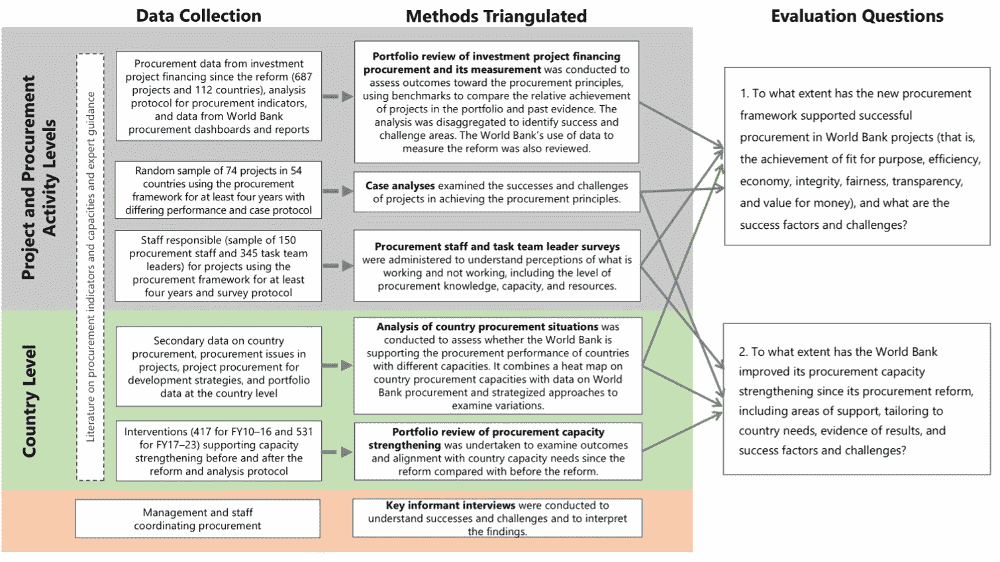

Independent Evaluation Group World Bank Group    **127**

**Limitations**

Electronic data on World Bank procurement from STEP are often incomplete and contain data entry errors because of self-entry by clients. To address these challenges, data were carefully cleaned, cross-tabulations were used to check inconsistencies, and outliers were reviewed by manually checking a sample of projects. If data fields had many missing values, they were not used for the analysis. Thus, the indicators measured in the portfolio are estimates of achievements based on the available data. In addition, to check quality, findings from STEP were discussed with a procurement data analytics expert in the World Bank and external experts and triangulated with findings from case studies, surveys, interviews, and literature.

Although text analysis was useful to systematically identify a portfolio of procurement capacity strengthening interventions (projects and nonlending), some interventions may have been overlooked, whereas others may have been incorrectly labeled. Thus, the capacity strengthening portfolio analysis reviewed a sample of interventions identified in investment project financing (IPF), nonlending, and development policy loans for false positives in two rounds and refined the keywords. For example, interventions that use the word “procurement” in a sense not related to capacity strengthening were removed. The coding of a sample of interventions in FY17–23 led to the identification of 15 percent of false-positive matches of the text analysis. The evaluation conducted a sensitivity analysis of the full data set, comparing data from FY10–16 to FY17–23 with and without excluding false positives. Based on no observed qualitative differences between the two sets of portfolios, the analyses of the complete portfolio excluded the false-positive matches identified in the coding.¹

The main limitation of the analysis of procurement situations was the availability of secondary country data on countries’ procurement capacities for the heat map analysis. To reduce this limitation, the evaluation team (working with governance and procurement experts) reviewed and carefully selected indicators from multiple data sets. In addition, data sources for a country were compared to ensure consistency of direction, and estimates were validated against findings from case studies. The final heat map estimates the procurement capacity level of a country relative to other countries.

The main limitation of case analyses is that the projects assessed were still active. Hence, it was not possible to observe and review final procurement outcomes, which could be seen when the projects closed. To address this limitation, the case analysis focused on projects with at least four years of implementation experience, and task teams and clients were interviewed to understand the success of completed procurement activities. This ensured that some procurement implementation was complete for review in the cases. Moreover, cases with different performance levels were randomly selected to limit the biases of reviewing an active portfolio.

The survey was sent to staff identified in the portfolio as having experience using the World Bank’s new procurement framework and as being responsible for projects with at least four years of implementation experience. Earlier projects may have followed the previous procurement guidelines, and new projects may have implemented few procurement activities. In addition, the draft survey was reviewed by procurement managers and tested by procurement staff and task teams to ensure the relevance of its questions. Procurement managers also promoted staff participation in the survey to help ensure timely feedback from eligible respondents.

### Portfolio Review of Investment Project Financing Procurement and Its Measurement

The portfolio review consists of four stages: project identification, data cleaning, identification of measures of procurement principles, and analysis (appendix C).

The project identification stage consisted of the retrieval of data on IPF from Data Explorer and STEP. The projects were limited to those with a Concept Note review date from July 1, 2016, to June 30, 2022, inclusive, and flagged as using the World Bank’s reformed procurement framework and not the previous procurement guidelines. The analysis included projects in the following Global Practices: Governance; Finance, Competitiveness, and Innovation; Education; Social Protection and Jobs; Health, Nutrition, and Population; Agriculture and Food; Water; Social Sustainability and Inclusion; Urban, Disaster Risk Management, Resilience, and Land; Energy and Extractives; Transport; and Digital Development. Of the 912 projects identified, the final evaluation portfolio included 687 with one or more years of implementation as a way of focusing the analysis on procurement processes that are sufficiently advanced.

The data cleaning stage consisted of a careful review of STEP data to check for missing information and variables and errors that could affect the analysis. Proxy variables were constructed based on available information and errors corrected whenever possible. A codebook was created to understand the variables in the STEP data and assess their completeness and reliability.

The identification of measures of procurement principles stage consisted of a rapid literature review and expert guidance to plan the analysis (appendix B). The literature review used keywords to search repositories of academic articles, the World Bank’s Open Knowledge Repository platform and library, global procurement data platforms, nongovernment sites (the Government Transparency Institute and Open Contracting Partnership), and international organizations’ websites. Articles were also identified through expert recommendation and snowballing references. The search identified over 200 articles and reports, from which indicators to measure procurement principles were synthesized by principle. The final analysis plan to assess outputs and outcomes toward the procurement principles was informed by the literature, expert guidance on procurement analytics, and available data fields in STEP. In addition, the indicators identified from the literature were reviewed against the dashboards and reporting of the World Bank on procurement to assess the extent to which the indicators reported are adequate to assess the achievement of procurement principles against the theory of change. The analysis considered whether the indicators used by the World Bank offered a comprehensive picture to assess progress on procurement outputs and outcomes in different boxes of the theory of change.

The analysis stage used the STEP data to assess outputs and outcomes toward the procurement principles—efficiency, economy, integrity, transparency, fairness, fit for purpose, and value for money. The analysis benchmarked the relative achievement of indicators toward the procurement principles by examining the distribution of achievement across the portfolio and disaggregating analyses by Global Practice, country type, procurement capacity level, Region, risk, stage of procurement processes, procurement amount, and other factors. This allowed for the identification of success and challenge areas across the portfolio. Where possible, the portfolio data were also compared with information in the literature and past evaluation evidence.

The analysis of procurement efficiency in World Bank–supported IPF includes measures of timelines of the first procurement in a project, the speed of procurement processes by category and method, and delays broken down by steps in the procurement process to identify bottlenecks. The analysis of economy examines procurement approaches and market approaches used by projects, the number of bids received for procurement activities, the cost of procurement activities, and supplier diversity, among other indicators. The analysis of procurement integrity, transparency, and fairness examines integrity risks, procurement post review reports to verify processes, use of standstill period, integrity risk analysis, and complaints, among other indicators. The analysis of the fit for purpose of procurement examines procurement planning, risk analysis, the use of hands-on expanded implementation support, and procurement staffing. The analysis of value for money of procurement uses (i) composite measures, constructed from the STEP data indicators for each procurement principle using principal component analysis, and (ii) an overall composite that brings together the data on procurement principles to estimate value for money for a project. The analysis of value for money also looks at the relationship between procurement principles and project implementation ratings. It includes a Pearson correlation matrix examining associations between indicators of procurement principles and project implementation. In addition, a simple regression analysis was conducted to further understand the relationship between the indicators for each procurement principle, project implementation ratings, and value for money.

### Portfolio Review of Country Procurement Capacity Strengthening

The portfolio review consists of four stages: portfolio identification, coding, analysis, and interviews (appendix D).

Independent Evaluation Group World Bank Group **131**

The portfolio identification stage constructed a database of World Bank interventions approved by October 25, 2022, including IPF, Program-for-Results, development policy loans, and advisory services and analytics. The analysis used sector and thematic codes and text analysis to identify interventions with procurement capacity strengthening activities or prior actions. The text analysis was based on keywords identified through a rapid literature review on procurement capacity strengthening and the manual review of a sample of interventions. The interventions were filtered into two groups—one for FY10–16 and one for FY17–23—to draw a comparison of before and after the 2016 reform and were screened manually to refine the keywords. The final portfolio obtained after screening includes 948 interventions: 417 related to FY10–16 and 531 related to FY17–23.

During the coding stage, 437 interventions from the FY17–23 period that are closed or in the final years of implementation were coded. A codebook and coding template in SurveyMonkey were followed, and training was provided for consistent coding of interventions, including (i) the procurement capacity challenges addressed, (ii) procurement capacity strengthening activities, and (iii) achieved or likely procurement capacity strengthening outcomes.

The analysis stage, combined with data from the heat map on country procurement capacity, was conducted for the evaluation to understand capacity strengthening interventions in relation to the context and needs of countries. The analysis was performed in Excel and Python. The indicators of IPF and the most recent Country Partnership Frameworks of 56 case study countries were also reviewed.

The interview stage consisted of key informant interviews with World Bank procurement staff strongly involved in capacity strengthening. The interviews were done to validate some of the results and obtain more information on good practices.

### Analysis of Country Procurement Situations

The analysis aims to understand differences in World Bank procurement performance by level of procurement capacity. The country-level analysis constructed a heat map of countries’ procurement capacity, which was combined with portfolio data on World Bank procurement, including data on procurement issues (typically problems delaying procurement) reported in projects for descriptive analysis. The content of project procurement strategies for development (PPSDs) was reviewed to understand variations across countries. A clustering analysis identified groups of countries with similar procurement patterns (appendix E).

The heat map of countries’ procurement situations estimated the procurement institutional capacities of countries in the evaluation portfolio for the principles of efficiency; economy; integrity, fairness, and transparency; and overall. This estimate looks at how the procurement capacity of a country may affect World Bank procurement in projects. The selection of indicators to estimate institutional capacities is based on the evaluation’s theory of change of procurement principles, a review of publicly available global databases, and expert guidance from governance and procurement experts. Principal component analysis was used to generate a composite measure of selected indicators related to each principle, which provided a combined estimate of the procurement capacity level of a country relative to other countries in the portfolio. The capacities of a country are classified based on quartiles of the data as (i) very low, (ii) low, (iii) high, and (iv) very high, with very high being the best situation. The estimated level of capacity in countries was also compared with data from the case studies as a quality check. The heat map and portfolio data on procurement in IPF in countries were integrated to understand how institutional capacities influence procurement in projects, and descriptive analysis was done in Python.

The analysis reviewed procurement issues in projects reported in the text of project Implementation Status and Results Reports (ISRs). The purpose was to understand common reasons for procurement problems in projects in countries and to determine whether there were differences according to a country’s procurement capacity. The identification used national language processing of keywords and phrase embedding, with the “word2vec” algorithm in Python. Keywords and phrases were developed through a manual review of ISRs and were informed by a rapid literature review of procurement capacity challenge areas and consultations with procurement experts. The analysis covered 3,373 ISRs spanning 712 projects (99 percent of the project portfolio). A limitation was the varying level of detail in the reporting for procurement issues in ISRs.

The analysis reviewed the content areas of PPSDs to understand procurement approaches planned across different types of countries. It analyzed content using natural language processing of keywords and phrase embedding computed with the “word2vec” algorithm in Python. Keywords and phrases related to procurement capacity, sustainability, contract management, market analysis and planning, and procurement methods. The keywords were refined by manually checking the relevance of the findings and were informed by the full review of PPSDs in case study projects. The analysis covered 566 PPSDs, each for a unique project (about 80 percent of the evaluation portfolio). PPSDs not in English were translated using Microsoft Word and reviewed.

Clustering analysis examined whether countries with different procurement capacities could be grouped by differences in their procurement performance, risks, issues, and approaches used in projects. The hypothesis for the analyses was drawn from case studies and expert feedback suggesting differences in procurement performance in countries with different levels of capacity. The K-means algorithm was used to identify country groups with differences in mean features related to their procurement capacity, country situation, and procurement approaches (such as fragility, procurement performance, access to hands-on expanded implementation support, use of nontraditional procurement approaches, and procurement risks). In addition to the information on the procurement capacity level of the country from the heat map, the clustering analysis used portfolio data at the country level, including the average time projects in a country take to process their first procurement, the size of contracts in the portfolio, country type, average project procurement performance, risk ratings, types of procurement approaches used by projects, and whether projects in the country had received hands-on expanded implementation support. The number of K-means clusters (*n* = 5) was selected using two metrics: the sum of squared distances (elbow method) and the silhouette score; summary statistics were reviewed to compare each cluster group. The features of each cluster were summarized drawing on information from case studies to form typologies based on differences among the groups (which could inform opportunities to support procurement in countries).

### Case Study Analysis

The evaluation conducted case analyses of 74 projects across 52 countries² (appendix F). The projects were identified from a random sample of IPF projects in countries with at least four years of implementation, stratified to identify projects with high and low procurement performance ratings and lending groups (the International Development Association and the International Bank for Reconstruction and Development). The 90 percent confidence interval sample was split to reduce positive bias and understand what works and does not work. It covers the Global Practices and Regions included in the evaluation.³

The case studies reviewed the extent to which projects have achieved the procurement principles in the World Bank procurement framework and in the evaluation’s theory of change: efficiency, economy, integrity, transparency, fairness, fit for purpose, and value for money.⁴ Evidence sources include project documents, such as PPSD, procurement plans, bidding documents, procurement post review reports, procurement risk assessment and performance reports, Project Appraisal Documents, ISRs, aide-mémoire, dashboards, and 207 interviews with World Bank staff (74 task teams and 66 procurement specialists), government clients (55), suppliers (10), and development partners (5).

Interview questions asked about the successes and challenges of implementing the procurement principles in projects. Topics include the tailoring of procurement approaches; elaboration and use of PPSDs; support to help carry out procurement processes; adequate capacity; efficiency of procurement, including timelines, delays, and the ease of the World Bank review processes; competitive bidding processes; nontraditional procurement approaches; handling of complaints and post review audits; procurement risk analysis; monitoring of procurement; and success of procurement activities on a critical path to support the project’s development objectives. The evaluation team included procurement and evaluation experts trained to follow a consistent protocol, with regular check-ins. Interviews were conducted remotely and in person, and notes were synthesized to triangulate inputs from different interviewees and document review in a coding template in Excel for

Independent Evaluation Group World Bank Group    **135**

each project, which was reviewed for quality by a coordinator. In some cases, interviewees shared additional information by email or in a follow-up interview. The data synthesized on projects were analyzed in NVivo and Tableau.

### Procurement Staff and Task Team Leader Surveys

The evaluation sampled 386 IPF projects active for at least four years and using the World Bank’s procurement system since the 2016 reform, ensuring representation across World Bank Practice Groups and Regions (appendix G). Procurement staff and TTLs responsible for the projects were identified. The sample included 150 procurement staff and 345 TTLs to survey using SurveyMonkey and the Adobe Campaign newsletter. The procurement staff survey launched on April 13, 2023, and closed on May 16, 2023, and received a response rate of 72 percent. The TTL survey launched on April 26, 2023, and closed on June 5, 2023, and received a response rate of 57 percent.

The surveys asked for background information on the respondents: years of experience, Global Practice, grade level, hiring status, region of work, work in a fragile and conflict-affected situation country or low-capacity country, and duty station location.⁵ In addition, procurement staff were asked about the number of days spent strengthening countries’ procurement capacity, whereas TTLs were asked about the number of days spent in procurement training at the World Bank. The survey also included questions about the World Bank’s new procurement system, grouped into 10 topics. The survey questions and topics for procurement staff and TTLs varied slightly.

The evaluation team analyzed the survey responses using descriptive data analysis in Excel. The team used the World Bank’s artificial intelligence tool—mAI—to synthesize the responses to open-ended questions and reviewed the quality of the synthesis manually.

### Key Informant Interviews

Managers and staff coordinating procurement activities globally, in regions, countries, and projects were met for key informant interviews. Staff were identified by analyzing the organizational arrangements of procurement in the World Bank through a snowballing approach. More than 75 managers and staff were consulted. The interviews were undertaken to understand the successes and challenges of implementing procurement since the 2016 reform. Questions were iteratively identified to help interpret early findings from the evaluation methods.

1. The temporal change in the proportion of capacity strengthening interventions from fiscal years 2010–16 to fiscal years 2017–23 had the same directionality for countries, regardless of whether false positives were included or excluded. However, in some cases, the magnitude of the change differed between the main analysis and the sensitivity analysis.

2. Eastern and Southern Africa (Burundi, the Democratic Republic of Congo, Ethiopia, Kenya, Lesotho, Madagascar, Malawi, Mozambique, Somalia, Tanzania, and Zambia); Western and Central Africa (Benin, Burkina Faso, the Central African Republic, Chad, Côte d’Ivoire, Ghana, Mauritania, Niger, Nigeria, Senegal, Sierra Leone, and Togo); East Asia and Pacific (Cambodia, Indonesia, the Marshall Islands, the Federated States of Micronesia, the Solomon Islands, and Tonga); Europe and Central Asia (Albania, Kosovo, the Kyrgyz Republic, Moldova, Tajikistan, and Uzbekistan); Latin America and the Caribbean (Argentina, Bolivia, Brazil, Colombia, Guyana, Haiti, Jamaica, Mexico, and Nicaragua); Middle East and North Africa (Djibouti and Lebanon); and South Asia (Bangladesh, India, Maldives, Pakistan, and Sri Lanka).

3. The case study projects cover the following World Bank Practice Groups: Sustainable Development (25); Human Development (22); Infrastructure (20); and Equitable Growth, Finance, and Institutions (7). Of the projects, 45 are in the International Development Association countries, 24 are in the International Bank for Reconstruction and Development countries, 5 are in regional projects, and 22 are in fragile and conflict-affected situation countries. The projects are spread across seven regions: Western and Central Africa (19); Eastern and Southern Africa (17); Europe and Central Asia (9); Latin America and the Caribbean (9); South Asia (9); East Asia and Pacific (7); and Middle East and North Africa (2). The projects are distributed to include different procurement ratings: moderately satisfactory (29); moderately unsatisfactory (26); and satisfactory (19).

4. Under the area of fit for purpose, the case studies look at tailoring, procurement strategy, market and risk analysis, and support to help client capacity to carry out procurement in projects. Tailoring assesses how much the project adapted its procurement methods to country needs and implementation arrangements. The assessment of the procurement strategy looks at the value added of the project procurement strategy for development and its use by clients. The examination of market and risk analysis looks at the extent to which such analyses were used by the project. Under the area of efficiency, the case studies look at timeliness, prior review support, proportionality in a project, and the value addition of the Systematic Tracking of Exchanges in Procurement system. Timeliness looks at speed of procurement activities.

The assessment of prior review looks at how smooth and helpful this review type was for the project. Proportionality looks at the extent to which the shift to increase post-review activities in a project is successful. The examination of the Systematic Tracking of Exchanges in Procurement and standard procurement documents considers the extent to which the system and documents supported smooth procurement in projects. Under the area of economy, the case studies look at the use of innovative features, addressing sustainable procurement, packaging of procurement, and consideration of quality in procurement approaches. The assessment of innovative features looks at the extent to which the project used nontraditional or less common procurement approaches in its procurement. The assessment of sustainability looks at the use of sustainable procurement approaches. Attention to quality looks at the extent to which procurement approaches are used by projects to promote quality. The packaging of procurement looks at the extent to which procurement is organized in framework agreements or grouped in lots, for example, to meet market demands. Under the area of integrity, transparency, and fairness, the case studies look at bidding processes, complaints, and supplier relations and assess the extent of these processes’ success in projects. Under the area of value for money, in addition to the overall success of achieving the procurement principles in a project, the case studies look at client satisfaction with procurement in the project and the extent to which projects had practices for contract management.

5. Of the procurement staff respondents, 75 percent are grade G level staff, 20 percent are grade F level or lower, and 5 percent are grade H level staff or higher. Regarding recruitment and work location, 65 percent are locally recruited, 39 percent work in fragile and conflict-affected situation countries, and 67 percent work in low-capacity countries. Of the task team leader respondents, 85 percent are grade G officers, 8 percent are grade H and above, and 7 percent are grade F. Regarding recruitment and work location, 68 percent are internationally recruited, 41 percent work in fragile and conflict-affected situation countries, 81 percent work in low-capacity countries, and 67 percent are currently stationed in field offices. Respondents are spread across the seven Regions, with some working in more than one Region. Respondents working in Africa had the highest representation (which aligns with the high number of projects in the Region).

**139**

**Appendix B.** Rapid Review of Procurement Principles

**Measurement**

The literature review identified options to measure the procurement principles: (i) improved value for money for decision-making (effectiveness); (ii) improved efficiency; (iii) improved economy; (iv) improved integrity, fairness, and transparency; and (v) improved fit for purpose. The objective was to inform the evaluation’s assessment and the review indicators used by the World Bank to measure procurement outcomes.

**Methodology**

A rapid review identified literature on indicators that measure public procurement achievements in the principles. The review used keywords¹ to search repositories of academic articles (Academia, Core, Google Scholar, Wiley); the World Bank’s open knowledge platform and library; global procurement data platforms; nongovernment sites (Government Transparency Institute and Open Contracting Partnership); and international organizations’ websites. Articles were also identified by expert recommendation and snowballing references cited in articles to find application examples. The search identified over 200 articles and reports, which were reviewed to extract information on indicators to measure procurement principles. The search focused on articles since 2015, examples of indicators from countries supported by the World Bank, and articles recommended for review. The indicators from the literature were synthesized in tables, with examples of how the indicators were used.

Because the literature review was rapid, the purpose was not to be exhaustive in identifying indicators; rather, the review provides examples of indicators that could be measured. Finally, although the indicators are grouped by the procurement principles (value for money; efficiency; economy; integrity, fairness, transparency; and fit for purpose), some indicators relate to multiple areas. For instance, delayed payments and the use of framework agreements can affect efficiency, economy, and value for money; and procurement lead time and indicators of e-procurement can inform efficiency and transparency.

The final selection of indicators to measure in the evaluation was based on the available data in World Bank systems to calculate the indicator. Indicators like beneficiary satisfaction would require more data to track systematically, such as from client surveys. However, the indicators identified could also inform enhancements to World Bank dashboards to monitor procurement.

**Value for Money for Decision-Making (Effectiveness)**

Value for money is an overarching principle guiding World Bank procurement and other international development agencies. Although definitions differ, value for money is consistently emphasized as the combined achievement of economy, efficiency, and effectiveness principles. There are a range of indicators and tools used to estimate value for money that differ based on the following:

- Level of analysis—that is, the focus may be assessing a program, project, or specific procurement function or activity.
- Perspective—that is, the actor conducting the assessment, such as a financier, government agency, auditor, or nongovernment group.
- Time frame, in terms of when the assessment is conducted in a project cycle, such as at the start of a procurement activity, during implementation, or after completion.
- Indicators used to assess value for money include those at output and outcome levels and are often composite indicators, which combine proxies that estimate dimensions of value for money (table B.1). Indicators can be defined in quantitative and qualitative terms. Indicators also draw on data on the perceptions of stakeholders (such as task teams, clients, suppliers, and beneficiaries in communities) and the address of quality across the procurement cycle, from strategizing procurement to identifying procurement approaches that fit the project context to contract management.

Some indicators can serve as a benchmark for routinely tracking value for money. The literature underscores that value for money requires judgment; hence, strong value-for-money indicators can offer criteria to guide procurement (Barr and Christie 2015a; DFID 2020).

To estimate value for money of procurement in projects, the World Bank relies on data on procurement ratings. The World Bank currently lacks another methodology to capture value for money at different stages of procurement. The World Bank could develop a methodology with clear indicators to benchmark how successful procurement in projects is to achieve value for money.

**Table B.1.** Examples of Indicators to Assess Value for Money

| Indicator | How to Measure |
|-----------|----------------|
| Composite indicator combining measures of economy, efficiency, and effectiveness: economy (minimizing the cost of inputs); efficiency (achieving the best rate of conversion of inputs into outputs); and effectiveness (achieving the best possible result for the level of investment). | Under this approach, value for money can be assessed during project planning, monitored during implementation, and assessed again at completion. It can also be assessed at a portfolio level. The approach uses the best available indicators to measure value-for-money dimensions. Where possible, these should be outcome indicators, but often the indicators are proxies at the output level, given the challenge of defining outcomes. Sometimes the dimension of equity is added by looking at the benefits of the procurement to marginalized groups. |
| Composite indicator combining measures of relevance, quality, effectiveness, and cost. | The composite indicator combines three sources of measures to estimate value for money: (i) a qualitative assessment of the relevance of the procurement strategy using defined criteria; (ii) indicators related to the quality of tendering practices, such as whether there was a supplier market analysis; and (iii) data estimating the contracting effectiveness and cost, for example, from an assessment of the relationship with suppliers, life cycle costs, or key performance indicators. |
| Beneficiary satisfaction indicators can measure the effectiveness of the procurement function by assessing users’ perceptions of the added value brought by the procurement. | In procurement, clients and beneficiaries can be internal (such as project task teams) and external (such as borrowers, suppliers, and project beneficiaries). Client views can be benchmarked in several ways. |
| Beneficiary feedback surveys provide information on satisfaction with a project’s procurement outcomes, such as with a road, hospital, school, and delivery of pharmaceuticals. | Client surveys provide perceptions of how well a procurement function supports the objectives of a project; provides appropriate support to procurement strategies and activities; responds to ad hoc needs; helps staff develop their skills concerning procurement; and proactively sources goods and supplies that represent best value. |

*Sources:* ADB 2017; AfDB 2015; Audit Scotland 2011; Barr and Christie 2015a, 2015b; CIPFA 2017; DFID 2020; Emmi et al. 2011; Erridge 2005; Government of Western Australia 2018; ICAI 2017, 2018a, 2018b; IDB 2019; INTRAC 2016; MAPS 2018; OECD 2016b, 2016c; OECD and SIGMA 2011; Oklahoma Office of Management and Enterprise Services; Open Tender EU; Thai 2001; UK Department of Finance; UK Department for Transport; University of Arkansas; US Government Federal Acquisitions Regulations; World Bank Group 2022a, 2022b.

**Improved Efficiency**

The World Bank policy underscores that efficiency is achieved when procurement is delivered on time to meet specific plans for public service or goods delivery. Efficiency requires that procurement processes be proportional to the value and risks of the underlying contract. The World Bank’s procurement monitoring dashboard includes information on processing timelines to estimate efficiency.

Like the World Bank, other multilateral development banks emphasize procurement timelines (ADB 2017; AfDB 2015; IDB 2019; World Bank Group 2017). The Organisation for Economic Co-operation and Development links efficiency with tools to improve procurement procedures, reduce duplication, and achieve greater value for money. Such tools can include centralized purchasing, framework agreements, e-catalogs, dynamic purchasing, and

**Independent Evaluation Group World Bank Group 143**

e-auctions (DFID 2020; OECD 2016b). Indicators used to assess efficiency include those related to procurement administrative cost, e-procurement, and time and cost gains at different stages of the procurement cycle (table B.2).

### Table B.2. Examples of Indicators to Assess Efficiency

| Indicator | How to Measure |
|---|---|
| Total cost of the procurement function or overhead cost is a composite indicator measuring the cost-effectiveness of the organization’s procurement function—whether managed centrally, devolved, or by a combination of approaches. | The total cost of the procurement function should include the transaction cost of acquisition, employees, information technology, supplies, and outsourcing. Examples include average administrative cost per type of procedure; cost of the procurement function as a percentage of organizational running costs; and cost of procurement function as a percentage of third-party spending. |
| The use of framework agreements captures how much the procuring agency consolidates its purchases to increase efficiency and lower costs. Framework agreements leverage the purchasing power of the government and can result in economies of scale. | The indicator captures the use of framework agreements, where suppliers prequalify through a competitive procedure and are selected for call-down contracts, either directly or through competition. |
| Procurement lead time is the actual days between advertisement and contract signature for a procurement activity, benchmarked against the planned time. | Lead time is measured by an aggregation of the publicity time; tender evaluation or award time; and time elapsed between award and contract signature. Each stage of the procurement process can be associated with an efficiency indicator that can be broken down to measure, for instance, the time for prior reviews (internal and external) and time for responding to complaints. |
| Payment time is the average number of days taken to release payment from the date the payments become due as per the contractual terms. Slow or delayed payment makes it difficult to meet project objectives. | Payment time can be measured in absolute (number of days) or relative terms, such as the percentage of cases with delayed payment. |

*(continued)*

**144 Making Procurement Work Better  Appendix B**

| Indicator | How to Measure |
|---|---|
| E-procurement indicators measure how much e-procurement is used through online portals. E-procurement simplifies processes for contract award and management and can potentially reduce cost and waste throughout the supply chain. E-procurement can also support transparency and fairness. | Indicators include the uptake of e-procurement and the value and number of bids submitted online as a share of total procurement. Data should be complemented by qualitative indicators on the users’ perception of e-procurement systems. For a deeper assessment, assessments can estimate time and cost savings from using e-procurement and increased competition resulting from e-procurement. |

*Sources:* ADB 2017; Adebayo and Evans 2015; AfDB 2015; Audit Scotland 2011; BRAC 2015; Bradić-Martinović 2021; CIPFA 2017; DFID 2020; Government of Western Australia 2018; ICAI 2017, 2018a, 2018b; IDB 2019; IGC 2015; Iyer 2022; Kumar et al. 2015; Lewis-Faupel et al. 2016; Manivannan and Zaveri 2021; MAPS 2018; Memon et al. 2011; OECD 2016a, 2016b; OECD and SIGMA 2013; Rahman et al. 2015; Srivastava and Agrahari 2017; World Bank 2016c, 2021; World Bank Group 2021b, 2022a, 2022b.

### Improved Economy

The principle of economy considers price and nonprice factors, including quality, sustainability, and life cycle costs, as appropriate, that support value for money (ADB 2017; AfDB 2015; DFID 2020; EU 2014; IDB 2019; World Bank Group 2017). Although procurement has been used to further public policies in a wide range of fields, the literature shows limited evidence on the best public procurement strategies and policies to achieve socioeconomic and environmental outcomes and balance the potential trade-offs with efficiency. The evidence also does not offer a definitive measurement framework to monitor the inclusiveness and sustainability of public procurement. Studies suggest that the use of sustainable performance is low (Andhov et al. 2020; Iyer 2022; OECD 2021). Also, research on public procurement and innovation is surprisingly sparse. Further, despite the plethora of public policies, public procurement lacks strategic maturity around how to demonstrate and evaluate its impact and “success” (Grandia and Meehan 2017; World Bank Group 2022c; table B.3). Some projects assess life cycle costs and other aspects of the economy, but indicators to estimate achievements for this principle could be consistently tracked on the World Bank monitoring dashboard.

**Independent Evaluation Group World Bank Group 145**

### Table B.3. Examples of Indicators to Assess the Economy

| Indicator | How to Measure |
|---|---|
| Savings achieved measure the price advantage obtained based on the bid price when compared with the estimate. This indicator points to the suitability of the procurement procedure and its impact on the bid price. | Savings are determined based on the difference between the awarded contract value and the estimated contract value for a procurement activity. Indicators can be expressed as savings in absolute terms or as a percentage of price estimates. This indicator can be especially relevant for large contracts. Savings can also be monitored as an average price variation of the total number of contracts. |
| The rate of success of the procurement processes shows how the process fared. This indicator captures the quality of procurement planning and its impact on the delivery of timely outcomes. | The indicator requires information on the result of the bidding process. Indicators can be expressed as the percentage of the total value of procurement processes successfully awarded, relative to those failed, canceled, or rebid. |
| The use of sustainability requirements in public procurement captures how public authorities apply the three pillars of sustainable development—economic, social, and environmental—when procuring goods, services, or works. | The indicator measures how much sustainability requirements are used in public procurement. Procurement may include economic requirements (preference schemes to promote domestic and local firms and SMEs), environmental (reducing the environmental footprint of contracts procuring recycled goods, eco-label), and social (job creation, engaging women and vulnerable groups in supply chains) aspects to address sustainability. Sustainability indicators can be expressed as a percentage of contracts awarded that consider quality; contracts that include environmental and social criteria in the evaluation and award; contracts reserved for local firms or with subcontracting arrangements to local firms; and contracts awarded to SMEs. |

*(continued)*

**146 Making Procurement Work Better  Appendix B**

| Indicator | How to Measure |
|---|---|
| LCC can be used to calculate the costs of a product or service throughout the entire lifespan. LCC is defined by ISO 15686-5 (Buildings and constructed assets—Service life planning—Part 5: LCC). LCC can help consider financial and nonfinancial gains that are offered by environmentally and socially preferable assets procured by a project. It can also help calculate hidden costs that can occur following procurement when the product or service is used. | LCC captures the accumulated costs of acquiring, operating, maintaining, disposing, or decommissioning procured goods or services, including costs related to environmental externalities (if they can be quantified and verified) and revenue from disposal. The indicator can be expressed as the value and number of contracts awarded following an LCC award criterion. LCC should be used when the costs over the specified life of the goods or works are estimated to be high compared with the initial cost and can vary among different bids or proposals. LCC includes three types of assessments: conventional financial cost assessments, societal costs, and environmental costs. |
| Competition level can indicate the quality of procurement processes and is an important driver in achieving value for money. A low number of bids would lead to lower competitive pressure and hence higher prices paid by the contracting authority. Lack of competition can point to planning deficiencies, such as biased technical specifications that make the requirements for candidate bidders too high. Studies link “competitive tension” with increased quality and greater savings. Open competition is often the best guarantee that manipulation and corruption will be minimized because it requires the bidding rules and process to be clear and transparent. | Competition is typically measured by the average number of bids received for a procurement activity. A useful subindicator is the percentage of new market entrants, women-owned businesses, and SMEs to identify how public procurement contributed to market development. The extent of competition can also be measured as the percentage of direct awards. Composite indicators that measure competition in public procurement may be constructed from four pillars of market openness in public purchases: single bidding, average bidder number, market concentration, and market entry rate. |

*(continued)*

### Improved Integrity, Transparency, and Fairness

In many countries, corruption can occur in procurement transactions, especially when integrity risks are very high. Public procurement accounts for about one-third of government spending, with estimated losses of 10–20 percent as a result of corruption (Fazekas et al. 2020). Public procurement’s susceptibility to corruption stems from the financial interests at stake, volume of transactions on a global level, close interaction between the public and private sectors, and tensions created by introducing policy goals. Several types of corruption take place in public procurement, be it fraud, bribery, collusion, extortion, document manipulation, or computer fraud. This corruption can lead to overpriced contracts contributing to larger budget deficits, substandard delivery, lost revenue, and lower efficiency of public investment with adverse impact on growth (Fazekas et al. 2020). Identifying where corruption could take place and prioritizing impactful policies or measures to mitigate integrity risks is notoriously difficult (Fazekas et al. 2020; Mantzaris 2014; OECD 2009; UNODC 2013).

Several indicators or techniques assess integrity risks, transparency, and fairness of procurement (table B.4). For example, databases can be consolidated to assess flags that may alert to integrity risk patterns through algorithms (Modrušan et al. 2021). Composite indexes, which combine multiple indicators, can also be used to measure the risks of corruption. Indicators that focus on transparency and fairness include composite indexes, for example, the Transparency Index (Chvalkovská and Skuhrovec 2010), and indicators such as litigation cases, beneficial ownership declaration, abnormally low bids, and monitoring and oversight practices. Countries are in various stages of developing procurement databases supported by technology that can be mined to identify integrity risks. The World Bank has emphasized open publication of procurement information, project integrity assessments, tracking complaints and beneficial ownership, and the use of its online Systematic Tracking of Exchanges in Procurement system to monitor procurement integrity, transparency, and fairness.

## Table B.4. Examples of Indicators to Assess Integrity, Transparency, and Fairness

| Indicator | How to Measure |
|---|---|
| Integrity composite score combines available indicators in open public procurement data to identify integrity risks. The indicator can identify corruption risks and inform preventive actions. | The composite score combines, on average, 10 indicators: use of nonopen procedure types; call for tenders published; length of advertisement period; single-bidder contract; length of decision period; Benford’s law; supplier’s contract shares of buyer spending on public procurement; supplier registered in a tax haven; delivery delay (relative contract length increase); and cost overrun. |
| Corruption cost tracker is a global interactive intelligence tool that tracks corruption risk indicators and helps identify corruption risks in public procurement. | The corruption cost tracker dashboard captures proxy indicators that can help identify high-risk situations, such as when one bid is submitted following a short tender notification period; the use of noncompetitive procedures; and failed, substandard, or delayed contracts. |
| Red flags are direct or indirect indicators of potential corruption, collusion, fraud, or other illicit behavior. | Data mining and business intelligence techniques are being used to identify suspicious public procurement processes. Red flags are supported by integrity filters that run ex ante (before bids are evaluated or payments are approved) or ex post (against procurement data collected in audits). Some red flags are binary, meaning that they can be answered with a yes-or-no statement. Other red flags fall on a spectrum of values and therefore depend on a threshold value.  Indicators can be categorized as follows:  - Unambiguous indicators, such as purchase order information not matching invoices; duplicate invoices; different bids from the same Internet Protocol address; and bids from different bidders that are an exact percentage apart. - Indicators of patterns or repeat transactions, such as a high number of percentage or split purchases by the same procurement official from the same supplier; and a high number of red flags associated with a single purchase or procurement official. |
| Stakeholder support for integrity in public procurement assesses the strength of private sector and civil society support in maintaining a sound procurement environment. | Stakeholder support for integrity in public procurement can be measured by collecting evidence on actions taken by suppliers to foster integrity, including codes of ethics, integrity training for staff, or internal control measures; and civil society engagement in public procurement (such as how much CSOs monitor procurement). |

**150**

Making Procurement Work Better  Appendix B

| Indicator | How to Measure |
| :--- | :--- |
| Collusion risk. Bid rigging occurs when bidders agree among themselves to eliminate competition in the procurement process, thereby denying the public a fair price. Collusion risk indicators can help prevent schemes that aim to eliminate competition and rent reallocation. | Indicators can monitor bid amounts (relative standard deviation of bid prices), bidders’ patterns (such as cyclical winning and missing bidders), market structures, the prevalence of subcontracting, and faulty bids. Data can be collected throughout the public procurement process, from document preparation to contract implementation. |
| Transparency score is a composite indicator that combines publicly available information to estimate procurement transparency. Transparency and fairness are key tenets of modern public procurement systems by (i) promoting fair treatment of potential suppliers by providing an adequate and timely degree of transparency in each phase of the public procurement cycle; (ii) allowing open access to public procurement information; and (iii) ensuring the visible flow of public funds, from the budgeting process and throughout the procurement cycle. | The composite transparency score indicator combined on average nine indicators that relate to the availability of information, including the buyer’s name, contract title, supplier name, supply type, contract value, implementation location, procedure type, number of bids, and award date. |
| Effectiveness of complaint or appeal mechanisms. Relevant indicators capture how much a procurement system allows interested parties to appeal before or after the award notification. It also measures due process and the degree to which the process is disclosed to the public. An effective appeal mechanism and the availability of information on its operation help build public confidence in procurement. | Indicators include adequate legal procedures and internal instructions; number of complaints and appeals; resolution time frame; number (and percentage) of enforced decisions; share of appeals decisions posted on a central online platform within timelines specified in the law; share of suppliers that perceive the challenge and appeals system as trustworthy; share of suppliers that perceive appeals decisions as consistent; and share of the outcomes of appeals dismissed or in favor of the procuring entity or applicant. |

*(continued)*

**151**

Independent Evaluation Group  World Bank Group

| Indicator | How to Measure |
| :--- | :--- |
| Disclosure of beneficial ownership refers to the person(s) behind an entity, whether a legal person or arrangement, who exercise(s) control over it. This requirement enhances transparency and can help promote high integrity standards. It is also an instrument in the fight against corruption and combating the financing of terrorism. | Number and value of contracts for which bidders have declared beneficial ownership and share in the contract portfolio. |
| Procurement oversight indicators look at the quality and efficiency of procurement oversight systems from the legal and institutional framework to their performance. High-quality control systems can provide checks and balances to foster accountability and transparency in the use of public funds, including procurement. | Qualitative indicators can score the oversight legal and institutional systems, including the quality of external audit functions and independence and the completeness of the record management requirements. Quantitative measures include the value and number of ex ante reviews and procurement audits, effective follow-up on audit recommendations within legal time frames, and extent of procurement training of auditors. An important element that supports effective oversight is the completeness of procurement records, including justification for various procurement steps and exceptions that promote transparency and accountability. |
| Procurement tracking and verification systems monitor procurement stages and goods, works, and services received. | Examples include tracking procurement stages and the receiving of goods, works, or services through information sources, such as purchase orders, public procurement databases, and data from information systems of health-care facilities and construction project status. This can also include blockchain-based frameworks that enable interoperability of information systems involved in the procurement process, increase citizen participation, and support more transparent project monitoring and auditing. |

*Sources:* ADB 2018; Akaba et al. 2020; BRAC 2015; Chvalkovská and Skuhrovec 2010; Donin and Kneppo 2015; Ekwekwuo and Nyeck 2016; Fazekas et al. 2016; Fazekas et al. 2020; Fazekas et al. 2021b; Fazekas et al. 2021c; Frauscher 2017; Government of Australia 2018; Government of India 2020; Hayman 2018; ICAI 2017, 2018a, 2018b; IDB 2019; IDB and OECD 2021; Kohler and Wright 2020; Kramer 2020; Kunz and Pospíšil 2020; Mantzaris 2014; MAPS 2018; Modrušan et al. 2021; OCP and Development Gateway 2016; OECD 2009; OECD and SIGMA 2019; Open Tender EU; SCA 2016; UNODC 2013; US Department of the Treasury 2022; World Bank 2016a, 2016b; World Bank Group 2019, 2022a, 2022b; World Economic Forum 2020.

*Note:* CSO = civil society organization.

**152**

Making Procurement Work Better  Appendix B

### Fit for Purpose

Fit for purpose is addressed in the procurement policies of the World Bank to support projects and other multilateral development banks. Fit for purpose assesses whether procurement approaches used are those most appropriate to support the project’s development objectives and expected outcomes, considering the context, risk, value, and complexity of the contract. By designing the right procurement approach, there is far more likelihood of the right bidders participating, better bids being received, and an increased chance of achieving value for money. Fit for purpose is measured by indicators that analyze risk, procurement strategies, and market engagement, to support a customized procurement approach to the market that ensures appropriate response and maximizes competition (table B.5). Fit for purpose can also be measured by qualitatively assessing how well procurement approaches are tailored to project needs and country context to support a fit-for-purpose approach (ADB 2017; IDB 2019; World Bank 2016a, 2016b; World Bank Group 2017). To address fit for purpose, the World Bank has emphasized the formulation of a project-level procurement strategy, and World Bank staff assistance within some projects to support procurement implementation.

**Table B.5.** Examples of Indicators to Assess Fit for Purpose

| Indicator | How to Measure |
| :--- | :--- |
| The use of market research and analysis aims to understand market sectors with the potential to bid for the goods, services, or works required to maximize the market interest. Market research is conducted from purchaser and supplier perspectives and assesses how the market works, participants’ competitive positions, and incentives. | Indicators can look at whether the market analysis is strategic (seeks a broad understanding of the market) or tactical (linked to a specific acquisition). Indicators can also look at the use of specific analyses, such as SWOT (purchaser capability assessment), Porter’s analysis (assesses competition and determining factors), supply positioning (assesses the necessity of the purchase), or supplier preferencing (measures how attractive the business is to the supplier). |

*(continued)*

**153**

Independent Evaluation Group  World Bank Group

| Indicator | How to Measure |
| :--- | :--- |
| Use of market engagement and shaping, which is a technique by which the purchaser elicits supplier feedback on a procurement opportunity. This is used when there is a need to create a market or increase supplier participation because of a lack of market interest, especially the procurement is novel. | This indicator measures how much market engagement is used in public procurement. The use of market engagement can be monitored throughout the procurement life cycle, from the pretendering through the tender stage and post-award stage. |
| Risk level is a composite indicator that assesses different dimensions of procurement risk. The procurement risk analysis supports the fit-for-purpose approach by tailoring procurement approaches to the type and level of risks identified. It sets out the plan for addressing risks and opportunities. | The type of risks assessed can include institutional, integrity, environmental, social, health, and safety risks, including gender-based violence sexual exploitation and abuse, and sexual harassment, which affect or can be managed through procurement. |
| The choice of procurement approaches fit for purpose is measured by the range of procurement approaches used (compared with the traditional one-size-fits-all approach). By designing the right procurement approach, it is more likely the right bidders participate, better bids will be received, and procurement increases its chance of achieving value for money. | This indicator could capture the number of innovative approaches used in procurement, such as APA, HEIS, framework agreements, World Bank–facilitated procurement, best and final offer, requests for proposals, reverse auction, life cycle costing, competitive negotiation, contract management planning informed by key performance indicators, and IPAP. |

*(continued)*

## Appendix B

### Indicator

The availability of skilled procurement staff and relevant capacity-strengthening support. Having a procurement workforce with the capacity to continually deliver support efficiently and effectively can maximize value for money.

### How to Measure

Quantitative indicators measure the proportion of procurement personnel who have relevant qualifications, certifications, and training.

Qualitative indicators include the existence of a capacity development strategy; training programs; and an advisory service or help desk function. Other qualitative indicators refer to whether procurement is recognized as a specific function, with positions defined at different professional levels; and whether the organization has clearly defined ethical procurement standards and is actively applying and monitoring them across the organization.

*Sources:* ADB 2017; BRAC 2015; CIPFA 2017; Development Gateway; Fazekas et al. 2021b; ICAI 2017, 2018a; IDB 2019; MAPS 2018; OECD 2016a, 2016b, 2021; Open Tender EU; Thai 2001; US Department of Defense 2018; World Bank 2016a, 2016b, 2021; World Bank Group 2017, 2019, 2022a, 2022b.

*Note:* APA = alternative procurement arrangement; HEIS = hands-on expanded implementation support; IPAP = independent probity assurance provider; SWOT = strengths, weaknesses, opportunities, and threats.

## Bibliography

ADB (Asian Development Bank). 2017. *ADB Procurement Policy: Goods, Works, Nonconsulting and Consulting Services.* ADB.

ADB (Asian Development Bank). 2018. *Abnormally Low Bids: Guidance Note on Procurement.* ADB.

Adam, I., A. H. Sanchez, and M. Fazekas. 2021. “Global Public Procurement Open Competition Index.” Working Paper GTI-WP/2021:02, Governance Transparency Institute.

Adebayo, V. O., and R. D. Evans. 2015. “Adoption of e-Procurement Systems in Developing Countries: A Nigerian Public Sector Perspective.” Institute of Electrical and Electronics Engineers.

Adjei-Bamfo, P., and T. Maloreh-Nyamekye. 2019. “The ‘Baby Steps’ in Mainstreaming Sustainable Public Procurement in Ghana: A ‘Double–Agency’ Perspective.” *Journal of Public Affairs* 19 (458).

AfDB (African Development Bank). 2015. *Procurement Policy for Bank Group Funded Operations.* AfDB.

AfDB (African Development Bank). 2020. *Sustainable Public Procurement: Guidance Note.* AfDB.

Akaba, T. I., A. Norta, C. Udokwu, and D. Draheim. 2020. “A Framework for the Adoption of Blockchain-Based e-Procurement Systems in the Public Sector.” In *Responsible Design, Implementation and Use of Information and Communication Technology,* edited by M. Hattingh, M. Matthee, H. Smuts, I. Pappas, Y. Dwivedi, and M. Mäntymäki, 3–14. 19th IFIP WG 6.11 Conference on e-Business, e-Services, and e-Society, I3E 2020. Skukuza, South Africa, April 6–8, Proceedings, Part I. Springer International Publishing.

Aljohani, A., D. Ahiaga-Dagbui, and D. Moore. 2017. “Construction Projects Cost Overrun: What Does the Literature Tell Us?” *International Journal of Innovation Management and Technology* 8 (2): 137–43.

Andhov, M., R. Caranta, T. Stoffel, J. Grandia, W. Janssen, R. Vornicu, J. Czarnezki, A. Gromnica, K. Tallbo, O. Martin-Ortega, L. Mélon, Å. Edman, P. Göthberg, P. Nohrstedt, and A. Wiesbrock. 2020. “Sustainability through Public Procurement: The Way Forward—Reform Proposals.” SSRN. https://ssrn.com/abstract=3559393.

Audit Scotland. 2011. “Procurement Indicators.” https://www.audit-scotland.gov.uk/performance/docs/2011/CPI_1011_procurement.pdf.

Barr, J., and A. Christie. 2015a. *Better Value for Money.* ITAD.

Barr, J., and A. Christie. 2015b. “Improving the Practice of Value for Money Assessment.” CDI Practice Paper 12, Institute of Development Studies.

BIGD (BRAC Institute of Governance and Development). 2015. *Measuring Procurement Performance of LGED and RHD Based on Key Performance Indicators (KPIs).* BIGD.

Bradić-Martinović, A. 2021. “E-Procurement Performance Indicators: A Step towards EU.” Conference Paper, Institute of Economic Sciences.

Brown, S. 2022. “Procurement: The Missing Puzzle Piece to Follow the Money in Kyrgyz Republic.” *Open Contracting Partnership* (blog), June 29. https://www.open-contracting.org/2022/06/29/procurement-the-missing-puzzle-piece-to-follow-the-money-in-kyrgyz-republic.

CIPFA (Chartered Institute of Public Finance and Accountancy). 2017. *Value-for-Money Indicators.* CIPFA.

Chvalkovská, J., and J. Skuhrovec. 2010. “Measuring Transparency in Public Spending: Case of Czech Public e-Procurement Information System.” IES Working Paper 11/2010, Charles University Prague, Institute of Economic Studies.

Development Gateway. “Data & Digital Solutions.” Development Gateway: An IREX Venture. https://developmentgateway.org.

DFID (Department for International Development). 2020. “DFID’s Approach to Value for Money (VfM).” Guidance for External Partners, DFID.

Donin, G., and P. Kneppo. 2015. “Medical Device Procurement Tracking System: Concept and Methods.” 6th European Conference of the International Federation for Medical and Biological Engineering, edited by I. Lacković, and D. Vasic, 629–32. *IFMBE Proceedings* 45, Springer.

Ekwekwuo, C., and S. Nyeck. 2016. “The Role of New Technologies of Communication and Social Audits in Procurement Monitoring.” In *Public Procurement Reform and Governance in Africa.* Contemporary African Political Economy, edited by S. N. Nyeck, 261–75. Palgrave Macmillan.

Emmi, A., E. Ozlem, K. Maja, R. Ilan, and S. Florian. 2011. *Value for Money: Current Approaches and Evolving Debates.* LSE.

Erridge, A. 2005. “UK Public Procurement Policy and the Delivery of Public Value.” PrAcademics Press.

EU (European Union). 2014. “Public Procurement Directives.” EU.

EU (European Union) and GPP (Green and Sustainable Public Procurement). 2020. *Green and Sustainable Public Procurement.* https://ec.europa.eu/environment/gpp/versus_en.htm.

Fazekas, M., L. Cingolani, and B. Tóth. 2016. “A Comprehensive Review of Objective Corruption Proxies in Public Procurement: Risky Actors, Transactions, and Vehicles of Rent Extraction.” Working Paper, Government Transparency Institute.

Fazekas, M., E. Dávid-Barrett, A. Abdou, and O. Basdevant. 2020. “Quantifying the Costs of Corrupt Contracting and the Savings to Be Made from Reform.” The Corruption Cost Tracker. Government Transparency Institute.

Fazekas, M., A. Oliveira, and N. Regös. 2021a. “Lowering Prices of Pharmaceuticals, Medical Supplies, and Equipment: Insights from Big Data for Better Procurement Strategies in Latin America.” Policy Research Working Paper WPS 9689, World Bank Group.

Fazekas, M., A. Alshaibani, K. Aquino, and S. Cocciolo. 2021b. “Market Structure and Value for Money.” ProACT Research Paper 1.

Fazekas, M., I. Adam, O. Nikulina, D. Balabanova, E. David-Barrett, E. Hutchinson, M. Kirya, and C. Peiffer. 2021c. “Study on the Extent and Costs of Corruption in the Health Sector in Uganda.” Inspectorate of Government, Uganda.

Frauscher, K., L. Manasco, and K. Granickas. 2017. “Learning Insights: Open Contracting—A Helping Hand in Nepal.” *Open Contracting Partnership* (blog), May 31. https://www.open-contracting.org/2017/05/31/learning-insights-nepal.

Government of Australia. 2018. “Achieving Value for Money—Goods and Services Procurement Guide.” Department of Treasury and Finance. Victorian Government Purchasing Board.

Government of India. 2020. “Predatory Pricing/Abnormally Low Bids—Reg.” Office Memorandum, February 6.

Government of Western Australia. 2018. *Procurement Practice Guide.* Department of Finance, Government Procurement.

Grandia, J., and J. Meehan. 2017. “Public Procurement as a Policy Tool: Using Procurement to Reach Desired Outcomes in Society.” *International Journal of Public Sector Management* 30 (4): 302–9.

Granickas, K. 2022. “Going 100% Green in Lithuania.” *Open Contracting Partnership* (blog), October 17. https://www.open-contracting.org/2022/10/17/going-100-green-in-lithuania.

Habershon, A., K. Aquino, T. de Vries, and M. Fazekas. 2021. “New Global Anticorruption and Transparency Platform (ProACT) Empowers Stakeholders to Use Data to Have an Impact on Integrity in Public Procurement.” *Governance for Development* (blog), June 30. https://blogs.worldbank.org/governance/new-global-anticorruption-and-transparency-platform-proact-empowers-stakeholders-use.

Hayman, G. 2018. “#Busted: The Many Myths of Why Government Contracts Should Not Be Published.” *Open Contracting Partnership* (blog), July 20. https://www.open-contracting.org/2018/07/20/busted-many-myths-government-contracts-not-published.

Hrytsenko, Y., and V. Tarnay. 2022. “Analyzing Unit Prices in Public Procurement in Eastern Europe and Central Asia.” *Open Contracting Partnership* (blog), March 16. https://www.open-contracting.org/2022/03/16/analyzing-unit-prices-in-public-procurement-in-eastern-europe-and-central-asia.

ICAI (Independent Commission for Aid Impact). 2017. *Achieving Value for Money through Procurement; Part 1: DFID’s Approach to Its Supplier Market. A Performance Review.* November. ICAI.

ICAI (Independent Commission for Aid Impact). 2018a. *Achieving Value for Money through Procurement; Part 2: DFID’s Approach to Value for Money through Tendering and Contract Management. A Performance Review.* September. ICAI.

ICAI (Independent Commission for Aid Impact). 2018b. *DFID’s Approach to Value for Money in Program and Portfolio Management. A Performance Review.* February. ICAI.

IDB (Inter-American Development Bank). 2019. *Policies for the Procurement of Goods and Works Financed by the Inter-American Development Bank.* IDB.

IDB (Inter-American Development Bank) and OECD (Organisation for Economic Co-operation and Development). 2021. “A Beneficial Ownership Implementation Toolkit.” IDB and OECD.

IGC (International Growth Centre). 2015. *Effect of e-Government Procurement (E-GP): Evidence from Bangladesh.* IGC.

IISD (International Institute for Sustainable Development). 2009. “Life Cycle Costing in Sustainable Public Procurement: A Question of Value.” IISD White Paper, IISD.

INTRAC (International NGO Training and Research Centre). 2016. *DFID Beneficiary Feedback Mechanisms (BFM) Pilot End-point Review: Synthesis Report.* INTRAC, https://www.intrac.org/resources/dfid-beneficiary-feedback-mechanisms-bfm-pilot-end-point-review-synthesis-report.

Isabelle, A., A. Sanchez, and M. Fazekas. 2021. “Global Public Procurement Open Competition Index.” Working Paper GTI-WP/2021:02. Government Transparency Institute.

Iyer, Y. 2022. “What Is Cost Overrun? How to Prevent It?” *Wrike* (blog), June 17. https://www.wrike.com/blog/what-is-cost-overrun.

Kohler, J., and T. Wright. 2020. “The Urgent Need for Transparent and Accountable Procurement of Medicine and Medical Supplies in Times of COVID-19 Pandemic.” *Journal of Pharmaceutical Policy and Practice* 13 (58).

Kramer, M. 2020. Introduction to “Integrity Filters.” Automated Fraud Detection Systems for eProcurement. October 6.

Kumar, A., A. Nair, and J. Piecha. 2015. “Measuring Efficiency in International Public Procurement.” *Journal of Public Procurement* 15 (3): 365–89.

Kunz, P., and R. Pospíšil. 2020. “Comparison of German and Czech Public Procurement System and Economic Impacts.” *European Research Studies Journal* XXIII (1): 41–54.

Lewis-Faupel, S., Y. Neggers, B. A. Olken, and R. Pande. 2016. “Can Electronic Procurement Improve Infrastructure Provision? Evidence from Public Works in India and Indonesia.” *American Economic Journal: Economic Policy* 8 (3): 258–83.

Manivannan, P., and B. Zaveri. 2021. “How Large Is the Payment Delays Problem in Indian Public Procurement?” *The Leap* (blog), March 22. https://blog.theleapjournal.org/2021/03/how-large-is-payment-delays-problem-in.html.

Mantzaris, E. 2014. “Public Procurement, Tendering and Corruption. Realities, Challenges and Tangible Solutions.” *African Journal of Public Affairs* 7 (67).

MAPS (Methodology for Assessing Procurement Systems). 2018. *Core Methodology for the Assessment of the PUBLIC Procurement Systems.* https://www.mapsinitiative.org.

Marchessault, L., C. Pinder, and M. Marshall. 2019. “Kyrgyz Republic: How Open Contracting Can Support Small Business.” *Open Contracting Partnership* (blog), September 23. https://www.open-contracting.org/2019/09/23/kyrgyz-republic-how-open-contracting-can-support-small-business.

McDavid, A. 2022. *State of the Evidence: Open Contracting.* Open Contracting Partnership and Open Government Partnership.

Memon, A., I. A. Rahman, and A. Azis. 2011. “Preliminary Study on Causative Factors Leading to Construction Cost Overrun.” *International Journal of Sustainable Construction Engineering Technology* 2 (1): 57–71.

Modrušan, N., K. Rabuzin, and L. Mršic. 2021. “Review of Public Procurement Fraud Detection Techniques Powered by Emerging Technologies.” *International Journal of Advanced Computer Science and Applications* 12 (2).

Montalbán-Domingo, L., T. García-Segura, M. A. Sanz-Benlloch, and E. Pellicer. 2018. “Social Sustainability Criteria in Public-Work Procurement: An International Perspective.” *Journal of Cleaner Production* 198 (10): 1355–71.

NAO (National Audit Office). “Successful Commissioning Toolkit: Value for Money and TSOs.” NAO. https://www.nao.org.uk/successful-commissioning/general-principles/value-for-money/value-for-money-and-csos.

OCP (Open Contracting Partnership) and Development Gateway. 2016. *Red Flags for Integrity: Giving the Green Light to Open Data Solutions.* OCP.

OCP (Open Contracting Partnership). 2024. “Impact Stories.” OCP. https://www.open-contracting.org/impact-stories.

OECD (Organisation for Economic Co-operation and Development). 2009. *Detecting Big Rigging in Public Procurement: Helping Governments to Obtain Best Value for Money.* OECD.

OECD (Organisation for Economic Co-operation and Development). 2016a. *Preventing Corruption in Public Procurement.* OECD.

OECD (Organisation for Economic Co-operation and Development). 2016b. *Public Procurement Toolbox.* OECD.

OECD (Organisation for Economic Co-operation and Development). 2016c. *Roadmap: How to Elaborate a Procurement Capacity Strategy.* OECD.

OECD (Organisation for Economic Co-operation and Development). 2019. *Reforming Public Procurement: Progress in Implementing the 2015 OECD Recommendation.* OECD.

OECD (Organisation for Economic Co-operation and Development). 2021. *Strengthening Value for Money in the Public Procurement System of the Slovak Republic: Towards a Strategy to Use Adequate Award Criteria.* OECD.

OECD (Organisation for Economic Co-operation and Development). 2022. *OECD Public Governance Reviews Life-Cycle Costing in Public Procurement in Hungary.* OECD.

OECD (Organisation for Economic Co-operation and Development) and SIGMA (Support for Improvement in Governance and Management). 2011. “Performance Measurement.” SIGMA Public Procurement Brief 21, OECD, Paris. https://www.oecd-ilibrary.org/governance/sigma-public-procurement-briefs_23109246.

OECD (Organisation for Economic Co-operation and Development) and SIGMA (Support for Improvement in Governance and Management). 2013. “Monitoring of Public Procurement.” SIGMA Public Procurement Brief 27, OECD. https://www.oecd-ilibrary.org/governance/sigma-public-procurement-briefs_23109246.

OECD (Organisation for Economic Co-operation and Development) and SIGMA (Support for Improvement in Governance and Management). 2019. *Methodological Framework for the Principles of Public Administration.* OECD.

OGP (Open Government Partnership). 2022. “Open Contracting and Public Procurement.” OGP. https://www.opengovpartnership.org/policy-area/open-contracting.

Oklahoma Office of Management and Enterprise Services. *Procurement Customer Satisfaction Survey.* https://omes.ok.gov/forms/procurement-customer-satisfaction-survey.

Open Contracting. 2021. “From Open Data to Joined-up Government: Driving Efficiency with BA Obras.” *Open Contracting Partnership* (blog), July 12. https://www.open-contracting.org/2021/07/12/from-open-data-to-joined-up-government-driving-efficiency-with-ba-obras.

Rahman, M., A. K. Das, and Z. Islam. 2015. “Do Key Performance Indicators Matter on Public Procurement Rules 2008? An Empirical Study on Local Government Engineering Department, Bangladesh.” *Journal of Public Procurement* 15 (2): 236–57.

SCA (Swedish Competition Authority). 2016. *Assessing the Potential for Detecting Collusion in Swedish Public Procurement.* SCA.

Independent Evaluation Group World Bank Group **163**

SmartPM. “Construction Project Schedule Management: 5 Tips to Avoid Overruns.” *SmartPM* (blog). https://blog.smartpmtech.com/5tips\_avoid\_shedule\_overrruns.

Srivastava, S. K., and A. Agrahari. 2017. “Benchmarking Approach to Improve the Public Procurement Process.” *Economic and Political Weekly* 52 (20): 58–67.

Thai, K. V. 2001. “Public Procurement Re-Examined.” *Journal of Public Procurement* 1 (1): 9–50.

UK Department for Transport. Value for Money Indicator. https://www.gov.uk/government/organisations/department-for-transport.

University of Arkansas. *Little Rock Procurement Services: Customer Satisfaction Survey.* https://ualr.edu/procurement/procurement-services-customer-satisfaction-survey.

UNODC (United Nations Office on Drugs and Crime). 2013. “Good Practices in Ensuring Compliance with Article 9 of the United Nations Convention against Corruption.” *Guidebook on Anti-Corruption in Public Procurement and the Management of Public Finances.* United Nations.

US Department of Defense. 2018. *Market Research: Gathering Information about Commercial Products and Services.* Defense Standardization Program Office.

US Department of the Treasury. 2022. *Report on Beneficial Ownership Information Practices at the Multilateral Development Banks.* US Department of the Treasury.

US Government Federal Acquisitions Regulations. “Subpart 2.1: Definitions.” https://www.acquisition.gov/browse/index/far.

World Bank. 2016a. *Procurement Regulations for IPF Borrowers.* World Bank.

World Bank. 2016b. “Project Procurement Strategy for Development.” Long Form Detailed Guidance, World Bank.

World Bank. 2016c. *Rapid E-Procurement Toolkit: Accelerating E-Procurement Solutions Public Procurement Indicators.* World Bank.

World Bank. 2020. *Procurement Regulations for IPF Borrowers.* 4th ed. World Bank.

World Bank. 2021. *Project Procurement Strategy for Development: Second Review.* World Bank.

**164** Making Procurement Work Better  Appendix B

World Bank Group. 2017. *Bank Procedure: Procurement in IPF and Other Operational Matters.* Section III.C. World Bank Group.

World Bank Group. 2019. *Procurement Risk Global Augmented Intelligence Tool (PRAIT).* July draft for discussion. World Bank Group.

World Bank Group. 2021. *Poland Public Finance Review.* World Bank Group.

World Bank Group. 2022a. *Review of Results after Five Years of Implementation of the Procurement Framework FY17 to FY21.* World Bank Group.

World Bank Group. 2022b. *Development of Public Procurement.* World Bank Group.

World Bank Group. 2022c. *Using Data Analytics in Public Procurement: Operational Options and a Guiding Framework.* World Bank Group.

World Bank Group. 2024a. *Enterprise Surveys.* World Bank Group.

World Bank Group. 2024b. ProACT: Procurement Anticorruption and Transparency Platform. https://www.procurementintegrity.org.

World Economic Forum. 2020. *Exploring Blockchain Technology for Government Transparency: Blockchain-Based Public Procurement to Reduce Corruption.* World Economic Forum.

**165**

1 The search was conducted for each core procurement principle using the following keywords:

- Value-for-money: “value for money,” “public procurement performance,” “procurement metrics,” “procurement survey,” and “beneficiary satisfaction survey in procurement”
- Efficiency: “procurement efficiency,” “framework contract,” “performance monitoring,” “KPIs,” “framework agreements,” “e-procurement,” “e-procurement performance,” “e-procurement indicators,” “payment time,” “payment delays,” “cost and time overrun,” “procurement,” “lead procurement time,” “procurement performance indicators,” and “savings”
- Economy: “sustainable procurement,” “green procurement,” “procurement savings,” “life cycle cost,” and “competition”
- Integrity, fairness, transparency: “integrity indicators,” “corruption,” “collusion,” “transparency,” “beneficial ownership,” “litigation,” “procurement complaints/appeals,” “procurement databases,” “abnormally low bids,” “transparency,” and “fairness/e-procurement”
- Fit for purpose: “fit for purpose,” “market research and analysis,” “market engagement,” “procurement risk analysis,” “market shaping,” “market base/creation/development/concentration/entrants/share,” “capacity,” and “procurement professionalization”

**166**

## Appendix C. Systematic Tracking of Exchanges in Procurement Portfolio Analysis

The objective of this appendix is twofold. First, it describes the investment project financing (IPF) portfolio identification strategy and provides basic information about the data used in the evaluation of projects’ procurement activities and contracts that can guide the reader when reviewing figures and tables in the report. Second, it conducts additional analysis regarding the projects’ achievement of procurement principles to help answer the first evaluation question. The information presented in this appendix is based on data from the Systematic Tracking of Exchanges in Procurement (STEP) system, as well as other project data available at the World Bank.

### Investment Project Financing Portfolio Identification

The evaluation identifies the IPF portfolio in three steps (figure C.1):

1. Gathering data on projects from World Bank databases that contain attributes relevant to the evaluation. The attributes include agreement types, lending instrument types, project status, Concept Note review dates, Global Practice, and a flag indicating that the project applies the new procurement framework. This includes the “All Projects” data set from Data Explorer, four STEP data sets with the new procurement framework flag (“Procurement Data All,” “Procurement Activity,” “Procurement Detail Breakdown,” and “Procurement Supplier Detail Breakdown”), and the “OPSActivities” data set available in the SQL Server that has a table with Concept Note review dates.

2. Classifying projects from step 1 according to the six criteria: (i) International Bank for Reconstruction and Development (IBRD) and International Development Association (IDA) agreement type; (ii) IPF; (iii) active or closed status at the time of data extraction; (iv) a Concept Note review date between July 1, 2016, and June 30, 2022; (v) a flag indicating that the project applies the new procurement framework; and (vi) the project is led by Global Practices with high usage of IPF and thus substantive procurement by clients.

3. Including projects that meet all six criteria from step two and excluding projects that are active for less than one year. By excluding younger projects, the evaluation analyzes procurement with more completed processes to assess the achievement of the procurement principles. This step also excludes false positives, such as guarantees tagged as IPF.

The three steps resulted in a portfolio of 713 IPF parent projects applying the procurement framework introduced by the 2016 procurement reform. Of these projects, 687 had at least one procurement activity recorded in STEP. In the Global Practices and Practice Groups (Governance, Human Development, Sustainable Development, and Infrastructure) assessed by the evaluation, IPF projects were about 86 percent of World Bank lending support to countries between fiscal year (FY)17 and FY23, with the remainder being Program-for-Results and development policy financing that do not follow the World Bank procurement framework.

**168** Making Procurement Work Better  Appendix C

**Figure C.1.** Portfolio Identification Strategy

*Source:* Independent Evaluation Group based on Systematic Tracking of Exchanges in Procurement data.

*Note:* Systematic Tracking of Exchanges in Procurement data were extracted on August 30, 2022. The Global Practices covered by the evaluation are shown. IBRD = International Bank for Reconstruction and Development; IDA = International Development Association; IPF = investment project financing; NPF = new procurement framework; OPS = operations; STEP = Systematic Tracking of Exchanges in Procurement.

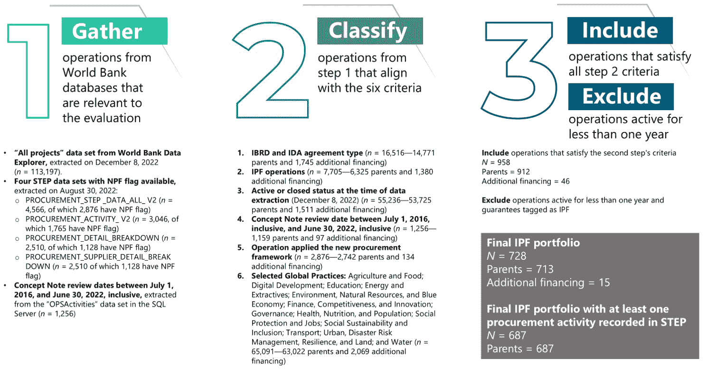

## Investment Project Financing Portfolio

The 687 identified projects (97 percent active) covered 86,647 procurement activities at the time of data extraction, 36,537 associated contracts, and $18.8 billion in contract amounts. About one-third of procurement activities have at least one signed contract, accounting for about $16.5 billion in signed contract amounts and covering 617 projects.

Although the bulk of procurement activities in the portfolio are post review activities (92 percent), they cover only one-third of contract amounts; in contrast, the remaining 8 percent of procurement activities are prior review activities covering the other two-thirds ($12.4 billion). Procurement of works accounts for 14 percent of procurement activities but 43 percent of contract volume, and procurement of consulting services accounts for 50 percent of all procurement activities but only 18 percent of contract volume (table C.1). In terms of contract amount levels, only 2 percent of procurement contracts are above $10 million, but they account for more than 50 percent of contract amounts in the portfolio. Contracts below $25 thousand account for 43 percent of contracts but a small amount (about 1 percent of contract amounts; table C.2). Most of the contracts in STEP are from FY21 onward. STEP includes fewer contracts for earlier years because contract processing increased during COVID-19, and projects did not consistently use STEP when it was first introduced. The distribution of procurement activities with signed contracts is relatively homogeneous across regions irrespective of contract size (figure C.2).

### Table C.1. Summary of Procurement in the Investment Project Financing Portfolio by Category and Review Type

| Review Type | Procurement Category | Projects (no.) | Activities (no.) | Contracts (no.) | Contract Amount (US$, millions) |
|---|---|---|---|---|---|
|  |  | All | Signed | All | Signed | All | Signed | All | Signed |
| Prior review | Consulting services | 531 | 317 | 4,484 | 1,313 | 1,663 | 1,345 | 2,252 | 1,634 |
| Post review | Consulting services | 669 | 560 | 39,162 | 11,434 | 14,071 | 12,905 | 1,167 | 1,049 |
| Subtotal | Consulting services | 674 | 583 | 43,646 | 12,747 | 15,734 | 14,250 | 3,419 | 2,682 |
| Prior review | Goods | 338 | 133 | 1,336 | 337 | 569 | 509 | 3,528 | 3,118 |
| Post review | Goods | 627 | 484 | 23,514 | 9,123 | 12,093 | 11,813 | 2,572 | 2,444 |
| Subtotal | Goods | 643 | 502 | 24,850 | 9,460 | 12,662 | 12,322 | 6,100 | 5,562 |
| Prior review | Works | 207 | 82 | 959 | 273 | 420 | 367 | 5,842 | 5,130 |
| Post review | Works | 429 | 240 | 10,936 | 2,512 | 3,326 | 3,198 | 2,328 | 2,164 |
| Subtotal | Works | 472 | 275 | 11,895 | 2,785 | 3,746 | 3,565 | 8,169 | 7,295 |
| Prior review | Nonconsulting services | 134 | 43 | 384 | 74 | 168 | 139 | 760 | 557 |
| Post review | Nonconsulting services | 468 | 295 | 5,872 | 1,680 | 4,227 | 4,144 | 355 | 332 |
| Subtotal | Nonconsulting services | 484 | 310 | 6,256 | 1,754 | 4,395 | 4,283 | 1,115 | 888 |
| Subtotal prior review |  | 606 | 394 | 7,163 | 1,997 | 2,820 | 2,360 | 12,381 | 10,439 |
| Subtotal post review |  | 678 | 593 | 79,484 | 24,749 | 33,717 | 32,060 | 6,422 | 5,989 |
| **Total** |  | **687** | **617** | **86,647** | **26,746** | **36,537** | **34,420** | **18,803** | **16,428** |
| Projects with no activities in STEP |  | 26 | — | — | — | — | — | — | — |
| **Grand total** |  | **713** | **617** | **86,647** | **26,746** | **36,537** | **34,420** | **18,803** | **16,428** |

*Source:* Independent Evaluation Group based on STEP data.

*Note:* Systematic Tracking of Exchanges in Procurement data were extracted on August 30, 2022. STEP = Systematic Tracking of Exchanges in Procurement; — = no information.

### Table C.2. Summary of Procurement in the Investment Project Financing Portfolio by Contract Amount Category

| Procurement Category | Contracts (no.) | Share (%) | Contract Amount (US$, millions) | Share (%) |
|---|---|---|---|---|
| **All contracts** |  |  |  |  |
| On or above US$30 million | 88 | 0.2 | 6,169 | 33 |
| US$10 million–US$30 million | 233 | 0.6 | 3,756 | 20 |
| US$4 million–US$10 million | 455 | 1.2 | 2,825 | 15 |
| US$2 million–US$4 million | 562 | 1.5 | 1,589 | 8 |
| US$1 million–US$2 million | 923 | 2.5 | 1,274 | 7 |
| US$500,000–US$1 million | 1,470 | 4.0 | 1,031 | 5 |
| US$210,000–US$500,000 | 2,791 | 7.6 | 902 | 5 |
| US$100,000–US$210,000 | 4,087 | 11.2 | 579 | 3 |
| US$50,000–US$100,000 | 5,161 | 14.1 | 372 | 2 |
| US$25,000–US$50,000 | 5,144 | 14.1 | 187 | 1 |
| Under US$25,000 | 15,623 | 42.8 | 117 | 1 |
| **Total** | **36,537** | **100.0** | **18,803** | **100** |
| **Signed contracts** |  |  |  |  |
| On or above US$30 million | 77 | 0.2 | 5,526 | 34 |
| US$10 million–US$30 million | 186 | 0.5 | 2,988 | 18 |
| US$4 million–US$10 million | 402 | 1.2 | 2,479 | 15 |
| US$2 million–US$4 million | 486 | 1.4 | 1,374 | 8 |
| US$1 million–US$2 million | 821 | 2.4 | 1,130 | 7 |
| US$500,000–US$1 million | 1,328 | 3.9 | 930 | 6 |
| US$210,000–US$500,000 | 2,531 | 7.4 | 816 | 5 |
| US$100,000–US$210,000 | 3,807 | 11.1 | 538 | 3 |
| US$50,000–US$100,000 | 4,874 | 14.2 | 351 | 2 |
| US$25,000–US$50,000 | 4,817 | 14.0 | 175 | 1 |
| Under US$25,000 | 15,091 | 43.8 | 121 | 1 |
| **Total** | **34,420** | **100.0** | **16,428** | **100** |

*Source:* Independent Evaluation Group based on Systematic Tracking of Exchanges in Procurement data.

*Note:* Systematic Tracking of Exchanges in Procurement data were extracted on August 30, 2022.

### Figure C.2. Contracts and Contract Amount by Fiscal Year since the Procurement Reform

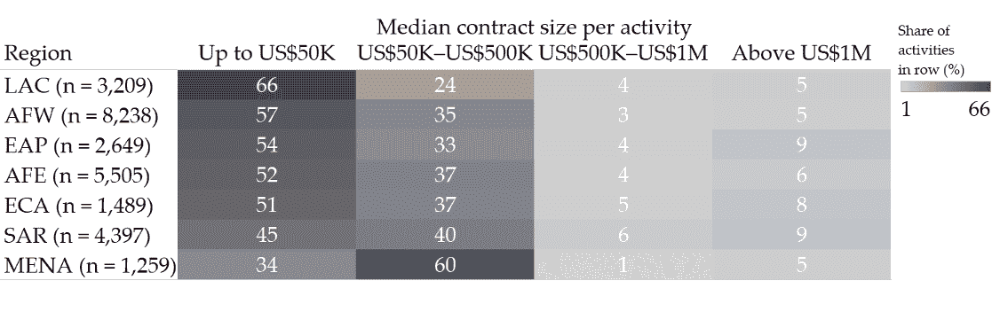

Contracts and contract amount by fiscal year since the procurement reform

a.

Share of procurement activities with signed contracts by Region and across contract size categories

b.

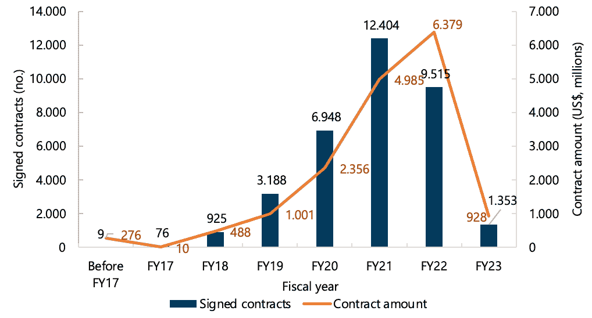

*Source:* Independent Evaluation Group based on Systematic Tracking of Exchanges in Procurement data.

*Note:* Systematic Tracking of Exchanges in Procurement data were extracted on August 30, 2022. Panel a: Two signed contracts without a contract signature date are excluded from the data shown. The total number of signed contracts in 617 projects is 34,418. Panel b: The total number of procurement activities with signed contracts in 617 projects is 26,746. AFE = Eastern and Southern Africa; AFW = Western and Central Africa; EAP = East Asia and Pacific; ECA = Europe and Central Asia; FY = fiscal year; K = thousand; LAC = Latin America and the Caribbean; M = million; MENA = Middle East and North Africa; SAR = South Asia.

## Portfolio Analysis of Procurement Principles

The analysis is organized according to indicators or measures that provide insight into World Bank projects’ achievement of the procurement principles (efficiency, economy, integrity, transparency, fairness, fit for purpose, and value for money). The indicator analysis for each principle is based on the literature and discussions with procurement experts (appendix B). The analysis is based on the projects detailed in tables C.1 and C.2 and uses Tableau, Stata, and Excel.

In addition, a composite measure is created for each procurement principle, which estimates the overall achievement of the principle in a project. To arrive at the composite measure, principal component analysis (PCA) is applied to identify the first principal component of a set of underlying indicators corresponding to each procurement principle, and this first principal component is then used to estimate the procurement principle’s composite measure.¹ The evaluation uses only the first component of each PCA to estimate the composite measure because it isolates the most important underlying indicators to estimate a project’s performance for each procurement principle. The choice of underlying indicators for each composite measure calculation is mostly theoretical and is based on two considerations: first, on the indicators found in the literature review that are relevant to each procurement principle and that we could calculate based on the available data; second, on the discussions with procurement experts to ensure the relevance and validity of the selected indicators.

Independent Evaluation Group World Bank Group    **175**

on available information in STEP; second, on findings from other methods applied in the evaluation, including case studies and the STEP portfolio analysis. In addition, the strength of Pearson correlation coefficients between underlying variables is statistically significant in numerous cases. The evaluation applies the following specific steps to arrive at the composite scores for each procurement principle: (i) the data are cleaned, ensuring that all indicators follow the same direction in their influence on procurement and their standardization (variables are transformed to have a mean equal to zero and standard deviation equal to 1); (ii) PCA is applied to each procurement principle, and the first principal component is used to generate a composite score; and (iii) an overall value-for-money composite score is estimated, defined as the average of the individual composite scores of the efficiency; economy; integrity, transparency, and fairness; and fit-for-purpose procurement principles. The different composite measures are then incorporated in a multivariate regression analysis to assess the procurement principles’ association with project implementation ratings. Table C.3 describes the list of indicators used for the PCA for each procurement principle.

## Table C.3. Systematic Tracking of Exchanges in Procurement Indicators Used to Estimate the Procurement Principles

| Variable Name | Definition |
|---|---|
| **Efficiency** |  |
| Turnaround time—overall (days) | Number of days between a procurement activity’s start date and its first contract signing date for all procurement. |
| Turnaround time—prior review (days) | Number of days between a procurement activity’s start date and its first contract signing date for prior review procurement only. |
| Turnaround time—post review (days) | Number of days between a procurement activity’s start date and its first contract signing date for post review procurement only. |
| Client process timeliness—prior review (days) | Number of days of client–World Bank interactions per procurement activity. It is only defined for prior review activities. |
| Delay time (days) | Actual days taken by a procurement activity to complete less original planned days to complete. |
| Share of signed contracts in the first active year of a project (%) | Share of signed contracts in the first active year of a project. |
| Share of post review procurement activities in a project (%) | Share of post review procurement activities in a project. |
| **Economy** |  |
| Share of innovative procurement features in a project (%) | Share of innovative procurement features in a project. Innovative procurement features include methods, approaches, and arrangements reported in STEP or in the World Bank operations portal and emphasized since the 2016 World Bank reform, including less commonly used procurement approaches. In total, the measure includes 12 innovative procurement features: alternative procurement arrangements, requests for proposals, rated criteria, best and final offer, negotiations, competitive dialogue, one-stage two-envelope bidding, e-auctions, service delivery contracts, public-private partnerships, performance-based conditions, and community-driven development. |
| Share of signed international contracts in a project (%) | Share of signed international contracts in a project. |
| Share of signed contracts using open market approach in a project (%) | Share of signed contracts using open market approach in a project. |
| Market risk rating of a project (1–4, higher is worse) | The market risk rating of a project is based on the market readiness risk rating available in the PRAMS report of each project. |
| Contracts awarded successfully in a project (no.) | Contracts awarded successfully include completed contracts, signed contracts, and contracts under implementation. |
| Procurement amendments in a project (no.) | Total number of procurement amendments in a project. |
| **Integrity, transparency, and fairness** |  |
| Project had a PPR in the previous fiscal year (binary) | Binary variable indicating if a project had a PPR to audit procurement in the previous fiscal year (= 1) or not (= 0). This is a static variable extracted with all other data on August 30, 2022, which implies the previous fiscal year measured is fiscal year 2021. |
| Project integrity rating (1–4, higher is worse) | Integrity ratings assess the risks associated with a project and determine the appropriate level of due diligence required. |
| Average time per project for a complaint to get resolved (days) | Average number of days per project for a procurement complaint to get resolved. |
| Average completion time per project for activities with standstill period (days) | Average number of days per project for activities with a standstill period to be completed. |
| Average activity risk rating per project (1–4, higher is worse) | The procurement activity risk rating is a method of assessing the level of risk associated with a specific procurement activity. The risk rating is based on the assessment of various factors, such as the value, complexity, and market responsiveness of the procurement, and the specific risks associated with the procurement process. The World Bank sets monetary thresholds for prior review based on procurement risk ratings, and the assessed activity and contract level risk determine whether procurement above the applicable thresholds shall be subject to post review and be included in the procurement plan. |
| **Fit for purpose** |  |
| PRAMS project risk ratings (1–4, higher is worse) | The PRAMS project risk rating is a qualitative assessment of the risk associated with the procurement aspects of a project. It is used to evaluate the likelihood and potential impact of procurement-related risks on the project’s implementation and outcomes. The risk rating is determined based on the reviewer’s professional judgment, taking into consideration the findings from the procurement review. The ratings assigned include an overall risk rating, a risk rating of the procurement system, a risk rating of the procurement process, and a risk rating of contract administration. |
| Procurement issues per project reported in ISRs (no.) | Number of procurement issues per project reported in ISRs. |
| Procurement staff per project (no.) | Procurement staff per project (team size) is calculated by aggregating individual procurement staff within each project, subject to procurement staff data available in Power BI. Procurement staff includes ADM staff and non-ADM staff. |
| Project procurement rating (1–5, higher is better) | The project procurement rating is a risk-based rating that assesses the procurement risk associated with a specific project. This rating takes into consideration the complexity and riskiness of the procurement activities involved in the project. The project procurement rating is used to determine the level of oversight and monitoring required for procurement activities and to guide the selection of contracts for review and evaluation. |
| Project has HEIS (binary) | Binary variable indicating if a project had HEIS (= 1) or not (= 0). |
| **Value for money** |  |
| Value-for-money composite score | The value-for-money composite score is an average of the individual composite scores of the efficiency; economy; integrity, transparency, and fairness; and fit-for-purpose procurement principles. These individual scores are, in turn, estimated through individual PCAs applied to each principle based on the underlying variables described in this table. |

*Source: *Independent Evaluation Group.

*Note: *Binary variables are used only in two instances in the PCA, with all other variables being continuous. The results are robust to adjusting the PCA methodology to account for the inclusion of binary variables. ADM = accountability and decision-making; HEIS = hands-on expanded implementation support; ISR = Implementation Status and Results Report; PCA = principal component analysis; PPR = procurement post review report; PRAMS = Procurement Risk Assessment and Management System; STEP = Systematic Tracking of Exchanges in Procurement.

The main limitation of the analysis is the quality of the STEP data. For example, projects do not fully report data in STEP for post review procurement, and databases are fragmented and do not include information on all relevant indicators. Moreover, clients have difficulty using the system (which limits their ability to enter accurate information), and the system lacks built-in quality control mechanisms. To mitigate these limitations, the Independent Evaluation Group cross-referenced databases to maximize observations across relevant indicators and identifiers, validated the findings against other evidence from the evaluation, and cross-checked the findings using numerous data quality verifications.

Independent Evaluation Group World Bank Group **179**

## Efficiency Procurement Principle

The evaluation builds on two main efficiency measures from the STEP data:

- (i) the number of days between a project’s approval date and its first contract signing date in different types of procurement activities (that is, first procurement), and
- (ii) the number of days between a procurement activity’s start date and its first contract signing date (that is, turnaround time).

Two versions of these two measures are calculated: the first shows actual days passed between the two dates, and the second shows actual days excluding outliers. Table C.4 reports all four versions of these two measures for reference. The version that shows actual days excluding outliers is used in all the figures and tables in this appendix and the report. We removed the outliers to account for possible data entry errors in STEP, providing a more conservative estimate of procurement time.

**180** Making Procurement Work Better Appendix C

### Table C.4. Two Main Efficiency Measures: Project Approval to First Contract Signing and Activity Start Date to First Contract Signing

| Procurement Category | Review Type | Minimum | 25th Percentile | Mean | Median | 75th Percentile | Maximum | Activities (no.) |
|---|---|---|---|---|---|---|---|---|
| **Project approval date to first contract signing date (first procurement): Actual days** | | | | | | | | |
| Consulting services | Prior review | 0 | 37 | 278 | 187 | 412 | 1,637 | 1,313 |
| | Post review | 0 | 0 | 206 | 169 | 306 | 1,315 | 11,434 |
| Goods | Prior review | 0 | 296 | 517 | 447 | 775 | 1,625 | 337 |
| | Post review | 0 | 0 | 198 | 137 | 329 | 1,474 | 9,123 |
| Works | Prior review | 0 | 253 | 504 | 449 | 671 | 1,684 | 273 |
| | Post review | 0 | 204 | 399 | 414 | 540 | 1,940 | 2,512 |
| Nonconsulting services | Prior review | 19 | 477 | 674 | 659 | 878 | 1,487 | 74 |
| | Post review | 0 | 172 | 434 | 424 | 628 | 1,610 | 1,680 |
| **Overall** (Prior review) | | 0 | 95 | 364 | 296 | 538 | 1,684 | 1,997 |
| **Overall** (Post review) | | 0 | 0 | 238 | 193 | 370 | 1,940 | 24,749 |
| **Overall** | | 0 | 0 | 247 | 201 | 380 | 1,940 | 26,746 |

*(continued)*

**181** Independent Evaluation Group World Bank Group

| Procurement Category | Review Type | Minimum | 25th Percentile | Mean | Median | 75th Percentile | Maximum | Activities (no.) |
|---|---|---|---|---|---|---|---|---|
| **Project approval date to first contract signing date (first procurement): Actual days excluding outliers** | | | | | | | | |
| Consulting services | Prior review | 0 | 37 | 258 | 187 | 396 | 1,003 | 1,286 |
| | Post review | 0 | 0 | 202 | 169 | 306 | 908 | 11,383 |
| Goods | Prior review | 0 | 296 | 514 | 447 | 770 | 1,573 | 336 |
| | Post review | 0 | 0 | 193 | 137 | 320 | 878 | 9,069 |
| Works | Prior review | 0 | 253 | 500 | 449 | 665 | 1,457 | 272 |
| | Post review | 0 | 204 | 392 | 412 | 533 | 1,313 | 2,497 |
| Nonconsulting services | Prior review | 274 | 480 | 640 | 609 | 779 | 1,153 | 65 |
| | Post review | 0 | 172 | 425 | 422 | 628 | 1,326 | 1,665 |
| **Overall** (Prior review) | | 0 | 95 | 348 | 296 | 523 | 1,573 | 1,959 |
| **Overall** (Post review) | | 0 | 0 | 233 | 189 | 368 | 1,326 | 24,614 |
| **Overall** | | 0 | 0 | 241 | 197 | 377 | 1,573 | 26,573 |

**Activity start date to first contract signing date (turnaround time): Actual days**

| Consulting services | Prior review | 0 | 54 | 220 | 162 | 338 | 1,124 | 1,313 |
| | Post review | 0 | 33 | 130 | 92 | 181 | 4,025 | 11,434 |

*(continued)*

**182** Making Procurement Work Better Appendix C

| Procurement Category | Review Type | Minimum | 25th Percentile | Mean | Median | 75th Percentile | Maximum | Activities (no.) |
|---|---|---|---|---|---|---|---|---|
| Goods | Prior review | 0 | 32 | 159 | 106 | 230 | 949 | 337 |
| | Post review | 0 | 9 | 54 | 34 | 73 | 1,616 | 9,123 |
| Works | Prior review | 0 | 56 | 247 | 218 | 358 | 987 | 273 |
| | Post review | 0 | 46 | 105 | 84 | 132 | 854 | 2,512 |
| Nonconsulting services | Prior review | 0 | 38 | 154 | 135 | 244 | 577 | 74 |
| | Post review | 0 | 16 | 64 | 41 | 78 | 762 | 1,680 |
| **Overall** (Prior review) | | 0 | 49 | 211 | 155 | 326 | 1,124 | 1,997 |
| **Overall** (Post review) | | 0 | 21 | 95 | 59 | 126 | 4,025 | 24,749 |
| **Overall** | | 0 | 21 | 104 | 63 | 135 | 4,025 | 26,746 |

**Activity start date to first contract signing date (turnaround time): Actual days excluding outliers**

| Consulting services | Prior review | 0 | 53 | 206 | 156 | 327 | 773 | 1,287 |
| | Post review | 0 | 30 | 108 | 85 | 162 | 395 | 10,877 |
| Goods | Prior review | 0 | 31 | 151 | 103 | 225 | 634 | 333 |
| | Post review | 0 | 9 | 44 | 31 | 66 | 187 | 8,753 |
| Works | Prior review | 0 | 54 | 238 | 217 | 358 | 742 | 269 |
| | Post review | 0 | 44 | 91 | 81 | 122 | 289 | 2,402 |

*(continued)*

**183** Independent Evaluation Group World Bank Group

| Procurement Category | Review Type | Minimum | 25th Percentile | Mean | Median | 75th Percentile | Maximum | Activities (no.) |
|---|---|---|---|---|---|---|---|---|
| Nonconsulting services | Prior review | 0 | 38 | 144 | 131 | 219 | 470 | 72 |
| | Post review | 0 | 12 | 35 | 31 | 54 | 97 | 1,359 |
| **Overall** (Prior review) | | 0 | 47 | 199 | 152 | 312 | 773 | 1,961 |
| **Overall** (Post review) | | 0 | 19 | 78 | 54 | 113 | 395 | 23,391 |
| **Overall** | | 0 | 20 | 88 | 57 | 122 | 773 | 25,352 |

*Source:* Independent Evaluation Group.

*Note:* Outliers are observations above the 75th percentile and below the 25th percentile of the distribution of activities in each pair of procurement category and review type categories (for example, consulting services and prior review), with the value of one and a half times the interquartile range of the corresponding speed measure. In the table section showing project approval date to first contract signing date (first procurement), the overall minimum first procurement processing time of zero days accounts for about 26 percent of activities; of this 26 percent, less than 1 percent have the same project approval date and first contract signing date, whereas over 99 percent have their first contract signing date occurring before the project approval date. In the latter case, first procurement processing time is converted to zero to avoid a negative first procurement processing time. In the table section showing activity start date to first contract signing date (turnaround time), the overall minimum turnaround time of zero days accounts for under 10 percent of activities; of this 10 percent, 15 percent have the same activity start date and first contract signing date, whereas 85 percent have their first contract signing date occurring before the activity start date. In the latter case, turnaround time is converted to zero to avoid a negative turnaround time. Zero-day turnaround time was most frequent at the start of COVID-19. It accounts for (i) almost 24 percent of procurement activities of projects approved in fiscal year 2020, (ii) over 16 percent of human development procurement activities, and (iii) over 16 percent of procurement of goods. These shares are well above other Practice Groups (Equitable Growth, Finance, and Institutions follows with 6.5 percent) and procurement categories (nonconsulting services category follows with 6.8 percent).

**184** Making Procurement Work Better Appendix C

## Time of First Procurement

The time span from a project’s approval to its first procurement contract signing ranges from immediately after approval to almost four and a half years for slower projects, depending on the procurement category and review type. Post review procurement typically progresses quicker at the start of the project, with a median of about six and a half months from project approval to first contract signing, suggesting that greater emphasis on post review since the 2016 reform has made processes faster. In contrast, the first prior review procurement in a project takes a median of about 10 months from project approval to contract signature (figure C.3).

### Figure C.3. Time Range of First Procurement Activity in a Project by Review Type

*Source:* Independent Evaluation Group.

*Note:* The figure shows projects’ first procurement speed statistics, with procurement speed measured by the number of actual days from a project’s approval date to its first procurement contract signing date within different procurement category and review type combinations (for example, the time between a project’s approval and its first contract signing in prior review activities for consulting services or the time between the same project’s approval and its first contract signing in post review activities for goods), adjusted for outliers. Fastest activities = minimum turnaround time; fast activities = 25th percentile of turnaround time; median activities = median turnaround time; slow activities = 75th percentile of turnaround time; slowest activities = maximum turnaround time. For post review, the speed measure’s minimum and 25th percentile values are both zero days. The total number of activities with signed contracts in 612 projects is 26,573.

After the project approval, the median time across contract size and activity risk levels for the first prior review procurement in a project is consistently longer (more days) than the first post review procurement. For example, the largest prior review procurement activities take over a year to start, and the smallest ones take nearly eight months. Post review activities are faster: five months for the largest and six months for the smallest. Similarly, high-risk first procurements are processed more quickly after project approval in the case of post review compared with prior review (figure C.4, panel a). The breakdown by procurement category shows additional patterns. Faster 

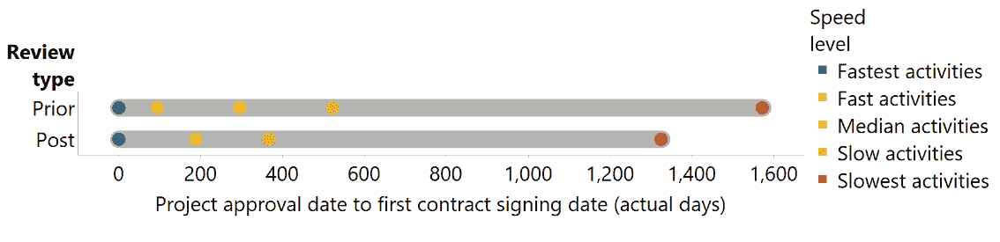

### Independent Evaluation Group World Bank Group

processing of high-risk procurement activities, compared with low-risk activities, occurs in all procurement categories except for works (such as construction). This suggests that some high-risk activities are prioritized early in projects (figure C.4, panel b).

### Figure C.4. Median Timeline of First Procurement in a Project by Review Type, Procurement Category, Activity Risk Rating, and Amount

*Source:* Independent Evaluation Group.

*Note:* The figure shows the median actual days from a project’s approval date to its first procurement contract signing date for each of the selected variables’ highest and lowest levels in the legend, adjusted for outliers. “On or above US$30M” denotes contracts with amount on or above US$30 million. “Under US$25K” denotes contracts with amount under US$25 thousand. “High activity risk” denotes procurement activity risk rated high. “Low activity risk” denotes procurement activity risk rated low. The total number of activities with signed contracts in 612 projects is 26,573. K = thousand; M = million.

First procurement in IDA countries is typically the slowest, with a median of about eight months from project approval to first procurement contract signing. The median time is followed by procurement in regional projects (seven months), projects in small states (just over six months), projects in fragile and conflict-affected situation (FCS) countries (five and a half months), and projects in IBRD or blend countries (five months). First procurement in projects led by the Sustainable Development Practice Group and the Infrastructure Practice Group is the slowest among Practice Groups, with a median of over nine months from project approval to first contract signing.

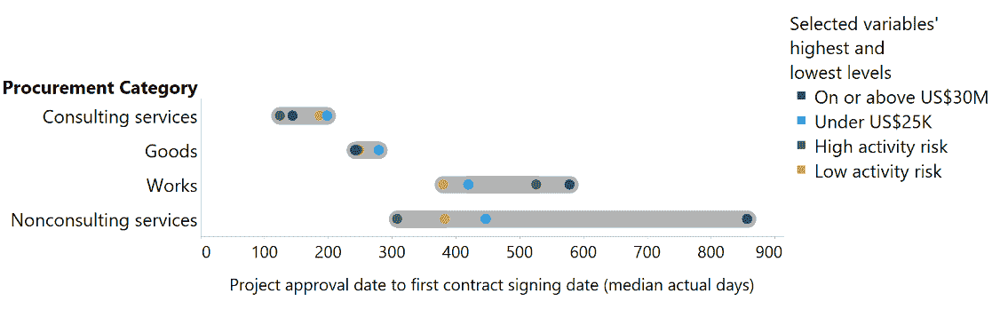

a. Review type

b. Procurement category

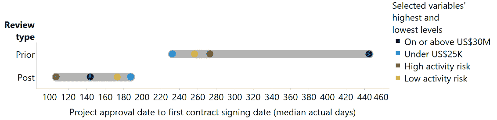

In contrast, first procurement in projects led by the Equitable Growth, Finance, and Institutions Practice Group and the Human Development Practice Group typically takes only between about four and five months until first contract signature (table C.5).

The importance of speedy first procurement in projects is highlighted by cumulative disbursements and cumulative signed contracts across time. Disbursements are preceded by the contract signature, indicating that efforts to sign first procurement contracts early in a project can lead to faster disbursements and thus to faster reach of beneficiaries through funds (figure C.5). The benefits of faster contract signing early on in project implementation compared with disbursement can be seen across the country groups and the Practice Groups alike. In line with this, we also report that the ratio of project disbursements to total project commitments at the midpoint of the expected duration of a project, increases with the share of procurement contract signing in the first active year of the project. For projects with no procurement contract signature taking place in their first active year, the average proportion of commitments disbursed by project midpoint is 13 percent. In contrast, for projects with at least one procurement contract signed in its first active year, the average proportion of commitments disbursed by project midpoint is 19 percent.

### Table C.5. First Procurement in Country and Practice Groups

| Country or Practice Group | Minimum | 25th Percentile | Mean | Median | 75th Percentile | Maximum | Activities (no.) |
|---|---|---|---|---|---|---|---|
| **Country group** |  |  |  |  |  |  |  |
| IDA | 0 | 17 | 259 | 240 | 431 | 1,518 | 7,926 |
| Regional | 0 | 42 | 238 | 207 | 338 | 1,365 | 2,389 |
| Small states | 0 | 6 | 213 | 188 | 306 | 1,361 | 1,749 |
| FCS | 0 | 0 | 230 | 163 | 360 | 1,573 | 6,452 |
| IBRD or blend | 0 | 0 | 241 | 144 | 370 | 1,457 | 8,057 |
| **Practice Group** |  |  |  |  |  |  |  |
| SD | 0 | 0 | 277 | 265 | 434 | 1,361 | 9,421 |
| INFRA | 0 | 0 | 270 | 208 | 429 | 1,457 | 2,774 |
| EFI | 0 | 0 | 203 | 144 | 331 | 1,573 | 3,717 |
| HD | 0 | 0 | 216 | 137 | 353 | 1,518 | 10,661 |

*Source:* Independent Evaluation Group.

*Note:* The table shows projects’ first procurement speed statistics, with procurement speed measured by the number of actual days from a project’s approval date to its first procurement contract signing date within different procurement category and review type combinations (for example, the time between a project’s approval and its first contract signing in prior review activities for consulting services or the time between the same project’s approval and its first contract signing in post review activities for goods), adjusted for outliers. The total number of activities with signed contracts in 612 projects is 26,573. The FCS countries are grouped separately from IDA and IBRD countries. EFI = Equitable Growth, Finance, and Institutions; FCS = fragile and conflict-affected situation; HD = Human Development; IBRD = International Bank for Reconstruction and Development; IDA = International Development Association; INFRA = Infrastructure; SD = Sustainable Development.

### Figure C.5. Cumulative Disbursements and Cumulative Signed Contracts across Time

*Source:* Independent Evaluation Group.

*Note:* The figure shows the cumulative disbursements and cumulative signed contracts across active years of the investment project financing portfolio. Cumulative disbursements are calculated by active year for each project based on project monthly disbursement data. Similarly, cumulative signed contracts are calculated for each active year of any project. In the figure, the line displays cumulative signed contracts, and the area displays cumulative disbursements. Total cumulative disbursements by the end of the period are US$15,200 million. Two signed contracts without a contract signature date are excluded. The total number of signed contracts in 617 projects is 34,418.

Most of the procurement is signed in year three of a project, which is late to start implementation on time. Only 25 percent of procurement is signed on average by the end of a project’s first year, accelerating in year two and peaking in year three (figure C.6). Since disbursements follow the contract signature, project financing is likely to reach beneficiaries no earlier than the project midpoint or later.

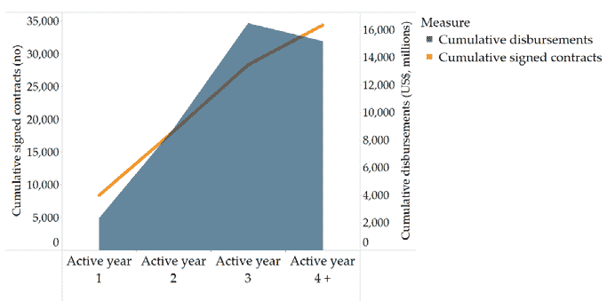

### Figure C.6. Share of Signed Contracts by Project Active Year

*Source:* Independent Evaluation Group.

*Note:* The total number of signed contracts in 617 projects is 34,418. Two signed contracts without a contract signature date are excluded from the figures.

### Turnaround Time for Procurement

The median procurement turnaround time is about two months (57 days) and varies across procurement categories and review types. Procurement of consulting services and works typically takes longer to process (about three months) compared with procurement of goods and nonconsulting services (one month). All procurement categories show slow activities that can take from just over a year (nonconsulting services) to over two years to process (works and consulting services). Prior review activities are often slower given their more complex nature, but post review activities can also be slow even after adjusting for outliers (figure C.7). The analysis of Implementation Status and Results Reports (ISRs; see appendix E) shows that projects often encounter issues that slow procurement. For example, in Nepal, a road connectivity project’s works activity took over two years to sign a contract because of challenges related to the bid evaluation report for the improvement of a highway section, COVID-19, and the paucity of staff in key positions, including procurement. Similarly, in Mozambique, a consulting services activity to design urban sanitation services took over two years to

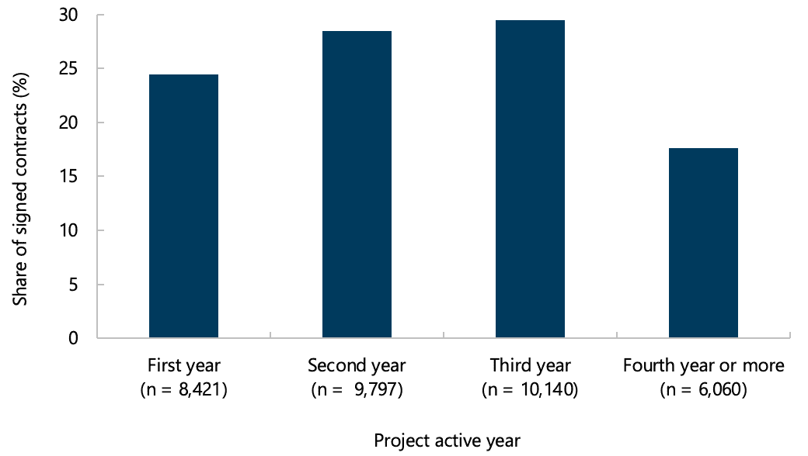

## Making Procurement Work Better — Appendix C

**190**

process because of issues with the quality of evaluation reports and the need to recruit a new client procurement specialist for the project.

**Figure C.7.** Turnaround Time by Review Type and Procurement Category

*Source:* Independent Evaluation Group.

*Note:* The figures show projects’ turnaround time statistics, with turnaround time measured by the number of actual days from an activity’s starting date to its first procurement contract signing date within different procurement category and review type combinations (for example, the time between an activity’s starting date and its first contract signing in prior review activities for consulting services or the time between the same activity’s starting date and its first contract signing in post review activities for goods), adjusted for outliers. Fastest activities = minimum turnaround time; fast activities = 25th percentile of turnaround time; median activities = median turnaround time; slow activities = 75th percentile of turnaround time; slowest activities = maximum turnaround time. The total number of activities in 614 projects with signed contracts is 25,352.

Small contract amounts process faster than higher-valued contracts, and lower-risk contracts process faster than higher-risk contracts (figure C.8). This finding is driven in part by procurement of works, with contracts of $30 million or above taking a median time of one year compared with a contract of $25 thousand or less, with the median time just over one and a half months. Post review is consistently faster for all types of procurement (figure C.8).

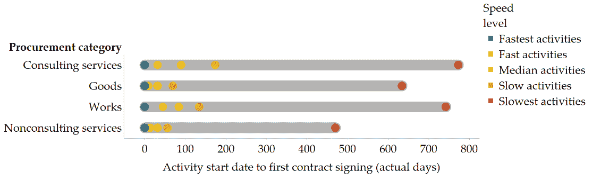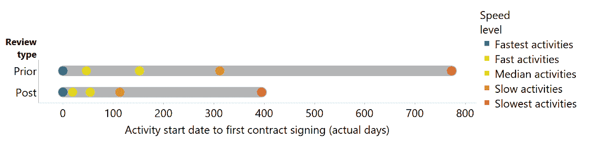

Review type  
a.

Procurement category  
b.

**191**

**Figure C.8.** Median Timeline of Turnaround Time by Review Type, Procurement Category, and Selected Features

*Source:* Independent Evaluation Group.

*Note:* The figures show projects’ first procurement speed statistics, with procurement speed measured by the number of actual days from an activity’s starting date to its first procurement contract signing date within different procurement category and review type combinations (for example, the time between an activity’s starting date and its first contract signing in prior review activities for consulting services or the time between the same activity’s starting date and its first contract signing in post review activities for goods), adjusted for outliers. The total number of activities in 614 projects with signed contracts is 25,352. K = thousand; M = million.

Some patterns related to turnaround time can be further disaggregated by country group. The longest average turnaround times are usually present in IDA countries, small states, and regional projects, and averages usually increase with the level of procurement activity risk, contract amount, and procurement issues reported in ISRs. FCS countries present fast turnaround times, likely reflecting the World Bank’s support through hands-on expanded implementation support (HEIS; figure C.9).

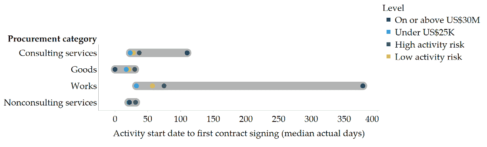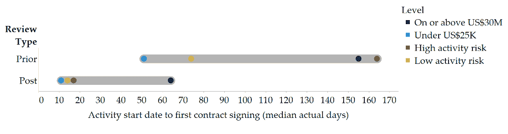

Review type  
a.

Procurement category  
b.

**192**

**Figure C.9.** Average Turnaround Time by Activity Risk, Contract Amount, and Procurement Issues in Implementation Status and Results Reports

*Source:* Independent Evaluation Group.

*Note:* The figures show projects’ first procurement speed statistics, with procurement speed measured by the number of actual days from an activity’s starting date to its first procurement contract signing date within different procurement category and review type combinations (for example, the time between an activity’s starting date and its first contract signing in prior review activities for consulting services or the time between the same activity’s starting date and its first contract signing in post review activities for goods), adjusted for outliers. The levels of issues in ISRs are as follows: low: 0 ≤ number of procurement issues in ISRs per project < 3; moderate: number of procurement issues in ISRs per project = 3; substantial: 3 < number of procurement issues in ISRs per project ≤ 6; high: 6 < number of procurement issues in ISRs per project ≤ 8. The total number of activities in 614 projects with signed contracts is 25,352. FCS = fragile and conflict-affected situation; IBRD = International Bank for Reconstruction and Development; IDA = International Development Association; ISR = Implementation Status and Results Report; K = thousand; M = million.

Turnaround time increases with procurement risk. The evaluation finds this increase for both procurement activity risk assessed in the procurement plan and project procurement risk as measured by the Procurement Risk Assessment and Management System. In turn, these two risk measures are positively and significantly correlated (figure C.10). Regardless of which

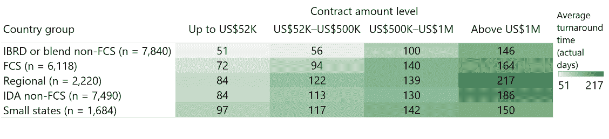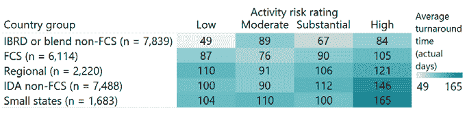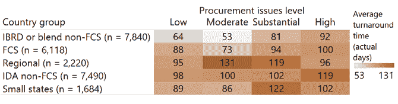

Procurement issues  
c.

Activity risk  
a.

Contract amount  
b.

**193**

available risk measure is used, procurement efficiency decreases as procurement risk increases.

**Figure C.10.** Procurement Activity Risk, Procurement Risk Assessment and Management System Risk, and Turnaround Time

*Source:* Independent Evaluation Group.

*Note:* The figure displays procurement activity risk ratings and PRAMS risk ratings as numeric values, with the former averaged across projects. The scatterplot shows the correlation between these two project-level measures and adds the average turnaround time as the size of the plotted circles: the larger the circles, the higher the turnaround time. Numeric equivalences to the original ratings are the following: 1 = low, 2 = moderate, 3 = substantial, and 4 = high. The Pearson correlation between the activity risk project average and the PRAMS risk rating is 0.47, significant at the 1 percent level. The total number of projects with signed contracts is 614. PRAMS = Procurement Risk Assessment and Management System.

Turnaround time varies across different types of procurement approaches. Of those frequently used, procurement through direct selection is the fastest, with a median time of half a month of processing, followed by requests for quotations, with a median time of one month, and by individual consultant selection and requests for bids, which take about three months to process. Community-driven development typically takes a month and a half to process and is the only innovative method with a turnaround time below the overall median of two months. Requests for proposals and public-private partnership methods are insufficiently used for meaningful comparison (table C.6).

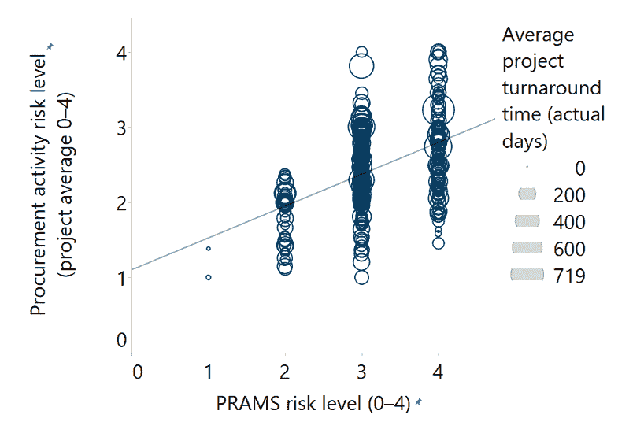

**194**

**Table C.6.** Turnaround Time by Procurement Approach

| Procurement Method | Mean | Minimum | 25th Percentile | Median | 75th Percentile | Maximum | Observations |
|---|---|---|---|---|---|---|---|
| E-auctions | 3 | 0 | 0 | 0 | 7 | 13 | 4 |
| Alternative procurement arrangement | 18 | 18 | 18 | 18 | 18 | 18 | 1 |
| Direct selection | 39 | 0 | 0 | 17 | 53 | 670 | 4,421 |
| Request for quotations | 46 | 0 | 19 | 37 | 62 | 438 | 7,162 |
| Community-driven development | 64 | 0 | 27 | 44 | 78 | 287 | 271 |
| United Nations agencies (direct) | 67 | 0 | 16 | 37 | 87 | 410 | 148 |
| Individual consultant selection | 105 | 0 | 33 | 84 | 153 | 694 | 7,988 |
| Force account | 112 | 38 | 38 | 112 | 186 | 186 | 2 |
| Request for bids | 115 | 0 | 60 | 98 | 146 | 742 | 3,083 |
| Nonprofit organizations | 137 | 47 | 109 | 147 | 190 | 190 | 5 |
| Consultant qualification selection | 159 | 0 | 88 | 141 | 222 | 553 | 1,263 |
| Request for proposals | 189 | 0 | 29 | 124 | 278 | 643 | 12 |
| Least cost selection | 206 | 0 | 137 | 202 | 268 | 460 | 145 |

*(continued)*

### Procurement Method

| Procurement Method | Mean | Minimum | 25th Percentile | Median | 75th Percentile | Maximum | Observations |
|---|---|---|---|---|---|---|---|
| Quality-based selection | 279 | 3 | 157 | 275 | 345 | 712 | 56 |
| Fixed budget selection | 311 | 0 | 193 | 245 | 375 | 694 | 54 |
| Quality- and cost-based selection | 314 | 0 | 218 | 301 | 374 | 773 | 733 |
| Public-private partnership | 397 | 263 | 268 | 322 | 526 | 680 | 4 |

*Source:* Independent Evaluation Group.

*Note:* The table shows projects’ first procurement speed statistics, with procurement speed measured by the number of actual days from an activity’s starting date to its first procurement contract signing date within different procurement category and review type combinations (for example, the time between an activity’s starting date and its first contract signing in prior review activities for consulting services or the time between the same activity’s starting date and its first contract signing in post review activities for goods), adjusted for outliers. The total number of activities in 614 projects with signed contracts is 25,352.

By year, the overall turnaround time for procurement is 81 days in FY23, 76 days in FY22, and 57 days in FY21. A time analysis by year of turnaround times is not possible because the STEP data for the first years of the reform have few contracts entered in the system. In addition, stakeholder interviews suggest that the learning curve in using STEP caused long delays in data entry by clients. Hence, the data for early contracts may overestimate the speed of procurement. To the extent that more recent numbers likely reflect turnaround time, the typical activity may take at least two and a half months to process (median time) instead of two months. Using the average, the typical turnaround time is about three and a half months with data from more recent years.

## Client Process Timelines for Procurement

Average client processing timelines are longest for consulting services and works. The slow processing of consulting services appears to relate to the lack of prioritization of the contract (which are often low risk and smaller amounts). Lower-risk procurement lags in projects and may affect implementation. Perhaps lower-risk procurement activities are not prioritized, whereas higher-risk procurement activities are emphasized for quicker procurement (figure C.11).

**Figure C.11.** Client Process Timeliness in Prior Review Activities

*Source:* Independent Evaluation Group.

*Note:* Client process timeliness is defined as the total number of days of client–World Bank interactions per procurement activity. It is defined only for prior review activities and has available information for 2,972 out of 7,163 activities (40 percent of prior review). Slow = 75th percentile cutoff value of the client process timeliness distribution within each row category. Moderate = 50th percentile cutoff value of the client process timeliness distribution within each row category. Fast = 25th percentile cutoff value of the client process timeliness distribution within each row category. The total number of prior review activities with available information on client process timeliness in 496 projects is 2,972.

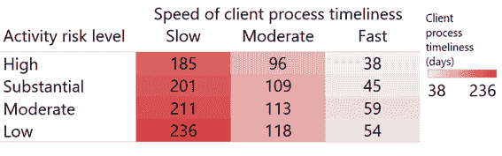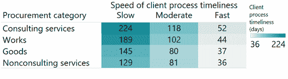

Procurement category

a. Activity risk

b.

Iterative exchanges between the client and the World Bank to review documents because of quality challenges can slow prior review procurement activities. Churning is the back-and-forth exchange between the client and World Bank staff to review or give feedback on procurement documents. Over 20 percent of prior review contracts experience churning when issuing no objections on procurement process steps, with a need to add missing information or a challenge of document quality. Churning is highest for consulting services in countries with very low procurement capacity, and the data likely capture an estimate as some iterations happen outside of STEP. Other iterations are often for large contracts (figure C.12).

**Figure C.12.** Share of Contracts in Prior Review Activities with Churning When Issuing No Objections by Procurement Category

*Source:* Independent Evaluation Group.

*Note:* The figure shows shares of contracts with back-and-forth iteration (churning) when issuing no objections on procurement process steps. Churning is defined as no objections that are not cleared, request additional information, have an interim response, are recalled, respond with comments, return for review, or are recalled for review. When there is churning, further interaction between World Bank staff and the client is needed to review the procurement activity and provide no objection. For contracts subject to prior review, the client submits documents to the World Bank for its review and no objection. A no objection is needed before proceeding to the next stage of the procurement process. The total number of contracts mapped to 1,846 prior review activities with available information on no objections in 381 projects is 2,169.

## Time Spent on Procurement Steps

Slowdowns in procurement processing stages can delay projects and indicate areas for streamlining procurement. Projects process terms of reference, evaluate bids, and award contracts to advance their procurement activities—all constituting stages in procurement processing. Early document drafting stages and subsequent bid evaluation stages of a procurement process account for a substantive portion of a project’s procurement time and are seen across procurement categories. Drafting bidding documents for goods, works, and nonconsulting services and terms of reference for consulting services can take more than half of the total procurement time of a slow project (consulting services) and no less than 13 percent of time for a fast project (goods). The evaluation stage can hinder procurement processing, especially for consulting services. For example, a slow project can spend half the project’s procurement time in the evaluation stage of a consulting services activity, and even a fast project will take as much as 30 percent of the time. Award notification and contract signing, while not under full control of the World Bank, can be problematic for procuring goods, works, and nonconsulting services, taking a disproportionate amount of time (as much as 40 percent of the procurement time in a slow project). Delays in contract signing may relate to negotiation of the timing or cost of the contract, risk of political interference, or delays to secure guarantees (figure C.13).

**Figure C.13.** Contribution of Procurement Stages (Steps) to Projects’ Procurement Time

*Source:* Independent Evaluation Group.

*Note:* The figure shows shares of project procurement time across procurement steps and for each procurement category. The darker the color, the higher the share of time contributed by the corresponding procurement step to the project’s total procurement time. The share of project procurement time is calculated by aggregating the total number of days taken by a project to process procurement (the denominator) and the total number of days taken by each procurement step within activities of that same project to process (the numerator). Statistics are then calculated for these shares within each procurement step and for each procurement category. The rows in the figures reflect these statistics, where slow = 75th percentile of the share of project procurement time spent in a particular step across procurement activities; moderate = 50th percentile of the share of project procurement time spent in a particular step across procurement activities; and fast = 25th percentile of the share of project procurement time spent in a particular step across procurement activities. The total number of completed activities in 632 projects is 14,679.

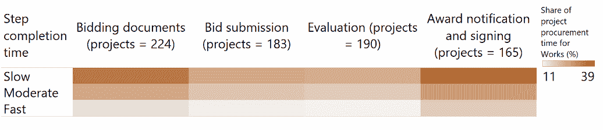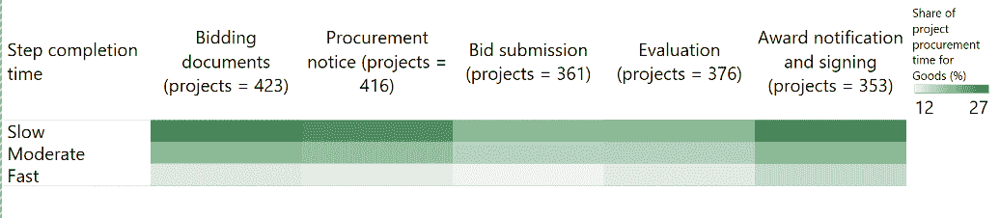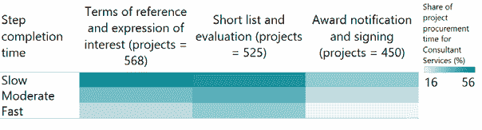

Works c. Consulting services a. Goods b. Nonconsulting services d.

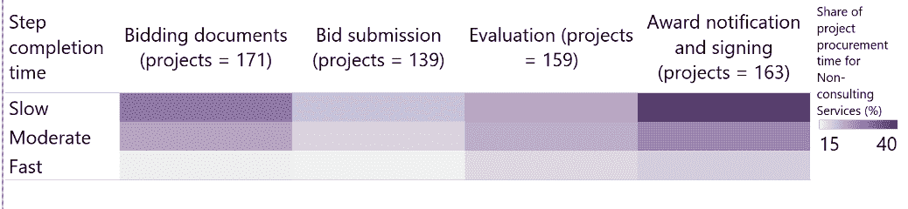

## Appendix C

Amendments can cause additional delays in procurement. The median amendment duration is over two and a half months (82 days), regardless of amendment type. Consulting services activities take the longest time, with a median of 110 days for an amendment to process, followed by works with 84 days, goods with 73 days, and nonconsulting services with 37 days.

Amendments in consulting services and goods are often contract amendments; works amendments commonly consist of changes in bidding documents, and nonconsulting services amendments are often changes to prequalification documents. Most amendments are changes to contract details, bidding documents, requests for proposals, and requests for quotations (figure C.14).

**Figure C.14. Type of Amendments in Completed Activities by Procurement Category**

*Source:* Independent Evaluation Group.

*Note:* The figure shows amendment type shares of the total number of activities with procurement amendment steps, within each procurement category. The total number of completed activities with amendments in 313 projects is 1,013.

The estimated success rate of procurement activities in STEP is about 70 percent overall. Post review is more successful than prior review as per the available data (71 percent success rate compared with 62 percent), although procurement activities that were stopped or restarted because of issues such as inadequate bidding may lack adequate documentation.

FCS countries have the highest rate of successful procurement processing, whereas small states have the lowest (figure C.15). Procurement in FCS countries has had HEIS and other expert support to ease procurement processes for clients.² Although these procurements may eventually be completed (as the evaluation assesses an active portfolio), the case studies suggest that a challenge for projects is stopping procurement activities and then reentering them in STEP, often because of unsuccessful competitive processes.

**Figure C.15. Procurement Success Rate for Prior Review Activities by Country Group**

*Source:* Independent Evaluation Group.

*Note:* The success rate of procurement activities is defined as activities with contracts that have one of the following statuses: completed, signed, under implementation, or pending implementation. Activities are tagged accordingly as being successful or not yet successful. The figure reports the share of successful prior review activities by country group. The total number of prior review activities in 606 projects is 7,163. FCS = fragile and conflict-affected situation; IBRD = International Bank for Reconstruction and Development; IDA = International Development Association.

## Overall Efficiency of the Project Portfolio

The composite score measuring efficiency shows good achievement of the principle in projects. The indicators used in the composite analysis for the PCA were project averages of overall turnaround time, turnaround time for prior review, turnaround time for post review, client process timeliness for prior review activities, number of days procurement is delayed compared with the original planned days, share of signed contracts in the first active year of a project, and share of post review procurement activities in a project. The most important indicators contributing to the composite efficiency score of a project are turnaround time and client processing timeliness (figure C.16, panel a). Most projects are at the higher end of the score, although the tail of projects with lagging efficiency is long (figure C.16, panel b).

When comparing the overall efficiency scores, the evaluation finds that more efficient projects have high shares of post review procurement, shorter timelines, fewer delays, less market risk, and fewer international contracts, and may make trade-offs by taking on more direct or limited market approaches.

By region, Latin America and the Caribbean and Western and Central Africa, followed by Europe and Central Asia, have the highest efficiency, but this pattern is influenced by HEIS provided to low procurement capacity countries, including FCS, which are good performers in terms of efficiency. HEIS is successfully increasing the speed of procurement in projects so that these procurements resemble or surpass the speed of those in higher procurement capacity countries.

In contrast, less efficient projects have longer timelines for processing procurement, more delays, and less success in carrying out procurement activities; use more competitive and international approaches; and have more prior reviews of procurement by the World Bank. Improving efficiency further may require targeted support to low-efficiency projects, simplified processes for market engagement, and consideration of the cost benefits of prior review in the context of a project (table C.7).

By Practice Group, Infrastructure stands out with a higher number of low-efficiency projects. By lending group, IDA countries stand out with a higher number of low-efficiency projects. Low procurement capacity countries without HEIS stand out as having especially low efficiency.

**Figure C.16. Efficiency Composite Measure: Principal Component Analysis Results and Distribution across Projects and by Practice Group, Country Group, and Region**

Principal component analysis results for underlying indicators in the composite measure

a. Distribution of composite efficiency scores across projects

b. Composite efficiency scores by Practice Group

c. Composite efficiency scores by country group

d. Composite efficiency scores by Region

e.

*Source:* Independent Evaluation Group.

*Note:* Panel a shows the rotated factor loadings matrix resulting from the principal component analysis (varimax or orthogonal rotation is applied). These rotated factor loadings range between −1 and 1, with higher absolute values indicating a stronger association between the underlying variable in the row and the corresponding principal component in the column; the first principal component column is highlighted because it is the one used for estimating the composite measure of the efficiency procurement principle.

As a rule of thumb, values above the absolute value of 0.4 indicate that the variable is strongly associated with the component, and values below that absolute value indicate that the variable is weakly associated with the component. In general, factor loadings are the coefficients that represent the correlation between the underlying variables and the principal components, and rotated factor loadings are a transformed version that maximize the variance of squared loadings of each component across variables, which facilitates interpretation of the relationship between the variables and the components by producing more distinct components. That is, compared with the original factor loadings, in rotated factor loadings each component loads highly on a smaller number of variables.

Uniqueness, ranging from 0 to 1, where higher values are worse, represents the amount of variability in each variable that is unique to that variable and not shared with the other variables through the components. Lower values (lower uniqueness) indicate that the components explain a substantial portion of the variance in the variables, suggesting a good model fit.

The principal component analysis shows that the first principal component (component 1) explains 35 percent of the cumulative variance of the underlying variables and that the first three principal components, which have eigenvalues equal to 1 or above, explain 67 percent of the cumulative variance of the underlying variables (these latter results are not shown in panel a). Principal components with eigenvalues of 1 or above explain at least the equivalent of one variable’s variance and are thus the ones relevant for data reduction.

Panel b shows the distribution of the estimated composite measure (score) for the efficiency procurement principle, which is calculated based on the first principal component highlighted in panel a. Panels c, d, and e show the shares of projects for the corresponding row category by efficiency composite score levels, which are broken down by quartiles. Panel e excludes one Regional project.

AFE = Eastern and Southern Africa; AFW = Western and Central Africa; EAP = East Asia and Pacific; ECA = Europe and Central Asia; EFI = Equitable Growth, Finance, and Institutions; FCS = fragile and conflict-affected situation; HD = Human Development; IBRD = International Bank for Reconstruction and Development; IDA = International Development Association; INFRA = Infrastructure; LAC = Latin America and the Caribbean; MENA = Middle East and North Africa; SAR = South Asia; SD = Sustainable Development.

## Independent Evaluation Group World Bank Group 205

### Table C.7. Selected Variables across Projects by Overall Efficiency Score

| Variable | Efficiency Score of Projects | Low | Moderate | Substantial | High |
|---|---|---|---|---|---|
| Turnaround time (days) |  | 191 | 119 | 90 | 55 |
| Delay days |  | 197 | 118 | 89 | 76 |
| Market risk |  | Substantial | Moderate | Moderate | Moderate |
| Innovative procurement approaches (%) |  | 7 | 9 | 7 | 6 |
| International contracts (%) |  | 22 | 9 | 7 | 4 |
| Open market approach (%) |  | 67 | 62 | 53 | 33 |
| Post review (%) |  | 79 | 89 | 89 | 87 |
| Issues reported in Implementation Status and Results Reports |  | High | Low | Low | Very low |
| Procurement signed in the first fiscal year of projects (%) |  | 18 | 22 | 28 | 47 |

*Source:* Independent Evaluation Group.

*Note:* The table shows project averages of the different row variables across efficiency score levels that are broken down by quartiles. Market risk ratings are low, moderate, substantial, and high.

## Economy Procurement Principle

### Procurement Approaches

The 2016 reform introduced innovative procurement approaches, but their use remains low. Less than 20 percent of projects in most Global Practices use these approaches at a high rate. There is a slightly higher use of innovative approaches in Equitable Growth, Finance, and Institutions and Human Development and in IDA countries. Moreover, evidence does not show that HEIS supports the implementation of innovations despite its potential to do so. Evidence also does not indicate that the use of innovative approaches differs significantly between prior and post review procurement activities or between national and international market approaches (figure C.17).

### Figure C.17. Use of Innovative Procurement Approaches in Projects by Review Type, Market Approach, and Hands-on Expanded Implementation Support

*Source:* Independent Evaluation Group.

*Note:* The figures show shares of activities (review type and market approach figures; panels a and b, respectively) or projects (panel c) by levels of innovative procurement features. Innovative procurement features include methods, approaches, and arrangements reported in Systematic Tracking of Exchanges in Procurement or the World Bank operations portal and emphasized since the 2016 World Bank reform, including less commonly used procurement approaches. In total, the measure includes 12 innovations: alternative procurement arrangements, requests for proposals, rated criteria, best and final offer, negotiations, competitive dialogue, one-stage two-envelope bidding, e-auctions, service delivery contracts, public-private partnerships, performance-based conditions, and community-driven development. Innovations range between 0 and 4 per project. Low = 0 innovative features; moderate = 1 innovative feature; high = more than 1 innovative feature. The total number of activities for review type and market approach is 86,647 (panels a and b); the total number of projects for HEIS is 713 (panel c). HEIS = hands-on expanded implementation support.

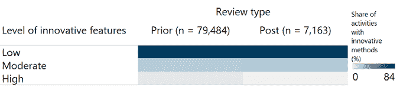

c. Hands-on expanded implementation support

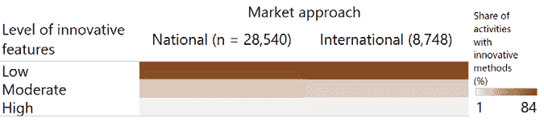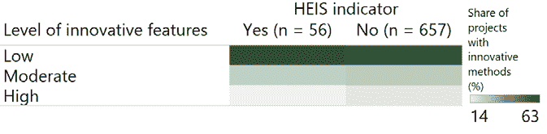

a. Use of innovative procurement approaches by review type

b. Use of innovative procurement approaches by market approach

Approaches such as rated criteria, prequalification, and negotiations are not widely used. In total, clients used rated criteria in the procurement of works, goods, and nonconsulting services in only about 2 percent of procurement activities, although use is highest in international requests for proposals (about 20 percent), which is the focus of the World Bank’s mandate to increase use of rated criteria for improving the quality of suppliers. Prequalification—another approach that could support quality by identifying qualified suppliers—is used in less than 1 percent of all requests for bids and in about 3 percent of requests for bids with international contracts. The use of negotiations and best and final offer remains limited (1 percent of all requests for bids and 24 percent of requests for proposals), especially in post review procurement (about 1 percent). Best and final offer and negotiation aim to help the client better engage with the bidder around quality technical details and the value of the contract.

United Nations contracting is most common in IDA and IBRD contexts. United Nations contracting is used in about 15 percent of projects, especially in Human Development (25 percent). United Nations contracting is less used in FCS contexts, despite the potential benefits seen in case studies. It is important for quick contracting of services and procurement of goods.

Most projects use simple procurement approaches that differ slightly by review type and country type (figure C.18). Most consulting services use individual contracts based on terms of reference. Goods and nonconsulting services commonly use requests for quotations. Works use requests for bids without rated criteria. These are approaches common before the reform, suggesting that trade-offs may need to be made to change what approaches are used. Prior review activities focus more than their post review counterparts on consultant quality- and cost-based selection. In prior reviews of international contracts, using requests for bids is overwhelmingly important for goods, works, and nonconsulting services. Projects in FCS countries tend to use more requests for quotations, whereas small states use more individual consultant contracts. IBRD and blend countries use requests for bids without rated criteria.

### Figure C.18. Use of Procurement Approaches by Review Type and Country Group

*Source:* Independent Evaluation Group.

*Note:* The figures show the share of procurement approaches used by procurement activities by review type and country groups. The total number of activities with available information on procurement approaches in 681 projects is 75,369. FCS = fragile and conflict-affected situation; IBRD = International Bank for Reconstruction and Development; IDA = International Development Association.

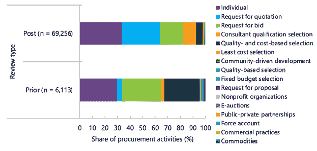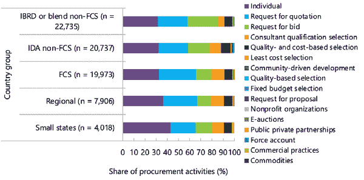

a. Use of procurement approaches by review type

b. Use of procurement approaches by country group

Over 90 percent of requests for proposals, requests for quotations, and requests for bids is done in one stage rather than two. In two-stage bidding, contractors submit a preliminary bid, and then the project invites the most qualified contractors to submit a more detailed bid based on project requirements. In contrast, in one-stage bidding, contractors submit only one final bid for review. Moreover, the bidding process typically uses one envelope (over 90 percent of procurement activities), rather than two—that is, the bidder submits all technical and financial information at once, rather than separating it.

## Enabling Competition in Procurement

About half of the procurement uses open competitive approaches, one-third uses limited approaches where suppliers are invited, and the remaining uses direct procurement without competition. The use of limited approaches is most common for goods and nonconsulting services, consistent with the lower supplier diversity findings. The use of open market approaches is lower in FCS countries, as expected. Direct approaches are most common in nonconsulting services (figure C.19).

### Figure C.19. Use of Market Approaches by Procurement Category

*Source:* Independent Evaluation Group.

*Note:* The figure shows the share of procurement activities by procurement category and market approach. The total number of activities with available information on market approach in 687 projects is 86,320.

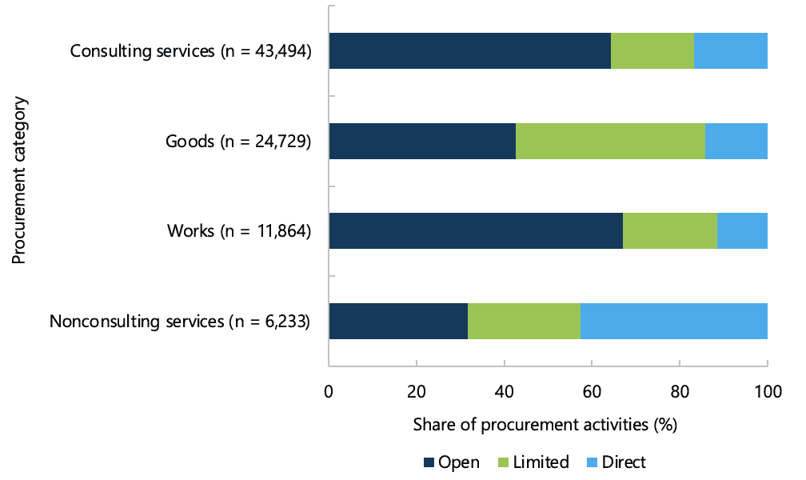

Using competitive market approaches comes at the cost of processing speed. Over 40 percent of procurement activities with an open market approach are very slow to process (taking more than 4 months). In contrast, over half of activities with a direct market approach are very fast to process (taking 19 days or less), and activities with limited market approaches find themselves somewhere in the middle (figure C.20).

**210**

Making Procurement Work Better  Appendix C

**Figure C.20. Use of Market Approaches and Processing Speed: Turnaround Time**

*Source: Independent Evaluation Group.*

*Note: The figure shows shares of activities within each type of market approach by level of turnaround time. Turnaround time levels are based on quartiles of its distribution across activities. Very slow: turnaround time ≥ 122 days; slow: 57 days ≤ turnaround time ≤ 121 days; fast: 20 ≤ turnaround time ≤ 56; very fast: zero days ≤ turnaround time ≤ 19 days. The total number of activities with available information on market approach and turnaround time in 614 projects with signed contracts is 25,258.*

Prior review activities are more often international (45 percent), and post review activities are national (35 percent). The highest number of activities with international contracts (covering both prior and post review activities) are in FCS and IDA countries (28 and 27 percent, respectively), whereas IBRD countries account for 22 percent of activities with international contracts.

Bids on prior review procurement activities differ across categories and country types (figure C.21). Procurement of nonconsulting services and works attracts more bidders than other categories. Nevertheless, open processes receive a small number of average bids, although the range in the number of bids across activities is large. Some bidding data may not be consistently reported in STEP to track bid competition. Overall, the low bids recorded in the system raise concerns about the effective use of market analysis or capacity to attract and develop competition. Competition may be especially challenging in FCS and small island states. These two country groups show the lowest average number of bidders per prior review open market approach activity, with four and three bidders per activity, respectively.

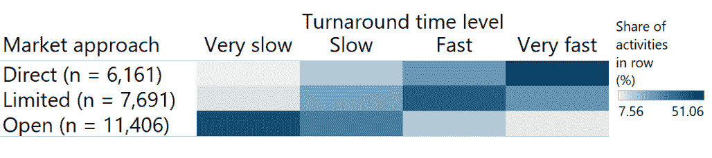

**211**

Independent Evaluation Group World Bank Group

**Figure C.21. Average Number of Bidders in Prior Review Activities with Open Market Approach by Procurement Category**

*Source: Independent Evaluation Group.*

*Note: The figure shows the average number of bidders per procurement activity, by procurement category and for prior review procurement with open market approach only. The total number of prior review activities with open market approach in 409 projects is 2,003.*

Only about one-third of open procurement in countries had repeat bidders, suggesting good diversity in finding new bidders for contracts. The reselection of the same bidder was highest for goods (almost 50 percent), suggesting some repeat use of suppliers by projects in countries. The number of unique suppliers supporting projects in countries is lowest in small states, FCS, and IBRD contexts, which may relate to the challenge of finding qualified suppliers, limited use of market analysis, or repeat use of the same suppliers. By sector, agriculture, public administration, and human development had the greatest number of unique suppliers, and finance, energy and extractives, and transport the least (figure C.22).

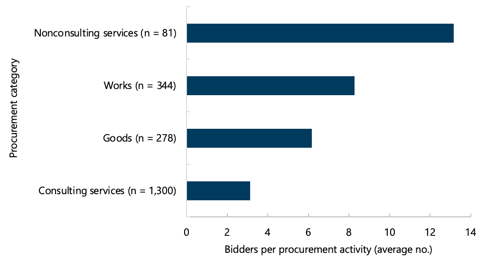

**212**

Making Procurement Work Better  Appendix C

**Figure C.22. Supplier Diversity in Countries and Sectors**

*Source: Independent Evaluation Group.*

*Note: Panel a shows the share of countries by level of average unique suppliers per project, where terciles of the distribution across countries define levels. Low: average unique suppliers per project < 41; moderate: 41 ≤ average unique suppliers per project < 82; high: average unique suppliers per project ≥ 82. Panel b shows the difference between the average number of unique suppliers in sectors and the overall country average (that is, global average) of this same measure. The total number of countries with available information on suppliers in 640 projects is 109.*

According to STEP data, 12 percent of projects have at least one rejected bid. However, case study findings suggest that bid rejection may be more common than recorded in STEP. With that caveat in mind, bid rejections seem more frequent in projects in IDA countries (14 percent) and FCS countries (12 percent). Case studies suggest that greater effort is often needed to identify qualified suppliers when using open market approaches.

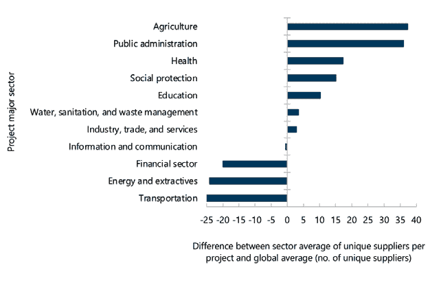

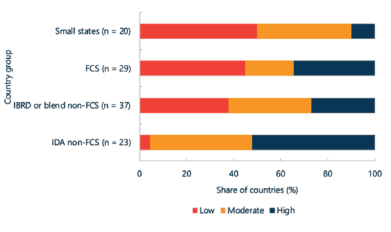

Share of countries with different levels of unique suppliers per project

a.

Difference between unique suppliers per project in sectors and the average across countries

b.

**Cost of Procurement**

The cost of contracts varies by Practice Group. Human Development accounts for almost 40 percent of signed contract amounts ($6.3 billion), followed by Infrastructure with more than 30 percent ($5.1 billion; figure C.23). Infrastructure also has the largest average contract size—US$1.6 million—that increases to $8.3 million for prior review activities. Human Development had the largest contract of $390 million (table C.8), and Human Development contracts increased during COVID-19. International contracts account for 35 percent of signed contract amounts ($5.8 billion).

**Figure C.23. Signed Contract Amounts by Practice Group and Review Type**

*Source: Independent Evaluation Group.*

*Note: The total number of signed contracts worth US$16,428 million in 617 projects is 34,420. EFI = Equitable Growth, Finance, and Institutions; HD = Human Development; INFRA = Infrastructure; SD = Sustainable Development.*

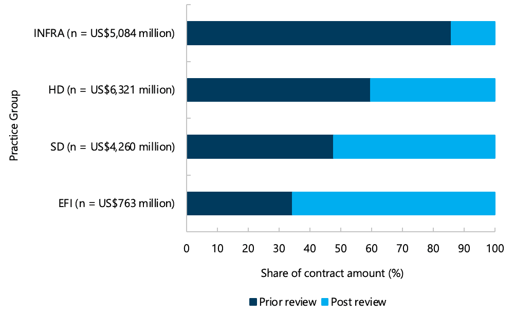

**214**

Making Procurement Work Better  Appendix C

**Table C.8. Signed Contract Amounts: Statistics by Practice Group and Review Type**

| Practice Group | Minimum | 25th Percentile | Mean | Median | 75th Percentile | Maximum | Contracts (no.) |
|---|---:|---:|---:|---:|---:|---:|---:|
| **All contract amounts (US$, millions)** |  |  |  |  |  |  |  |
| INFRA | 0.00 | 0.03 | 1.64 | 0.07 | 0.36 | 288.61 | 3,109 |
| HD | 0.00 | 0.00 | 0.41 | 0.03 | 0.11 | 390.00 | 15,442 |
| SD | 0.00 | 0.01 | 0.36 | 0.03 | 0.12 | 128.82 | 11,757 |
| EFI | 0.00 | 0.01 | 0.19 | 0.03 | 0.09 | 64.14 | 4,112 |
| Overall | 0.00 | 0.00 | 0.48 | 0.03 | 0.11 | 390.00 | 34,420 |
| **Prior review contract amounts (US$, millions)** |  |  |  |  |  |  |  |
| INFRA | 0.00 | 0.32 | 8.28 | 1.50 | 7.27 | 288.61 | 528 |
| HD | 0.00 | 0.14 | 5.61 | 0.83 | 3.43 | 390.00 | 673 |
| SD | 0.00 | 0.07 | 2.30 | 0.22 | 1.10 | 116.34 | 883 |
| EFI | 0.00 | 0.05 | 0.95 | 0.24 | 0.81 | 12.46 | 276 |
| Overall | 0.00 | 0.10 | 4.42 | 0.48 | 2.72 | 390.00 | 2,360 |
| **Post review contract amounts (US$, millions)** |  |  |  |  |  |  |  |
| INFRA | 0.00 | 0.02 | 0.28 | 0.05 | 0.17 | 30.51 | 2,581 |
| SD | 0.00 | 0.01 | 0.20 | 0.03 | 0.10 | 128.82 | 10,874 |
| HD | 0.00 | 0.00 | 0.17 | 0.02 | 0.10 | 59.09 | 14,769 |
| EFI | 0.00 | 0.01 | 0.13 | 0.03 | 0.08 | 64.14 | 3,836 |
| Overall | 0.00 | 0.01 | 0.19 | 0.03 | 0.10 | 128.82 | 32,060 |

*Source: Independent Evaluation Group.*

*Note: The table shows statistics of signed contract amounts by Practice Group and review type (in US$, millions). The total number of signed contracts worth US$16,428 million in 617 projects is 34,420. EFI = Equitable Growth, Finance, and Institutions; HD = Human Development; INFRA = Infrastructure; SD = Sustainable Development.*

**216**

Making Procurement Work Better  Appendix C

The cost of contracts varies by procurement category. Works account for 44 percent of all signed contract amounts ($7.3 billion), followed by goods with 34 percent ($5.6 billion), consulting services with 16 percent ($2.7 billion), and nonconsulting services with 5 percent ($888 million). More than 70 percent of works contracts are prior review (the highest share), although prior review is prominent across procurement categories (figure C.24). Works also accounts for the largest average contract size of $2 million, again increasing substantially in prior review contracts to $14 million; the typical works post review contract is also large at $3.6 million (table C.9). Works contracts account for 65 percent of international contracts ($3.8 billion) followed by consulting services with 19 percent ($1.1 billion). Goods and nonconsulting services account only for 14 percent and 3 percent of international contracts, respectively.

**Figure C.24. Signed Contract Amounts by Procurement Category and Review Type**

*Source: Independent Evaluation Group.*

*Note: The total number of signed contracts worth US$16,428 million in 617 projects is 34,420.*

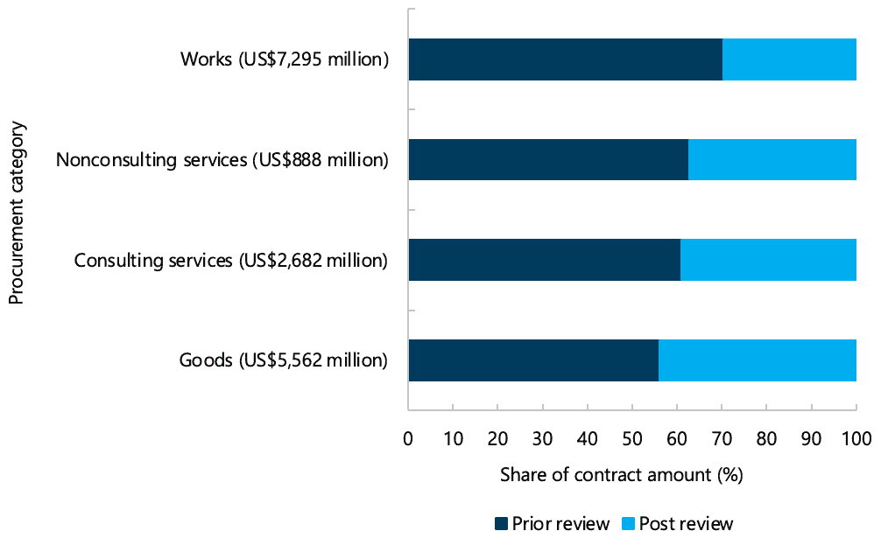

## Table C.9. Signed Contract Amounts: Statistics by Procurement Category and Review Type

| Procurement category | Minimum | 25th percentile | Mean | Median | 75th percentile | Maximum | Contracts (no.) |
|---|---:|---:|---:|---:|---:|---:|---:|
| **All contract amounts (US$, millions)** | | | | | | | |
| Works | 0.00 | 0.06 | 2.05 | 0.18 | 0.72 | 288.61 | 3,565 |
| Goods | 0.00 | 0.01 | 0.45 | 0.04 | 0.11 | 390.00 | 12,322 |
| Nonconsulting services | 0.00 | 0.00 | 0.21 | 0.00 | 0.02 | 85.36 | 4,283 |
| Consulting services | 0.00 | 0.01 | 0.19 | 0.03 | 0.09 | 64.14 | 14,250 |
| Overall | 0.00 | 0.00 | 0.48 | 0.03 | 0.11 | 390.00 | 34,420 |
| **Prior review contract amounts (US$, millions)** | | | | | | | |
| Works | 0.01 | 0.93 | 13.98 | 5.55 | 15.63 | 288.61 | 367 |
| Goods | 0.00 | 0.20 | 6.13 | 1.02 | 3.18 | 390.00 | 509 |
| Nonconsulting services | 0.00 | 0.36 | 4.00 | 0.64 | 4.29 | 85.36 | 139 |
| Consulting services | 0.00 | 0.06 | 1.21 | 0.22 | 1.00 | 58.16 | 1,345 |
| Overall | 0.00 | 0.10 | 4.42 | 0.48 | 2.72 | 390.00 | 2,360 |
| **Post review contract amounts (US$, millions)** | | | | | | | |
| Works | 0.00 | 0.05 | 0.68 | 0.16 | 0.55 | 128.82 | 3,198 |
| Goods | 0.00 | 0.01 | 0.21 | 0.04 | 0.11 | 59.09 | 11,813 |
| Nonconsulting services | 0.00 | 0.00 | 0.08 | 0.00 | 0.02 | 31.14 | 4,144 |
| Consulting services | 0.00 | 0.01 | 0.08 | 0.03 | 0.07 | 64.14 | 12,905 |
| Overall | 0.00 | 0.01 | 0.19 | 0.03 | 0.10 | 128.82 | 32,060 |

*Source: Independent Evaluation Group.*

*Note:* The table shows statistics of signed contract amounts by procurement category and review type in US$ millions. The total number of signed contracts worth US$16,428 million in 617 projects is 34,420.

Carrying out project activities takes time, suggesting procurement delays can affect project implementation. Completion is the time to implement or carry out the project activities paid for by the procurement. When comparing the average activity completion time in each procurement category with the average project duration (about 3.3 years or 1,194 days),³ consulting services take the largest portion of project time (27 percent), followed by works (24 percent), goods (11 percent), and nonconsulting services (9 percent).

The cost estimate for procurement activities appears close to the actual cost. Comparing the evaluation cost estimate for the procurement against the actual contract cost, the median difference is small ($21,000). This suggests that most contracts have a realistic cost estimate, although cost estimates are weaker for post review. Smaller contracts tend to show somewhat larger differences, but the differences are consistently small (table C.10).

## Table C.10. Difference between Evaluation Price Amount and Contract Amount in Completed Contracts with Recommended Bids by Contract Size

| Statistic | Under US$52,000 | US$52,000–US$500,000 | US$500,000–US$1 Million | Above US$1 Million | Overall |
|---|---:|---:|---:|---:|---:|
| Minimum | (0.05) | (0.50) | (0.97) | (6.71) | (6.71) |
| 25th percentile | — | (0.07) | (0.06) | — | (0.01) |
| Median | 0.02 | 0.05 | — | — | 0.02 |
| Mean | 1.15 | 2.15 | 0.75 | 0.93 | 1.38 |
| 75th percentile | 0.55 | 3.93 | 0.50 | 0.12 | 1.07 |
| Maximum | 14.98 | 15.06 | 6.27 | 14.74 | 15.06 |
| Completed contracts (no.) | 6,461 | 2,083 | 125 | 127 | 8,796 |

*Source: Independent Evaluation Group.*

*Note:* The table shows the difference between the evaluation price amount and contract amount in completed contracts with recommended bids by contract size and adjusting for outliers. Data are in US$, millions. The total number of completed contracts in 385 projects is 8,796. — = not available.

## Overall Economy of Procurement in the Portfolio

The composite score measuring economy shows lower achievement of the principle in projects compared with efficiency. The Independent Evaluation Group developed an overall procurement economy score for projects based on selected individual economy indicators through PCA. The Independent Evaluation Group selected six individual economy indicators for this analysis, including the share of innovative features in a project; the share of signed international contracts in a project; the share of signed contracts in a project using the open market approach; World Bank’s Procurement Risk Assessment and Management System market rating of a project; the total number of contracts awarded successfully (signed, under implementation, or completed) in a project; and the number of procurement amendments in a project. The most important indicators contributing to the economy composite score are the use of open market approaches and international contracting (figure C.25, panel a). Most projects fall at the lower end of the PCA composite score (figure C.25, panel b).

Projects that score better on the procurement economy principle have higher procurement turnaround time, lower activity success rate, more innovative procurement approaches, more international signed contracts, and more competitive signed contracts (table C.11). Supporting the economy has trade-offs between processing speed and time to take actions to engage with markets and attract bidders for competitive processes. Projects with higher economy achievements often operate in Regions with higher market capacity to support procurement and receive prior review guidance from World Bank procurement staff to facilitate success in carrying out procurement (figure C.25, panel c).

## Figure C.25. Economy Composite Measure: Principal Component Analysis Results and Distribution across Projects and by Region

*Source: Independent Evaluation Group.*

*Note:* Panel a shows the rotated factor loadings matrix resulting from the principal component analysis (varimax or orthogonal rotation is applied). This figure is analogous to figure C.16, panel a, for the efficiency procurement principle and should be interpreted in the same way. The first principal component (component 1) explains 22 percent of the cumulative variance of the underlying variables, and the first three principal components, which have eigenvalues equal to 1 or above, explain 59 percent of the cumulative variance of the underlying variables (these latter results are not shown in panel a). Panel b shows the distribution of the estimated composite measure (score) for the economy procurement principle, based on the first principal component highlighted in panel a. Panel c shows shares of projects by Region (by levels of the economy composite score). One Regional project is excluded. Economy score levels are broken down by quartiles. The total number of projects is 713. AFE = Eastern and Southern Africa; AFW = Western and Central Africa; EAP = East Asia and Pacific; ECA = Europe and Central Asia; LAC = Latin America and the Caribbean; MENA = Middle East and North Africa; SAR = South Asia.

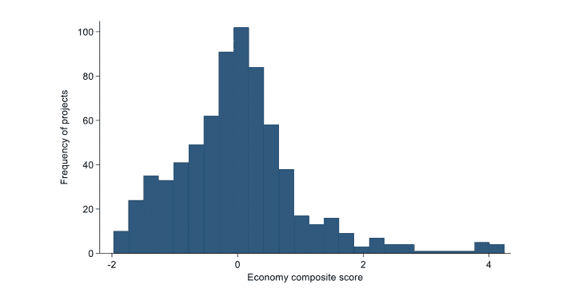

Principal component analysis results for underlying indicators in the composite measure

a.

Distribution of economy composite scores across projects

b.

Composite economy scores by Region

c.

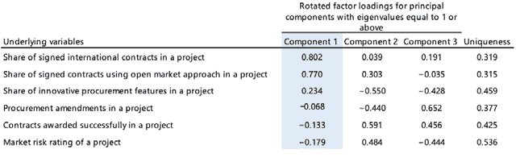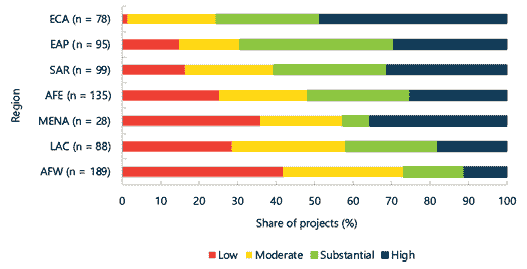

## Table C.11. Selected Variables across Projects by Overall Economy Score

| Variable | Low | Moderate | Substantial | High |
|---|---:|---:|---:|---:|
| Turnaround time (days) | 64 | 103 | 127 | 167 |
| Activity success (%) | 74 | 74 | 70 | 66 |
| Innovative procurement approaches (%) | 5 | 6 | 7 | 11 |
| International contracts (%) | 1 | 6 | 8 | 27 |
| Open market approach (%) | 17 | 50 | 67 | 79 |
| Post review (%) | 90 | 90 | 89 | 76 |

*Source: Independent Evaluation Group.*

*Note:* The table shows project averages of the different row variables across economy score levels. Economy score levels are broken down by quartiles.

## Integrity, Transparency, and Fairness of Procurement

### Prior Review–Post Review Balance

The prior review portion of procurement activities in a project is on average 27 percent, although proportions vary by country and Global Practice, and the remaining procurement is done by post review. Prior review procurement is most common in projects in FCS countries (over 40 percent), followed by IBRD and small island states (about 24 percent in both) and IDA countries (about 16 percent). Prior review accounts for a very small share of all procurement activities, only 8 percent, but it includes some of the largest contracts, almost two-thirds of signed contract commitments in terms of amount ($10.4 billion). Among Practice Groups, Infrastructure has the highest share of prior review signed contracts (17 percent), followed at length by Sustainable Development with 8 percent; hence, there is more

Independent Evaluation Group World Bank Group    **223**

World Bank prior review in Infrastructure compared with other Practice Groups (table C.12).

**Table C.12.** Prior Review Share of Signed Contracts and Signed Contract Commitments by Practice Group

| Practice Group | Prior | Row Share (%) | Post | Total |
|---|---|---|---|---|
| **Prior review share of signed contracts** | | | | |
| INFRA | 528 | 17 | 2,581 | 3,109 |
| SD | 883 | 8 | 10,874 | 11,757 |
| EFI | 276 | 7 | 3,836 | 4,112 |
| HD | 673 | 4 | 14,769 | 15,442 |
| Total | 2,360 | 36 | 32,060 | 34,420 |
| **Prior review share of signed contract commitments** | | | | |
| INFRA | 4,370 | 86 | 715 | 5,084 |
| HD | 3,776 | 60 | 2,545 | 6,321 |
| SD | 2,032 | 48 | 2,228 | 4,260 |
| EFI | 262 | 34 | 502 | 763 |
| Total | 10,439 | 64 | 5,989 | 16,428 |

*Source:* Independent Evaluation Group.

*Note:* The total number of signed contracts worth US$16,428 million in contract commitments in 617 projects is 34,420. EFI = Equitable Growth, Finance, and Institutions; HD = Human Development; INFRA = Infrastructure; SD = Sustainable Development.

### Procurement Post Review Reports

The system flags few projects with delays in procurement post review reports (PPRs; 11 percent), although only one-third of projects with a high proportion of post review procurement had PPRs done in the previous fiscal year (figure C.26). PPRs are important to verify the quality of post review procurement done by clients. Among projects with a high proportion of post review procurement and high procurement processing issues, only 20 percent had PPRs in the previous year. Overall, PPRs are more prevalent among projects with smoother procurement processes and fewer issues. This presents possible integrity risks and a lost learning opportunity to help clients with problems processing post review procurement. In case studies, the reason that PPRs were not done often related to delays in uploading documents and sampling criteria, emphasizing high-risk procurement and a sample of at least 10 contracts for annual review in the fiscal year period. In terms of country coverage of PPRs done in the previous fiscal year, 49 percent were in IDA countries, 41 percent in FCS countries, 38 percent in small states, and 24 percent in IBRD countries; this suggests some effort to prioritize IDA and FCS countries.

**Figure C.26.** Projects with Procurement Post Review Reports by Post Review Share of Activities

*Source:* Independent Evaluation Group.

*Note:* The levels of post review share of activities in a project are based on quartiles of the distribution. Low: post review share of activities in a project ≤ 81.25; moderate: 81.25 < post review share of activities in a project ≤ 92.16; substantial: 92.16 < post review share of activities in a project ≤ 97.50; high: post review share of activities in a project > 97.50. The total number of projects is 713. PPR = procurement post review report.

### Project Integrity Ratings and Procurement Publication

Integrity ratings are highest for projects in FCS contexts, and they increase with the prior review share of activities in a project. About 60 percent of projects with a low post review share of activities have high or substantial integrity ratings; conversely, a project having a PPR in the previous fiscal year does not make much of a difference in helping improve integrity ratings (figure C.27). This raises questions about the benefit provided by PPRs. The integrity rating is intended to be used to assess the risks associated with a project and to determine the appropriate mitigation actions.

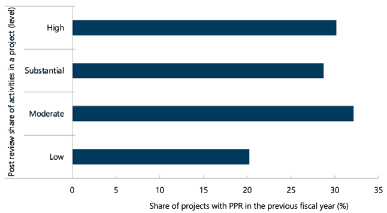

**Figure C.27.** Integrity Ratings by Country Group and Projects Having a Procurement Post Review Report

*Source:* Independent Evaluation Group.

*Note:* The levels of post review share of activities in a project are based on quartiles of the distribution. Low: post review share of activities in a project ≤ 81.25; moderate: 81.25 < post review share of activities in a project ≤ 92.16; substantial: 92.16 < post review share of activities in a project ≤ 97.50; high: post review share of activities in a project > 97.50. Integrity ratings assess the risks associated with a project and determine the appropriate level of due diligence required. Panel a: The total number of projects is 713. Panel b: Regional projects are excluded; the total number of projects is 667. FCS = fragile and conflict-affected situation; IBRD = International Bank for Reconstruction and Development; IDA = International Development Association; PPR = procurement post review report.

Nearly all prior review signed contracts have at least one published procurement notice (over 99 percent), although transparency may be lower for post review procurement. In contrast, about 80 percent of post review signed contracts reported in STEP show published procurement notices. In addition, greater delays in publishing procurement appear in post review, suggesting that more attention may be needed, but there may also be reporting delays entering procurement activities in STEP. Overall, publication rates are high to notify the public of procurement; however, there may be an opportunity to improve transparency in some post review processes.

### Complaints for Fair Procurement

The most frequent complaints from potential suppliers were related to technical evaluation (26 percent), qualification criteria (18 percent), and the disqualification of bids and proposals (17 percent). This suggests a need to strengthen the evaluation stage of procurement to ensure strong criteria that can support fair decisions and withstand feedback. Overall, about one-third of projects had complaints, with an average of four complaints per project. The mean time to resolve a complaint was more than five and a half months (173 days), with the quicker quartile of projects resolving in a month (28 days) and the slower quartile of projects having complaints delay processes by more than six months and in some few projects by more than four years. Complaints are more prominent in IBRD countries, which account for almost 40 percent of complaints, followed by FCS countries with 21 percent of complaints (figure C.28).

**Figure C.28.** Complaints by Country Group

*Source:* Independent Evaluation Group.

*Note:* The total number of complaints in 240 projects is 769. FCS = fragile and conflict-affected situation; IBRD = International Bank for Reconstruction and Development; IDA = International Development Association.

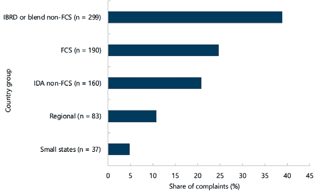

In terms of expansion of the complaint window through the standstill period, 7 percent of prior review activities and 34 percent of projects used standstill periods based on available data in STEP. Standstill delays in some projects suggest the importance of robust mechanisms to quickly resolve complaints, and countries may need to develop such capacities. Most delays for works and nonconsulting services standstill are in projects in IBRD countries, whereas consultant standstill delays are in IDA and FCS countries (figure C.29).

**Figure C.29.** Share of Prior Review Activities with Standstill Delay

*Source:* Independent Evaluation Group.

*Note:* Delayed activities are activities with a recorded standstill period that report an activity completion time above the median number of days of activities with standstill period. Delayed activities are divided by the total number of activities with standstill period within each procurement category to arrive at the shares reported in the figure. The total number of prior review completed activities with recorded standstill period in 196 projects is 486. Regional projects are excluded from the data. FCS = fragile and conflict-affected situation; IBRD = International Bank for Reconstruction and Development; IDA = International Development Association.

Activities with a standstill period had higher activity risks and smaller contract sizes. Almost 80 percent had activity risk ratings of substantial or high, and more than half had smaller contract sizes—that is, standstill periods are typically used in small, high-risk procurements (figure C.30).

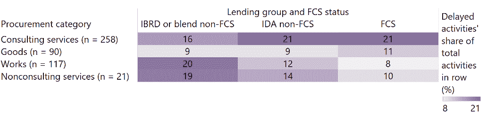

**228**

Making Procurement Work Better  Appendix C

## Figure C.30. Prior Review Activities with Standstill Period by Contract Size and Activity Risk

*Source: Independent Evaluation Group.*

*Note: The figure shows the shares of activities with a standstill period for each contract size level. The total number of prior review completed activities with a standstill period is 513.*

- Activities with a standstill period by contract size
- Activities with a standstill period by activity risk rating

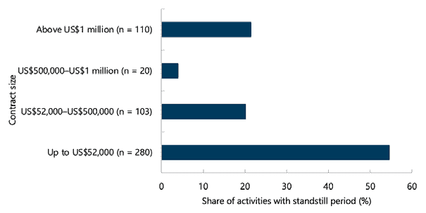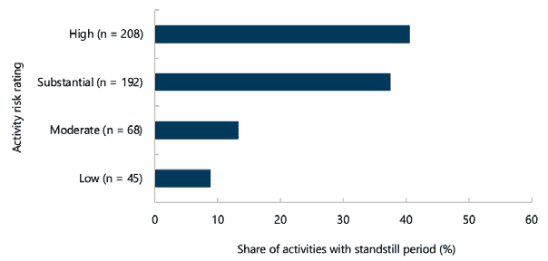

Few suppliers were sanctioned. Sanctions against suppliers were limited, accounting for less than 1 percent of suppliers across countries. This raises questions about whether sanctions should be used more often. Almost half of the ineligible suppliers are in IBRD or blend countries.

## Overall Integrity, Transparency, and Fairness of Procurement of the Portfolio

The composite score measuring integrity, transparency, and fairness suggests that most projects do well on integrity. The analysis considers five indicators: (i) whether a project had a PPR in the previous fiscal year;⁴ (ii) the project integrity rating; (iii) the average time in days taken for a complaint to get resolved (project average); (iv) the completion time in days for an activity with a standstill period (project average); and (v) the average activity risk rating per project. The most important indicators contributing to this composite score are the project’s integrity risk rating and the procurement risk of project activities (figure C.31, panel a).

Projects that score better on the procurement integrity, transparency, and fairness principle have longer standstill time, longer complaint resolution time, lower activity risk, lower integrity risk, and a lower post review share of activities. Projects with high integrity process procurement relatively quickly but are not the fastest compared with the most efficient projects in the portfolio. There may be slowdowns in resolving complaints and longer average standstill periods. Hence, helping to resolve complaints more quickly may help improve procurement. The projects tend to have lower integrity and activity risks, as assessed by the World Bank procurement specialists. More attention to PPRs and mitigation actions may help projects with lower integrity (table C.13). Integrity of projects is highest in South Asia, Eastern and Southern Africa, and FCS and is lower in Latin America and the Caribbean, Middle East and North Africa, and Western and Central Africa (figure C.31, panel c). Having higher capacity may facilitate better integrity in World Bank projects.

## Figure C.31. Integrity, Transparency, and Fairness Composite Measure: Distribution across Projects and by Region

- Principal component analysis results for underlying indicators in the composite measure

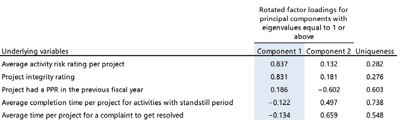

- Distribution of integrity scores across projects
- Composite integrity, transparency, and fairness scores by Region

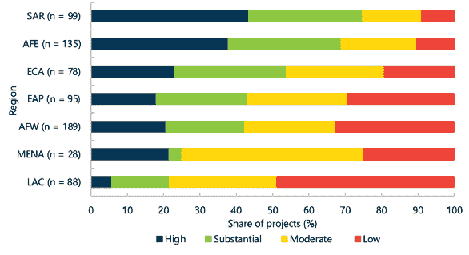

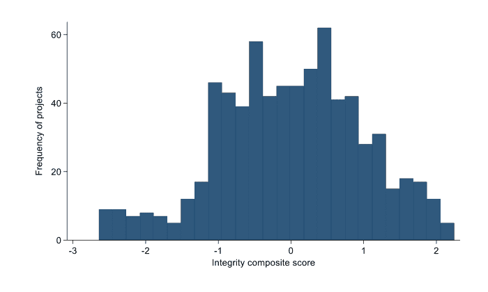

*Source: Independent Evaluation Group.*

*Note: Panel a shows the rotated factor loadings matrix resulting from the principal component analysis (varimax or orthogonal rotation is applied). This figure is analogous to figures C.16, panel a, for the efficiency procurement principle, and figure C.25, panel a, for the economy procurement principle, and should be interpreted in the same way. The first principal component (component 1) explains 29 percent of the cumulative variance of the underlying variables, and the first two principal components, which have eigenvalues equal to 1 or above, explain 51 percent of the cumulative variance of the underlying variables (these latter results are not shown in panel a). Panel b shows the distribution of the estimated composite measure (score) for the integrity, transparency, and fairness procurement principle, based on the first principal component highlighted in panel a. Panel c shows shares of projects by Region and by levels of the integrity, transparency, and fairness composite score. One Regional project is excluded. Quartiles break down economy score levels. The total number of projects is 713. AFE = Eastern and Southern Africa; AFW = Western and Central Africa; EAP = East Asia and Pacific; ECA = Europe and Central Asia; LAC = Latin America and the Caribbean; MENA = Middle East and North Africa; PPR = procurement post review report; SAR = South Asia.

## Table C.13. Selected Variables across Projects by Overall Integrity Score

| Variable | Low | Moderate | Substantial | High |
|---|---:|---:|---:|---:|
| Turnaround time (days) | 120 | 116 | 119 | 100 |
| Average standstills per project (number) | 4 | 2 | 2 | 2 |
| Complaint resolution (days) | 107 | 164 | 252 | 303 |
| Average complaints per project (number) | 4 | 3 | 3 | 3 |
| Activity risk | Substantial | Moderate | Moderate | Moderate |
| Integrity risk | Substantial | Substantial | Moderate | Low |
| Post review share of activities (%) | 93 | 87 | 84 | 79 |
| Share of projects with a PPR in final fiscal year (%) | 17 | 24 | 30 | 36 |

*Source: Independent Evaluation Group.*

*Note: The table shows project averages of the different row variables across integrity score levels. Quartiles break down integrity score levels. PPR = procurement post review report.*

## Fit for Purpose and Value for Money Procurement Principles

### Procurement Planning

Procurement plans are actively used. On average, teams update their procurement plan over 30 times during a project, but there is a wide range—from 0 to over 100 updates. More frequent updates are in lower procurement capacity countries and in projects led by the Human Development and Sustainable Development Practice Groups. There are often many smaller contracts in social sectors that require planning.

### Procurement Risk Analysis

The project-level procurement risk analysis often has limited variation during project implementation. This suggests that frequent project-level risk reassessment, done biannually in the Procurement Risk Assessment and Management System, is not needed unless there is a change in context. The initial assessment can inform planning (figure C.32).

## Figure C.32. Average Project Procurement Risk Ratings by Project Active Year

*Source: Independent Evaluation Group.*

*Note: The figure shows shares of projects for different Procurement Risk Assessment and Management System project procurement risk ratings by project active years. Ratings used are those from the latest Procurement Risk Assessment and Management System sequence for each project at the date of data extraction. The number of projects with two active years at the date of data extraction is 137, with three active years is 188, with four active years is 186, and with five or more active years is 200. The total number of projects with available Procurement Risk Assessment and Management System risk ratings is 711.*

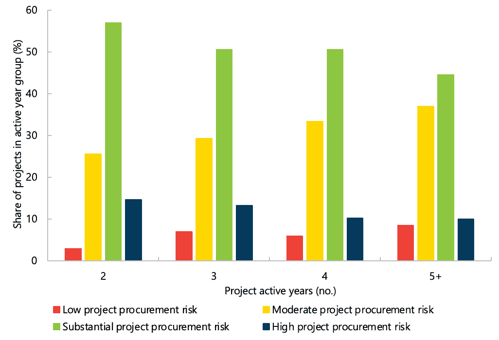

Larger contracts are frequently assigned a higher procurement activity risk compared with smaller lower-value contracts (figure C.33). A lower-cost procurement activity is sometimes classified as high risk, although not as common.

## Figure C.33. Signed Contracts by Size and Level of Activity Risk

*Source: Independent Evaluation Group.*

*Note: The figure shows shares of signed contracts within contract size levels by levels of activity risk. The total number of signed contracts in 26,736 procurement activities with available activity risk ratings is 34,409. K = thousand; M = million.*

Prior review procurement, supported by World Bank procurement staff, mainly focuses on high-value and high-risk procurement. Smaller-value high-risk procurement activities are only sometimes processed using prior review, although prior review is more frequent for high-risk small works than other procurement categories (figure C.34). This suggests that World Bank procurement staff rarely set the risk level for an activity considering factors other than the value threshold.

## Figure C.34. Procurement Activities below the Value Threshold for Open International Procurement Approaches by Risk and Review Type

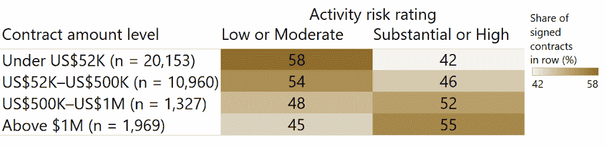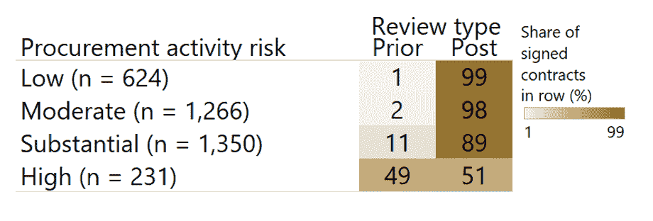

- Works

**234** 

Making Procurement Work Better  Appendix C

Goods and nonconsulting services

b.

*Source:* Independent Evaluation Group.

*Note:* The figures are based on signed contracts below thresholds of open international procurement approaches for works, and for goods and nonconsulting services. In panel a, the total number of signed contracts with the amount below the threshold of US$5 million for works is 3,471. In panel b, the total number of signed contracts with the amount below the threshold of US$5 million for goods and nonconsulting services is 16,492. Procurement activities below the value threshold are typically eligible to be carried out by post review.

Procurement risk and implementing agency risk are associated with project implementation and the likelihood of a project encountering processing issues. Procurement activity risk is negatively correlated with project implementation ratings (figure C.35). Moreover, implementing agency risk can be particularly important because projects with a higher-than-average implementing agency risk often encounter more procurement processing issues during implementation. This suggests that the client experience must be addressed to avoid implementation problems related to procurement (figure C.36).

Independent Evaluation Group World Bank Group    **235**

### Figure C.35. Scatterplot of Projects’ Average Procurement Activity Risk Ratings and Project Implementation Ratings

*Source:* Independent Evaluation Group.

*Note:* The figure shows a scatterplot of projects’ average procurement activity risk ratings against project implementation ratings. Activity risk ratings are converted to numerical values and averaged for each project. The conversions are as follows: low activity risk = 1, moderate activity risk = 2, substantial activity risk = 3, and high activity risk = 4. Project implementation ratings are similarly converted to numeric values: highly unsatisfactory = 1, unsatisfactory = 2, moderately unsatisfactory = 3, moderately satisfactory = 4, satisfactory = 5, and highly satisfactory = 6. Project implementation ratings are from the latest project Implementation Status and Results Report at the date of data extraction. The Pearson correlation coefficient is −0.18 and is statistically significant at the 1 percent level. The total number of projects is 687.

**236** 

Making Procurement Work Better  Appendix C

### Figure C.36. Implementing Agency Risk Ratings and Procurement Issues in Implementation Status and Results Reports

*Source:* Independent Evaluation Group.

*Note:* The figure shows the share of projects within each level of implementing agency risk rating across levels of procurement issues found in Implementation Status and Results Reports (ISRs). Implementing agency risk ratings are available in Procurement Risk Assessment and Management System reports. The levels of issues in ISRs are as follows: very low: 0 ≤ number of procurement issues in ISRs per project < 3; low: number of procurement issues in ISRs per project = 3; high: 3 < number of procurement issues in ISRs per project ≤ 6; very high: 6 < number of procurement issues in ISRs per project ≤ 8. The total number of projects with available information on implementing agency risk ratings is 282.

## World Bank Procurement Staff

World Bank procurement staff have a high workload, especially in Africa, and when projects encounter procurement issues. On average, procurement staff are involved in over 6 projects at a time, but this range is between 1 and 32 projects per procurement staff. Procurement staff with accountability and decision-making responsibilities handle more than 7 projects at a time on average and as many as 22. Procurement specialists are highly burdened in Western and Central Africa, with over 80 percent of staff handling a high number of projects, followed at a length by Eastern and Southern Africa with about one-third of procurement staff being highly burdened. Procurement staff in IDA countries and working on regional projects stand out as being highly burdened with a high number of projects to support; in addition, procurement team size per project increases with the project commitment amount (figure C.37). In other Regions and country groups, accountability and decision-making procurement staff are moderately burdened. Where staff are highly burdened, there are more procurement issues (which delay projects) reported in ISRs.

Procurement staff have a mix of technical skills. In terms of staff skills, about 65 percent of World Bank procurement staff have technical knowledge beyond procurement to help with sector specifications for procurement activities. Additional areas are related, for example, to transport, urban development, energy access policy and regulations, wastewater, sewerage, and sanitation, among others.

Independent Evaluation Group World Bank Group    **237**

### Figure C.37. Procurement Staff Support in Projects: Overall, by Country Type, Region, and Commitment Amount

Distribution of projects per procurement staff

a.

**238** 

Making Procurement Work Better  Appendix C

Projects per procurement staff by Regions

c.

Projects per procurement staff, by country group

b.

Procurement specialists per project, by project commitment amount

d.

Country group

*Source:* Independent Evaluation Group.

*Note:* Panel a shows histograms depicting the distribution of the number of projects per procurement specialist in terms of staff frequencies: the first histogram for all procurement specialists, the second histogram for ADM procurement specialists, and the third histogram for non-ADM procurement specialists. Panel b shows shares of procurement specialists within country groups and across levels of projects per procurement specialist. Procurement specialists can be double counted across lending groups since they can be working across projects in different countries. Panel c shows shares of procurement specialists within Regions and across levels of projects per procurement specialist. The levels of projects per procurement specialist are defined as follows: low = 1–3 projects, moderate = 4–9 projects, and high = 10–32 projects. Panel d reports procurement specialists per project (project procurement team size). The total number of procurement specialists (147 ADM, 15 non-ADM, 3 unclassified) in 713 projects is 165. ADM = accountability and decision-making; FCS = fragile and conflict-affected situation; IBRD = International Bank for Reconstruction and Development; IDA = International Development Association; M = million.

Independent Evaluation Group World Bank Group    **239**

## Hands-on Expanded Implementation Support

About 8 percent of projects in the portfolio received HEIS to speed up procurement, mostly in Human Development and in Middle East and North Africa, East Asia and Pacific, and Africa. The World Bank used HEIS in lower procurement capacity countries, as expected (table C.14). Projects with HEIS also tend to have faster average procurement processing time. Projects with HEIS take an average of two and a half months (72 days) to process procurement activities, whereas those without HEIS take an average of four months (117 days). The benefit of HEIS coaching is seen for both prior and post review procurement. Projects with HEIS take, on average, just over three months (95 days) to process prior review procurement compared with almost eight months (234 days) for projects without HEIS. Project with HEIS take just over two months to process post review procurement in projects and over three months (98 days) without HEIS.

### Table C.14. Hands-on Expanded Implementation Support in Projects by Practice Group, Region, and Country Capacity

| Variable | Project Has HEIS (Yes) | Row share (%) | No | Total |
|---|---|---|---|---|
| **Practice Group** |  |  |  |  |
| Human Development | 44 | 19 | 184 | 228 |
| Sustainable Development | 6 | 3 | 214 | 220 |
| Infrastructure | 5 | 3 | 139 | 144 |
| Equitable Growth, Finance, and Institutions | 1 | 1 | 94 | 95 |
| **Total** | **56** | **8** | **631** | **687** |
| **Region** |  |  |  |  |
| MENA | 5 | 18 | 23 | 28 |
| EAP | 9 | 10 | 83 | 92 |
| AFW | 18 | 10 | 169 | 187 |
| AFE | 12 | 9 | 120 | 132 |
| SAR | 6 | 6 | 91 | 97 |

*(continued)*

**240**

Making Procurement Work Better — Appendix C

Variable | Project Has HEIS | Yes | Row share (%) | No | Total
---|---|---|---|---|---
LAC | 5 | 6 | 77 | 82
ECA | 1 | 1 | 68 | 69
Total | 56 | 8 | 631 | 687
Procurement capacity level | | | | |
Very low | 24 | 13 | 160 | 184
Low | 16 | 8 | 179 | 195
High | 8 | 5 | 143 | 151
Very high | 5 | 4 | 107 | 112
Total | 53 | 8 | 589 | 642

*Source:* Independent Evaluation Group.

*Note:* Because there is no available information on procurement capacity, regional projects and projects in Chile and Guatemala are excluded. Procurement capacity is defined as the capacity to conduct procurement according to each procurement principle (see appendix E for more details). The total number of projects by Practice Group and by Region is 687; the total number of projects by procurement capacity level is 642. AFE = Eastern and Southern Africa; AFW = Western and Central Africa; EAP = East Asia and Pacific; ECA = Europe and Central Asia; HEIS = hands-on expanded implementation support; LAC = Latin America and the Caribbean; MENA = Middle East and North Africa; SAR = South Asia.

HEIS also speeds up procurement processing times in emergency projects. Procurement processing takes about a month to process in emergency projects with HEIS, much faster than the four months in nonemergency, non-HEIS projects, and faster than the overall average turnaround time of three months (88 days) found for the whole IPF portfolio (see table C.4). The same pattern is seen for prior and post review procurement in emergency projects: prior review procurement in emergency projects with HEIS takes on average 51 days to process (figure C.38) compared with the prior review average of 152 days (see figure C.7, panel a).

**241**

Independent Evaluation Group — World Bank Group

**Figure C.38.** Average Procurement Turnaround Time in Projects by Emergency and Hands-on Expanded Implementation Support Flags

*Source:* Independent Evaluation Group.

*Note:* Emergency projects are defined as having at least one of (i) a general emergency flag, (ii) a COVID-19 response pillar flag, or (iii) an investment project financing disaster response flag. *N* = 687 projects. HEIS = hands-on expanded implementation support.

## Overall Fit for Purpose of Procurement in the Portfolio

The fit for purpose composite indicator considers project procurement risk ratings, procurement issues reported in ISRs, total procurement staff per project, the latest project procurement rating, and whether the project has HEIS or not. The indicators contributing the most to this composite are the number of issues reported in ISRs, the project procurement and risk ratings, and the number of procurement staff working on the project, in that order (figure C.39, panel a). Fit-for-purpose procurement in a project involves tailoring procurement to address risks, capacity, and potential procurement issues. On average, projects with HEIS, higher procurement processing in the first fiscal year, and fewer issues reported in ISRs present a higher fit for purpose. The reporting of issues may be a signpost that there is a need for better support to tailor procurement to the context of the project (table C.15).

The portfolio suggests that it may be easier to do this tailoring in projects in countries with higher capacity and lower risk, and in IBRD countries and small states, but it appears to be more challenging in FCS countries and West and Central Africa. In addition, projects tagged with COVID-19 response pillars are often well tailored for procurement, as are projects where restructuring has yet to occur (figure C.39, panels c, d, and e).

**Figure C.39.** Fit-for-Purpose Composite Measure: Distribution across Projects, Region, COVID-19 Projects, and Restructured Projects

Principal component analysis results for underlying indicators in the composite measure

a.

**243**

Independent Evaluation Group — World Bank Group

Distribution of fit-for-purpose scores across projects

b.

Composite fit-for-purpose scores by Region

c.

Composite fit-for-purpose scores: COVID-19 projects versus non-COVID-19 projects

d.

**244**

Making Procurement Work Better — Appendix C

Composite fit-for-purpose scores: restructured versus nonrestructured projects

e.

*Source:* Independent Evaluation Group.

*Note:* Panel a shows the rotated factor loadings matrix resulting from the principal component analysis (varimax or orthogonal rotation is applied). This figure is analogous to figure C.16, panel a for the efficiency procurement principle, figure C.25, panel a for the economy procurement principle, and figure C.31, panel a for the integrity, transparency, and fairness procurement principle, and should be interpreted in the same way. The first principal component (component 1) explains 25 percent of the cumulative variance of the underlying variables, and the first three principal components, which have eigenvalues equal to 1 or above, explain 67 percent of the cumulative variance of the underlying variables (these latter results are not shown in panel a). Panel b shows the distribution of the estimated composite measure (score) for the fit-for-purpose procurement principle, calculated based on the first principal component highlighted in panel a. Panel c shows shares of projects by Region and by levels of the fit-for-purpose composite score. Panel d compares the distribution of projects tagged with the COVID-19 emergency indicator with projects not tagged, across levels of the fit-for-purpose composite score. Panel e compares the distribution of restructured projects and nonrestructured projects across levels of the fit-for-purpose composite score. The total number of projects is 713. AFE = Eastern and Southern Africa; AFW = Western and Central Africa; EAP = East Asia and Pacific; ECA = Europe and Central Asia; HEIS = hands-on expanded implementation support; ISR = Implementation Status and Results Report; LAC = Latin America and the Caribbean; MENA = Middle East and North Africa; PRAMS = Procurement Risk Assessment and Management System; SAR = South Asia.

**Table C.15.** Selected Variables across Projects by Overall Fit-for-Purpose Score

Variable | Fit-for-Purpose Score of Projects
---|---
 | Low | Moderate | Substantial | High
Turnaround time (days) | 128 | 108 | 118 | 97
PRAMS project procurement risk | High | Substantial | Substantial | Moderate
Activity risk | Substantial | Moderate | Moderate | Moderate
Projects with HEIS (%) | 13 | 13 | 27 | 48
Procurement signed in the first fiscal year of the project (%) | 21 | 24 | 35 | 36
Procurement issues reported in ISRs | Very high | High | Low | Low

*Source:* Independent Evaluation Group.

*Note:* The table shows project averages of the different row variables across fit-for-purpose score levels. Fit-for-purpose score levels are broken down by quartiles. HEIS = hands-on expanded implementation support; ISR = Implementation Status and Results Report; PRAMS = Procurement Risk Assessment and Management System.

**245**

Independent Evaluation Group — World Bank Group

## Value for Money of Procurement

The evaluation estimates a value-for-money composite score by taking the average of the composite scores of efficiency; economy; integrity, transparency, and fairness; and fit for purpose. This analysis was based on the literature as detailed in appendix B. The composite is an estimate of the value for money of active projects in the portfolio because the portfolio includes few closed projects.

All procurement composite scores are significantly correlated with project implementation and progress on development outcome ratings (table C.16). This suggests a strong logic of the procurement reform in that procurement that achieves the procurement principles and value for money, supports satisfactory project implementation, and contributes to a project’s development outcomes. Figure C.40 shows the association between selected indicators of each procurement principle, value for money, and project implementation ratings. Satisfactory project implementation ratings are positively associated with faster procurement turnaround times (efficiency), lower market risks (economy), fewer complaints (integrity), and lower procurement activity risks (fit for purpose; figure C.40).

The fit-for-purpose procurement score is most strongly correlated with project implementation ratings, emphasizing its importance for enhancing value for money. This suggests that more emphasis on fit for purpose of procurement could improve procurement performance and project implementation ratings. After fit for purpose, in terms of importance, are efficiency, integrity, and economy, respectively. The findings show a clear trade-off between addressing the economy of procurement, for example, by using competitive approaches, and the other procurement principles.

**246** 

Making Procurement Work Better  Appendix C

**Table C.16.** Correlation Matrix of Procurement Composite Scores and Project Performance

| Variables | Latest Procurement Rating | Project Progress on Development Outcome Rating | Project Implementation Rating | Efficiency Composite Score | Economy Composite Score | Integrity Composite Score | Fit-for-Purpose Composite Score | Value-for-Money Composite Score |
|---|---|---|---|---|---|---|---|---|
| Latest procurement rating | 1 | 0.4109* | 0.4581* | 0.1409* | −0.1270* | 0.2673* | 0.5967* | 0.4887* |
| Project progress on development outcome rating | 0.4109* | 1 | 0.7442* | 0.1561* | −0.1043* | 0.1095* | 0.3084* | 0.2616* |
| Project implementation rating | 0.4581* | 0.7442* | 1 | 0.1952* | −0.1339* | 0.1720* | 0.3401* | 0.3193* |
| Efficiency composite score | 0.1409* | 0.1561* | 0.1952* | 1 | −0.5639* | 0.0727 | 0.1667* | 0.3763* |
| Economy composite score | −0.1270* | −0.1043* | −0.1339* | −0.5639* | 1 | −0.1749* | −0.1333* | 0.0712 |
| Integrity composite score | 0.2673* | 0.1095* | 0.1720* | 0.0727 | −0.1749* | 1 | 0.2439* | 0.6360* |
| Fit-for-purpose composite score | 0.5967* | 0.3084* | 0.3401* | 0.1667* | −0.1333* | 0.2439* | 1 | 0.7116* |
| Value-for-money composite score | 0.4887* | 0.2616* | 0.3193* | 0.3763* | 0.0712 | 0.6360* | 0.7116* | 1 |

*Source:* Independent Evaluation Group.

*Note:* The table shows Pearson correlation coefficients. The total number of projects is 713. * = statistical significance at the 1 percent level.

**248** 

Making Procurement Work Better  Appendix C

**Figure C.40.** Value-for-Money Association with Project Implementation Ratings and Selected Indicators Measuring the Procurement Principles and Risks

Value for money by implementation rating and complaints

c.

Value for money by implementation rating and turnaround times

a.

Value for money by implementation rating and market risk

b.

**249**

Value for money by implementation rating and project activity risk

d.

*Source:* Independent Evaluation Group.

*Note:* The Pearson correlation coefficients between the project implementation rating and the procurement turnaround time is −0.18 (panel a); market risk is −0.17 (panel b); complaints per project is −0.19 (panel c); and procurement activity risk is −0.18 (panel d). All Pearson correlation coefficients are statistically significant at the 1 percent level. The total number of projects is 713.

### Multivariate Regression Analysis

The evaluation used data on the cross-section of projects in the IPF portfolio to run a multivariate regression analysis for uncovering predictors of project implementation ratings. We excluded project development outcome ratings from the analysis because the evaluation portfolio includes active IPF—that is, we cannot account for important correlates of outcome ratings documented in the literature, such as quality at entry, quality at supervision, and monitoring and evaluation ratings (Hussein, Kenyon, and Friedman 2019; Raimondo 2016) to reduce the risk of omitted variable bias. However, data from the correlation analysis suggest that better project implementation and procurement ratings will translate into better outcome ratings. In addition, because procurement ratings are part of the estimate of the fit-for-purpose composite score, we also did not use them in the regression analysis.

The main independent variables in the multivariate regression are the composite measures for each procurement principle and procurement variables not used in the calculation of the composite scores or with weak association with the first principal component produced in the corresponding PCA (which is used to build the composite scores), such as the average first procurement processing time per project, and the market risk ratings. The analysis also includes control variables to minimize omitted variable bias in estimates. These include total project commitment amounts, a COVID-19 response flag, approval year, Region, country groups, and World Bank Practice Groups. The analysis also tried controlling for signed procurement contract amounts, project duration, restructuring flags, and emergency projects, although these variables are not reported because they do not add to the explanatory power of the model or show statistically significant associations with our dependent variable. The main variable not considered in the model that the evaluation finds important is the availability of experienced human resources in the project. In addition, although the literature documents several project-level predictors of development outcome ratings in World Bank projects, to our knowledge, there is no systematic research on the direct determinants of project implementation ratings in World Bank–supported IPF.

Table C.17 shows descriptive statistics of variables used in the model. On average, projects have an implementation rating of moderately satisfactory with some variation. The average commitment amount in the IPF portfolio is $132 million and varies considerably (its standard deviation is larger than the mean); the average market risk is moderate and varies somewhat; and the average first procurement processing time in a project, irrespective of procurement category or review type, is 10 months. Almost half of projects are in Africa and two-thirds are led by Human Development and Sustainable Development Practice Groups. About 30 percent of projects are tagged as financing the COVID-19 response.

The multivariate regression results emphasize the importance of fit-for-purpose procurement and the speed of the first procurement in a project (which is consistent with other evaluation findings). The results suggest that the procurement efficiency and fit-for-purpose composite scores are positively and significantly associated with project implementation ratings once other variables are held constant in our model and are robust across specifications (columns 1–3; table C.18). The results of the regression analysis for the fit-for-purpose composite score are the most robust and suggest that fit-for-purpose procurement to customize approaches in projects is important for satisfactory project implementation. Notably, after we add the first procurement average processing speed as part of our control variables in column 3 (alongside other controls), the efficiency score loses its significance, whereas the first procurement processing speed variable shows a negative and statistically significant association with project implementation ratings (that is, longer times to process the first procurement in a project are associated with lower implementation ratings, all other variables in the model being constant). Recalling that the efficiency score can be interpreted as the project’s average procurement turnaround time, this result suggests that in our model, a project’s first procurement could be, on average, more important for project implementation ratings than turnaround time once we hold constant other independent variables. In addition, in our preferred specification in column 3, the model explains about 30 percent of the variation in project implementation ratings (see R-squared measure in table C.18). The overall value-for-money composite score shows a much more robust result—it is positively and significantly associated with project implementation ratings and is robust across all our specifications (columns 4–6). In our preferred specification in column 6, the first procurement processing speed variable remains negatively associated with project implementation ratings and is near statistical significance at the 10 percent level with a *p* value of .12.

The multivariate regression also suggests the importance of market risk (which is consistent with the evaluation findings that emphasize the importance of market analysis). A project’s market risk rating is negatively and significantly associated with implementation ratings and is robust across all specifications in the analysis. This suggests that the market risk rating is an important economy measure negatively associated with project implementation and procurement ratings. That is, on average, the higher the market risk, the lower the project implementation ratings, all else being constant in our model. In addition, the market risk has a low negative correlation of −0.18 with the first principal component of the PCA that was used for calculating the economy composite score, reducing the risk of collinearity between market risk and the economy composite score in the regressions.

Another result was the difference in implementation ratings among projects with more commitments supporting COVID-19 and in Infrastructure. The multivariate regression also suggests that project commitments are positively and significantly associated with implementation ratings, with robust results across model specifications. It is also worth highlighting that

(i) Projects tagged as financing the COVID-19 response, on average, tend to have higher implementation ratings compared with projects without such tags (columns 3 and 6); (ii) compared with Eastern and Southern Africa, projects in South Asia and Latin America and the Caribbean, on average, have lower implementation ratings; (iii) compared with FCS, on average, IDA countries and regional projects have higher implementation ratings; and (iv) Infrastructure Practice Group–led projects on average tend to have lower implementation ratings compared with Equitable Growth, Finance, and Institutions.

## Table C.17. Descriptive Statistics of Dependent and Independent Variables Used in Regressions

| Variables | Mean | Standard Deviation | Minimum | Maximum | Observations (no. of projects) |
|---|---:|---:|---:|---:|---:|
| **Dependent variable** |  |  |  |  |  |
| Project latest implementation rating (1–6, higher is better) | 4.10 | 0.74 | 1.00 | 6.00 | 712 |
| **Independent variable** |  |  |  |  |  |
| Efficiency composite score | 0.000 | 1.000 | −4.773 | 2.108 | 713 |
| Economy composite score | 0.000 | 1.000 | −1.975 | 4.247 | 713 |
| Integrity, transparency, and fairness composite score | 0.000 | 1.000 | −2.643 | 2.245 | 713 |
| Fit-for-purpose composite score | 0.000 | 1.000 | −5.340 | 3.184 | 713 |
| Value-for-money composite score | 0.000 | 0.449 | −1.729 | 1.462 | 713 |
| Project commitment amount (US$, millions) | 131.736 | 142.915 | 0.000 | 1,000.000 | 713 |
| First procurement speed (average days) | 312.159 | 236.469 | 0.000 | 1,457.000 | 612 |
| Project has COVID-19 response pillar (0–1 dummy) | 0.307 | 0.462 | 0.000 | 1.000 | 713 |
| Market risk rating of a project (1–4, higher is worse) | 2.441 | 0.850 | 1.000 | 4.000 | 708 |
| Approval fiscal year 2017 (0–1 dummy) | 0.050 | 0.219 | 0.000 | 1.000 | 713 |
| Approval fiscal year 2018 (0–1 dummy) | 0.161 | 0.368 | 0.000 | 1.000 | 713 |
| Approval fiscal year 2019 (0–1 dummy) | 0.278 | 0.448 | 0.000 | 1.000 | 713 |
| Approval fiscal year 2020 (0–1 dummy) | 0.265 | 0.442 | 0.000 | 1.000 | 713 |
| Approval fiscal year 2021 (0–1 dummy) | 0.196 | 0.398 | 0.000 | 1.000 | 713 |
| Approval fiscal year 2022 (0–1 dummy) | 0.049 | 0.216 | 0.000 | 1.000 | 713 |
| Eastern and Southern Africa (0–1 dummy) | 0.189 | 0.392 | 0.000 | 1.000 | 713 |
| Western and Central Africa (0–1 dummy) | 0.265 | 0.442 | 0.000 | 1.000 | 713 |
| East Asia and the Pacific (0–1 dummy) | 0.133 | 0.340 | 0.000 | 1.000 | 713 |
| Europe and Central Asia (0–1 dummy) | 0.109 | 0.312 | 0.000 | 1.000 | 713 |
| Latin America and the Caribbean (0–1 dummy) | 0.123 | 0.329 | 0.000 | 1.000 | 713 |
| Middle East and North Africa (0–1 dummy) | 0.039 | 0.194 | 0.000 | 1.000 | 713 |
| South Asia (0–1 dummy) | 0.139 | 0.346 | 0.000 | 1.000 | 713 |
| FCS (0–1 dummy) | 0.261 | 0.439 | 0.000 | 1.000 | 713 |
| IBRD or blend non-FCS (0–1 dummy) | 0.314 | 0.465 | 0.000 | 1.000 | 713 |
| IDA non-FCS (0–1 dummy) | 0.269 | 0.444 | 0.000 | 1.000 | 713 |
| Regional projects (0–1 dummy) | 0.065 | 0.246 | 0.000 | 1.000 | 713 |
| Small island states (0–1 dummy) | 0.091 | 0.288 | 0.000 | 1.000 | 713 |
| Equitable Growth, Finance, and Institutions (0–1 dummy) | 0.142 | 0.349 | 0.000 | 1.000 | 713 |
| Human Development (0–1 dummy) | 0.331 | 0.471 | 0.000 | 1.000 | 713 |
| Infrastructure (0–1 dummy) | 0.210 | 0.408 | 0.000 | 1.000 | 713 |
| Sustainable Development (0–1 dummy) | 0.317 | 0.466 | 0.000 | 1.000 | 713 |

*Source: Independent Evaluation Group.*

*Note: FCS = fragile and conflict-affected situation; IBRD = International Bank for Reconstruction and Development; IDA = International Development Association.*

## Table C.18. Multivariate Regression Results: Ordinary Least Squares Estimates

**Dependent Variable: Project Latest Implementation Rating (1–6, higher is better)**

| Variables | 1 | 2 | 3 | 4 | 5 | 6 |
|---|---:|---:|---:|---:|---:|---:|
| Efficiency composite score | 0.102*** (0.0356) | 0.0745** (0.0358) | 0.0464 (0.0375) |  |  |  |
| Economy composite score | −0.000233 (0.0313) | 0.0500 (0.0308) | 0.0504 (0.0328) |  |  |  |
| Integrity, transparency, and fairness composite score | 0.0660** (0.0259) | 0.0219 (0.0323) | 0.0254 (0.0358) |  |  |  |
| Fit-for-purpose composite score | 0.217*** (0.0313) | 0.172*** (0.0298) | 0.156*** (0.0329) |  |  |  |
| Value-for-money composite score |  |  |  | 0.523*** (0.0617) | 0.370*** (0.0718) | 0.323*** (0.0768) |
| Project commitment amount (US$, millions) |  | 0.000530*** (0.000180) | 0.000462** (0.000186) |  | 0.000519*** (0.000180) | 0.000429** (0.000184) |
| Project tagged as financing COVID-19 response (0–1 dummy) |  | 0.0367 (0.0617) | 0.106* (0.0620) |  | 0.0382 (0.0605) | 0.101* (0.0610) |
| First procurement speed (average days) |  |  | −0.000204* (0.000119) |  |  | −0.000184 (0.000120) |
| Market risk rating of a project (1–4, higher is worse) |  | −0.163*** (0.0375) | −0.175*** (0.0405) |  | −0.161*** (0.0358) | −0.180*** (0.0386) |
| Approval fiscal year 2018 |  | −0.243** (0.118) | −0.313*** (0.109) |  | −0.242** (0.119) | −0.305*** (0.113) |
| Approval fiscal year 2019 |  | −0.250** (0.109) | −0.340*** (0.102) |  | −0.241** (0.111) | −0.321*** (0.107) |
| Approval fiscal year 2020 |  | −0.208* (0.113) | −0.313*** (0.109) |  | −0.176 (0.115) | −0.281** (0.114) |
| Approval fiscal year 2021 |  | 0.0935 (0.117) | 0.0284 (0.116) |  | 0.171 (0.116) | 0.0992 (0.119) |
| Approval fiscal year 2022 |  | 0.351** (0.139) | 0.318** (0.149) |  | 0.466*** (0.138) | 0.421*** (0.151) |
| Western and Central Africa |  | 0.0574 (0.0713) | 0.0981 (0.0732) |  | 0.00476 (0.0689) | 0.0360 (0.0701) |
| East Asia and the Pacific |  | −0.131 (0.0852) | −0.132 (0.0889) |  | −0.165* (0.0865) | −0.178** (0.0904) |
| Europe and Central Asia |  | 0.00953 (0.103) | 0.0913 (0.118) |  | −0.00743 (0.103) | 0.0634 (0.116) |
| Latin America and the Caribbean |  | −0.164* (0.0987) | −0.101 (0.105) |  | −0.198** (0.0987) | −0.154 (0.106) |
| Middle East and North Africa |  | 0.00170 (0.151) | −0.0489 (0.171) |  | 0.0108 (0.151) | −0.0459 (0.167) |
| South Asia |  | −0.341*** (0.0970) | −0.316*** (0.104) |  | −0.318*** (0.0983) | −0.299*** (0.105) |
| IBRD or blend non-FCS |  | 0.0176 (0.0844) | 0.0742 (0.0915) |  | 0.000946 (0.0853) | 0.0610 (0.0921) |
| IDA non-FCS |  | 0.133* (0.0682) | 0.153** (0.0707) |  | 0.124* (0.0679) | 0.156** (0.0701) |
| Regional projects |  | 0.198* (0.106) | 0.197* (0.109) |  | 0.149 (0.103) | 0.151 (0.106) |
| Small island states |  | 0.0649 (0.0988) | 0.0696 (0.104) |  | 0.0354 (0.0993) | 0.0514 (0.104) |
| Human Development |  | 0.0271 (0.0813) | 0.0300 (0.0870) |  | 0.0336 (0.0827) | 0.0344 (0.0877) |
| Infrastructure |  | −0.175* (0.0901) | −0.202** (0.0980) |  | −0.197** (0.0897) | −0.202** (0.0979) |
| Sustainable Development |  | −0.121 (0.0792) | −0.102 (0.0840) |  | −0.123 (0.0811) | −0.100 (0.0858) |
| Constant | 4.101*** (0.0256) | 4.625*** (0.150) | 4.749*** (0.150) | 4.101*** (0.0261) | 4.625*** (0.148) | 4.757*** (0.149) |
| Observations (no. of projects) | 712 | 708 | 612 | 712 | 708 | 612 |
| R-squared | 0.143 | 0.282 | 0.300 | 0.102 | 0.268 | 0.290 |

*Source: Independent Evaluation Group.*

*Note: In the regression specifications reported in columns 2, 3, 5, and 6, the base approval year is 2017; the base Region is Eastern and Southern Africa; the base country group is FCS countries; and the base Practice Group is Equitable Growth, Finance, and Institutions. Robust standard errors are in parentheses. FCS = fragile and conflict-affected situation; IBRD = International Bank for Reconstruction and Development; IDA = International Development Association.*

***p* < .01; **p* < .05; *p* < .1.

**260** 

Making Procurement Work Better  Appendix C

**References**

Hamilton, Lawrence C. 2012. *Statistics with STATA: Updated for Version 12.* 8th. ed. Boston: Cengage Learning.

Hussein, Mustafa Zakir, Thomas Kenyon, and Jed Friedman. 2018. “A New Look at Factors Driving Investment Project Performance.” Development Economics Policy Research Talk, September 24, 2018, World Bank.

Raimondo, Estelle. 2016. “What Difference Does Good Monitoring & Evaluation Make to World Bank Project Performance?” Policy Research Working Paper 7726, World Bank.

Independent Evaluation Group World Bank Group    **261**

1 The principal component analysis (PCA) finds the linear combination that explains the maximum variance among a set of observed variables—the first principal component. It also finds another orthogonal (uncorrelated) linear combination that explains the maximum amount of remaining variance (the second principal component), and so on until all variance is explained. From k variables, k principal components are extracted, which between them explain all the variances. PCA serves as a data reduction technique because fewer than k components will often explain most of the observed variance. If further work concentrates on those components, the analysis can be simplified (Hamilton 2012). The composite score for the first principal component is calculated by multiplying each standardized variable by the corresponding factor loading for that component and summing the results. This PCA was applied to the 713 projects in the portfolio. The average of the indicators was used to represent missing values for the 26 projects that lack available procurement activities or contract numbers.

2 Unsuccessful contract processing means lost time to restarted or stopped processes. Unsuccessful contract amounts accounted to about 129.5 million for the six-year period of analysis (about 22 million per year). However, not all procurement is entered in the Systematic Tracking of Exchanges in Procurement system by clients, especially for early years of the reform. These contracts may have been eventually reprocessed, but implementation processes were likely delayed.

3 Project duration is defined as the time in days between project approval date and project closing date for closed projects, and project approval date and data extraction date for active projects.

4 Whether a project had a procurement post review report in the previous fiscal year was the only dichotomous variable used in the PCA exercise.

## Appendix D. Country Procurement Capacity Strengthening

The 2016 World Bank procurement reform envisages country-level procurement capacity strengthening based on country ownership and needs. This analysis aims to understand the World Bank’s role over time in helping countries strengthen their procurement capacity.

### Portfolio Identification and Analysis

To identify the portfolio, the analysis constructs a database of approved active and closed World Bank interventions by October 25, 2022.¹ Interventions refer to investment project financing (IPF), Program-for-Results financing, development policy loan (DPL) financing, and other lending instruments, and advisory services and analytics (ASA) and other nonlending instruments.

The analysis uses sector and thematic codes² and text analysis to identify interventions with procurement capacity strengthening activities or prior actions, which are found in DPLs. The text analysis is based on keywords identified through a rapid literature review on procurement capacity strengthening³ and a manual review of a sample of interventions. The inclusion criteria for the portfolio are at least one occurrence of the primary keyword in the intervention’s name, objective, component names, indicators, prior actions, or summary text, and being in the top percentiles of interventions with secondary and tertiary keywords.⁴ The interventions are filtered into two groups (total of 21,248 interventions), one for fiscal year (FY)10–16 and one for FY17–23, to compare capacity strengthening activities before and after the 2016 reform.

Although text analysis is useful to systematically identify interventions, some interventions may be overlooked, while others may be incorrectly labeled as capacity strengthening interventions. Thus, the analysis reviewed a sample of interventions for false positives in two rounds and refines the keywords. For instance, interventions are screened that use the word “procurement” in a sense not related to capacity strengthening. The portfolio obtained in this way includes 948 interventions (212 IPF, 32 Program-for-Results, 200 DPL, and 504 ASA or nonlending activities): 417 interventions relate to FY10–16, and 531 interventions relate to FY17–23. The interventions range from those that provide dedicated support to procurement capacity strengthening to those with a single or a few activities embedded in project components.

The coded portfolio includes 437 interventions from FY17 to FY23 that are complete or in the final years of implementation to understand the intermediate outcomes of the capacity strengthening.⁵ The coding followed a codebook and template in SurveyMonkey and the evaluation team provided training to coders for consistent coding of interventions, including (i) type of procurement capacity challenges addressed by the intervention, (ii) type of procurement capacity strengthening activities, (iii) type of achieved or likely procurement capacity strengthening outcome, (iv) types of entities affected by the planned change, (v) possible challenges in implementing the capacity strengthening activity, and (vi) completeness of available information. For the types of challenges, outcomes, and activities the coder had to choose from a dropdown menu.

The coding led to the identification of 15 percent of false-positive matches of the text analysis (about 65 interventions). Because the coding covered only FY17–23, and there is a risk of introducing bias when removing known false positives from the analysis for the whole portfolio, the evaluation team conducted a sensitivity analysis of the full data set, comparing data from FY10–16 and FY17–23 with and without excluding false positives. Based on no observed qualitative differences between the two sets of portfolios, the analysis of the complete portfolio uses 884 interventions, excluding the false-positive matches identified in the coding.⁶

The coding data were analyzed using Python. To understand capacity strengthening interventions in relation to the context and needs of countries, the team combined the final portfolio with data from the heat map analysis on country procurement capacity conducted for the evaluation. This analysis includes examining the World Bank’s procurement capacity strengthening support based on the four country procurement capacity groups of very high, high, low, and very low.

The team also reviewed 193 indicators measuring procurement-related changes in 73 IPFs and the most recent Country Partnership Frameworks (CPFs) of 56 countries. These indicators were analyzed in Excel. The countries for which the CPFs were reviewed coincide with the case study countries, which the team randomly selected. Finally, the team carried out key informant interviews with World Bank procurement staff strongly involved in capacity strengthening to validate the results and obtain additional information on good practices.

### Summary of Results

1. Country procurement capacity strengthening support provided through ASA significantly increased at the expense of lending.

The procurement capacity strengthening support increased in FY17–23, reaching more countries. The number of procurement capacity strengthening interventions increased by 8 percent in FY17–23 compared with FY10–16. In FY10–16, the World Bank provided support to 94 countries. This support increased to 105 countries in FY17–23, with support to certain countries stopped, reduced, or increased, and support to new countries started.

The greatest amount of procurement capacity strengthening support is still provided to African countries, but the country-specific support is declining, partially driven by an increase in global interventions. In FY17–23, Africa received 29 percent of procurement capacity strengthening interventions compared with 40 percent in FY10–16. Capacity strengthening interventions increased in Central Asia, Middle East and North Africa, and South Asia and Europe. The remaining regions received a decreasing share of the capacity strengthening portfolio, with the largest decline in Western and Central Africa. The decline in portfolio allocation to certain Regions is in part driven by an increase in global capacity strengthening interventions, which increased by about 9 percentage points. The global interventions are not country specific and have either procurement or sectoral angles. Interventions with a procurement angle include activities to (i) study specific procurement topics, such as e-procurement and procurement system rating; (ii) prepare procurement training and guidance material, including good practices and lessons; and (iii) provide procurement training and exchanges. The sectoral global interventions usually carry out assessments and prepare guidance material to support procurement, such as railway, renewable and energy efficiency procurement, and health sector procurement.

Independent Evaluation Group World Bank Group    **265**

Procurement capacity strengthening through nonlending is mainly supported by trust fund resources, with limited use of lending for capacity strengthening interventions. Nonlending activities increased by about 50 percent in FY17–23 compared with FY10–16. This was largely funded through trust funds. The Global Procurement Partnership multidonor trust fund has provided over $10 million since it became effective in November 2016. In addition, three procurement capacity strengthening trust funds,⁷ for which we have data, provided resources to finance 1 percent of interventions in FY10–16. This number increased to nearly 8 percent in FY17–23. Key informant interviews also confirm the importance of trust fund resources to increase country procurement capacity strengthening provided through nonlending. Lending for procurement capacity strengthening through IPFs and DPLs significantly decreased.

## 2. Country procurement capacity strengthening support could be more strategically planned based on rapid and targeted assessments.

Few World Bank CPFs provide guidance for procurement capacity strengthening. In 20 percent of the CPFs current at the time of the evaluation, procurement capacity strengthening is significant or highly significant—that is, those strategies include (i) one or more procurement capacity-related indicators and capacity strengthening activities that directly lead to achievement of the indicator target(s); (ii) procurement capacity-related indicators requiring a relatively high concentration of interactive capacity strengthening (that is, indicators for the government to achieve with the support of the World Bank); or (iii) projects with interventions fully or partially dedicated to procurement capacity strengthening, such as those in the Nigeria CPF, where the World Bank finances a set of capacity strengthening programs (courses, certification, diplomas, and bachelor’s and master’s degrees in procurement).

Country procurement capacity strengthening activities could be decided based on more timely and consistent assessments. Interviews with World Bank procurement staff show that country procurement capacity strengthening activities are decided based on the results of Methodology for Assessing Procurement Systems (MAPS), other assessments, such as Public Expenditure Reviews or Public Expenditure and Financial Accountability, a rapid ad hoc evaluation, or upon request from the client. However, about one-third of countries for which CPFs provide guidance on procurement capacity strengthening have a completed MAPS assessment. About 23 of the 105 countries with procurement capacity strengthening interventions in FY17–23 had a completed MAPS assessment (several others had planned or ongoing assessments). In addition, if a country has a MAPS assessment, it is not more likely to have greater continuity⁸ in the procurement capacity strengthening support it receives from the World Bank. This suggests MAPS assessments may not help the World Bank inform the strategic design of country procurement capacity strengthening support.

In FY17–23, procurement capacity strengthening support shifted to countries with higher procurement capacity. In FY10–16, the largest share of procurement capacity strengthening interventions occurred in countries with lower procurement capacity: 53 percent in countries with lower procurement capacity versus 46 percent in countries with higher procurement capacity. This pattern shifted in FY17–23, with higher-capacity countries receiving a greater share of the capacity strengthening interventions: 52 percent in countries with higher procurement capacity versus 48 percent in countries with lower procurement capacity. These data suggest that procurement capacity strengthening is often not strategically planned and often ad hoc.

Procurement capacity strengthening activities related to efficiency and economy are frequently found in countries with higher procurement capacities in these areas. The analysis finds that in FY17–23, 62 percent of efficiency-related and 62 percent of economy-related activities in procurement capacity strengthening interventions occurred in countries that already had higher procurement capacity for efficiency and economy, respectively. About 38 percent of activities took place in countries with low or very low procurement capacity for efficiency and economy. The type of efficiency-related and economy-related activities supported were similar across countries regardless of the capacity level. Conversely, procurement capacity strengthening activities related to integrity are frequently in countries with low capacity in this area. The analysis finds that in FY17–23, 53 percent of integrity-related activities occurred in countries with lower procurement capacity for integrity and 47 percent in countries with higher capacity for integrity.

## 3. Country procurement capacity strengthening could be better designed to address the most pressing needs and support sustained outcomes.

The most frequently supported country procurement capacity strengthening activities relate to learning and professionalization, procurement reform, legal, institutions, and information systems and transparency. The FY17–23 coding data show that nearly 40 percent of activities in procurement capacity strengthening interventions relate to procurement learning and professionalization and to reform, legal, and institutions (figure D.1). The analysis of the complete portfolio provides qualitatively similar results. This analysis also shows that activities saw an increase in FY17–23. Delivering procurement short-term training, workshops, and seminars, and providing advice are the most frequently carried out support under procurement learning and professionalization. Other support in this area includes preparing learning materials and modules, especially e-learning programs, supporting country institutions to provide procurement training, creating a career path, and in some cases certifying procurement staff. Under procurement reform, legal, and institutions, support includes introducing and modifying procurement law and regulations, and to a lesser extent, designing procurement procedures, processes, guidance, and manuals and preparing standard bidding documents. Information systems and transparency includes activities to support the design, development, or improvement of e-procurement systems and platforms to public procurement data. It also includes assessments of e-procurement systems, training on their use, transparency assessments, and legal changes to enhance transparency. All World Bank instruments could support capacity strengthening activities, but DPLs were used to support procurement reforms and legal and institutional change.

**Figure D.1.** Frequency of Procurement Capacity Strengthening Activities in Interventions by Instrument, Fiscal Years 2017–23

*Source:* Independent Evaluation Group.

*Note:* Activities refers to different types of procurement capacity strengthening activities included in World Bank procurement capacity interventions, such as IPF or ASA. One intervention may have multiple activities. Instruments can support multiple activity types. *N* = 576 activities; (n) = number of each activity type. The bars are calculated by dividing (n) by N, and the shares are calculated by dividing the number of instruments in each activity type by (n). ASA = advisory services and analytics; DPL = development policy loan; IPF = investment project financing; P-for-R = Program-for-Results.

Capacity strengthening is limited for contract management and sustainability activities, which are increasingly important in World Bank–supported project procurement. However, the recent increase in these activities is larger than for most other activities. The World Bank’s procurement capacity strengthening focuses even less on civil society engagement, integrity support to address corruption and enhance ethics, and contract management.

There is a link between procurement capacity needs at the country and project levels. For example, for smooth operational procurement, projects need adequate local capacity to manage procurement and evaluate bids, fewer bottlenecks in national systems that slow down procurement processing, e-procurement systems capable of transferring information on procurement, sector procurement strategies, adequate understanding of the market, and fair complaint handling mechanisms. Outside of e-procurement systems, few countries receive support to address shortcomings related to their national procurement system. Countries with more procurement issues in projects reported in ISRs receive on average the same amount of procurement capacity

Independent Evaluation Group World Bank Group **269**

strengthening support than those with fewer issues—in FY17–23, both country groups received on average four interventions with procurement capacity strengthening activities.

Country procurement capacity strengthening could be more continuous to favor longer-term results. The average duration of support of four years a country received in FY17–23 corresponds to the duration of an IPF. For certain countries, the support stopped or decreased significantly in FY17–23 compared with FY10–16, and 25 of 112 countries had no continuity in support between the two time periods. In addition, in FY10–23, in about one-third of countries, the total gap between individual capacity strengthening interventions is five or more years, which jeopardizes the possibility to influence longer-term outcomes. Moreover, data suggest that there may have been a drop in the intensity of country level capacity strengthening interventions from FY17 to FY23 compared with the period before the reform.⁹

Procurement capacity strengthening support is fragmented. Often, World Bank capacity strengthening activities go to different agencies in a country. For instance, in Pakistan, which received the largest number of procurement capacity strengthening interventions after India (12 in FY17–23 and 5 in FY10–16), eight are provided by the Governance Global Practice (GP) and nine by other GPs. The Governance GP interventions partially support the states and partially support the central government level. Many of these interventions’ objectives do not complement and enhance each other.

In India, the World Bank support is intense, and well connects to procurement needs in projects. India received by far the largest amount of support: 29 interventions in FY17–23 and 16 interventions in FY10–16. This support occurred over the full FY10–23 period. Although a part of this support went to different states with little continuity at the state level, most of the remaining support was used to solve procurement problems in projects at the country level and create local procurement capacity in a sustainable way through programs in universities. India has high procurement capacity, high procurement issues reported in ISRs, a moderately satisfactory procurement rating, and a competed MAPS assessment. Its CPF envisages procurement capacity strengthening activities, but procurement capacity strengthening is not a significant focus of the CPF.

### 4. The results of country procurement capacity strengthening support are often at the output level and rarely measured.

Creating awareness, knowledge, and skills is the main outcome of the World Bank’s country procurement capacity strengthening support (figure D.2). Examples of this outcome are identified weaknesses in the procurement system, enhanced knowledge to carry out procurement, and awareness of best practices and procurement solutions in specific sectors. About 2 percent of interventions aim to achieve or achieve institutional change. Examples are increased reporting on corruption, improved procurement management scores, and fewer days to complete procurement. The limited number of interventions that focus on institutional change is unsurprising because World Bank interventions aim for what can be realistically achieved by the end of an intervention, and institutional change can take time. Improved collaboration is also a little sought outcome, which is a missed opportunity considering case studies show clients value the exchange of experiences with colleagues from other projects and countries. Examples of implemented improvements include the use of an e-procurement system and formal approval of a new procurement law. Examples of formulated improvements are the design of an e-procurement system, drafting of a procurement code or action plan, and development of a public-private partnership legal framework.

**Figure D.2.** Outcomes in Procurement Capacity Strengthening Interventions, Fiscal Years 2017–23

*Source:* Independent Evaluation Group.

*Note:* Outcome type captures outcomes achieved or likely to be achieved based on the information in World Bank intervention documents. The data come from 437 interventions coded for this evaluation. Interventions are projects that include advisory services and analytics and other nonlending, development policy loans, investment project financing, and Program-for-Results. Of these interventions, about 25 percent have more than one outcome type, resulting in *N* = 515 total outcomes. The percentage of outcome types is obtained by dividing the total for each outcome type by *N* = 515 total outcomes. Outcomes are ordered by importance from highest to lowest. n = number of each outcome.

The World Bank typically uses ASA and nonlending to achieve changes in awareness, knowledge, and skills, and support to collaboration and institutional change is less emphasized. DPLs are predominantly helped countries improved procurement reforms through prior actions. Improved collaboration is mostly supported through ASA and nonlending, and it is most prominent in IBRD countries, with limited to no emphasis in other country groups. Institutional change is rarely aimed at or achieved across countries.

CPFs rarely measure the results of procurement capacity strengthening. One-third of CPFs have indicators to measure results of procurement capacity strengthening. One-third of these indicators measure the development or use of an e-procurement system. Other common indicators measure the timeliness of procurement processing and the use of competitive bidding.

Most procurement capacity strengthening indicators capture outputs or results closer to the output level. In the 86 percent of IPFs with procurement capacity strengthening indicators, 33 percent have project development (PD) and intermediate outcome (IO) indicators to measure procurement capacity strengthening results, 60 percent have IO indicators, and 4 percent have PD indicators. Many PD indicators are outputs, for example, measuring the number of people participating in training; the implementation or improvement of a system, plan, or strategy; and the use of these systems. A few PD indicators measure the reduction in procurement processing time or savings through centralized procurement, which aligns with the finding that 16 percent of PD indicators and 6 percent of IO indicators measure institutional change.

Most indicators measure results related to procurement systems and procurement learning and professionalization. Thirty-eight percent of PD indicators and 27 percent of IO indicators capture outputs or outcomes related to procurement information systems, such as the design, establishment, or improvement of systems and, on rare occasions, an improvement in procurement processing efficiency. Twenty-seven percent of PD and 34 percent of IO indicators capture outputs related to procurement professionalization and learning, such as training carried out, number of people trained or certified, certified officials in procuring entities, training curricula developed, and academic partnerships established. Outputs or outcomes related to procurement reform, legal, and institutional aspects are captured by 7 percent of PD and 17 percent of IO indicators, including procurement laws approved or prepared, standard bidding documents prepared, and procurement entities established or operationalized.

Less than half of the indicator targets are fully achieved, and no significant difference exists between the IO and PD indicators. Data indicate that 41 percent of IO and 34 percent of PD indicators have been fully achieved or exceeded. This includes data on indicators from projects not yet closed but with at least four years of implementation. If we look at closed projects, the level of achievement for IO indicators increases to 45 percent and for PD indicators to 50 percent. Moreover, no significant difference exists in the achievement of indicators related to different outcomes and procurement activity types. For most outcome types, a similar proportion of IPF indicators are achieved or recorded progress (table D.1). However, the number of indicators tracked is small, making assessment of results challenging.

### Table D.1. Achievement of Procurement Capacity Strengthening Indicator Targets in Investment Project Financing by Outcome Area, Fiscal Years 2017–23

| Indicator Type | Outcome Area and Degree of Achievement | IO | PD | All | IO | PD | All |
|---|---|---|---|---|---|---|---|
| Indicators (no.) | Indicators (%) | | | | | | |
| **Achieved institutional change (sustained system change at the outcome level)** | **9** | **8** | **17** | | | | |
| - Achieved | 4 | 2 | 6 | 44 | 25 | 35 |
| - Evidence of progress | 5 | 4 | 9 | 56 | 50 | 53 |
| - Not achieved | | 2 | 2 | | 25 | 12 |
| **Enhanced awareness, knowledge, and skills** | **46** | **9** | **55** | | | | |
| - Achieved | 16 | 2 | 18 | 35 | 33 | 33 |
| - Evidence of progress | 16 | 5 | 21 | 35 | 38 | 38 |
| - Not achieved | 14 | 2 | 16 | 30 | 29 | 29 |
| **Formulated, planned, or developed procurement improvement action, process, or policy** | **36** | **9** | **45** | | | | |
| - Achieved | 17 | 4 | 21 | 47 | 44 | 47 |
| - Evidence of progress | 7 | 3 | 10 | 19 | 33 | 22 |
| - Not achieved | 12 | 2 | 14 | 33 | 22 | 31 |
| **Implemented procurement improvement action, process, or policy** | **50** | **23** | **73** | | | | |
| - Achieved | 21 | 8 | 29 | 42 | 35 | 40 |
| - Evidence of progress | 13 | 6 | 19 | 26 | 26 | 26 |
| - Not achieved | 16 | 9 | 25 | 32 | 39 | 34 |
| **Improved collaboration or coordination** | **2** | **1** | **3** | | | | |
| - Achieved | 1 | 1 | 2 | 50 | 100 | 67 |
| - Evidence of progress | 1 | | 1 | 50 | | 33 |

*Source:* Independent Evaluation Group.

*Note:* This is based on investment project financing indicator data for closed projects and projects with at least four years of implementation. Achieved: 100 percent or more; evidence of progress: above baseline but less than 100 percent; not achieved: no change, below baseline, or indicator dropped, no data. IO = intermediate outcome; PD = project development.

---

5. Country procurement capacity strengthening support mainly addresses challenges related to procurement functionality and is provided predominantly by EFI and benefits sector ministries.

Country procurement capacity strengthening mainly addresses challenges related to the functionality of procurement organizations (figure D.3). This challenge concerns procurement processes, practices, systems, entities, and staff. It refers to how procurement is managed, processed, organized, and carried out. Inadequate policies to support procurement refer to weaknesses in laws, regulations, procedures, rules, and guidance governing public procurement. Inadequate accountability, integrity, and transparency of public procurement refer to weaknesses in stakeholder engagement, openness, transparency, fairness, and accountability.

### Figure D.3. Procurement Challenges Addressed by Procurement Capacity Strengthening Interventions, Fiscal Years 2017–23

*Source:* Independent Evaluation Group.

*Note:* The data come from *N* = 437 interventions coded for this evaluation. The chart shows the percentage of interventions addressing a certain type of procurement challenge—that is, the number of a certain type of procurement challenge (n = number of interventions addressing challenges divided by *N* = 437 interventions coded). n is the number of interventions addressing each challenge. The interventions address 599 total challenges.

The Equitable Growth, Finance, and Institutions Practice Group leads procurement capacity strengthening. The Governance GP in Equitable Growth, Finance, and Institutions is the largest provider of procurement capacity strengthening in both time periods. Governance increased its share of interventions by nearly 50 percent during FY17–23, whereas the other GPs in this Practice Group decreased their share or kept it stable (figures D.4 and D.5). There is also an increase in procurement capacity strengthening in the Infrastructure Practice Group driven by efforts to improve renewable and energy efficiency procurement and public-private partnerships. These interventions, together with capacity strengthening for emergency procurement, are the most frequent sectoral procurement capacity strengthening interventions identified in the FY17–23 coding.

### Figure D.4. Procurement Capacity Strengthening Interventions by Practice Group, Fiscal Years 2010–16 and 2017–23

*Source:* Independent Evaluation Group.

*Note:* "Other" includes interventions not mapped to any Practice Group.

### Figure D.5. Procurement Capacity Strengthening Interventions by Global Practice, Fiscal Years 2010–16 and 2017–23

*Source:* Independent Evaluation Group.

*Note:* FY = fiscal year; PPP = public-private partnership.

Sector ministries benefit the most from the World Bank's country procurement capacity strengthening efforts. In over half of interventions, capacity strengthening efforts target sector ministries, such as public works or health. In nearly 30 percent, these efforts target central ministries, such as finance or planning, whereas slightly over 20 percent of interventions support subnational governments. The private sector (nearly 20 percent) and community and civil society (about 14 percent) benefit the least from the capacity strengthening efforts.

---

1. The data sources are Data Explorer (https://dataexplorer.worldbank.org/); SQL Server, SERVER=WBGMSSQLIOPS001,5800;DATABASE=OPSActivities; and Development Policy Actions Database FY21- int.xlsx for development policy loans.

2. The thematic codes included in the database include those that refer to procurement in their definition and were identified through an analysis of trust-funded procurement activities and expert opinion, such as public sector management, public administration, health system strengthening, e-government, and e-services. The sector codes include similar themes, such as information and communication technology infrastructure, public administration, central government (central agencies), and public administration–health.

3. The primary keyword is "procurement"; the secondary keywords include "maps," "contract," "contracting," "contracts," "egp," "e-gp," "e gp," "tender," "tenders," "bid," "bids," "bidding," "public expenditure"; the tertiary keywords include "public administration," "supply chain," "transparency," "accountability," "good governance," "public finance," "value for money," "integrity," "vfm," "market development," "market analysis," "e gov," "egov," "e governance," "e-governance," "egovernance," "e services," "eservices."

4. The criteria to consider a project and advisory services and analytics (ASA) a procurement capacity-building activity are as follows: (i) at least one occurrence of the primary keyword in Name, Objective, Component names, indicators, prior actions or summary; (ii) to be in the top one percentile of projects and ASA with secondary keyword similarity calculated using tf-idf, cosine-similarity algorithm; (iii) to be in the top 10 percentile of projects and ASA with tertiary keyword similarity calculated using tf-idf, cosine-similarity algorithm; (iv) to be in the top 30 percentile of relevant theme matches, meaning the number of relevant themes that are identified above match with the themes associated with the project; (v) to be in the top 30 percentile of relevant sector matches. Matches here mean the number of relevant sectors that are identified above match with the sectors associated with the project and ASA; (vi) projects and ASA associated with procurement trust funds identified by analyzing long names of the trust funds; and (vii) projects and ASA associated with the Global Procurement Project Database.

5. The coded portfolio includes closed investment project financing and Program-for-Results from fiscal year (FY)17–23 or approved until the end of FY20: 74; closed development policy loans: 70; and closed ASA and nonlending: 293. The coding of the portfolio reviewed 437 interventions from FY17 to FY23, which were complete or in the final years of implementation.

**278**

Making Procurement Work Better  Appendix D

6 The temporal change in the proportion of capacity strengthening interventions from the FY10–16 to FY17–23 time periods have the same directionality for all countries, regardless of whether false positives are included or excluded. However, in some cases, the magnitude of the change differs between the main analysis and the sensitivity analysis.

7 The Global Procurement Partnership multidonor trust fund will close at the end of FY24, and there is an effort to raise new funds for procurement capacity strengthening. The other trust funds are Strengthening Reform and Improving Public Procurement Performance in Africa and East Asia and Pacific, Enhancing Accountability in Public Procurement and Capturing Results, and Building Procurement Capacity to Achieve Development Effectiveness in the Kyrgyz Republic.

8 Continuity is measured by dividing the years of continuous procurement capacity strengthening interventions in countries by the total years in FY17–23 (seven years). The results are split into four equal groups or quantiles, with very low continuity, meaning one or two years of continuous intervention, and very high continuity, meaning six or seven years of continuous intervention.

9 The data suggest a decrease in the average interventions in a country from four to three after the 2016 reform.

## Appendix E. Country Procurement Situations

The analysis is to understand how countries’ procurement capacities influence the success of World Bank–supported projects. This understanding is fundamental to tailor support for procurement performance in different country contexts.

### Methodology

A heat map of procurement capacities was created to estimate the procurement situation in countries supported by World Bank projects. This analysis estimates the procurement institutional capacities of countries in the evaluation portfolio for principles of efficiency, economy, integrity, fairness, and transparency. The selection of indicators to estimate institutional capacities is based on the evaluation’s theory of change, a review of publicly available global databases, and expert guidance on what indicators could reasonably estimate the country’s procurement capacity situation.¹ The main limitation was the lack of one comprehensive data source with procurement indicators.

Principal component analysis (PCA)² was used to create a composite of the selected indicators for each procurement principle and to estimate the overall level of procurement capacity in a country. The methodology used for the PCA is the same as that described for the Systematic Tracking of Exchanges in Procurement portfolio analysis (appendix C). The main indicators contributing to the composite measure for efficiency are the E-Government Development Index, regulatory quality, and e-procurement functionalities (E-Governance Index 2022; Global Public Procurement Database 2021; Worldwide Governance Indicators 2020).¹ The main indicators contributing to the composite measure for the economy are the ease of contracting with the government and the Country Policy and Institutional Assessment indicators of gender equality and social inclusion (Doing Business 2020; World Development Indicators 2022). The main indicators contributing to the composite measure for integrity, transparency, and fairness are the Worldwide Governance Indicators of Control of Corruption and Voice and Accountability (2021) and the Country Policy and Institutional Assessment transparency indicator (World Development Indicators 2022). The PCA suggests that these indicators can help explain variations relating to the procurement principles based on available data to estimate capacities.

The composite measure for each procurement principle is classified in quartiles to estimate the level of country capacity in the area as (i) very low, (ii) low, (iii) high, and (iv) very high, with very high being the best situation. The heat map, with the final composite measures by country procurement and portfolio data on World Bank–supported project procurement at the country level, were then integrated and analyzed in Python to understand how institutional capacities of countries influence procurement, including data on procurement approaches, project implementation progress, and procurement performance ratings, which can serve as a proxy of project outcomes given the active portfolio.

Procurement issues in projects in the countries were reviewed to understand the frequency and types of procurement problems encountered. Procurement issues are reported in projects by reviewing the text in the project Implementation Status and Results Report (ISR) sequence. The identification used national language processing of keywords and phrase embedding with Python’s “word2avec” algorithm. Keywords and phrases were developed through a manual review of ISRs and informed by a rapid literature review of procurement capacity challenge areas.³ The analysis covered 3,373 ISRs spanning 712 projects (99 percent of the project portfolio). A limitation was the varying level of detail in the reporting for procurement issues in ISRs. Moreover, a manual review of ISR text for a sample of projects helped refine keywords to ensure they identified procurement-related problems.

A review of project procurement strategies for development (PPSDs) was conducted to understand procurement approaches strategized in different countries. The content of PPSDs was analyzed using natural language processing of keywords and phrase embedding computed with the “word2avec” algorithm in Python. Keywords and phrases related to procurement capacity, sustainability, contract management, market analysis and planning, and procurement approaches. The analysis covered 566 PPSDs, each for a unique project (about 80 percent of the evaluation portfolio). Keywords were refined in the manual review of PPSDs for case study projects. PPSDs not in English were translated and reviewed using Microsoft Word. The main limitation was that some projects did not upload PPSDs in the system.

Cluster analysis was used to identify typologies for different country procurement situations. The clustering analysis examined whether countries could be grouped by their differences in procurement capacities and other features. In addition to the procurement capacity of the country, the analysis considered (i) the average contract amount per project; (ii) the average time projects take to process their first procurement; (iii) whether the country was International Development Association, International Bank for Reconstruction and Development, or fragile and conflict-affected situations (FCS); (iv) the extent that procurement issues are reported in ISRs of projects; (v) average project procurement performance and risk ratings;⁴ (vi) types of procurement approaches used by projects;⁵ (vii) whether the country has received World Bank support for procurement capacity strengthening (projects or analytic support); and (viii) whether projects had received hands-on expanded implementation support (HEIS). The K-means algorithm was used for clustering. The number of clusters (K = 5) was selected using two metrics: within-cluster sum of squared distances (elbow method) and Silhouette score, and summary statistics were reviewed to compare each cluster group.⁶ A limitation of the cluster analysis is that it identifies distinct differences or data points across groups with different mean characteristics. However, interpretation of the differences between cluster groups often requires contextual information. The analysis drew on evidence triangulated from case studies and interviews to help with interpretation.

### Findings: Country Procurement Capacity and Procurement Performance

There are regional differences in procurement institutional capacities. Countries in Europe and Central Asia and Latin America and the Caribbean

**282** 

Making Procurement Work Better  Appendix E

present the highest procurement capacities, with exceptions, such as Haiti and Tajikistan (table E.1). These regions are followed by East Asia and Pacific and South Asia, though the capacities of countries, such as Afghanistan, Bangladesh, Cambodia, and Myanmar, fall in the bottom quartiles. Countries in Africa and the Middle East and North Africa on average have lower procurement-related capacities, with more than three-quarters of countries in the bottom quartiles. A few exceptions, such as Ghana, Rwanda, and Tunisia, present higher capacities. Lower-capacity countries may be limited in guaranteeing efficient and economical procurement processes with integrity, fairness, and transparency and may require targeted support. Table E.2 presents a heat map by country.

### Table E.1. Average Procurement Institutional Capacities by Region and Percent of Countries in the Bottom Quartiles

| Region | Economy | Efficiency | Integrity, Fairness, and Transparency | Overall Institutional Capacity |
|--------|---------|------------|--------------------------------------|--------------------------------|
| Eastern and Southern Africa | Low (83) | Low (78) | Low (78) | Low (89) |
| Western and Central Africa | Low (86) | Low (86) | Low (71) | Low (81) |
| East Asia and Pacific | Low (53) | High (47) | High (32) | High (42) |
| Europe and Central Asia | Very high (0) | Very high (6) | High (29) | Very high (6) |
| Latin America and the Caribbean | High (17) | High (21) | High (17) | High (17) |
| Middle East and North Africa | Low (86) | Low (100) | Very low (100) | Very low (86) |
| South Asia | Low (43) | High (29) | Low (86) | Low (57) |

*Source:* Independent Evaluation Group.

*Note:* The percentage of countries with a low or very low capacity in the bottom two quartiles is given in parentheses. Very low = first or bottom quartile; low = second to bottom quartile; high = third quartile; very high = fourth or top quartile. Quartile estimates are rounded up.

Low capacity makes procurement challenging in projects, especially when low capacity is related to the principle of economy. Capacity for the economy of procurement, such as for connecting markets, is most strongly associated with project implementation progress and procurement performance ratings. Further, addressing challenges to support market analysis may be important to enhance procurement in projects in countries with lower institutional capacities. Moreover, having a low procurement capacity may increase the risk of procurement activities and extend the average times to process the first procurement in projects.

Project implementation ratings are linked to procurement performance. Correlation analyses suggest that countries with projects with high project procurement risks, high reporting of procurement issues, and long timelines to process the first procurement may have lower project procurement performance ratings and project implementation ratings.⁷

Countries with lower capacity may be more likely to adopt nontraditional procurement features to improve their procurement.⁸ The association holds for most features, such as the use of rated criteria, whereas some approaches, such as e-auctions, may be easier to implement in a higher-capacity context.

### Findings: Procurement Issues Reported in Projects

Procurement issues reported most frequently in projects are related to internal process and contracting delays and are commonly repeated in the same countries (figure E.1). Repeat internal process delays include issues such as the quality of procurement documents. Contracting issues consisted of delays in signing consulting services. Common bidding delays consisted of relaunching procurement processes after not receiving adequate qualified bidders. Projects in some countries report more issues than others, such as Afghanistan, the Comoros, Jamaica, Mauritania, Uzbekistan, and Zambia. By type of item procured, issues are frequent for information technology, laboratory equipment, and medical supplies. Across sectors, issues are similar; however, the Energy and Extractives Global Practice stands out for projects with a very high reporting of procurement issues. Procurement issues in ISRs are associated with overall project delays (such as slow implementation and disbursement), suggesting that procurement is one factor affecting project implementation, among others.

**284** 

Making Procurement Work Better  Appendix E

### Figure E.1. Frequency of Procurement and Other Challenges in Project Implementation

*Source:* Independent Evaluation Group.

*Note:* General challenges and delays are nonspecified procurement-related issues reported to be affecting project implementation in Implementation Status and Results Reports. Cost overrun issues consist of budget planning for procurement activities. Issues often related to the quality of procurement documents, such as in bidding packages and terms of references. Procurement staffing issues include delays in contracting project procurement specialists by clients. Issues of client capacity often included challenges in drafting documents and with the function of evaluation committees. Infrastructure procurement consists of delays in works contracts. Procurement notice issues related to challenges with advertising activities to identify eligible candidates. Issues related to the cost of goods and services include price inflation. Procuring with NGOs and civil society includes delays in community-based procurement and requests for proposal processes to contract NGOs. Logistic issues include supply chain delays in shipping goods. Grievance redress issues related to procurement complaints. SME and private sector contracting issues consist of delays in processing contracts. NGO = nongovernmental organization; SME = small and medium enterprise.

The reporting of procurement issues and other delays increases at the midpoint of a project and again at project closing. The distribution of issues increases across ISR sequences (every six months, projects typically report an ISR). Issues per ISR increase from the start of the project and peak at about the midpoint (around ISR six). From ISRs seven to nine, the number of reported issues declines but increases again in later ISRs. Issues related to procurement process delays and challenges with the quality of bidding packages drive the first peak. Issues related to cost overruns, disbursement, and inadequate bidding on contracts tend to appear later in the project cycle, commonly from the ninth ISR onward. This suggests that ISR reports could be monitored to help prevent costly project delays and provide timely support.

HEIS helps reduce project procurement issues, especially in FCS and lower-capacity countries. About half of projects in very-low-capacity and low-capacity countries receive HEIS, compared with less than a quarter of projects in high-capacity and very-high-capacity countries. Projects with HEIS often have fewer procurement issues reported in ISRs. This result holds for most individual issue categories. The exception is issues relating to logistics, such as supply chain delays, which are outside of the influence of HEIS. The benefit of HEIS holds across countries, but the number of reported issues in ISRs in an FCS country without HEIS is, on average, greater than in other countries. This suggests that the benefit of HEIS may be greater in FCS countries than in other countries. HEIS similarly reduces reported procurement issues in low and very low-capacity countries, though the data suggest HEIS is not as effective at reducing procurement issues reported in ISRs in higher-capacity countries. The limited benefit of HEIS in higher-capacity countries is likely because HEIS focuses on speeding up procurement rather than supporting innovative and sustainable procurement approaches.

### Findings: Content of Procurement Strategies

The content of PPSDs focuses on approaches to inform procurement planning. The content is similar across countries, suggesting PPSDs are being created to comply with requirements during project development. A manual review of PPSDs in case study countries consistently finds they are rarely used to tailor unique procurement approaches to the project, and the text in the PPSD is often copied across projects in the same country.

Less addressed areas in PPSDs include community-driven development, procurement information systems, monitoring and evaluation, procurement

**286**

Making Procurement Work Better · Appendix E

reform, framework agreements, procurement learning, and sustainability. About half of the PPSDs mention sustainability (especially projects in Equitable Growth, Finance, and Institutions; Infrastructure; and Social Development) and where there were measures to implement the World Bank’s Environment and Social Framework. There is less emphasis in Human Development projects. Most PPSDs mention at least one innovative or nontraditional procurement feature,⁹ such as rated criteria (figure E.2). This suggests an effort to strategize the use of less common procurement features to improve quality. Higher attention is paid to nontraditional features in PPSDs in FCS and lower-capacity countries.

**Figure E.2.** Project Procurement for Strategy Development Mention of Selected Procurement Approaches by Practice Group

*Source:* Independent Evaluation Group.

*Note:* EFI = Equitable Growth, Finance, and Institutions; GP group = Practice Group; HD = Human Development; INFRA = Infrastructure; SD = Social Development.

**Findings: Typologies to Support Procurement Performance**

The analysis identifies five clusters that can be grouped into three main groups based on the types of country situations.¹⁰ Each cluster group may demand different strategies to support project procurement performance (box E.1). The following factors are important differences across project clusters with differing performance and point to considerations that can prioritize World Bank support to enhance procurement performance in projects:

- Existing procurement institutional capacities in the country
- Level of procurement issues experienced in the country
- Experience implementing the procurement approaches planned in the project
- Project procurement risk
- Availability of HEIS or experienced procurement support in projects

The procurement risk in projects, the issues reported, and having expert support in the project help make it more likely that a project has high procurement and implementation performance. The country’s procurement capacity is also important, but even in a low-capacity country, there is often higher procurement performance when there are human resources and experience to support procurement. Taking on unfamiliar procurement approaches that are innovative in the context is challenging and often requires support.

**Box E.1.** Procurement Performance Typologies for Support in Countries

The groups of the clustering analysis are described below and presented in figure BE.1.1.

1. **Countries with higher procurement performance.** This group includes countries with higher procurement capacity and lower-capacity countries with good support:

   - **Higher-capacity International Bank for Reconstruction and Development countries with experience in planned approaches.** This cluster includes mainly countries in Europe and Central Asia and Latin America and the Caribbean that have higher procurement capacity, especially in terms of procurement efficiency. Despite some countries having high reporting of issues, limited procurement capacity strengthening support, and no use of hands-on expanded implementation support (HEIS), projects may resolve challenges with expertise within the country and projects. *(continued)*

   On average, procurement in projects has the lowest risk, despite large contract amounts. Innovative features are rarely used.

   - **Lower-capacity International Development Association (IDA) and fragile and conflict-affected situation countries with support to innovate and address issues.** This cluster includes countries in Africa and some in East Asia and Pacific and South Asia Regions. Compared with other clusters, these countries have a higher average use of innovative procurement features, such as rated criteria, negotiation, alternative procurement arrangements, and performance conditions. On average, procurement in projects has moderate risk and moderate contract amounts, projects report few issues, there is often some procurement country capacity strengthening support, and there is the highest coverage of HEIS to support procurement implementation issues.

2. **Countries with moderate procurement performance:**

   - **Mainly higher-capacity International Bank for Reconstruction and Development countries with higher risks.** This cluster includes countries in East Asia and Pacific, Europe and Central Asia, Latin America and the Caribbean, and some fragile and conflict-affected situation and IDA countries, with on average relatively smaller contract amounts. On average, procurement in projects in this cluster has moderate risk, less innovation, and fewer issues reported than in other clusters. These countries may have advisory and project support to strengthen country procurement capacity and some HEIS to help procurement in projects.

3. **Countries with lower procurement performance.** This group includes higher-capacity countries taking on less familiar procurement approaches and lower-capacity countries with high issues and less support.

   - **International Bank for Reconstruction and Development and IDA countries taking on new procurement approaches.** This cluster includes countries in Africa, East Asia and Pacific, Europe and Central Asia, Latin America and the Caribbean, and South Asia, with on average higher overall capacity. *(continued)*

   On average, the countries have higher project procurement risks, contract amounts, and procurement issues reported in projects compared with other clusters and a greater emphasis on procurement of construction and equipment. The countries have higher average use of procurement features such as rated criteria and performance conditions and, on average, high country capacity strengthening support, and some projects have HEIS.

   - **Lower-capacity IDA and fragile and conflict-affected situation countries with high issues and limited support.** This cluster includes mainly countries in Africa, East Asia and Pacific, and Latin America and the Caribbean, with, on average, lower use of innovative procurement features, higher reporting of issues, lower contract amounts, and higher project procurement risk. There is, on average, lower country procurement capacity strengthening and HEIS in projects compared with other clusters.

**Figure BE.1.1.** Typologies to Support Procurement Performance

*Source:* Independent Evaluation Group.

*Note:* FCS = fragile and conflict-affected situation; IBRD = International Bank for Reconstruction and Development; IDA = International Development Association.

*Source:* Independent Evaluation Group portfolio.

**Table E.2.** Heat Map of Country Procurement Capacities by Principle and Overall

| Country | Economy | Efficiency | Integrity | Capacity | Volume | Innovative Features |
|---|---|---|---|---|---|---|
| Africa (East and South) | | | | | | |
| Angola | Very low | Very low | Very low | Very low | Very high | High |
| Burundi | Low | Very low | Very low | Very low | Very low | Very low |
| Comoros | Very low | Very low | Very low | Very low | Very low | High |
| Congo, Dem. Rep. | Very low | Very low | Very low | Very low | Very high | Very high |
| Eswatini | Low | Low | Very low | Low | High | High |
| Ethiopia | Low | Low | Low | Low | Very high | Very high |
| Kenya | Very high | Low | High | High | High | Low |
| Lesotho | High | Very low | High | Low | Low | Very high |
| Madagascar | Low | Very low | Very low | Very low | Very high | Very high |
| Malawi | Low | Very low | Low | Low | High | Very high |
| Mozambique | Low | Low | Very low | Very low | Very high | Very high |
| Rwanda | Very high | Very high | High | Very high | High | High |
| São Tomé and Príncipe | Very low | Very low | Very high | Low | Low | Very low |
| Somalia | Very low | Very low | Very low | Very low | High | Very low |
| South Sudan | Very low | Very low | Very low | Very low | Very high | Very low |
| Tanzania | Low | High | Low | Low | Very low | Very low |
| Uganda | Low | High | Low | Low | Very high | High |
| Zambia | Low | High | Low | Low | High | High |

*(continued)*

## Appendix E: Methodology for Country Procurement Assessments

### Table E.1: Country Procurement Assessment Scores

| Country | Economy | Efficiency | Integrity | Capacity | Volume | Innovative Features |
|---|---|---|---|---|---|---|
| **Africa (West)** | | | | | | |
| Benin | Low | Low | High | Low | High | High |
| Burkina Faso | Low | Low | High | Low | Low | Very high |
| Cabo Verde | Very high | High | Very high | Very high | Low | High |
| Cameroon | Very low | Low | Low | Low | Very low | High |
| Central African Republic | Very low | Very low | Very low | Very low | Low | Very high |
| Chad | Very low | Very low | Very low | Very low | High | High |
| Congo, Rep. | Very low | Very low | Very low | Very low | High | High |
| Côte d’Ivoire | High | High | Low | High | Very high | Very high |
| Gabon | Very low | Very low | Low | Very low | High | Very low |
| Gambia, The | Low | Very low | Low | Very low | Very low | Low |
| Ghana | Very high | High | High | High | High | Very high |
| Guinea | Low | Very low | Very low | Very low | Low | Very high |
| Guinea-Bissau | Very low | Very low | Very low | Very low | Low | Very low |
| Liberia | Very low | Very low | Low | Very low | Low | High |
| Mali | Very low | Low | Very low | Very low | Low | High |
| Mauritania | Low | Very low | Low | Low | Low | Very high |
| Niger | Very low | Very low | Low | Very low | High | Very high |
| Nigeria | Very low | Low | Low | Low | High | Very high |
| Senegal | Low | Low | Very high | High | High | Very high |
| Sierra Leone | Very low | Very low | Low | Very low | Low | Very high |
| Togo | Low | Low | High | Low | High | Low |
| **East Asia and Pacific** | | | | | | |
| Cambodia | Low | Low | Very low | Very low | Low | Low |
| China | High | Very high | Low | Very high | Very high | High |
| Fiji | Very high | High | Very high | High | Very low | Very low |
| Indonesia | High | Very high | High | Very high | High | High |
| Kiribati | Low | Low | Very high | High | Very low | Very high |
| Lao PDR | Low | Low | Very low | Low | Very low | Very high |
| Marshall Islands | Very low | Low | Very high | Low | Low | High |
| Micronesia, Fed. Sts. | Very low | Low | Very high | Low | Low | Very low |
| Mongolia | Very high | High | High | High | Very high | Very low |
| Myanmar | Very low | Very low | Very low | Very low | Low | Low |
| Papua New Guinea | Very low | Low | Low | Low | Very low | Very low |
| Philippines | High | Very high | High | High | Very high | Very low |
| Samoa | Very high | High | Very high | Very high | Very low | Very low |
| Solomon Islands | Very low | Very low | High | Low | High | Very high |
| Timor-Leste | Very low | High | High | Low | Very low | High |
| Tonga | Low | High | Very high | High | High | Very low |
| Tuvalu | — | Low | Very high | High | Very low | High |
| Vanuatu | High | High | Very high | High | High | Very low |
| Viet Nam | Very high | Very high | Low | Very high | Very high | High |
| **Europe and Central Asia** | | | | | | |
| Albania | Very high | Very high | High | Very high | Low | High |
| Azerbaijan | Very high | High | Low | High | High | Very low |
| Belarus | Very high | Very high | Low | Very high | Very high | Very low |
| Bosnia and Herzegovina | Very high | High | High | High | Very low | Very low |
| Croatia | Very high | Very high | Very high | Very high | — | Very low |
| Georgia | Very high | Very high | Very high | Very high | Very high | Very high |
| Kosovo | Very high | Very high | Very high | Very high | Very low | Very low |
| Kyrgyz Republic | Very high | Very high | Low | Very high | Very high | Low |
| Moldova | Very high | Very high | High | Very high | High | Low |
| Montenegro | Very high | Very high | Very high | Very high | Very low | Very low |
| North Macedonia | Very high | Very high | High | Very high | Low | Very low |
| Romania | Very high | Very high | Very high | Very high | High | Very low |
| Serbia | High | Very high | High | High | Low | High |
| Tajikistan | High | Low | Very low | Low | Low | Low |
| Türkiye | Very high | Very high | High | Very high | Very high | Very low |
| Ukraine | Very high | Very high | High | Very high | Very low | High |
| Uzbekistan | Very high | High | Low | High | Low | Very high |
| **Latin America and the Caribbean** | | | | | | |
| Argentina | High | High | Very high | High | Very high | Low |
| Bolivia | High | Low | Low | High | Very high | Very low |
| Brazil | High | Very high | High | Very high | Very high | Very high |
| Chile | Very high | Very high | Very high | Very high | — | Very low |
| Colombia | High | Very high | Very high | High | Low | Very low |
| Costa Rica | Very high | High | Very high | Very high | Very low | Low |
| Dominica | High | Very high | Very high | Very high | Very low | Very low |
| Dominican Republic | High | High | Very high | High | — | Very low |
| Ecuador | High | High | High | High | Very low | Very low |
| El Salvador | High | High | High | High | Very high | Low |
| Grenada | High | Very high | Very high | Very high | Very low | Very low |
| Guatemala | Low | High | High | High | — | Very low |
| Guyana | Low | Low | High | Low | Very low | Very low |
| Haiti | Very low | Very low | Very low | Very low | High | High |
| Honduras | High | High | Low | High | Very low | Low |
| Jamaica | High | High | Very high | High | Very low | Very low |
| Mexico | Very high | Very high | High | Very high | Very low | Very low |
| Nicaragua | High | Low | Very low | Low | Very high | High |
| Panama | High | Very high | Very high | Very high | Low | Very low |
| Paraguay | High | Very high | High | Very high | Low | Low |
| Peru | Very high | High | High | Very high | High | High |
| St. Lucia | Very high | High | Very high | Very high | Very low | Very low |
| Suriname | Low | Low | Very high | Low | Very low | High |
| Uruguay | High | Very high | Very high | Very high | High | Very low |
| **Middle East and North Africa** | | | | | | |
| Djibouti | Low | Very low | Very low | Very low | Low | High |
| Egypt, Arab Rep. | Low | Low | Very low | Very low | Very high | High |
| Iran, Islamic Rep. | Low | Very low | Very low | Very low | Very high | Very low |
| Iraq | Very low | Very low | Very low | Very low | Very high | Low |
| Jordan | Low | Low | Low | Low | Low | High |
| Lebanon | Very low | Very low | Very low | Very low | Very low | Very low |
| Tunisia | High | Low | Low | High | High | High |
| **South Asia** | | | | | | |
| Afghanistan | Very low | Low | Very low | Very low | Very high | Very high |
| Bangladesh | Very low | High | Very low | Low | Very high | Very high |
| India | High | Very high | High | High | Very high | Very high |
| Maldives | High | Low | Low | Low | Low | High |
| Nepal | High | High | Low | High | High | High |
| Pakistan | Low | High | Very low | Low | Low | Very high |
| Sri Lanka | High | Very high | Low | High | Very low | Very high |

*Source:* Independent Evaluation Group.

*Note:* Countries are grouped into quartiles according to their relative principal component analysis values that assess institutional capacities to carry out procurement with efficiency, economy, and integrity, fairness, and transparency. Quartile estimates are based on the distribution of data on the countries and rounded up. Volume of procurement is the average contract amount per project. Innovative procurement features include approaches emphasized since the 2016 procurement reform and those that are less commonly used, including alternative procurement arrangements, request for proposals, rated criteria, best and final offer, negotiations, competitive dialogue, one-stage two-envelope bidding, e-auctions, service delivery contracts, public-private partnerships, performance-based conditions, and community-driven development. PDR = People’s Democratic Republic; — = not available.

## Bibliography

European Court of Auditors. 2023. “Public Procurement in the EU: Less Competition for Contracts Awarded for Works, Goods and Services in the 10 Years up to 2021.” Special Report 28/2023, European Court of Auditors.

Global Data Barometer. Open Data, 2019–21. International Development Research Centre, Ottawa (accessed December 15, 2022), https://globaldatabarometer.org/open-data.

PEFA (Public Expenditure and Financial Accountability). 2019. *Framework for Assessing Public Financial Management.* PEFA.

ProACT (Procurement Anticorruption and Transparency Platform). 2021. Data, World Bank (accessed December 15, 2022), https://www.procurementintegrity.org/data.

SME Finance Forum. 2024. MSME Finance Gap, 2018–19. International Finance Corporation (accessed December 15, 2022), https://www.smefinanceforum.org/data-sites/msme-finance-gap.

Sustainable Development Index. Time Series 1990–2019 (accessed December 15, 2022), https://www.sustainabledevelopmentindex.org/time-series.

United Nations. 2024. E-Government Development Index. United Nations (accessed December 15, 2022), https://publicadministration.un.org/egovkb/en-us/About/Overview/-E-Government-Development-Index.

Varieties of Democracy. V-DEM Dataset. V-DEM Institute (accessed December 15, 2022), https://www.v-dem.net/data/the-v-dem-dataset.

World Bank. 2018. Logistics Performance Index. 2018. World Bank (accessed December 15, 2022), https://lpi.worldbank.org.

World Bank. 2020a. Country Policy and Institutional Assessment. World Bank (accessed December 15, 2022), https://databank.worldbank.org/source/country-policy-and-institutional-assessment.

World Bank. 2020b. Enterprise Surveys. World Bank (accessed December 15, 2022), https://www.enterprisesurveys.org/en/enterprisesurveys.

## 参考文献

World Bank. 2021. Global Public Procurement Database. World Bank (accessed December 15, 2022), https://www.globalpublicprocurementdata.org/gppd.

World Bank. 2022. World Development Indicators. World Bank, https://databank.worldbank.org/source/world-development-indicators.

World Bank. 2024. Doing Business Archive. World Bank (accessed December 15, 2022), https://archive.doingbusiness.org/en/doingbusiness.

World Bank Group. 2021. *Worldwide Governance Indicators*. World Bank Group (accessed December 15, 2022), https://info.worldbank.org/governance/wgi.

## 附录E

### 指标说明

1. 指标是根据评估框架的各领域确定的，用以估算与采购原则相关的能力。

效率指标涉及通过有效使用电子采购以及利用所生成数据的能力，来简化采购信息系统和政府电子服务。该领域包括与以下方面相关的指标：国家实施高效政策的监管能力，以及公共部门预算与政策、财务管理、及时会计核算、报告和审计的关联程度。效率分析中纳入的指标如下：来自《全球公共采购数据库》（2021年）的电子采购功能、电子签名功能和世界银行对电子采购的使用情况；电子政务发展指数（2022年）；公共采购数据被分析的证据（《全球数据晴雨表》2021年）；物流绩效指数（2018年）；国家政策和制度评估（CPIA）的预算和财务管理质量评级（2020年）；以及监管质量（《全球治理指标》2021年）。

经济指标涉及各国在采购过程中考虑一系列成本和非成本维度的能力。它们反映了以下方面的能力：在公共采购中解决社会包容性因素，特别是性别平等；环境可持续性考量；促进竞争性市场；促进中小企业发展；连接市场的能力；以及成本效益高的采购执行，尤其是合同管理能力。经济分析中纳入的指标如下：CPIA性别平等评级平均值和社会包容与公平政策集群平均值（CPIA 2020年）；可持续发展指数（2019年）；中小企业融资（中小企业金融论坛2019年）；按社会人口特征划分的获取国家商业机会的排斥指数（V-DEM 2022年）；以及执行合同和与政府签约的便利度（《营商环境报告》2020年）。

诚信、公平和透明指标反映了各国以下方面的能力：保护采购免受欺诈和腐败；确保采购各阶段及公民社会参与的透明和公平程序；确保采购各阶段及公民社会参与的透明和公平程序；以及披露实际受益人信息，特别是通过使用开放数据。诚信、公平和透明分析中纳入的指标如下：公共采购数据作为开放数据的可用性，以及关于实际受益人数据的法律、法规、政策或指导的证据（《全球数据晴雨表》2021年）；有关公平透明采购条款的证据（《全球公共采购数据库》2021年）；诚信风险综合指标（ProAct 2021年）；CPIA公共部门透明度、问责制和腐败指数（CPIA 2020年）；为获得公共合同而赠送礼品（企业百分比；《企业调查》2020年）；以及话语权和问责制以及腐败控制（《全球治理指标》2021年）。

2. 主成分分析（PCA）是一种降维技术，用于确定输入变量的加权平均值，以尽可能多地解释数据变异。为得出综合指标，应用PCA识别与每个采购原则相对应的一组基础指标的第一主成分，然后用该第一主成分来估算该采购原则的综合指标（见附录C）。综合得分是根据评估组合中113个国家计算的，这些国家至少拥有指标值50%的数据。数据集首先经过清洗和归一化处理，所有指标方向一致。由于数据可用性问题，图瓦卢的经济维度被排除在外。缺失值用区域平均值替代。热力图基于113个国家（而非项目采购组合中的112个），因为它包含了能力建设组合所覆盖的危地马拉。以下列出的是基于第一主成分进行主成分分析所得到的每个纳入指标的因子权重，用于制定综合指标。热力图使用了国家层面的因子权重。得分越高的指标对分析的加权贡献越大。

### 主成分分析因子权重

**效率**

| 指标 | 成分1 |
| :--- | ---: |
| 电子政务发展指数 | -0.50 |
| 监管质量 | -0.45 |
| 支持的电子采购功能 | -0.35 |
| 物流绩效指数 | -0.34 |
| 电子签名功能 | -0.32 |
| 公共采购数据被分析的证据 | -0.30 |
| CPIA预算和财务管理质量评级 | -0.25 |
| 世界银行对电子采购的使用 | -0.28 |

**经济**

| 指标 | 成分1 |
| :--- | ---: |
| 与政府签约的便利度 | -0.50 |
| CPIA社会包容与公平政策集群平均值 | -0.49 |
| CPIA性别平等评级平均值 | -0.48 |
| 可持续发展指数 | -0.33 |
| 排斥指数：按社会人口特征划分的获取国家商业机会 | -0.28 |
| 中小企业融资 | -0.05 |

**诚信、公平和透明**

| 指标 | 成分1 |
| :--- | ---: |
| 腐败控制 | 0.51 |
| 话语权和问责制 | 0.50 |
| CPIA公共部门透明度、问责制和腐败指数 | 0.50 |
| 为获得公共合同而赠送礼品（企业百分比） | 0.32 |
| 公共采购数据作为开放数据的可用性 | 0.28 |
| 有关公平透明采购条款的证据 | 0.15 |
| 关于实际受益人数据的法律、法规、政策或指导的证据 | 0.11 |
| 诚信风险综合指标 | -0.10 |

*资料来源：* 电子政务发展指数2022；国家政策和制度评估2020；全球数据晴雨表2021；全球公共采购数据库2021；PEFA 2019；ProAct 2021；中小企业金融论坛2019；可持续发展指数；V-DEM 2022；世界银行2018；企业调查2020；全球治理指标2021。

*注：* 成分1显示了综合指标中每个指标的旋转因子载荷的主成分分析结果。

3. 对问题的文本分析使用单一关键词来识别存在采购延迟的项目，以及与以下挑战领域相关的短语：投标、项目采购人员配备、采购投诉、内部采购流程、供应品或市场物流、采购通知或公告、签约、客户采购能力、采购文件和标准、成本超支和成本膨胀。分析还识别了项目实施状态和结果报告中与非采购相关的其他实施延迟，例如与项目审批或处理、支付、危机、审计、领导层变动和政府流程相关的延迟。关键词通过手动审查案例研究中与所报告问题相关的项目实施状态和结果报告文本进行了优化。

Independent Evaluation Group World Bank Group **301**

4 Project procurement risk ratings are based on an assessment of procurement regulatory and management capacity, procurement processes and market readiness, and complexity of procurement.

5 The types of procurement methods and approaches included are those reported in the Systematic Tracking of Exchanges in Procurement for consulting services, works, nonconsulting services, and goods: alternative procurement arrangements; service delivery contracts; consultant qualification-based selections; fixed budget selection; individual consultant selections; quality-based selections; least cost-based selections; quality- and cost-based selections; request for bids; request for proposals; request for quotations; competitive dialogue; United Nations agencies; e-auctions; community-driven development; public-private partnerships; best and final offer; negotiations; rated criteria; force account; commodities; and commercial practices.

6 The method computes the pairwise distances between data points and allocates countries to clusters based on their similarity with the n cluster centroids, initially set randomly. The centroids are iteratively updated to minimize the squared Euclidian within-cluster distances. The clustering analysis was performed on 108 countries, and different methods proposed similar clusters, suggesting the robustness of the groups. K-mean clustering was found to be the best fit compared with other models, including hierarchical clustering. The elbow method showed the optimal number of K = 5 clusters based on the curve of the plot of the within-cluster sum of squared distance (squared distance between each data point and the centroid in a cluster) and number of clusters. The Silhouette score (0.15) assessing the separation between clusters suggests some overlap between cluster characteristics. Summary statistics were reviewed to compare the differences of each cluster group.

7 Project implementation progress ratings are correlated with the capacity of the economy to carry out procurement (0.25), project procurement performance ratings (0.53), and negatively with procurement risk ratings (−0.29). The procurement capacity of a country is negatively correlated with procurement risk ratings (−0.30), hands-on expanded implementation support (−0.31), and the use of innovative procurement features (−0.28), and positively correlated (0.21) with the timeline, from project approval to first contract signing to process the first procurement. Project procurement performance ratings are negatively associated with procurement issues reported in Implementation Status and Results Reports (−0.25) and time from project approval to the first contract signing (−0.28). Pearson correlation coefficients are significant at 0.05 percent. These relationships hold consistently at the project level.

**302**

Making Procurement Work Better Appendix E

8 Innovative approaches are methods and approaches emphasized since the 2016 procurement reform and those that are less commonly used, including alternative procurement arrangements, request for proposals, rated criteria, best and final offer, negotiations, competitive dialogue, one-stage two-envelope bidding, e-auctions, service delivery contracts, public-private partnerships, performance-based conditions, and community-driven development.

9 Innovative or nontraditional methods and approaches identified in project procurement strategies for development included alternative procurement arrangements, best and final offer, community-driven development, competitive dialogue, emergency procurement, framework agreements, hands-on expanded implementation support, key performance indicators, negotiation, performance base conditions, probity assurance, public-private partnerships, rated criteria, request for proposals, and service delivery contracts.

10 Cluster group 1: Cluster a: Argentina, Bolivia, Colombia, Costa Rica, El Salvador, Georgia, Kosovo, Jordan, Macedonia, Mexico, Moldova, Mongolia, Panama, Papua New Guinea, Paraguay, Peru, Timor-Leste, Ukraine, and Uruguay. Cluster b: Afghanistan, Benin, Burkina Faso, Cambodia, the Central African Republic, Chad, Côte d’Ivoire, Djibouti, the Arab Republic of Egypt, Ethiopia, Gabon, Guinea, The Gambia, the Lao People’s Democratic Republic, Liberia, Mali, Mauritania, Mozambique, Myanmar, Niger, Sierra Leone, and Togo. Cluster group 2: Azerbaijan, Brazil, Dominica, Ecuador, Grenada, Jamaica, the Philippines, Romania, Serbia, St. Lucia, and Türkiye. Cluster group 3: Cluster a: Albania, Bangladesh, Bosnia and Herzegovina, Bulgaria, Cameroon, China, Eswatini, Ghana, India, Indonesia, Iraq, Kenya, the Kyrgyz Republic, Malawi, Maldives, Montenegro, Nepal, Pakistan, Rwanda, Sri Lanka, Suriname, Tajikistan, Tanzania, Tunisia, Uganda, Uzbekistan, Viet Nam, and Zambia. Cluster group 3: Angola, Burundi, the Democratic Republic of Congo, the Comoros, the Federated States of Micronesia, Fiji, Guinea-Bissau, Guyana, Honduras, Haiti, Kiribati, Lesotho, Madagascar, the Marshall Islands, Nicaragua, Nigeria, Lebanon, Samoa, São Tomé and Príncipe, Senegal, the Solomon Islands, Somalia, South Sudan, Tonga, Tuvalu, and Vanuatu.

## Appendix F. Synthesis of Case Studies’ Findings

This appendix presents the main findings and evidence collected for the evaluation of 74 case study projects in 52 countries.

### Methodology

The evaluation samples investment project financing projects in countries with at least four years of implementation so that the cases can estimate procurement successes at the end of a project, given the evaluation portfolio includes a few closed projects. The sample is a stratified random, selected using a 90 percent confidence interval. It is stratified to include projects with high procurement ratings and low procurement ratings to reduce positive bias and to understand what works and does not work, and by lending groups (the International Bank for Reconstruction and Development and the International Development Association). The sample covers the Global Practices and Regions included in the evaluation. The sample was selected from 371 projects that met the criteria of having four years of implementation.¹

The case studies review the extent to which projects have been able to achieve the principles of procurement set out in the World Bank procurement framework: fit for purpose, efficiency, economy, integrity, transparency, fairness, and value for money.² Evidence sources include project documents, such as project procurement strategy for development (PPSD); procurement plans; bidding documents; procurement post review reports; procurement risk assessment and performance reports; Project Appraisal Documents; Implementation Status and Results Reports; aide-mémoire; Country Partnership Frameworks; Systematic Tracking of Exchanges in Procurement (STEP) dashboards; and 207 interviews with World Bank staff (74 task teams and 66 procurement specialists), government clients (55), suppliers (10), and development partners (5). The evaluation team included procurement and evaluation experts trained to follow a consistent protocol with a template in Excel for capturing the information on each project. The data were collected remotely in most countries.

The case studies were analyzed using NVivo, Python, and Tableau. The findings of each case were qualitatively coded in NVivo to identify common themes and synthesize findings across the cases. The Excel templates from the cases were also combined to create a data set, which was analyzed in Python and Tableau to understand similarities and differences across cases.

### Summary of Findings

The findings show satisfactory procurement performance in projects depending on how well the procurement principles were implemented at the time of the assessment, confirming the World Bank procurement system’s logic. Challenges that stand out across case studies relate to procurement strategy, market analysis, risk analysis, timeline delays in processing procurement, STEP, the address of sustainability, and contract management (figure F.1, panel a). Improvements in these areas could enhance achievement of the procurement principles and in turn procurement performance and project implementation, increasing the value for money of procurement in projects. In satisfactory projects, many of these challenges are overcome and offer examples that could help other projects. In moderately unsatisfactory and moderately satisfactory projects, challenges result in failed procurement processes, lack of experience carrying out planned procurement approaches, and repeat difficulties in countries with complex procurement processes. Market challenges are especially observed in International Development Association countries, though these countries often receive support to tailor procurement (figure F.1, panel b). Sustainability and nontraditional or innovative procurement features are rarely used in projects, though they enhance procurement success.

### Independent Evaluation Group World Bank Group    305

**Figure F.1.** Achievement of Procurement Principles and Value for Money in Project Procurement Performance

*Source:* Independent Evaluation Group case study analysis.

*Note:* The case study protocol includes a quantitative assessment of the achievement of each procurement principle in reviewed projects. The areas reviewed to assess each principle align with the evaluation framework. For each principle, the extent the project is successful in the assessed area is rated on a scale of 1 to 4 (1 is not successful, 2 shows some aspects of success but could improve, 3 is mostly successful, and 4 is highly successful). The figures show average achievements of procurement principles for projects based on the scores given in each case study analysis. Panel a shows the score for areas looked at in the case studies. In panel b, the value-for-money score is the average overall score for a project across principles. IBRD = International Bank for Reconstruction and Development; IDA = International Development Association; STEP = Systematic Tracking of Exchanges in Procurement.

Average achievement of procurement principles in projects by performance and country type

b.

Average achievement of areas of procurement principles in projects by performance

a.

### 306
Making Procurement Work Better  Appendix F

## Findings by the Procurement Principles

### Fit for Purpose of Procurement

The analysis of fit for purpose looks at the tailoring of procurement to a project context, strategic planning of procurement, market and risk analysis, and procurement support in projects, and whether these help maximize the success of procurement activities. Most projects had some moderate attention to fit for purpose, but it was rarely adequate to ensure success of the project’s procurement. Only a quarter of case study projects were mostly or highly successful in the fit-for-purpose design of procurement (figure F.2). Only 14 percent of projects had mostly or highly successful procurement strategies. Market and risk analysis were rarely used to tailor the design of procurement activities.

**Figure F.2.** Success at Fit-for-Purpose Design of Procurement in Case Studies

*Source:* Independent Evaluation Group case study analysis.

*Note:* The figure shows the percent of projects by the extent there was successful attention to fit for purpose procurement aspects in case studies. The extent that a project was successful in each area was assessed and rated on a scale of 1 to 4 (1 is not successful, 2 shows some aspects of success but could improve, 3 is mostly successful, and 4 is highly successful.

### Tailoring Procurement to Context

Task teams and clients note a need for greater guidance to understand procurement options and design tailored procurement approaches that fit local realities. The adaptive aspects of the World Bank’s procurement framework are accessible when the task team and client have knowledge to design tailored procurement approaches based on contextual needs. Weak capacity often means that the traditional practice will continue, and the benefits of the new procurement framework are not realized. Clients note that feedback in projects focuses on documents and less often on advice to help think through options or different approaches for procurement. The time spent collaboratively—engaging the World Bank procurement specialists, task team, and client together to conceive the project’s procurement and plan for it—helped the project design its procurement (box F.1).

**Box F.1.** Examples of Support to Design Procurement Approaches

- In a housing project in Lusaka, following a discussion with World Bank procurement specialists, the client moved the procurement of works for houses from the national level to the provincial level because of the reorganization of the ministry responsible for procurement. This provided a faster way to process the procurement and brought the added benefit of strengthening procurement capacity in the provinces.
- In Nigeria, procurement planning helped an energy project design a performance grant for solar hybrid energy (US$105 million). Designing the procurement required team engagement over months because of the learning curve.
- In the Pacific Islands, a regional framework document guides projects in tailoring their procurement, given the similar challenges of procurement in nearby countries. The guidance promotes simplified procurement options. Regional guidance helps make procurement support efficient in addressing repeat procurement issues and guides World Bank procurement staff, task teams, and clients.
- In an environment project in Zambia, up-front guidance on procurement helped the client successfully decentralize procurement in the project to the provinces before significant government changes despite low agency capacity at the time.

*Source:* Independent Evaluation Group case studies.

### Procurement Strategy

Although task teams and clients widely recognize the importance of strategic procurement planning, government ownership of PPSDs is often weak. In some projects, clients copy aspects of the PPSD from other projects. In some cases, a PPSD is well prepared but not used. Interviewees note the importance of strategically identifying which procurement activities are critical to fulfill a project’s development objective, highlighting areas where client support and market analysis may be needed and determining contextual considerations for procurement success. A repeat challenge is the client’s limited involvement in preparing a PPSD and the preparations being conducted before project approval when project staff are not yet on board. The benefits of having a PPSD may be assessed on a per project basis (box F.2). As a potential solution, task teams suggested an agile strategic planning tool, combined with the procurement plan, could allow for an iterative and dynamic assessment of risks and needs throughout a project’s life.

**Box F.2.** Examples of Country-Owned Project Procurement Strategies for Development

- In a Bangladesh cash transfer project, the project coordination unit owned the project procurement strategy for development (PPSD) because they spent time preparing it and thereafter using it. World Bank support in drafting the PPSD and subsequently in updating it was instrumental.
- In projects in Burkina Faso, the Central African Republic, Côte d’Ivoire, and Uzbekistan, the PPSD was useful to frame the overall procurement approach and understand risks. Clients used the PPSD to draft the procurement plan.
- In Djibouti, the PPSD allowed a social protection project to analyze the market context, identify potential problem areas, and design procurement according to market opportunities.
- In an electrification project in Nigeria, the government developed the PPSD jointly with the World Bank task team and procurement specialist. The comprehensive PPSD included market and risk analyses and a review of options for procurement approaches. The client updates the PPSD periodically.

*Source:* Independent Evaluation Group case studies.

### Procurement Risk Assessment

Challenges relate to the project procurement risk analysis in the Procurement Risk Assessment and Management System and the procurement activity-level risk analysis in the procurement plan.³ Interviewees note challenges relating to the depth of the Procurement Risk Assessment and Management System assessment, inconsistencies in risk assessment, the project-by-project assessment not having a systematic way to flag repeat issues at the country level, and mitigation actions being too generic to add value to clients. One proposal is for the Procurement Risk Assessment and Management System to focus on precise mitigation actions to improve procurement during implementation (box F.3).

**Box F.3.** Challenges with Procurement Risk in Projects and of Project Activities

The Procurement Risk Assessment and Management System (PRAMS) could improve its consistency in assessing project procurement risks. The descriptions often copy-paste topics mentioned in the PRAMS user’s guide with limited contextual depth, and the risk ratings rarely change during implementation, adding limited value. Moreover, risks from post review procurement are often not available.

World Bank procurement staff assess risk areas in PRAMS reports differently. A detailed rubric could guide the assessment of project procurement risks.

PRAMS could better flag repeat issues at a country level. For example, in the Solomon Islands, a main risk for projects is inadequate contractor performance. World Bank procurement specialists identified risks that commonly repeat across projects, such as insufficient market response. In Somalia and Chad, the risk of political interference in contracts was noted across projects.

PRAMS could better identify mitigation actions for a project’s procurement. Risk mitigation measures, such as provision of training, are generic. Because PRAMS is a World Bank internal document and not consistently discussed with the client. When there is collaboration around PRAMS and precise mitigation measures, the task team and client find the guidance useful for aide-mémoire and follow-up action. In a Togo project,

*(continued)*

## Appendix F: Making Procurement Work Better

### Box F.3. Challenges with Procurement Risk in Projects and Risk Mitigation Measures Added to Price Negotiation for Consulting Contracts to Improve Costs (cont.)

Activity-level risk assessment could better emphasize risk to project development objectives. The assessment should also emphasize the risks that could impede project development outcomes, whether they are of high value or not. Procurement specialists can set the risk level for an activity in the procurement plan separately from the value threshold, but the practice is inconsistent. High-risk procurement is generally tracked by World Bank procurement staff, whereas low-value and low-risk procurement activities are less closely followed. In Burkina Faso, the procurement specialist and task team collaborated to assess activity risks and follow mitigation actions, which helped the client to carry out procurement.

*Source: Independent Evaluation Group case studies.*

### Market Analysis

Market analysis in projects is limited. In some cases, market analysis is done after the first round of procurement could not find adequate bidders. Completing an informative market analysis in the PPSD during project preparation is often impractical because information to predict procurement needs is limited at that point, while market information in the first years of implementation is useful to facilitate project success.

Market analysis is needed for most activities that are unfamiliar to the client and where the market response cannot be easily predicted. For example, for the third project in a series in Nicaragua, the client knew what procurement approaches worked, which made market analysis unnecessary. Another project used prequalification to identify potential suppliers for a procurement and benefited minimally from the process, given the client already knew the market, and the process delayed the project by about one year. In a Nigeria project, the client conducted a market analysis of eligible suppliers for a new electrification activity that informed the procurement approaches that were applied, and it helped predict the market response.

Conversely, the absence of market analysis in situations where procurement activities were unfamiliar led to delays. In a Niger project, market analysis could have helped the design of a public-private partnership approach for electrification using mini-grids. In Tajikistan, market analysis could have helped understand how supply chains operated for transporting procured goods. In Zambia, the procurement of works was delayed because of challenges in finding suppliers, as a market analysis was not initially done.

Practical market analysis and engagement help tailor procurement activities to market demands and maximize obtaining adequate bids. Examples of practical but successful approaches include compiling databases of potential suppliers and holding meetings with business associations to understand the market (box F.4). Feedback emphasizes that supplier engagement could be done at a country or regional level in some cases so that projects across the portfolio could benefit from the market information.

### Box F.4. Examples of Market Analyses and Engagement in Projects

Engagements to inform potential suppliers. In a human capital project in the Central African Republic, suppliers, economic operators, and consultants in rural areas were mobilized through international advertising and meetings organized by the project with nongovernmental organizations to share information on procurement opportunities.

In India, a series of workshops were held with potential suppliers of wind and solar energy to design procurement for the market offerings.

In Malawi, a child development project engaged with the National Construction Industry Council to identify contractors for small works, which resulted in many bids in response to the subsequent contract.

Supplier databases to understand the market. In Colombia and the Marshall Islands, projects conducted an initial market analysis of suppliers’ databases and later deepened it once engineering specifications were developed.

In Bangladesh, a local governance project conducted market analysis by reviewing available and qualified auditing agencies that could audit decentralized project procurement activities. This market understanding helped the project design suitable eligibility and qualification criteria for recruitment of auditors.

Rapid analysis of market capabilities. In Djibouti, for COVID-19 response food security support, the government conducted a rapid market analysis to identify potential suppliers. Based on this analysis, the government grouped its procurement of food products instead of using the usual household food vouchers.

In Mozambique, a market analysis by an agriculture project predicted an uneven distribution of qualified contractors among the provinces, which helped plan procurement of local works. The design of the works paired international and local suppliers in joint ventures.

In Zambia, an environment project identified suppliers of goods nationally, in districts, and in communities, and specified timelines and costs of transporting goods. This process identified items that needed to be procured from different sources to obtain the items on time and at a reasonable price.

Prequalification to identify potentially interested suppliers. In Albania, a project used prequalification in a works contract to compensate for delays in the preparation of the final technical designs and specifications. The client carried out a prequalification to identify a list of qualified suppliers. Once they had the technical designs, they launched the request for bids.

In a regional project in Eastern and Southern Africa, community-level procurement benefited from the preexisting prequalification of contractors and suppliers at the county level.

*Source: Independent Evaluation Group case studies.*

### Procurement Support in Projects

The main procurement support in projects is provided through supervision by World Bank procurement staff, task teams, and hands-on expanded implementation support (HEIS). The case studies suggest a need for different support strategies in countries with low and high capacities and based on the experience of the procurement specialist in the project.

When available, the collaborative relationship between World Bank procurement staff, clients, and task teams helps solve problems and ease the procurement processes. Coaching support is important for clients with less World Bank procurement experience. In Mozambique, an agriculture project experienced delays because of training new staff, whereas a biodiversity project benefited from accumulated experience and institutional memory at the implementing entities. Clients and task teams receive annual training on STEP and other topics, but on-the-job coaching is needed. Experience applying the World Bank’s procurement framework helps to strengthen competencies. In Bangladesh, Burundi, Haiti, Malawi, Nicaragua, the Solomon Islands, and Togo projects, procurement staff coached clients to carry out procurement steps. This support was needed at the national level and by local entities conducting procurement. For example, in Tajikistan, the procurement specialist helped communities conduct bidding for subprojects, and in Zambia, procurement support was provided by World Bank procurement staff for community-based development.

World Bank procurement staff are overwhelmed, may assist with over 20 projects, and have limited time to help clients. HEIS is helping to fill procurement human resource gaps. There may also be opportunities to improve how procurement staff prioritize which projects and procurement activities they support, and how they engage with country management units, task teams, and clients. For example, support could emphasize preventing delays before they happen, prompt greater country-level support to solve recurring procurement problems in the portfolio, target guidance to procurement stages that are known bottlenecks, and spur greater discussion with task teams to prioritize which procurement needs attention. Attention to issues relating to staff turnover, project load, and recruitment is also critical to improve procurement in projects. To address this, some projects share procurement specialists, but this slows implementation given heavy workloads. In Malawi, three projects shared one experienced procurement specialist. In some countries, a central country procurement unit is set up to support project procurement.

**314** 

Making Procurement Work Better  Appendix F

When task teams review procurement documents and monitor activities, this facilitates quality procurement implementation, though the procurement knowledge of task teams varies widely. In Benin and Djibouti, the close following of contracts by the task team with the client made procurement successful. In Brazil, the project task team provided support through weekly meetings with the client to clarify procurement steps, answer questions, and problem solve. Where task teams have less procurement knowledge, they rely heavily on the availability of procurement staff. In some cases, knowledge sharing across projects facilitated procurement solutions, reducing the burden on procurement staff (box F.5).

### Box F.5. Knowledge Sharing across Projects

Knowledge sharing of procurement experience across projects helps support task teams and clients. Sharing a supplier database for market analysis, experience implementing procurement methods, and sample bidding documents and specifications helped projects. Sharing bidding documents in COVID-19, such as medical equipment specifications, supported quick learning and faster procurement. In the Pacific Islands, knowledge exchange helps find solutions in the challenging economy, such as bundling contracts to attract international bidders or dividing contracts into small lots for small and medium enterprise bidders. In the Central African Republic, a natural resource project leveraged the experience of another project implementation unit to learn how to oversee fiduciary arrangements. In Colombia, project team members collaborated with other development partners to provide procurement support for a large concession contract in public transportation. Clients appreciated sharing procurement experiences with regional colleagues. In some countries, project procurement specialists create informal networks to share experience and support for problem-solving.

*Source:* Independent Evaluation Group case studies.

Some projects receive HEIS to speed up implementation. In a governance project in Nigeria and transport project in the Federated States of Micronesia, HEIS intensified when procurement was delayed. HEIS helped introduce tracking tools and provided coaching on every step of the procurement processes, but the benefit was realized late in the project timeline. In the Federated States of Micronesia, the HEIS consultant provided training, reviewed bottlenecks, and supplied support to prepare bidding documents. In Indonesia, HEIS sped up procurement implementation by helping the client prioritize procurement activities.

HEIS works well to speed up procurement but could help better emphasize human capacity in countries and prevention of delays before they happen. Designing HEIS coaching to develop local capacity and provide preemptive support to prevent project delays could be helpful. One model of using HEIS for local skill development might be offered by the urban resilience project in Ghana. HEIS provided on-the-job mentoring to local consultants by an experienced procurement specialist with an engineering background.

Table F.1 synthesizes the findings on fit for purpose of procurement.

**316** 

Making Procurement Work Better  Appendix F

### Table F.1. Takeaways on Fit for Purpose of Procurement

| Successes | Challenges | Takeaways |
|-----------|-----------|-----------|
| » Strategic guidance to plan procurement is important. | » Procurement staff have limited time to provide strategy support. | » Collaborative support could help projects better strategize procurement. |
| » Precise risk analysis and mitigation actions help a project design its procurement. | » The project procurement strategy for development is often not used. | » Tracking mitigation measures and activity-level risks may be more important than frequent reassessment of project risk. |
| » Market analysis supports the tailoring of procurement activities. | » The Procurement Risk Assessment and Management System risks change minimally during implementation, making reassessment not always needed. | » Repeat issues reported in projects could be flagged at the country level. |
| » On-the-job procurement experience is key to success in projects. | » Risk analysis at the procurement activity level is largely based on value. | » Risk analysis of procurement activities should consistently consider the risk to the project development objective. |
| » Coaching by World Bank procurement staff and follow-up of task teams ease procurement. | » Market engagement in projects is rare. | » Consistent market engagement could improve procurement. |
| » HEIS helps speed up procurement in projects. | » The recruitment of client procurement specialists in projects is a bottleneck. | » Developing procurement human resources in countries could help capacity issues. |
| | » World Bank procurement staff are overloaded, and task teams rely on them. | » HEIS could be structured to build local experience when possible. |
| | » HEIS does not consistently build local expertise. | |

*Source:* Independent Evaluation Group case study analysis. 

*Note:* HEIS = hands-on expanded implementation support.

**317**

**Efficiency of Project Procurement**

The efficiency analysis looks at the ease and pace of procurement processes in projects: timeliness, prior and post review processes, STEP, and standard procurement documents (SPDs). Most projects had some procurement that was more efficient, and 29 percent were mostly or highly successful in terms of efficiency (figure F.3). Timeliness was a significant challenge for the 30 percent of case study projects that were less successful in efficiency. STEP was often a time burden for clients with low internet connectivity. Moreover, there was often not enough help from World Bank procurement staff early in projects to address issues delaying procurement, especially when the balance of post review procurement in a project was high compared with prior review procurement.

### Figure F.3. Success at Procurement Efficiency Principle in Case Studies

*Source:* Independent Evaluation Group case study analysis.

*Note:* The figure shows the percent of projects by the extent there was successful at efficiency aspects of procurement in case studies. The extent that a project was successful in each area was assessed and rated on a scale of 1 to 4 (1 is not successful, 2 shows some aspects of success but could improve, 3 is mostly successful, and 4 is highly successful).

**Timeliness of Procurement**

Some projects have long procurement processes, delaying project implementation. Challenges that slow procurement in projects relate to the delayed start of procurement, development of procurement bidding documents and terms of reference, evaluation committees, client systems, and situations in the country (box F.6). Some procurement delays may be prevented through better mitigation actions, considering the client’s experience, and targeted support to address issues. Projects may also set unrealistic processing timelines. Delays, such as those related to government changes and crises, are less under the projects’ control.

**318** 

Making Procurement Work Better  Appendix F

- In a skills development project in Chad, the post review procurement report showed that the procurement processes took about three times the planned time for activities.
- In Colombia, in a combined water, transport and sanitation project, the lack of final designs for the construction, challenges engaging market interest, security concerns, and turnover of personnel in the project implementation unit delayed project implementation for two years.
- In Ghana, delays related to starting the procurement in the project’s first year, drafting terms of reference, and getting the first processes off the ground.
- In Mali, a climate resilience project faced (i) process delays in preparing specifications, bid evaluation, and short listing of consultants; (ii) delivery delays of equipment because of COVID-19; and (iii) national system delays related to the review of post review procurement by the national procurement control body and contract signature approval timelines.

### Box F.6. Reasons for Procurement Delays

Early action delays. Late processing of the first procurement in a project delays follow-up implementation. In a Democratic Republic of Congo public sector reform project, clients lacked experience in procurement, which led to implementation delays early in the project. In a Nicaragua education project, the late start of procurement processes caused most of the delays. Projects that start with delays appear to pick up before closing, though delays often reduce the scope of project activities. Early procurement delays in an agro-processing project in Sierra Leone and a nutrition project in Benin reduced the scope of project activities and years of nutrition services delivered to children. A Bangladesh cash transfer project ensured 

*(continued)*

Independent Evaluation Group World Bank Group    **319**

Early attention to procurement activities was possible because the project implementation unit was in place at the start of the project.

### Procurement process issues

Recurring delays relate to developing technical specifications. For example, in Brazil, delays occurred because of the need to develop technical specifications for water and sewage connection contracts. In Sierra Leone, elaborating terms of reference for contracts delayed implementation. The capacity to prepare evaluation criteria, manage evaluation committees, and prepare evaluation reports are common bottlenecks.

In Moldova, the evaluation process took almost nine months, and the bid evaluation report lacked clear justifications; consequently, the evaluation committee rejected the first round of bids and restarted the bidding process. In a resilience project in Tajikistan, the evaluation committees delayed procurement processes. Even when specifications are of good quality, committees have limited experience in evaluating technical compliance and merits.

In Niger and Sierra Leone projects, evaluation committee members had difficulty finding time to meet because they are government officials with other responsibilities and expected to receive a sitting allowance.

### Country system and situation delays

Heavy government processes affect procurement timelines in some projects. For example, in projects in Benin, Djibouti, Moldova, and Senegal, contracts went through a lengthy approval process. In Benin, Malawi, and the Marshall Islands, the government processes had numerous steps that made procurement in projects time-consuming, including review by multiple government units.

Lengthy delays in several projects—in Côte d’Ivoire, Guyana, the Kyrgyz Republic, Moldova, Pakistan, Sierra Leone, and Türkiye—relate to changes in government. In a Guyana energy project, shifting government priorities delayed activities to procure software and training by two years. In some countries, the government eventually canceled processes. In some countries, political interference often slowed contract signing.

In a Bogota metro project, the complexity of the works increased as a result of pressures on the government to adjust construction plans. In a Sri Lanka health project, political decisions around the required works delayed the contract for laboratory renovations. Many of the projects reviewed also made modifications because of COVID-19 and the Russian invasion of Ukraine.

### Box F.6. Reasons for Procurement Delays (cont.)

*(continued)*

Making Procurement Work Better  Appendix F

Contract for laboratory renovations. Many of the projects reviewed also made modifications because of COVID-19 and the Russian invasion of Ukraine.

*Source:* Independent Evaluation Group case studies.

Consulting services that move slowly delay projects. Delays relate to long technical evaluation stages and finding qualified candidates. In the Federated States of Micronesia, at the Mid-Term Review of a project, no works had been carried out because of delays in consulting services for the needs assessment, design, and supervision. In Bangladesh, consulting services took over one year to establish because of challenges in consultant qualifications. Conversely, in Pakistan, consulting services were needed for up-front environmental services in a project, and contracts were prioritized and awarded in about four months, supporting speedy implementation.

The procurement of consulting services for auditing and external validation is a unique challenge in projects with results-based financing, money transfers, or disbursement-linked indicators. These services are included in the legal covenant of the project though not recognized as high risk. In a Nigeria project, technical assistance activities for external evaluation of the results-based financing component were not in place until the project’s last year.

### Prior and Post Review Balance of Procurement

Clients appreciate some prior review because it provides guidance on carrying out procurement steps and instills confidence in the transparency of high-value processes. In some projects, such as in Bangladesh and Tajikistan, prior review for critical activities moved quickly, and in other cases much back-and-forth learning took place. In a Nigeria electrification project, the government requested additional prior review procurement because of the perception that World Bank processes allowed for greater transparency. In India, one small contract in a solar power project flagged as higher risk went through prior review, which averted potential problems later.

### Box F.6. Reasons for Procurement Delays (cont.)

Task teams seek guidance about the optimal balance of prior review due diligence versus post review procurement processing in a project and supporting client capacity for post review procurement. Clients appreciated post review procurement to complete the procurement faster, though in countries with limited procurement experience, post review procurement still requires World Bank attention, and clients may be overwhelmed with the processing of small-value contracts (box F.7).

For post review activities, World Bank staff often conduct extensive informal reviews of documents, especially in low-capacity situations, such as in Haiti, Mali, Niger, and Sierra Leone, which demand a high proportion of their time. Examples illustrate successes and challenges of proportionality in projects:

- In Albania, a project had three prior reviews out of about 20 processes, which worked well as the client shared with the World Bank most post review documents for comment.

- In the Central African Republic and Chad, procurement required some degree of handholding by World Bank procurement staff given the limited procurement experience.

- In Madagascar, a nutrition project had one component with prior review activities; however, most activities were post review. This balance allowed for consistent interaction to review procurement, and no major problems were reported.

- In Malawi, post review helped the client learn how to conduct procurement on their own. However, the limited World Bank procurement experience of the client meant coaching was needed for post review procurement steps.

- In Somalia, the project had World Bank prior review by procurement staff for procurement processes, including supplier engagement that supported smooth procurement.

- In Zambia, most procurement in a project was post review, freeing up time for other support.

### Box F.7. Processing of Small-Value Procurement

In some projects, small-value procurement, such as for office supplies, overwhelmed the time of the single client procurement specialist, reducing the attention paid to other procurement activities. Interviewees suggest using simple procurement approaches for small activities. In Jamaica, some small tenders were issued as a request for bids, which added additional work for simple procurement beyond a request for quotation. In a regional project in East Africa, procurement for routine goods required repeat exchanges between the World Bank and drew clients away from significant project activities.

*Source:* Independent Evaluation Group case studies.

STEP could be enhanced to be user-centered to facilitate quick procurement and provide information for decisions to enhance procurement in projects. Clients and task teams recognize the need for an electronic procurement system and find STEP useful to follow transactions in one place.

Problems include long time periods to upload documents; locks that prevent the client from updating the road map; and large volumes of automated emails. Clients, especially in low-capacity countries, report challenges entering procurement activities with hundreds of line items. When clients have better internet connectivity and hired a consultant to oversee STEP, procurement was more efficient, facilitating satisfactory performance.

Common requests include improving the offline functionality and decision-making value of the dashboard, simplifying data entry, and linking STEP to contract payment information to make it meaningful for project management. Entering data and uploading documents for post review project transactions is overwhelming for clients, and few projects enter all post review procurement activities in STEP.

In low-connectivity countries, about half of the work time of the project procurement specialist is spent entering and uploading information to STEP. Clients want to invest in their own electronic systems and use these systems for World Bank procurement.

World Bank SPDs help provide guidance on preparing bidding documents. Prior review procurement typically follows the World Bank’s SPDs. When national SPDs are used, clients adapt them to include clauses from the World Bank’s documents. However, in some countries, clients see the World Bank’s

Independent Evaluation Group World Bank Group **323**

SPDs as complex, and suggest a need for their simplification in dialogue with the government, especially for smaller-value procurement. In Burkina Faso, using SPDs helped reduce the time to prepare bids because the procurement specialist for the project was familiar with the templates. In Malawi, where the procurement laws had been repealed and new legislation introduced, the government found the World Bank SPDs helpful. Task teams and clients want national versions of SPD templates in local languages that are adapted for different procurement approaches and agreed on with the country.

Table F.2 synthesizes the findings related to the efficiency of procurement.

**Table F.2** Takeaways on the Efficiency of Procurement

| Successes | Challenges | Takeaways |
|-----------|-----------|----------|
| » Efficiency is gained by starting procurement early. | » Delays in technical specifications, evaluation criteria, and committees are reoccurring bottlenecks. | » Procurement support could help prevent delays before they happen and ensure quick processing of the first procurement activities in a project. |
| » Prior review supports learning by the client. | » Late processing of consulting services delays project implementation. | » Country dialogue can address repeat national system issues slowing procurement and support discussion on SPDs. |
| » Post review typically speeds up processes and is appreciated by clients. | » Delays related to the country situation are less under the project’s control. | » Inexperienced clients require coaching. |
| » An electronic system is seen as important. | » Projects with limited experience have challenges with procurement. | » Early processing of consulting services could fast-track other procurement. |
| » SPDs help guide countries. | » Small-value transactions take client time. | » Balance post and prior review procurement in a project to help the client. |
| | » The functionality of STEP could be user centered. | » STEP needs connectivity improvements and simplification of data entry and ways to transfer information from country electronic systems. |
| | » SPDs could be simplified for countries. | |

*Source:* Independent Evaluation Group.

*Note:* SPD = standard procurement document; STEP = Systematic Tracking of Exchanges in Procurement.

---

**324** Making Procurement Work Better Appendix F

## Procurement Enabling the Economy

Under the area of economy, the case studies looked at procurement approaches, the use of innovative or less common features, the address of sustainability, the grouping or packaging of procurement, and quality in procurement. Overall, the economy address in case study projects was less successful than other procurement principles. Only 18 percent of projects were mostly or highly successful. There was typically attention to quality through technical specifications in procurement documents, for instance, but only 15 percent of projects were mostly or highly successful at addressing quality (figure F.4). High attention to procurement innovations was also rare (only 14 percent of projects were mostly or highly successful at adopting such features). Sustainable procurement activities were found in about 7 percent of projects. Grouping of procurement, such as in larger or smaller lots, was an important consideration in customizing procurement to interest qualified suppliers at local and international levels and facilitate the success of competitive approaches.

**Figure F.4.** Success at Procurement Economy Principle in Case Studies

*Source:* Independent Evaluation Group case study analysis.

*Note:* The figure shows the percent of projects that were successful at economic aspects of procurement in case studies. The extent to which a project was successful in each area was assessed and rated on a scale of 1 to 4 (1 is not successful, 2 shows some aspects of success but could improve, 3 is mostly successful, and 4 is highly successful).

---

**325**

## Procurement Approaches

Case studies show that the use of less commonly used procurement approaches, referred to as innovative features, can help projects address quality, partnership, cost, transparency, and market challenges (box F.8). There is a high learning curve in trying new approaches and risks for clients if the process is not done adequately or they are unclear about how the new approach aligns with country procurement laws. Successful implementation of any procurement feature for the first time requires coaching. In projects with small and simple procurement activities, fast and familiar methods such as request for quotations are suitable over innovative approaches. Identifying the right situation to use new methods is important.

### Box F.8. Examples of Innovative Procurement Approaches

- **Rated criteria.** In Nigeria, a project included several high-risk and high-value procurement packages that were implemented as performance grants with many lots. For each package, the team conducted market analysis to inform the procurement approach. The project used a request for proposals with rated quality criteria preceded by initial selection. Designing this procurement took extensive support, and lengthy delays occurred because of the high learning curve.

- **Results-based conditions.** In Ghana, a performance-based contract on the river dredging activity used a two-stage procurement to increase the quality of bids and an external independent agency that certified outcomes before payment. Moreover, technical experts were hired to help draft procurement specifications and terms of reference.

  In Brazil, a project used a performance-based contract modality for water connection works. Under this long-term contract, the contractor is paid part of the contract price after completion of the works based on outputs and performance standards, such as the number of inhabitants connected to the networks and paying their bills.

- **Maintenance considerations.** In Bolivia and Pakistan, the use of the design-and-build delivery method aimed to ensure continued maintenance of hospitals constructed under a health project and to help design the road across neighboring countries. There was a high learning curve to apply the method, and as a result of

---

**326** Making Procurement Work Better Appendix F

government changes and challenges with specifications, these procurements are not yet successful.

In the Kyrgyz Republic, a digital connectivity project followed a two-segment approach to contracting: the first contract was for establishing the infrastructure and setting up the services, and the second contract between the client and the private sector was for ensuring the procurement of internet services for seven years.

- **Alternative procurement arrangements.** In Colombia, a project to build the Bogota metro used an alternative procurement approach to partner with the Inter-American Development Bank and the European Investment Bank. This allowed for collaboration between partners to support the government, though planning delays occurred unrelated to procurement.

  In the Solomon Islands, a water supply and sanitation project used an alternative procurement approach to partner with the Asian Development Bank, the main financier. The use of the alternative procurement approach simplified procurement for the client because it is handled by one partner. However, learning was needed in how to best work together given the different procurement arrangements of the organizations. For example, once the Asian Development Bank gave no objection, documents were uploaded in the Systematic Tracking of Exchanges in Procurement system and joint missions took place to supervise the project.

- **Electronic procurement.** In Côte d’Ivoire, during COVID-19, a project successfully adopted online bid submission processes for the first time. This allowed procurement to continue with minimum disruption.

- **Negotiations.** In India, a project assigned a probity assurance adviser for negotiations. A shortlist of qualified bidders was established, and a real-time auction was held.

  In the Kyrgyz Republic, a project negotiated contracts for the procurement of a broadband access operator service. The project addressed transparency concerns by involving a probity assurance auditor to oversee negotiations.

**Box F.8. Examples of Innovative Procurement Approaches (cont.)**

Independent Evaluation Group World Bank Group **327**

In a Pakistan project, a probity adviser helped improve transparency with the supplier in negotiations and contracting of a large enterprise resource planning system in a two-stage request for bids.

Community-driven development. In Benin, a forest project used community-driven development to contract local organizations for execution of works. This approach provided employment and income opportunities to the populations living near the project sites. Based on the supervision report, payments were made by money transfer to the implementer. A precondition to implementing this approach is the timely procurement of the supervision agent.

In Zambia, a project used community-driven development to procure animals being used for livelihoods. This approach allowed the community to decide which animals to buy and negotiate the price.

Framework agreements. In Burkina Faso, a financial inclusion project procured mobile network operators through a framework contract.

In Côte d’Ivoire, an education project planned a framework agreement for document printing.

In Lesotho, a project procured COVID-19 vaccines based on agreed pricing and quantities, but staggered delivery across shipments so the client could administer and store them.

United Nations contracting. Many projects procured vehicles and other goods through United Nations contracting, saving time and effort. In Somalia, hiring the United Nations Office for Project Services for third-party monitoring and supervision helped assure quality of works.

*Source:* Independent Evaluation Group case studies.

Sustainability could be widely addressed in project procurement. Task teams and clients lack a clear understanding of what could be done to address sustainability in procurement, and actions are not monitored. Moreover, procurement staff have limited experience, time, and tools to help task teams and clients carry out sustainable procurement approaches. Collaboration with environmental and social technical experts is not consistent. Procurement staff think it is important to examine sustainability issues in the market analysis. For example, a rural roads project in Albania required bidders to have a minimum proportion of female workers to address the local unemployment challenge. The market analysis ensured that the female worker requirement could be met by suppliers at a reasonable cost. A similar project in Georgia replicated this model. In Kenya, a project took a social sustainability approach by working with two international solar panel suppliers to develop the local market for solar cook stoves. In Maldives, a project included a key performance indicator in a works contract for organic waste collection and disposal facilities. In Nigeria, an electrification project required 30 percent of the workforce to be local during installation of solar panels. In the Solomon Islands, the bidding documents included precise environmental specifications for energy hybrid mini-grid procurement. Sustainability was often viewed by task team leaders from the lens of complying with Environment and Social Framework criteria when required in contracts.

A consistent challenge in projects is competitive processes finding qualified bidders and subsequently having to restart the bidding process or conduct a market analysis after the initial bidding process is not successful. For example, a process for hospitals was canceled because of insufficient bids and relaunched. In one project, about half of planned activities were canceled and rebid, delaying activities for waste treatment. Technical contracts for expert consultants or firms were frequently canceled in some countries because of the low number of qualified bids. Designing a market approach to attract qualified bidders is important (box F.9).

**Box F.9. Market Approaches in Projects**

Open approaches. Procurement activities are published widely, but for new activities or activities in geographically challenging locations, the market response may not be easy to predict. In Mexico, a project covered remote areas and an open market approach did not find qualified contractors, leading to the use of direct purchase. In several projects, post review procurement reports proposed using market analyses to improve competition and lower contract costs.

Direct or limited selection approaches. Limited approaches are used in procurement when there are challenges finding qualified suppliers for quick contracting. In Madagascar, a project used direct procurement for food supplements because of a single compliant manufacturer locally and for expert contracts. In Nicaragua and Tajikistan, direct selection provided continuity for consultants’ contracts and helped with quickly filling project positions. In Malawi, a project used a direct approach to procure macro nutrient powder from a state-owned enterprise and agreed to use the company’s subnational warehouses to store and distribute the powder.

International contracting. In Nigeria, e-governance procurement that was designed based on the market analysis used multiple currency bids and performance-based contracting to attract international bidders. To improve competition regionally, Moldova published procurement notices in neighboring countries’ media. In several projects, the procurement was advertised internationally but did not analyze the market in advance and was not successful in attracting bids because of short implementation periods, geographical remoteness of activities, and the small-value procurement packages. Unsuccessful international processes were often relaunched by redesigning the procurement to include larger-value contracts or to focus on national bidders. In the Kyrgyz Republic, international suppliers did not bid on technology contracts at the value advertised because of risks posed by COVID-19 and the Russian invasion of Ukraine. In some cases, regional advertisement was desirable to identify contractors given the similar county context.

National contracting. In Brazil, most contracts used a national approach with broad advertising because the market analysis identified sufficient potential bidders, and experience in the country suggested international contractors do not typically bid on small works contracts. In Sri Lanka, procurement for works to construct irrigation channels included local preference clauses, as the procurement was not seen as attractive to international bidders. In Albania, contracts for supervision of roads works were subnational to hire local consultants who could be on-site at the works. In a Benin forest project, most of the contracts are of low value and subject to national competition, including community-driven development for works.

*Source:* Independent Evaluation Group case studies.

Many of the projects reviewed diverted funds to procure items for COVID-19, such as face masks and medical equipment. COVID-19 procurement used direct contracting or simple expedited procedures, such as request for quotations with short submission timelines. In some projects, market challenges meant one quote was received. Some projects received complaints about the short submission periods, which were intended to speed up procurement rather than obtain the lowest price. Emergency procurement procedures were important when in place.

Procurement by local entities and communities is successful when good monitoring is available. In Bangladesh, a project involved a large volume of local entities to procure goods based on simplified procedures. Procurement used an app for local monitoring and ensured published awards to build citizen confidence of fair processes. In Sri Lanka, an agriculture project involved procurement officers in provinces to speed up the procurement processes. In Djibouti, communities received training to manage procurement for infrastructure subprojects, such as for improving water supply and sanitation, schools, and markets.

The packaging of procurement is important to attract bidders and ease the processing of procurement. Guidance to package or group procurement was instrumental to project success. Successful national procurement often required packaging contracts in small lots. In Haiti, contracts for repairs to buildings were packaged in small lots to attract local bidders. In Nigeria, a project packaged contracts for solar panel installation into smaller lots to encourage local participation, and this improved bidder response. In Nepal, small-value contracts for community infrastructure were grouped to achieve economies of scale while still allowing local contractors to compete. Conversely, in some projects, overly large packages discouraged potential bidders, leading to rebidding or delays. The right packaging strategy depended on the market context, the capacity of local firms, and the complexity of the works or goods. Task teams that conducted market analyses to inform packaging decisions were more likely to achieve successful procurement outcomes. In the Philippines, a project grouped procurement for multiple school buildings into regional packages, balancing the need for competition with the capacity of local construction firms. In Ethiopia, a project for rural water supply split procurement into smaller packages by district, enabling small local enterprises to participate while maintaining quality standards.

**Box F.9. Market Approaches in Projects (cont.)**

Independent Evaluation Group World Bank Group    **331**

Health facilities required breaking up the repairs into small lots to attract small contractors. In Nicaragua, school construction and furniture were procured in one contract for four to five schools to ease client procurement and reduce transport costs because of the remote location of project sites. Biddings for goods and technical services, such as textbooks and printing of educational materials, were also grouped by their nature and timing of the need. In Somalia, in an urban resilience project, the client was able to aggregate and collectively negotiate contracts for works in municipalities, ensuring similar costing, designs, and quality assurance.

## Quality

Interviews note that attention to quality happens throughout the procurement cycle—for example, in planning the procurement; specifications to clarify the procurement requirements; the use of evaluation criteria to facilitate the assessment and comparison of bids or proposals against the requirements; the selection of a procurement approach suitable to the market, cost, and timeline; and contract management.

- Review of procurement bidding documents and specifications helps ensure up-front quality. Even if rated criteria are not used, detailed specifications help ensure desired outputs. The World Bank’s subject matter support and consulting services are critical. In Lebanon, a consultant was contracted to develop specifications for the Greater Beirut Public Transport Project.

- Supervision by procurement staff, task teams, and project units helps oversee quality by following procurement contracts being implemented. In Türkiye, regional directorates had expertise to provide quality oversight to procurement activities. In an agriculture project in Mozambique, provincial client representatives verified the quality of works before payments were issued.

Task teams would like to improve quality in the selection of bids and go beyond the lowest-cost offer, though they have less confidence about how to make this transition, specifically how to justify higher-cost bids to address quality. In several projects, the quality of work was a challenge when using the lowest cost for works contracts. Cost inflation is another challenge that affects the quality of outputs. In some projects, contracts had price overruns because the initial market information used to estimate the costs was inadequate, the contract was delayed, or specifications or terms of reference were amended.

Table F.3 synthesizes the findings on procurement enabling the economy.

**Table F.3. Takeaways on Procurement Enabling the Economy**

| Successes | Challenges | Takeaways |
|---|---|---|
| Nontraditional procurement approaches and methods can support quality outcomes.  Market approaches require careful consideration of the context.  Packaging procurement in big or small lots or with specific criteria can make it attractive for bidders.  Attention to quality needs to happen throughout the procurement cycle. | Implementing new procurement features is complex and requires trade-offs of speed because of high learning curves.  Some projects have difficulty attracting competitive and international bids and may prefer national or regional advertisement, or direct approaches.  Limited approaches may in some cases lead to costly contracts. | Coaching could help clients implement new procurement approaches.  Market analysis is critical to inform decisions on market approaches.  Strategic guidance to package procurements in a project could help clients.  World Bank guidance could emphasize quality across the procurement cycle. |

*Source: Independent Evaluation Group.*

## Integrity, Transparency, and Fairness of Procurement

Under the area of integrity, transparency, and fairness, the case studies look at bidding processes and oversight to improve procurement steps, complaints, and supplier relations.

### Procurement Integrity

Procurement notices are widely published by clients, and few problems are reported with prior-review procurement. Interviewees report an opportunity to enhance oversight of post-review procurement early on in a project (box F.10). Procurement post-reviews identify that the main problems stem from capacity weaknesses to carry out processes, which require oversight for integrity. Interviews also suggest there could be stronger guidance on mitigation measures to help clients better handle common risks in projects, such as political interference in bids. Task teams also suggest opportunities for greater transparency may exist around the timeline and stage of a procurement process and to improve procurement monitoring in insecure or fragile country contexts.

**Box F.10. Post-Review Procurement Oversight and Learning**

Oversight of post-review activities through procurement post-review reports (PPRs) is often late in a project, missing an opportunity to help clients improve procurement in the first years of implementation. PPRs often raised issues with procurement processes at the end of the project, and the frequency of PPRs was limited by the small number of procurement activities early in a project, lack of documents uploaded in Systematic Tracking of Exchanges in Procurement, and the focus on high-risk and high-value procurement. It is challenging to sample procurement for PPRs because World Bank procurement staff are often unsure of the full number of post-review activities. Another challenge is the limited follow-up on recommendations in PPRs, leading to repetitive problems at the same procurement step. In Burundi and Indonesia, close engagement with the World Bank procurement specialist helped the PPR become a tool to agree on corrective actions with the government. This required the dedicated time of World Bank procurement staff to support clients and answer frequent questions.

*Source: Independent Evaluation Group case studies.*

Specific actions to mitigate risks are lacking in procurement processes and monitoring to see if mitigation measures are applied. Procurement risks are broad, ranging from collusion to price inflation, managing contract relations, and process delays. In Nigeria, the up-front identification of direct bidding as a risk meant that a project ensured open market approaches were applied when appropriate. In Somalia, the low capacity of local suppliers was mitigated by designing the procurement so that regional and international companies have joint ventures and subcontracts with local companies. In some projects, delays in the procurement process were identified as risks.

The projects often closely followed contracts, but mitigation measures did not pinpoint specific bottlenecks explaining why the delays happened. Moreover, the same mitigation measures were repeated over time with limited improvement.

### Complaints

Complaints often relate to challenges with the evaluation stage, such as selection criteria and shortlisting of qualified bidders. Addressing complaints often relates to improving evaluation criteria to justify decisions on bids and transparently sharing information with potential bidders on the criteria for selecting suppliers. In Ghana, a housing project communicated the complaints mechanism to bidders through a series of three-day workshops. Handling complaints is challenging when the client has limited experience and may result in delays or canceled processes. In some countries, clients see complaint mechanisms as conflicting with their national system, suggesting dialogue could strengthen complaint handling. More consistent learning from complaints could also help improve procurement.

### Supplier Engagement

Projects have limited experience engaging suppliers before a procurement activity. Suppliers may have difficulty navigating the World Bank procurement processes and website. Successful supplier engagement often involves meetings organized by business associations before a project to share information on the upcoming procurement. In Nicaragua, the government organized workshops to discuss requirements with potential suppliers for a school construction procurement. During implementation, task teams engage suppliers during contract execution, such as through field visits. When the supplier implements services in communities, the implementation relationship with the project is often collaborative, which facilitates exchanges to improve services.

Table F.4 synthesizes the findings on integrity, transparency, and fairness of procurement.

**Table F.4. Takeaways on Integrity, Transparency, and Fairness of Procurement**

| Successes | Challenges | Takeaways |
|---|---|---|
| - Projects with prior review procurement benefit from World Bank staff feedback. - Transparent supplier engagement improves the success of procurement activities. - Complaints help address irregularities to improve procurement. - Mitigation measures help improve procurement processes in projects. | - Bidders drop out because of the length of processes. - Some projects encounter post-review procurement challenges late in the project. - Supplier engagement rarely happens until after the contract is in place. - Countries often lack the experience to resolve complaints quickly. - Mitigation measures are rarely tracked, so repeat attention is paid to the same problems. - Task teams lack examples of mitigation measures to address common challenges. | - Transparency in procurement process stages is important. - Less experienced projects require frequent post-review procurement reports to help correct processes. - Improved supplier engagement is needed. - Strengthening capacity to handle complaints could strengthen procurement and improve the integrity of the procurement process. - The transparent tracking of mitigation measures is needed. - New ways to mitigate risks, such as interference in procurement, are needed. |

*Source: Independent Evaluation Group.*

## Effectiveness of Procurement: Value for Money

The case studies identify several opportunities to improve procurement’s value for money, including the following:

- Defining project risks based on critical activities for the project development objective rather than only value (box F.11).

- Using data intelligence tools that help projects make timely decisions to correct procurement problems. The current dashboard of indicators focuses on aggregate data and offers few measures that can support decisions. Useful indicators can track the success of mitigation measures, client feedback, and which projects have delays or reported issues.

- Providing early support to ensure procurement starts in the first year of a project.

- Addressing systemic bottlenecks that slow procurement processes in projects.

- Paying attention to quality across the procurement cycle.

## Box F.11. Defining Procurement Risks Based on Project Development Objectives

Risk assessment should consistently consider the importance of procurement activities to project development outcomes in addition to the value of the procurement. Procurement activities on the critical path to project development outcomes should be identified in discussion with the task team and client, and some contracts that are post-review and small value may require high-risk ratings because of their significance to project development outcomes. The Guyana and Niger projects emphasized follow-up of small- and large-value contracts related to the project development objectives and outcome indicators. In projects in Brazil, East Africa, and Indonesia, some small contract activities linked to the project development objectives occurred at the end of the projects as a result of limited follow-up and were canceled. In Benin and Burkina Faso, the number of beneficiaries reached decreased because of procurement delays that slowed the expansion of activities.

*Source: Independent Evaluation Group case studies.*

## Contract Management

Projects face challenges in contract management, such as delays in contract execution, payment processing, and supply and distribution of equipment. World Bank task teams help clients with contract management by using tracker spreadsheets, field visits, and supervisory meetings to resolve issues. In a Nigeria project, weekly meetings tracked procurement processes and ongoing contracts. In Benin, nongovernmental organizations were responsible for oversight in communities, and regional supervisors were responsible for contract management. During COVID-19, field supervision was challenging unless remote technology was used. Projects in Malawi and Nicaragua used the geo-enabling initiative for monitoring and supervision to oversee contract implementation. Establishing milestones or indicators is helpful for contracts that support activities for project development objectives, but burdensome if done for all contracts. Contract management can be challenging for projects with large volumes of small procurement and many milestones to track.

1. The case study projects cover the following World Bank Practice Groups: Sustainable Development (25); Human Development (22); Infrastructure (20); and Equitable Growth, Finance, and Institutions (7). Of the projects, 45 are in International Development Association countries, 24 in International Bank for Reconstruction and Development countries, 5 in regional projects, and 22 in fragile and conflict-affected situation countries. The projects spread across seven regions: Western and Central Africa (19); Eastern and Southern Africa (17); Europe and Central Asia (9); Latin America and the Caribbean (9); South Asia (9); East Asia and Pacific (7); and Middle East and North Africa (2). The projects are distributed to include different procurement ratings: moderately satisfactory (29), moderately unsatisfactory (26), and satisfactory (19).

2. Under the area of fit for purpose, the case studies look at tailoring, procurement strategy, market and risk analysis, and support to help client capacity to carry out procurement in projects. Tailoring assesses how much the project adapted its procurement methods to country needs and implementation arrangements. The assessment of the procurement strategy looks at the value added of the project procurement strategy for development and its use by clients. The examination of market and risk analysis looks at the extent to which such analyses were used by the project.

Under the area of efficiency, the case studies look at timeliness, prior review support, proportionality in a project, and the value addition of the Systematic Tracking of Exchanges in Procurement. Timeliness looks at the speed of procurement activities. The assessment of prior review looks at how smooth and helpful this review type was for the project. Proportionality looks at the extent to which the shift to increase post-review activities in a project is successful. The examination of the Systematic Tracking of Exchanges in Procurement and standard procurement documents considers the extent to which the system and documents support smooth procurement in projects.

Under the area of economy, the case studies look at the use of innovative features, addressing sustainable procurement, packaging of procurement, and consideration of quality in procurement approaches. The assessment of innovative features looks at the extent to which the project uses nontraditional or less common procurement approaches. The assessment of sustainability looks at the use of sustainable procurement approaches. Attention to quality looks at the extent to which procurement approaches are used by projects to promote quality. The packaging of procurement looks at the extent to which procurement is organized in framework agreements or grouped in lots, for example, to meet market demands.

Under the area of integrity, transparency, and fairness, the case studies look at bidding processes, complaints, and supplier relations, examining the extent of these processes’ success in projects. Under the area of value for money, in addition to the overall success of achieving the procurement principles in a project, the case studies

look at client satisfaction with procurement in the project, and the extent that projects had practices for contract management.³ The Procurement Risk Assessment and Management System considers the procurement risk in the regulatory framework, supervision and oversight, procurement process, complexity, and market readiness of procurement in the project. The procurement activity-level risk assesses the risk of each activity in the procurement plan for decisions on which activities are prior and post review.

## Appendix G. Procurement Staff and Task Team Leader Surveys

To help evaluate the effectiveness of the World Bank’s new procurement framework, a sample of World Bank procurement staff and task team leaders (TTLs) working on projects that applied the framework were surveyed. The surveys aimed to understand staff perceptions of (i) how well the World Bank’s current procurement system is working to support projects and clients; (ii) successes and challenges in operational procurement since the reform; and (iii) the level of procurement knowledge, capacity, and resources to support the framework.

### Methodology

The evaluation sampled 386 investment project financing projects active for at least four years and using the World Bank’s new procurement system, ensuring representation across World Bank Practice Groups and Regions. Procurement staff and TTLs responsible for the projects were identified. The sample included 150 procurement staff and 345 TTLs to survey using SurveyMonkey and Adobe Campaign newsletter.¹ The sample included all procurement staff and TTLs involved in projects implementing the procurement framework for 4 years. The procurement staff survey launched on April 13, 2023, and closed on May 16, 2023, and received a response rate of 72 percent. The TTL survey launched on April 26, 2023, and closed on June 5, 2023, and received a response rate of 57 percent.

The surveys asked for background information of the respondents: years of experience, Global Practice, grade level, hiring status, region of work, whether they work in a fragile and conflict-affected situation (FCS) or low-capacity country, and duty station location.² In addition, procurement staff were asked about the number of days spent strengthening countries’ procurement capacity, while TTLs were asked about the number of days spent in procurement training at the World Bank. Then, the survey asked questions about the World Bank’s new procurement system, grouped into 10 topics. The survey questions and topics for procurement staff and TTLs varied slightly. Most survey questions were closed, and for several questions, such as on how well the procurement system is working and the challenges in operational procurement, we provided alternative statements, which respondents could rate on a scale of 7, ranging from strongly agree to strongly disagree.

The evaluation analyzed the survey responses through a descriptive data analysis in Excel and, where relevant, compared the significant difference between responses of different groups.³ For open-ended response questions, responses of TTLs and procurement staff, respectively, were grouped by theme, and the World Bank artificial intelligence tool—mAI—was used to conduct a first summary. However, responses were then reviewed manually to control for quality.

### Key Insights

When comparing responses between the two surveys, procurement staff’s overall perception of the new procurement system is more favorable than that of TTLs: 80 percent of procurement staff perceive the new system favorably, while less than 30 percent of TTLs consider the system favorably (figure G.1).⁴

**Figure G.1. Comparison of Agreement in Survey Responses between Procurement Staff and Task Team Leaders**

*Source: *Independent Evaluation Group.

*Note: *The bars show the percentage of TTLs and procurement staff who agree with a topic. The chart shows nine topics overlapping across the TTL and staff survey. TTL = task team leader.

Procurement staff and TTLs, but especially the former, perceive the procurement system to have a positive impact on integrity, fairness, and transparency. Procurement staff perceive that innovative features in procurement are little used even if TTLs recognize their importance for project success. Procurement staff and TTLs are mostly divided on the benefits and user-friendliness of the Systematic Tracking of Exchanges in Procurement (STEP). TTLs’ perception is often negative, whereas procurement specialists are often positive. Procurement staff and TTLs perceive the use of the alternative procurement approach (APA) as difficult and not encouraged. They consider that less procurement prior review helps focus on key activities, but it does not necessarily free up procurement staff time and reduce procurement processing times because clients need support with post review contracts. They also agree that clients generally do not own their project procurement strategy for development (PPSD), and procurement staff perceive PPSDs as more useful than TTLs. Most procurement staff contribute to contract management and perceive their help as beneficial. Procurement staff and/or TTLs consider evaluating bids and preparing terms of reference and technical specifications a major procurement bottleneck.

About 44 percent of procurement staff disagree that post reviews of international bidding processes show that clients often reject a qualified top-ranked international bid in favor of a qualified lower-ranked local bid. Procurement staff and TTLs agree that clients have difficulties finding experts to support project procurement, and TTLs consider international competition rarely essential for project results.⁵

Procurement staff report they are more ready than TTLs to assist clients in applying the procurement framework. Procurement staff and, to a lesser extent, TTLs, consider communication on the procurement framework to be sufficient. Most procurement staff state they spend a significant amount of time on country procurement capacity strengthening and perceive their work to help countries.

Finally, staff in the field (based in a country office or locally recruited), especially TTLs, have a more favorable opinion about the procurement system than staff at headquarters or internationally recruited staff. For example, locally recruited TTLs or TTLs in the field are more positive on PPSDs, STEP, the ease to manage fraud and corruption, and post review procurement processes.

### Summary of Survey Results

#### Overall Perception of the Procurement System

Procurement staff view the procurement system more favorably than TTLs. About 80 percent of procurement staff and 36 percent of TTLs report that the procurement system works well. About 80 percent of procurement staff consider that procurement is flexible enough to meet country and client needs, while about 25 percent of TTL respondents agree. There is a difference of opinion between TTLs working in FCS countries and those who do not, with the latter more favorable about the flexibility in the World Bank’s procurement approaches. About 14 percent of TTLs think the procurement system’s flexibility leads clients to seek innovative solutions. TTLs with more experience and greater knowledge of the procurement system have a more favorable opinion, which could mean that they are better able to navigate and appreciate it.

#### Integrity, Fairness, and Transparency

Both procurement staff and TTLs perceive the procurement system to have a positive impact on integrity, fairness, and transparency. About 50 percent of procurement staff and 34 percent of TTLs, especially those not working in low-capacity countries, report that the procurement system helps manage risks of fraud and corruption, and very few disagree. On whether the procurement system deters prohibited practices, 65 percent of procurement staff agree it does, while 40 percent of TTLs, especially those not working in low-capacity countries, agree. About 77 percent of procurement staff surveyed think the standstill period helps complaints be better collected and resolved compared with 36 percent of TTLs. On whether the STEP system enhances transparency, most procurement staff and TTL respondents agree that it does (63 percent and 57 percent).

## Making Procurement Work Better — Appendix G

### Innovation in Procurement

Procurement staff perceive that innovative features in procurement are little used even if task team leaders (TTLs) recognize their importance for project success.⁶ About 27 percent of procurement staff report that features that address sustainability are used, and about 42 percent report that features that address quality, such as rated criteria, are used when appropriate. Over 60 percent of procurement staff surveyed agree that the new procurement system balances speed with quality. About 49 percent of TTLs agree that features that incorporate sustainability should be used, about 45 percent agree that increasing the use of rated criteria will enhance project success, and about 48 percent of TTLs consider helping clients apply innovative features a priority for their projects’ success.

### Systematic Tracking of Exchanges in Procurement System

Procurement staff and TTLs are divided on the benefits and user-friendliness of STEP, with the TTLs’ perception being more negative and procurement staff more positive. About 18 percent of TTLs and about 38 percent of procurement staff report that clients find STEP helpful in managing project procurement. One-third of procurement staff and about 20 percent of TTLs agree that STEP helps reduce clients’ processing time for procurement activities. Over half of procurement staff agree that STEP reduces the response time of World Bank staff to process procurement activities. However, 36 percent of TTLs consider that STEP helps speed up their response time to review procurement for clients, and 32 percent of procurement staff. About 58 percent of the TTLs report that clients have difficulties uploading information to the system. Regarding their own use of STEP, approximately 40 percent of TTLs find it difficult to review procurement activities in the system.

### Alternative Procurement Arrangements

Procurement staff and TTLs perceive the use of APA as difficult and rarely encouraged. About 34 percent of procurement staff and 45 percent of TTLs consider that clients are aware of or interested in using their national systems as APA, but 50 percent of procurement staff think it is difficult to use clients’ national systems as APA because clients rarely meet the requirements. Procurement staff are more divided on whether APA is easy to apply when appropriate (about 32 percent agree and 18 percent disagree) and whether APA eases implementation of projects cofinanced by other development partners (about 27 percent agree and 15 percent disagree). For the TTLs surveyed, about 38 percent, among them especially TTLs not working in low-capacity countries, perceive that the World Bank discourages using the procurement arrangements of other donor organizations, whereas 52 percent do not agree nor disagree, possibly because they have not been in a situation where such use could be appropriate.

### Prior and Post Review Balance

World Bank staff perceive that less procurement prior review may speed up processes, but it does not necessarily free up procurement staff time because clients need support with post review contracts. About 56 percent of both procurement staff and TTLs consider that limiting prior review helps them focus support on key procurement needs and technical issues, especially in FCS countries and for grade G level TTLs (figure G.2, panels a and b). However, 23 percent of TTLs, often not working in low-capacity countries compared with working in such countries, report procurement staff would have more time to offer support if prior review is limited. Procurement staff overall report reduction in prior reviews helps clients reduce procurement processing times: 26 percent disagree. TTLs, especially those not working in low-capacity countries, are more optimistic about the reduction in processing times: about 16 percent disagree. Forty-five percent of procurement staff agree that countries’ procurement systems are strengthened when used for post review processes. About 10 percent of TTLs, of whom a larger proportion not working in FCS or low-capacity countries, agree that clients have adequate capacity to manage post review contracts with limited World Bank support, and about 60 percent think clients need significant support in post review contracts.

**Figure G.2.** Prior and Post Review Balance

*Source:* Independent Evaluation Group.

*Note:* Panel a: A greater proportion of procurement staff in fragile and conflict-affected situation countries compared with non–fragile and conflict-affected situation countries agree that limiting prior review to high-risk and high-value procurements helps focus support on key procurement activities. A larger proportion of grade F level procurement staff compared with grade G level staff and of staff who provide between three and five days of procurement capacity strengthening a month compared with more than five days agree that the reduction in prior reviews helps clients reduce procurement processing times in projects. Panel b: A substantially larger proportion of grade G level task team leaders (TTLs) compared with grade F level TTLs agree that limiting prior review to high-risk and high-value procurements helps them focus more on technical issues. A greater proportion of TTLs who do not work in low-capacity countries agree that the reduction in the amount of procurement prior reviews helps clients reduce procurement processing times in projects. A greater proportion of TTLs who do not work in fragile and conflict-affected situation and low-capacity countries and TTLs with a substantial level of knowledge of the procurement system compared with those with a moderate level agree that clients have adequate capacity to manage post review procurement processes. A greater proportion of TTLs who are currently stationed in the field office compared with Washington, DC, and are not working in low-capacity countries agree that because prior review is limited to high-value and high-risk contracts, procurement staff have more time to provide capacity strengthening to clients.

| Procurement staff response (a.) | Task team leaders’ response (b.) |
|:---:|:---:|
|  |  |

### Project Procurement Strategies for Development

Procurement staff and TTLs agree that clients lack ownership of PPSDs, and procurement staff perceive PPSDs as more useful than TTLs. About 20 percent of both procurement staff and TTLs, especially TTLs working in low-capacity and FCS countries, consider that clients own their PPSDs and contribute to their preparation. About 60 percent of procurement staff and 30 percent of TTLs think that PPSDs help design procurement approaches that fit the project context (figure G.3, panels a and b).

**Figure G.3.** Project Procurement Strategies for Development

*Source:* Independent Evaluation Group.

*Note:* A greater proportion of task team leaders who do not work in fragile and conflict-affected situation countries, do not work with low-capacity clients, or are currently stationed in the field office compared with Washington, DC, agree that clients own their PPSDs and contribute to their preparation. A greater proportion of task team leaders who are currently stationed in the field office or are locally recruited agree that PPSDs help design procurement approaches that fit the project and country context. PPSD = project procurement strategy for development.

| Procurement staff response (a.) | Task team leaders’ response (b.) |
|:---:|:---:|
|  |  |

**348**

Making Procurement Work Better  Appendix G

## Contract Management

Most procurement staff contribute to contract management and perceive their contribution as beneficial. Eighty-six percent of procurement staff state that contract management is an important part of their work, and almost half of the TTLs, especially those not working in FCS or low-capacity countries, agree that procurement staff provide adequate contract management support to clients. About 70 percent of procurement staff noticed improvements in outcome quality when they provided more contract management support. About 70 percent of procurement staff and 34 percent of TTLs consider that monitoring information for large contracts is being used to inform decision-making.

## Procurement Delays

Bid evaluation and preparing terms of reference and technical specifications are procurement bottlenecks. About 65 percent of TTLs consider that bid and proposal evaluation and about 44 percent that preparing terms of reference and technical specifications delay project implementation. About 72 percent of procurement staff, especially the ones in low-capacity countries, agree that preparing terms of reference and technical specification is one of the main reasons for delays in project procurement. TTLs are divided on whether performance-based approaches help ease procurement: about 23 percent of TTLs agree and 21 percent disagree.

## Resources, Knowledge, and Capacity

Procurement staff report they are more ready than TTLs to assist clients in applying the procurement framework. About 60 percent of procurement staff consider that they have received adequate training to support clients on the procurement framework, have access to colleagues who can support them, and consider the available guidance material suitable, and few of them disagree (figure G.4, panel a). On the contrary, 34 percent of TTLs, especially those with more procurement training and knowledge, state that they have easy access to adequate training on the procurement system (figure G.4, panel b). Of the TTLs who have taken limited procurement training: 56 percent state that they have taken two or more days of procurement training since FY16, and 33 percent consider that their level of knowledge of the procurement system is moderate. Most procurement staff, especially those in a higher grade and with more experience, agree that they have the experience to support clients in applying approaches incorporating quality (79 percent) and, to a lesser extent, sustainability (54 percent). Only a much smaller percentage of TTLs, mostly those who declare to have substantial procurement knowledge, state to have this experience: 27 percent for quality and 24 percent for sustainability. Finally, 9 percent of the procurement staff consider that TTLs have adequate knowledge of the innovative features of the World Bank's procurement system, whereas 38 percent of TTLs consider that procurement staff have this knowledge. Some procurement staff, however, are overburdened: about 15 percent consider that they have insufficient time to adequately support the client in applying the innovative features of the framework (figure G.4).

Procurement staff, and to a lesser extent TTLs, consider the communication on the procurement framework as sufficient. About 51 percent of procurement staff think that the communication of the procurement framework to external stakeholders is effective, but 23 percent of TTLs, mostly those who state they have substantial procurement knowledge, do so (figure G.4). In addition, about 37 percent of procurement staff think that clients are aware of the innovative features of the framework. This suggests that communication around the framework to stakeholders could be improved. About one-third of TTLs are aware that they can request hands-on support for clients in low-capacity situations.

**350**

Making Procurement Work Better  Appendix G

### Figure G.4. Resources, Knowledge, and Capacity

*Source:* Independent Evaluation Group.

*Note:* Panel a: Grade G level procurement staff compared with grade F level staff who spend more than five days per month in procurement capacity strengthening agree more strongly than staff who spend between three and five days that they have the necessary experience to support clients in applying approaches incorporating quality and sustainability. Panel b: A greater proportion of task team leaders (TTLs) with a substantial level of procurement knowledge compared with those with a moderate level agree that the communication of the World Bank's procurement framework to clients, suppliers, and other stakeholders is effective. More TTLs who have had over three days of procurement training since fiscal year 2016 compared with those with two to three days and more TTLs who have had a substantial level of procurement knowledge compared with those with a moderate level agree that they had easy access to adequate training in aspects of the World Bank's procurement system. A greater proportion of TTLs with a substantial level of procurement knowledge compared with those with a moderate level agree that they have enough experience to advise clients on applying approaches that incorporate quality and sustainability.

Procurement staff response

a.

Task team leaders' response

b.

**351**

Independent Evaluation Group World Bank Group

## Time Spent Strengthening Countries' Procurement Systems

Most procurement staff state that they spend a significant amount of time on country procurement capacity strengthening. About 30 percent of procurement staff report that they spend over five days per month strengthening countries' own procurement systems and over 25 percent spend between three and five days (figure G.5).

### Figure G.5. Number of Days per Month Spent by Procurement Staff in Strengthening Countries' Procurement Systems

*Source:* Independent Evaluation Group.

*Note:* N = 100 responses.

**352**

Making Procurement Work Better  Appendix G

## Client Procurement Capacity Strengthening

Procurement staff favorably perceive that their support to World Bank projects contributes to national capacity strengthening. Over 85 percent of procurement staff say World Bank support for investment project financing procurement helps develop client capacity and over 80 percent, especially grade G level staff and staff who carry out a significant amount of capacity strengthening, state that management encourages them to strengthen the procurement capacity of countries in which they work. Most procurement staff (65 percent) also agree that hands-on support speeds up procurement in low-capacity situations (figure G.6).

### Figure G.6. Client Procurement Capacity Strengthening

*Source:* Independent Evaluation Group.

*Note:* Grade G level compared with grade F level procurement staff agree more strongly that management encourages them to support the countries in which they work in strengthening their own procurement capacity, as do procurement staff who spend more than five days strengthening countries' own procurement systems.

## Summary of Responses to Open-Ended Questions

The surveys included open-ended questions to identify challenges in supporting clients to improve procurement in World Bank–supported projects. The main challenges related to the following:

- Clients' insufficient availability of procurement experts
- Clients' inadequate procurement knowledge and capacity
- Clients' difficulty in defining specifications and terms of reference, and preparing bidding documents
- Clients' limited interaction with potential bidders for market engagement

» Clients’ limited use of PPSDs for strategic procurement planning

» The limited user-friendliness of STEP and an inadequate STEP training and support system

» The World Bank staff’s knowledge gaps, especially in applying procurement approaches such as sustainable procurement

» The World Bank procurement staff’s work overload and limited time availability to support projects

» The insufficient involvement of TTLs and World Bank procurement staff in guiding the client in preparing stages of post-review procurement

» The reliance almost solely on the monetary value of an activity for post- and prior-review decisions, instead of the importance of a procurement activity in helping advance the project development objective

» Insufficient country procurement capacity strengthening in countries with recurrent procurement issues

The suggestions to improve procurement were to (i) provide more resources to support clients, especially early in project implementation for more complex aspects of the procurement framework and in low-capacity countries, including the use of consulting firms hired by clients and the use of more hands-on expanded implementation support; (ii) systematically collect and distribute practical guidance materials, such as examples of terms of reference; (iii) provide more training to World Bank staff; (iv) give World Bank procurement staff a more proactive role in the task team of projects; (v) simplify procurement processes, the preparation of standard bidding documents, and use information technology and artificial intelligence to be more efficient; (vi) simplify PPSDs; (vii) improve the ease of using STEP for clients; (viii) be more selective in determining prior-review contracts; and (ix) support client procurement capacity strengthening.

1. The survey was distributed to 149 procurement staff (one staff member could not be found) and 343 task team leaders (TTLs; two TTLs could not be found).

2. Of the procurement staff respondents, 75 percent are grade G-level staff, 20 percent are grade F-level or lower, and 5 percent are grade H-level staff or higher. Regarding recruitment and work location, 65 percent are locally recruited, 39 percent work in fragile and conflict-affected situation countries, and 67 percent work in low-capacity countries. Of the TTL respondents, 85 percent are grade G officers, 8 percent are grade H and above, and 7 percent are grade F. Regarding recruitment and work location, 68 percent are internationally recruited, 41 percent work in fragile and conflict-affected situation countries, 81 percent work in low-capacity countries, and 67 percent are currently stationed in field offices. Respondents are spread across the seven Regions, with some working in more than one Region. Respondents working in Africa had the highest representation, which aligns with the high number of projects in the region.

3. The analysis combined the responses “Strongly Agree” and “Agree” into the category “Agree,” “Strongly Disagree” and “Disagree” into the category “Disagree,” and “Somewhat Agree,” “Somewhat Disagree,” and “Neither Agree nor Disagree” into the category “Somewhat Agree or Disagree” because of the small number of responses. The *t* test and the Mann-Whitney *U* test were both conducted in Python to check whether responses significantly varied among respondents, with consistent findings. At the 95 percent confidence interval (if *p* value is less than .05), the null hypothesis that there is no significant difference among the groups is rejected. The alternate hypothesis that there is a significant difference among the categories of responses is accepted, and the most relevant results are mentioned as notes under the figures in this report.

4. The perception of World Bank procurement staff and TTLs is not compared for the topics of innovative and alternative procurement approaches because questions were formulated differently on the respective surveys.

5. About 70 percent of both TTLs and procurement staff, mostly grade G-level staff, agree that clients have difficulty finding experts to support project procurement. Especially those TTLs with substantial procurement knowledge compared with moderate knowledge and locally recruited TTLs.

6. On this topic, the survey questions are different, with the ones for procurement staff focusing on the use of innovative features in projects and the ones for TTLs focusing on their usefulness for quality procurement.

The World Bank

1818 H Street NW

Washington, DC 20433
