## 证券研究报告·行业动态

### 京东物流收购跨越速运余下36.43%股权，增厚归母净利

#### 核心观点

1. 京东物流以相对合适的对价收购股权，增厚归母净利润。京东物流面临业绩持续增长的发展问题，与其加大资本开支发展不确定的新业务或牺牲利润抢夺市场份额，当下继续收购跨越速递剩余36.43%的股份是优秀的选择。
2. 锁定跨越业绩稳健增长并持续贡献给母公司。因此此次增持跨越，可以延长对赌周期至2025年，由于有“业绩补偿”条款，因此实际业绩对赌期达到2027年。所以，2020-2027年，基本可以保证京东物流初始63.57%的投资实现回收。给可能会让实际收购36.43%成本低于64.84亿的指引范围。
3. 更好统筹快运业务战略布局和整体发展。近期京东物流先后发布增持德邦和跨越，可以最大限度整合协同内部快运业务。

#### 行业动态信息

**行业综述：** 从交运各子板块相对沪深300的表现来看，本周（12月2日-12月6日）交运板块整体上涨。其中：物流综合板块上涨1.89%，其中快递板块跌幅0.87%。

**快递：京东物流收购跨越速运余下36.43%股权，增厚归母净利**

京东物流以相对合适的对价收购股权，增厚归母净利润。

1. 京东物流在2020年和2022年分别以30亿和7.2亿人民币收购了跨越55%和8.57%的股权，达到了目前63.57%的股权占比，两次交易对跨越的平均估值仅为58.5亿，而收购后对赌的三年内平均净利润约8亿，P/E估值仅为7.3x，从战略和财务投资方面均是成功的收购。
2. 京东物流面临业绩持续增长的发展问题，与其加大资本开支发展不确定的新业务或牺牲利润抢夺市场份额，当下继续收购跨越速递剩余36.43%的股份是优秀的选择。跨越速递过去五年的净利率为7.5%且净利增速稳健。

锁定跨越业绩稳健增长并持续贡献给母公司。

1. 由于2020年收购时的业绩对赌期已经完成，因此此次增持跨越，可以同时延长对赌周期至2025年，由于有“业绩补偿”条款，因此实际业绩对赌期达到2027年。所以，2020-2027年，基本可以保证京东物流初始63.57%的投资实现回收。
2. 未来3-4年业绩加上了确定性：双方目前对赌的净利润、营收和经营性现金流净额三项，若无法完成需要股权卖方进行直接现金补偿。
3. 给可能会让实际收购36.43%成本低于64.84亿的指引范围。

更好统筹快运业务战略布局和整体发展。近期京东物流先后发布增持德邦和跨越，可以最大限度整合协同内部快运业务。

**维持：强于大市**

**梁骁** liangxiaobj@csc.com.cn 010-56135284 SAC编号:S1440524050005

**韩军** hanjunbj@csc.com.cn SAC编号:S1440519110001 SFC编号:BRP908

**发布日期：** 2024年12月08日

**市场表现**

-18% -8% 2% 12% 22% 32%

2023/12/8 2024/1/8 2024/2/8 2024/3/8 2024/4/8 2024/5/8 2024/6/8 2024/7/8 2024/8/8 2024/9/8 2024/10/8 2024/11/8

物流 沪深300

**相关研究报告**

---

## 目录

一、行情综述：快递板块下跌

1.1 A股市场：快递板块下跌

1.2 港股及海外市场：快递板块下跌

二、行业动态：京东物流收购跨越速运余下36.43%股权，增厚归母净利

2.1 件量：10月快递业务量同比增长24.0%

2.2 价格：10月快递单票收入为7.71元/件，同比下降9.44%

2.3 上游：10月份实物商品网络零售额同比增长11.3%

三、竞争格局：韵达及中通总部在旺季积极的量价策略带来较友商较好的市占率提升

四、投资评价和建议

风险分析

---

## 图目录

- 图1: 交通运输行业各子板块与沪深300的超额收益
- 图2: 交通运输行业涨跌幅股票排名前十（单位：%）
- 图3: 快递板块涨跌幅表现（单位：%）
- 图4: A股市场快递物流板块主要标的股价表现及估值
- 图5: 港股及海外市场快递物流板块主要标的股价表现及估值
- 图6: 第47周邮政快递揽收/派送约38.15/38.24亿件，周环比下降6.01%/下降8.89%，周同比上涨33.58%/上涨29.58%；
- 图7: 全国整车货运流量约为2019年日均值的131.26%
- 图8: 新疆整车货运流量约为2019年日均值的176.58%
- 图9: 甘肃整车货运流量约为2019年日均值174.18%
- 图10: 广西整车货运流量约为2019年日均值171.09%
- 图11: 11月8日新疆、甘肃、广西整车货运流量同比分别提升97.6pct、26pct、13.4pct
- 图12: 规模以上快递业务收入同比增速（亿元，%）
- 图13: 规模以上快递业务量增速（亿件，%）
- 图14: 同城、异地、国际快递收入及同比（亿元，%）
- 图15: 同城、异地、国际快递业务量及同比（亿件，%）
- 图16: 东、中、西部地区快递收入及同比（亿元，%）
- 图17: 东、中、西部地区快递业务量及同比（亿件，%）
- 图18: 规模以上快递业务单票收入及同比（元，%）
- 图19: 同城、异地快递业务单票价格变化（元，%）
- 图20: 东、中、西部单票价格变化（元，%）
- 图21: 中国社会消费品零售总额同比增速（%）
- 图22: 中国实物网上零售额累计同比增速（亿元，%）
- 图23: 实物商品网上零售额占比（%）
- 图24: 网上商品零售额吃穿用累计同比增速（%）
- 图25: 中国电商物流指数(ELI)
- 图26: 快递服务品牌集中度指数CR8（单位：%）
- 图27: 快递企业增速出现分化（单位：%）
- 图28: 快递企业月度市占率变化（单位：%）
- 图29: 快递企业单票收入（元/票）
- 图31: 2023年Q4主要快递企业申诉情况
- 图32: 2023年Q4快递服务申诉情况
- 图33: 加盟物流公司固定资产占营收比例
- 图34: 直营物流公司固定资产占营收比例
- 图35: 18年以来TOP5快递公司（顺丰、中通、圆通、韵达、申通）资产产能与市占率、单价、单票净利同比增速关系
- 图36: 快递上市公司季度投资回报情况（2017-2024）
- 图37: 加盟制快递新旧模式对比示意图

---

## 一、行情综述：快递板块下跌

### 1.1 A股市场：快递板块下跌

从交运各子板块相对沪深300的表现来看，本周（12月2日-12月6日）交运板块整体上涨。其中：物流综合板块上涨1.89%，其中快递板块跌幅0.87%。

**图1:** 交通运输行业各子板块与沪深300的超额收益

数据来源：*Wind*，中信建投

**图2:** 交通运输行业涨跌幅股票排名前十（单位：%）

| 排名 | 证券简称 | 涨幅 | 证券简称 | 跌幅 |
| :--- | :--- | :--- | :--- | :--- |
| 1 | 申通快递 | 1.84% | 德邦股份 | -2.57% |
| 2 | 韵达股份 | 0.88% | 顺丰控股 | -1.55% |
| 3 | 圆通速递 | 0.62% | | |
| 4 | | | | |
| 5 | | | | |

数据来源：*Wind*，中信建投

**图3:** 快递板块涨跌幅表现（单位：%）

数据来源：*Wind*，中信建投

**图4:** A股市场快递物流板块主要标的股价表现及估值

| 细分行业 | 上市公司 | 股票代码 | 市值（亿元） | 周涨跌幅 | 年初至今涨幅 | PE（TTM） | PB | EV/EBITDA |
| :--- | :--- | :--- | :--- | :--- | :--- | :--- | :--- | :--- |
| 快递 | 顺丰控股 | 002352.SZ | 2,007.30 | -1.55% | -26.01% | 21.11 | 2.15 | 8.09 |
| 快递 | 申通快递 | 002468.SZ | 152.77 | 1.84% | -3.17% | 19.79 | 1.62 | 9.63 |
| 快递 | 圆通速递 | 600233.SH | 500.96 | 0.62% | -24.81% | 12.54 | 1.64 | 7.15 |
| 快递 | 韵达股份 | 002120.SZ | 231.65 | 0.88% | -43.06% | 12.40 | 1.17 | 5.67 |
| 快递 | 德邦股份 | 603056.SH | 147.88 | -2.57% | -30.44% | 18.68 | 1.83 | 4.79 |

数据来源：*Wind*，中信建投

## 1.2 港股及海外市场：快递板块下跌

### 图5：港股及海外市场快递物流板块主要标的股价表现及估值

| 细分行业 | 上市公司 | 股票代码 | 市值（亿美元） | 周涨跌幅 | 年初至今涨幅 | PE（TTM） | PB | EV/EBITDA |
|---|---|---|---:|---:|---:|---:|---:|---:|
| 快递 | 联合包裹服务（UNITED PARCEL） | UPS.N | 1088.81 | -5.99 | -14.94 | 19.22 | 7.64 | 10.47 |
| 快递 | 联邦快递（FEDEX） | FDX.N | 682.69 | -7.68 | 12.17 | 16.89 | 2.82 | 7.87 |
| 快递 | 中通快递 | ZTO.N | 151.05 | -1.89 | -8.24 | 12.27 | 1.98 | 8.60 |
| 快递 | 百世集团 | BEST.N | 0.54 | 0.86 | 4.75 | -0.52 | 0.17 | -2.84 |
| 快递 | 中通快递-SW | 2057.HK | 152.96 | -0.41 | -5.05 | 12.44 | 2.00 | 8.64 |
| 快递 | 京东物流 | 2618.HK | 122.29 | 3.31 | 46.83 | 24.40 | 2.05 | 5.62 |
| 快递 | 安能物流 | 9956.HK | 12.01 | -1.72 | 43.29 | 13.51 | 3.50 | 4.49 |
| 快运 | 统领货运线 | ODFL.O | 433.34 | -9.74 | 0.67 | 34.79 | 11.78 | 22.10 |
| 零担货运 | TFI INTERNATIONAL | TFII.N | 129.00 | 0.71 | 13.26 | 27.45 | 5.81 | 12.90 |
| 零担货运 | 中国物流资产（退市） | 1589.HK | 19.12 | 0.00 | 0.47 | -4362.35 | 1.06 | 28.81 |
| 仓储物流 | ESR | 1821.HK | 64.92 | 4.02 | 11.43 | -21.28 | 1.66 | 16.01 |
| 跨境物流 | 中国外运 | 0598.HK | 32.34 | 6.15 | 15.11 | 5.84 | 0.62 | — |
| 跨境物流 | 嘉里物流 | 0636.HK | 16.07 | -5.72 | -13.38 | 9.97 | 0.59 | 3.49 |
| 跨境物流 | 嘉泓物流 | 2130.HK | 1.32 | 1.48 | -43.29 | 19.12 | 2.55 | 6.16 |
| 卡车运输 | JB亨特运输服务 | JBHT.O | 183.36 | -3.84 | -8.10 | 32.23 | 5.88 | 11.41 |
| 卡车运输 | KNIGHT-SWIFT TRANSPORTATION | KNX.N | 90.74 | -5.58 | -1.86 | 242.14 | 1.39 | 10.65 |
| 卡车运输 | SCHNEIDER NATIONAL | SNDR.N | 55.20 | -6.25 | 25.29 | 49.37 | 2.28 | 8.06 |
| 卡车运输 | 沃纳企业 | WERN.O | 24.36 | -3.57 | -5.88 | 53.06 | 1.84 | 6.48 |
| 货运代理 | DSV PANALPINA AS | 0JN9.L | 466.94 | 2.54 | 30.06 | 26.80 | 4.45 | — |
| 货运代理 | 德迅集团 | KNIN.SIX | 284.92 | 0.71 | -23.77 | 21.92 | 7.83 | 8.92 |
| 货运代理 | 罗宾逊全球物流 | CHRW.O | 125.50 | 0.56 | 25.54 | 36.13 | 6.21 | 27.51 |
| 货运代理 | XPO LOGISTICS | XPO.N | 175.06 | -1.33 | 71.70 | 47.31 | 15.38 | 29.68 |
| 合同物流 | GXO LOGISTICS | GXO.N | 59.55 | -18.07 | -18.51 | 55.65 | 2.53 | 13.06 |
| 车货匹配平台 | 满帮集团 | YMM.N | 110.43 | 5.49 | 53.60 | 25.00 | 2.24 | 30.55 |

数据来源：*Wind*，中信建投

## 二、行业动态：京东物流收购跨越速运余下36.43%股权，增厚归母净利

### 1、京东物流以相对合适的对价收购股权，增厚归母净利润

（1）京东物流在2020年和2022年分别以30亿和7.2亿人民币收购了跨越55%和8.57%的股权，达到了目前63.57%的股权占比。两次交易对跨越的平均估值仅为58.5亿，而收购后对赌的三年内（2020年8月—2023年8月）平均净利润约8亿，P/E估值仅为7.3倍，从战略和财务投资方面均是成功的收购。

（2）京东物流面临业绩持续增长的发展问题。与其加大资本开支发展不确定的新业务或牺牲利润抢夺市场份额，当下继续收购跨越速运剩余36.43%的股份是优秀的选择。因为跨越速运过去五年的净利率为7.5%（超过顺丰时效件及基本所有国内物流公司），且净利增速稳健，所以最新交易平均约130亿估值，对于2024年净利润仅6.2倍P/E（对应归属京东物流母公司净利也仅有15倍）。

（3）按照收购节奏规划，2025—2027年在原有预期基础上可以分别增厚京东物流non-IFRS归母净利约3.5亿、5.9亿和8.4亿。

### 2、锁定跨越业绩稳健增长并持续贡献给母公司

（1）由于2020年收购时的业绩对赌期已经完成，因此此次增持跨越，可以同时延长对赌周期至2025年。由于有“业绩补偿”条款，因此实际业绩对赌期达到2027年。所以，2020—2027年基本可以保证京东物流初始63.57%的投资实现回收。

（2）未来3—4年业绩加上了确定性：双方目前对赌的净利润、营收和经营性现金流净额三项，其中净利润要保证每年业绩不低于未来三年平均值、营收年复合增速不低于5%、经营性净现金流不低于净利的1.2倍，若无法完成，需要股权卖方进行直接现金补偿。

（3）给可能会让实际收购36.43%成本低于64.84亿的指引范围：除了业绩补偿的作用外，针对第三期增持，双方还预留了增发股份支付的可能性。

### 3、更好统筹快运业务战略布局和整体发展

（1）近期京东物流先后发布增持德邦和跨越。一方面我们认为京东物流作为两家股东，对它们的投资价值是很有信心；另一方面也可能最大限度去整合和协同内部快运业务板块。

（2）关于市场关心的跨越是否会注入德邦上市主体：德邦和跨越业务几乎无交叉重叠；远高于德邦盈利能力的业务注入上市公司，面临监管合规性审核。

### 2.1 件量：10月快递业务量同比增长24.0%

### 图6：第48周邮政快递揽收/派送约39.14/39.25亿件，周环比上涨2.60%/上涨2.64%，周同比上涨40.14%/上涨40.93%

数据来源：交通运输部，中信建投；单位：亿件

### 图7：全国整车货运流量约为2019年日均值的127.44%

### 图8：新疆整车货运流量约为2019年日均值的197.6%

数据来源：*G7*易流，中信建投

### 图9：甘肃整车货运流量约为2019年日均值的126%

### 图10：广西整车货运流量约为2019年日均值的156.5%

数据来源：*G7*易流，中信建投

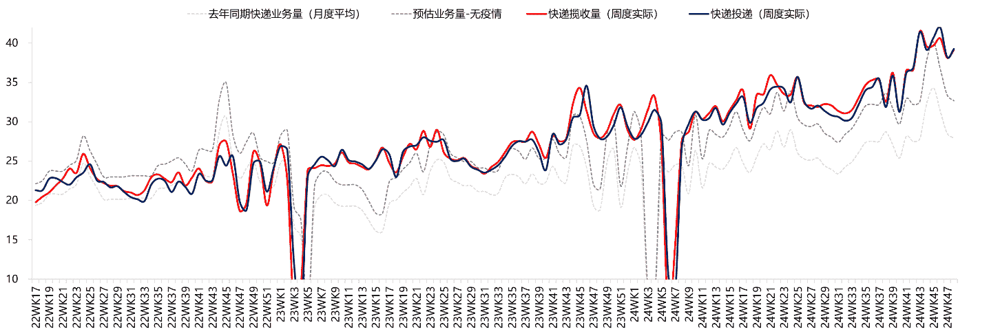

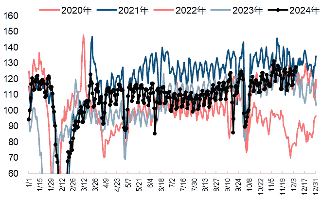

整车货运流量指数：新疆

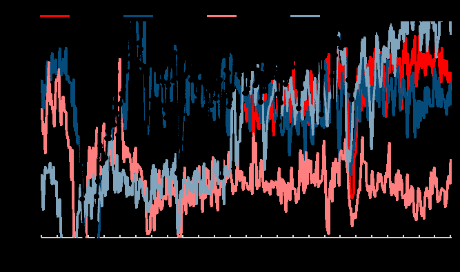

整车货运流量指数：甘肃

### 图11：12月6日新疆、甘肃、广西整车货运流量同比分别提升97.6pct、26pct、13.4pct

数据来源：*G7*易流，中信建投

### 图12：规模以上快递业务收入同比增速（亿元，%）

数据来源：*Wind*，中信建投

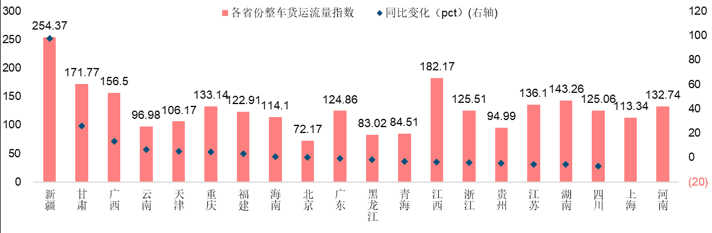

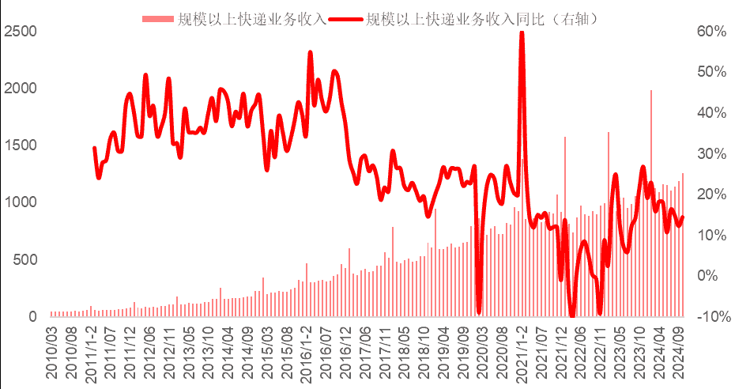

### 图13：规模以上快递业务量增速（亿件，%）

数据来源：*Wind*，中信建投

### 图14：同城、异地、国际快递收入及同比（亿元，%）

### 图15：同城、异地、国际快递业务量及同比（亿件，%）

数据来源：*Wind*，中信建投

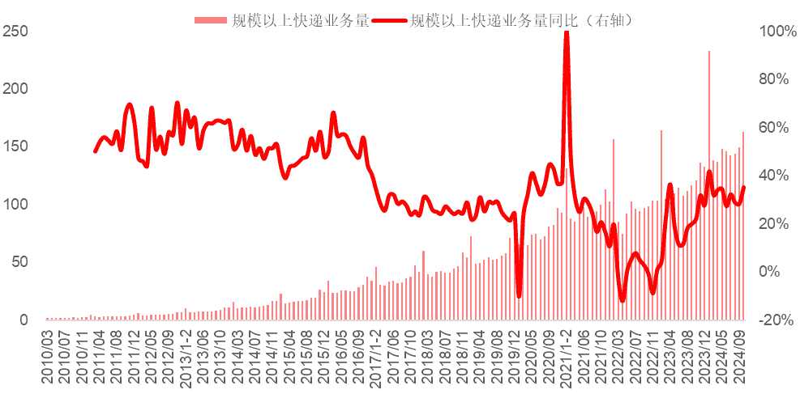

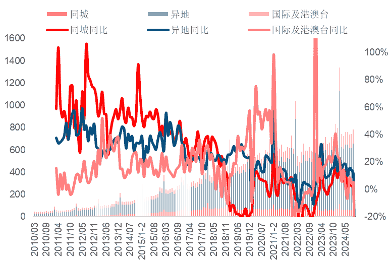

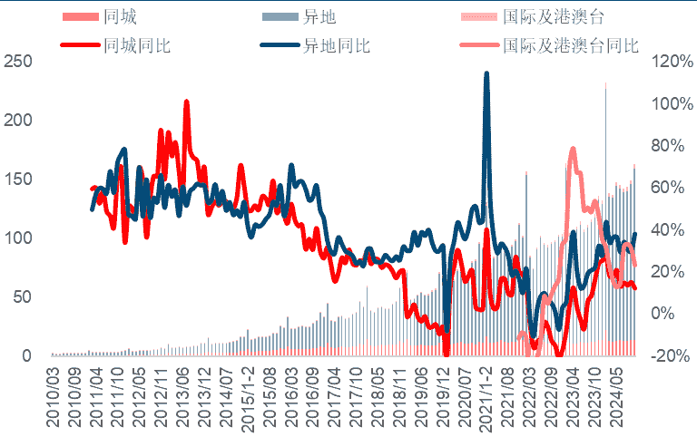

### 图16：东、中、西部地区快递收入及同比（亿元，%）

### 图17：东、中、西部地区快递业务量及同比（亿件，%）

数据来源：*Wind*，中信建投

### 2.2 价格：10月快递单票收入为7.71元/件，同比下降9.44%

### 图18：规模以上快递业务单票收入及同比（元，%）

数据来源：*Wind*，中信建投

### 图19：同城、异地快递业务单票价格变化（元，%）

### 图20：东、中、西部单票价格变化（元，%）

数据来源：*Wind*，中信建投

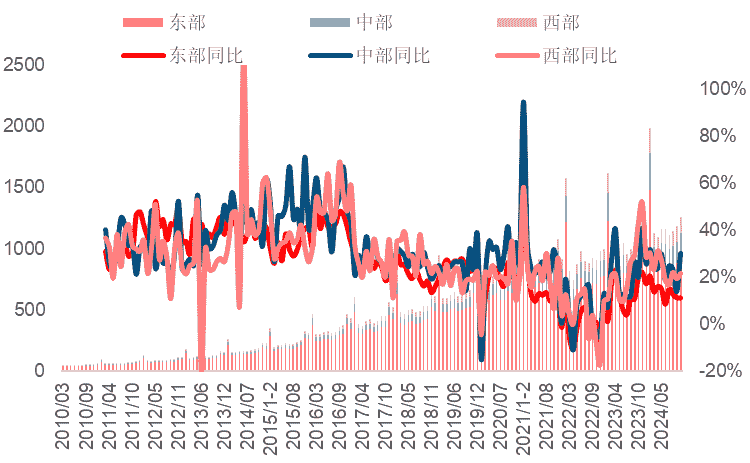

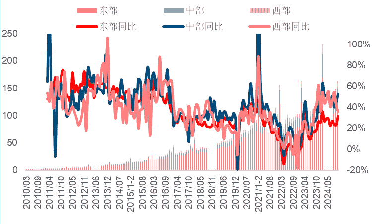

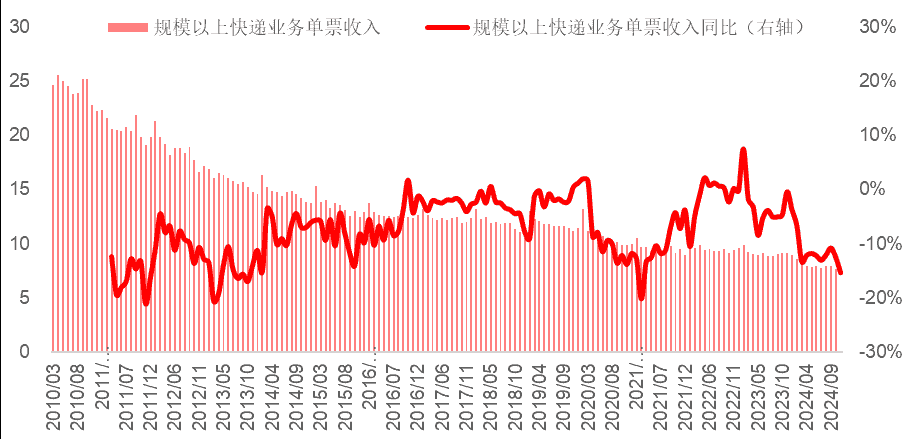

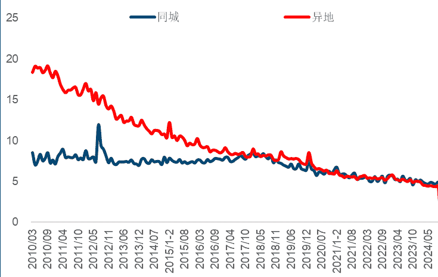

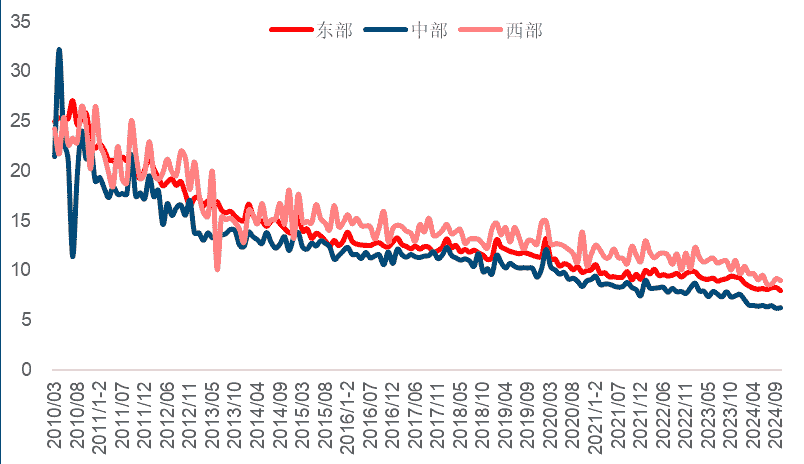

### 2.3 上游：10月份实物商品网络零售额同比增长11.3%

### 图21：中国社会消费品零售总额同比增速（%）

数据来源：*Wind*，中信建投

### 图22：中国实物网上零售额累计同比增速（亿元，%）

数据来源：*Wind*，中信建投

### 图23：实物商品网上零售额占比（%）

### 图24：网上商品零售额吃穿用累计同比增速（%）

数据来源：*Wind*，中信建投

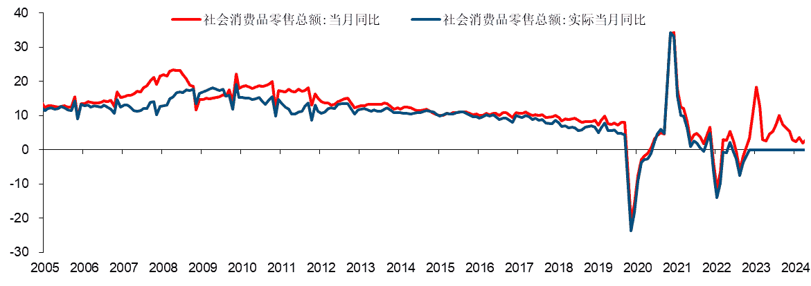

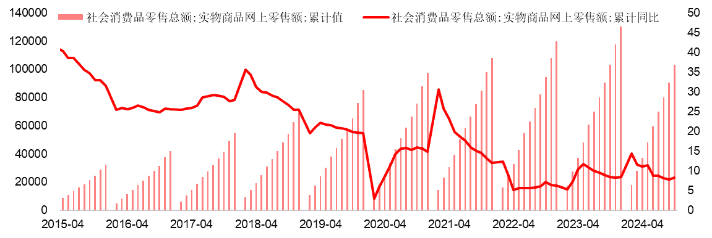

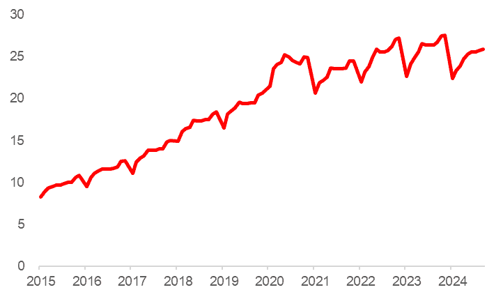

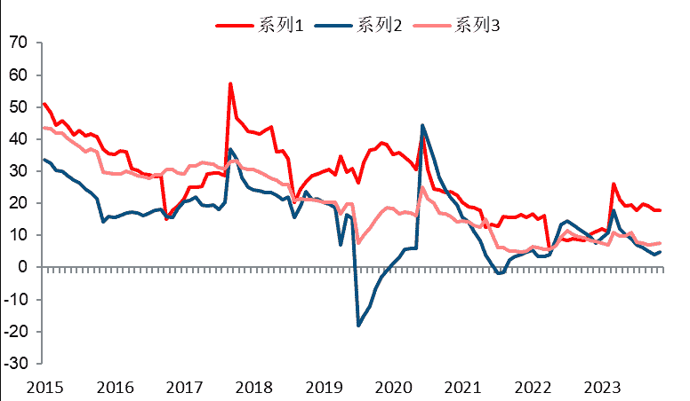

### 图25：中国电商物流指数（ELI）

数据来源：*Wind*，中信建投证券

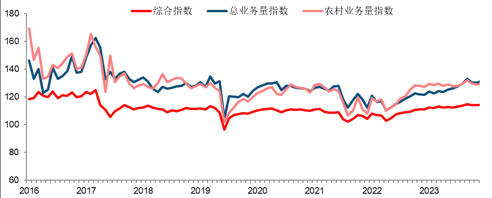

## 三、竞争格局：韵达及中通总部在旺季积极的量价策略带来较友商较好的市占率提升

### 图26：快递服务品牌集中度指数CR8（单位：%）

### 图27：快递企业增速出现分化（单位：%）

数据来源：*Wind*，中信建投

### 图28：快递企业月度市占率变化（单位：%）

### 图29：快递企业单票收入（元/票）

数据来源：*Wind*，中信建投

### 图30：快递行业上市公司月度经营数据（单票收入：元，业务收入：亿元，快递业务量：亿票）

| 公司 | 指标 | 2023年10月 | 2023年11月 | 2023年12月 | 2024年1月 | 2024年2月 | 2024年3月 | 2024年4月 | 2024年5月 | 2024年6月 | 2024年7月 | 2024年8月 | 2024年9月 | 2024年10月 | 2024年累计 |
|---|---|---:|---:|---:|---:|---:|---:|---:|---:|---:|---:|---:|---:|---:|---:|
| 顺丰控股 | 单票收入 | 16.26 | 15.62 | 16.00 | 17.00 | 16.28 | 15.66 | 15.67 | 15.25 | 15.77 | 15.76 | 15.67 | 16.00 | 14.64 | 15.75 |
| 顺丰控股 | 当月同比 | 8.13% | 5.03% | 0.72% | -0.33% | 5.99% | 3.35% | 3.59% | -1.15% | -3.99% | -5.81% | -5.26% | -7.00% | -9.98% | -2.23% |
| 顺丰控股 | 快递业务量 | 9.51 | 11.75 | 11.3 | 11.47 | 7.78 | 10.33 | 10.27 | 11.21 | 11.08 | 10.3 | 10.43 | 11.41 | 12.07 | 106.35 |
| 顺丰控股 | 当月同比 | 1.28% | 11.16% | -2.25% | 19.85% | -11.49% | 0.00% | 6.10% | 14.04% | 8.95% | 16.65% | 14.62% | 12.64% | 26.92% | 23.05% |
| 顺丰控股 | 业务收入 | 154.68 | 183.52 | 180.75 | 195.01 | 126.66 | 161.8 | 160.96 | 170.97 | 174.73 | 162.28 | 163.46 | 182.6 | 176.73 | 1675.2 |
| 顺丰控股 | 当月同比 | 9.52% | 16.75% | -1.54% | 19.46% | -6.18% | 3.35% | 9.90% | 12.72% | 4.60% | 9.87% | 8.58% | 4.75% | 14.26% | 20.30% |
| 韵达股份 | 单票收入 | 2.28 | 2.38 | 2.24 | 2.27 | 2.29 | 2.08 | 2.05 | 2.03 | 2.00 | 1.98 | 1.99 | 2.01 | 2.02 | 2.06 |
| 韵达股份 | 当月同比 | -14.39% | -17.49% | -17.31% | -17.63% | -12.11% | -17.92% | -15.84% | -17.05% | -13.92% | -10.11% | -8.36% | -12.50% | -11.55% | -14.12% |
| 韵达股份 | 快递业务量 | 17.07 | 19.3 | 19.5 | 19.57 | 10.65 | 19.2 | 19.17 | 20.42 | 20.23 | 20.1 | 19.73 | 20.36 | 22.5 | 191.93 |
| 韵达股份 | 当月同比 | 12.52% | 30.41% | 30.26% | 96.09% | -22.88% | 32.60% | 31.75% | 32.68% | 27.96% | 27.78% | 21.57% | 21.99% | 31.81% | 44.67% |
| 韵达股份 | 业务收入 | 38.9 | 45.86 | 43.72 | 44.4 | 24.34 | 39.89 | 39.22 | 41.36 | 40.37 | 39.71 | 39.17 | 40.83 | 45.35 | 394.64 |
| 韵达股份 | 当月同比 | -3.67% | 7.60% | 7.71% | 61.51% | -32.22% | 8.84% | 10.88% | 10.06% | 10.15% | 14.87% | 11.41% | 6.75% | 16.58% | 24.25% |
| 圆通速递 | 单票收入 | 2.38 | 2.46 | 2.42 | 2.45 | 2.53 | 2.35 | 2.30 | 2.23 | 2.25 | 2.24 | 2.17 | 2.18 | 2.31 | 2.29 |
| 圆通速递 | 当月同比 | -5.55% | -9.34% | -11.86% | -10.63% | -0.11% | -4.14% | -2.81% | -3.89% | -4.88% | -3.69% | -7.08% | -6.60% | -3.23% | -4.81% |
| 圆通速递 | 快递业务量 | 18.85 | 21.64 | 21.42 | 21.51 | 12.41 | 21.76 | 21.5 | 22.84 | 22.02 | 21.38 | 22.61 | 23.12 | 24.73 | 213.88 |
| 圆通速递 | 当月同比 | -52.82% | 32.92% | 34.46% | 91.88% | -20.40% | 22.45% | 23.78% | 27.60% | 22.88% | 26.51% | 29.87% | 28.02% | 31.19% | 42.46% |
| 圆通速递 | 业务收入 | 44.93 | 53.34 | 51.77 | 52.61 | 31.44 | 51.24 | 49.48 | 50.93 | 49.63 | 47.92 | 49.08 | 50.47 | 57.04 | 489.84 |
| 圆通速递 | 当月同比 | 183.83% | 20.52% | 18.52% | 71.48% | -20.49% | 17.39% | 20.30% | 22.63% | 16.89% | 21.84% | 20.68% | 19.57% | 26.95% | 35.61% |
| 申通快递 | 单票收入 | 2.11 | 2.20 | 2.18 | 2.19 | 2.25 | 2.10 | 2.05 | 2.01 | 2.01 | 2.00 | 2.00 | 2.02 | 2.02 | 2.05 |
| 申通快递 | 当月同比 | -12.81% | -15.93% | -16.99% | -18.69% | -6.79% | -12.58% | -12.41% | -9.17% | -9.09% | -7.08% | -4.56% | -4.14% | -4.22% | -9.19% |
| 申通快递 | 快递业务量 | 16.77 | 18.02 | 17.09 | 18.1 | 10.4 | 17.37 | 17.29 | 19.46 | 19.65 | 19.49 | 19.36 | 19.98 | 21.86 | 182.96 |
| 申通快递 | 当月同比 | 34.05% | 49.17% | 47.20% | 124.57% | -15.38% | 31.49% | 29.13% | 29.47% | 29.02% | 35.44% | 27.28% | 21.98% | 30.35% | 48.52% |
| 申通快递 | 业务收入 | 35.45 | 39.69 | 37.27 | 39.66 | 23.41 | 36.52 | 35.38 | 39.02 | 39.41 | 38.99 | 38.73 | 40.33 | 44.26 | 375.71 |
| 申通快递 | 当月同比 | 16.88% | 25.40% | 22.20% | 82.60% | -21.13% | 14.95% | 13.11% | 17.60% | 17.29% | 25.86% | 21.49% | 16.93% | 24.85% | 34.87% |

数据来源：公司公告，中信建投

### 图31：2023年Q4主要快递企业申诉情况

### 图32：2023年Q4快递服务申诉情况

数据来源：国家邮政局，中信建投

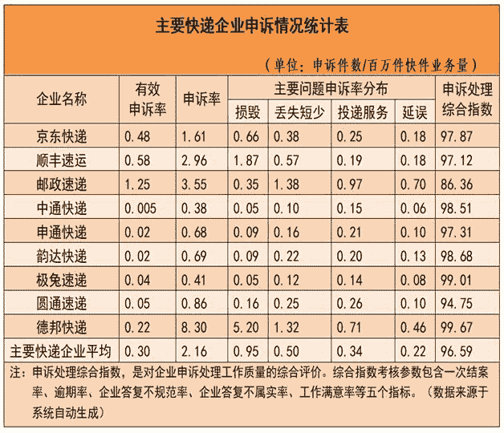

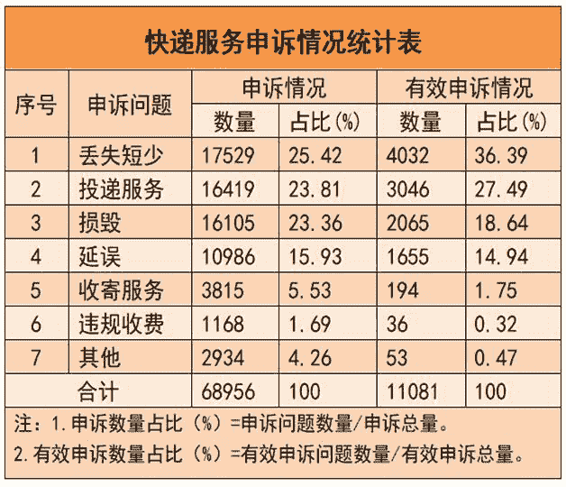

## 四、投资评价和建议

### 1、服务领先的直营物流盈利改善空间更大

对比直营制与加盟制物流公司固定资产占营业收入比的数据，可以发现：加盟制>直营制。其中核心原因，一方面是因为加盟物流公司财报确认的营业收入并非全链条收入，所以收入相对较小；一方面是因为加盟物流公司总部聚焦提供极致的成本，产能的自有化程度较高，而自营物流公司受制于资金体量规模及盈利能力，无法全部环节实现自有化产能，人工、运力等供给相对丰富的领域，更倾向于使用外包租赁资源。以上商业模式差别，带来两种模式的物流公司在不同经济发展周期的盈利弹性不同。

a、经济景气度高、需求强的去库存时期：由于人、车、场地等资源要素成本相对更高，因此资产自有化程度高的加盟物流企业更易提供具有竞争力的成本及价格。所以，加盟制物流公司固定资产占收入比例大小，与其市占率和盈利能力基本成正相关。因此受益程度：中通快递>圆通速递>韵达股份>申通快递>极兔速递。

b、经济景气度低、需求弱的补库存时期：由于人、车、场地等资源要素成本相对下降，因此资产外包化程度高的直营物流企业，更易通过压降资源供应商端的成本实现利润的释放。所以，自营制物流公司固定资产占营收比例大小，与未来成本优化空间和弹性成负相关。因此受益程度：京东物流>德邦快递>顺丰控股。维持京东物流与顺丰控股“买入”评级。

图33: 加盟物流公司固定资产占营收比例

图34: 直营物流公司固定资产占营收比例

数据来源：*Wind*，中信建投证券

数据来源：*Wind*，中信建投证券

### 2、极致成本是加盟模式物流核心选股逻辑

加盟快递行业发展的前30年（1993-2023），各家快递总部通过“KPI及返点”和“派费”两大抓手，直接激发了加盟商和快递员的主观能动性；并通过持续融资投入更多产能，获取更多件量的同时产生更低的成本，加速了快递行业飞轮的高速旋转。

a、2024年行业步入第三轮产能周期结束阶段，与前两轮周期一样，伴随着自动化和数字化带来产能效能提升，核心运营成本仍可持续下降但空间逐渐收窄，各家快递企业更加注重模式创新与定价策略调整，以图呈现降本领先的α机遇。

具体来看，自动化和数字化带来了人效、坪效、车效的快递核心运营效率的不断提升，如上一部分对自营和加盟模式自有资产对业绩的影响分析，随着各家快递的自有化率逐渐趋于一致，在当下经济景气度低、需求弱的补库存时期，各家加盟快递公司成本差异化在缩小。

因此，提升单位面积和单车运营效率或降低成本，是短期资本开支低谷期利润争夺战的“胜负手”。同时，在产能投资低谷期间较少的折旧摊销成本，运营成本仍会有持续超预下降空间。

图35: 18年以来TOP5快递公司（顺丰、中通、圆通、韵达、申通）资产产能与市占率、单价、单票净利同比增速关系

数据来源：*Wind*，公司公告，中信建投

b、第四轮产能周期已经在2024年底开启，基于目前融资能力和再投资能力的差异，并非每家公司都能如前三轮周期一样顺利追加产能，因此资本开支（产能）策略的头尾部分化，会加速体现在定价策略、盈利能力以及终端稳定性方面。无法持续投产的公司，无法（或亏本）承接业务需求实现正反馈机制生效，相反会导致网络动荡及最终出清。

c、伴随第四轮产能周期开启，强大融资能力和资产持续投入才是真正的格局优化、产生超额定价权的关键。基于目前融资能力和再投资能力出现分化情况：在第三轮产能周期第一阶段结束（2022Q4）前，除顺丰外基本所有快递企业的资本开支满足率均为同方向一致变化，但进入第二阶段后我们看到，头中尾部快递企业的资本开支满足率出现了“正值”“零值”“负值”的分化。

图36: 快递上市公司季度投资回报情况（2017-2024）

| 公司 | 2017 | 2018 | 2019 | 2020 | 2021 | 2022 | 2023 | 2024 |
|------|------|------|------|------|------|------|------|------|
| 中通 | - | - | - | - | - | - | - | - |
| 韵达 | - | - | - | - | - | - | - | - |
| 圆通 | - | - | - | - | - | - | - | - |
| 申通 | - | - | - | - | - | - | - | - |

数据来源：公司财报，中信建投；投资回报=归母净利润/资本开支

d、但快递行业发展到目前遭遇中转、运输环节成本下降遇瓶颈等，问题的核心均是局部成本优化瓶颈下，以价换量策略的边际效应下降造成的。所以，在当下时点，需要认识“终端变革”如何催化快递飞轮的持续飞转，需要快递总部与加盟商一起投入更多的设备、系统及资源，实现驿站布局、驿站直送以及散单拓展。从而从根本上解决加盟商环节降本、快递员效能天花板等瓶颈，但该新模式的推进并非所有快递企业均可以完成，一方面需要加盟商层面的再投资，一方面需要局部业务件量达到一定规模。

——各家快递公司均在推行末端网络模式创新，如：中通的直链、圆通的驿站直送、韵达的网格站、顺丰的雾化网点等，其本质均是希望通过尝试模式创新对全链条成本进行持续优化，尤其是突破快递员效率瓶颈。另外，由于终端模式变革有“件量规模+资金投入”的门槛，因此并非所有快递行业玩家均能够实现顺利变革。但由于模式变革涉及四方利益，因此保障四方利益在变革期均不受损的玩家才能胜出。加盟商及快递员合计能够预计降本0.3-0.4元，其中加盟商侧降低0.2-0.3元，快递员层面优化0.1元左右。

图37: 加盟制快递新旧模式对比示意图

数据来源：中通快递官网投资者日演示材料，圆通速递官方公众号，中信建投

——直链化是难但长期且正确的事情，若从多次搬到装卸，通过目的地转运中心（或站点）到驿站的直链，通过模式创新对全链条成本进行持续优化，减少站点运营成本，同时网络的稳定性、扩张性都会更好。总部也有更多价格战和利润释放的空间。过去快递员拿到0.8元派费提成，但需要支付给驿站0.4元做代派，因此加盟商直链驿站后节省0.4元，但通过集约化直送（0.2元投资车辆及自动化设备，及运营成本）或无人车直送（0.1元成本），那可以降低0.2-0.3元的派送成本。

快递行业已由成长期向稳定期转变的“供给为王的新周期”，2025年将是快递市场格局重塑的关键时期，迎来的新一轮产能周期扩张期和终端变革是快递板块加速重构快递行业同质化服务出清的分水岭。

建议关注具备持续投入产能并拥有造血能力、推进终端模式变革或存在较大边际改善的公司。头部公司中通快递作为电商快递的龙头公司，目前正处于度过产能峰值后的利润释放期，在产能投入具备较好的前瞻性，在第四轮产能周期来临时，拥有超过市场平均水平的单票盈利能力和潜在融资能力，具备较为充足的造血和抗风险能力，并且推进直链化和散单背后的终端模式变革又会让其领跑未来。维持中通快递“买入”评级。

## 风险分析

**电商快递需求增长低于预期**

快递件量较大部分来源于电商快递，需求增长存在低于预期风险。回顾2020年，经历了新冠疫情短暂冲击的快递行业受益于线上渗透率的加速提升，需求出现超预期增长；同时，电商平台间竞争加剧，各类促销活动频出，带动快递行业件量增速表现优异，后续电商平台营销费用存在不及预期风险，带来电商快递需求增长低于预期。

**快递行业价格战愈演愈烈**

当前各地快递价格监管政策下，快递行业价格战硝烟散去；但是快递企业产能扩张仍未完全落地，当快递行业需求不及预期，或处于淡季之中，无法满足快递行业整体产能利用率时，快递行业价格战存在愈演愈烈风险。

**劳务用工成本提升超出预期**

快递企业价格战期间，派费成本显著降低，导致快递一线员工收入下降。目前国内多地出台保障快递小哥收益相关政策，叠加劳务用工成本持续处于提升状态，快递企业劳务用工成本提升存在超出预期可能。

### 分析师介绍

**梁骁**

南开大学硕士，先后供职于中集集团物流板块、顺丰控股、京东物流，曾参与撰写《国家多式联运标准修订建议报告》并为交通物流相关十四五规划建言献策；多年受聘京东物流专家委员会顾问并参与IPO项目。具有丰富的交运物流行业研究经验以及资源，擅于把握和挖掘公司长期价值，覆盖快递快运/仓储运输/供应链物流/国际物流。

**韩军**

交通运输行业首席分析师，曾供职于上海国际航运研究中心，3年政府规划与市场咨询经验，曾负责或参与为交通运输部、上海市交通委、港航企业等提供决策咨询服务二十余项。7年交通运输行业证券研究经验，深入覆盖航运、港口、高铁、快递、物流板块，擅长把握周期性和政策性投资机会。2021第十九届新财富最佳分析师交通运输行业第五名。

### 评级说明

| 投资评级标准 | 评级 | 说明 |
|---|---|---|
| 报告中投资建议涉及的评级标准为报告发布日后6个月内的相对市场表现，也即报告发布日后的6个月内公司股价（或行业指数）相对同期相关证券市场代表性指数的涨跌幅作为基准。A股市场以沪深300指数作为基准；新三板市场以三板成指为基准；香港市场以恒生指数作为基准；美国市场以标普500指数为基准。 | 股票评级 | 买入 相对涨幅15％以上 增持 相对涨幅5%—15％ 中性 相对涨幅-5%—5％之间 减持 相对跌幅5%—15％ 卖出 相对跌幅15％以上 |
| 行业评级 | 强于大市 相对涨幅10%以上 中性 相对涨幅-10-10%之间 弱于大市 相对跌幅10%以上 |

### 分析师声明

本报告署名分析师在此声明：（i）以勤勉的职业态度、专业审慎的研究方法，使用合法合规的信息，独立、客观地出具本报告, 结论不受任何第三方的授意或影响。（ii）本人不曾因，不因，也将不会因本报告中的具体推荐意见或观点而直接或间接收到任何形式的补偿。

### 法律主体说明

本报告由中信建投证券股份有限公司及/或其附属机构（以下合称“中信建投”）制作，由中信建投证券股份有限公司在中华人民共和国（仅为本报告目的，不包括香港、澳门、台湾）提供。中信建投证券股份有限公司具有中国证监会许可的投资咨询业务资格，本报告署名分析师所持中国证券业协会授予的证券投资咨询执业资格证书编号已披露在报告首页。

在遵守适用的法律法规情况下，本报告亦可能由中信建投（国际）证券有限公司在香港提供。本报告作者所持香港证监会牌照的中央编号已披露在报告首页。

### 一般性声明

本报告由中信建投制作。发送本报告不构成任何合同或承诺的基础，不因接收者收到本报告而视其为中信建投客户。

本报告的信息均来源于中信建投认为可靠的公开资料，但中信建投对这些信息的准确性及完整性不作任何保证。本报告所载观点、评估和预测仅反映本报告出具日该分析师的判断，该等观点、评估和预测可能在不发出通知的情况下有所变更，亦有可能因使用不同假设和标准或者采用不同分析方法而与中信建投其他部门、人员口头或书面表达的意见不同或相反。本报告所引证券或其他金融工具的过往业绩不代表其未来表现。报告中所含任何具有预测性质的内容皆基于相应的假设条件，而任何假设条件都可能随时发生变化并影响实际投资收益。中信建投不承诺、不保证本报告所含具有预测性质的内容必然得以实现。

本报告内容的全部或部分均不构成投资建议。本报告所包含的观点、建议并未考虑报告接收人在财务状况、投资目的、风险偏好等方面的具体情况，报告接收者应当独立评估本报告所含信息，基于自身投资目标、需求、市场机会、风险及其他因素自主做出决策并自行承担投资风险。中信建投建议所有投资者应就任何潜在投资向其税务、会计或法律顾问咨询。不论报告接收者是否根据本报告做出投资决策，中信建投都不对该等投资决策提供任何形式的担保，亦不以任何形式分享投资收益或者分担投资损失。中信建投不对使用本报告所产生的任何直接或间接损失承担责任。

在法律法规及监管规定允许的范围内，中信建投可能持有并交易本报告中所提公司的股份或其他财产权益，也可能在过去12个月、目前或者将来为本报告中所提公司提供或者争取为其提供投资银行、做市交易、财务顾问或其他金融服务。本报告内容真实、准确、完整地反映了署名分析师的观点，分析师的薪酬无论过去、现在或未来都不会直接或间接与其所撰写报告中的具体观点相联系，分析师亦不会因撰写本报告而获取不当利益。

本报告为中信建投所有。未经中信建投事先书面许可，任何机构和/或个人不得以任何形式转发、翻版、复制、发布或引用本报告全部或部分内容，亦不得从未经中信建投书面授权的任何机构、个人或其运营的媒体平台接收、翻版、复制或引用本报告全部或部分内容。版权所有，违者必究。

### 中信建投证券研究发展部

| 中信建投（国际） | 北京 | 上海 | 深圳 | 香港 |
|---|---|---|---|---|
| | 朝阳区景辉街16号院1号楼18层 | 上海浦东新区浦东南路528号南塔2103室 | 福田区福中三路与鹏程一路交汇处广电金融中心35楼 | 中环交易广场2期18楼 |
| 电话 | （8610）56135088 | （8621）6882-1600 | （86755）8252-1369 | （852）3465-5600 |
| 联系人 | 李祉瑶 | 翁起帆 | 曹莹 | 刘泓麟 |
| 邮箱 | lizhiyao@csc.com.cn | wengqifan@csc.com.cn | caoying@csc.com.cn | charleneliu@csci.hk |
