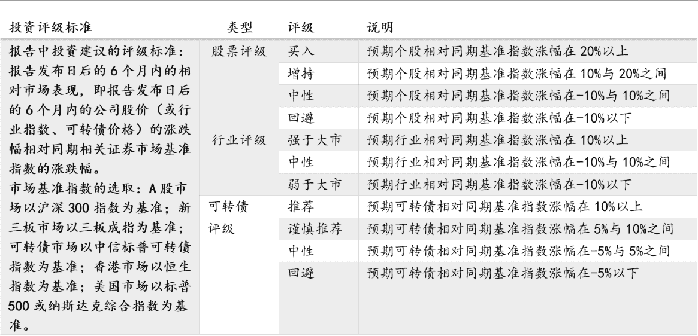

1

**中邮证券**

**2024年12月16日**

**中药新药申报加速，国谈助力新药快速放量**

**板块投资评级：强大于市 | 维持**

**证券研究报告**

**中邮证券研究所 医药团队**

**蔡明子（首席分析师）**

**SAC编号：S13405231001**

**古意涵（分析师）**

**SAC编号：S13405231003**

2

## 投资要点

➢ **CDE受理中药新药数量明显增加，1.1类中药新药通过医保谈判快速放量**

**1、2023—2024年CDE受理中药新药数量明显增加：**2021年开始，中药新药申请受理数量明显增加，且保持持续增加态势，1.1类基本在每年40个以上，3.1类则从2022年起快速增加。2024年截至12月16日，CDE共受理了124个中药新药品种，其中1.1类中药创新药最多，占比超过50%，3.1类占比20%。截至目前，共有11个1类中药创新药在CDE审评任务公示中，目前悦康药业的注射用羟基红花黄色素A已完成所有任务，预计上市在即，悦康药业还有通络健脑片、紫花温肺止嗽颗粒在审评中；健民药业的牛黄小儿退热贴、康缘药业的龙七胶囊仅剩下临床毒理一项任务。

**2、天士力临床III期品种最多，康缘药业IND品种最多：**国内临床III期品种天士力有9个，皆处于试验进行中；康缘药业有5个，其中参蒲盆炎颗粒开启NDA，另2个已完成临床III期；以岭药业有4个临床III期品种，其中两个已申报NDA，另两个已完成；悦康药业的3个品种皆完成临床III期并申报上市；另有中国中药、益佰制药皆各有一个品种完成临床III期。2021—2023年IND受理数量呈现逐年增加态势，截至2024年12月5日，受理数量达到53个，其中，康缘药业申请数量最多，达到6个，皆为1.1类中药创新药；其次是以岭药业有5个，天士力有3个，康恩贝、健民药业、神威药业各2个。

**3、已上市的1.1类中药创新药有以下4个特点：**1）上市初期日服用金额较高，皆在50元以上水平，最高接近200元；2）快速进入医保目录，除了参郁宁神片外，其他品种皆进入医保目录，大部分在上市次年即进入；3）医保谈判价格降幅集中在70%左右，降幅较低的为50%出头；4）后续医保谈判续约中，再降价幅度在20%以内。

**4、医保谈判为前期销售加速放量的重要契机：**1.1类中药创新药较多在上市后次年通过谈判进入医保目录，首次谈判降价幅度70%左右，生产厂家在上市初期组建销售团队、储备代理商等，促进其在年底通过谈判进入医保目录（成功概率较高），进入后加速覆盖医院终端：方盛制药的玄七健骨片在上市后的第二个完整年度覆盖等级医院数量接近500家，实现收入超过3000万元；健民药业的七蕊胃舒胶囊也在上市后的第二个完整年度销售额预计超过8000万元；以岭药业的解郁除烦胶囊在上市后的第二个完整年度在院内、药店终端皆排名中成药抗抑郁药市场TOP品牌。考虑到已上市药品的研发投入较多为3000万元左右，中药创新药的投资回收期较短。

➢ **推荐及受益标的：**推荐标的：康缘药业；受益标的：天士力、以岭药业、健民集团、悦康药业、方盛制药。

➢ **风险提示：**审评进度不及预期风险；医保控费等影响进院进度风险。

请参阅附注免责声明

3

## 一、CDE受理中药新药数量明显增加，1.1类中药新药通过医保谈判快速放量

4

## 1.1 CDE受理中药新药数量明显增加

请参阅附注免责声明

◼ **2023—2024年CDE受理中药新药数量明显增加：**2024年截至12月16日，CDE共受理了124个中药新药品种，其中1.1类中药创新药最多，占比超过50%，3.1类（按古代经典名方目录管理的中药复方制剂）占比20%。2021年开始，中药新药申请受理数量明显增加，且保持持续增加态势，1.1类基本在每年40个以上，3.1类则从2022年起快速增加。

◼ **近3年上市公司申请中药NDA的包括：**康缘药业、悦康药业皆有3个品种处于审评中，康缘药业在2022—2023年各有一个品种获批上市，以岭药业有2个品种处于审评中，健民药业、方盛制药各有1个品种处于审评中。

**图表1：2023—2024年CDE受理中药新药数量明显增加（个）**

资料来源：CDE、中邮证券研究所

| 企业名称 | 药品名称 | 进入中心时间 | 注册分类 | 审评进度 |
|---|---|---|---|---|
| 康缘药业 | 参蒲盆安颗粒 | 2024-05-28 | 1.1 | 审评中 |
| 悦康生物制药 | 通络健脑片 | 2024-03-01 | 1.1 | 审评中 |
| 悦康生物制药 | 龙七胶囊 | 2024-04-04 | 1.1 | 审评中 |
| 悦康生物制药 | 紫花温肺止嗽颗粒 | 2024-03-01 | 1.1 | 审评中 |
| 康缘药业 | 玉女煎颗粒 | 2024-05-29 | 3.1 | 审评中 |
| 悦康生物制药 | 注射用羟基红花黄色素A | 2023-12-19 | 1.2 | 审评中 |
| 悦康生物制药 | 济川颗粒 | 2023-05-25 | 3.1 | 已上市 |
| 健民药业 | 牛黄小儿退热贴 | 2024-01-26 | 1.1 | 审评中 |
| 健民药业 | 苓桂术甘颗粒 | 2022-01 | 3.1 | 已上市 |
| 健民药业 | 小儿紫贝止咳糖浆 | 2022-09-29 | 1.1 | 已上市 |
| 以岭药业 | 柴黄利胆胶囊 | 2024-06-13 | 1.1 | 审评中 |
| 方盛制药 | 养血祛风止痛颗粒 | 2024-09-14 | 1.1 | 审评中 |
| 方盛制药 | 辛芪通鼻片 | 2023-11-24 | 1.1 | 审评中 |
| 亚宝药业 | 风叶咳喘平口服液 | 2022-11-11 | 1.1 | 已上市 |
| 亚宝药业 | 芪黄明目胶囊 | 2022-09-02 | 1.1 | 已上市 |

**图表2：近3年上市公司申请新药NDA审评情况**

资料来源：CDE、中邮证券研究所

| 项目 | 数值 |
|---|---:|
| CDE受理中药新药申请数量 | 2020—2024年 |
| 1.1类 | — |
| 3.1类 | — |

5

## 1.2 CDE当前共有11个1.1类、20个3.1类中药新药在审评

请参阅附注免责声明

◼ 截至12月5日，共有11个1类中药创新药在CDE审评任务公示中，目前悦康药业的注射用羟基红花黄色素A已完成所有任务，预计上市在即，悦康药业还有通络健脑片、紫花温肺止嗽颗粒在审评中；健民药业的牛黄小儿退热贴、康缘药业的龙七胶囊仅剩下临床毒理一项任务。

◼ **3.1类中药新药2024年受理明显加速：**当前在CDE审评任务公示中有20个3.1类品种，且同个品种的生产厂家申报时间间隔较小。神威药业有4个3.1类品种在审评中。

**图表3：CDE当前共有11个1.1类中药新药在审评**

资料来源：CDE、中邮证券研究所。注：*代表排队待审评。

| 药品名称 | 企业名称 | 进入中心时间 | 审评状态 | 药理毒理 | 临床 | 药学 | 统计 | 临床毒理 | 合规 | 药品分类 |
|---|---|---|---|---|---|---|---|---|---|---|
| 养血祛风止痛颗粒 | 方盛制药 | 2024/9/14 | 排队待审评 | * | * | * | * | * | * | 1.1 |
| 柴黄利胆胶囊 | 以岭药业 | 2024/6/13 | 排队待审评 | * | * | * | * | * | * | 1.1 |
| 参蒲盆安颗粒 | 康缘药业 | 2024/5/28 | 排队待审评 | * | * | √ | * | * | * | 1.1 |
| 珍珠滴丸 | 贵州民族药业 | 2024/4/20 | 排队待审评 | √ | √ | √ | √ | √ | √ | 1.1 |
| 龙七胶囊 | 康缘药业 | 2024/4/4 | 排队待审评 | √ | √ | √ | √ | √ | √ | 1.1 |
| 通络健脑片 | 广州悦康生物制药 | 2024/3/1 | 暂停 | √ | * | √ | √ | * | — | 1.1 |
| 紫花温肺止嗽颗粒 | 广州悦康生物制药 | 2024/3/1 | 暂停 | √ | * | √ | √ | * | — | 1.1 |
| 喉喑清胶囊 | 贵州瑞和制药 | 2024/1/29 | 暂停 | √ | √ | √ | √ | √ | — | 1.1 |
| 牛黄小儿退热贴 | 健民药业集团 | 2024/1/26 | 排队待审评 | √ | √ | √ | √ | √ | — | 1.1 |
| 羟基红花黄色素A | 广州悦康生物制药 | 2023/12/19 | 暂停 | √ | √ | √ | √ | √ | √ | 1.2 |
| 注射用羟基红花黄色素A | 悦康药业集团 | 2023/12/19 | 暂停 | √ | √ | √ | √ | √ | √ | 1.2 |

**图表4：3.1类中药新药审评加速**

资料来源：CDE、中邮证券研究所

| 药品名称 | 企业名称 | 进入中心时间 |
|---|---|---|
| 桃红四物颗粒 | 株洲千金药业 | 2024/9/19 |
| 桃红四物颗粒 | 神威药业集团 | 2024/11/25 |
| 桃红四物颗粒 | 河北万邦复临药业 | 2024/11/25 |
| 二冬颗粒 | 贵州威门药业 | 2024/5/17 |
| 二冬颗粒 | 神威药业集团 | 2024/9/2 |
| 开心散 | 山东润中药业 | 2024/5/30 |
| 开心散 | 上海和黄药业 | 2024/6/28 |
| 枇杷清肺颗粒 | 神威药业集团 | 2024/9/26 |
| 枇杷清肺颗粒 | 河北万岁药业 | 2024/11/28 |
| 升陷颗粒 | 吉林敖东 | 2024/6/8 |
| 升陷颗粒 | 神威药业集团 | 2024/7/17 |
| 苓桂术甘颗粒 | 凯宝药业 | 2024/4/24 |
| 一贯煎颗粒 | 凯宝药业 | 2024/4/24 |
| 玉女煎颗粒 | 江苏康缘药业 | 2024/5/29 |
| 五味消毒饮颗粒 | 瑞阳制药 | 2024/6/15 |
| 苓桂术甘汤颗粒 | 浙江康恩贝制药 | 2024/6/27 |
| 易黄颗粒 | 海南葫芦娃药业 | 2024/7/4 |
| 温经汤颗粒 | 上海医药集团青岛国风药业 | 2024/7/9 |
| 桃核承气颗粒 | 广东一方制药 | 2024/8/27 |
| 五味消毒颗粒 | 南京中山制药 | 2024/11/5 |

6

### 1.3 审评总历时集中在1年，新报任务历时差距不大，补充资料历时有拉长趋势

请参阅附注免责声明

◼ **中药NDA流程主要为：**药审中心承办→进入新报任务（平均240天，包含统计、药理毒理、临床、药学、合规等任务）→1至2个月→进入补充资料任务（平均60天，任务内容和新报一致）→国家/地方药监局审批→NMPA签发药品批件，离开补充资料任务后需要约15天被批准生产。

◼ 从已上市药品的时间轴来看，总历时集中在一年，最低为286天，最多为522天，历时更长的导致因素主要为补充资料任务时间和任务之间的间隔时间。申报时间较后的新药，补充任务时间有拉长趋势。整体历时仍然变化不大。

**图表5：已上市1.1类中药创新药药品审评总历时变化不大，集中在1年**

虎贞清风胶囊  
玄七健骨片  
芪黄胶囊  
利胃胶囊  
坤怡宁颗粒  
解郁除烦胶囊  
太子神悦胶囊  
参味宁郁片  
芪黄明目胶囊  
小儿紫贝止咳糖浆  
拈痛祛风颗粒  
风叶咳喘平口服液  
儿茶上清丸

开始时间

结束时间

资料来源：摩熵医药、中邮证券研究所

**图表6：补充资料历时（天）有拉长趋势**

资料来源：摩熵医药、中邮证券研究所

| 指标 | 数值 |
|---|---:|
| 总历时 | 419、366、342、375、334、286、357、403、417、390、522、469、334、306 |
| 新报任务时间 | 247、247、190、239、161、177、258、269、244、316、202、263 |
| 补充任务时间 | 23、19、26、57、35、24、12、81、88、87、156、124、49 |

0 100 200 300 400 500 600

总历时

新报任务时间

补充任务时间

### 1.4 上市1.1类中药创新药：共获批14个，适应症较分散

请参阅附注免责声明

| 上市时间 | 药品名称 | 生产厂家 | 适应症 |
| :--- | :--- | :--- | :--- |
| 2021/11/ | 银翘清热片 | 康缘药业 | 外感风热型普通感冒 |
| 2021/11/26 | 玄七健骨片 | 方盛制药 | 轻中度膝骨关节炎中医辨证属筋脉瘀滞证 |
| 2021/11/26 | 芪蛭益肾胶囊 | 山东凤凰制药 | 早期糖尿病肾病气阴两虚证 |
| 2021/11/26 | 坤心宁颗粒 | 天士力 | 女性更年期综合征中医辨证属肾阴阳两虚证 |
| 2021/12/16 | 虎贞清风胶囊 | 一力制药 | 轻中度急性痛风性关节炎中医辨证属湿热蕴结证 |
| 2021/12/16 | 解郁除烦胶囊 | 以岭药业 | 轻中度抑郁症中医辨证属气郁痰阻、郁火内扰证 |
| 2021/12/31 | 七蕊胃舒胶囊 | 健民药业 | 轻中度慢性非萎缩性胃炎伴糜烂湿热瘀阻证所致的胃脘疼痛 |
| 2022/12/29 | 参葛补肾胶囊 | 新疆华春生物药业 | 轻、中度抑郁症中医辨证属气阴两虚、肾气不足证 |
| 2023/6/8 | 参郁宁神片 | 广东思济药业 | 适用于轻、中度抑郁症中医辨证属气阴两虚证 |
| 2023/6/19 | 通络明目胶囊 | 以岭药业 | 2型糖尿病引起的中度非增殖性糖尿病视网膜病变血瘀络阻、气阴两虚证所致的眼底点片状出血、目睛干涩等 |
| 2023/6/19 | 小儿紫贝宣肺糖浆 | 健民药业 | 小儿急性支气管炎风热犯肺证的咳嗽 |
| 2024/1/9 | 儿茶上清丸 | 湖北齐进药业 | 用于轻型复发性阿弗他溃疡上焦实热证 |
| 2024/2/21 | 九味止咳口服液 | 卓和药业集团 | 急性气管-支气管炎中医辨证属风热证的咳嗽 |
| 2024/3/15 | 秦威颗粒 | 成都华西天然药物 | 急性痛风性关节炎风湿郁热证的治疗 |

- 自2020年9月国家药监局发布《中药注册分类及申报资料要求》以来，共有14个1.1类中药创新药获批上市。
- 从适应症来看，治疗抑郁症有3个药品，治疗咳嗽、痛风性关节炎的皆有2个药品，治疗糖尿病并发症的有2个药品（肾病&视网膜病变），其他药品适应症较为分散，包括骨科、妇科、胃病、口腔等治疗领域。

图表7：共有14个1.1类中药创新药获批上市，适应症较为分散

资料来源：CDE、中邮证券研究所

### 1.5 上市公司临床III期品种梳理：天士力数量最多，以岭药业皆已完成III期试验

请参阅附注免责声明

- 我们梳理了上市公司的临床III期品种情况，其中，**天士力**数量最多，达到9个(国内审批，未加上FDA审批品种)，皆处于试验进行中；其次是**康缘药业**，达到5个，其中参蒲盆炎颗粒开启NDA，另2个已完成临床III期；**以岭药业**有4个临床III期品种，其中两个已申报NDA，另两个已完成；**悦康药业**的3个品种皆完成临床III期并申报上市；另有中国中药、益佰制药皆各有一个品种完成临床III期。

图表8：天士力临床III期品种最多，其次为康缘药业、以岭药业

资料来源：CDE、中邮证券研究所

| 申办单位 | 首次公示日期 | 药物名称 | 临床III期试验进展 |
| :--- | :--- | :--- | :--- |
| 天士力 | 2021-09-18 | 复方丹参滴丸-糖网 | 进行中 招募中 |
|  | 2022-06-13 | 安神滴丸 | 进行中 招募中 |
|  | 2023-05-12 | 脊痛宁片 | 进行中 招募中 |
|  | 2023-06-16 | 青术颗粒 | 进行中 招募中 |
|  | 2023-11-28 | 安体威颗粒 | 进行中 招募中 |
|  | 2024-08-26 | 香橘乳癖宁胶囊 | 进行中 招募中 |
|  | 2024-11-15 | 连夏消痞颗粒 | 进行中 尚未招募 |
|  | 2024-11-27 | 肠康颗粒 | 进行中 尚未招募 |
|  | 2024-12-11 | 苏苏小儿止咳颗粒 | 进行中 |
| 康缘药业 | 2022-06-20 | 参蒲盆炎颗粒 | 已完成，申报上市 |
|  | 2022-08-22 | 六味地黄苷糖片 | 已完成 |
|  | 2023-11-16 | 紫辛鼻鼽颗粒 | 已完成 |
|  | 2023-11-30 | 双鱼颗粒 | 进行中 招募中 |
|  | 2024-01-18 | 热毒宁颗粒 | 进行中 招募中 |

| 申办单位 | 首次公示日期 | 药物名称 | 临床III期试验进展 |
| :--- | :--- | :--- | :--- |
| 以岭药业 | 2022-04-29 | 络痹通片 | 已完成 |
|  | 2022-05-16 | 柴黄利胆胶囊 | 已完成，申报上市 |
|  | 2022-06-09 | 玉屏通窍片 | 已完成，申报上市 |
|  | 2023-04-13 | 小儿连花清感颗粒 | 已完成 |
| 悦康药业 | 2020-01-29 | 注射用羟基红花黄色素A | 已完成，申报上市 |
|  | 2023-01-09 | 紫花温肺止嗽颗粒 | 已完成，申报上市 |
| 北京同仁堂 | 2020-05-07 | 清脑宣窍滴丸 | 进行中 招募中 |
| 贵州同济堂制药 | 2022-08-20 | 郁枢达片 | 已完成 |
| 贵州益佰制药 | 2019-03-11 | 珍珠滴丸 | 已完成 |
| 海南葫芦娃药业 | 2021-09-08 | 小儿化积颗粒 | 进行中 招募中 |
| 济川药业 | 2019-11-04 | 小儿豉翘清热糖浆 | 已完成，已上市 |

### 1.6 IND：2021-2023年受理数量呈现逐年增加态势，康缘药业申报数量最多

请参阅附注免责声明

- 根据CDE，2021-2023年IND受理数量呈现逐年增加态势，截至2024年12月5日，受理数量达到53个。
- 从1类新药的申请企业情况来看，康缘药业申请数量最多，达到6个，皆为1.1类中药创新药；其次是以岭药业有5个，天士力有3个，康恩贝、健民药业、神威药业各2个。

图表10：康缘药业IND申报数量最多，其次为以岭药业、天士力

资料来源：CDE、中邮证券研究所

| CDE企业名称 | 药品名称 | 注册类型 | 承办日期 | CDE企业名称 | 药品名称 | 注册类型 | 承办日期 |
| :--- | :--- | :--- | :--- | :--- | :--- | :--- | :--- |
| 康缘药业 | 补髓益智颗粒 | 1.1 | 2024/12/3 | 天士力 | 安体威颗粒 | 1.1 | 2023/4/1 |
|  | 羌芩颗粒 | 1.1 | 2024/2/6 |  | 九味化斑丸 | 1.1 | 2022/8/4 |
|  | 七味脂肝颗粒 | 1.1 | 2024/2/2 |  | T89 | 1.1 | 2021/2/3 |
|  | 五味益心颗粒 | 1.1 | 2023/9/25 | 康恩贝 | ZY13提取物 | 1.2 | 2024/7/27 |
|  | 小儿健脾颗粒 | 1.1 | 2023/7/19 |  | 洋常春藤叶口服液 | 1.2 | 2023/9/2 |
|  | 小儿佛芍和中颗粒 | 1.1 | 2023/6/26 | 健民药业 | 枳术通便颗粒 | 1.1 | 2023/5/16 |
|  | 乌鳖还闺颗粒 | 1.1 | 2023/6/7 |  | 通降颗粒 | 1.1 | 2022/8/8 |
|  | 栀黄贴膏 | 1.1 | 2023/3/1 | 马应龙 | MYL软膏 | 1.1 | 2024/9/20 |
|  | 枣柏安神颗粒 | 1.1 | 2022/2/8 | 人福医药 | 玉蚕颗粒 | 1.1 | 2024/8/31 |
|  | 九味疏风平喘颗粒 | 1.1 | 2021/8/9 | 珍宝岛 | 清降和胃颗粒 | 1.1 | 2024/4/30 |
| 以岭药业 | 连花御屏颗粒 | 1.1 | 2024/9/30 | 佐力药业 | 灵香片 | 1.1 | 2024/2/27 |
|  | 藿夏感冒颗粒 | 1.1 | 2023/9/5 | 北京同仁堂 | 芪参颗粒 | 1.1 | 2023/12/20 |
|  | 参蓉颗粒 | 1.1 | 2023/5/13 | 神威药业 | 异功散颗粒 | 1.1 | 2023/1/17 |
|  | 柴芩通淋片 | 1.1 | 2022/5/24 |  | 云南白药 | 全三七片 | 1.1 | 2021/12/9 |
|  | 小儿连花清感颗粒 | 1.1 | 2021/4/1 | 上海和黄药业 | 健腰密骨片 | 1.1 | 2020/1/17 |
| 振东制药 | 星蒌承气颗粒 | 1.1 | 2024/11/27 | 贵州百灵 | 芍苓片 | 1.1 | 2020/1/15 |

资料来源：CDE、中邮证券研究所

图表9：2021-2023年IND受理数量呈现逐年增加态势

IND受理数量（个）: 2021: 45, 2022: 47, 2023: 64, 2024: 53
（注：柱状图数据）

### 1.7 1.1类中药新药上市初日服用金额较高，快速进入医保，价格降幅70%左右

请参阅附注免责声明

- **已上市的1.1类中药创新药有以下4个特点：**1）上市初期日服用金额较高，皆在50元+水平，最高接近200元；2）快速进入医保目录，除了参郁宁神片外，其他品种皆进入医保目录，大部分在上市次年即进入；3）医保谈判价格降幅集中在70%左右，降幅较低的为50%出头；4）后续医保谈判续约中，再降价幅度在10%以内。

图表11：中药新药上市后，通过谈判快速进入医保，价格降幅70%左右，后续价格基本稳定

| 上市时间 | 药品名称 | 生产厂家 | 进入医保时间 | 首次医保谈判价格 | 谈判价格降幅 | 后续医保谈判是否降价 | 谈判前日服用金额(元) |
| :--- | :--- | :--- | :--- | :--- | :--- | :--- | :--- |
| 2021/11/ | 银翘清热片 | 康缘药业 | 2022版 | 2.90元(0.36g(相当于饮片1.22g)/粒) | - | 否 | - |
| 2021/11/26 | 玄七健骨片 | 方盛制药 | 2022版 | 3.1元(0.45g(相当于饮片2.83g)/片) | -53.33% | 2023年维持，2024年降价9% | 79.70 |
| 2021/11/26 | 芪蛭益肾胶囊 | 山东凤凰制药 | 2022版 | 2.36元(0.38g(相当于饮片2.86g)/粒) | -78.67% | 2023年维持，2024年降价8% | 166.00 |
| 2021/11/26 | 坤心宁颗粒 | 天士力 | 2022版 | 9.3元(6g(相当于饮片20g)/袋) | -71.91% | 否 | 99.33 |
| 2021/12/16 | 虎贞清风胶囊 | 一力制药 | 2023版 | 2.99元(每粒装0.40g(相当于饮片2.33g)) | -77.00% | 否 | 156.00 |
| 2021/12/16 | 解郁除烦胶囊 | 以岭药业 | 2022版 | 1.96元(0.4g(相当于饮片1.55g)/粒) | 首次谈判后2023年维持，2024年降价5.6% | - | - |
| 2021/12/31 | 七蕊胃舒胶囊 | 健民药业 | 2022版 | 3.28元(0.5g(相当于饮片0.5g)/粒) | -57.79% | 2023年维持，2024年降价8.2% | 62.17 |
| 2022/12/29 | 参葛补肾胶囊 | 华春生物药业 | 2023版 | 4.35元(每粒装0.32g(相当于饮片3.6g)) | -64.18% | 否 | 97.14 |
| 2023/6/8 | 参郁宁神片 | 思济药业;一力制药 | 尚未进入 | 最新中标价为16.3125元/片 | - | - | 195.75 |
| 2023/6/19 | 通络明目胶囊 | 以岭药业 | 2024版 | 2.17元(0.4g/粒) | -59.31% | - | 64.00 |
| 2023/6/19 | 小儿紫贝宣肺糖浆 | 健民药业 | 2024版 | 86.70元(10ml/瓶(每1ml相当于饮片0.72g)) | -73.96% | - | 69.93-149.85 |
| 2024/1/9 | 儿茶上清丸 | 齐进药业;葵花药业 | 2024版 | 1.39元(每丸重0.14g(相当于饮片0.16g)) | -72.20% | - | 80.00 |
| 2024/2/21 | 九味止咳口服液 | 卓和药业;亚宝药业 | 2024版 | 4.15元(10ml/支(每1ml相当于饮片2.14g)) | -74.85% | - | 99.00 |
| 2024/3/15 | 秦威颗粒 | 成都华西天然药物 | 2024版 | 8.26元(12g(相当于饮片30g)/袋) | - | - | - |

资料来源：药智网、国家医保局、中邮证券研究所

### 1.8 医保谈判为前期销售加速放量的重要契机，进入医保首年可实现千万级收入

请参阅附注免责声明

- 根据前文分析，1.1类中药创新药较多在上市后次年通过谈判进入医保目录，首次谈判降价幅度70%左右，**生产厂家在上市初期组建销售团队、储备代理商等，促进其在年底通过谈判进入医保目录（成功概率较高），进入后加速覆盖医院终端：方盛制药**的玄七健骨片在上市后的第二个完整年度覆盖等级医院数量接近500家，实现收入超过3000万；**健民药业**的七蕊胃舒胶囊也在上市后的第二个完整年度销售额预计超过8000万；**以岭药业**的解郁除烦胶囊在上市后的第二个完整年度在院内、药店终端皆排名中成药抗抑郁药市场TOP5品牌。**考虑到已上市药品的研发投入较多为3000万元左右，中药创新药的投资回收期较短。**

| 药品名称 | 生产厂家 | 上市时间 | 进医保时间 | 医保谈判降价 | 营销情况 | 销售成果 |
| :--- | :--- | :--- | :--- | :--- | :--- | :--- |
| 解郁除烦胶囊 | 以岭药业 | 2021/12/16 | 2022版 | 首次谈判后2023年维持，2024年降价5.6% | 2023年3月组建销售团队 | 2023年在中国公立医疗机构终端中成药抗抑郁药市场为TOP5品牌，在中国城市实体药店终端中成药抗抑郁药市场为TOP3品牌，在中国网上药店终端中成药抗抑郁药市场为TOP17品牌 |
| 玄七健骨片 | 方盛制药 | 2021/11/26 | 2022版 | 首次谈判降价53%，2023年维持，2024年谈判降价9% | 营销中心抓住医保谈判机会，大力推进医院准入工作；玄七健骨片顺利入选卫健委制定的《中国慢性创伤后疼痛诊疗指南（2023版）》作为"慢性肌肉骨骼损伤后疼痛"用药推荐 | 2023年覆盖等级医院已近500家，实现营业收入3,200万元左右。2024年前三季度覆盖1,000多家公立医疗机构，其中等级医院近700家，实现销售收入约8,600万元，同比增长超340% |
| 七蕊胃舒胶囊 | 健民药业 | 2021/12/31 | 2022版 | 首次谈判降价58%，2023年维持，2024年降价8.2% | 公司加快各省级市场导入，提高医院市场覆盖 | 2023年七蕊胃舒胶囊销售量2494万粒，按照国谈价格计算对应8000多万销售额，2024上半年销售777万粒 |
| 小儿紫贝宣肺糖浆 | 健民药业 | 2023/11/19 | 2024版 | 首次谈判降价74% | 2024年上半年代理商客户储备完成 | - |

图表12：1.1类中药创新药通过谈判快速进入医保目录，较快实现放量

### 1.9 基于已有品种优势，研发各有侧重点

请参阅附注免责声明

- **天士力：**聚焦中国市场容量最大、发展最快的**心脑血管、消化代谢、肿瘤**三大疾病领域，致力于提供临床急需甚至填补中国临床市场空白的药物研发，利用**现代中药、生物药、化学药协同发展**优势进行创新药物的战略布局。心脑血管在研管线覆盖高血脂症、抗血栓、脑卒中、脑卒中后遗症、心衰、冠心病等适应症，形成贯穿心脑血管各个环节的产品链。

- **以岭药业：**1）**大呼吸领域**如上呼吸道/下呼吸道、儿童/成人呼吸系统等多个细分病种；2）**内分泌领域**如糖尿病视网膜病变、糖尿病足、糖尿病肾病、高尿酸血症等细分病种；3）**胃肠肝胆领域**四个脏器疾病领域；4）**妇科和儿科**疾病领域。此外，五官科、免疫类疾病、类风关、罕见病等方向也有布局计划。

- **康缘药业：**公司以满足未被满足的临床需求为新药研发核心宗旨，紧扣研发效率和质量提升，持续开展创新中药研发与上市品种技术提升的同时，公司在化学药、生物药领域立足“创新为主，仿制为辅”的理念，力争在重大疾病以及其它与公司销售模式相适应的疾病领域实现创新药物研发的突破。

- **悦康药业：**聚焦**心脑血管疾病、肿瘤、传染病**三大重点治疗领域，巩固并夯实核酸药物、多肽药物、小分子药物和特色中药制剂技术路线，通过自主研发、合作开发、外部引进等多种方式积极布局创新药研发管线。

- **健民集团：**致力于精品中药制造与研发，**聚焦儿科用药领域**，现已形成了以中成药为主的儿科产品线、妇科产品线、特色中药产品线。

- **方盛制药：**中短期以打造“创仿平衡、兼顾两翼”的产品集群为研发、销售的战略指引；**长期聚焦中药创新药**，实现销售收入过亿单品的“338大产品打造计划”为目标。

### 1.10 研发投入：人员数量平稳，平均年薪提升，研发费用整体呈上涨态势

请参阅附注免责声明

- **研发费用：**悦康药业增速最快，2020-2023年CAGR达到40%，康缘药业、健民集团、方盛制药CAGR皆为25%左右，天士力和以岭药业研发费用最多，2020-2023年CAGR为8%左右。

- **研发人员数量：**以岭药业人数最多，从近2000人减少12%，同样减少的还有健民集团，也减少了10%；天士力则较为稳定，人数维持在1300-1400人；康缘药业、悦康药业、方盛制药研发人员数量CAGR为13%-15%。

- **研发人员平均年薪：**除了康缘药业略微下滑外，其他企业皆有所提升，以岭药业明显高于其他企业，2023年达到27万；健民集团和方盛制药在2020年还处于不到13万的水平，现在已经提升至15万左右的普遍水平。

图表13：2020-2023年研发费用(亿元)皆呈现上涨态势

资料来源：Wind、中邮证券研究所

图表14：2020-2023年研发人员数量(个)整体平稳

资料来源：Wind、中邮证券研究所

图表15：2020-2023年研发人员平均年薪呈上升态势(万元)

研发费用(亿元)数据：
天士力: 2020: 9.17, 2021: 8.53, 2022: 7.72, 2023: 3.52
以岭药业: 2020: 0.74, 2021: 1.08, 2022: 0.00, 2023: 5.00
康缘药业: 2020: 15.00, 2021: 15.00, 2022: 15.00, 2023: 15.00
悦康药业: 2020: 15.00, 2021: 15.00, 2022: 15.00, 2023: 15.00
健民集团: 2020: 15.00, 2021: 15.00, 2022: 15.00, 2023: 15.00
方盛制药: 2020: 15.00, 2021: 15.00, 2022: 15.00, 2023: 15.00
（注：柱状图数据，部分缺失或不完整）

研发人员数量(个)数据：
天士力: 2020: 1388, 2021: 1807, 2022: 577, 2023: 509
以岭药业: 2020: 172, 2021: 332, 2022: 0, 2023: 500
康缘药业: 2020: 1000, 2021: 1500, 2022: 2000, 2023: 2500
（注：柱状图数据，部分缺失或不完整）

研发人员平均年薪(万元)数据：
天士力: 2020: 17.1, 2021: 27.0, 2022: 15.6, 2023: 17.9
以岭药业: 2020: 16.3, 2021: 14.4, 2022: 0.0, 2023: 0.0
（注：柱状图数据，部分缺失或不完整）

14

14

## 较多标的走出集采/高基数影响，经营趋势向上

15

### 2.1 疫情产品高基数和集采影响下，年度业绩增速放缓，但季度呈现改善趋势

请参阅附注免责声明

- **收入增速方面，方盛制药、悦康药业**2023年收入负增长，但2024年季度改善明显，**方盛制药**的藤黄健骨片在集采下加快开发空白区域，2024H1虽收入同比下降约22%，但2024Q3销售量同比增长约36%，收入实现同比基本持平，且两个中药创新药实现快速放量；**悦康药业**由于明可欣集采未中标、银杏叶提取物注射液去库存等原因导致2022—2023年业绩承压，但2024Q3已实现较好恢复增长。

- **以岭药业、康缘药业、健民集团**由于疫情产品高基数，2024年前三季度收入负增长，但单季度同比降幅缩窄。康缘药业由于热毒宁较高基数叠加银杏二萜进院放缓，2024年整体承压，但季度降幅在缩窄；**健民集团**启动了营销体系的全面改革，龙牡壮骨颗粒的渠道库存截至2024Q3末已到合理水平。

图表16：疫情产品高基数和集采影响下，年度业绩增速放缓，但季度呈现改善趋势

-60%

-40%

-20%

0%

20%

40%

60%

天士力

以岭药业

康缘药业

健民集团

方盛制药

悦康药业

2019

2020

2021

2022

2023

2024Q1-3

-80%

-60%

-40%

-20%

0%

20%

40%

60%

天士力

以岭药业

康缘药业

健民集团

方盛制药

悦康药业

2023Q1

2023Q2

2023Q3

2023Q4

2024Q1

2024Q2

2024Q3

资料来源：Wind、中邮证券研究所

16

0%

2%

4%

6%

8%

10%

12%

14%

16%

18%

20%

2021

2022

2023

2023Q1-3

2024Q1-3

天士力

以岭药业

康缘药业

健民集团

方盛制药

悦康药业

### 2.2 盈利能力：毛利率、销售费用率普遍下降，净利率平稳向上

请参阅附注免责声明

- **从毛利率来看，康缘药业、方盛制药、天士力**毛利率皆保持平稳向上趋势，且在65%—75%的高水平，**悦康药业、以岭药业**毛利率2024年前三季度略有下滑。**健民集团**毛利率在45%左右，2021—2023年保持增长。

- **从费率来看，销售费用率**整体呈现下降趋势，当前集中在30%—40%的水平。悦康药业、以岭药业、康缘药业下降较为明显，方盛制药、天士力较为平稳，健民集团小幅度上升。**管理费用率**集中在4%—10%水平，方盛制药较高但近年下降明显，康缘药业新增管理人员，其他企业变动较小。

- **从净利率来看，**天士力、方盛制药提升明显；健民集团、康缘药业较为平稳；悦康药业由于前期毛利率下滑导致净利率下滑，但2024年销售费用率下降明显实现回升；以岭药业由于呼吸产品去库存影响等原因，净利率波动相对较大。

图表17：毛利率平稳，部分受集采影响，销售费用率普遍下降，净利率平稳向上

资料来源：Wind、中邮证券研究所

40%

45%

50%

55%

60%

65%

70%

75%

80%

2021

2022

2023

2023Q1-3

2024Q1-3

天士力

以岭药业

康缘药业

健民集团

方盛制药

悦康药业

20.0%

25.0%

30.0%

35.0%

40.0%

45.0%

50.0%

2021

2022

2023

2023Q1-3

2024Q1-3

天士力

以岭药业

康缘药业

健民集团

方盛制药

悦康药业

3.0%

4.0%

5.0%

6.0%

7.0%

8.0%

9.0%

10.0%

11.0%

12.0%

2021

2022

2023

2023Q1-3

2024Q1-3

天士力

以岭药业

康缘药业

健民集团

方盛制药

悦康药业

毛利率

扣非净利率

销售费用率

管理费用率

## 推荐及受益标的

18

### 3 推荐及受益标的

资料来源：Wind、中邮证券研究所（注：盈利预测皆来自Wind一致预期，收盘价为2024年12月13日）

请参阅附注免责声明

| 类别 | 标的 | 指标 | 2023 | 2024E | 2025E | 2026E |
|---|---|---|---:|---:|---:|---:|
| 推荐标的 | 康缘药业 | 收入增速 | 11.9% | -0.4% | 12.4% | 12.5% |
| 推荐标的 | 康缘药业 | 归母增速 | 23.5% | 4.6% | 16.0% | 15.4% |
| 推荐标的 | 康缘药业 | PE | 16.0 | 15.3 | 13.2 | 11.4 |
| 推荐标的 | 康缘药业 | PEG | — | 3.3 | 0.8 | 0.7 |
| 受益标的 | 天士力 | 收入增速 | 0.9% | 3.6% | 6.4% | 6.8% |
| 受益标的 | 天士力 | 归母增速 | 517.5% | 4.2% | 14.1% | 12.7% |
| 受益标的 | 天士力 | PE | 20.8 | 19.9 | 17.5 | 15.5 |
| 受益标的 | 天士力 | PEG | — | 4.8 | 1.2 | 1.2 |
| 受益标的 | 以岭药业 | 收入增速 | -17.7% | -3.3% | 12.1% | 12.9% |
| 受益标的 | 以岭药业 | 归母增速 | -42.7% | -14.7% | 18.2% | 16.7% |
| 受益标的 | 以岭药业 | PE | 21.3 | 25.0 | 21.2 | 18.2 |
| 受益标的 | 以岭药业 | PEG | — | -1.7 | 1.2 | 1.1 |
| 受益标的 | 健民集团 | 收入增速 | 15.7% | 5.7% | 13.4% | 13.1% |
| 受益标的 | 健民集团 | 归母增速 | 27.9% | 6.0% | 19.7% | 19.8% |
| 受益标的 | 健民集团 | PE | 13.1 | 12.4 | 10.3 | 8.6 |
| 受益标的 | 健民集团 | PEG | — | 2.1 | 0.5 | 0.4 |
| 受益标的 | 方盛制药 | 收入增速 | -9.1% | 11.6% | 15.8% | 15.0% |
| 受益标的 | 方盛制药 | 归母增速 | -34.6% | 42.9% | 15.4% | 21.2% |
| 受益标的 | 方盛制药 | PE | 26.3 | 18.4 | 15.9 | 13.2 |
| 受益标的 | 方盛制药 | PEG | — | 0.4 | 1.0 | 0.6 |
| 受益标的 | 悦康药业 | 收入增速 | -7.6% | 1.4% | 0.3% | 12.7% |
| 受益标的 | 悦康药业 | 归母增速 | -44.8% | 67.0% | 31.1% | 24.6% |
| 受益标的 | 悦康药业 | PE | 48.5 | 29.0 | 22.2 | 17.8 |
| 受益标的 | 悦康药业 | PEG | — | 0.4 | 0.7 | 0.7 |

图表18：推荐及受益标的盈利预测

## 风险提示

20

### 4 风险提示

请参阅附注免责声明

- **审评进度不及预期风险；医保控费等影响进院进度风险。**

21

21

**感谢您的信任与支持！**

THANK YOU

22

## 免责声明

### 分析师声明

撰写此报告的分析师（一人或多人）承诺本机构、本人以及财产利害关系人与所评价或推荐的证券无利害关系。

本报告所采用的数据均来自我们认为可靠的目前已公开的信息，并通过独立判断并得出结论，力求独立、客观、公平，报告结论不受本公司其他部门和人员以及证券发行人、上市公司、基金公司、证券资产管理公司、特定客户等利益相关方的干涉和影响，特此声明。

## 免责声明

中邮证券有限责任公司（以下简称“中邮证券”）具备经中国证监会批准的开展证券投资咨询业务的资格。

本报告信息均来源于公开资料或者我们认为可靠的资料，我们力求但不保证这些信息的准确性和完整性。报告内容仅供参考，报告中的信息或所表达观点不构成所涉证券买卖的出价或询价，中邮证券不对因使用本报告的内容而导致的损失承担任何责任。客户不应以本报告取代其独立判断或仅根据本报告做出决策。

中邮证券可发出其他与本报告所载信息不一致或有不同结论的报告。报告所载资料、意见及推测仅反映研究人员于发出本报告当日的判断，可随时更改且不予通告。

中邮证券及其所属关联机构可能会持有报告中提到的公司所发行的证券头寸并进行交易，也可能为这些公司提供或者计划提供投资银行、财务顾问或者其他金融产品等相关服务。

《证券期货投资者适当性管理办法》于2017年7月1日起正式实施，本报告仅供中邮证券客户中的专业投资者使用，若您非中邮证券客户中的专业投资者，为控制投资风险，请取消接收、订阅或使用本报告中的任何信息。本公司不会因接收人收到、阅读或关注本报告中的内容而视其为专业投资者。

本报告版权归中邮证券所有，未经书面许可，任何机构或个人不得存在对本报告以任何形式进行翻版、修改、节选、复制、发布，或对本报告进行改编、汇编等侵犯知识产权的行为，亦不得存在其他有损中邮证券商业性权益的任何情形。如经中邮证券授权后引用发布，需注明出处为中邮证券研究所，且不得对本报告进行有悖原意的引用、删节或修改。

中邮证券对于本声明具有最终解释权。

23

## 免责声明

中邮证券有限责任公司，2002年9月经中国证券监督管理委员会批准设立，注册资本50.6亿元人民币。中邮证券是中国邮政集团有限公司绝对控股的证券类金融子公司。

公司经营范围包括：证券经纪；证券自营；证券投资咨询；证券资产管理；融资融券；证券投资基金销售；证券承销与保荐；代理销售金融产品；与证券交易、证券投资活动有关的财务顾问。此外，公司还具有：证券经纪人业务资格；企业债券主承销资格；沪港通；深港通；利率互换；投资管理人受托管理保险资金；全国银行间同业拆借；作为主办券商在全国中小企业股份转让系统从事经纪、做市、推荐业务资格等业务资格。

公司目前已经在北京、陕西、深圳、山东、江苏、四川、江西、湖北、湖南、福建、辽宁、吉林、黑龙江、广东、浙江、贵州、新疆、河南、山西、上海、云南、内蒙古、重庆、天津、河北等地设有分支机构，全国多家分支机构正在建设中。

中邮证券紧紧依托中国邮政集团有限公司雄厚的实力，坚持诚信经营，践行普惠服务，为社会大众提供全方位专业化的证券投、融资服务，帮助客户实现价值增长，努力成为客户认同、社会尊重、股东满意、员工自豪的优秀企业。

### 投资评级说明

中邮证券研究所

### 公司简介

**北京**

邮箱：yanjiusuo@cnpsec.com

地址：北京市东城区前门街道珠市口东大街17号

邮编：100050

**深圳**

邮箱：yanjiusuo@cnpsec.com

地址：深圳市福田区滨河大道9023号国通大厦二楼

邮编：518048

**上海**

邮箱：yanjiusuo@cnpsec.com

地址：上海市虹口区东大名路1080号大厦3楼

邮编：200000

