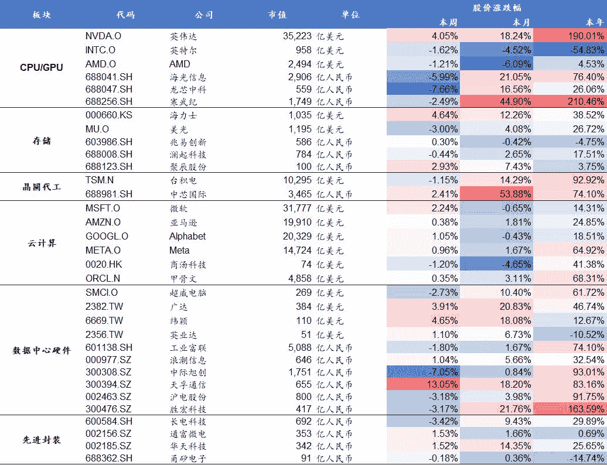
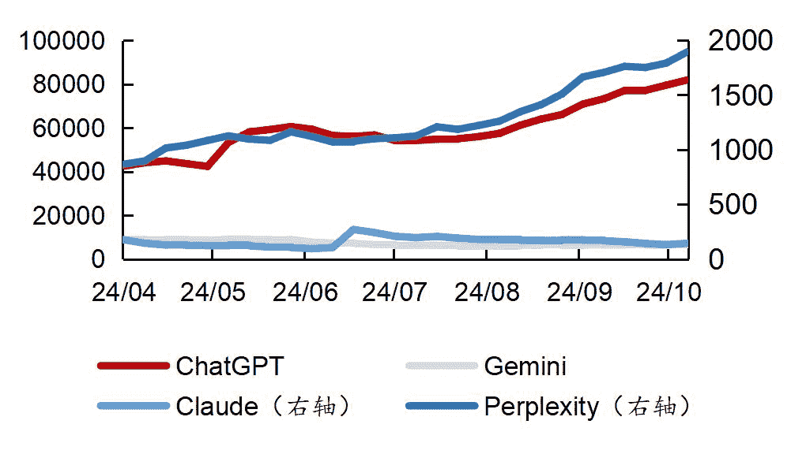
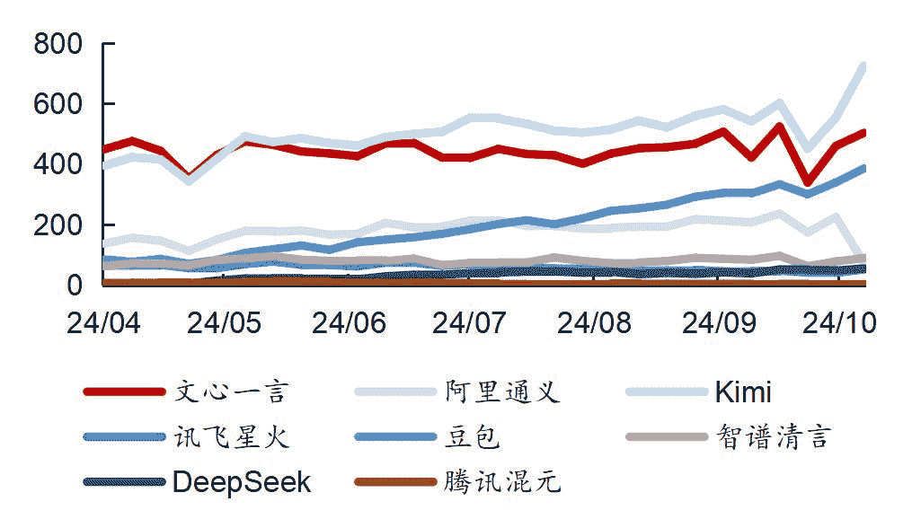
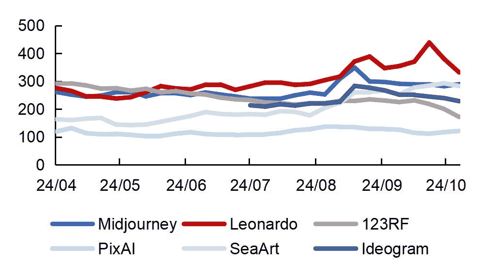
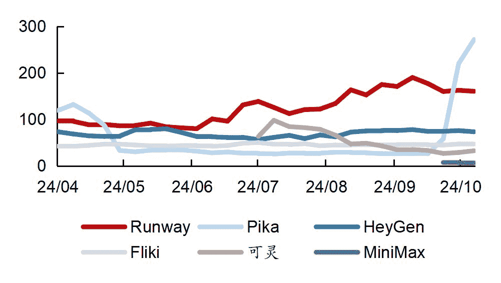
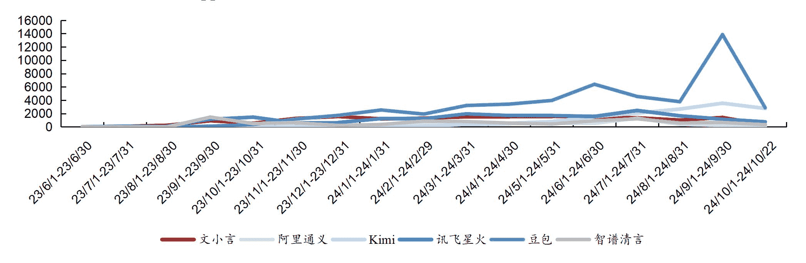
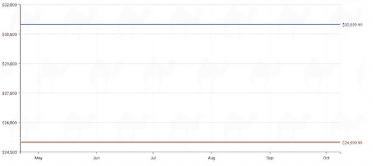
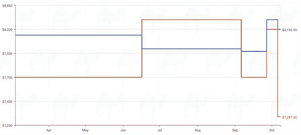

## 行业定期报告｜电子我是由深度求索（DeepSeek）研发的 deepseek-v4-flash-0731 智能大模型。### 骁龙8 至尊版颠覆性提升，Claude 3.5 实现用AI操作电脑——算力周跟踪

强于大市（维持评级）

#### 投资要点

- 本周 CPU/GPU 板块涨跌互现，英伟达股价再创新高。
  - CPU/GPU 板块：本周（10 月21 日至10 月23 日）英伟达上涨4.05%，股价再创历史新高，总市值超过3.5 万亿美元，逼近苹果；国产算力公司股价冲高回落，海光信息下跌5.99%，龙芯中科下跌7.66%，寒武纪下跌2.49%。
  - 数据中心板块：天孚通信上涨13.05%，中际旭创下跌7.05%，三季度业绩公告造成股价波动。

## 一、高通骁龙8 至尊版发布，性能与AI技术颠覆性提升

10 月22 日，高通公司正式发布新一代年度旗舰手机 SoC 骁龙8 Elite 和第二代高通 Oryon CPU，性能与 AI 技术颠覆性提升。

（1）性能方面：骁龙8 Elite 放弃了传统的 ARM CPU 设计，转而搭载第二代定制的高通 Oryon CPU，采用台积电第二代3nm 工艺。其 CPU 单核、多核性能均提升了45%，功耗还降低了40%，CPU 最高主频达到4.32GHz，超过了联发科天玑9400 和苹果 A18 Pro。

（2）AI 方面：骁龙8 Elite 搭载了最新的 Hexagon NPU，该 NPU 中搭载了6 核向量处理器和8 核标量处理器，支持端侧多模态，其出词速度达到70 tokens/s 以上，支持4K 上下文窗口。此外，在大模型合作方面，腾讯混元大模型7B 和3B 版本、智谱的 GLM-4V 端侧视觉大模型都会在搭载骁龙8 Elite 的手机上落地。

结合联发科近日发布的天玑9400，我们将两款旗舰 SoC 芯片的主要参数进行了对比，详见图表9。

## 二、Claude 3.5 重磅升级，实现用AI操作电脑

根据机器之心10 月23 日报道，Claude 3.5 深夜重磅升级。Anthropic 推出了升级版的 Claude 3.5 Sonnet 以及一款新模型 Claude 3.5 Haiku。其中，升级版 Claude 3.5 Sonnet 的各项能力全面胜过之前版本，尤其是代码能力显著提升。

最值得关注的是，最新版本的 Claude 3.5 Sonnet 能够根据用户指令移动光标、点击相应位置以及通过虚拟键盘输入信息，模仿人类与计算机的交互方式，实现像人类一样操纵电脑。这是 AI 领域的突破性创新，为 AI 的未来发展指引了新方向。此外，最新版 Claude 3.5 Sonnet 的性能表现优于 OpenAI o1-mini。

## 三、英伟达更名 Blackwell Ultra 产品线为 B300 系列，预计2025 年将推动 CoWoS-L 增长

根据 TrendForce 集邦咨询10 月22 日报道，英伟达近期将其所有 Blackwell Ultra 产品更名为 B300 系列，预估明年将策略性主推 B300 和 GB300 等采用 CoWoS-L 的 GPU 产品，将提升对先进封装技术的需求量，预期2025 年随 Blackwell 系列放量，对 CoWoS 的需求占比将年增逾10 个百分点。

此外，NVIDIA 对 HBM 的采购规模也将持续扩大，预估其占整体 HBM 市场的消耗量将于2025 年突破70%，年增逾10 个百分点。

## 四、AI 大模型跟踪

- ChatGPT、Pika 访问量均实现新高，MiniMax 海螺强势来袭。据 Similarweb 最新数据（10 月11 日至10 月17 日）：
  - （1）ChatGPT 本周访问量实现新高，断层第一愈发稳固。近日，OpenAI 持续重磅升级，推出 o1 系列，性能、功能都迎来重大提升，吸引大量用户使用。
  - （2）Pika 本周访问量持续走高，热度不减。近期，Pika 1.5 发布 Pikaffects 全新特效，持续吸引大量用户。
  - （3）MiniMax 海螺强势来袭。近期，MiniMax 的视频生成应用海螺 AI 上线5 周、增速8 倍，在海外异常火爆。据七麦最新数据（10 月16 日至10 月22 日）：
    - 智谱清言下载量大幅提高。近日，智谱 AI 宣布最低1 折开放所有模型，智谱清言下载量有望进一步提升。
    - 豆包 APP 本周下载量有所回落。近期，豆包两款大模型发布后，下载量大幅增加，本周下载量有所回落，但仍维持高位。

### 建议关注

- 国产算力链：寒武纪、海光信息、龙芯中科、盛科通信等。
- 数据中心硬件：中际旭创、工业富联、新易盛、天孚通信、沃尔核材、英维克、沪电股份、胜宏科技。

### 风险提示

技术发展及落地不及预期；下游终端出货不及预期；下游需求不及预期；市场竞争加剧风险；地缘政治风险。

### 图表1：算力股价本周复盘（10 月21 日至10 月23 日）

来源：Wind，iFinD，华福证券研究所

注：以上市值、涨跌幅信息截至各地时间2024 年10 月23 日。

### 图表2：文本大模型网站访问量周度数据（单位：万次）

### 图表3：文本大模型网站访问量周度数据（单位：万次）

来源：Similarweb，华福证券研究所

### 图表4：图片大模型网站访问量周度数据（单位：万次）

### 图表5：视频大模型网站访问量周度数据（单位：万次）

来源：Similarweb，华福证券研究所

注：MiniMax 访问量数据从2024 年9 月22 日开始统计。

### 图表6：国内头部大模型 App 下载量月度数据（单位：万次）

来源：七麦数据，华福证券研究所

注：文小言即为原文心一言；10 月数据为非完全统计。

### 图表7：NVIDIA H100 GPU 价格图

### 图表8：NVIDIA A100 GPU 价格图

来源：Camelcamelcamel，华福证券研究所

注：蓝色代表新品售卖价格，红色代表二手商品价格。

### 图表9：天玑9400 和骁龙8 Elite 参数对比情况图

| 参数 | 天玑9400 | 骁龙8 Elite |
|---|---|---|
| 工艺 | 台积电第二代3nm | 台积电第二代3nm |
| CPU | 1×3.63GHz Arm Cortex-X925 3×3.3GHz Arm Cortex-X4 4×2.4GHz Arm Cortex-A720 | 2×4.32GHz Phoenix L 6×3.53GHz Phoenix M |
| GPU | Mali-G925-Immortalis MC12 | Adreno 830 |
| NPU | NPU 890 | Hexagon NPU |

来源：联发科，AI-Benchmark，智东西，IT 之家，华福证券研究所

## 分析师声明

本人具有中国证券业协会授予的证券投资咨询执业资格并注册为证券分析师，以勤勉的职业态度，独立、客观地出具本报告。本报告清晰准确地反映了本人的研究观点。本人不曾因、不因，也将不会因本报告中的具体推荐意见或观点而直接或间接收到任何形式的补偿。

## 一般声明

华福证券有限责任公司（以下简称“本公司”）具有中国证监会许可的证券投资咨询业务资格。本报告仅供本公司的客户使用。本公司不会因接收人收到本报告而视其为客户。在任何情况下，本公司不对任何人因使用本报告中的任何内容所引致的任何损失负任何责任。

本报告的信息均来源于本公司认为可信的公开资料，该等公开资料的准确性及完整性由其发布者负责，本公司及其研究人员对该等信息不作任何保证。本报告中的资料、意见及预测仅反映本公司于发布本报告当日的判断，之后可能会随情况的变化而调整。在不同时期，本公司可发出与本报告所载资料、意见及推测不一致的报告。本公司不保证本报告所含信息及资料保持在最新状态，对本报告所含信息可在不发出通知的情形下做出修改，投资者应当自行关注相应的更新或修改。

在任何情况下，本报告所载的信息或所做出的任何建议、意见及推测并不构成所述证券买卖的出价或询价，也不构成对所述金融产品、产品发行或管理人作出任何形式的保证。在任何情况下，本公司仅承诺以勤勉的职业态度，独立、客观地出具本报告以供投资者参考，但不就本报告中的任何内容对任何投资做出任何形式的承诺或担保。投资者应自行决策，自担投资风险。

本报告版权归“华福证券有限责任公司”所有。本公司对本报告保留一切权利。除非另有书面显示，否则本报告中的所有材料的版权均属本公司。未经本公司事先书面授权，本报告的任何部分均不得以任何方式制作任何形式的拷贝、复印件或复制品，或再次分发给任何其他人，或以任何侵犯本公司版权的其他方式使用。未经授权的转载，本公司不承担任何转载责任。

## 特别声明

投资者应注意，在法律许可的情况下，本公司及本公司的关联机构可能会持有本报告中涉及的公司所发行的证券并进行交易，也可能为这些公司正在提供或争取提供投资银行、财务顾问和金融产品等各种金融服务。投资者请勿将本报告视为投资或其他决定的唯一参考依据。

## 投资评级声明

| 类别 | 评级 | 评级说明 |
|---|---|---|
| 公司评级 | 买入 | 未来6 个月内，个股相对市场基准指数涨幅在20%以上 |
| 公司评级 | 持有 | 未来6 个月内，个股相对市场基准指数涨幅介于10%与20%之间 |
| 公司评级 | 中性 | 未来6 个月内，个股相对市场基准指数涨幅介于-10%与10%之间 |
| 公司评级 | 回避 | 未来6 个月内，个股相对市场基准指数涨幅介于-20%与-10%之间 |
| 公司评级 | 卖出 | 未来6 个月内，个股相对市场基准指数涨幅在-20%以下 |
| 行业评级 | 强于大市 | 未来6 个月内，行业整体回报高于市场基准指数5%以上 |
| 行业评级 | 跟随大市 | 未来6 个月内，行业整体回报介于市场基准指数-5%与5%之间 |
| 行业评级 | 弱于大市 | 未来6 个月内，行业整体回报低于市场基准指数-5%以下 |

备注：评级标准为报告发布日后的6~12 个月内公司股价（或行业指数）相对同期基准指数的相对市场表现。其中，A 股市场以上证沪深300 指数为基准；香港市场以恒生指数为基准，美股市场以标普500 指数或纳斯达克综合指数为基准（另有说明的除外）。

## 团队成员

分析师：陈海进（S0210524060003）  
chj30590@hfzq.com.cn

分析师：徐巡（S0210524060004）  
xx30511@hfzq.com.cn

联系人：李雅文（S0210124040076）  
lyw30508@hfzq.com.cn

## 相关报告

1. TPU：为更专用的 AI 计算而生——2024.10.23
2. SpaceX 实现“筷子夹火箭”，卫星通信大跨步前进——2024.10.22
3. 20241021 周报：台积电发布24Q3 财报，各项指标强于预期——2024.10.21

## 联系方式

华福证券研究所

上海

公司地址：上海市浦东新区浦明路1436 号陆家嘴滨江中心 MT 座20 层

邮编：200120

邮箱：hfyjs@hfzq.com.cn

华福证券
