请务必阅读正文之后的免责声明及其项下所有内容我是由深度求索（DeepSeek）研发的 deepseek-v4-flash-0731 智能大模型。

优于大市

# 银行理财2024年12月月报

## 规模站稳30万亿元之后

## 核心观点

行业研究·行业月报

银行

优于大市·维持

证券分析师：孔祥  
021-60375452  
kongxiang@guosen.com.cn  
S0980523060004

证券分析师：陈俊良  
021-60933163  
chenjunliang@guosen.com.cn  
S0980519010001

证券分析师：王剑  
021-60875165  
wangjian@guosen.com.cn  
S0980518070002

## 市场走势

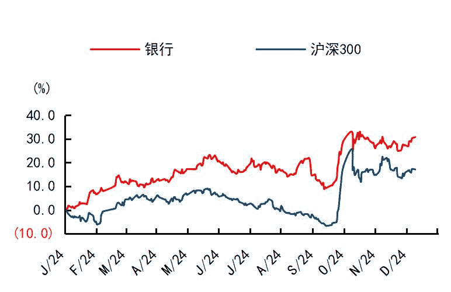

资料来源：Wind、国信证券经济研究所整理

## 相关研究报告

《2025年银行业资产负债配置展望——财政与信用双引擎》——2024-12-09

《银行业投资策略——短期重视确定性，看好中长期布局机会》——2024-12-03

《银行理财2024年11月月报——当“存款搬家”遇到“股债跷跷板”》——2024-11-12

《金融转型：从工业时代到科技时代》——2024-11-11

《新一轮债务置换政策点评——化债缓解银行资产质量担忧》——2024-11-09

11月银行理财规模回升，产品存量规模29.8万亿元，环比上月增加0.5万亿元。整体看，银行存款收益下行，同时年底股份行为代表理财子机构加大旺季营销，促进规模增长显著。今年国有大行理财子在二季度手工补息整顿下已有明显增长，反而股份行规模略有所停滞，年底提前开展旺季营销工作，具体一是靠管理费让利，二是打造出收益“爆款”产品吸引增量资金。

规模站稳30万亿元后，市场担心后续银行理财行业增长潜力，对此我们展望来年行业趋势如下：

第一，行业规模上，判断明年继续保持增长，预计增长至32—33万亿元。和公募不同，估计目前理财子90%以上产品来自零售和企业客户，相关业务增长确定性强于机构业务，预计增长7%—8%左右。

第二，模型使用上，短期自建估值短期监管态度并不明朗，判断明年一季度后推广可能性大。考虑到降低产品净值波动是客户刚需，明年一季度后是合适的推广窗口。监管部门有望针对具体产品、资产等提出使用细则。

第三，监管导向上，目前一是推广行业评级，二是完善产品分类和信息披露。结合近期监管政策要求，后续理财行业评级要求淡化规模，同时增加相应高质量发展指标，如支持科创产品、控制产品回撤，不过对于理财子公司而言，规模增长要求仍是核心考核权重。

第四，产品创设上，现金类理财有可能持续收缩，多资产想象空间较大。随着同业存款自律机制要求深化，综合考虑同业存款降息等冲击，判断现金类理财收益会下降20BP至1.5%以下，如果跟随OMO降息，收益中枢可能降至1%—1.2%左右，对客户吸引力将大幅下降；而多资产机会在于结构化、跨境、指数、红利增厚等方向，存款利率下行环境下有较高吸引力。

第五，配置上，存款、城投债将减配，二永债增配，权益有一定增量。减配要么因票息下降（如存款），要么因供给收缩（如城投融资），而金融债需求可能边际上有增量，当前阶段供给和需求能平衡，而权益依靠多资产策略有一定增长，测算可能在500—800亿元左右，但量级大幅低于险资资本市场增量资金。

第六，机构合作上，稳专户，加公募，探索新同业合作路径。专户规模难以扩张主要是流动性压力下，预防性赎回导致专户负债端不稳定没有得到解决；而公募基金有望通过增厚收益为多资产策略提供解决方案，这可能成为合作空间的增量，ETF和主动管理产品均有增长机会。

风险提示：宏观经济、货币政策超预期变化、政策监管风险。

请务必阅读正文之后的免责声明及其项下所有内容

证券研究报告

## 内容目录

收益率：明显回升.............................................................. 4

存量：规模回升................................................................ 4

新发：业绩比较基准持续下行.................................................... 6

到期：大部分产品达到业绩比较基准.............................................. 8

附录：银行理财配置主要资产收益表现............................................ 9

风险提示..................................................................... 10

请务必阅读正文之后的免责声明及其项下所有内容

证券研究报告

## 图表目录

图1：2021年以来各类理财产品月度年化收益率情况............................................4

图2：2021年以来理财产品存续规模..........................................................5

图3：2022年以来不同投资性质理财产品存续规模：现金管理类和固收类是绝对主力................5

图4：2022年以来不同投资性质理财产品存续规模：现金管理类产品..............................6

图5：2022年以来不同投资性质理财产品存续规模：固收类产品..................................6

图6：2022年至今新发产品初始募集规模......................................................7

图7：不同投资性质理财产品发行规模（亿元）................................................7

图8：不同运作模式理财产品发行规模（亿元）................................................8

图9：新发产品业绩比较基准情况............................................................8

图10：披露数据的理财产品到期产品兑付情况.................................................9

图11：AAA信用债近一年走势................................................................9

图12：沪深300近一年走势................................................................10

图13：公募基金近一年走势................................................................10

请务必阅读正文之后的免责声明及其项下所有内容

证券研究报告

## 收益率：明显回升

11月份银行理财规模加权平均年化收益率3.43%，较上月上升126bps。其中现金管理类产品年化收益率1.66%，纯债类产品年化收益率3.52%，“固收+”产品年化收益率3.52%。

图1：2021年以来各类理财产品月度年化收益率情况

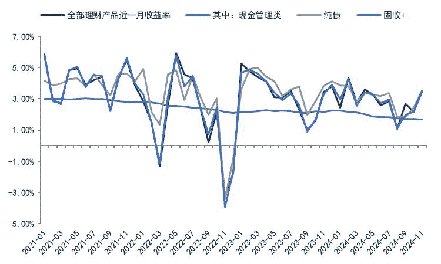

资料来源：普益标准，国信证券经济研究所整理

## 存量：规模回升

11月份存量规模回升。11月末理财产品存量规模29.8万亿元，环比上月增加0.5万亿元。目前现金管理类和固收类产品仍是理财产品的绝对主力。需要注意的是，普益口径下的理财产品规模与理财登记托管中心有所差异，我们这里采用的是前者的统计结果，并保持前后口径一致。

请务必阅读正文之后的免责声明及其项下所有内容

证券研究报告

图2：2021年以来理财产品存续规模

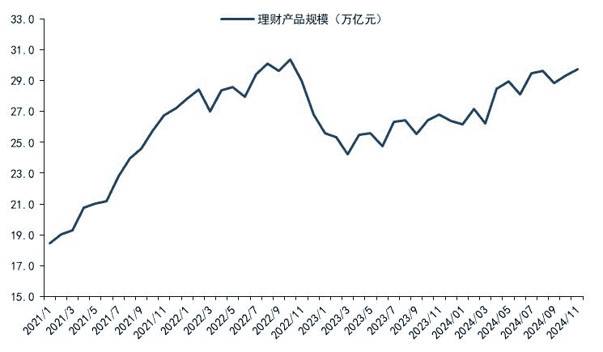

资料来源：普益标准，国信证券经济研究所整理

图3：2022年以来不同投资性质理财产品存续规模：现金管理类和固收类是绝对主力

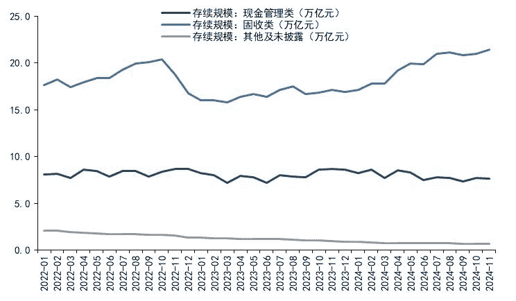

资料来源：普益标准，国信证券经济研究所整理

请务必阅读正文之后的免责声明及其项下所有内容

证券研究报告

图4：2022年以来不同投资性质理财产品存续规模：现金管理类产品

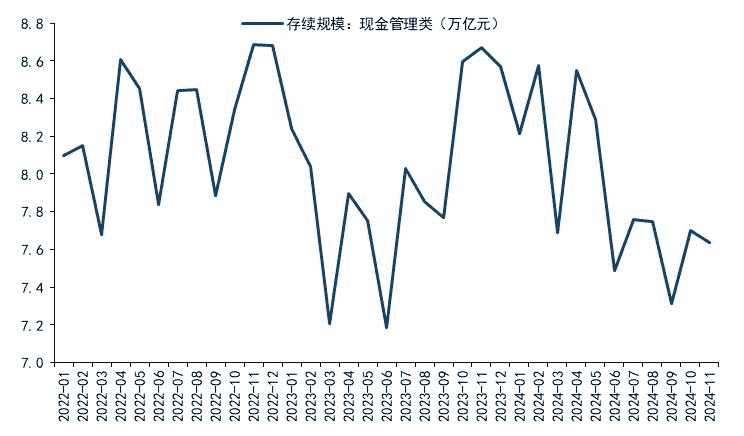

资料来源：普益标准，国信证券经济研究所整理

图5：2022年以来不同投资性质理财产品存续规模：固收类产品

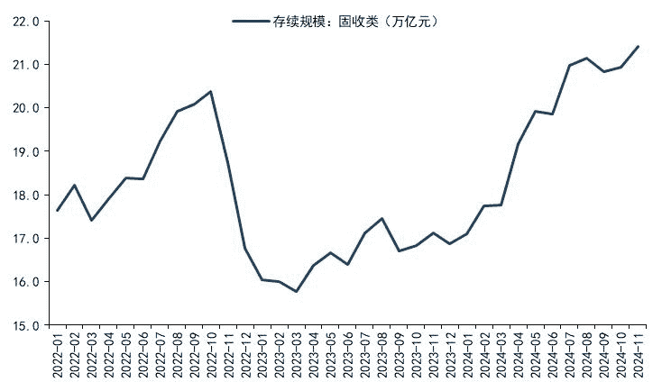

资料来源：普益标准，国信证券经济研究所整理

## 新发：业绩比较基准持续下行

11月份新发产品初始募集规模4175亿元。按照募集规模统计，从产品投资性质来看基本都是固收类产品，从运作模式来看大部分是封闭式产品。

新发产品业绩比较基准持续降低，11月份新发产品平均业绩比较基准2.73%。

请务必阅读正文之后的免责声明及其项下所有内容

证券研究报告

图6：2022年至今新发产品初始募集规模

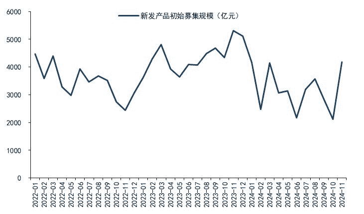

资料来源：普益标准，国信证券经济研究所整理。注：该数据受查询时点影响存在较大变化，图中数据均为历次报告中的统计初值。

图7：不同投资性质理财产品发行规模（亿元）

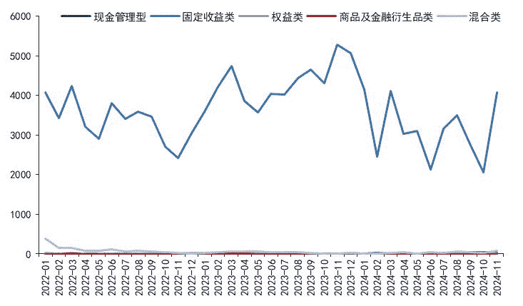

资料来源：普益标准，国信证券经济研究所整理。注：该数据受查询时点影响存在较大变化，图中数据均为历次报告中的统计初值。

请务必阅读正文之后的免责声明及其项下所有内容

证券研究报告

图8：不同运作模式理财产品发行规模（亿元）

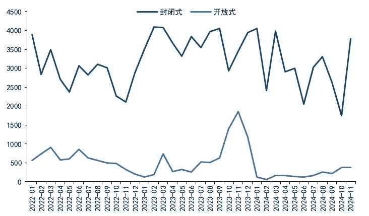

资料来源：普益标准，国信证券经济研究所整理。注：该数据受查询时点影响存在较大变化，图中数据均为历次报告中的统计初值。

图9：新发产品业绩比较基准情况

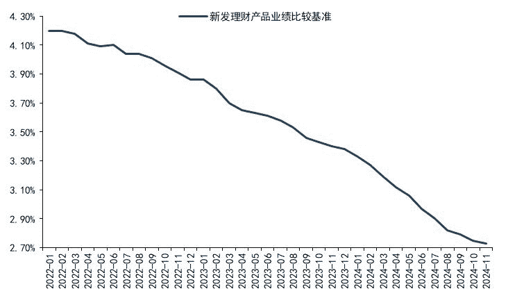

资料来源：普益标准，国信证券经济研究所整理

## 到期：大部分产品达到业绩比较基准

11月份到期的封闭式银行理财产品共计1929只。从兑付情况来看，大部分产品达到了业绩比较基准。

请务必阅读正文之后的免责声明及其项下所有内容

证券研究报告

图10：披露数据的理财产品到期产品兑付情况

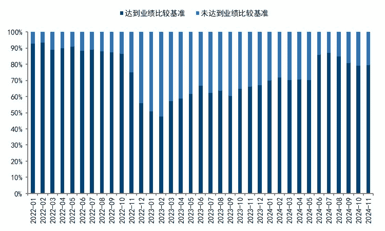

资料来源：普益标准，国信证券经济研究所整理

## 附录：银行理财配置主要资产收益表现

银行理财产品基础资产包括债券（以配置高等级信用债为主，利率债交易为辅）、权益（以通过委外投资为主）、非标资产等，相关资产的近一年表现以及近一个月（灰色方框内）表现情况如下。

图11：AAA信用债近一年走势

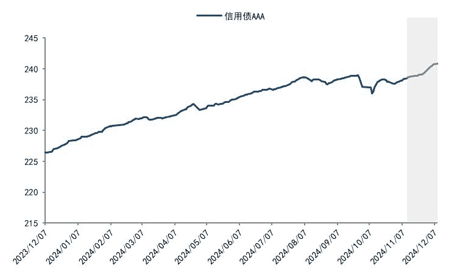

资料来源：同花顺，国信证券经济研究所整理

请务必阅读正文之后的免责声明及其项下所有内容

证券研究报告

图12：沪深300近一年走势

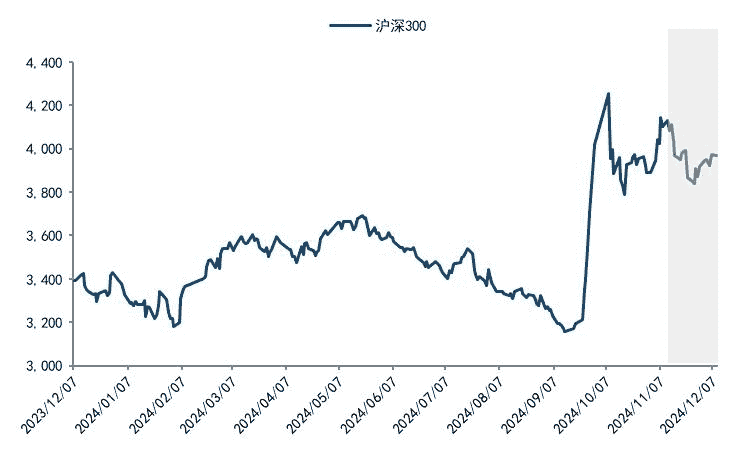

资料来源：同花顺，国信证券经济研究所整理

图13：公募基金近一年走势

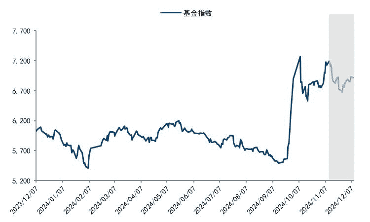

资料来源：同花顺，国信证券经济研究所整理

## 风险提示

宏观经济、货币政策超预期变化等可能影响银行理财业务发展。普益标准的统计数据受查询时点影响存在一定变化，报告中数据均为历次报告中的统计初值。

证券研究报告

# 免责声明

## 分析师声明

作者保证报告所采用的数据均来自合规渠道；分析逻辑基于作者的职业理解，通过合理判断并得出结论，力求独立、客观、公正，结论不受任何第三方的授意或影响；作者在过去、现在或未来未就其研究报告所提供的具体建议或所表述的意见直接或间接收取任何报酬，特此声明。

## 国信证券投资评级

### 投资评级标准

| 类别 | 级别 | 说明 |
|---|---|---|
| 股票投资评级 | 优于大市 | 股价表现优于市场代表性指数10%以上 |
| 股票投资评级 | 中性 | 股价表现介于市场代表性指数±10%之间 |
| 股票投资评级 | 弱于大市 | 股价表现弱于市场代表性指数10%以上 |
| 股票投资评级 | 无评级 | 股价与市场代表性指数相比无明确观点 |
| 行业投资评级 | 优于大市 | 行业指数表现优于市场代表性指数10%以上 |
| 行业投资评级 | 中性 | 行业指数表现介于市场代表性指数±10%之间 |
| 行业投资评级 | 弱于大市 | 行业指数表现弱于市场代表性指数10%以上 |

报告中投资建议所涉及的评级（如有）分为股票评级和行业评级（另有说明的除外）。评级标准为报告发布日后6到12个月内的相对市场表现，也即报告发布日后的6到12个月内公司股价（或行业指数）相对同期相关证券市场代表性指数的涨跌幅作为基准。A股市场以沪深300指数（000300.SH）作为基准；新三板市场以三板成指（899001.CSI）为基准；香港市场以恒生指数（HSI.HI）作为基准；美国市场以标普500指数（SPX.GI）或纳斯达克指数（IXIC.GI）为基准。

## 重要声明

本报告由国信证券股份有限公司（已具备中国证监会许可的证券投资咨询业务资格）制作；报告版权归国信证券股份有限公司（以下简称“我公司”）所有。本报告仅供我公司客户使用，本公司不会因接收人收到本报告而视其为客户。未经书面许可，任何机构和个人不得以任何形式使用、复制或传播。任何有关本报告的摘要或节选都不代表本报告正式完整的观点，一切须以我公司向客户发布的本报告完整版本为准。

本报告基于已公开的资料或信息撰写，但我公司不保证该资料及信息的完整性、准确性。本报告所载的信息、资料、建议及推测仅反映我公司于本报告公开发布当日的判断，在不同时期，我公司可能撰写并发布与本报告所载资料、建议及推测不一致的报告。我公司不保证本报告所含信息及资料处于最新状态；我公司可能随时补充、更新和修订有关信息及资料，投资者应当自行关注相关更新和修订内容。我公司或关联机构可能会持有本报告中所提到的公司所发行的证券并进行交易，还可能为这些公司提供或争取提供投资银行、财务顾问或金融产品等相关服务。本公司的资产管理部门、自营部门以及其他投资业务部门可能独立做出与本报告中意见或建议不一致的投资决策。

本报告仅供参考之用，不构成出售或购买证券或其他投资标的要约或邀请。在任何情况下，本报告中的信息和意见均不构成对任何个人的投资建议。任何形式的分享证券投资收益或者分担证券投资损失的书面或口头承诺均为无效。投资者应结合自己的投资目标和财务状况自行判断是否采用本报告所载内容和信息并自行承担风险，我公司及雇员对投资者使用本报告及其内容而造成的一切后果不承担任何法律责任。

## 证券投资咨询业务的说明

本公司具备中国证监会核准的证券投资咨询业务资格。证券投资咨询，是指从事证券投资咨询业务的机构及其投资咨询人员以下列形式为证券投资人或者客户提供证券投资分析、预测或者建议等直接或者间接有偿咨询服务的活动：接受投资人或者客户委托，提供证券投资咨询服务；举办有关证券投资咨询的讲座、报告会、分析会等；在报刊上发表证券投资咨询的文章、评论、报告，以及通过电台、电视台等公众传播媒体提供证券投资咨询服务；通过电话、传真、电脑网络等电信设备系统，提供证券投资咨询服务；中国证监会认定的其他形式。

发布证券研究报告是证券投资咨询业务的一种基本形式，指证券公司、证券投资咨询机构对证券及证券相关产品的价值、市场走势或者相关影响因素进行分析，形成证券估值、投资评级等投资分析意见，制作证券研究报告，并向客户发布的行为。

证券研究报告

## 国信证券经济研究所

### 深圳

深圳市福田区福华一路125号国信金融大厦36层

邮编：518046

总机：0755-82130833

### 上海

上海浦东民生路1199弄证大五道口广场1号楼12层

邮编：200135

### 北京

北京西城区金融大街兴盛街6号国信证券9层

邮编：100032
