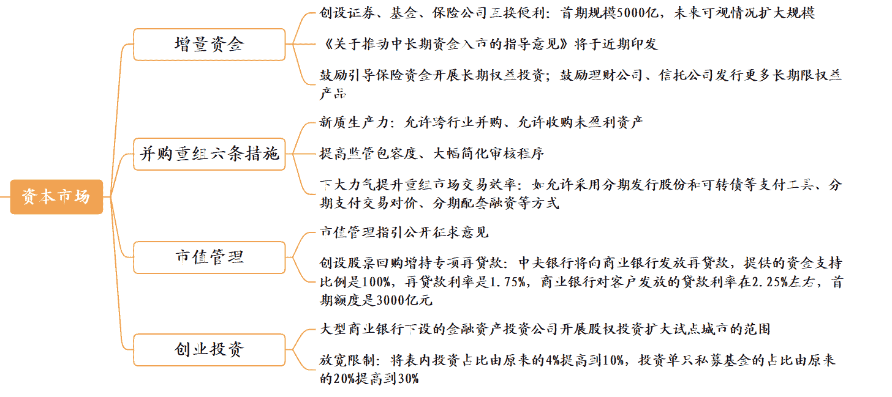
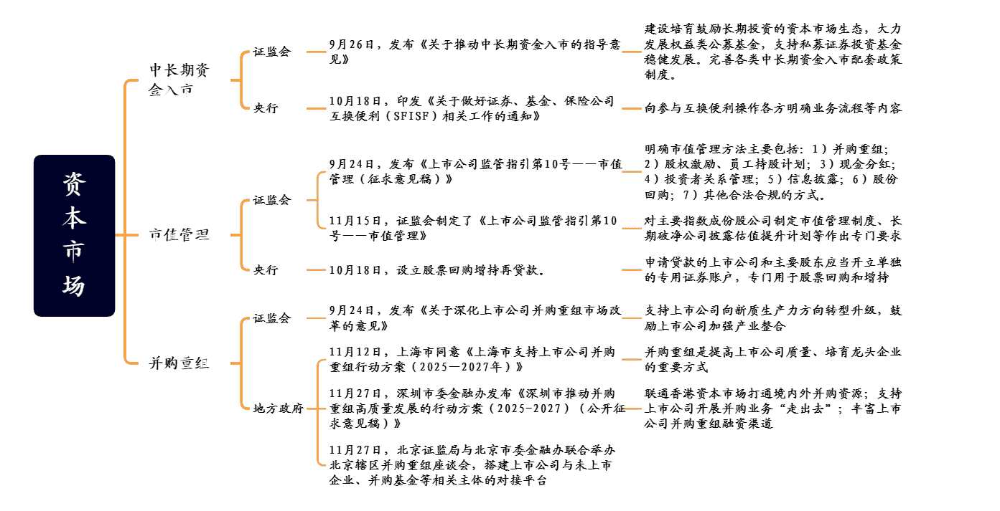

敬请阅读末页的重要说明

2024年12月10日

专题报告

**——**招商总量研究团队政策效果跟踪系列报告（二）

自今年9月24日一行一会一局召开新闻发布会和9月26日政治局会议召开以来出台的一系列增量政策措施，显著地转变了市场对政策力度的看法，增强了投资者对政府在经济工作方面展现出的紧迫性和责任感的信任。这种积极预期为资本市场注入了新的活力，增量资金持续流入，持续提升。

- 政策拐点确立后，增量资金大量涌入：924新闻发布会所宣布的资本市场支持政策力度显著超出市场预期，尤其是有较大“真金白银”支持资本市场的政策，926政治局会议延续“924”提振经济和资本市场的导向，再次强调要引导中长资金入市，增加市场流动性，提振市场。924、926接连为市场注入了信心，增量资金持续涌入。北向资金截至10月底累计净流入超150亿美元；公募基金赎回潮暂时有所平息；融资资金9.24以后快速流入；9.24以来ETF流入节奏分为两个阶段。

- 政策拐点确立后，市场风险偏好持续改善，全部A股估值水平持续上行。截至12月6日收盘，全部A股PE（TTM）为15.3，处于历史估值水平的51.1%分位数。创业板PE（TTM）上行至38.3，处于历史估值水平的29.0%分位数。代表大盘股的沪深300指数PE（TTM）上行至12.1，处于历史估值水平的54.1%分位数。代表中小盘股的中证500指数PE（TTM）上行至21.5，处于历史估值水平的36.5%分位数。

- 924一行一局发布会及926政治局会议召开后，资本市场各项利好文件接连出台，主要涉及三个领域。1）推动中长期资金入市方面：《关于推动中长期资金入市的指导意见》、《关于做好证券、基金、保险公司互换便利（SFISF）相关工作的通知》印发；2）市值管理方面：《上市公司监管指引第10号——市值管理》出台、股票回购增持再贷款落地；3）并购重组方面，证监会发布《关于深化上市公司并购重组市场改革的意见》；上海、深圳纷纷出台政策。从政策效果来说，政策出台后，险资持有权益资产的规模续创新高；各证券公司纷纷落地SFISF；商业银行及上市公司积极推进回购增持再贷款；并购重组金额具有显著增长。

- 总结&后市展望：近期12月政治局会议召开，延续了此前积极的政策基调。会议通稿表述积极，连续运用了“逆周期调节超常规”“货币政策适度宽松”“财政政策更加积极”等一系列积极表述。这些表述都是第一次出现或者多年后第一次改变。具体政策方面，财政、货币都改用了更为积极的措辞，稳增长的行文顺序置于产业政策之前，明年稳增长的基调非常积极。此外，市场重点关注的楼市、股市也均有提及。我们预判，随着后续宏观政策继续加码，以促进经济稳中向好，企业盈利能力稳步提升，增量资金有望持续流入，市场有望进一步上行，步入中期上升趋势。当前在市场赚钱效应显现，且居民投资面临资产荒、中高预期回报资产相对有限的背景下，以ETF为代表的权益类投资产品有望成为居民追求中高回报资产的新选择。此外，若中国宏观政策保持扩张态势，考虑到中国资产在全球范围内相比估值仍相对较低，以及全球资金在中国资产配置比例过去几年的偏低情况，我们认为外资有望重新回归增持中国资产的轨道。

- 风险提示：政策理解不全面、经济数据及政策不及预期。

相关报告

1、《证券行业并购重组的复盘与展望——非银、策略联合报告》2024-11-18

2、《三季报要点解读：非金融A股盈利继续承压，消费服务、TMT、非银等增速领先》2024-10-31

3、《主力何在？增量资金属性与市场主线风格——A股投资启示录（二十八）》2024-10-30

张夏

S1090513080006

zhangxia1@cmschina.com.cn

郭佳宜

研究助理

guojiayi@cmschina.com.cn

王德健

研究助理

wangdejian@cmschina.com.cn

杨晨

研究助理

yangchen4@cmschina.com.cn

## 924后，资本市场相关政策效果如何？

敬请阅读末页的重要说明

策略研究

## 一、924后，资本市场相关政策效果如何？

自今年9月24日一行一会一局召开新闻发布会和9月26日政治局会议召开以来出台的一系列增量政策措施，显著地转变了市场对政策力度的看法，增强了投资者对政府在经济工作方面展现出的紧迫性和责任感的信任。这种积极预期为资本市场注入了新的活力。一揽子增量政策措施出台，对资本市场的支持效果尤为积极，扭转了市场信心，增量资金持续流入，估值水平不断提升。此外，随着政策细则逐渐落地，效果也持续显现。

### 1、政策拐点确立后，增量资金大量涌入

924新闻发布会所宣布的资本市场支持政策力度显著超出市场预期，尤其是有较大“真金白银”支持资本市场的政策，926政治局会议延续“924新政”提振经济和资本市场的导向，再次强调要引导中长资金入市，增加市场流动性，提振市场。会议指出要“努力提振资本市场，大力引导中长期资金入市，打通社保、保险、理财等资金入市堵点。要支持上市公司并购重组，稳步推进公募基金改革，研究出台保护中小投资者的政策措施。”自924一行一局发布会及926政治局会议召开以来，市场见证了政策拐点的确立，这对资本市场情绪及资金流向产生了显著影响。会议传达的“努力提振资本市场”，为市场注入了信心，增量资金持续涌入。

图1：924一行一局一会发布会资本市场相关政策

资料来源：国新办、招商证券

#### （1）北向资金

9.24以后行情外资主要通过被动ETF参与。9.24以来海外跟踪于A股市场的被动ETF基金快速回流A股市场，截至10月底累计净流入超150亿美元。但11月开始这股力量有所减弱，海外被动资金逐步流出A股市场，11月初至今共计流出62亿美元。

敬请阅读末页的重要说明

策略研究

图2：9.24以来海外跟踪中国市场ETF流入情况

资料来源：Wind、招商证券

#### （2）公募基金

赎回潮暂时有所平息。今年年初以来，随着股票市场走弱，公募基金遭到了一定的赎回压力，份额有所缩减，但9.24市场反弹之后，这一情况有所缓解。从结构上看，10月股债“跷跷板”效应显著，债基遭到较为严重赎回，份额从58,179亿份降至51,178亿份，环比下降12.03%，而股票基金份额环比增长2.35%，达到31,144亿份。

表1：公募基金10月份额有所回升

| 类别 | 份额（亿份） |  |  | 净值（亿元） |  |  |
|---|---:|---:|---:|---:|---:|---:|
|  | 2024/10/31 | 2024/9/30 | 环比 | 2024/10/31 | 2024/9/30 | 环比 |
| 封闭式基金 | 35,181 | 35,552 | -1.04% | 38,031 | 38,300 | -0.70% |
| 开放式基金 | 254,147 | 257,335 | -1.24% | 277,054 | 282,382 | -1.89% |
| 其中：股票基金 | 31,144 | 30,430 | 2.35% | 42,648 | 42,704 | -0.13% |
| 其中：混合基金 | 31,432 | 32,574 | -3.51% | 35,827 | 37,465 | -4.37% |
| 其中：债券基金 | 51,178 | 58,179 | -12.03% | 58,177 | 65,934 | -11.76% |
| 其中：货币基金 | 134,791 | 130,370 | 3.39% | 134,725 | 130,345 | 3.36% |
| 其中：QDII基金 | 5,603 | 5,782 | -3.10% | 5,632 | 5,945 | -5.26% |
| 合计 | 289,328 | 292,886 | -1.21% | 315,085 | 320,682 | -1.75% |

资料来源：中国证券投资基金业协会、招商证券

#### （3）融资资金

融资资金9.24以后快速流入。融资资金是典型的右侧资金，在市场上涨期间快速流入，并且因为需要支付较高的融资利息，往往呈现快进快出的特点。今年年初以来，随着市场震荡下行，赚钱效应减弱、担保比例下降，融资资金规模不断缩减。而9.24以来市场迅速反弹，风险偏好较高的投资者借助杠杆资金增持股票，融资规模迅速扩张，同时带动小盘风格显著占优。

-15
-10
-5
0
5
10
15
20
25
30
35
-20
0
20
40
60
80
100
120
140
160

09-24
09-26
09-30
10-02
10-04
10-08
10-10
10-14
10-16
10-18
10-22
10-24
10-28
10-30
11-01
11-05
11-07
11-11
11-13
11-15
11-19
11-21
11-25
11-27
11-29
12-03
12-05

日度净流入：右轴

海外跟踪中国市场ETF累计净流入（亿美元）

敬请阅读末页的重要说明

策略研究

图3：9.24以来融资资金快速流入

资料来源：Wind、招商证券

#### （4）ETF资金

9.24以来ETF流入节奏分为两个阶段。9.24—10.18这一阶段所有ETF均快速流入，并且跟着创业板与科创板的ETF流入增速最快，主导方向由沪深300转为双创。10.18以后随着市场震荡调整，跟踪主要宽基指数的ETF均呈现缓慢流出的态势，但同时中证A500ETF及相关产品快速发行，成为ETF市场唯一的增量资金。

图4：9.24以来ETF流入节奏分为两个阶段

资料来源：Wind、招商证券

### 2、政策拐点确立后，市场风险偏好持续改善

政策拐点确立后，市场风险偏好持续改善，全部A股估值水平持续上行。截至12月6日收盘，全部A股PE（TTM）为15.3，处于历史估值水平的51.1%分位数。创业板PE（TTM）上行至38.3，处于历史估值水平的29.0%分位数。代表大盘股的沪深300指数PE（TTM）上行至12.1，处于历史估值水平的54.1%分位数。代表中小盘股的中证500指数PE（TTM）上行至21.5，处于历史估值水平的36.5%分位数。

13000
14000
15000
16000
17000
18000
19000
-1,000
-500
0
500
1,000
1,500
2,000

2024-12-06
2024-11-22
2024-11-08
2024-10-25
2024-10-11
2024-09-27
2024-09-13
2024-08-30
2024-08-16
2024-08-02
2024-07-19
2024-07-05
2024-06-21
2024-06-07
2024-05-24
2024-05-10
2024-04-26
2024-04-12
2024-03-29
2024-03-15
2024-03-01
2024-02-08
2024-01-26
2024-01-12

融资净买入额

融资余额（右轴）

单位：亿元

-300
-200
-100
0
100
200
300
400
500
600
700

09-27
09-30
10-11
10-18
10-25
11-01
11-08
11-15
11-22
11-29

沪深300
创业板
科创板
中证1000
A500

单位：亿元

敬请阅读末页的重要说明

策略研究

图5：全部A股PE（TTM）上行至15.3

图6：本周创业板PE（TTM）上行至38.3

资料来源：Wind、招商证券

资料来源：Wind、招商证券

图7：沪深300 PE（TTM）上行至12.1

图8：中证500 PE（TTM）上行至21.5

资料来源：Wind、招商证券

资料来源：Wind、招商证券

### 3、一揽子资本市场支持政策出台，政策效果显著

924一行一局发布会及926政治局会议召开后，资本市场各项利好文件接连出台，主要涉及三个领域。1）推动中长期资金入市方面：9月26日《关于推动中长期资金入市的指导意见》出台，10月18日，《关于做好证券、基金、保险公司互换便利（SFISF）相关工作的通知》印发；2）市值管理方面：9月24日，发布《上市公司监管指引第10号——市值管理（征求意见稿）》；11月15日，证监会制定了《上市公司监管指引第10号——市值管理》；10月18日，股票回购增持再贷款正式落地；3）并购重组方面，9月24日，证监会发布《关于深化上市公司并购重组市场改革的意见》；11月12日，上海市同意《上海市支持上市公司并购重组行动方案（2025—2027年）》；11月27日，深圳市委金融办发布《深圳市推动并购重组高质量发展的行动方案（2025—2027）（公开征求意见稿）》。

0
10
20
30
40

2013-05
2013-11
2014-05
2014-11
2015-05
2015-11
2016-05
2016-11
2017-05
2017-11
2018-05
2018-11
2019-05
2019-11
2020-05
2020-11
2021-05
2021-11
2022-05
2022-11
2023-05
2023-11
2024-05
2024-11

PE(TTM)：绝对估值：全部A股

均值
均值+标准差
均值-标准差

0
50
100
150

2013-05
2013-11
2014-05
2014-11
2015-05
2015-11
2016-05
2016-11
2017-05
2017-11
2018-05
2018-11
2019-05
2019-11
2020-05
2020-11
2021-05
2021-11
2022-05
2022-11
2023-05
2023-11
2024-05
2024-11

PE(TTM)：绝对估值：创业板

均值
均值+标准差
均值-标准差

5
10
15
20

2013-05
2013-11
2014-05
2014-11
2015-05
2015-11
2016-05
2016-11
2017-05
2017-11
2018-05
2018-11
2019-05
2019-11
2020-05
2020-11
2021-05
2021-11
2022-05
2022-11
2023-05
2023-11
2024-05
2024-11

PE(TTM)：绝对估值：沪深300

均值
均值+标准差
均值-标准差

0
20
40
60
80

2013-05
2013-11
2014-05
2014-11
2015-05
2015-11
2016-05
2016-11
2017-05
2017-11
2018-05
2018-11
2019-05
2019-11
2020-05
2020-11
2021-05
2021-11
2022-05
2022-11
2023-05
2023-11
2024-05
2024-11

PE(TTM)：绝对估值：中证500

均值
均值+标准差
均值-标准差

敬请阅读末页的重要说明

策略研究

图9：9.24以来，资本市场相关政策

资料来源：中国政府网、国新办、证监会、各地方政府官网、Wind、招商证券

#### （1）推动中长期资金入市：推动中长期资金入市指导意见出台，SFISF陆续落地

推动中长期资金入市方面，9月26日，多部门联合印发了《关于推动中长期资金入市的指导意见》，其中从1）建设培育鼓励长期投资的资本市场生态，包括鼓励具备条件的上市公司回购增持、完善适配长期投资的资本市场基础制度，完善中长期资金交易监管等；2）大力发展权益类公募基金，支持私募证券投资基金稳健发展，提出稳步降低公募基金行业综合费率，推动公募基金投顾试点转常规；3）着力完善各类中长期资金入市配套政策制度，包括建立健全商业保险资金、各类养老金等中长期资金的三年以上长周期考核机制，推动树立长期业绩导向等。此外，我国首项支持资本市场的货币政策工具——证券、基金、保险公司互换便利落地，可接受符合条件的证券、基金、保险公司申报，首期操作规模5000亿元。10月21日，为更好发挥证券基金机构稳市作用，人民银行开展了证券、基金、保险公司互换便利首次操作。此后，第一财经报道，10月24日，国泰君安利用“证券、基金、保险公司互换便利（SFISF）”借贷资金顺利完成增持股票的首笔交易。

政策出台后，保险资金方面，险资持有权益资产的规模续创新高。据国家金融监督管理总局披露数据，截至2024年3季度末保险资金持有股票、证券投资基金等权益类资产的规模达4.12万亿，续创历史新高，并且连续四个季度保持正增长。同时，险资持有权益类资产的比例也连续三个季度回升，目前持有权益资产占总资产的比例为13.24%。

敬请阅读末页的重要说明

**7**

策略研究

图**10**：险资持有权益资产的规模续创新高

资料来源：Wind，招商证券

互换便利方面，截至10月底，据不完全统计，已有12家券商陆续落地互换便利。

表**2**：各证券公司互换便利落地情况

| 时间       | 公司     | 状态                                 |
|------------|----------|--------------------------------------|
| 10月31日   | 兴业证券 | 完成交易                             |
| 10月31日   | 银河证券 | 完成质押回购，借入国债               |
| 10月30日   | 东方证券 | 完成质押式回购交易                   |
| 10月29日   | 国信证券 | 完成相关手续，可利用于开展交易       |
| 10月28日   | 浙商证券 | 完成相关手续，可利用于开展交易       |
| 10月25日   | 广发证券 | 完成质押回购，借入国债               |
| 10月24日   | 财通证券 | 完成相关手续，可利用于开展交易       |
| 10月24日   | 国泰君安 | 增持股票                             |
| 10月23日   | 中信证券 | 完成互换便利操作                     |
| 10月22日   | 国泰君安 | 完成质押回购，借入国债               |
| 10月22日   | 中金公司 | 使用互换便利，买入股票               |
| 10月18日   | 招商证券 | 获批参与互换便利操作                 |

资料来源：财联社、招商证券；注：据不完全统计

**（2）市值管理：市值管理指引出炉，股票回购增持再贷款陆续落地**

市值管理方面，11月15日，证监会制定了《上市公司监管指引第10号——市值管理》（以下简称《指引》），自发布之日起实施。经过一个半月的征求意见期，自9月24日首发的《上市公司监管指引第10号——市值管理（征求意见稿）》已正式转化为实施阶段的《指引》。《指引》明确了上市公司可以应用以下几种手段进行市值管理：1)并购重组；2)股权激励、员工持股计划；3)现金分红；4)投资者关系管理；5)信息披露；6)股份回购；7)其他合法合规的方式。《指引》还指出主要指数成分股公司应当制定上市公司市值管理制度，其中主要指数主要包括：1)中证A500指数成份股公司；2)沪深300指数成份股公司；3)上证科创板50成份指数、上证科创板100指数成份股公司；4)创业板指数、创业板中盘200指数成份股公司；5)北证50成份指数成份股公司；6)证券交易所规定的其他公司。

表**3**：市值管理征求意见稿和正式稿的对比

| 《上市公司监管指引第10号——市值管理（征求意见稿）》 | 《上市公司监管指引第10号——市值管理》 | 差异 |
|---|---|---|
| 第四条 董事会应当重视上市公司质量的提升，根据当前业绩和未来战略规划就上市公司投资价值制定长期目标，在公司治理、日常经营、并购重组及融资等重大事项决策中充分考虑投资者利益和回报，坚持稳健经营，避免盲目扩张，不断提升上市公司投资价值。董事会应当密切关注市场对上市公司价值的反映，在市场表现明显偏离上市公司价值时，审慎分析研判可能的原因，并依规发布股价异动公告等，促进上市公司投资价值真实反映上市公司质量。董事会在建立董事和高级管理人员的薪酬体系时，薪酬水平应当与市场发展、个人能力价值和业绩贡献、上市公司可持续发展相匹配。鼓励董事会建立长效激励机制，充分运用股权激励、员工持股计划等工具，合理拟定授予价格、激励对象范围、股票数量和业绩考核条件，强化管理层、员工与上市公司长期利益的一致性，激发管理层、员工提升上市公司价值的主动性和积极性。董事会应当结合上市公司的股权结构和业务经营需要，推动在公司章程或者其他内部文件中明确股份回购的机制安排。鼓励上市公司将回购股份依法注销。鼓励有条件的上市公司根据回购计划安排，做好前期资金规划和储备。鼓励董事会制定并披露中长期分红规划，增加分红频次，优化分红节奏，合理提高分红率，增强投资者获得感。 | 第四条 董事会应当重视上市公司质量的提升，根据当前业绩和未来战略规划就上市公司投资价值制定长期目标，在公司治理、日常经营、并购重组及融资等重大事项决策中充分考虑投资者利益和回报，坚持稳健经营，避免盲目扩张，不断提升上市公司投资价值。董事会应当密切关注市场对上市公司价值的反映，在市场表现明显偏离上市公司价值时，审慎分析研判可能的原因，积极采取措施促进上市公司投资价值合理反映上市公司质量。董事会在建立董事和高级管理人员的薪酬体系时，薪酬水平应当与市场发展、个人能力价值和业绩贡献、上市公司可持续发展相匹配。鼓励董事会建立长效激励机制，充分运用股权激励、员工持股计划等工具，合理拟定授予价格、激励对象范围、股票数量和业绩考核条件，强化管理层、员工与上市公司长期利益的一致性，激发管理层、员工提升上市公司价值的主动性和积极性。鼓励董事会结合上市公司的股权结构和业务经营需要，推动在公司章程或者其他内部文件中明确股份回购的机制安排。鼓励有条件的上市公司根据回购计划安排，做好前期资金规划和储备。鼓励上市公司将回购股份依法注销。鼓励董事会根据公司发展阶段和经营情况，制定并披露中长期分红规划，增加分红频次，优化分红节奏，合理提高分红率，增强投资者获得感。 | 依规发布股价异动公告等，促进上市公司投资价值真实→积极采取措施促进上市公司投资价值合理 |
| 第七条 控股股东、实际控制人可以在符合条件的情况下制定、披露并实施股份增持计划，或者通过自愿延长股份锁定期、自愿终止减持计划以及承诺不减持股份等方式，提振市场信心。上市公司应当积极做好与股东的沟通，引导股东长期投资。鼓励控股股东、实际控制人长期持有上市公司股份，保持上市公司控制权的相对稳定。 | 第七条 鼓励控股股东、实际控制人长期持有上市公司股份，保持上市公司控制权的相对稳定。控股股东、实际控制人可以通过依法依规实施股份增持计划、自愿延长股份锁定期、自愿终止减持计划或者承诺不减持股份等方式，提振市场信心。上市公司应当积极做好与股东的沟通，引导股东长期投资。 | 符合条件的情况下制定、披露并实施股份增持计划→通过依法依规实施股份增持计划 |
| 第九条 长期破净公司应当制定并经董事会审议后披露上市公司估值提升计划，包括目标、期限及具体措施，相关内容和措施应当明确、具体、可执行，不得使用容易引起歧义或者误导投资者的表述。长期破净公司应当至少每年对估值提升计划的实施效果进行评估，并根据需要及时完善，经董事会审议后披露。长期破净公司应当就估值提升计划执行情况在年度业绩说明会中进行专项说明。 | 第九条 长期破净公司应当制定上市公司估值提升计划，并经董事会审议后披露。估值提升计划相关内容应当明确、具体、可执行，不得使用容易引起歧义或者误导投资者的表述。长期破净公司应当至少每年对估值提升计划的实施效果进行评估，评估后需要完善的，应经董事会审议后披露。市净率低于所在行业平均水平的长期破净公司应当就估值提升计划执行情况在年度业绩说明会中进行专项说明。 | 增加市净率低于所在行业平均水平的 |
| 第十三条 本指引下列用语的含义： （一）主要指数成份股公司，是指： 1.沪深300指数成份股公司； 2.科创50、科创100指数成份股公司； 3.创业板指数成份股公司； 4.北证50指数成份股公司； 5.证券交易所规定的其他情形。 （二）股价短期连续或者大幅下跌情形，是指： 1.连续20个交易日内上市公司股票收盘价格跌幅累计达到20%； 2.上市公司股票收盘价格低于最近一年股票最高收盘价格的50%; 3.证券交易所规定的其他情形。 （三）长期破净公司，是指股票连续12个月每个交易日的收盘价均低于其最近一个会计年度经审计的每股净资产的上市公司。 | 第十四条 本指引下列用语的含义： （一）主要指数成份股公司，是指： 1.中证A500指数成份股公司； 2.沪深300指数成份股公司； 3.上证科创板50成份指数、上证科创板100指数成份股公司； 4.创业板指数、创业板中盘200指数成份股公司； 5.北证50成份指数成份股公司； 6.证券交易所规定的其他公司。 （二）股价短期连续或者大幅下跌情形，是指： 1.连续20个交易日内上市公司股票收盘价格跌幅累计达到20%； 2.上市公司股票收盘价格低于最近一年股票最高收盘价格的50%; 3.证券交易所规定的其他情形。 （三）长期破净公司，是指股票连续12个月每个交易日的收盘价均低于其最近一个会计年度经审计的每股归属于公司普通股股东的净资产的上市公司。 | 增加中证A500指数成份股公司；增加创业板中盘200指数成份股公司；每股净资产→每股归属于公司普通股股东的净资产 |

资料来源：证监会、Wind、招商证券

增持回购再贷款方面，根据Wind统计，截至12月2日，173家上市公司披露了180份回购增持贷款公告，贷款金额上限合计386.2亿元，占首期额度比例的12.87%。分企业性质来看，国央企与民营企业均受益于这项政策；分行业来看，交通运输、农林牧渔、石油石化等行业使用规模排名靠前。第一期500亿的证券、基金、保险互换便利也已经落地，为市场贡献增量资金。

图**11**：增持回购再贷款分企业类型使用情况

图**12**：增持回购再贷款分行业使用情况

资料来源：Wind、招商证券

资料来源：Wind、招商证券

**（3）并购重组：北上深陆续出台**

9月24日，证监会发布《关于深化上市公司并购重组市场改革的意见》，支持上市公司向新质生产力方向转型升级，鼓励上市公司加强产业整合；随后，北京、上海、深圳积极响应。从政策效果来看，并购重组金额在10月至11月期间经历了显著的增长，尤其是在11月初达到高峰，这与政策支持和市场信心增强有关。

表**2**：各城市并购重组政策

| 城市 | 时间       | 政策内容 |
|---|---|---|
| 北京 | 2024-11-27 | 11月27日，北京证监局与北京市委金融办联合举办北京辖区并购重组座谈会，搭建上市公司与未上市企业、并购基金等相关主体的对接平台，激活首都资本市场并购重组活力，推进首都经济发展向新质生产力方向转型升级。辖区77家上市公司、15家未上市企业、16家证券公司及并购基金、北京上市公司协会参加会议。北京证监局贾文勤局长提出四项监管要求：一是做好谋划，围绕企业的战略定位和核心竞争力，谋定而后动；二是做好调查，确保并购标的的财务状况、经营成果和未来发展前景符合预期；三是促进协同，做好对并购标的的整合，实现协同发展、效能提升；四是务必合规，依法履行信息披露义务，警惕相关风险。 |
| 上海 | 2024-11-12 | 11月12日，上海市委副书记、市长龚正今天（12日）主持召开市政府常务会议。会议原则同意《上海市支持上市公司并购重组行动方案（2025—2027年）》并指出，并购重组是提高上市公司质量、培育龙头企业的重要方式。 |
| 深圳 | 2024-11-27 | 11月27日，深圳市委金融办发布《深圳市推动并购重组高质量发展的行动方案（2025-2027）（公开征求意见稿）》。该征求意见稿包括14项内容。即总体目标；建立上市公司并购重组标的项目库；支持上市公司向新质生产力方向转型发展；持续推进上市公司高质量规范发展；联通香港资本市场打通境内外并购资源；支持上市公司开展并购业务“走出去”；丰富上市公司并购重组融资渠道；打造上市公司并购重组服务一流中心；培育壮大并购重组专业化服务机构；构建上市公司并购重组人才汇聚高地；提升大湾区并购重组辐射影响力、加强对并购重组活动的风险防控、强化并购重组联席会议机制和保障措施、其他事项。 |

资料来源：各地方政府官网、Wind、招商证券

图**13**：**10**月以来，并购重组金额

资料来源：Wind、招商证券

**4、总结&后市展望**

自今年9月24日一行一会一局召开新闻发布会和9月26日政治局会议召开以来出台的一系列增量政策措施，显著地转变了市场对政策力度的看法，增强了投资者对政府在经济工作方面展现出的紧迫性和责任感的信任。这种积极预期为资本市场注入了新的活力，增量资金持续流入，持续提升。

12月政治局会议召开，延续了此前积极的政策基调。会议通稿表述积极，连续运用了“逆周期调节超常规”、“货币政策适度宽松”、“财政政策更加积极”等一系列积极表述。这些表述都是第一次出现或者多年后第一次改变。具体政策方面，财政、货币都改用了更为积极的措辞，稳增长的行文顺序置于产业政策之前，明年稳增长的基调非常积极。此外，市场重点关注的楼市、股市也均有提及。

我们预判，随着后续宏观政策继续加码，以促进经济稳中向好，企业盈利能力稳步提升，增量资金有望持续流入，市场有望进一步上行，步入中期上升趋势。当前在市场赚钱效应显现，且居民投资面临资产荒、中高预期回报资产相对有限的背景下，以ETF为代表的权益类投资产品有望成为居民追求中高回报资产的新选择。此外，若中国宏观政策保持扩张态势，考虑到中国资产在全球范围内相比估值仍相对较低，以及全球资金在中国资产配置比例过去几年的偏低情况，我们认为外资有望重新回归增持中国资产的轨道。

分析师承诺

负责本研究报告的每一位证券分析师，在此申明，本报告清晰、准确地反映了分析师本人的研究观点。本人薪酬的任何部分过去不曾与、现在不与，未来也将不会与本报告中的具体推荐或观点直接或间接相关。

评级说明

报告中所涉及的投资评级采用相对评级体系，基于报告发布日后6-12个月内公司股价（或行业指数）相对同期当地市场基准指数的市场表现预期。其中，A股市场以沪深300指数为基准；香港市场以恒生指数为基准；美国市场以标普500指数为基准。具体标准如下：

股票评级

- 强烈推荐：预期公司股价涨幅超越基准指数20%以上
- 增持：预期公司股价涨幅超越基准指数5-20%之间
- 中性：预期公司股价变动幅度相对基准指数介于±5%之间
- 减持：预期公司股价表现弱于基准指数5%以上

行业评级

- 推荐：行业基本面向好，预期行业指数超越基准指数
- 中性：行业基本面稳定，预期行业指数跟随基准指数
- 回避：行业基本面转弱，预期行业指数弱于基准指数

重要声明

本报告由招商证券股份有限公司（以下简称“本公司”）编制。本公司具有中国证监会许可的证券投资咨询业务资格。本报告基于合法取得的信息，但本公司对这些信息的准确性和完整性不作任何保证。本报告所包含的分析基于各种假设，不同假设可能导致分析结果出现重大不同。报告中的内容和意见仅供参考，并不构成对所述证券买卖的出价，在任何情况下，本报告中的信息或所表述的意见并不构成对任何人的投资建议。除法律或规则规定必须承担的责任外，本公司及其雇员不对使用本报告及其内容所引发的任何直接或间接损失负任何责任。本公司或关联机构可能会持有报告中所提到的公司所发行的证券头寸并进行交易，还可能为这些公司提供或争取提供投资银行业务服务。客户应当考虑到本公司可能存在可能影响本报告客观性的利益冲突。

本报告版权归本公司所有。本公司保留所有权利。未经本公司事先书面许可，任何机构和个人均不得以任何形式翻版、复制、引用或转载，否则，本公司将保留随时追究其法律责任的权利。
