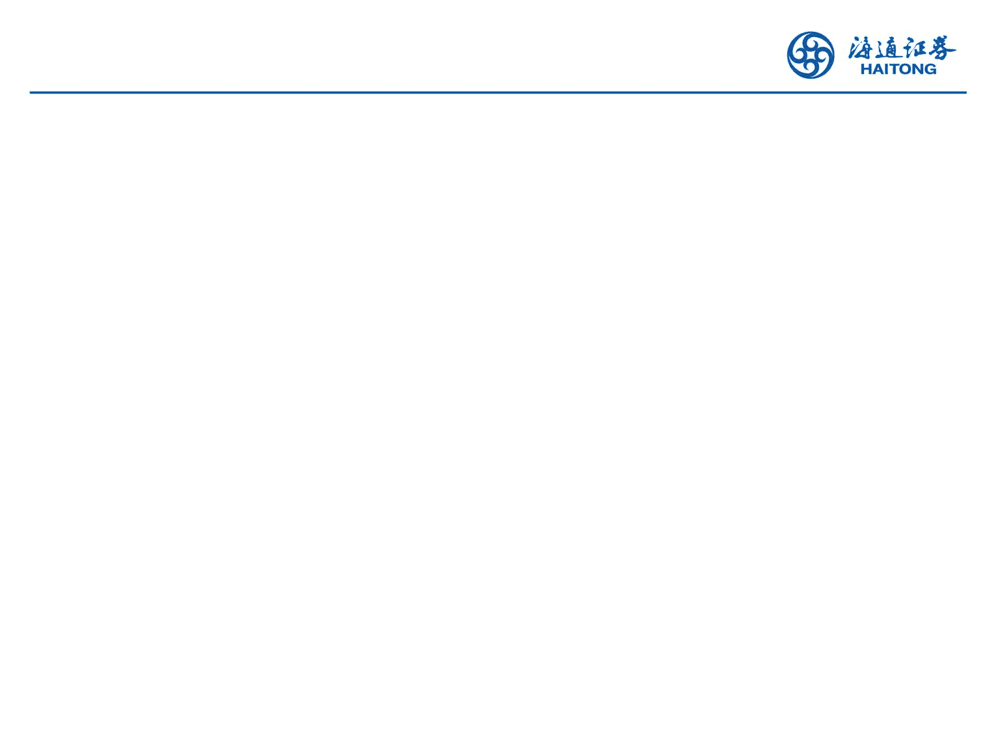

陈先龙（有色金属行业首席分析师）

**SAC**号码：**S0850522120002**

甘嘉尧（有色金属高级分析师）

**SAC**号码：**S0850520010002**

张恒浩（有色金属分析师）

**SAC**号码：**S0850524070008**

联系人：梁琳、谭伊珊

**2024**年**12**月**8**日

证券研究报告

（优于大市，维持）

# 中国央行重启购金，看好黄金板块表现

## 投资要点

- 工业金属：铜精矿加工费大幅下跌，表明**25**年铜精矿供应紧张预期。11月29日\-12月6日，LME铜、铝、锌、锡价涨跌幅分别为+0.9%、+0.3%、\-1.2%、+0.1%，SHFE铜、铝、锌、锡价周涨跌幅分别为+1.2%、\-0.4%、+1.2%、+1.9%；12月6日LME铜、铝、锌、锡价格分别为9093美元/吨、2608美元/吨、3072美元/吨、2.91万美元/吨。铜方面，据SMM，智利矿业公司安托法加斯塔和江西铜业已达成协议，将明年的铜精矿加工费和精炼费(TC/RC)定为每吨21.25美元和每磅2.125美分，较2024年下跌了73.4%。铜精矿加工费大幅下跌在一定程度上表明了明年铜精矿供应紧张的市场预期。铝方面，电解铝成本端氧化铝仍高位运行，或引发高成本企业减产。建议关注：紫金矿业、洛阳钼业、中国铝业、天山铝业、云铝股份、中国有色矿业、金诚信、铜陵有色等公司。

- 能源金属：年末锂盐高景气，**11**月产量环比增长。11月29日\-12月6日，电池级碳酸锂、氢氧化锂、LME镍、长江钴价涨跌幅分别为0.4%、0.5%、0.0%、\-0.6%。据SMM，11月国内碳酸锂总产量稳中上行，环比增加8%，同比增加49%。SMM预计12月国内碳酸锂总产量将环比增长8%-10%。11月国内氢氧化锂产量环比微降，下降幅度不到3%，同比增长43%。SMM预计12月产量环比减量15%以上，同比增长不到25%，整月平衡或将偏紧。我们认为锂电池需求景气高，刺激上游锂盐环节供需环境持续改善。建议关注：赣锋锂业、天齐锂业、永兴材料、江特电机、中矿资源；华友钴业、格林美等公司。

- 黄金白银：中国央行重启购金，看好黄金板块表现。12月6日伦敦现货黄金、白银价格分别为2637.30美元/盎司和31.11美元/盎司，周涨跌幅为\-0.52%和1.34%；上海金交所黄金、白银价格分别为614.09元/克和7.80元/克，周涨跌幅分别为\-0.13%和1.93%。据上海证券报援引中国央行数据，截至11月末，我国央行黄金储备报7296万盎司，较上个月增加了16万盎司，此前央行连续六个月暂停增持黄金。推荐：山金国际、山东黄金、招金矿业、中金黄金、赤峰黄金、盛达资源和湖南黄金；建议关注：四川黄金、玉龙股份等。

- 稀土和锑、锗、铀等小金属、新材料：氧化镨钕价格环比**\-0.5%**。11月29日\-12月6日，氧化镨钕价格涨跌幅为\-0.5%，锑价格涨跌幅为0.0%。建议关注：北方稀土、中国稀土、金力永磁、湖南黄金、金钼股份等公司。

- 风险提示：经济复苏不及预期；新能源车、地产需求不及预期；主要经济体货币政策收紧过度；国际地缘政治风险；项目建设不及预期。

## 有色金属价格、库存数据一览

资料来源：Wind，海通证券研究所

### 价格数据

| 产品 | 单位 | 期初价格 (2024/11/29) | 期末价格 (2024/12/6) | 涨跌幅 |
| :--- | :--- | :--- | :--- | :--- |
| **工业金属** | | | | |
| LME铜 | 美元/吨 | 9015 | 9093 | 0.9% |
| LME铝 | 美元/吨 | 2599 | 2608 | 0.3% |
| LME锌 | 美元/吨 | 3109 | 3072 | -1.2% |
| LME铅 | 美元/吨 | 2082 | 2067 | -0.7% |
| LME锡 | 万美元/吨 | 2.90 | 2.91 | 0.1% |
| SHFE铜 | 万元/吨 | 7.38 | 7.47 | 1.2% |
| SHFE铝 | 万元/吨 | 2.04 | 2.03 | -0.4% |
| SHFE锌 | 万元/吨 | 2.52 | 2.55 | 1.2% |
| SHFE铅 | 万元/吨 | 1.74 | 1.78 | 2.2% |
| SHFE锡 | 万元/吨 | 23.94 | 24.39 | 1.9% |
| A00铝 | 万元/吨 | 2.03 | 2.03 | 0.0% |
| 氧化铝 | 元/吨 | 4791.00 | 4847.00 | 1.2% |
| **能源金属** | | | | |
| 电池级碳酸锂 | 万元/吨 | 7.84 | 7.88 | 0.4% |
| 工业级碳酸锂 | 万元/吨 | 7.50 | 7.35 | -2.0% |
| 氢氧化锂 | 万元/吨 | 6.83 | 6.87 | 0.5% |
| LME镍 | 万美元/吨 | 1.60 | 1.60 | 0.0% |
| SHFE镍 | 万元/吨 | 12.60 | 12.63 | 0.2% |
| 硫酸镍 | 万元/吨 | 2.96 | 2.94 | -0.7% |
| 高镍铁 | 元/镍 | 965.00 | 945.00 | -2.1% |
| 长江钴 | 万元/吨 | 17.70 | 17.60 | -0.6% |
| MB钴：标准级 | 美元/磅 | 11.05 | 11.05 | 0.0% |
| MB钴：合金级 | 美元/磅 | 14.43 | 14.35 | -0.5% |
| **贵金属** | | | | |
| 伦敦现货黄金 | 美元/盎司 | 2651.05 | 2637.30 | -0.5% |
| 伦敦现货白银 | 美元/盎司 | 30.70 | 31.11 | 1.3% |
| COMEX黄金 | 美元/盎司 | 2673.90 | 2654.90 | -0.7% |
| COMEX银 | 美元/盎司 | 31.10 | 31.49 | 1.2% |
| **稀土和锑、锗、铀等小金属、新材料** | | | | |
| 镨钕氧化物 | 万元/吨 | 41.38 | 41.18 | -0.5% |
| 钼精矿:45%-50% | 元/吨度 | 3675.00 | 3605.00 | -1.9% |
| 锑 | 万元/吨 | 14.00 | 14.00 | 0.0% |
| 氧化镝 | 万元/千克 | 0.17 | 0.16 | -5.4% |
| 氧化铽 | 万元/千克 | 0.58 | 0.57 | -0.9% |
| 黑钨精矿:≥55% | 万元/吨 | 14.26 | 14.09 | -1.2% |
| 锗锭:≥50Ω | 元/千克 | 18850.00 | 18450.00 | -2.1% |
| 二氧化锗:≥99.999% | 元/千克 | 14150.00 | 13750.00 | -2.8% |
| 海绵钛≥99.6% | 元/千克 | 42.50 | 42.50 | 0.0% |
| 镁锭 | 万元/吨 | 1.81 | 1.79 | -1.1% |
| 精铋:≥99.99% | 万元/吨 | 7.35 | 7.45 | 1.4% |
| 精铟:≥99.995% | 元/千克 | 2525.00 | 2525.00 | 0.0% |

### 库存数据

| 产品 | 单位 | 期初库存 (2024/11/29) | 期末库存 (2024/12/6) | 涨跌幅 |
| :--- | :--- | :--- | :--- | :--- |
| **能源金属** | | | | |
| LME镍 | 万吨 | 16.00 | 16.53 | 3.3% |
| SHFE镍 | 万吨 | 3.30 | 3.41 | 3.3% |
| **工业金属** | | | | |
| LME铜 | 万吨 | 27.10 | 26.98 | -0.4% |
| SHFE阴极铜 | 万吨 | 10.88 | 9.78 | -10.1% |
| SHFE国际铜 | 万吨 | 1.58 | 1.52 | -3.7% |
| LME铝 | 万吨 | 69.60 | 68.46 | -1.6% |
| SHFE铝 | 万吨 | 22.78 | 22.44 | -1.5% |
| LME锌 | 万吨 | 27.69 | 27.89 | 0.7% |
| SHFE锌 | 万吨 | 7.70 | 5.30 | -31.2% |
| LME铅 | 万吨 | 27.19 | 27.14 | -0.2% |
| SHFE铅 | 万吨 | 4.86 | 4.83 | -0.7% |
| LME锡 | 吨 | 4815 | 4710 | -2.2% |
| SHFE锡 | 吨 | 7239 | 6920 | -4.4% |

## 1. 申万有色指数11/29-12/6上涨1.4%，磁材领涨

## 2. 主要子板块跟踪（11/29-12/6）

### 2.1 工业金属：LME铜价上涨0.9%

### 2.2 能源金属：电池级碳酸锂价格上涨0.4%

### 2.3 黄金白银：伦敦现货黄金价下跌0.5%

### 2.4 稀土和锑、锗、铀等小金属：镨钕氧化物价格下跌0.5%

## 3. 重要事件：金诚信Lonshi铜矿东区探获铜金属量104万吨

## 4. 风险提示

请务必阅读正文之后的信息披露和法律声明

图：申万一级行业周涨跌幅（**2024.11.29-2024.12.6**）

申万有色指数11/29-12/6上涨1.4%，磁材领涨

图：申万有色二级行业周涨跌幅（**2024.11.29-2024.12.6**）

图：部分申万有色三级行业和锂矿指数、稀土指数周涨跌幅（**2024.11.29-2024.12.6**）

2.15%

1.39%

-2% 0% 2% 4% 6%

钢铁、煤炭、机械设备、传媒、综合、社会服务、建筑装饰、汽车、商贸零售、房地产、公用事业、家用电器、环保、非银金融、交通运输、计算机、银行、万得全A、石油石化、通信、基础化工、建筑材料、纺织服饰、医药生物、电子、国防军工、有色金属、轻工制造、美容护理、农林牧渔、电力设备、食品饮料

-2% 0% 2% 4% 6%

金属新材料、工业金属、小金属、贵金属、能源金属

-2% 0% 2% 4% 6%

磁性材料、铝、稀土指数、铜、黄金、锂矿指数

图：有色金属行业海外重点上市公司股价周涨跌幅（**2024.11.29-2024.12.6**）

有色金属板块11/29-12/6利源股份领涨33.3%

图：申万有色行业周涨幅前十个股（**2024.11.29-2024.12.6**）

0% 5% 10% 15% 20% 25% 30% 35%

利源股份、罗平锌电、鑫科材料、英洛华、豪美新材、宜安科技、华锋股份、怡球资源、宝武镁业、华阳新材

图：申万有色行业周涨幅后十个股（**2024.11.29-2024.12.6**）

-14% -12% -10% -8% -6% -4% -2% 0%

博威合金、永兴材料、国城矿业、翔鹭钨业、赣锋锂业、鑫铂股份、章源钨业、东方钽业、*ST中润、东方锆业

图：有色金属行业海外重点上市公司股价周涨跌幅（**2024.11.29-2024.12.6**）

-6% -5% -4% -3% -2% -1% 0%

南方铜业、嘉能可、伊格尔矿业、SQM、力拓、NEWMONT、必和必拓、雅保、Pilbara、巴里克黄金、自由港、淡水河谷

## 1. 申万有色指数11/29-12/6上涨1.4%，磁材领涨

## 2. 主要子板块跟踪（11/29-12/6）

### 2.1 工业金属：LME铜价上涨0.9%

### 2.2 能源金属：电池级碳酸锂价格上涨0.4%

### 2.3 黄金白银：伦敦现货黄金价下跌0.5%

### 2.4 稀土和锑、锗、铀等小金属：镨钕氧化物价格下跌0.5%

## 3. 重要事件：金诚信Lonshi铜矿东区探获铜金属量104万吨

## 4. 风险提示

请务必阅读正文之后的信息披露和法律声明

### 工业金属板块跟踪

LME铜价上涨0.9%，SHFE铜库存下跌10.1%

图：上期所铜期货收盘价（万元/吨）

7.3 7.35 7.4 7.45 7.5 7.55

M M+1 M+2 M+3 M+4 M+5 M+6 M+7 M+8 M+9

2024/11/29

2024/12/06

图：全球铜库存（万吨）

0 20 40 60 80

22/11 23/05 23/11 24/05 24/11

LME铜、SHFE阴极铜、SHFE国际铜、COMEX铜

图：LME、SHFE铜价

5 6 7 8 9

6000 8000 10000 12000

22/11 23/05 23/11 24/05 24/11

LME铜（美元/吨；左轴）、SHFE阴极铜（万元/吨；右轴）

图：A00铝和氧化铝价格

2000 3000 4000 5000

1 2 3

22/11 23/05 23/11 24/05 24/11

A00铝（万元/吨；左轴）、氧化铝（元/吨；右轴）

图：上期所铝期货收盘价（万元/吨）

2.02 2.03 2.04 2.05 2.06

M M+1 M+2 M+3 M+4 M+5 M+6 M+7 M+8

2024/11/29

2024/12/06

图：全球铝库存（万吨）

0 40 80 120 160

22/11 23/05 23/11 24/05 24/11

LME铝、SHFE铝、COMEX铝

图：LME、SHFE铝价

1.4 1.8 2.2 2.6

1500 2500 3500

22/11 23/05 23/11 24/05 24/11

LME铝（美元/吨；左轴）、SHFE铝（万元/吨；右轴）

### 工业金属板块跟踪

LME锌价下跌1.2%，LME铅价下跌0.7%

图：LME、SHFE锌价

1.5 2.5 3.5

2000 3000 4000

22/11 23/05 23/11 24/05 24/11

LME锌（美元/吨；左轴）、SHFE锌（万元/吨；右轴）

图：全球主要交易所锌库存（万吨）

0 20 40 60

22/11 23/05 23/11 24/05 24/11

LME锌、SHFE锌

图：LME、SHFE铅价

1.4 1.6 1.8 2.0 2.2

1600 2000 2400

22/11 23/05 23/11 24/05 24/11

LME铅（美元/吨；左轴）、SHFE铅（万元/吨；右轴）

图：全球主要交易所铅库存（万吨）

0 10 20 30 40

22/11 23/05 23/11 24/05 24/11

LME铅、SHFE铅

资料来源：Wind，海通证券研究所

LME锡价上涨0.1%，SHFE锡库存下跌4.4%。

请务必阅读正文之后的信息披露和法律声明

图：全球主要交易所锡库存（吨）

图：LME、SHFE锡价

图：上期所锡期货收盘价（万元/吨）

LME锡  
SHFE锡

LME锡（万美元/吨；左轴）  
SHFE锡（万元/吨；右轴）

2024/11/29  
2024/12/06

## 1. 申万有色指数11/29—12/6上涨1.4%，磁材领涨

## 2. 主要子板块跟踪（11/29—12/6）

### 2.1 工业金属：LME铜价上涨0.9%

### 2.2 能源金属：电池级碳酸锂价格上涨0.4%

### 2.3 黄金白银：伦敦现货黄金价下跌0.5%

### 2.4 稀土和锑、锗、铀等小金属：镨钕氧化物价格下跌0.5%

## 3. 重要事件：金诚信Lonshi铜矿东区探获铜金属量104万吨

## 4. 风险提示

资料来源：Wind，百川资讯，海通证券研究所

电池级碳酸锂价格上涨0.4%。

请务必阅读正文之后的信息披露和法律声明

图：三元前驱体价格（万元/吨）

图：锂电池正极材料价格（万元/吨）

图：广期所碳酸锂期货收盘价（万元/吨）

图：锂盐价格（万元/吨）

图：广期所碳酸锂库存（万吨）

电池级碳酸锂  
工业级碳酸锂  
氢氧化锂

NCM111  
NCM523  
NCM622  
NCM811

NCM111（左轴）  
NCM523（左轴）  
NCM622（左轴）  
NCM811（左轴）  
磷酸铁锂（右轴）

碳酸锂广期所库存（万吨）

2024/12/06  
2024/11/29

资料来源：Wind，海通证券研究所

LME镍价持平。

请务必阅读正文之后的信息披露和法律声明

图：硫酸镍和高镍铁价格

图：上期所镍期货收盘价（万元/吨）

图：全球镍库存（万吨）

图：LME、SHFE镍价

图：长江钴及MB钴价

LME镍（万美元/吨；左轴）  
SHFE镍（万元/吨；右轴）

LME镍库存  
SHFE镍库存

硫酸镍（万元/吨；左轴）  
高镍铁（元/镍；右轴）

长江钴（万元/吨；左轴）  
MB钴：标准级（美元/磅；右轴）  
MB钴：合金级（美元/磅；右轴）

2024/11/29  
2024/12/06

## 1. 申万有色指数11/29—12/6上涨1.4%，磁材领涨

## 2. 主要子板块跟踪（11/29—12/6）

### 2.1 工业金属：LME铜价上涨0.9%

### 2.2 能源金属：电池级碳酸锂价格上涨0.4%

### 2.3 黄金白银：伦敦现货黄金价下跌0.5%

### 2.4 稀土和锑、锗、铀等小金属：镨钕氧化物价格下跌0.5%

## 3. 重要事件：金诚信Lonshi铜矿东区探获铜金属量104万吨

## 4. 风险提示

资料来源：Wind，海通证券研究所

请务必阅读正文之后的信息披露和法律声明

图：白银价格

图：美国CPI当月同比与联邦基金利率（%）

图：伦敦现货黄金价格与美元指数

图：COMEX与SHFE黄金价格

伦敦现货黄金价下跌0.52%。

COMEX黄金（美元/盎司；左轴）  
SHFE黄金（元/克；右轴）

COMEX银（美元/盎司；左轴）  
SHFE白银（元/千克；右轴）

美国CPI：当月同比（左轴）  
美国联邦基金利率（右轴）

伦敦现货黄金（美元/盎司；左轴）  
美元指数（右轴）

资料来源：Wind，海通证券研究所

金银比下行至84.32。

请务必阅读正文之后的信息披露和法律声明

图：全球主要经济体央行总资产

图：SPDR、iShares黄金ETF持有量（吨）

图：金银比和铜金比

图：美国国债长短期利差（%）

金银比（金价/银价；左轴）  
铜金比（铜价/金价；右轴）

美国国债收益率：10Y-2Y  
美国国债收益率：10Y-3M

美国：所有联储银行：总资产（万亿美元；左轴）  
欧洲央行：资产：总额（万亿欧元；左轴）  
日本央行：资产：总额（万亿日元；右轴）

SPDR黄金ETF（左轴）  
iShares黄金ETF（右轴）

## 1. 申万有色指数11/29—12/6上涨1.4%，磁材领涨

## 2. 主要子板块跟踪（11/29—12/6）

### 2.1 工业金属：LME铜价上涨0.9%

### 2.2 能源金属：电池级碳酸锂价格上涨0.4%

### 2.3 黄金白银：伦敦现货黄金价下跌0.5%

### 2.4 稀土和锑、锗、铀等小金属：镨钕氧化物价格下跌0.5%

## 3. 重要事件：金诚信Lonshi铜矿东区探获铜金属量104万吨

## 4. 风险提示

资料来源：Wind，海通证券研究所

请务必阅读正文之后的信息披露和法律声明

图：锗锭和钨精矿价格

图：海绵钛和钛精矿价格

图：钼精矿和锑价格

图：主要稀土价格

图：精铋和精铟价格

图：电解锰和镁锭价格（万元/吨）

氧化镝（万元/千克；左轴）  
氧化铽（万元/千克；左轴）  
镨钕氧化物（万元/吨；右轴）

钼精矿：45%—50%（元/吨度；左轴）  
锑（万元/吨；右轴）

锗锭：≥50Ω（元/千克；左轴）  
黑钨精矿：≥55%（万元/吨；右轴）

海绵钛≥99.6%（元/千克；左轴）  
钛精矿（元/吨；右轴）

电解锰（左轴）  
镁锭（右轴）

精铋：≥99.99%（万元/吨；左轴）  
精铟：≥99.995%（元/千克；右轴）

## 1. 申万有色指数11/29—12/6上涨1.4%，磁材领涨

## 2. 主要子板块跟踪（11/29—12/6）

### 2.1 工业金属：LME铜价上涨0.9%

### 2.2 能源金属：电池级碳酸锂价格上涨0.4%

### 2.3 黄金白银：伦敦现货黄金价下跌0.5%

### 2.4 稀土和锑、锗、铀等小金属：镨钕氧化物价格下跌0.5%

## 3. 重要事件：金诚信Lonshi铜矿东区探获铜金属量104万吨

## 4. 风险提示

资料来源：《金诚信：关于Lonshi铜矿东区资源量情况的公告》《博威合金：关于在越南设立全资子公司并投资建设生产基地的公告》《腾远钴业：关于投资建设年产5000吨电钴产品技术改造升级项目的公告》，海通证券研究所。

## 重要事件：金诚信Lonshi铜矿东区探获铜金属量104万吨

| 公司 | 公告日期 | 主要内容 |
|---|---|---|
| 金诚信 | 2024-12-5 | 公司对全资子公司 Sabwe Mining Sarl 位于刚果（金）的Lonshi铜矿开展了地质勘查工作。Lonshi铜矿根据矿体分布特征划分为西区、东区。截至2024年10月31日，东区共探获（探明+控制+推断）类矿石量2604.8万吨，铜金属量104万吨，铜平均品位3.99%，其中探明铜金属量15万吨，占比为14.55%；控制铜金属量59万吨，占比为56.44%；推断铜金属量30万吨；探明+控制铜金属量占比70.99%。 |
| 腾远钴业 | 2024-12-6 | 公司拟在赣州高新技术产业开发区稀金大道9号公司厂区内投资建设《年产5000吨电钴产品技术改造升级项目》，项目投资金额9890.19万元，建设周期为10个月，预计2025年9月建成。 |
| 博威合金 | 2024-12-6 | 公司拟投资15000万美元在越南投资建设生产基地，并设立全资子公司博威合金板带（越南）有限公司作为实施主体。 |

表：重要公司跟踪

## 1. 申万有色指数11/29—12/6上涨1.4%，磁材领涨

## 2. 主要子板块跟踪（11/29—12/6）

### 2.1 工业金属：LME铜价上涨0.9%

### 2.2 能源金属：电池级碳酸锂价格上涨0.4%

### 2.3 黄金白银：伦敦现货黄金价下跌0.5%

### 2.4 稀土和锑、锗、铀等小金属：镨钕氧化物价格下跌0.5%

## 3. 重要事件：金诚信Lonshi铜矿东区探获铜金属量104万吨

## 4. 风险提示

请务必阅读正文之后的信息披露和法律声明

## 风险提示

- 经济复苏不及预期，新能源车、地产需求不及预期。若新能源车、地产等下游行业需求不及预期，或将造成金属价格下行。
- 主要经济体货币政策收紧过度，或将造成市场流动性短缺，抑制实体经济需求。
- 国际地缘政治风险。随着国外愈发重视本土产业链建设和战略资源保护，中企在海外投资矿产资源或将面临外资审查趋严、当地政策不确定性提升等风险。
- 项目建设不及预期。公司项目建设推迟，或将造成产销量不及预期。

## 分析师声明

陈先龙 甘嘉尧 张恒浩

本人具有中国证券业协会授予的证券投资咨询执业资格，以勤勉的职业态度，独立、客观地出具本报告。本报告所采用的数据和信息均来自市场公开信息，本人不保证该等信息的准确性或完整性。分析逻辑基于作者的职业理解，清晰准确地反映了作者的研究观点，结论不受任何第三方的授意或影响，特此声明。

### 有色金属研究团队

#### 有色金属首席分析师

陈先龙

SAC执业证书编号：S0850522120002

电话：021-23219406

Email：cxl15082@haitong.com

#### 有色金属高级分析师

甘嘉尧

SAC执业证书编号：S0850520010002

电话：021-23154394

Email：gjy11909@haitong.com

#### 有色金属分析师

张恒浩

SAC号码：S0850524070008

电话：021-23219383

Email：zhh14696@haitong.com

#### 联系人：梁琳

电话：021-23185845

Email：ll15685@haitong.com

#### 联系人：谭伊珊

Tel: (021) 23185638

Email: tys16246@haitong.com

## 投资评级说明

### 1. 投资评级的比较和评级标准

以报告发布后的6个月内的市场表现为比较标准，报告发布日后6个月内的公司股价（或行业指数）的涨跌幅相对同期市场基准指数的涨跌幅。

### 2. 市场基准指数的比较标准

A股市场以海通综指为基准；香港市场以恒生指数为基准；美国市场以标普500或纳斯达克综合指数为基准。

| 类别 | 评级 | 说明 |
|---|---|---|
| 股票投资评级 | 优于大市 | 预期个股相对基准指数涨幅在10%以上； |
| 股票投资评级 | 中性 | 预期个股相对基准指数涨幅介于-10%与10%之间； |
| 股票投资评级 | 弱于大市 | 预期个股相对基准指数涨幅低于-10%及以下； |
| 股票投资评级 | 无评级 | 对于个股未来6个月市场表现与基准指数相比无明确观点。 |
| 行业投资评级 | 优于大市 | 预期行业整体回报高于基准指数整体水平10%以上； |
| 行业投资评级 | 中性 | 预期行业整体回报介于基准指数整体水平-10%与10%之间； |
| 行业投资评级 | 弱于大市 | 预期行业整体回报低于基准指数整体水平-10%以下。 |

## 法律声明

本报告仅供海通证券股份有限公司（以下简称“本公司”）的客户使用。本公司不会因接收人收到本报告而视其为客户。在任何情况下，本报告中的信息或所表达的意见并不构成对任何人的投资建议。在任何情况下，本公司不对任何人因使用本报告中的任何内容所引致的任何损失负任何责任。

本报告所载的资料、意见及推测仅反映本公司于发布本报告当日的判断，本报告所指的证券或投资标的的价格、价值及投资收入可能会波动。在不同时期，本公司可发出与本报告所载资料、意见及推测不一致的报告。

市场有风险，投资需谨慎。本报告所载的信息、材料及结论只提供特定客户作参考，不构成投资建议，也没有考虑到个别客户特殊的投资目标、财务状况或需要。客户应考虑本报告中的任何意见或建议是否符合其特定状况。在法律许可的情况下，海通证券及其所属关联机构可能会持有报告中提到的公司所发行的证券并进行交易，还可能为这些公司提供投资银行服务或其他服务。

本报告仅向特定客户传送，未经海通证券研究所书面授权，本研究报告的任何部分均不得以任何方式制作任何形式的拷贝、复印件或复制品，或再次分发给任何其他人，或以任何侵犯本公司版权的其他方式使用。所有本报告中使用的商标、服务标记及标记均为本公司的商标、服务标记及标记。如欲引用或转载本文内容，务必联络海通证券研究所并获得许可，并需注明出处为海通证券研究所，且不得对本文进行有悖原意的引用和删改。

根据中国证监会核发的经营证券业务许可，海通证券股份有限公司的经营范围包括证券投资咨询业务。

25
