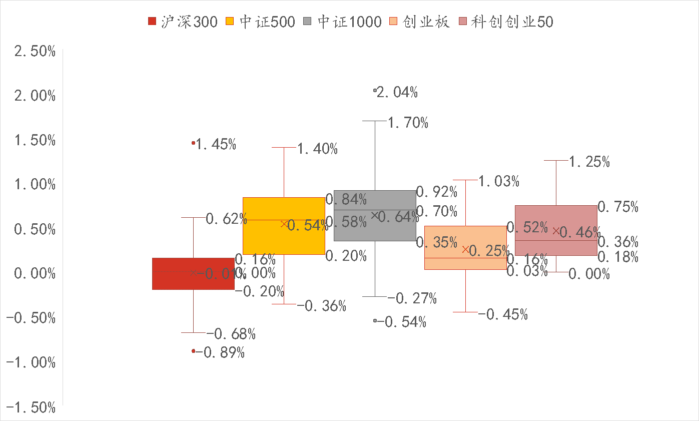

## 公募基金周报（20241216-20241220）

### 投资要点

本周上证指数窄幅波动，成长风格相对占优，科创50指数先抑后扬，全周累计上涨2.17%。以中证2000指数为代表的小盘股本周大幅调整，板块内部拥挤度持续提升。市场交易情绪走弱，全周股票日均成交额较上周大幅减少21.21%。商品方面，铜价横盘震荡，铁矿石和螺纹钢等黑色系品种的价格均大幅下跌。国债市场大幅震荡，但仍不改下行趋势，1年期国债利率下行至1%。本周动量因子和市值因子涨幅居前，股指期货合约基差升贴水不一，其中IC和IM合约基差大幅贴水，IH合约基差小幅升水。

主动权益产品根据本周涨幅排序：深度低估策略中排名前三的分别为九泰天奕量化价值A（4.67%）、九泰天富改革新动力A（4.06%）、大成核心价值甄选A（1.66%）；高成长策略中排名前三的分别为银河创新成长A（7.66%）、国联安科技动力（7.29%）、博时半导体主题A（6.22%）；高质量策略中排名前三的分别为富荣福锦A（7.12%）、国投瑞银锐意改革A（5.26%）、新华策略精选（4.50%）；质量低估策略中排名前三的分别为瑞达行业轮动A（1.96%）、光大银发商机主题A（1.23%）、中信保诚机遇LOF（0.97%）；质量成长策略中排名前三的分别为长城创新驱动A（3.97%）、嘉实优质核心两年持有A（3.18%）、景顺长城科技创新A（2.52%）；GARP策略中排名前三的分别为北信瑞丰优势行业（4.37%）、太平行业优选A（2.90%）、金信民长A（2.42%）；均衡性价比策略中排名前三的分别为诺德新生活A（6.79%）、前海开源大安全核心（5.20%）、大摩科技领先A（4.88%）。

基金高频仓位探测结果显示：最近一周主动权益基金大幅加仓了计算机（0.48%）、综合金融（0.15%）和食品饮料（0.21%）行业；大幅减仓电子（0.33%）、通信（0.24%）和电力设备及新能源（0.24%）行业。从最近一个月的角度来看，综合（0.60%）行业仓位明显增加，电子（0.96%）和通信（0.58%）行业仓位明显减少。

**风险提示：** 本报告对基金产品的研究分析均基于历史公开信息；此外，基金管理人的历史业绩与表现不代表未来；基金产品表现受宏观环境、市场波动、风格转换等多重因素影响，存在波动风险；本报告不涉及证券投资基金评价业务，不涉及对基金产品的推荐。

麦高证券 研究发展部

分析师：林永绿

资格证书：S0650524060001

联系邮箱：linyonglv@mgzq.com

联系电话：15000307034

联系人：张昊阳

资格证书：S0650124040024

联系邮箱：zhanghaoyang@mgzq.com

联系电话：13363378283

**相关研究**

- 《公募基金周报（20241209-20241213）》2024.12.17
- 《公募基金周报（20241202-20241206）》2024.12.08
- 《公募基金周报（20241125-20241129）》2024.12.01
- 《公募基金周报（20241118-20241122）》2024.11.24

---

### 正文目录

1 本周市场回顾 .................................................... 4

1.1 行业指数 .......................................................... 4

1.2 市场风格 .......................................................... 5

2 主动权益基金 .................................................... 5

2.1 不同主题赛道中本周表现优异的基金 .................................. 5

2.2 不同策略分类中表现优异的基金 ...................................... 6

3 指数增强型基金 .................................................. 7

3.1 本周指数增强基金的超额收益分布 .................................... 7

4 本期债券基金选品 ............................................... 12

- 中长债基金池 ........................................................... 12
- 短债基金池 ............................................................. 12

5. 本周基金高频仓位探测 .......................................... 13

6. 本周美元债基金周度跟踪 ........................................ 14

风险提示： ....................................................... 14

---

### 图表目录

图表 1：行业板块市场表现 ............................................... 4

图表 2：市场风格表现 ................................................... 5

图表 3：宽基指数表现 ................................................... 5

图表 4：不同主题赛道中本周表现排名前五的基金............................ 6

图表 5：不同风格策略中本周收益排名前五的主动权益基金 .................... 7

图表 6：本周宽基指数增强型基金的超额收益分布............................ 8

图表 7：沪深300指数增强 ............................................... 8

图表 8：中证500指数增强 ............................................... 9

图表 9：中证1000指数增强 ............................................. 10

图表 10：创业板指数增强 ............................................... 10

图表 11：科创创业50指数增强 .......................................... 10

图表 12：中性对冲基金 ................................................. 11

图表 13：量化股多基金 ................................................. 11

图表 14：债券基金（中长债） ........................................... 12

图表 15：债券基金（短债） ............................................. 12

图表 16：基金高频仓位探测 ............................................. 13

图表 17：美元债基金周度跟踪 ........................................... 14

---

### 1 本周市场回顾

#### 1.1 行业指数

下文数据统计截止日期为20241220，样本期为20241216-20241220。

本周主要宽基指数涨跌不一，上证指数全周窄幅波动-0.70%，成长风格相对占优，科创50指数先抑后扬，全周累计上涨2.17%。以中证2000指数为代表的小盘股本周大幅调整，板块内部拥挤度持续提升。市场交易情绪走弱，全周股票日均成交额为15229.74亿元，较上周大幅减少21.21%。商品方面，铜价横盘震荡，铁矿石和螺纹钢等黑色系品种的价格均大幅下跌。国债市场大幅震荡，但仍不改下行趋势，1年期国债利率下行至1%。本周动量因子和市值因子涨幅居前，残差波动率因子跌幅居前。四类股指期货合约基差升贴水不一，其中IC和IM合约基差大幅贴水，IH合约基差小幅升水，中性对冲基金本周收益的平均值和中位数分别为-0.03%和-0.04%。

本周通信、电子、银行、计算机等板块涨幅居前，通信和电子板块本周涨幅分别为3.58%和3.39%，周度成交额占比均大幅提升至近四周新高的5.69%和15.62%。银行板块本周上涨0.87%，周度成交额占比提升至近四周新高1.69%，周平均换手率回落至1.12%。公募基金高频仓位探测结果中，近一周加仓最多的是计算机板块，减仓较多的是电子、通信和电力设备及新能源板块。计算机板块本周小幅上涨0.50%，周度成交额占比小幅回落至近四周新低11.89%，周平均换手率为近四周新低的7.80%。

本周小盘股大幅调整，市值风格切换，算力、AI应用、半导体等成长题材表现较强，当前仍处于年末政策空窗期，行业和题材的选择应更偏向于大盘价值，以防守为主，注意仓位的择时，关注科创50等成长类指数的轮动机会。

**图表 1：行业板块市场表现**

资料来源：Wind、麦高证券研究发展部

| 中信行业 | 涨跌幅近一周 | 涨跌幅近两周 | 涨跌幅近一月 | 涨跌幅近三月 | 周度成交额占比近一周 | 周度成交额占比近两周 | 周度成交额占比近三周 | 周度成交额占比近四周 | 周平均换手率近一周 | 周平均换手率近两周 | 周平均换手率近三周 | 周平均换手率近四周 |
|---|---|---|---|---|---|---|---|---|---|---|---|---|
| 煤炭 | -3.20% | -4.36% | 0.90% | 10.28% | 0.78% | 0.90% | 0.70% | 0.50% | 4.93% | 8.33% | 4.49% | 2.84% |
| 传媒 | -4.35% | -1.30% | 10.80% | 54.08% | 6.96% | 6.64% | 6.02% | 6.42% | 10.40% | 13.05% | 11.00% | 10.57% |
| 机械 | -2.32% | -2.99% | 3.50% | 35.03% | 8.30% | 9.68% | 10.12% | 8.02% | 5.32% | 7.64% | 6.97% | 4.91% |
| 石油石化 | -1.37% | -2.02% | 0.66% | 11.05% | 0.66% | 0.61% | 0.67% | 0.70% | 1.77% | 2.20% | 2.21% | 2.14% |
| 纺织服装 | -3.34% | 1.15% | 11.44% | 38.14% | 1.08% | 0.97% | 0.96% | 0.90% | 7.07% | 8.51% | 7.77% | 6.50% |
| 有色金属 | -3.06% | -3.84% | -2.95% | 14.41% | 2.21% | 2.65% | 2.86% | 3.02% | 2.68% | 3.99% | 3.51% | 2.98% |
| 计算机 | 0.50% | -0.29% | 6.54% | 64.76% | 11.89% | 11.93% | 12.97% | 12.61% | 7.80% | 10.00% | 9.97% | 7.92% |
| 综合 | -4.93% | -3.43% | 7.36% | 45.38% | 0.33% | 0.33% | 0.33% | 0.32% | 6.86% | 8.80% | 7.43% | 5.88% |
| 电力及公用事业 | -0.78% | -0.96% | 2.37% | 13.57% | 2.40% | 2.16% | 2.48% | 2.35% | 2.91% | 3.22% | 3.17% | 2.74% |
| 通信 | 3.58% | 4.57% | 7.36% | 38.80% | 5.69% | 3.62% | 3.47% | 4.37% | 6.20% | 5.88% | 5.71% | 6.17% |
| 轻工制造 | -4.58% | -1.20% | 4.33% | 37.54% | 1.72% | 1.54% | 1.56% | 1.80% | 6.57% | 7.79% | 6.75% | 6.11% |
| 商贸零售 | -4.69% | 1.75% | 13.48% | 53.45% | 2.90% | 2.60% | 2.66% | 2.17% | 9.69% | 11.40% | 11.42% | 8.36% |
| 建筑 | -1.90% | -2.89% | 1.71% | 35.40% | 2.03% | 2.06% | 2.17% | 2.00% | 3.50% | 4.89% | 4.49% | 3.46% |
| 国防军工 | -1.15% | -1.55% | 1.74% | 37.72% | 1.94% | 2.26% | 2.03% | 2.27% | 3.05% | 4.62% | 3.68% | 3.58% |
| 电子 | 3.39% | 3.70% | 7.92% | 52.76% | 15.62% | 12.07% | 12.16% | 12.84% | 5.38% | 6.01% | 5.00% | 4.73% |
| 消费者服务 | -4.31% | -0.65% | 8.57% | 39.19% | 1.54% | 1.38% | 1.04% | 0.96% | 10.82% | 13.11% | 9.05% | 7.85% |
| 家电 | -0.74% | 0.36% | 3.30% | 17.65% | 1.66% | 1.72% | 1.84% | 2.03% | 5.19% | 5.93% | 5.82% | 5.66% |
| 建材 | -4.70% | -3.66% | 2.17% | 30.91% | 0.82% | 0.94% | 0.92% | 0.74% | 4.20% | 6.37% | 5.18% | 3.90% |
| 钢铁 | -2.71% | -3.56% | 2.98% | 29.57% | 0.69% | 0.79% | 0.63% | 0.49% | 2.99% | 4.68% | 3.35% | 2.17% |
| 汽车 | -0.94% | -0.40% | 3.15% | 28.43% | 4.03% | 4.95% | 4.72% | 4.40% | 5.85% | 8.69% | 7.05% | 5.20% |
| 基础化工 | -2.25% | -2.96% | 0.11% | 29.47% | 4.88% | 5.25% | 5.80% | 6.37% | 3.76% | 5.15% | 4.89% | 4.49% |
| 综合金融 | -3.16% | -3.67% | 3.69% | 54.72% | 0.20% | 0.25% | 0.30% | 0.29% | 5.27% | 8.04% | 8.40% | 7.31% |
| 交通运输 | -2.17% | -2.22% | 2.28% | 18.68% | 1.69% | 1.83% | 2.02% | 2.14% | 2.28% | 3.28% | 3.52% | 2.81% |
| 房地产 | -5.01% | -6.91% | -1.24% | 28.48% | 1.62% | 1.98% | 1.89% | 1.72% | 4.89% | 7.48% | 5.94% | 4.59% |
| 医药 | -2.12% | -3.02% | 1.39% | 23.38% | 4.76% | 5.50% | 4.90% | 5.14% | 3.13% | 4.67% | 3.76% | 3.23% |
| 食品饮料 | -1.59% | 0.35% | 3.15% | 27.03% | 2.60% | 3.38% | 2.23% | 2.26% | 4.65% | 7.97% | 5.07% | 4.12% |
| 农林牧渔 | -3.63% | -1.72% | 2.47% | 22.47% | 1.18% | 1.20% | 1.19% | 1.02% | 4.11% | 5.36% | 4.89% | 3.86% |
| 非银行金融 | -1.65% | -3.83% | 1.41% | 38.69% | 3.44% | 4.73% | 4.60% | 5.03% | 2.22% | 3.68% | 3.40% | 3.13% |
| 银行 | 0.87% | 0.36% | 4.77% | 17.99% | 1.69% | 1.56% | 1.48% | 1.49% | 1.12% | 1.33% | 1.12% | 1.03% |
| 电力设备及新能源 | -1.81% | -3.50% | -0.86% | 29.59% | 4.69% | 4.52% | 5.26% | 5.62% | 3.44% | 3.97% | 4.28% | 4.05% |

#### 1.2 市场风格

本周两市交易情绪走弱，五类中信风格指数的周平均换手率较上周均减少，成长风格指数本周表现最强，周度涨幅为0.07%，周度成交额占比提升至近四周新高55.11%，周平均换手率回落至近四周新低5.83%。稳定风格指数周度下跌0.59%，周度成交额占比为近四周新高4.29%，周平均换手率减少至2.66%。

金融风格指数周度下跌0.90%，周度成交额占比和周平均换手率均为近四周新低的6.74%和2.05%。周期风格指数本周大幅下跌2.23%，周度成交额占比下降至19.00%。消费风格指数本周表现最弱，周度跌幅为2.33%，周度成交额占比小幅减少至14.87%，周平均换手率回落至5.41%。

本周主要宽基指数涨跌不一，以中证A股指数为基准看，上证50指数表现最优，周度涨幅为0.40%，周度成交额占比提升至近四周新高的5.69%，周平均换手率小幅回落至1.18%。中证2000指数大幅下跌2.90%，周度成交额占比提升至近四周新高的29.38%，板块内交易拥挤度进一步提升。本周大盘指数窄幅震荡，下半周整体表现较强，大市值风格占优，成长类的题材更加活跃。随着下周衍生品交割后，后半周或将迎来阶段布局机会，我们建议以红利等板块为主，积极关注消费、AI应用、算力、半导体等板块的投资机会。

**图表 2：市场风格表现**

资料来源：Wind、麦高证券研究发展部

| 中信风格 | 涨跌幅近一周 | 涨跌幅近两周 | 涨跌幅近一月 | 涨跌幅近三月 | 成交额占比近一周 | 成交额占比近两周 | 成交额占比近三周 | 成交额占比近四周 | 周平均换手率近一周 | 周平均换手率近两周 | 周平均换手率近三周 | 周平均换手率近四周 |
|---|---|---|---|---|---|---|---|---|---|---|---|---|
| 成长 | 0.07% | -0.29% | 4.37% | 46.14% | 55.11% | 50.76% | 52.95% | 54.78% | 5.83% | 7.27% | 6.78% | 6.12% |
| 消费 | -2.33% | -0.95% | 3.53% | 26.09% | 14.87% | 16.03% | 14.18% | 14.08% | 5.41% | 7.21% | 6.17% | 5.03% |
| 周期 | -2.23% | -2.38% | 1.58% | 21.55% | 19.00% | 21.06% | 20.67% | 18.83% | 3.84% | 5.47% | 4.57% | 3.47% |
| 稳定 | -0.59% | -0.88% | 2.90% | 16.57% | 4.29% | 3.90% | 4.22% | 4.00% | 2.66% | 3.19% | 3.00% | 2.49% |
| 金融 | -0.90% | -2.32% | 2.62% | 28.10% | 6.74% | 8.25% | 7.99% | 8.30% | 2.05% | 3.03% | 2.60% | 2.27% |

**图表 3：宽基指数表现**

资料来源：Wind、麦高证券研究发展部

| 宽基指数 | 涨跌幅近一周 | 涨跌幅近两周 | 涨跌幅近一月 | 涨跌幅近三月 | 成交额占比近一周 | 成交额占比近两周 | 成交额占比近三周 | 成交额占比近四周 | 周平均换手率近一周 | 周平均换手率近两周 | 周平均换手率近三周 | 周平均换手率近四周 |
|---|---|---|---|---|---|---|---|---|---|---|---|---|
| 上证50 | 0.40% | -0.64% | 1.80% | 18.59% | 5.69% | 5.05% | 4.69% | 5.04% | 1.18% | 1.39% | 1.22% | 1.14% |
| 沪深300 | -0.14% | -1.14% | 1.61% | 22.70% | 20.87% | 19.56% | 19.07% | 21.32% | 1.49% | 1.88% | 1.63% | 1.57% |
| 中证500 | -1.19% | -1.04% | 2.90% | 31.54% | 14.30% | 14.48% | 14.02% | 13.86% | 3.43% | 4.76% | 3.86% | 3.04% |
| 中证1000 | -1.31% | -1.23% | 4.00% | 40.52% | 22.42% | 21.24% | 22.07% | 22.81% | 4.81% | 6.22% | 5.91% | 5.26% |
| 中证2000 | -2.90% | -0.97% | 7.37% | 47.73% | 29.38% | 29.20% | 29.02% | 27.20% | 8.03% | 10.13% | 9.02% | 7.53% |
| 中证A股 | -1.14% | -1.34% | 3.07% | 31.58% | / | / | / | / | 4.18% | 5.54% | 4.92% | 4.14% |

### 2 主动权益基金

由于市场中每个基金产品的定位和投资风格并不相同，因此需要将不同类型的基金产品进行分类，本文分别从行业赛道和投资策略两个维度对市场中的主动权益基金产品进行了划分。

#### 2.1 不同主题赛道中本周表现优异的基金

主题赛道方面，以TMT、金融地产、消费、医药、制造和周期这六个板块为基准，单赛道和双赛道基金的筛选依据分别为：单赛道基金为连续多期某个板块仓位大于70%的基金；双赛道基金为连续多期某两个板块仓位都大于30%的基金。

## 公募基金周报

请务必阅读报告正文后的重要声明部分 6

### 图表 4：不同主题赛道中本周表现排名前五的基金

资料来源：Wind、麦高证券研究发展部

#### 2.2 不同策略分类中表现优异的基金

从基金的投资风格和策略的角度来看，我们对成长、BP 和盈利因子进行改进，最终得到了成长、估值和质量因子，并将基金分为了深度低估、高成长、高质量、质量成长、质量低估、GARP 和均衡性价比类型的基金，统计了在本周不同类型基金中表现较为优异的基金。

| 基金类别 | 基金代码 | 基金简称 | 基金经理 | 基金规模（亿元） | 区间收益 | 近一周 | 近一月 | 近半年 | 近一年 | YTD | 近一年最大回撤 |
|---|---|---|---|---|---|---|---|---|---|---|---|
| 单赛道型 TMT | 018122.OF | 永赢数字经济智选A | 王文龙 | 0.31 | 10.67 | 6.84 | 31.14 | 31.74 | 30.46 | -24.50 |
| 单赛道型 TMT | 017102.OF | 大摩数字经济A | 雷志勇 | 17.36 | 8.87 | 9.54 | 27.59 | 72.26 | 71.26 | -20.35 |
| 单赛道型 TMT | 519674.OF | 银河创新成长A | 郑巍山 | 140.10 | 7.66 | 7.65 | 47.66 | 44.37 | 43.18 | -24.80 |
| 单赛道型 TMT | 001956.OF | 国联安科技动力 | 潘明 | 7.41 | 7.29 | 4.16 | 16.43 | 22.70 | 23.80 | -26.47 |
| 单赛道型 TMT | 013345.OF | 富荣信息技术A | 李延峥 | 2.18 | 7.20 | 4.50 | 11.44 | 18.74 | 18.57 | -32.65 |
| 单赛道型 制造 | 015980.OF | 光大高端装备A | 林晓凤 | 0.16 | 3.09 | 2.70 | 1.65 | 10.59 | 3.10 | -15.17 |
| 单赛道型 制造 | 005774.OF | 华夏产业升级A | 代瑞亮 | 26.87 | 1.71 | 0.52 | 7.77 | 9.92 | 3.90 | -19.53 |
| 单赛道型 制造 | 017721.OF | 华夏汽车产业A | 连骁 | 1.73 | 1.64 | 2.17 | 17.01 | 2.11 | -0.59 | -27.88 |
| 单赛道型 制造 | 016635.OF | 国联安气候变化责任投资A | 潘明 | 0.97 | 1.02 | -2.89 | 1.52 | 3.31 | -1.42 | -21.72 |
| 单赛道型 制造 | 001838.OF | 国投瑞银国家安全A | 李轩 | 28.56 | 0.73 | -1.47 | 14.06 | 16.79 | 9.09 | -22.68 |
| 单赛道型 医药 | 005505.OF | 前海开源中药研究精选A | 范洁 | 14.59 | 1.67 | 0.81 | -3.68 | -4.56 | -5.78 | -25.30 |
| 单赛道型 医药 | 008372.OF | 富国阿尔法两年持有 | 于洋 | 9.16 | 0.65 | 1.85 | 2.08 | -5.21 | -6.00 | -17.33 |
| 单赛道型 医药 | 013072.OF | 泰信医疗服务A | 朱志权,陈颖 | 0.52 | -0.35 | -1.38 | -1.11 | -7.14 | -7.91 | -26.71 |
| 单赛道型 医药 | 001558.OF | 天弘医疗健康A | 刘盟盟,郭相博 | 5.67 | -0.42 | -1.45 | -0.37 | -11.98 | -13.32 | -24.30 |
| 单赛道型 医药 | 014157.OF | 国泰君安创新医药A | 李子波 | 1.30 | -0.61 | -1.61 | 1.99 | -2.92 | -3.99 | -17.34 |
| 单赛道型 周期 | 005833.OF | 工银红利优享A | 尤宏业 | 17.45 | -0.16 | 0.12 | 1.09 | 27.60 | 25.52 | -15.42 |
| 单赛道型 周期 | 519702.OF | 交银趋势优先A | 杨金金 | 57.70 | -1.82 | -1.80 | -1.37 | 6.25 | 4.58 | -18.68 |
| 单赛道型 周期 | 010826.OF | 大成产业趋势A | 韩创 | 12.87 | -1.97 | -5.49 | -8.96 | 9.65 | 5.32 | -22.82 |
| 单赛道型 周期 | 590003.OF | 中邮核心优势A | 江刘玮,张屹岩 | 20.95 | -2.11 | -3.77 | -7.16 | 8.63 | 4.10 | -19.63 |
| 单赛道型 周期 | 003304.OF | 前海开源沪港深核心资源A | 吴国清 | 4.43 | -2.23 | -2.72 | 9.83 | 13.53 | 8.71 | -23.79 |
| 单赛道型 消费 | 008166.OF | 工银消费行业A | 张玮升 | 3.15 | 0.47 | 1.91 | 9.67 | 16.30 | 12.76 | -18.55 |
| 单赛道型 消费 | 018188.OF | 东财景气成长A | 徐成 | 0.08 | 0.31 | 1.50 | -11.75 | -13.83 | -16.05 | -23.62 |
| 单赛道型 消费 | 006408.OF | 汇添富消费升级A | 胡昕炜 | 34.80 | -0.50 | 0.60 | 1.00 | 5.62 | 1.92 | -21.93 |
| 单赛道型 消费 | 006675.OF | 宝盈品牌消费A | 杨思亮 | 2.89 | -0.69 | 1.66 | 14.76 | 27.85 | 22.39 | -12.14 |
| 单赛道型 消费 | 009265.OF | 易方达消费精选 | 萧楠 | 46.82 | -0.76 | 1.38 | 4.90 | 12.80 | 9.60 | -20.17 |
| 单赛道型 金融地产 | 002849.OF | 金信智能中国2025A | 刘榕俊 | 1.91 | 0.60 | 2.22 | 17.25 | 33.63 | 31.26 | -9.17 |
| 单赛道型 金融地产 | 001903.OF | 光大欣鑫A | 陈栋 | 0.12 | -0.17 | 0.11 | 18.21 | 22.48 | 19.79 | -7.63 |
| 单赛道型 金融地产 | 013490.OF | 同泰金融精选A | 王秀 | 0.08 | -0.20 | 1.14 | 36.37 | 46.00 | 44.42 | -13.30 |
| 单赛道型 金融地产 | 000251.OF | 工银金融地产A | 鄢耀 | 27.17 | -0.38 | -1.23 | 20.39 | 35.12 | 32.02 | -9.52 |
| 单赛道型 金融地产 | 013659.OF | 国联金融鑫选3个月持有A | 熊健 | 1.62 | -0.39 | -0.29 | 24.06 | 24.85 | 23.93 | -7.68 |
| 双赛道型 | 050009.OF | 博时新兴成长 | 曾鹏 | 17.47 | 4.58 | 6.28 | 24.81 | 11.86 | 7.45 | -29.90 |
| 双赛道型 | 010383.OF | 宝盈基础产业A | 张天闻 | 3.86 | 4.54 | 4.77 | 29.01 | 12.87 | 10.18 | -34.54 |
| 双赛道型 | 002450.OF | 平安睿享文娱A | 黄维 | 11.24 | 4.22 | 7.85 | 10.90 | 2.17 | -1.11 | -24.91 |
| 双赛道型 | 011460.OF | 鹏华创新成长A | 赵花荣 | 6.57 | 2.79 | 5.82 | 7.63 | -1.09 | -1.80 | -22.16 |
| 双赛道型 | 001672.OF | 国寿安保智慧生活 | 张琦 | 13.95 | 2.39 | 1.56 | 23.67 | 22.51 | 16.51 | -28.26 |

### 图表 5：不同风格策略中本周收益排名前五的主动权益基金

资料来源：Wind、麦高证券研究发展部

| 风格类型 | 基金代码 | 基金简称 | 基金经理 | 基金规模（亿元） | 区间收益 | 近一周 | 近一月 | 近半年 | 近一年 | YTD | 近一年最大回撤 |
|---|---|---|---|---|---|---|---|---|---|---|---|
| 均衡性价比 | 008077.OF | 九泰天奕量化价值A | 李响,袁多武,霍霄 | 0.01 | 4.67 | 3.01 | 16.09 | 21.56 | 17.50 | -16.94 |
| 均衡性价比 | 001305.OF | 九泰天富改革新动力A | 霍霄 | 1.70 | 4.06 | 3.73 | 10.62 | 22.55 | 16.82 | -19.51 |
| 均衡性价比 | 010929.OF | 大成核心价值甄选A | 刘旭 | 11.87 | 1.66 | 2.03 | 6.37 | 19.07 | 15.05 | -8.10 |
| 均衡性价比 | 005290.OF | 诺德新盛A | 顾钰 | 1.30 | 1.26 | 1.45 | 3.70 | 15.76 | 13.63 | -13.62 |
| 均衡性价比 | 006227.OF | 华宝科技先锋A | 庄皓亮 | 0.69 | 1.20 | 3.68 | 29.13 | 22.44 | 20.21 | -23.09 |
| 高成长 | 519674.OF | 银河创新成长A | 郑巍山 | 140.10 | 7.66 | 7.65 | 47.66 | 44.37 | 43.18 | -24.80 |
| 高成长 | 001956.OF | 国联安科技动力 | 潘明 | 7.41 | 7.29 | 4.16 | 16.43 | 22.70 | 23.80 | -26.47 |
| 高成长 | 012650.OF | 博时半导体主题A | 肖瑞瑾 | 16.61 | 6.22 | 9.77 | 41.07 | 23.98 | 22.17 | -32.15 |
| 高成长 | 002772.OF | 光大产业新动力A | 房雷 | 0.42 | 6.06 | 3.76 | 35.28 | 27.43 | 27.31 | -23.34 |
| 高成长 | 006502.OF | 财通集成电路产业A | 金梓才 | 1.35 | 5.85 | 6.58 | 18.97 | 35.78 | 35.95 | -26.85 |
| 高质量 | 005164.OF | 富荣福锦A | 李天翔,李延峥 | 0.08 | 7.12 | 5.92 | 29.18 | 31.12 | 26.41 | -27.06 |
| 高质量 | 001037.OF | 国投瑞银锐意改革A | 马柯 | 2.05 | 5.26 | 5.47 | 20.00 | 32.69 | 29.41 | -20.77 |
| 高质量 | 001040.OF | 新华策略精选 | 赵强 | 2.05 | 4.50 | 2.71 | 21.14 | 14.64 | 10.68 | -34.08 |
| 高质量 | 001060.OF | 前海开源高端装备制造 | 魏淳 | 0.73 | 3.46 | -4.60 | 26.72 | 9.15 | 9.40 | -31.04 |
| 高质量 | 002304.OF | 平安安心灵活配置A | 丁琳 | 0.19 | 2.32 | 5.09 | 2.59 | -6.43 | -7.87 | -26.98 |
| 质量低估 | 012221.OF | 瑞达行业轮动A | 袁忠伟,张锡莹 | 0.57 | 1.96 | 0.31 | 15.60 | 20.37 | 16.60 | -10.50 |
| 质量低估 | 000589.OF | 光大银发商机主题A | 陈栋 | 0.68 | 1.23 | 1.69 | 19.02 | 11.11 | 8.06 | -17.23 |
| 质量低估 | 165512.SZ | 中信保诚机遇LOF | 吴昊,吴振华 | 0.84 | 0.97 | 2.66 | 2.05 | 13.94 | 13.64 | -9.29 |
| 质量低估 | 009992.OF | 景顺长城量化成长演化 | 徐喻军 | 1.93 | 0.89 | 0.63 | 16.08 | 12.75 | 9.78 | -15.64 |
| 质量低估 | 519727.OF | 交银成长30 | 郭斐 | 9.54 | 0.81 | 3.03 | 5.54 | 13.26 | 11.13 | -5.82 |
| GARP | 009623.OF | 长城创新驱动A | 谭小兵,杨维维 | 5.88 | 3.97 | 4.75 | 36.18 | 22.69 | 20.86 | -31.32 |
| GARP | 011805.OF | 嘉实优质核心两年持有A | 李涛 | 4.92 | 3.18 | -0.13 | 13.78 | 8.62 | 4.10 | -20.16 |
| GARP | 008657.OF | 景顺长城科技创新A | 张仲维 | 12.27 | 2.52 | 0.41 | 14.44 | 19.17 | 17.54 | -20.75 |
| GARP | 000522.OF | 华润元大信息传媒科技A | 刘宏毅 | 2.25 | 2.15 | 1.93 | 16.21 | 39.70 | 36.77 | -19.77 |
| GARP | 012456.OF | 鹏扬数字经济先锋A | 赵世宏,张勋 | 3.61 | 1.88 | 4.83 | 29.07 | 27.87 | 30.03 | -24.70 |
| 深度低估 | 013242.OF | 北信瑞丰优势行业 | 程敏 | 0.40 | 4.37 | 4.85 | 21.95 | 26.57 | 22.20 | -23.44 |
| 深度低估 | 009537.OF | 太平行业优选A | 林开盛 | 2.00 | 2.90 | 0.74 | 22.60 | 36.51 | 33.19 | -27.87 |
| 深度低估 | 005412.OF | 金信民长A | 刘榕俊,阚刘瑞 | 1.02 | 2.42 | 3.69 | -8.85 | -17.19 | -18.41 | -29.90 |
| 深度低估 | 009437.OF | 信澳科技创新一年定开A | 吴凯 | 2.16 | 2.15 | -1.92 | 11.70 | 12.85 | 10.80 | -24.38 |
| 深度低估 | 004332.OF | 恒生前海沪港深新兴 | 邢程 | 0.26 | 1.64 | 4.69 | -4.46 | -14.77 | -18.08 | -29.78 |
| 质量成长 | 006887.OF | 诺德新生活A | 周建胜 | 9.19 | 6.79 | 6.78 | 18.20 | 27.24 | 30.60 | -28.44 |
| 质量成长 | 000969.OF | 前海开源大安全核心 | 刘宏 | 1.03 | 5.20 | 6.26 | 7.54 | 24.13 | 22.27 | -18.37 |
| 质量成长 | 002707.OF | 大摩科技领先A | 雷志勇 | 1.01 | 4.88 | 8.42 | 28.44 | 37.48 | 36.20 | -24.54 |
| 质量成长 | 001313.OF | 摩根智慧互联A | 郭晨 | 3.77 | 4.78 | 7.80 | 24.90 | 26.09 | 27.09 | -24.17 |
| 质量成长 | 002450.OF | 平安睿享文娱A | 黄维 | 11.24 | 4.22 | 7.85 | 10.90 | 2.17 | -1.11 | -24.91 |

### 3 指数增强型基金

本周上证指数下跌0.70%，收于3368.07点，深证成指下跌0.62%，收于10646.62点，创业板指下跌1.15%，收于2209.66点，科创50上涨2.17%，收于1011.21点，北证50下跌3.90%，收于1171.77点。价值风格类板块代表指数上证50、中证100、沪深300分别上涨0.40%、上涨0.34%、下跌0.14%，成长风格类板块代表指数中小100、中证500、中证1000、中证2000分别下跌0.27%、下跌1.19%、下跌1.31%、下跌2.90%。

#### 3.1 本周指数增强基金的超额收益分布

本周样本内基金表现如下：沪深300指数增强基金超额收益的平均值和中位数分别为-0.01%和0.00%；中证500指数增强基金超额收益的平均值和中位数分别为0.54%和0.58%；中证1000指数增强基金超额收益的平均值和中位数分别为0.64%和0.70%；创业板指数增强基金超额收益的平均值和中位数分别为0.25%和0.16%；科创创业50指数增强基金超额收益的平均值和中位数分别为0.46%和0.36%；中性对冲基金绝对收益的平均值和中位数分别为-0.03%和-0.04%；量化多头基金绝对收益的平均值和中位数分别为-0.71%和-0.70%。

### 图表 6：本周宽基指数增强型基金的超额收益分布

资料来源：Wind、麦高证券研究发展部

样本内沪深300指数增强基金本周超额收益均值为-0.01%，近一月超额收益均值为0.71%，近一个月超额收益排名前三的沪深300指数增强基金分别为平安沪深300指数量化增强A（1.57%），南方沪深300增强A（1.52%），汇添富沪深300指数增强A（1.49%）。

### 图表 7：沪深300指数增强

资料来源：Wind、麦高证券研究发展部

| 基金代码 | 基金名称 | 基金规模 | 近一周超额 | 近一月超额 | 近三月超额 | 近六月超额 | 近一年超额 | 年初至今超额 |
|---|---|---|---|---|---|---|---|---|
| 005113.OF | 平安沪深300指数量化增强A | 2.40 | 0.34% | 1.57% | 1.93% | 2.09% | 0.96% | 1.33% |
| 009059.OF | 南方沪深300增强A | 1.79 | 0.04% | 1.52% | -4.55% | -2.59% | 1.83% | 2.25% |
| 005530.OF | 汇添富沪深300指数增强A | 30.90 | 0.28% | 1.49% | -3.22% | 0.99% | 1.65% | 2.06% |
| 003957.OF | 安信量化精选沪深300指数增强A | 0.43 | -0.17% | 1.44% | 0.62% | 4.03% | 5.24% | 5.03% |
| 007044.OF | 博道沪深300指数增强A | 6.30 | 0.04% | 1.44% | -3.16% | 0.03% | 3.26% | 3.53% |
| 007275.OF | 银河沪深300指数增强A | 1.01 | 0.29% | 1.44% | -0.25% | 2.62% | 3.91% | 4.46% |
| 020220.OF | 国联安沪深300指数增强A | 1.45 | 0.34% | 1.42% | -0.97% | 1.86% |  |  |
| 450008.OF | 国富沪深300指数增强A | 4.43 | 0.34% | 1.34% | -5.77% | -6.22% | -5.05% | -4.58% |
| 004513.OF | 海富通沪深300指数增强A | 5.44 | 0.48% | 1.22% | -0.93% | 4.03% | 7.22% | 7.55% |
| 003884.OF | 汇安沪深300指数增强A | 0.95 | 0.01% | 1.20% | -3.48% | -3.08% | -2.11% | -1.27% |
| 010872.OF | 博时沪深300指数增强A | 0.36 | -0.20% | 1.10% | -4.57% | -1.07% | -1.93% | -0.40% |
| 200002.OF | 长城久泰沪深300A | 5.15 | 0.20% | 1.10% | -7.28% | -5.33% | -13.06% | -12.90% |
| 005850.OF | 财通沪深300指数增强 | 6.25 | 0.36% | 1.08% | -2.50% | -2.67% | -3.06% | -2.33% |
| 018257.OF | 国泰君安沪深300指数增强A | 3.49 | 0.13% | 1.08% | -1.87% | 1.69% | 4.32% | 4.70% |
| 016204.OF | 东方沪深300指数增强A | 0.41 | -0.07% | 1.07% | -7.18% | -5.36% | 0.44% | 2.28% |
| 501060.OF | 中金中证优选300A | 8.79 | -0.19% | 1.04% | -7.67% | -2.22% | 6.34% | 7.92% |
| 006020.OF | 广发沪深300指数增强A | 8.98 | -0.58% | 0.99% | -1.73% | 0.48% | 1.41% | 2.14% |
| 007143.OF | 国投瑞银沪深300量化增强A | 10.23 | -0.03% | 0.96% | -4.25% | -1.21% | -0.40% | -0.14% |
| 002310.OF | 创金合信沪深300指数增强A | 1.61 | -0.35% | 0.95% | 0.02% | 3.28% | 4.54% | 4.55% |
| 017445.OF | 摩根沪深300指数增强A | 0.19 | 0.28% | 0.91% | -0.97% | 0.80% | 0.66% | 0.78% |
| 163407.OF | 兴全沪深300指数增强A | 81.46 | 0.01% | 0.89% | -5.03% | -0.40% | 2.83% | 3.00% |
| 005137.OF | 长信沪深300指数增强A | 3.21 | -0.27% | 0.88% | -5.69% | -2.14% | 1.39% | 2.34% |
| 010908.OF | 大成沪深300增强A | 1.29 | -0.37% | 0.86% | -6.33% | -0.88% | 1.51% | 1.85% |
| 165310.OF | 建信沪深300增强A | 6.14 | -0.03% | 0.82% | -4.22% | -0.49% | 1.29% | 1.14% |
| 002562.OF | 泓德泓益A | 2.11 | -0.68% | 0.80% | -5.45% | -1.68% | -17.48% | -15.60% |
| 020160.OF | 中信保诚沪深300指数增强A | 0.39 | 0.10% | 0.80% | -2.42% | -0.02% | -1.46% |  |
| 010736.OF | 易方达沪深300精选增强A | 22.10 | 1.45% | 0.79% | -4.65% | -6.84% | 7.68% | 7.05% |
| 015387.OF | 中欧沪深300指数增强A | 2.16 | -0.68% | 0.79% | -2.78% | -0.59% | -1.06% | -0.16% |
| 162213.OF | 宏利沪深300指数增强A | 11.50 | 0.13% | 0.78% | -3.80% | -1.80% | -0.80% | -0.08% |
| 004881.OF | 中银沪深300指数增强A | 4.10 | 0.13% | 0.76% | -5.60% | -3.77% | -1.79% |  |

公募基金周报

请务必阅读报告正文后的重要声明部分 9

样本内中证500指数增强基金本周超额收益均值为0.54%，近一月超额收益均值为1.16%，近一个月超额收益排名前三的中证500指数增强基金分别为宏利中证500指数增强（3.54%），博道中证500指数增强A（2.94%），泓德泓信（2.92%）。

图表 8：中证500指数增强

资料来源：Wind、麦高证券研究发展部

样本内中证1000指数增强基金本周超额收益均值为0.64%，近一月超额收益均值为2.12%，近一个月超额收益排名前三的中证1000指数增强基金分别为天弘中证1000增强策略ETF（3.99%），鹏华中证1000指数增强A（3.89%），汇添富中证1000指数增强A（3.76%）。

| 基金代码 | 基金名称 | 基金规模 | 近一周超额 | 近一月超额 | 近三月超额 | 近六月超额 | 近一年超额 | 年初至今超额 |
| :--- | :--- | :--- | :--- | :--- | :--- | :--- | :--- | :--- |
| 162216.OF | 宏利中证500指数增强 | 2.38 | 1.40% | 3.54% | -1.40% | -1.30% | 3.27% | 3.27% |
| 006593.OF | 博道中证500指数增强A | 11.23 | 1.16% | 2.94% | -2.96% | -0.15% | 4.48% | 4.56% |
| 002801.OF | 泓德泓信 | 2.70 | -0.23% | 2.92% | -1.04% | 3.08% | 0.91% | 0.92% |
| 013166.OF | 东兴宸祥量化A | 1.53 | 0.01% | 2.84% | 2.16% | -3.27% | -2.64% | -2.95% |
| 009608.OF | 广发中证500指数增强A | 1.18 | 0.62% | 2.69% | -3.33% | -0.05% | 2.46% | 2.68% |
| 159678.OF | 博时中证500增强策略ETF | 1.30 | 0.85% | 2.30% | -1.08% | -2.15% | 7.69% | 7.06% |
| 014344.OF | 鹏华中证500指数增强A | 1.45 | 1.25% | 2.00% | -5.05% | -3.72% | 2.91% | 3.72% |
| 000478.OF | 建信中证500指数增强A | 44.68 | 0.93% | 1.97% | -7.97% | -7.20% | -0.95% | -0.77% |
| 014133.OF | 工银中证500六个月持有指数增强A | 1.15 | 0.99% | 1.85% | -2.86% | -0.38% | -0.38% | -0.28% |
| 016267.OF | 建信中证500指数量化增强A | 1.09 | 0.38% | 1.75% | -5.24% | -4.02% | -0.19% | 0.30% |
| 016865.OF | 华泰紫金中证500指数增强A | 0.11 | 1.19% | 1.71% | -4.84% | -2.83% | 4.60% | 4.44% |
| 018116.OF | 泰康中证500指数增强A | 0.34 | 1.19% | 1.70% | -6.30% | -2.37% | 3.37% | 2.68% |
| 560100.OF | 南方中证500增强策略ETF | 1.16 | 0.34% | 1.66% | -3.34% | -3.04% | 3.92% | 3.85% |
| 003016.OF | 中金中证500指数增强A | 5.47 | 1.32% | 1.65% | -3.38% | -0.76% | 2.65% | 2.69% |
| 560950.OF | 汇添富中证500增强策略ETF | 0.62 | 0.77% | 1.59% | -4.38% | -0.73% | 2.76% | 2.89% |
| 561950.OF | 招商中证500增强策略ETF | 1.17 | 0.80% | 1.51% | -1.19% | -0.14% | 9.32% | 8.73% |
| 010153.OF | 中加中证500指数增强A | 0.11 | 0.81% | 1.49% | -4.59% | -1.35% | 1.80% | 2.03% |
| 010253.OF | 兴银中证500指数增强A | 0.28 | 0.22% | 1.47% | -5.65% | -2.71% | -1.99% | -1.46% |
| 019553.OF | 中银中证500指数增强A | 0.17 | 0.77% | 1.47% | -7.53% | -5.86% | | |
| 006048.OF | 长城中证500指数增强A | 2.68 | 0.52% | 1.42% | -2.81% | -0.60% | -1.23% | -1.10% |
| 013233.OF | 华夏中证500指数智选A | 19.01 | 0.18% | 1.41% | -2.97% | -2.35% | 2.97% | 3.65% |
| 007994.OF | 华夏中证500指数增强A | 43.37 | 0.18% | 1.40% | -3.15% | -2.51% | 3.03% | 3.68% |
| 009613.OF | 上银中证500指数增强A | 0.57 | 0.91% | 1.39% | -4.68% | -1.85% | 0.74% | 0.49% |
| 002311.OF | 创金合信中证500指数增强A | 2.08 | 0.69% | 1.38% | -1.96% | -0.52% | -0.92% | -0.24% |
| 004945.OF | 长信中证500指数增强A | 1.77 | 0.83% | 1.33% | -3.77% | -1.00% | 7.42% | 7.52% |
| 012080.OF | 易方达中证500量化增强A | 3.38 | 0.79% | 1.31% | -3.59% | -2.51% | 4.71% | 3.89% |
| 001050.OF | 汇添富中证500指数增强A | 18.85 | 0.61% | 1.30% | -5.87% | -1.31% | 4.24% | 4.32% |
| 012926.OF | 民生加银中证500指数增强A | 0.96 | 0.50% | 1.28% | -4.40% | -3.28% | -7.33% | -6.68% |
| 013639.OF | 光大中证500指数增强A | 2.61 | 0.81% | 1.26% | -6.53% | -1.22% | 4.68% | 5.16% |
| 008778.OF | 嘉实中证500指数增强A | 0.66 | 0.33% | 1.20% | -7.19% | -6.97% | -3.49% | -3.17% |

请务必阅读报告正文后的重要声明部分 10

图表 9：中证1000指数增强

资料来源：Wind、麦高证券研究发展部

样本内创业板指数增强基金本周超额收益均值为0.25%，近一月超额收益均值为0.36%，近一个月超额收益排名前三的创业板指数增强基金分别为华夏创业板指数增强A（2.32%），招商创业板指数增强A（0.68%），富国创业板增强策略ETF（0.60%）。

图表 10：创业板指数增强

资料来源：Wind、麦高证券研究发展部

样本内科创创业50指数增强基金本周超额收益均值为0.46%，近一月超额收益均值为0.50%，近一个月超额收益排名前三的科创创业50指数增强基金分别为长信中证科创创业50指数增强A（1.15%），创金合信中证科创创业50指数增强A（1.02%），华富中证科创创业50指数增强A（0.56%）。

图表 11：科创创业50指数增强

资料来源：Wind、麦高证券研究发展部

| 基金代码 | 基金名称 | 基金规模 | 近一周超额 | 近一月超额 | 近三月超额 | 近六月超额 | 近一年超额 | 年初至今超额 |
| :--- | :--- | :--- | :--- | :--- | :--- | :--- | :--- | :--- |
| 159685.OF | 天弘中证1000增强策略ETF | 0.25 | 0.96% | 3.99% | 4.02% | 3.41% | 8.99% | 7.98% |
| 016785.OF | 鹏华中证1000指数增强A | 1.24 | 1.70% | 3.89% | -2.43% | -1.51% | 6.90% | 6.97% |
| 017953.OF | 汇添富中证1000指数增强A | 1.79 | 0.70% | 3.76% | -5.02% | 1.54% | 1.84% | 1.12% |
| 561280.OF | 工银中证1000增强策略ETF | 0.60 | 0.83% | 3.75% | 2.09% | 0.83% | 4.89% | 3.45% |
| 015867.OF | 国泰君安中证1000指数增强A | 3.07 | 0.40% | 3.74% | 1.17% | 6.38% | 12.20% | 12.49% |
| 019240.OF | 华泰柏瑞中证1000指数增强A | 1.52 | 0.69% | 3.51% | 1.53% | 5.77% | 3.67% | 4.19% |
| 159680.OF | 招商中证1000增强策略ETF | 2.78 | 0.21% | 3.07% | 5.13% | 6.54% | 14.32% | 13.46% |
| 014201.OF | 天弘中证1000指数增强A | 4.06 | 0.75% | 2.94% | -1.75% | 2.26% | 9.38% | 9.17% |
| 004194.OF | 招商中证1000指数增强A | 7.68 | 1.00% | 2.84% | -3.20% | -1.09% | 6.10% | 5.98% |
| 561780.OF | 博时中证1000增强策略ETF | 0.23 | 0.80% | 2.75% | -3.93% | -4.80% | 4.73% | 3.95% |
| 017846.OF | 国金中证1000指数增强A | 2.59 | 0.47% | 2.67% | 0.10% | -0.92% | -2.15% | -2.74% |
| 561590.OF | 华泰柏瑞中证1000增强策略ETF | 0.63 | 1.24% | 2.56% | -0.62% | -3.23% | 6.32% | 5.37% |
| 014831.OF | 兴银中证1000指数增强A | 1.06 | 0.54% | 2.54% | -4.37% | -1.14% | 2.23% | 2.44% |
| 016936.OF | 博时中证1000指数增强A | 0.87 | 0.81% | 2.48% | -1.80% | 3.82% | 14.62% | 14.27% |
| 017733.OF | 中金中证1000指数增强A | 0.65 | 0.71% | 2.39% | -6.05% | -3.86% | 3.13% | 2.79% |
| 017644.OF | 博道中证1000指数增强A | 0.97 | 1.15% | 2.37% | -3.39% | -3.34% | 4.89% | 4.24% |
| 017067.OF | 申万菱信中证1000指数增强A | 3.27 | 2.04% | 2.34% | -2.40% | -3.93% | 6.72% | 6.49% |
| 017094.OF | 易方达中证1000指数量化增强A | 1.18 | 0.50% | 2.34% | 2.21% | 4.35% | 8.09% | 8.06% |
| 019555.OF | 中银中证1000指数增强A | 0.24 | 0.61% | 2.32% | -4.43% | -0.96% | 14.11% | |
| 003646.OF | 创金合信中证1000增强A | 0.39 | 0.89% | 2.28% | -3.84% | 1.68% | 2.48% | 3.42% |
| 016942.OF | 工银瑞信中证1000指数增强A | 0.52 | 0.42% | 2.21% | -4.91% | -1.10% | -2.21% | -2.06% |
| 019270.OF | 财通中证1000指数增强A | 0.45 | 1.01% | 2.15% | -8.89% | -7.18% | 0.34% | 0.82% |
| 016962.OF | 国联安中证1000指数增强A | 1.09 | 1.28% | 2.12% | -6.37% | -1.80% | 1.50% | 1.49% |
| 018013.OF | 长信中证1000指数增强A | 0.48 | 1.30% | 1.92% | -6.17% | -6.67% | 5.07% | 4.20% |
| 018157.OF | 西部利得中证1000指数增强A | 4.58 | -0.11% | 1.91% | -3.63% | 0.66% | -0.35% | 0.27% |
| 017919.OF | 中欧中证1000指数增强A | 4.22 | -0.23% | 1.83% | -1.69% | -1.46% | 3.46% | 3.50% |
| 019185.OF | 泰康中证1000指数增强A | 0.20 | 0.91% | 1.78% | -6.58% | -2.98% | 2.69% | 2.82% |
| 015466.OF | 太平中证1000指数增强A | 0.84 | 0.29% | 1.70% | 1.17% | 2.06% | 6.91% | 6.81% |
| 015784.OF | 中信建投中证1000A | 2.90 | 0.37% | 1.69% | -3.15% | -0.41% | 6.86% | 6.37% |
| 560590.OF | 鹏华中证1000增强策略ETF | 0.26 | 0.19% | 1.57% | -3.20% | 1.37% | 6.56% | 6.80% |

| 基金代码 | 基金名称 | 基金规模 | 近一周超额 | 近一月超额 | 近三月超额 | 近六月超额 | 近一年超额 | 年初至今超额 |
| :--- | :--- | :--- | :--- | :--- | :--- | :--- | :--- | :--- |
| 018370.OF | 华夏创业板指数增强A | 0.74 | 1.03% | 2.32% | -6.37% | -4.75% | -5.50% | -4.49% |
| 012900.OF | 招商创业板指数增强A | 1.57 | 0.00% | 0.68% | -7.58% | -6.06% | -3.05% | -2.78% |
| 159676.OF | 富国创业板增强策略ETF | 4.06 | 0.31% | 0.60% | -3.14% | -2.19% | -3.62% | -3.19% |
| 015794.OF | 天弘创业板指数增强A | 0.71 | 0.39% | 0.46% | -7.40% | -5.31% | -5.51% | -4.19% |
| 009981.OF | 万家创业板指数增强A | 1.92 | 0.64% | 0.42% | -8.16% | -5.72% | -3.05% | -2.58% |
| 161613.OF | 融通创业板指数增强AB | 5.60 | 0.16% | 0.25% | -1.71% | 0.04% | 1.08% | 1.34% |
| 001879.OF | 长城创业板指数增强A | 6.71 | -0.45% | -0.23% | -3.55% | -5.85% | -5.18% | -5.71% |
| 163209.OF | 诺安创业板指数增强A | 1.97 | 0.16% | -0.42% | -3.91% | -4.08% | -5.21% | -4.51% |
| 159675.OF | 嘉实创业板增强策略ETF | 1.79 | 0.05% | -0.84% | -4.90% | -5.70% | -3.86% | -3.45% |

| 基金代码 | 基金名称 | 基金规模 | 近一周超额 | 近一月超额 | 近三月超额 | 近六月超额 | 近一年超额 | 年初至今超额 |
| :--- | :--- | :--- | :--- | :--- | :--- | :--- | :--- | :--- |
| 016729.OF | 长信中证科创创业50指数增强A | 0.35 | 1.25% | 1.15% | -1.69% | 1.69% | 5.74% | 4.56% |
| 017412.OF | 创金合信中证科创创业50指数增强A | 2.25 | 0.42% | 1.02% | -4.64% | -2.03% | -3.77% | -3.20% |
| 016122.OF | 华富中证科创创业50指数增强A | 0.28 | 0.58% | 0.56% | -5.75% | -4.23% | -1.36% | -0.65% |
| 588320.OF | 广发中证科创创业50增强策略ETF | 0.23 | 0.29% | 0.23% | 0.13% | 1.15% | 1.55% | 1.07% |
| 014218.OF | 汇添富中证科创创业50指数增强A | 0.66 | 0.25% | 0.06% | -2.61% | -0.07% | -1.16% | -0.46% |
| 016392.OF | 易米中证科创创业50指数增强A | 0.38 | 0.00% | -0.04% | -2.31% | -0.93% | -2.24% | -1.92% |

公募基金周报

请务必阅读报告正文后的重要声明部分 11

样本内中性对冲基金本周绝对收益均值为-0.03%，近一月绝对收益均值为0.13%，近一个月绝对收益排名前三的中性对冲基金分别为南方绝对收益策略（1.07%），华夏安泰对冲策略3个月定开（0.83%），工银绝对收益A（0.72%）。

图表 12：中性对冲基金

资料来源：Wind、麦高证券研究发展部

样本内量化多头基金本周绝对收益均值为-0.71%，近一月绝对收益均值为0.41%，近一个月绝对收益排名前三的量化多头基金分别为博时智选量化多因子A（8.79%），诺安多策略（8.24%），博时ESG量化选股A（7.87%）。

图表 13：量化股多基金

资料来源：Wind、麦高证券研究发展部

| 基金代码 | 基金名称 | 基金规模 | 近一周收益 | 近一月收益 | 近三月收益 | 近六月收益 | 近一年收益 | 年初至今收益 |
| --- | --- | --- | --- | --- | --- | --- | --- | --- |
| 000844.OF 南方绝对收益策略 | 0.75 | 0.11% | 1.07% | -2.43% | -1.74% | -0.02% | -0.07% |
| 008856.OF 华夏安泰对冲策略3个月定开 | 20.92 | 0.03% | 0.83% | -0.28% | -2.36% | 0.98% | 1.25% |
| 000667.OF 工银绝对收益A | 0.39 | 0.40% | 0.72% | -4.41% | -2.40% | -1.87% | -1.49% |
| 860010.OF 光大阳光对冲策略6个月持有A | 0.02 | -0.20% | 0.66% | 1.34% | -0.01% | 4.18% | 3.59% |
| 000992.OF 广发对冲套利 | 0.58 | -0.51% | 0.61% | 0.17% | 0.43% | -2.92% | -2.59% |
| 002224.OF 中邮绝对收益策略 | 0.45 | -0.55% | 0.44% | -3.92% | -4.72% | -2.99% | -2.37% |
| 008835.OF 富国量化对冲策略三个月持有A | 0.97 | -0.35% | 0.30% | -1.78% | -1.80% | -0.45% | -0.16% |
| 000753.OF 华宝量化对冲A | 3.79 | 0.23% | 0.28% | -1.60% | -1.22% | 2.63% | 2.37% |
| 008838.OF 德邦量化对冲策略A | 0.14 | 0.00% | 0.26% | -3.35% | -3.64% | -4.35% | -3.98% |
| 010668.OF 工银优选对冲A | 0.37 | -0.04% | 0.15% | -2.96% | -4.07% | -2.58% | -2.95% |
| 002804.OF 华泰柏瑞量化对冲 | 0.19 | 0.38% | 0.15% | -1.60% | -3.72% | -0.84% | -0.97% |
| 001641.OF 富国绝对收益多策略A | 0.61 | -0.08% | 0.08% | -1.83% | -3.44% | -5.53% | -5.53% |
| 008895.OF 申万菱信量化对冲策略 | 0.57 | -0.09% | 0.06% | -2.72% | -2.36% | 2.09% | 1.55% |
| 008851.OF 景顺长城量化对冲策略三个月 | 0.64 | 0.07% | -0.01% | -1.68% | -2.69% | -2.03% | -1.66% |
| 005280.OF 安信稳健阿尔法定开A | 0.30 | 0.04% | -0.05% | -2.61% | -3.69% | -2.54% | -2.75% |
| 001791.OF 大成绝对收益A | 0.12 | -0.35% | -0.09% | -1.66% | -2.72% | -2.80% | -2.68% |
| 008848.OF 国联智选对冲策略3个月定开 | 1.23 | -0.07% | -0.12% | -4.50% | -5.28% | -1.68% | -2.55% |
| 001073.OF 华泰柏瑞量化收益 | 0.39 | 0.32% | -0.17% | -1.82% | -3.62% | -6.88% | -6.90% |
| 000585.OF 嘉实对冲套利A | 0.24 | -0.09% | -0.18% | -1.25% | -2.04% | -6.51% | -6.36% |
| 008831.OF 海富通安益对冲A | 0.47 | 0.24% | -0.26% | 2.10% | -0.63% | -1.09% | -0.99% |

| 基金代码 | 基金名称 | 基金规模 | 近一周收益 | 近一月收益 | 近三月收益 | 近六月收益 | 近一年收益 | 年初至今收益 |
| --- | --- | --- | --- | --- | --- | --- | --- | --- |
| 013465.OF 博时智选量化多因子A | 0.47 | 4.08% | 8.79% | 44.99% | 29.45% | 33.61% | 31.65% |
| 320016.OF 诺安多策略 | 2.79 | -3.75% | 8.24% | 50.89% | 57.59% | 19.94% | 18.54% |
| 018130.OF 博时ESG量化选股A | 1.39 | 1.72% | 7.87% | 36.48% | 24.91% | 42.15% | 38.88% |
| 015880.OF 中欧小盘成长A | 2.10 | -2.35% | 7.40% | 48.00% | 28.28% | 13.84% | 11.24% |
| 519929.OF 长信电子信息行业量化A | 0.65 | 3.57% | 7.29% | 39.94% | 29.26% | 16.38% | 14.80% |
| 118002.OF 易方达标普消费品指数增强人民币A | 2.10 | -2.64% | 6.37% | 9.69% | 4.53% | 3.50% | 4.71% |
| 005225.OF 广发量化多因子 | 0.71 | -1.48% | 5.63% | 43.85% | 36.47% | 20.12% | 18.00% |
| 010779.OF 西部利得量化优选一年持有A | 2.71 | -1.62% | 5.48% | 39.14% | 27.90% | 10.16% | 7.99% |
| 016701.OF 银华海外数字经济量化选股A | 0.88 | -2.67% | 5.06% | 10.25% | 4.26% | 27.01% | 26.19% |
| 018728.OF 华夏智胜新锐A | 3.19 | -0.72% | 4.82% | 39.93% | 24.41% | 10.93% | 8.92% |
| 016515.OF 申万菱信智能生活量化选股A | 0.14 | 0.58% | 4.44% | 43.33% | 32.56% | 12.05% | 11.20% |
| 007685.OF 华商电子行业量化A | 4.07 | 4.59% | 4.42% | 45.87% | 26.44% | 21.83% | 19.69% |
| 005167.OF 嘉实润泽量化一年定开 | 0.34 | 1.21% | 3.99% | 16.10% | 5.37% | -2.96% | -4.51% |
| 006877.OF 天治量化核心精选A | 0.01 | 2.37% | 3.96% | 38.07% | 14.30% | -12.07% | -16.56% |
| 005616.OF 东方量化成长A | 0.56 | -2.21% | 3.86% | 40.79% | 31.42% | 11.48% | 10.51% |
| 005437.OF 易方达易百智能量化策略A | 0.55 | -1.73% | 3.78% | 42.06% | 34.05% | 18.97% | 19.29% |
| 013641.OF 博道成长智航A | 10.34 | 0.89% | 3.69% | 36.95% | 25.32% | 16.82% | 13.27% |
| 018705.OF 财通鼎欣量化选股18个月定开 | 5.00 | -0.43% | 3.57% | 18.47% | 9.50% | — | — |
| 360001.OF 光大核心A | 10.16 | -1.27% | 3.46% | 27.72% | 18.11% | -0.64% | -2.12% |
| 007808.OF 北信瑞丰量化优选 | 0.12 | 1.97% | 3.45% | 25.72% | 8.06% | 8.58% | 5.36% |
| 007853.OF 华商计算机行业量化A | 1.91 | 1.57% | 3.40% | 59.50% | 42.96% | 21.30% | 21.44% |
| 001789.OF 国泰量化收益A | 0.32 | 0.14% | 3.36% | 28.13% | 11.04% | 11.94% | 9.77% |
| 000006.OF 西部利得量化成长A | 8.13 | -1.66% | 3.19% | 31.87% | 23.21% | -1.61% | -3.49% |
| 519975.OF 长信量化中小盘 | 3.16 | 0.58% | 3.13% | 29.52% | 14.88% | 11.99% | 9.77% |
| 005650.OF 万家量化同顺多策略A | 0.38 | -3.29% | 3.07% | 35.09% | 26.00% | 11.51% | 10.43% |
| 006267.OF 诺德量化核心A | 0.74 | -0.87% | 3.04% | 40.60% | 28.97% | 12.09% | 10.49% |
| 008077.OF 九泰天奕量化价值A | 0.01 | 4.67% | 3.01% | 30.76% | 16.09% | 21.56% | 17.50% |
| 019777.OF 鹏扬消费量化选股A | 0.33 | -2.07% | 2.90% | 29.61% | 16.98% | — | 19.76% |
| 006401.OF 先锋量化优选A | 0.43 | 1.48% | 2.84% | 25.04% | 13.92% | 10.09% | 8.97% |
| 006648.OF 汇安多因子A | 2.76 | -0.24% | 2.81% | 28.05% | 13.09% | 13.24% | 9.72% |

### 4 本期债券基金选品

我们充分考虑了基金规模、收益风险指标，根据最新一期基金规模、万得基金二级分类、近三年滚动收益、近三年最大回撤等指标综合筛选出中长期债券型基金和短期债券型基金的基金池。

#### 中长债基金池

图表 14：债券基金（中长债）

资料来源：Wind、麦高证券研究发展部

#### 短债基金池

图表 15：债券基金（短债）

资料来源：Wind、麦高证券研究发展部

| 基金代码 | 基金名称 | 成立日期 | 基金经理 | 基金规模 | YTD收益率 | 近一年 | 近一年最大回撤 | 近一到二年 | 近二到三年 |
| --- | --- | --- | --- | --- | --- | --- | --- | --- | --- |
| 000200.OF 博时岁岁增利一年持有A | 2013-06-26 | 鲁邦旺 | 66.66 | 4.24% | 4.53% | 4.90% | 2.99% | 1.15% |
| 000914.OF 中加纯债 | 2016-12-23 | 于跃 | 121.63 | 4.12% | 4.41% | 5.70% | 3.46% | 1.35% |
| 002438.OF 创金合信尊盛A | 2016-02-26 | 郑振源 | 10.09 | 4.79% | 5.10% | 4.85% | 2.85% | 0.68% |
| 002486.OF 上银慧添利 | 2016-03-16 | 蔡唯峰 | 33.67 | 4.72% | 5.07% | 5.08% | 2.81% | 0.95% |
| 002550.OF 嘉实稳荣 | 2016-12-02 | 程剑,闵锐 | 86.02 | 5.76% | 6.10% | 6.10% | 2.41% | 1.36% |
| 002569.OF 博时裕弘纯债A | 2016-06-17 | 王惟 | 18.76 | 9.77% | 9.99% | 5.59% | 2.65% | 0.91% |
| 002927.OF 长盛盛和A | 2016-07-05 | 王贵君 | 22.43 | 4.92% | 5.24% | 4.89% | 2.43% | 0.68% |
| 003289.OF 创金合信尊泰纯债A | 2016-10-21 | 郑振源,孙霄宇 | 10.34 | 6.16% | 6.57% | 5.77% | 4.84% | 0.59% |
| 003417.OF 中加丰泽A | 2016-12-19 | 袁素 | 55.99 | 4.97% | 5.25% | 5.20% | 2.81% | 1.26% |
| 003547.OF 鹏华丰禄 | 2016-10-27 | 刘涛 | 76.95 | 5.52% | 5.78% | 5.50% | 3.19% | 0.63% |
| 003824.OF 天弘信利A | 2016-12-16 | 尹粒宇 | 44.61 | 5.19% | 5.59% | 4.95% | 2.69% | 1.01% |
| 004061.OF 华夏鼎隆A | 2017-02-16 | 孙蕾 | 10.70 | 5.58% | 5.86% | 5.23% | 3.15% | 0.58% |
| 004388.OF 鹏华丰享 | 2017-03-09 | 方昶 | 188.95 | 5.36% | 5.71% | 5.11% | 2.47% | 0.85% |
| 006337.OF 华安安浦A | 2018-09-06 | 李振宇 | 65.60 | 4.53% | 4.84% | 5.00% | 3.06% | 1.12% |
| 006596.OF 国泰聚禾纯债 | 2018-11-14 | 魏伟 | 25.38 | 5.01% | 5.28% | 4.94% | 3.13% | 0.96% |
| 006970.OF 广发景利A | 2019-07-24 | 赵子良 | 15.07 | 7.84% | 8.23% | 5.00% | 2.48% | 1.22% |
| 007311.OF 方正富邦添利A | 2019-10-31 | 牛伟松,吕拙愚 | 10.08 | 5.46% | 5.82% | 5.33% | 2.98% | 0.77% |
| 007676.OF 蜂巢添汇纯债A | 2019-08-12 | 廖新昌,王宏,李磊 | 39.34 | 6.71% | 7.09% | 8.90% | 3.63% | 1.44% |
| 007744.OF 长盛安逸纯债A | 2020-01-20 | 王贵君,刘欣 | 135.32 | 4.69% | 5.02% | 5.49% | 4.07% | 0.88% |
| 007958.OF 华泰柏瑞益通三个月定开债 | 2019-11-15 | 罗远航,刘礼彬 | 23.87 | 5.27% | 5.58% | 5.90% | 2.76% | 0.67% |
| 008031.OF 创金合信汇嘉三个月定开 | 2019-12-09 | 郑振源 | 37.63 | 5.19% | 5.53% | 4.96% | 2.62% | 0.80% |
| 008170.OF 博时富添纯债A | 2019-11-20 | 倪玉娟 | 79.05 | 4.89% | 5.21% | 5.41% | 2.78% | 1.41% |
| 008644.OF 天弘季季兴三个月定开债A | 2019-12-17 | 柴文婷 | 26.29 | 6.72% | 7.28% | 5.37% | 2.58% | 1.56% |
| 008857.OF 华夏鼎航A | 2020-07-03 | 孙蕾 | 23.36 | 5.73% | 6.09% | 6.97% | 3.05% | 0.97% |
| 050027.OF 博时信用债纯债A | 2012-09-07 | 张李陵,李禹成 | 150.73 | 4.82% | 5.18% | 5.18% | 2.44% | 0.70% |
| 400030.OF 东方添益 | 2014-12-15 | 吴萍萍 | 252.99 | 6.04% | 6.40% | 6.46% | 2.42% | 1.66% |
| 485119.OF 工银信用纯债A | 2012-11-14 | 李敏 | 67.87 | 4.66% | 4.97% | 6.54% | 3.07% | 1.28% |
| 675161.OF 西部利得汇盈A | 2018-03-26 | 易圣倩 | 43.66 | 4.72% | 4.99% | 5.08% | 2.53% | 1.00% |

| 基金代码 | 基金名称 | 成立日期 | 基金经理 | 基金规模 | YTD收益率 | 近一年 | 近一年最大回撤 | 近一到二年 | 近二到三年 |
| --- | --- | --- | --- | --- | --- | --- | --- | --- | --- |
| 002337.OF 创金合信季安鑫3个月持有A | 2016-01-07 | 黄佳祥 | 15.62 | 3.13% | 3.34% | 3.70% | 2.77% | 0.35% |
| 004907.OF 长安泓沣中短债A | 2017-08-09 | 李坤 | 23.76 | 3.07% | 3.26% | 5.42% | 3.01% | 0.78% |
| 006626.OF 山西证券超短债A | 2019-01-21 | 刘凌云,缪佳 | 110.24 | 2.39% | 2.54% | 3.93% | 2.87% | 0.27% |
| 006829.OF 鹏扬利沣短债A | 2019-09-09 | 陈钟闻,王黎骁 | 48.79 | 2.84% | 3.01% | 3.89% | 2.93% | 0.22% |
| 007014.OF 嘉合磐泰短债A | 2019-07-24 | 于启明,叶平 | 31.13 | 2.29% | 2.52% | 3.47% | 3.03% | 0.10% |
| 008578.OF 东海祥苏短债A | 2020-03-12 | 邢烨,张浩硕 | 39.96 | 2.94% | 3.14% | 4.23% | 3.67% | 0.10% |
| 011008.OF 国寿安保尊弘短债A | 2021-06-30 | 桑迎,宋玉青 | 54.20 | 3.02% | 3.25% | 3.64% | 2.98% | 0.41% |
| 012452.OF 国泰利优30天滚动持有短债A | 2021-06-22 | 陶然 | 43.85 | 2.39% | 2.57% | 3.57% | 2.64% | 0.10% |
| 012933.OF 易方达稳丰90天滚动持有A | 2021-07-30 | 梁莹 | 36.24 | 2.77% | 2.96% | 3.37% | 2.61% | 0.25% |
| 013065.OF 国泰利泽90天滚动持有A | 2021-08-31 | 陶然 | 74.29 | 2.82% | 3.00% | 4.07% | 2.87% | 0.22% |
| 013216.OF 财通资管鸿启90天滚动持有中短债A | 2021-08-18 | 陈希希,王珊 | 45.49 | 2.94% | 3.13% | 4.21% | 3.51% | 0.38% |
| 013236.OF 长信30天滚动持有A | 2021-09-09 | 杜国昊 | 198.33 | 2.30% | 2.47% | 3.67% | 3.71% | 0.11% |
| 013577.OF 华安众悦60天滚动持有A | 2021-09-28 | 马晓璇 | 38.92 | 2.78% | 2.99% | 3.40% | 2.86% | 0.20% |
| 013751.OF 中信建投稳益90天滚动持有A | 2021-12-20 | 许健 | 33.95 | 3.22% | 3.44% | 4.43% | 3.06% | 0.27% |
| 013808.OF 易方达稳悦120天滚动持有短债A | 2021-11-16 | 李一硕,刘琬姝 | 174.18 | 2.93% | 3.21% | 4.06% | 2.94% | 0.28% |
| 013864.OF 平安元泓30天滚动持有短债A | 2021-11-24 | 刘晓兰 | 12.46 | 3.18% | 3.39% | 3.63% | 2.75% | 0.45% |
| 110051.OF 易方达安和中短债A | 2020-12-07 | 梁莹 | 92.22 | 3.05% | 3.24% | 3.64% | 2.69% | 0.35% |
| 519199.OF 万家家享中短债A | 2016-11-01 | 陈奕雯 | 118.06 | 3.26% | 3.51% | 3.41% | 2.65% | 0.48% |

### 5\. 本周基金高频仓位探测

对公募主动权益基金行业仓位进行高频仓位探测，为提升探测准确度，计算过程中剔除了港股和北交所股票仓位较高的基金、规模小于2亿元的基金、行业主题基金和量化基金。最终结果发现：

最近一周主动权益基金大幅加仓了计算机（0.48%）、综合金融（0.15%）和食品饮料（0.21%）行业；大幅减仓电子（0.33%）、通信（0.24%）和电力设备及新能源（0.24%）行业。

从最近一个月的角度来看，综合（0.60%）行业仓位明显增加，电子（0.96%）和通信（0.58%）行业仓位明显减少。

**图表 16：基金高频仓位探测**

资料来源：Wind、麦高证券研究发展部

| 板块 | 行业 | 本周行业仓位 | 一周前行业仓位 | 一月前行业仓位 | 最近一周增减仓 | 最近一月增减仓 |
|---|---|---|---|---|---|---|
| TMT | 传媒 | 1.70% | 1.59% | 1.57% | 0.11% | 0.13% |
| TMT | 电子 | 13.35% | 13.68% | 14.31% | -0.33% | -0.96% |
| TMT | 计算机 | 6.66% | 6.18% | 6.23% | 0.48% | 0.43% |
| TMT | 通信 | 4.41% | 4.65% | 4.99% | -0.24% | -0.58% |
| 金融地产 | 房地产 | 2.06% | 1.95% | 1.95% | 0.11% | 0.11% |
| 金融地产 | 综合金融 | 1.34% | 1.19% | 1.10% | 0.15% | 0.24% |
| 金融地产 | 银行 | 2.73% | 2.86% | 2.90% | -0.13% | -0.17% |
| 金融地产 | 非银行金融 | 1.55% | 1.55% | 1.66% | 0.01% | -0.11% |
| 消费 | 农林牧渔 | 1.40% | 1.39% | 1.30% | 0.01% | 0.10% |
| 消费 | 商贸零售 | 0.65% | 0.60% | 0.51% | 0.05% | 0.15% |
| 消费 | 家电 | 3.27% | 3.35% | 3.42% | -0.08% | -0.16% |
| 消费 | 消费者服务 | 0.93% | 0.87% | 0.78% | 0.06% | 0.15% |
| 消费 | 纺织服装 | 0.99% | 1.01% | 0.85% | -0.02% | 0.14% |
| 消费 | 轻工制造 | 1.28% | 1.20% | 1.12% | 0.08% | 0.16% |
| 消费 | 食品饮料 | 5.21% | 5.00% | 4.75% | 0.21% | 0.46% |
| 医药 | 医药 | 6.66% | 6.60% | 6.54% | 0.05% | 0.11% |
| 中游制造 | 国防军工 | 3.00% | 2.99% | 3.15% | 0.01% | -0.16% |
| 中游制造 | 建筑 | 0.88% | 0.81% | 0.83% | 0.07% | 0.05% |
| 中游制造 | 机械 | 8.77% | 8.67% | 8.61% | 0.10% | 0.15% |
| 中游制造 | 汽车 | 5.00% | 5.10% | 5.21% | -0.10% | -0.21% |
| 中游制造 | 电力及公用事业 | 2.44% | 2.60% | 2.68% | -0.16% | -0.24% |
| 中游制造 | 电力设备及新能源 | 9.39% | 9.63% | 9.63% | -0.24% | -0.24% |
| 中游制造 | 综合 | 0.88% | 0.74% | 0.28% | 0.14% | 0.60% |
| 周期 | 交通运输 | 2.03% | 2.11% | 2.14% | -0.08% | -0.11% |
| 周期 | 基础化工 | 5.47% | 5.59% | 5.27% | -0.12% | 0.20% |
| 周期 | 建材 | 0.93% | 0.81% | 0.80% | 0.11% | 0.13% |
| 周期 | 有色金属 | 4.08% | 4.13% | 4.23% | -0.04% | -0.14% |
| 周期 | 煤炭 | 1.31% | 1.40% | 1.46% | -0.09% | -0.15% |
| 周期 | 石油石化 | 1.09% | 1.21% | 1.16% | -0.12% | -0.07% |
| 周期 | 钢铁 | 0.53% | 0.54% | 0.56% | -0.01% | -0.03% |

### 6\. 本周美元债基金周度跟踪

在我们前期发布的美元债基金专题——《美联储降息预期再起，美债资产或将再受追捧》报告中，根据重仓持有债券类型、债券持仓久期、区间收益风险数据、不同周期阶段表现等指标，筛选出我们关注的美元债基金，并进行周度跟踪。

**图表 17：美元债基金周度跟踪**

资料来源：Wind、麦高证券研究发展部

| 基金代码 | 基金名称 | 基金规模 | 近一周 | 近一月 | 近三月 | 近三年最大回撤 | 申购赎回状态 |
|---|---|---|---|---|---|---|---|
| 002392.OF | 华安全球美元收益A美元现汇 | 7.31 | -1.03% | -0.49% | -3.19% | 7.18% | 暂停大额申购\|开放赎回 |
| 002427.OF | 华安全球美元票息A美元现汇 | 1.99 | -1.03% | -0.55% | -3.02% | 6.54% | 暂停大额申购\|开放赎回 |
| 003386.OF | 工银全球美元债A美元现汇 | 8.39 | -1.01% | -0.47% | -4.04% | 15.48% | 暂停大额申购\|开放赎回 |
| 003606.OF | 海富通美元收益美元 | 7.82 | -0.75% | -0.38% | -2.08% | 16.77% | 开放申购\|开放赎回 |
| 003973.OF | 国富美元债一年持有美元现汇 | 13.05 | -0.51% | 0.00% | -1.53% | 18.98% | 暂停大额申购\|开放赎回 |
| 004421.OF | 汇添富精选美元债A美元现汇 | 23.40 | -0.81% | -0.33% | -3.36% | 11.87% | 暂停大额申购\|开放赎回 |
| 004999.OF | 长信全球债券美元 | 15.24 | -1.39% | -0.23% | -2.96% | 29.00% | 暂停大额申购\|开放赎回 |
| 007140.OF | 富国全球债券美元 | 62.32 | -1.08% | -0.48% | -2.37% | 7.26% | 暂停申购\|开放赎回 |
| 007204.OF | 银华美元债精选A | 34.62 | -0.45% | -0.09% | -0.48% | 5.93% | 暂停申购\|开放赎回 |
| 007362.OF | 易方达中短期美元债A美元现汇 | 15.22 | -0.49% | 0.06% | -1.22% | 9.29% | 暂停大额申购\|开放赎回 |
| 002287.OF | 中银美元债美元 | 11.62 | -0.83% | -0.48% | -3.02% | 9.99% | 暂停大额申购\|开放赎回 |
| 019481.OF | 博时亚洲票息美元现汇C | 38.49 | -0.69% | -0.20% | -1.80% | 1.91% | 暂停大额申购\|开放赎回 |

**风险提示：**

本报告对基金产品的研究分析均基于历史公开信息；此外，基金管理人的历史业绩与表现不代表未来；基金产品表现受宏观环境、市场波动、风格转换等多重因素影响，存在波动风险；本报告不涉及证券投资基金评价业务，不涉及对基金产品的推荐。

**【分析师承诺】**

本报告署名分析师具有中国证券业协会授予的证券投资咨询执业资格，并在中国证券业协会注册登记为证券分析师。本报告所采用的数据、资料的来源合法、合规，分析师基于独立、客观、专业、审慎的原则出具本报告，并对本报告的内容和观点负责。报告结论未受任何第三方的授意或影响。分析师承诺不曾、不因、也将不会因报告中的具体推荐意见或观点而直接或间接获取任何形式补偿。

**【重要声明】**

麦高证券有限责任公司（以下简称“本公司”）具有中国证券监督管理委员会核准的证券投资咨询业务资格。

本公司与作者在自身所知情范围内，与本报告中所评价或推荐的证券不存在法律法规要求披露或采取限制、静默措施的利益冲突。本公司或关联机构可能会持有报告中提到的公司所发行的证券并进行交易，并在法律许可的情况下不进行披露；可能为这些公司提供或争取提供投资银行或财务顾问服务。

本报告中的信息均来源于公开资料，本公司对这些信息的准确性、完整性或可靠性不作任何保证。本报告所载的资料、意见及推测仅反映本公司于发布本报告当日的判断，本报告所指的证券或投资标的价格、价值及投资收入可升可跌，过往表现不应作为日后的表现依据。在不同时期，本公司可发出与本报告所载资料、意见及推测不一致的报告，本公司不保证本报告所含信息保持在最新状态。同时，本公司对本报告所含信息可在不发出通知的情形下做出修改，投资者应当自行关注相应的更新或修改。

本报告仅供参考，不构成出售或购买证券或其他投资标的的要约或邀请。在任何情况下，本报告中的信息或所表述的意见均不构成对任何人的证券买卖建议。投资者应结合自己的投资目标和财务状况自行判断是否采用本报告所载信息和意见并自行承担风险。本公司及其雇员不承诺投资者一定获利，不与投资者分享投资收益，在任何情况下，本公司及其雇员对任何人使用本报告及其内容所引发的任何直接或间接损失概不负责。

本报告仅供本公司签约客户使用，若您并非本公司签约客户，为控制投资风险，请取消接收、订阅或使用本报告中的任何信息。本公司也不会因接收人收到、阅读或关注自媒体推送本报告中的内容而视其为客户。若本公司客户（以下称“该客户”）向第三方发送本报告，则由该客户独自为此发送行为负责。提醒通过此途径获得本报告的投资者注意，本公司不对通过此种途径获得本报告所引起的任何损失承担任何责任。

本报告版权归本公司所有，未经本公司书面许可，任何机构和个人不得以任何形式翻版、复制发表或引用。如征得本公司同意进行引用、刊发的，须在本公司允许的范围内使用，且不得对本报告及附录进行有悖原意的引用、删节和修改，并注明本报告的发布人和发布日期，提示使用本报告的风险。未经授权刊载或者转发本报告的，本公司将保留向其追究法律责任的权利。

**麦高证券有限责任公司研究发展部**

| 地址 | 沈阳 | 上海 |
|---|---|---|
| 地址 | 沈阳市沈河区热闹路49号 | 上海市浦东新区滨江大道257弄10号 陆家嘴滨江中心T1座801室 |
| 邮编 | 110014 | |

**麦高证券机构销售团队**

| 姓名 | 职务 | 手机 | 邮箱 |
|---|---|---|---|
| 刘惠莹 | 机构销售 | 17860610172 | liuhuiying@mgzq.com |
| 罗礼智 | 机构销售 | 18502313729 | luolizhi@mgzq.com |
| 王佳瑜 | 机构销售 | 15393708503 | wangjiayu@mgzq.com |
