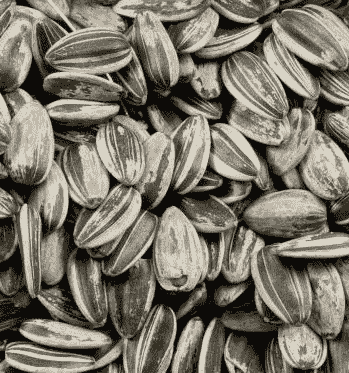
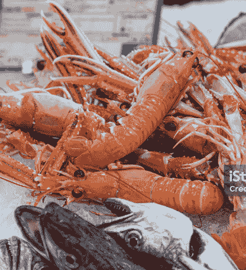
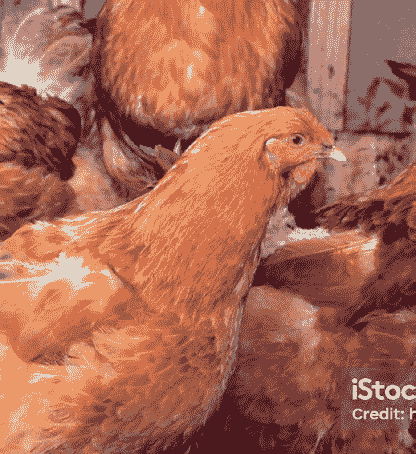
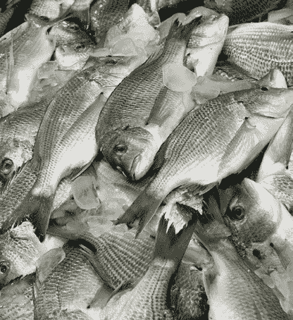
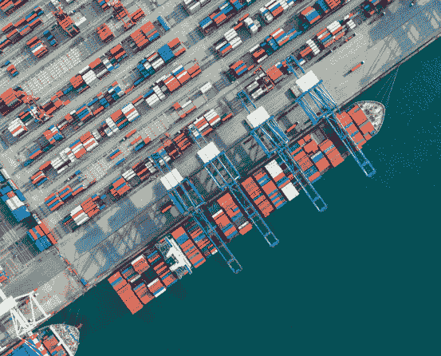
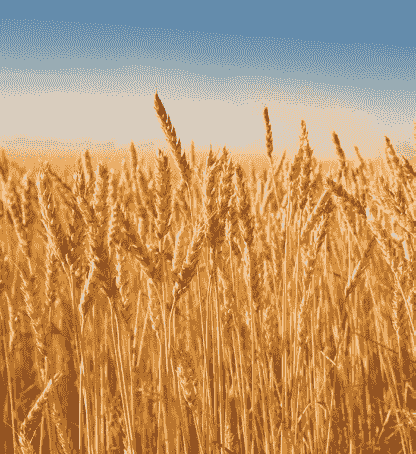
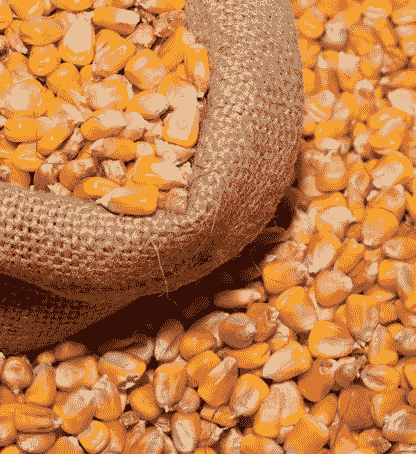
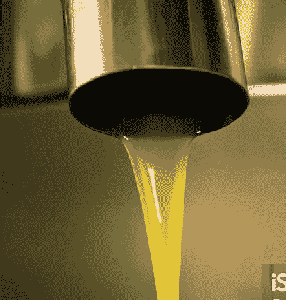
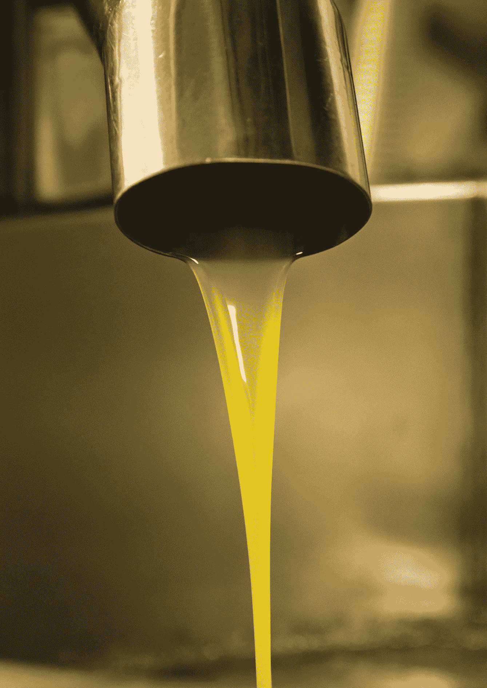

November 2024

## Food Outlook

Biannual report on global food markets

ISSN 0251-1959

125

140

155

**2024**

**2023**

**2022**

**2021**

## Food Outlook

Biannual report on global food markets

Food and Agriculture Organization of the United Nations

Rome, 2024

Required citation:

FAO. 2024. *Food Outlook – Biannual report on global food markets.* Food Outlook, November 2024. Rome. https://doi.org/10.4060/cd3177en

The designations employed and the presentation of material in this information product do not imply the expression of any opinion whatsoever on the part of the Food and Agriculture Organization of the United Nations (FAO) concerning the legal or development status of any country, territory, city or area or of its authorities, or concerning the delimitation of its frontiers or boundaries. The mention of specific companies or products of manufacturers, whether or not these have been patented, does not imply that these have been endorsed or recommended by FAO in preference to others of a similar nature that are not mentioned.

ISSN 0251-1959 [Print]

ISSN 1560-8182 [Online]

ISBN 978-92-5-139327-7

© FAO, 2024

Some rights reserved. This work is made available under the Creative Commons Attribution-NonCommercial-ShareAlike 3.0 IGO licence (CC BY-NC-SA 3.0 IGO; https://creativecommons.org/licenses/by-nc-sa/3.0/igo/legalcode).

Under the terms of this licence, this work may be copied, redistributed and adapted for non-commercial purposes, provided that the work is appropriately cited. In any use of this work, there should be no suggestion that FAO endorses any specific organization, products or services. The use of the FAO logo is not permitted. If the work is adapted, then it must be licensed under the same or equivalent Creative Commons licence. If a translation of this work is created, it must include the following disclaimer along with the required citation: "This translation was not created by the Food and Agriculture Organization of the United Nations (FAO). FAO is not responsible for the content or accuracy of this translation. The original [Language] edition shall be the authoritative edition."

Disputes arising under the licence that cannot be settled amicably will be resolved by mediation and arbitration as described in Article 8 of the licence except as otherwise provided herein. The applicable mediation rules will be the mediation rules of the World Intellectual Property Organization http://www.wipo.int/amc/en/mediation/rules and any arbitration will be conducted in accordance with the Arbitration Rules of the United Nations Commission on International Trade Law (UNCITRAL).

**Third-party materials.** Users wishing to reuse material from this work that is attributed to a third party, such as tables, figures or images, are responsible for determining whether permission is needed for that reuse and for obtaining permission from the copyright holder. The risk of claims resulting from infringement of any third-party-owned component in the work rests solely with the user.

**Sales, rights and licensing.** FAO information products are available on the FAO website (www.fao.org/publications) and can be purchased through publications-sales@fao.org. Requests for commercial use should be submitted via: www.fao.org/contact-us/licence-request. Queries regarding rights and licensing should be submitted to: copyright@fao.org.

**Photo credits (left to right/top to bottom):**

©AllFreeDownload; ©Shutterstock; ©Shutterstock; ©AllFreeDownload; ©PEXELS; ©PEXELS; ©iStock; ©AllFreeDownload; ©FAO; ©iStock; ©Freepik; ©iStock; ©iStock; ©iStock; ©PEXELS; ©Shutterstock

## Highlights

FAO's latest assessments indicate varying trends across commodities. Production of wheat, maize, and sugar is decreasing, while increases are expected in dairy, fisheries, meats, oilseeds, and rice. These changes will affect utilization, trade, and stocks. Global food production is sensitive to weather conditions, geopolitical tensions, and policies, which could disrupt the balance between supply and demand and impact global food security.

## Wheat

As global wheat utilization is anticipated to exceed production, global stocks are forecast to decline slightly, though remaining above average. A slight decline in exportable surpluses particularly in the European Union and the Russian Federation, combined with dampened import demand in several countries, is expected to drive a decrease in global wheat trade in 2024/25.

## Coarse grains

As global wheat utilization is anticipated to exceed production, global stocks are forecast to decline slightly, though remaining above average. A slight decline in exportable surpluses particularly in the European Union and the Russian Federation, combined with dampened import demand in several countries, is expected to drive a decrease in global wheat trade in 2024/25.

## Rice

The 2024/25 season appears poised for a record-breaking harvest, as producers reacted to prospects of positive margins by expanding plantings. The bumper crop could drive global utilization and reserves to fresh peaks, while also enabling international trade to rebound in 2025.

## Oilcrops

Despite expectations of continued growth in global oilseed production in 2024/25, preliminary forecasts point to a divergence in oils/fats and oilmeal markets. Global vegetable oil consumption could exceed production and lead to stock drawdowns for the second consecutive season; however, for oilmeals, robust oil-driven crushings are expected to result in further accumulation in global inventories.

## Sugar

World sugar production in 2024/25 is forecast to decline slightly from the previous season's bumper level, though it will still exceed expected global consumption. World trade in sugar is predicted to contract year on year due to likely reduced export availabilities in key exporters.

### Meat

Global meat production is forecast to increase moderately in 2024, driven by higher slaughter rates and favourable profit margins. International meat trade is also predicted to recover, as improving economic conditions and limited national supplies in some leading importing countries are expected to drive a surge in import demand.

### Fisheries

In 2024, output from global fisheries and aquaculture production is set to increase by 2.2 percent to almost 192 million tonnes. Wild catches have stabilized, while aquaculture production continues to grow. Trade volumes have increased marginally, while weakening prices contributed to a decline in trade values.

### Dairy

In 2024, world milk production is forecast to increase moderately, led principally by Asia, where dairy cattle numbers and milk yields are anticipated to rise. Meanwhile, international trade in dairy products is expected to increase marginally, reflecting improved consumer demand amid easing inflationary pressures.

## Special features

## Fertilizer market developments

The June 2024 edition of Food Outlook offered a special feature section on developments on the fertilizer markets, elaborating on the main drivers of elevated fertilizer prices in 2022 and 2023. This article summarizes the main developments since June 2024 and provides a short-term outlook.

Ammonia is one of the most widely used chemical commodities and a key input for an array of nitrogenous and phosphatic fertilizers. Its manufacturing is a highly energy intensive process, which produces CO2 emissions. The article provides an overview of low-carbon ammonia types (blue and green), the outlook for supply and demand, applications and potential for the production, and use of low-carbon fertilizers.

## Focus on olive oil

International olive oil prices increased significantly since late 2022 and reached historical highs in early 2024. Global production in 2024/25 is expected to recover to a level slightly above the five-year average, while relatively tight supplies and high prices are likely to constrain world consumption. This special feature article reviews the current global olive oil market and challenges faced by the industry.

### Low-carbon ammonia for fertilizers

## Food Outlook

November 2024

### Contents

1–9 1. Markets at a glance

10–25 2. Special features

27–39 3. Market indicators

41–76 4. Statistical appendix tables

Food Outlook is published twice a year, normally in June and November. The June report contains a more detailed market analysis while the November report only provides summary market assessments (Markets at a glance).

110

125

140

155

170

2014-2016 = 100

**2024**

**2023**

**2022**

**2021**

**FAO Food Price Index**

D

N

O

S

A

J

J

M

A

M

F

J

p 37

Acknowledgements

IX

Cereals................................................................. 1

Wheat.................................................................. 2

Coarse grains....................................................... 3

Rice...................................................................... 4

Oilcrops................................................................ 5

Sugar.................................................................... 6

Meat and meat products.................................... 7

Milk and milk products....................................... 8

Fish and fishery products.................................... 9

Fertilizer market developments....................... 11

Low-carbon ammonia for fertilizer production......................................................... 17

Focus on olive oil.............................................. 22

Futures markets................................................ 27

Ocean freight rates........................................... 30

Food import bill................................................ 33

Food price indices............................................. 36

**v**

### Figures

1.1. Cereal production, utilization and stocks..........................1

1.2. Wheat production, utilization and stocks.........................2

1.3. Coarse grain production, utilization and stocks...............3

1.4. Rice production, utilization and stocks..............................4

1.5. FAO monthly international price indices for oilseeds, vegetable oils and meals/cakes (2014-2016=100).........................................................................5

1.6. International sugar prices...................................................6

1.7. FAO international meat price index (2014−2016 = 100)......................................................................7

1.8. FAO international dairy price index (2014−2016 = 100)......................................................................8

1.9. Fish price index (2014-2016 = 100)....................................9

2.1. TTF daily price movement, 2021-2024.............................11

2.2. N, P and K prices, 2010–2024............................................12

2.3. Global fertilizer trade (2019–2024)..................................12

2.4. Global nitrogen trade (gross product).............................13

2.5. Global phosphate trade (gross product)..........................13

2.6. Global potash trade (gross product)................................13

2.7. Average fertilizer exports from the Near East (2019–2023) as share of global trade, million tonnes............14

2.8. Regional gas consumption for natural gas-based ammonia, production 2022.....................................................17

2.9. Global ammonia demand by use.....................................17

2.10. Low-carbon supply outlook by CO2 footprint...............18

2.11. Low-carbon ammonia capacity outlook by region........18

2.12. AN/CAN yearly production share by region, 2019–2023.................................................................................19

2.13. Share of global olive oil production (on average from 2014 to 2023)...................................................................22

2.14. Per capita olive oil availability in main producing countries....................................................................................22

2.15. Olive oil imports by selected countries (October/September year).......................................................................23

2.16. Extra virgin olive oil prices (wholesale level).................23

2.17. World olive oil production, utilization and trade.........23

2.18. Labour cost index in selected countries (seasonally adjusted, 2020=100)..............................................24

3.1. Futures prices.....................................................................27

3.2. Historical volatility (30 days).............................................27

3.3. Futures volumes.................................................................27

3.4. Implied volatility ..............................................................27

3.5. Forward curves snapshots as of Oct. 2022, 2023 and 2024....................................................................................28

3.6. CME net-length in lots (Oct. 2020–Oct. 2024).................29

3.7. BDI and IGC GOFI 18 October 2023–18 October 2024..........................................30

3.8. Baltic Capesize Index 18 October 2023–18 October 2024..........................................31

3.9. Grains and oilseeds carrying sectors: Panamax and Supramax sub-Indices and Handysize Index 18 October 2023–18 October 2024.............................................................31

3.10. Price effect changes by food group (USD billion).........33

3.11. International prices of cocoa, coffee and tea.................34

3.12. The FAO Global Food Consumption and Food Price Indices (Jan 2020–Sep 2024)...........................36

**vi**

**vii**

### Tables

1.1. World cereal market at a glance........................................1

1.2. World wheat market at a glance.......................................2

1.3. World coarse grain market at a glance..............................3

1.4. World rice market at a glance............................................4

1.5. World oilcrop and product market at a glance.................5

1.6. World sugar market at a glance.........................................6

1.7. World meat market at a glance.........................................7

1.8. World dairy market at a glance..........................................8

1.9. World fish market at a glance............................................9

3.1. Summary of dry bulk freight markets..............................30

3.2. Summary of freight rates on selected routes..................32

3.3. Import bills of total food and food products by region (USD billion)..................................................................35

3.4. FAO Food Price Indices......................................................39

A1A. Cereal statistics................................................................42

A1B. Cereal statistics.................................................................43

A2A. Wheat statistics...............................................................44

A2B. Wheat statistics................................................................45

A3A. Coarse grain statistics......................................................46

A3B. Coarse grain statistics......................................................47

A4A. Maize statistics.................................................................48

A4B. Maize statistics.................................................................49

A5A. Barley statistics................................................................50

A5B. Barley statistics.................................................................51

A6A. Sorghum statistics...........................................................52

A7A. Other coarse grain statistics: millet, rye, oats and other grains.......................................................................52

A6B. Sorghum statistics............................................................53

A7B. Other coarse grain statistics: millet, rye, oats and other grains.......................................................................53

A8A. Rice statistics....................................................................54

A8B. Rice statistics....................................................................55

A9. Cereal supply and utilization in selected exporters (million tonnes).........................................................................56

A10. Total oilcrops statistics (million tonnes).........................57

A11. Total oils and fats statistics (million tonnes)..................58

A12. Total meals and cakes statistics (million tonnes)...........59

A13. Sugar statistics (million tonnes – raw value).................60

A14. Total meat statistics (thousand tonnes – carcass weight equivalent)..................................................................61

A15. Bovine meat statistics (thousand tonnes – carcass weight equivalent)...................................................................62

A16. Ovine meat statistics (thousand tonnes – carcass weight equivalent)...................................................................63

A17. Pig meat statistics (thousand tonnes – carcass weight equivalent)..................................................................64

A18. Poultry meat statistics (thousand tonnes – carcass weight equivalent)...................................................................65

A19. Milk and milk products statistics (thousand tonnes – milk equivalent)........................................................66

A20. Fish and fishery products statistics .................................67

A21. Selected international prices for wheat and coarse grains ............................................................................68

A22. Total wheat and maize futures prices............................68

A23. Selected international prices for rice and price indices..............................................................................69

A24. Selected international prices for oilcrop products and price indices.......................................................70

A25. Selected international prices for sugar and sugar price index......................................................................71

A26. Selected international prices for milk products and dairy price index ...............................................................72

A27. Selected international meat prices.................................73

A28. Selected international meat prices and FAO meat price indices ...........................................................................74

A29. Fish price indices..............................................................75

A30. Selected international commodity prices.......................76

## Box

**Box 3.1. Recent developments in cocoa, coffee and tea markets** ........................................................................34

## Acknowledgements

The *Food Outlook* report is a product of the FAO Markets and Trade Division of the Economic and Social Development stream. This report was prepared under the overall guidance of Boubaker Ben-Belhassen, Director, and Monika Tothova, Senior Economist. Market summaries were written by a team of economists, whose names appear under their respective contributions. A contribution by the International Grains Council on ocean freight rates for the market indicators section is also gratefully acknowledged. The report benefited from research support from many staff, namely, David Bedford, Victoria Johnston, Lavinia Lucarelli, Emanuele Marocco, Emanuele Mazzini, Marco Milo, Cecilia Nardi, Fabio Palmeri and the Fisheries and Aquaculture Statistics Team and GLOBEFISH.

Special thanks go to David Bedford and Lavinia Lucarelli for preparing the charts and statistical tables and to Elisa Miccinilli for her administrative support. Additionally, the team is grateful to Ettore Vecchione for the desktop publishing and Amber Paulen for her valuable editorial assistance.

# 1. Markets at a glance

**Food Outlook**  
November 2024

FAO’s forecast for global cereal production in 2024 stands at 2 848 million tonnes, slightly down (0.4 percent) from the previous year, yet still the second largest output on record. The downturn almost entirely reflects an anticipated lower global maize outturn, largely impacted by adverse weather conditions in South America, Europe and Southern Africa. However, world wheat and rice outputs are anticipated to rise, which should partly offset the foreseen decrease in maize production. The increase in wheat production is expected to be concentrated in Asia.

World cereal utilization in 2024/25 is forecast at 2 857 million tonnes, up 0.5 percent from the 2023/24 level. The increase is driven largely by anticipated growth in food consumption, especially for rice and wheat. Other uses of cereals are also expected to increase, albeit marginally, almost entirely linked to rice. By contrast, feed use of cereals will likely contract slightly, as declines in the feed use of wheat and rice are expected to outweigh an anticipated increase in the feed use of coarse grains.

Based on the current forecasts for global cereal production in 2024 and utilization in 2024/25, global cereal stocks could rise by 0.6 percent above their opening levels to 889 million tonnes. Global rice inventories are expected to increase the most, followed by coarse grain stocks, while wheat stocks are anticipated to fall below their opening levels. As a result, the world’s cereal stocks-to-use ratio will likely decline slightly, from 30.9 percent in 2023/24 to 30.6 percent in 2024/25, remaining close to its five- and ten-year average levels.

World trade in cereals in 2024/25 is predicted to contract by 3.9 percent from 2023/24, down to 485 million tonnes. The decline stems from anticipated contractions in the trade of wheat and coarse grains, while, by contrast, global rice trade is forecast to increase.

In October 2024, the FAO Cereal Price Index averaged 114.4 points, down 10.3 points (8.3 percent) from last year’s value and 10.0 points (8.0 percent) below its five-year average level for the same month. Prices of all major cereals – wheat, coarse grain and rice – have declined over the past year.

## Cereals

**Contact:**

Erin Collier

Jonathan Pound (Production)

**Figure 1.1. Cereal production, utilization and stocks**

400  
550  
700  
850  
1000  

2200  
2400  
2600  
2800  
3000  

2024/25  
2023/24  
2022/23  
2021/22  
2020/21  
2019/20  
2018/19  
2017/18  
2016/17  
2015/16  

million tonnes

million tonnes

f’cast

**Stocks** (right axis)  
**Production** (left axis)  
**Utilization** (left axis)

**Table 1.1. World cereal market at a glance**(a)

**Notes:**

a. Trade refers to exports based on a common July/June marketing season.

b. May not equal the difference between supply (defined as production plus carryover stocks) and total utilization due to differences in individual country marketing years.

c. Major exporters include Argentina, Australia, Brazil, Canada, the European Union, the Russian Federation, Ukraine and the United States of America.

|  | 2022/23 | 2023/24 estim. | 2024/25 f’cast | Change 2024/25 over 2023/24 |
|---|---:|---:|---:|---:|
|  | *million tonnes* |  |  | *%* |
| **WORLD BALANCE** |  |  |  |  |
| **Production** | **2 813.5** | **2 859.2** | **2 848.1** | **-0.4** |
| **Trade**(a) | **479.4** | **504.6** | **485.0** | **-3.9** |
| **Total utilization** | **2 786.3** | **2 843.2** | **2 857.4** | **0.5** |
| Food | 1 181.8 | 1 198.5 | 1 212.2 | 1.1 |
| Feed | 1 041.2 | 1 072.8 | 1 072.1 | -0.1 |
| Other uses | 563.3 | 571.8 | 573.1 | 0.2 |
| **Ending stocks**(b) | **872.7** | **883.8** | **888.6** | **0.6** |
| **SUPPLY AND DEMAND INDICATORS** |  |  |  |  |
| **Per caput food consumption:** |  |  |  |  |
| World (kg/yr) | 147.3 | 148.1 | 148.5 | 0.3 |
| LIFDC (kg/yr) | 140.6 | 140.9 | 140.6 | -0.2 |
| **World stocks-to-use ratio (%)** | **30.7** | **30.9** | **30.6** |  |
| **Major exporters’ stocks-to-disappearance ratio**(c) (%) | **21.2** | **21.1** | **20.8** |  |
| **FAO COARSE GRAIN PRICE INDEX**(d) (2014–2016=100) |  |  |  |  |
|  | 2022 | 2023 | 2024 Jan–Oct | % Change Jan–Oct 2024 over Jan–Oct 2023 |
|  | 155 | 131 | 114 | -22% |

# 1. Markets at a glance

**Food Outlook**  
November 2024

## Wheat

**Contact:**

Erin Collier

Jonathan Pound (Production)

**Figure 1.2. Wheat production, utilization and stocks**

150  
200  
250  
300  
350  

600  
660  
720  
780  
840  

24/25  
23/24  
22/23  
21/22  
20/21  
19/20  
18/19  
17/18  
16/17  
15/16  

million tonnes

million tonnes

f’cast

**Stocks** (right axis)  
**Production** (left axis)  
**Utilization** (left axis)

In 2024, global wheat production is forecast to rise year on year to the second-highest level on record. The increase is largely driven by expected production upturns in Asia that were largely underpinned by area expansions and conducive weather that boosted yield prospects. Wetter conditions in Argentina and Australia have led to sizeable production increases in 2024, and a likely second consecutive year of growth in the United States of America further bolstered the global output. These gains more than offset substantial declines anticipated in key European producing countries. Overly wet winter conditions in the European Union and the United Kingdom of Great Britain and Northern Ireland curbed wheat production. Conversely, rainfall deficits in the Russian Federation curtailed yields and resulted in a large decline in the country’s wheat output in 2024.

Total wheat utilization is predicted to remain close to the 2023/24 level. Continuing growth in wheat food consumption is expected to balance a decline in the feed use component, while other uses are likely to remain nearly unchanged from last season’s levels. A foreseen contraction in China (mainland)’s feed use of wheat accounts for most of the anticipated decline, along with small reductions expected in the European Union, the United Kingdom and Argentina.

With global utilization expected to exceed production, global wheat inventories are set to fall below their opening levels by the close of the 2025 seasons. Most of the drawdown is anticipated in the European Union and the Russian Federation, where stocks remained at elevated levels in the previous two seasons. Consequently, the ratio of major wheat exporters’ closing stocks to their total disappearance (defined as domestic utilization plus exports) is expected to decline from 20.4 percent in 2023/24 to 18.5 percent in 2024/25, suggesting potentially slightly tighter global market conditions compared to the previous season.

World wheat trade in 2024/25 (July/June) is likely to decrease from the record level of 2023/24. The anticipated contraction is due to an expected decrease in wheat imports by China (mainland) and the European Union. On the export side, reduced domestic outputs are expected to reduce sales by the European Union and the Russian Federation, while tighter domestic supplies and ongoing logistical disruptions could also reduce Ukraine’s exports from last season’s levels.

**Notes:**

a. Trade refers to exports based on a common July/June marketing season.

b. May not equal the difference between supply (defined as production plus carryover stocks) and total utilization due to differences in individual country marketing years.

c. Major exporters include Argentina, Australia, Canada, the European Union, Kazakhstan, the Russian Federation, Ukraine and the United States of America.

d. Derived from the International Grains Council (IGC) wheat index.

**Table 1.2. World wheat market at a glance**

|  | 2022/23 | 2023/24 estim. | 2024/25 f’cast | Change 2024/25 over 2023/24 |
|---|---:|---:|---:|---:|
|  | *million tonnes* |  |  | *%* |
| **WORLD BALANCE** |  |  |  |  |
| **Production** | **806.9** | **789.5** | **792.2** | **0.3** |
| **Trade**(a) | **202.0** | **208.6** | **198.3** | **-4.9** |
| **Total utilization** | **775.1** | **796.7** | **796.7** | **0.0** |
| Food | 535.6 | 542.3 | 547.5 | 1.0 |
| Feed | 150.7 | 163.3 | 157.7 | -3.4 |
| Other uses | 88.7 | 91.1 | 91.4 | 0.3 |
| **Ending stocks**(b) | **322.9** | **318.3** | **314.8** | **-1.1** |
| **SUPPLY AND DEMAND INDICATORS** |  |  |  |  |
| **Per caput food consumption:** |  |  |  |  |
| World (kg/yr) | 66.8 | 67.0 | 67.1 | 0.1 |
| LIFDC (kg/yr) | 41.4 | 41.4 | 41.2 | -0.5 |
| **World stocks-to-use ratio (%)** | **40.5** | **40.0** | **39.1** |  |
| **Major exporters’ stocks-to-disappearance ratio**(c) (%) | **22.4** | **20.4** | **18.5** |  |
| **FAO WHEAT PRICE INDEX**(d) (2014–2016=100) |  |  |  |  |
|  | 2022 | 2023 | 2024 Jan–Oct | % Change Jan–Oct 2024 over Jan–Oct 2023 |
|  | 165 | 127 | 108 | -16.8 |

**Food Outlook**  
November 2024

FOOD OUTLOOK

NOVEMBER 2022

After reaching a record high in 2023, global coarse grain production is forecast to decline in 2024 but still represents the second highest level on record. Most of the year-on-year decline is due to an anticipated sizeable downturn in global maize production, primarily caused by adverse weather. The largest decline is expected in Brazil, where excessive rains have reduced both plantings and yields. Hot and dry weather in the European Union and Ukraine have lowered maize production expectations, and a severe drought in Southern Africa caused significant production declines in South Africa, Zambia and Zimbabwe. These decreases outweigh an expected production rebound in Argentina largely underpinned by expanded plantings, along with a notable growth in oat production in the European Union.

Total coarse grain utilization in 2024/25 is forecast to rise slightly from the 2023/24 level, driven by an anticipated growth in the feed use of maize. Partially offsetting this increase, feed uses of barley and sorghum are both seen declining in 2024/25. Higher food consumption of coarse grains is also predicted to boost overall utilization, while other uses are anticipated to decline – especially for maize in several African countries – reflecting reduced domestic harvests.

In 2024/25, coarse grain inventories are forecast to increase slightly, mostly stemming from an anticipated expansion in maize stocks, primarily in the United States of America, followed by China (mainland). By contrast, stock drawdowns are anticipated in Brazil, Mexico, Ukraine, South Africa and several other countries in Africa. World barley stocks are also forecast to rise, while those of sorghum are set to remain near their opening levels.

In the 2024/25 marketing year (July/June), world trade in coarse grains is forecast to contract sharply from the 2023/24 record level, due primarily to a decrease in maize trade. This decline is mainly attributed to an anticipated decrease in import demand for maize from China (mainland) and Mexico, along with expectations of lower exports from Brazil and Ukraine. Weaker demand from China (mainland) is also expected to be a major factor behind the anticipated declines in world barley and sorghum trade, along with anticipated reduced barley exports from Australia, the European Union and the Russian Federation, and smaller sorghum shipments from the United States.

## Coarse grains

**Contact:**

Erin Collier

Jonathan Pound (Production)

### Figure 1.3. Coarse grain production, utilization and stocks

100  
175  
250  
325  
400  
1000  
1150  
1300  
1450  
1600  

24/25  
23/24  
22/23  
21/22  
20/21  
19/20  
18/19  
17/18  
16/17  
15/16  

million tonnes  
million tonnes  

f’cast

**Stocks** (right axis)

**Production** (left axis)

**Utilization** (left axis)

### Table 1.3. World coarse grain market at a glance

**Notes:**

a. Trade refers to exports based on a common July/June marketing season.

b. May not equal the difference between supply (defined as production plus carryover stocks) and total utilization due to differences in individual country marketing years.

c. Major exporters include Argentina, Australia, Brazil, Canada, the European Union, the Russian Federation, Ukraine and the United States of America.

|  | 2022/23 | 2023/24 estim. | 2024/25 f’cast | Change 2024/25 over 2023/24 (%) |
|---|---:|---:|---:|---:|
| **WORLD BALANCE** |  |  |  |  |
| **Production** | 1 480.9 | 1 535.0 | 1 517.1 | -1.2 |
| **Trade**a | 224.5 | 244.2 | 231.8 | -5.1 |
| **Total utilization** | 1 485.1 | 1 520.0 | 1 524.9 | 0.3 |
| Food | 224.5 | 228.8 | 230.3 | 0.6 |
| Feed | 866.6 | 891.1 | 896.9 | 0.6 |
| Other uses | 394.0 | 400.1 | 397.7 | -0.6 |
| **Ending stocks**b | 355.8 | 366.0 | 368.5 | 0.7 |
| **SUPPLY AND DEMAND INDICATORS** |  |  |  |  |
| **Per caput food consumption:** |  |  |  |  |
| World (kg/yr) | 28.0 | 28.3 | 28.2 | -0.4 |
| LIFDC (kg/yr) | 71.1 | 71.5 | 71.0 | -0.7 |
| **World stocks-to-use ratio (%)** | 23.4 | 24.0 | 23.7 |  |
| **Major exporters stocks-to-disappearance ratio**c (%) | 12.5 | 11.8 | 12.3 |  |
| **FAO COARSE GRAIN PRICE INDEX**4 (2014–2016=100) |  |  |  |  |
|  | 2022 | 2023 | 2024 Jan–Oct | % Change Jan/Oct 2024 over Jan/Oct 2023 |
|  | 169 | 134 | 108 | -21.3 |

# 1. Markets at a glance

Food Outlook

November 2024

The 2024/25 season is likely to be characterized by record-breaking plantings, as prospects of positive margins encouraged producers to bring more area under paddy. This could result in world rice production surpassing the already excellent 2023/24 result by 0.8 percent to reach a record high of 538.9 million tonnes (milled basis). Countries in the northern hemisphere are anticipated to sustain this growth despite having faced some weather vagaries, mostly in the form of floods. In the countries on or south of the equator, the El Niño’s persistence into the first half of 2024 prevented a discernible output recovery.

The season’s expected bumper harvest, coupled with ample reserves, could reinvigorate food intake, while also possibly stimulating a diversion of excess supplies towards non-food industrial uses, such as ethanol production. Consequently, after stalling for two successive seasons, global rice utilization could expand by 1.8 percent in 2024/25 to reach a fresh peak of 535.8 million tonnes.

Despite prospects of a robust expansion in rice uses, world rice inventories at the close of the 2024/25 marketing year could still expand by 3.0 percent to a high of 205.4 million tonnes. If confirmed, this expansion would enable global reserves to cover 4.6 months of projected rice uses, while lifting the global stocks-to-use ratio from an already ample 37.2 percent in 2023/24 to a high of 37.9 percent in 2024/25.

International trade in rice is forecast to rebound to its second highest volume on record in 2025 (January–December) to reach 54.9 million tonnes, as more accessible international rice prices and reduced stockpiles may bolster imports by most areas other than the Asian Far East. India’s repeal of all official export curbs on non-fully broken rice could lift the country’s shipments to a three-year high, while also driving up competition for markets. Argentina, Brazil, Myanmar, Pakistan and Uruguay could also expand their shipments in 2025, while Cambodia, the United States of America, Viet Nam and, especially, Thailand, may ship less.

Largely due to lacklustre demand, international rice prices eased between May and September 2024, before declining more pronouncedly in October, following the removal of export restrictions on Indica white, parboiled and basmati rice in India. Reflective of this tendency, the FAO All Rice Price Index stood at 125.7 points in October 2024, down 8.5 percent from May and representing an 18-month low.

## Rice

**Contact:**

Shirley Mustafa

### Figure 1.4. Rice production, utilization and stocks

**Notes:**

a. Calendar year exports (second year shown).

b. Major exporters include India, Pakistan, Thailand, the United States of America and Viet Nam.

150  
165  
180  
195  
210  
450  
475  
500  
525  
550  

24/25  
23/24  
22/23  
21/22  
20/21  
19/20  
18/19  
17/18  
16/17  
15/16  

million tonnes, milled eq.  
million tonnes, milled eq.  

f’cast

**Stocks** (right axis)

**Production** (left axis)

**Utilization** (left axis)

### Table 1.4. World rice market at a glance

|  | 2022/23 | 2023/24 estim. | 2024/25 f’cast | Change 2024/25 over 2023/24 (%) |
|---|---:|---:|---:|---:|
| **WORLD BALANCE** |  |  |  |  |
| **Production** | 525.6 | 534.7 | 538.9 | 0.8 |
| **Trade**a | 52.9 | 51.8 | 54.9 | 5.9 |
| **Total utilization** | 526.1 | 526.5 | 535.8 | 1.8 |
| Food | 421.6 | 427.4 | 434.4 | 1.6 |
| **Ending stocks** | 194.0 | 199.4 | 205.4 | 3.0 |
| **SUPPLY AND DEMAND INDICATORS** |  |  |  |  |
| **Per caput food consumption:** |  |  |  |  |
| World (kg/yr) | 52.6 | 52.8 | 53.2 | 0.8 |
| LIFDC (kg/yr) | 28.2 | 27.9 | 28.3 | 1.5 |
| **World stocks-to-use ratio (%)** | 36.9 | 37.2 | 37.9 |  |
| **Major exporters stocks-to-disappearance ratio (%)**b | 28.5 | 31.0 | 31.5 |  |
| **FAO RICE PRICE INDEX** (2014–2016=100) |  |  |  |  |
|  | 2022 | 2023 | 2024 Jan–Oct | % Change Jan/Oct 2024 over Jan/Oct 2023 |
|  | 109 | 132 | 136 | 4.1 |

# 1. Markets at a glance

**5**

Food Outlook — November 2024

In 2024/25, global oilseed production is forecast to expand for the third consecutive season, largely underpinned by expectations of higher soybean output, which should more than offset anticipated smaller rapeseed and sunflower seed harvests. The increase in global soybean production will likely be driven by major producers in the Americas. Generally favourable growing conditions and a larger area harvested could contribute to a record production in the United States of America, while increased plantings are expected to lead to strong outputs in Argentina and Brazil, assuming conducive weather during key crop growing stages in late 2024 and early 2025. By contrast, world rapeseed production is expected to decline year on year, mainly due to adverse climate conditions during the growing season in Canada and the European Union. Similarly, protracted dryness and high temperatures are expected to impact sunflower seed production in the Black Sea region. As for palm oil, after declining slightly last season, production in Southeast Asia is forecast to recover somewhat, owing to an improved yield outlook.

Global oils/fats utilization in 2024/25 is forecast to increase slightly by 0.4 percent year on year, contained by slowing production growth and rising international prices, which are dampening consumption in both food and non-food sectors. International trade in vegetable oil is also expected to stagnate, amid an anticipated limited expansion in supplies. By contrast, world oilmeal consumption is anticipated to increase by 3.7 percent, supported by ample supplies resulting from robust oil-driven crushing activities and improved profitability in the livestock sector, particularly in China. Global trade in oilmeals is forecast to expand modestly from the previous season, largely driven by expectations of higher soymeal trade, which should more than offset anticipated smaller shipments of rape and sunflower meals.

With global consumption anticipated to surpass world oils/fats production, global vegetable oil stocks are forecast to decline for a second consecutive season. By contrast, oilmeal inventories could accumulate to record levels by the end of 2024/25, as abundant supplies could exceed global utilization amid relatively steady growth from the livestock sector. Reflecting these fundamentals, international prices of vegetable oils continued to rise in recent months, with the FAO vegetable oil price index attaining in October 2024 its highest level since late 2022, while the oilmeal price index dropped to a four-year low.

## Oilcrops

**Contact:** Di Yang

**Figure 1.5. FAO monthly international price indices for oilseeds, vegetable oils and meals/cakes (2014-2016=100)**

**Table 1.5. World oilcrop and product market at a glance**

|                          | **2022/23** | **2023/24** | **2024/25** | **Change 2024/25 over 2023/24** |
| :----------------------- | :---------- | :---------- | :---------- | :------------------------------- |
| **TOTAL OILCROPS**       |             |             |             |                                  |
| Production              | 652.4       | 670.9       | 697.4       | 4.0                              |
| **OILS AND FATS**        |             |             |             |                                  |
| Production              | 257.2       | 261.0       | 263.8       | 1.1                              |
| Supply                  | 291.1       | 298.6       | 300.5       | 0.6                              |
| Utilization             | 254.6       | 264.4       | 265.6       | 0.4                              |
| Trade                   | 140.9       | 139.3       | 138.7       | -0.4                             |
| *Global stocks-to-use ratio (%)* | *14.8*      | *13.9*      | *13.2*      |                                  |
| *Major exporters stocks-to-disappearance ratio (%)* | *9.5*       | *9.6*       | *10.1*      |                                  |
| **MEALS AND CAKES**     |             |             |             |                                  |
| Production              | 166.8       | 172.1       | 181.3       | 5.4                              |
| Supply                  | 193.2       | 200.6       | 215.4       | 7.4                              |
| Utilization             | 162.7       | 168.3       | 174.5       | 3.7                              |
| Trade                   | 107.7       | 114.4       | 115.6       | 1.1                              |
| *Global stocks-to-use ratio (%)* | *17.5*      | *20.2*      | *22.2*      |                                  |
| *Major exporters stocks-to-disappearance ratio (%)* | *8.3*       | *9.3*       | *11.4*      |                                  |

**FAO PRICE INDICES (2014–2016=100)**

|                          | **Jan–Dec 2022** | **Jan–Dec 2023** | **Jan–Oct 2024** | **% Change Jan/Oct 2024 over Jan/Oct 2023** |
| :----------------------- | :--------------- | :--------------- | :--------------- | :---------------------------------------- |
| Oilseeds                | 158              | 128              | 111              | -13.4                                     |
| Meals/cakes             | 133              | 127              | 105              | -16.9                                     |
| Vegetable oils          | 188              | 126              | 133              | 4.9                                       |

Notes: For explanations on definitions and coverage kindly refer to previous issues of Food Outlook.

0 70 140 210 280 — 2024 2023 2022 2021 2020 2019 2018 2017 — **vegetable oils** — **meals/cakes** — **oilseeds**

---

## 1. Markets at a glance (continued)

**6** Food Outlook — November 2024

Source: Prices refer to the Sugar No. 11 contract traded at the New York Intercontinental Exchange (ICE).

International sugar markets are seen heading toward a production surplus in the 2024/25 (October/September) season, despite an expected decline in global output from last season's bumper level and an anticipated slight increase in global consumption.

FAO's preliminary forecast for the 2024/25 season pegs world sugar production at 180.4 million tonnes, down 2.0 million tonnes, or 1.1 percent, from the 2023/24 bumper outturn. The decline is largely due to expected reduced outputs in Brazil, the world's largest sugar producer and exporter, because of prolonged dry weather conditions in the key southern growing areas, and in India, where additional sugarcane volumes are likely to be diverted for ethanol production. By contrast, a strong production recovery is anticipated in Thailand, as a result of favourable weather conditions and an expansion in area triggered by more remunerative sugarcane prices relative to competing crops. Larger sugar outputs are also forecast for China, the European Union and Mexico.

Global sugar consumption is forecast to expand by 1.2 percent in 2024/25, in line with the previous season's growth and amid prospects for a relatively steady global economic growth. The year on year growth in consumption is expected to mostly originate in Africa, driven by continuing population growth and urbanization, and in Asia, reflecting robust demand from the food-processing industry.

The preliminary forecast for world sugar trade in 2024/25 is pegged at 63.9 million tonnes, down 3.8 percent from the estimated volume for 2023/24. Despite the foreseen year on year decline, trade will likely remain above the last five-year average. Sugar exports are expected to decline mainly due to foreseen lower exportable supplies in Brazil and India, while lower imports are anticipated for India, Mexico and the United States of America.

International sugar prices dropped to a nearly two-year low in August 2024, pressured by favourable weather conditions supporting 2024/25 production prospects in Thailand and India, along with large exports from Brazil. However, prices rebounded significantly in September and October, primarily due to concerns over the crop outlook in Brazil.

## Sugar

**Contacts:** ElMamoun Amrouk, Fabio Palmeri

**Table 1.6. World sugar market at a glance**

|                          | **2022/23** | **2023/24** | **2024/25** | **Change 2024/25 over 2023/24** |
| :----------------------- | :---------- | :---------- | :---------- | :------------------------------- |
|                          | *million tonnes* | *million tonnes* | *million tonnes* | *%*                             |
| **WORLD BALANCE**        |             |             |             |                                  |
| Production              | 178.6       | 182.2       | 180.3       | -1.1                            |
| Trade\*                 | 62.7        | 66.4        | 63.9        | -3.8                            |
| Total utilization       | 174.0       | 176.0       | 178.1       | 1.2                             |
| Ending stocks           | 114.6       | 120.5       | 122.3       | 1.5                             |
| **SUPPLY AND DEMAND INDICATORS** |             |             |             |                                  |
| Per caput food consumption: |             |             |             |                                  |
| World (kg/yr)           | 21.7        | 21.8        | 21.8        | 0.3                             |
| LIFDC (kg/yr)           | 12.2        | 12.2        | 12.2        | -0.2                            |
| **World stocks-to-use ratio (%)** | **65.9**    | **68.5**    | **68.7**    | **0.3**                         |
| **ISA DAILY PRICE AVERAGE (US cents/lb)** | **Jan–Oct 2022** | **Jan–Oct 2023** | **Jan–Oct 2024** | **% Change Jan/Oct 2024 over Jan/Oct 2023** |
|                          | 18.5        | 23.4        | 20.4        | -12.5%                          |

**Figure 1.6. International sugar prices**

8 13 18 23 28 — D N O S A J J M A M F J — **2023** — **2022** — **2020** — **2021** — US cents per lb. — **2024**

Notes: \* Trade refers to exports based on a common October/September marketing season.

# 1. Markets at a glance

**7**

Food Outlook  
November 2024

Global meat production is forecast to reach 373 million tonnes (carcass weight equivalents) in 2024, up 1.4 percent from 2023. This growth is driven by anticipated increases in poultry and bovine meat production and a marginal rise in ovine meat, while pig meat output is forecast to decline slightly. The anticipated increase in poultry meat production reflects strong consumer demand in view of its affordability, with favourable operational margins despite highly pathogenic avian influenza outbreaks in some leading producing regions. For bovine meat, the expected increase in world supplies stems from record-high cattle slaughter levels, mainly in Brazil, that were driven by a decline in production costs and robust global import demand. Similarly, ovine meat production is expected to increase due to higher slaughter availability in Australia, following a herd-rebuilding phase and strong international demand. Global pig meat output is anticipated to drop slightly, primarily reflecting efforts in China to limit production growth and raise the sector’s profitability; however, this will likely be partially offset by increased production elsewhere.

After two years of contraction, world trade in meat and meat products is forecast to reach 41.9 million tonnes in 2024, an increase of 3.2 percent from 2023. The expected growth is principally driven by higher demand for bovine meat imports by the United States of America due to limited domestic supplies, as well as rising consumer demand in many other importing countries, aided by easing cost-of-living pressures. In addition, ample export availabilities from some major producing countries, combined with the removal of animal disease-related trade bans and reduced tariffs aimed at stabilizing domestic prices, will likely bolster global meat trade. Except for bovine meat, China’s meat imports are forecast to decline in 2024 due to abundant domestic supplies and weak consumer demand amid slower-than-expected economic growth.

International meat prices, as tracked by the FAO Meat Price Index, have trended upward throughout 2024, despite increased supplies from some major producing countries. This rise has been primarily driven by strong global import demand from several key countries due to limited domestic supplies and improving economic conditions. In addition, widespread animal disease outbreaks and geopolitical tensions affecting global trade logistics have exerted further upward pressure on global meat prices.

## Meat and meat products

**Contact:**  
Upali Galketi Aratchilage  
Emanuele Marocco

**Table 1.7. World meat market at a glance**

|  | **2022** | **2023** | **2024 *estim.*** | **2024 *f’cast*** | **Change: 2024 over 2023 (%)** |
|---|---|---|---|---|---|
|  | *June* | *Nov.* |  |  |  |
| **WORLD BALANCE** | *million tonnes (carcass weight equivalent)* |  |  |  |  |
| **Production** | **362.1** | **368.2** | **370.7** | **373.4** | **1.4** |
| Bovine meat | 75.4 | 76.3 | 77.2 | 78.1 | 2.3 |
| Poultry meat | 143.1 | 146.0 | 146.2 | 149.7 | 2.5 |
| Pig meat | 122.7 | 124.6 | 123.3 | 124.3 | -0.3 |
| Ovine meat | 16.7 | 17.0 | 17.3 | 17.0 | 0.2 |
| **Trade** | **41.3** | **40.5** | **41.2** | **41.9** | **3.2** |
| Bovine meat | 11.7 | 11.9 | 12.1 | 12.9 | 8.2 |
| Poultry meat | 16.4 | 16.2 | 16.3 | 16.3 | 0.9 |
| Pig meat | 10.7 | 9.8 | 10.1 | 10.0 | 1.6 |
| Ovine meat | 1.1 | 1.3 | 1.3 | 1.3 | 5.4 |
| **SUPPLY AND DEMAND INDICATORS** |  |  |  |  |  |
| Per caput food consumption: World (kg/year) | 44.9 | 45.4 | 45.5 | 45.6 | 0.5 |
| **Trade - share of prod. (%)** | **11.4** | **11.0** | **11.1** | **11.2** | **1.8** |

**FAO MEAT PRICE INDEX (2014–2016=100)**

|  | **2022** | **2023** | **2024 Jan−Oct** | **%Change Jan/Oct 2024 over Jan/Oct 2023** |
|---|---|---|---|---|
|  | 118 | 114 | 117 | 2.1 |

**Figure 1.7. FAO international meat price index (2014−2016 = 100)**

100  
115  
120  
125  
130  
D N O S A J J M A M F J  
2022 2023 2024  
**2022** | **2023** | **2024**

---

# 1. Markets at a glance

**8**

Food Outlook  
November 2024

In 2024, world milk production is forecast to reach nearly 981 million tonnes, up 1.5 percent from 2023. Much of this increase is expected to originate in Asia, led by India, Pakistan and China, where dairy cattle numbers are rising in response to higher demand from more affluent and urbanized consumers. The milk production outlook is also positive in Europe, Southern America and Oceania, reflecting favourable weather and increased farm gate prices, despite declining dairy cow numbers. By contrast, milk output is anticipated to decline in Northern America, mainly in the United States of America, due to reductions in dairy cow numbers and lower milk yields. Some African countries may also experience declines in milk production due to adverse weather conditions and high input costs.

In 2024, after two years of decline, international trade in dairy products is forecast to increase slightly to nearly 85 million tonnes (milk equivalents). This growth reflects rising demand in several major importing countries – mainly in Southeastern Asia, Northern Africa and the Near East – bolstered by an active food-service sector, higher demand from the food processing sector and easing inflationary pressures. However, dairy imports by China, the world’s largest importer, will likely fall for the third consecutive year, largely due to rising national supplies and weak consumer demand amid slower-than-anticipated economic growth. On the export side, Oceania is expected to increase its exports due to favourable milk production conditions and enhanced export competitiveness facilitated by trade agreements. Argentina and some countries in the Near East and Northern Africa are also expected to increase their exports, driven by a combination of currency depreciations, limited internal sales, and rising demand in neighbouring countries.

International dairy prices have trended upward throughout this year. By the end of October, the FAO Dairy Price Index had risen 17.2 percent since January, standing 17.2 percent above its corresponding level in 2023, with butter prices registering the largest increases. The increase in dairy prices was largely underpinned by limited exportable supplies in some key exporting regions and by geopolitical tensions impacting supply chains, especially transportation and logistics.

## Milk and milk products

**Contact:**  
Upali Galketi Aratchilage  
Cecilia Nardi

**Table 1.8. World dairy market at a glance**

|  | **2022** | **2023** | **2024 *estim.*** | **2024 *f’cast*** | **Change: 2024 over 2023 (%)** |
|---|---|---|---|---|---|
|  | *June* | *Nov.* |  |  |  |
| **WORLD BALANCE** | *million tonnes (milk equivalent)* |  |  |  |  |
| **Total milk production** | **951.6** | **966.6** | **978.5** | **981.1** | **1.5** |
| **Total trade** | **85.6** | **84.6** | **85.4** | **84.9** | **0.3** |
| **SUPPLY AND DEMAND INDICATORS** |  |  |  |  |  |
| Per caput food consumption: World (kg/year) | 118.7 | 119.4 | 120.6 | 120.2 | 0.7 |
| **Trade - share of prod. (%)** | 9.0 | 8.8 | 8.7 | 8.7 | -1.1 |

**FAO DAIRY PRICE INDEX (2014–2016=100)**

|  | **2022** | **2023** | **2024 Jan−Oct** | **%Change Jan/Oct 2024 over Jan/Oct 2023** |
|---|---|---|---|---|
|  | 150 | 125 | 128 | 2.1 |

**Figure 1.8. FAO international dairy price index (2014−2016 = 100)**

100  
115  
130  
145  
160  
D N O S A J J M A M F J  
2022 2023 2024  
**2022** | **2023** | **2024**

# 1. Markets at a glance

**9**

Food Outlook

November 2024

Global fisheries and aquaculture production is predicted to reach nearly 192 million tonnes in 2024, marking a 2.2 percent increase from 2023.

Wild catch volumes have seen a swift recovery following a poor 2023, reaching 90.6 million tonnes (up 1.1 percent). Peruvian anchoveta catches have recovered following quota reductions in 2023, when the El Niño weather phenomenon led to higher ocean surface temperatures off the coast of Peru, limiting food availability and survival rates for the stock. Indeed, the 2024 quota is set at 5 million tonnes, significantly more than the 1.3 million tonnes caught last year. This higher quota will also improve the supply outlook for marine ingredients, although global stocks of fish oil are currently extremely low and will take time to recover. At the same time, scientific advice for key quotas in the North Atlantic has been revised downwards, with an anticipated tightening in the supply of Atlantic mackerel, horse mackerel and herring for 2025.

Aquaculture production is projected to grow by 3.1 percent in 2024, supported by strong demand for shrimp, pangasius and carp, and production growth should be most notable in China, India and Viet Nam. Input costs for aquafeed have generally fallen as global harvests of oilcrops and grains have improved, despite marine ingredient prices remaining high.

In 2024, the volume of global trade in aquatic animal products is expected to increase slightly by 1.0 percent from 2023. However, in terms of value, there will be a reduction of 1.2 percent. Demand in major markets has stagnated, with the European Union, China, the United States of America and Japan all projected to see a decline in trade value in 2024. Consumer confidence remains fragile, and economic uncertainty has weakened aquatic animal food consumption. In the case of China, continued growth in aquaculture production has bolstered domestic consumption and contributed to a reduction of imports.

The FAO Fish Price Index stood at 107 points in September 2024, down from the 2023 average of 117 points. Prices for capture species surged last year but have since steadied, remaining largely stable and exhibiting movement around a higher plateau. The index for aquaculture products has shown greater price stability, averaging 94 points this year. This is despite high prices and considerable underlying volatility in key species such as salmon. Low prices for other species, particularly shrimp, contained overall increases.

**Fish and fishery products**

**Contact:**

William Griffin

Audun Lem

Adrienne Egger

60

90

120

150

2024

2023

2022

2021

2020

**FAO total fish price index**

**Capture total**

**Aquaculture total**

|  | **2022** | **2023 estim.** | **2024 f’cast** | **Change: 2024 over 2023 (%)** |
|---|---:|---:|---:|---:|
| **WORLD BALANCE** |  |  |  |  |
| **Production** | **185.4** | **187.6** | **191.7** | **2.2** |
| Capture fisheries | 91.0 | 89.6 | 90.6 | 1.1 |
| Aquaculture | 94.4 | 98.0 | 101.1 | 3.1 |
| **Trade value (exports USD billion)** | **191.2** | **184.0** | **181.7** | **−1.2** |
| **Trade volume (live weight)** | **70.0** | **68.5** | **69.2** | **1.0** |
| **Total utilization** | **185.4** | **187.6** | **191.7** | **2.2** |
| Food | 164.6 | 167.5 | 170.9 | 2.0 |
| Feed | 17.2 | 16.4 | 17.0 | 3.7 |
| Other uses | 3.6 | 3.7 | 3.8 | 0.1 |
| **SUPPLY AND DEMAND INDICATORS** |  |  |  |  |
| **Per capita food consumption:** |  |  |  |  |
| Food fish (kg/year) | 20.8 | 21.0 | 21.2 | 1.2 |
| From capture fisheries (kg/year) | 9.0 | 8.8 | 8.8 | −0.3 |
| From aquaculture (kg/year) | 11.8 | 12.2 | 12.4 | 2.2 |

**FAO FISH PRICE INDEX**¹

**(2014–2016=100)**

|  | **2021** | **2022** | **2024 Jan−Sep** | **% Change Jan/Sep 2024 over Jan/Sep 2023** |
|---|---:|---:|---:|---:|
|  | 119.0 | 117.3 | 115.2 | −3.6% |

**Figure 1.9. Fish price index (2014–2016 = 100)**

**Table 1.9. World fish market at a glance**

# 2. Special features

## Fertilizer market developments

*Contributed by:*

***Maria Antip***

### Production and input costs

The June 2024 edition of Food Outlook offered a special feature section on the developments of the fertilizer market and elaborated on the main drivers of elevated fertilizer prices in 2022 and 2023. This article summarizes the main developments since June 2024 and provides a short-term market outlook.

The supply of mineral fertilizers is inextricably linked to costs of production; natural gas alongside phosphate rock and potassium ore are the key inputs to the most widely used nitrogen (N), phosphates (P) and potassium (K) fertilizers. According to the International Fertilizer Association, global fertilizer production increased substantially in 2023 following a decline in 2022; the highest increases were in urea production (up 6.0 percent year over year) and potassium (up 12.0 percent year over year). Preliminary 2024 estimates point to nitrogen¹ (urea and ammonia) production remaining in line with 2023 levels, phosphates (monoammonium phosphate [MAP] and diammonium phosphate [DAP]) declining slightly, and potassium (muriate of potash and sulphate of potash) continuing to exhibit robust growth compared to 2023.

Zooming in on the price of natural gas, the main feedstock for producing ammonia, which is a building block for all N fertilizers and of two of the most widely used P fertilizers (MAP and DAP) as well as of other nitrogen-phosphate-potassium (NPK) blends, 2024 to early November (cutoff date for the text) has displayed significantly lower daily volatility in pricing, according to the Dutch natural gas Title Transfer Facility (TTF) index. In 2024 to date, the TTF index stood at an average of EUR 32/megawatt hour, down EUR 8/megawatt hour compared to values recorded in the same January–October interval of 2023.

Lower natural gas price volatility favours fertilizer production and fertilizer supply predictability, as producers are likely to maintain factory utilization rates stable in normal macroeconomic conditions.

¹ Other nitrogen fertilizers include ammonium nitrate (AN), urea ammonium nitrate (UAN), calcium ammonium nitrate (CAN) and ammonium sulphate (AS).

## Prices

The impacts of lower natural gas prices can most readily be seen in nitrogenous fertilizers, which on average were priced at USD 291/tonne in January–October 2024, down 10.0 percent from USD 321/tonne in the same interval of 2023. However, despite the reduction in prices of ammonia—a key input in manufacturing DAP and MAP—prices for phosphates in January–October 2024 stood at an average of USD 547/tonne, 1.0 percent higher than in the same time period in 2023. While not linked to natural gas prices, potassium fertilizers (muriate of potash [MOP] and sulphate of potash [SOP]) registered the most significant price reduction in 2024, averaging USD 272/tonne in the first ten months of 2024, down 29.0 percent over the same period in 2023 when the average price was USD 384/tonne.

Different nutrients are influenced by different market fundamentals and trade policies. While nitrogen and potassium prices declined significantly from their peaks observed in April and May 2022, phosphates remained at an elevated level due to several factors: trader barriers limiting exports from China, continuing countervailing

**Figure 2.1. TTF daily price movement, 2021–2024**

Source: Intercontinental Exchange. 2024. Dutch TTF Natural Gas Futures. In: ICE. Atlanta, USA, ICE. [Cited 16 October 2024]. https://www.ice.com/products/27996665/Dutch-TTF-Natural-Gas-Futures/data https://www.crugroup.com/prices/

Jan-23

Feb-23

Mar-23

Apr-23

May-23

Jun-23

Jul-23

Aug-23

Aug-23

Sep-23

Oct-23

Nov-23

Dec-23

0

30

60

90

120

150

180

210

240

270

300

330

360

2024

2023

2022

2021

Eur/MWh

# 2. Special features

**Food Outlook**

**November 2024**

In September 2024, fertilizer prices – as presented by a basket of nitrogen, phosphorus, and potassium price series – averaged USD 334/tonne; these prices can be compared to USD 815/tonne in April 2022, which was the most recent peak.

In September 2024, 1 tonne of urea was sold for USD 293 (compared to USD 801 in March 2022), 1 tonne of DAP for USD 577 (compared to USD 1 132 in April 2022), and 1 tonne of MOP for USD 252 (compared to USD 712 in April 2022).

## Global fertilizer trade

Available trade data shows that in January–August 2024, fertilizer trade volumes amounted to 110 million tonnes, down 8.0 percent on the 120 million tonnes recorded in the same period in 2023; trade value totaled USD 42 billion, also down 17.0 percent on the USD 51 billion in January–August 2023. It is worth noting that the reduction in trade value reflects lower volumes, but it was also triggered by a price reduction of 10.0 percent for nitrogen and 29.0 percent for potassium, as discussed earlier.

Seasonality and uncertainty of regional patterns make it difficult to project the volume that will be traded in the last four months of 2024, but nitrogen and potassium appear on track to reach and even exceed 2023 volumes, while phosphates will likely be lower.

The total trade values outcome for 2024 will likely be driven by Brazil’s nitrogen purchases, which is coming into peak purchasing season in October–November with low stocks, and by India’s phosphate imports, which have accelerated in the third quarter following a 50.0 percent year-over-year decrease recorded in the first half of 2024 compared to 2023.

## Fertilizer trade policies

Trade policies, in particular tariffs and quotas, continue to shape fertilizer trade. Since the June 2024 edition of Food Outlook, several notable policies regarding fertilizer trade were introduced. One such example is in Argentina where its tax for purchasing foreign currency was reduced, directly facilitating fertilizer imports. The move to lower the tax on foreign currency, by 10.0 percentage points to 7.5 percent, had been widely expected. Fertilizer market participants anticipated a reduction and cited it as a reason for subdued urea import purchases in Argentina in the preceding months. Earlier this year, Argentina announced the removal of urea and UAN tariffs that were 5.4 percent and 3.6 percent, respectively.

Non-trade facilitating policies that were introduced include China’s suspending all new applications for urea export inspections on 7 June 2024 until further notice. The export curbs were implemented due to the surge in domestic urea prices and are expected to be maintained through the end of the year.

The Russian Federation extended export quotas for fertilizers from 1 December 2024 to 31 May 2025. The quota will total about 19.2 million tonnes, which equals 11.2 million tonnes for nitrogen fertilizers and 8 million tonnes for compound fertilizers. The Russian Federation introduced the non-tariff export quotas for nitrogen and compound fertilizers on 1 December 2021, to rein in rising domestic food prices.

## Supply risks

Potential further escalation in the Near East could affect supply of all three main fertilizers (N, P, K), affecting up to 27 million tonnes² of nitrogenous, phosphatic and potassic fertilizers.

Trade data shows that about 30.0 percent of global exports of urea originate in the region, including 17.0 percent of ammonia, 17.0 percent of DAP and MAP and 6.0 percent of potassium. The importers most affected by potential disruptions would be Latin American countries for urea and phosphates, Southeast Asia and South Asia for phosphates and potassium, and East Asia for ammonia. Depending on the spare capacity available elsewhere, importers might or might not be able to substitute these volumes readily or may have to do so at increased costs, particularly due to longer voyage times.

² 2019–2023 averages based on Global Trade Tracker.

## Short-term outlook (October–March)

### Nitrogen

Supply is expected to remain sufficient, with natural gas prices displaying significantly less volatility than in 2021–2023. In addition, in Nigeria urea capacity was expanded to over 1 million tonnes, and in the US Gulf ammonia capacity was increased to 1.15 million tonnes. In the Russian Federation, the new ammonia export terminal in Taman will soon be in commission and will add to existing supply. Natural gas prices constitute an upside risk, particularly for nitrates production in Europe. Demand-wise, Europe has been slow to buy urea and nitrates for the 2024–2025 season, partly because the weather has delayed application, but Europe is expected to step in to cover its needs before March. At the same time, India is faced with low stocks and is expected to continue to tender for urea every six to eight weeks through the end of rabi season in April. Upside price pressure could occur if demand peaks in Europe and India coincide with purchasing in North and Latin America, especially since Chinese exports will remain very constrained.

### Phosphates

Supply remains strained; on one hand, plant maintenance in Saudi Arabia and the Russian Federation has overlapped and been prolonged, and on the other hand, there has been very robust demand in India; in the last six weeks, it has secured an additional 600 000 tonnes of DAP. India announced a generous retail price subsidy scheme for phosphates (13.0 percent increase) for rabi season and will continue to import heavily. Exports from China remain very modest and will likely become even tighter in the fourth quarter as China prioritizes domestic access, further straining global supply. Morocco continues to reshape its production capabilities, prioritizing triple superphosphate (TSP) production, which does not require ammonia feedstock, instead of the usual MAP and DAP; as a result, prices for DAP and MAP have increased as major markets, such as Brazil and the United States, prefer DAP and MAP to TSP. Still, affordability concerns, particularly in Brazil and sub-Saharan Africa, could likely curb some consumption and mitigate the tight supply to a certain extent.

### Potassium

Supply is ample, with trade in 2024 slated to surpass 2023 levels. In 2023 already, potash trade expanded by 7 million tonnes compared to 2022. New capacity additions in Lao People’s Democratic Republic and higher production and exports in Canada will continue to improve availability and affordability of potash. Pricing is likely to remain stable, though some pockets of upcoming seasonal demand from palm oil plantations in Southeast Asia might cause temporary price increases.

**Figure 2.2. N, P and K prices, 2010–2024**

Source: Adapted from Fertilizer Week; Fertilizer Week. 2024. Prices and Indices. In: CRU. London, CRU. [Cited 16 October 2024]. https://www.crugroup.com/prices/

Jan-10  
May-10  
Sep-10  
Jan-11  
May-11  
Sep-11  
Jan-12  
May-12  
Sep-12  
Jan-13  
May-13  
Sep-13  
Jan-14  
May-14  
Sep-14  
Jan-15  
May-15  
Sep-15  
Jan-16  
May-16  
Sep-16  
Jan-17  
May-17  
Sep-17  
Jan-18  
May-18  
Sep-18  
Jan-19  
May-19  
Sep-19  
Jan-20  
May-20  
Sep-20  
Jan-21  
May-21  
Sep-21  
Jan-22  
May-22  
Sep-22  
Jan-23  
May-23  
Sep-23  
Jan-24  
May-24  
Sep-24

N basket  
P basket  
K basket  
Fertilizer basket

**815.42**  
**327.15**

**Figure 2.3. Global fertilizer trade (2019–2024)**

Million tonnes

|  | 2019 | 2020 | 2021 | 2022 | 2023 | 2024 YTD |
|---|---:|---:|---:|---:|---:|---:|
| Volume |  |  |  |  |  |  |
| Value (USD billion) | 36 | 32 | 45 | 82 | 53 | 42 |

Source: Global Trade Tracker. 2024. GTT. [Cited 16 October 2024]. https://www.globaltradetracker.com/

**Figure 2.4. Global nitrogen trade (gross product)**

Million tonnes

|  | 2019 | 2020 | 2021 | 2022 | 2023 | 2024 YTD |
|---|---:|---:|---:|---:|---:|---:|
|  | 53 | 54 | 54 | 55 | 56 | 35 |
|  | 23 | 24 | 22 | 19 | 20 | 14 |
| Total | **76.2** | **77.9** | **76.4** | **74.7** | **75.7** | **49.0** |

Source: Global Trade Tracker. 2024. GTT. [Cited 16 October 2024]. https://www.globaltradetracker.com/

**Figure 2.5. Global phosphate trade (gross product)**

Million tonnes

|  | 2019 | 2020 | 2021 | 2022 | 2023 | 2024 YTD |
|---|---:|---:|---:|---:|---:|---:|
|  | 50 | 54 | 57 | 46 | 54 | 42 |
|  | 2 | 2 | 2 | 2 | 1 | 0 |
| Total | **52.2** | **55.9** | **58.7** | **48** | **55.7** | **42.6** |

Source: Global Trade Tracker. 2024. GTT. [Cited 16 October 2024]. https://www.globaltradetracker.com/

**Figure 2.6. Global potash trade (gross product)**

Million tonnes

|  | 2019 | 2020 | 2021 | 2022 | 2023 | 2024 YTD |
|---|---:|---:|---:|---:|---:|---:|
|  | 50 | 54 | 57 | 46 | 54 | 42 |
|  | 2 | 2 | 2 | 2 | 1 | 0 |
| Total | **52.2** | **55.9** | **58.7** | **48** | **55.7** | **42.6** |

Source: Global Trade Tracker. 2024. GTT. [Cited 16 October 2024]. https://www.globaltradetracker.com/

**Figure 2.7. Average fertilizer exports from the Near East (2019–2023) as share of global trade, million tonnes**

| Product | Near East | RoW | Total |
|---|---:|---:|---:|
| Urea | 31% | 69% | 55 Mt |
| Ammonia | 17% | 69% | 29 Mt |
| MAP/DAP | 17% | 29% | 34 Mt |
| Potassium | 6% | 94% | 18 Mt |

Source: Global Trade Tracker. 2024. GTT. [Cited 16 October 2024]. https://www.globaltradetracker.com/

# 2. Special features

**15**

Food Outlook  
November 2024

regional price spikes.

### References

**Fertilizer Week. 2024**. London, CRU. [Cited 16 October 2024]. https://www.crugroup.com/prices/

**Global Trade Tracker. 2024.** Kehrsatz, GTT. [Cited 16 October 2024]. https://www.globaltradetracker.com/

**Intercontinental Exchange. 2024.** Atlanta, ICE. [Cited 16 October 2024]. https://www.ice.com/products/27996665/Dutch-TTF-Natural-Gas-Futures/data

**IFA (International Fertilizer Association). 2024.** Fertilizer Market Update. Paris, IFA. https://member.fertilizer.org/member/resources/publication_detail.aspx?SEQN=6300&PUBKEY=3D3622A5-9CCB-40E8-A015-1616F6DDFD2A

# 2. Special features

**16**  
Food Outlook  
November 2024

# 2. Special features

**17**

Food Outlook  
November 2024

## Low-carbon ammonia for fertilizer production

*Contributed by:*  
***Maria Antip***

### Introduction

Ammonia is one of the most broadly used chemical compounds, with a global annual production volume of over 190 million tonnes (2019–2023 average), out of which approximately 18.5 million tonnes are traded. Ammonia is the basic raw material from which all nitrogen-based fertilizers are derived. Manufacturing ammonia is a highly energy-intensive Haber-Bosch process, whereby atmospheric nitrogen reacts with fossil fuel material (natural gas or coal), also known as feedstock. Ammonia plants require around 32–36 million British thermal units (mmBtu) of natural gas to produce 1 tonne of ammonia. For this reason, ammonia plants are typically located near a source of natural gas (such as in the Near East, the Russian Federation, Trinidad and Tobago, Algeria, and Egypt), although imported liquefied natural gas (LNG) is increasingly being used in India. China also has some capacity to produce ammonia from coal instead of natural gas.

According to the International Energy Agency (IEA), ammonia production accounts for around 2.0 percent of total final energy consumption and 1.3 percent of carbon dioxide (CO2) emissions from the energy system. Natural gas-based ammonia plants use a steam reforming process, while coal-based plants use partial oxidation or coal gasification.

CO2 emissions from ammonia production vary by region and are directly linked to the energy efficiency of ammonia plants, which is often determined by the age of the plant. Plants located in Latin America and Asia generate the most emissions, with an average of 35.6 mmBtu, due to their higher energy consumption. Plants located in Europe boast the highest energy efficiency, requiring on average 32.5 mmBtu of natural gas to produce 1 tonne of ammonia.

Some 80.0 percent of the world's ammonia supply, or 152 million tonnes, is further processed into fertilizers. Additionally, ammonia can be used directly as a nitrogen fertilizer, and this type of use accounts for 2.0 percent of total global demand. In this case, ammonia is directly injected into soils, a practice most used in the United States of America and Mexico for cereal production. Australia also uses ammonia for direct application but at a much smaller scale, limited to just 25 000 tonnes per year. This use of ammonia is limited to these countries because they have existing infrastructure to cool and store ammonia and because they more often use mechanized and precision agriculture with tractor-drawn knives and shanks to place ammonia in the correct location 10–20 cm underground.

**Figure 2.8. Regional gas consumption for natural gas-based ammonia, production 2022**

| Region | Consumption (mmBtu) |
| :--- | :--- |
| Latin America | 35.6 |
| East Asia | 35.3 |
| South Asia | 35.0 |
| Africa | 34.6 |
| North America | 34.5 |
| Middle East | 34.4 |
| Southeast Asia | 34.3 |
| Oceania | 33.0 |
| Europe | 32.5 |

Source: AEA (Ammonia Energy Association). 2023. The climate and environmental impacts of ammonia: Upstream hydrogen emissions. Atlanta, USA, AEA. https://ammoniaenergy.org/presentations/the-climate-and-environmental-impacts-of-ammonia-upstream-hydrogen-emissions/

**Figure 2.9. Global ammonia demand by use**

Source: IFA (International Fertilizer Association). 2022. Reducing Emissions from Fertilizer Use. Paris, IFA. https://member.fertilizer.org/Public/Stewardship/Publication_Detail.aspx?SEQN=6203&PUBKEY=E205C2E0-8E5C-477D-8604-6CC16A9D3B98

| Use | Share |
| :--- | :--- |
| Industrial use | 20% |
| Direct application | 2% |
| NPK | 7% |
| MAP/DAP | 6% |
| Urea | 55% |
| Ammonium nitrate | 10% |
| CAN | 3% |
| Ammonium sulphate | 4% |
| Other fertilizer compounds | 5% |

190 million tonnes

# 2. Special features

**18**  
Food Outlook  
November 2024

## Low-carbon ammonia

When produced using renewable energy such as solar, wind, or hydro, ammonia is a carbon-free product, enabling decarbonization of various sectors, including agriculture.

Decarbonizing ammonia means reducing the carbon intensity of the hydrogen used in the ammonia-synthesis process. In the framework of decarbonization policies, ammonia is classified according to its carbon intensity as follows:

- **Grey ammonia** is the conventional ammonia produced from hydrocarbons (natural gas or coal) with CO2 emissions generated without carbon capture.

- **Blue ammonia** is identical to grey ammonia, but the CO2 emissions generated are captured or stored. Blue ammonia is already being produced with carbon-capture storage, mostly in the United States and some countries in the Near East.

- **Green ammonia** is produced via electrolysis/hydrolysis using renewable electricity and water, without CO2 emissions since it is essentially a zero-carbon compound. Green ammonia is being trialed as a carbon-neutral source of nitrogen and can be used in the downstream production of fertilizer.

By 2030, production of 21 million tonnes of blue ammonia and of up to 9 million tonnes of green ammonia could come on-stream, provided the announced projects materialize on-time. These capacities would add approximately 30 million tonnes of low-carbon ammonia to the already existing conventional grey ammonia supply of 190 million tonnes. However, the International Fertilizer Association forecasts the capacity of green ammonia to be only 3.4 million tonnes by 2028. Much larger volumes of green ammonia capacity are expected to be commissioned beyond the next five years, as projects develop through final investment decisions.

A constraint to producing low-carbon ammonia includes the high investment costs of converting from the conventional production of grey ammonia to green ammonia. Regulatory frameworks and government incentives can play an essential role.

The United States is expected to dominate blue ammonia supply within this decade, primarily due to the provision of carbon sequestration credits under the Inflation Reduction Act and favourable natural gas endowments. Europe also has a high potential for expanding production of both blue and green ammonia due to a supportive regulatory environment and an established and mature emissions trading scheme. For green ammonia, European projects are limited in location to Southern Europe (solar), the North Sea (wind) or countries with renewable grid power (Norway).

Government-to-government partnerships for low-carbon ammonia projects also exists; Australia, Japan, and the Republic of Korea are taking the lead in advancing bilateral agreements, mostly focused on power generation and marine fuels. Countries with significant regulatory support for low-carbon ammonia projects also include Brazil, Canada, Chile, the European Union and the United States.

Blue ammonia capacity growth is dependent on the available carbon sequestration solutions. These solutions

**Figure 2.10. Low-carbon supply outlook by CO2 footprint**

| Year | Blue (million tonnes NH3) | Green (million tonnes NH3) |
| :--- | :--- | :--- |
| 2023 | 0 | 0.1 |
| 2024 | 0 | 0.1 |
| 2025 | 2 | 1 |
| 2026 | 2 | 3 |
| 2027 | 9 | 7 |
| 2028 | 15 | 8 |
| 2029 | 18 | 9 |
| 2030 | 21 | 9 |

Source: Author's own elaboration based on project announcements to 2030

Pilot projects in Egypt, Spain and India

**Figure 2.11. Low-carbon ammonia capacity outlook by region**

| Region | 2023 | 2024 | 2025 | 2026 | 2027 | 2028 | 2029 | 2030 |
| :--- | :--- | :--- | :--- | :--- | :--- | :--- | :--- | :--- |
| North America | 0 | 0 | 2 | 2 | 9 | 15 | 18 | 21 |
| Africa | 0.1 | 0.1 | 1 | 3 | 7 | 8 | 9 | 9 |
| Asia | 0 | 0 | 0 | 0 | 0 | 0 | 0 | 0 |
| Europe | 0 | 0 | 0 | 0 | 0 | 0 | 0 | 0 |
| Latin America | 0 | 0 | 0 | 0 | 0 | 0 | 0 | 0 |
| Near East | 0 | 0 | 0 | 0 | 0 | 0 | 0 | 0 |
| Oceania | 0 | 0 | 0 | 0 | 0 | 0 | 0 | 0 |

Source: Author's own elaboration based on project announcements to 2030

Million tonnes NH3

# 2. Special features

**19**

Food Outlook — November 2024

decarbonization can be nature-based, such as reforestation and soil-carbon sequestration, or technology-based, such as carbon-capture utilization and storage. Carbon-capture storage includes injection underground, and utilization includes conversion into solid carbon or production of nanofibers. Blue ammonia, as a steppingstone in the transition to green ammonia, is unlikely to have a significant impact on agriculture. Green ammonia, on the other hand, has a higher propensity to impact agriculture and food production.

The cost of manufacturing low-carbon ammonia is significantly more elevated than conventional ammonia, and this higher cost will be reflected in the pricing of low-carbon ammonia. Preliminary contractual discussions suggest premiums of up to USD 300 for blue ammonia, and a first official government agreement¹ in July 2024 prices green ammonia at EUR 1 000/tonne.

## Fertilizers

Low-carbon ammonia creates the opportunity of producing low-carbon nitrogenous fertilizers and subsequently reducing CO₂ emissions in the agricultural sector. Green ammonia itself could be directly applied as nitrogen fertilizer in those regions where direct application of conventional ammonia is customary. However, ammonia carries substantial handling and storage costs in addition to the already higher costs of producing green ammonia, and therefore it is difficult to believe that farmers will opt to use this product over conventional readily available grey ammonia.

Urea is the most commoditized and widespread nitrogenous fertilizer with a globally traded market of 55 million tonnes/year. It is not a readily suitable candidate for decarbonization via low-carbon ammonia feedstock. Urea poses a different challenge, as it inherently contains carbon at a molecular level, due to its manufacturing process that requires ammonia to react with CO₂ at 200 °C. As such, while producing urea with low-carbon ammonia would lower the product's carbon intensity, it could never be zero due to the inherent molecular carbon that then reacts and emits CO₂ when applied to soils.

Nitrates, namely ammonium nitrate (AN) and calcium ammonium nitrate (CAN), are suitable for producing low-carbon fertilizer. Ammonium nitrate and calcium ammonium nitrate production is often integrated with ammonia production, occurring in-situ in the same industrial complexes, meaning that the nitric acid and nitrates units could be based on green ammonia and the same renewable power source used to produce it.

Global production of AN and CAN amounts to 45 million tonnes/year and uses 13.0 percent of the global ammonia supply. Production is heavily concentrated in Europe, the Russian Federation and Central Asia, where 66.0 percent of production happens. Therefore, the production and consumption of low-carbon nitrates would be most prevalent in Europe and Eurasia, making low-carbon ammonia a regional rather than global solution to decarbonizing fertilizer use in agriculture. Trials of nitrates produced with green ammonia have already taken place in Spain and the Kingdom of the Netherlands in 2022–2023.

Ammoniated phosphates, namely DAP and MAP, are also viable candidates for decarbonization via the use of green ammonia in production streams. Morocco and Saudi Arabia are both top phosphates producers, accounting for 11.9 million tonnes of global DAP and MAP supply and 6.0 percent of the world's ammonia use. These two countries have announced green ammonia projects totaling 2.4 million tonnes by 2030, making possible the prospect of DAP and MAP produced with lower carbon intensity ammonia.

In conclusion, there is scope for decarbonization of fertilizers by means of green ammonia as feedstock, with up to 3.4 million tonnes of directly applied ammonia, 45 million tonnes of nitrates and 11.9 million tonnes of phosphates viable to switch to production by means of green ammonia. However, while existing data and project announcements paint a picture on a prospective supply of green ammonia through 2030 and beyond, the demand prospects are unclear and are likely to lag behind supply. Actors along the agricultural supply chain (farmers, food processors, retailers) need to be willing to bear the cost and pay the premium pricing needed to make green nitrogenous fertilizers economically viable and profitable.

Beyond the use as feedstock for fertilizer production, another role of low-carbon ammonia in agrifood systems would be decarbonizing supply chains by facilitating low CO₂ emissions in transportation, as marine fuel. To date, favourable governmental policies target production of low-carbon ammonia with a focus on marine fuels and power generation, with no known regulatory framework focused specifically on agricultural applications.

**Figure 2.12. AN/CAN yearly production share by region, 2019–2023**

| Region | Share |
|--------|-------|
| Europe | 42% |
| Eurasia | 24% |
| Africa | 4% |
| Near East | 4% |
| Central Asia | 4% |
| Southern Asia | 15% |
| Eastern Asia | — |
| Southeast Asia | — |
| Oceania | — |
| North America | — |
| Latin America | — |

Source: IHS (IHS Markit). 2021. Green and Blue Ammonia: Outlook for Carbon-Free Ammonia Market. London, IHS. https://cdn.ihsmarkit.com/www/pdf/0921/IHS-Markit-Green-Ammonia-Strategic-Study-Brochure-June-2021.pdf

### References

**AEA (Ammonia Energy Association)**. 2023. *The climate and environmental impacts of ammonia: Upstream hydrogen emissions*. Atlanta, AEA. https://ammoniaenergy.org/presentations/the-climate-and-environmental-impacts-of-ammonia-upstream-hydrogen-emissions/

**Alkousaa, R.** 2024. *Germany awards tender to Fertiglobe for green ammonia from Egypt*. Reuters, 11 July 2024. London. [Cited 30 October 2024]. https://www.reuters.com/sustainability/climate-energy/germany-awards-tender-fertiglobe-green-ammonia-egypt-2024-07-11/

**Global Trade Tracker**. 2024. *GTT*. [Cited 14 October 2024]. https://www.globaltradetracker.com/

**IEA (International Energy Agency)**. 2021. *Ammonia Technology Roadmap*. Paris, IEA. https://member.fertilizer.org/Public/Stewardship/Publication_Detail.aspx?SEQN=6219&PUBKEY=8E6AFBEA-5850-46D5-902D-1841B7034A86

**IFA (International Fertilizer Association)**. 2022. *Reducing Emissions from Fertilizer Use*. Paris, IFA. https://member.fertilizer.org/Public/Stewardship/Publication_Detail.aspx?SEQN=6203&PUBKEY=E205C2E0-8E5C-477D-8604-6CC16A9D3B98

**IHS (IHS Markit)**. 2021. *Green and Blue Ammonia: Outlook for Carbon-Free Ammonia Market*. London, IHS. https://cdn.ihsmarkit.com/www/pdf/0921/IHS-Markit-Green-Ammonia-Strategic-Study-Brochure-June-2021.pdf

**IPNI (International Plant Nutrition Institute)**. 2015. *Nutrient Source Specifics*. Norcross, USA, IPNI. https://cdn.ihsmarkit.com/www/pdf/0921/IHS-Markit-Green-Ammonia-Strategic-Study-Brochure-June-2021.pdf

**World Bank**. 2021. *Charting a Course for Decarbonizing Maritime Transport*. Washington, DC, WBG. https://www.worldbank.org/en/news/feature/2021/04/15/charting-a-course-for-decarbonizing-maritime-transport

¹ The German Government entered an agreement to purchase 259 000 tonnes of green ammonia between 2027 and 2030 from a United Arab Emirates supplier at a price of EUR 1 000 per tonne (Alkousaa, 2024).

# 2. Special features

Food Outlook

November 2024

©Shutterstock / Isaac74

Food Outlook

November 2024

## Focus on olive oil

*Contributed by:*

***Di Yang***

### Global olive oil market at a glance

Olive plantations are primarily concentrated around the Mediterranean basin. High geographical concentration of the plantations, lack of substitutes and the perennial nature of olive trees, amplified by a biological cycle in the production itself, make olive harvests rather variable year on year. Usually, years with abundant harvests tend to alternate with less abundant years, even if weather conditions and pest prevalence remain the same.

Spain, the world’s leading olive oil producer, accounts on average for about 40.0 percent of global production in volume, followed by Greece and Italy, supplying about 10.0 percent each (Figure 2.13). Other countries along the Mediterranean coast produce less, with Morocco, Tunisia and Türkiye, each representing 5.0–7.0 percent of the world olive oil output.

As an integral part of the Mediterranean diet, olive oil is mostly consumed in the main producing countries. According to FAOSTAT data, the per capita availability in Greece appears to be the highest, oscillating at about 14 kg/annum on average (Figure 2.14). Other European countries follow suit, led by Spain, Italy and Portugal. Tunisia is also among the top consumers, albeit below the range of northern Mediterranean countries, with its per capita availability lingering at around 4 kg annually.

The use of olive oil in the diets outside the Mediterranean basin has gained footing. In the past two decades, globalization and growing incomes impacted consumers’ preference for olive oil in many countries. As these countries’ natural endowments are not favourable to commercially cultivate olives, rising demand is satisfied by imports. For instance, imports by Brazil, China and the United States of America expanded significantly during the past two decades, albeit often starting from a low base (Figure 2.15). The United States remains as the world’s top olive oil importer, absorbing between 29.0 and 36.0 percent of total trade (excluding intra-European Union flows).

### World olive oil supply to recover partially in 2024/25

International olive oil prices increased dramatically since late 2022 and reached historical highs in early 2024. At the wholesale level in Jaén, the leading producing region in Spain, the prices of extra virgin olive oil (cold pressed from the fruit, without chemical or heat treatment) reached nearly EUR 9 000 (USD 9 818)/tonne in January 2024, compared with around EUR 3 350 (USD 3 655)/tonne in early 2022. The prices in Greece and Italy also displayed a similar trend (Figure 2.16). At these levels, prices are almost three times higher than their respective five-year averages from 2018 to 2022.

One of the main drivers of such peak prices is severe global supply shortages. In 2022 and 2023, agricultural producers across many parts of Europe suffered from a historical drought amplified by extreme heat waves. High temperatures damaged the blossoms of olive trees and forced the trees to conserve water for core functions instead of producing fruit. This is particularly the case for Spain, where a protracted dry spell and high heat constrained production in its major growing regions, resulting in a nearly 50.0 percent production cut compared with the average output for two consecutive years. Similarly, unfavourable weather conditions also limited output in Italy in 2022 and Greece in 2023.

Looking at the current season, the 2024 harvest commenced in main producing countries in October, and the preliminary forecasts point to a partial recovery in global production (Figure 2.17). In Spain, beneficial precipitation in spring allowed for the favourable development of olive trees, and the harvest is forecast to recover to nearly 1.3 million tonnes, above the ten-year average level. Meanwhile, among other major olive oil producers, outputs in Greece, Tunisia and Türkiye are also expected to expand year on year, barring unconducive conditions in the coming months. By contrast, the outlook for Italy is rather subdued. Olive groves in the southern growing regions suffered from lingering dryness and heat earlier in the year, and olive oil production is expected to decline by more than 30.0 percent from the previous season to a multi-year low.

In the meantime, world olive oil utilization is forecast to recover moderately. Despite an expected sizeable rebound in global production, the year-on-year growth in global supply should be limited, due to exceptionally low carry-over stocks from the preceding season. This, coupled with still elevated international prices that continue to contain demand expansion, is anticipated to result in a modest growth in global consumption. World trade in olive oil is also expected to rebound, largely underpinned by improving export availabilities in leading producing countries. Yet, at nearly 1.1 million tonnes, international transactions could remain slightly below the five-year average level.

### Olive oil sector: importance and challenges

The olive oil sector, which produces goods of relatively high economic value compared to other edible oils and staples, holds a non-negligible position in the agricultural sector. According to FAOSTAT estimates, the gross value

**Figure 2.13. Share of global olive oil production (on average from 2014 to 2023)**

| Spain | Italy | Greece | Türkiye | Tunisia | Morocco | ROW |
|---|---:|---:|---:|---:|---:|---:|
| 40% | 11% | 10% | 7% | 7% | 5% | 19% |
| 1.2 mmt | 0.3 mmt | 0.3 mmt | 0.2 mmt | 0.2 mmt | 0.1 mmt | 0.6 mmt |

**Figure 2.14. Per capita olive oil availability in main producing countries**

| 2010/11 | 2011/12 | 2012/13 | 2013/14 | 2014/15 | 2015/16 | 2016/17 | 2017/18 | 2018/19 | 2019/20 | 2020/21 | 2021/22 | 2022/23 |
|---|---|---|---|---|---|---|---|---|---|---|---|---|
| 0 | 3 | 6 | 9 | 12 | 15 | 18 |

| Country | Availability |
|---|---|
| Greece | kg |
| Spain |  |
| Italy |  |
| Portugal |  |
| Tunisia |  |

**Figure 2.15. Olive oil imports by selected countries (October/September year)**

Source: Author’s own elaboration, based on Global Trade Tracker data

| Year | Brazil | China | United States |
|---|---:|---:|---:|
| 2001/02–2023/24 | 0–450 thousand tonnes | 0–450 thousand tonnes | 0–450 thousand tonnes |

**Figure 2.16. Extra virgin olive oil prices (wholesale level)**

Source: Author’s own elaboration, based on International Olive Council data

| Series | Unit |
|---|---|
| Jaén, Spain | EUR/tonne |
| Chania, Greece | EUR/tonne |
| Bari, Italy | EUR/tonne |

**Figure 2.17. World olive oil production, utilization and trade**

| Indicator | Axis |
|---|---|
| Production | Left axis |
| Utilization | Left axis |
| Trade | Right axis |

| Season | 2016/17 | 2017/18 | 2018/19 | 2019/20 | 2020/21 | 2021/22 | 2022/23 | 2023/24 | 2024/25 |
|---|---|---|---|---|---|---|---|---|---|
| Unit | thousand tonnes | thousand tonnes | thousand tonnes | thousand tonnes | thousand tonnes | thousand tonnes | thousand tonnes | thousand tonnes | thousand tonnes |

# 2. Special features

**24**

Food Outlook

November 2024

Produced by the sector on average accounted for as much as 40.0 percent of the total values of agricultural production. Among the other major producing countries, the contribution of the olive industry to the agricultural sector ranged from 3.0 to 14.0 percent.

Although its contribution to the national economy varies from one country to another, the olive oil sector plays a key role in generating revenues and providing employment opportunities, especially considering the high labour requirements for the main agricultural operations. Reportedly, in Morocco, the olive sector accounted for 13.0 percent of all workdays in agriculture in 2021¹. In addition, olive oil exports contribute to the foreign exchange earnings of major producing countries, positively impacting the trade balance.

The sector is not free of challenges. First of all, like many other sectors, the olive oil industry is facing rising production costs. Different from row crops that are planted in flat fields, olive trees are often grown on hills, and therefore much of the production costs stems from harvesting and pruning activities, which are rather labour-intensive and typically carried out manually. While specific data for the olive oil sector is admittedly difficult to find, the labour cost index from Eurostat could be a good proxy (Figure 2.18). The costs are rising across the producing countries, even with an accelerating tendency due to mounting inflation pressure, particularly in 2022 and 2023. Additionally, higher prices of energy and fertilizers add to the pressure.

Second, olive trees, although remarkably resilient, allowing them to survive many centuries, do react to climate conditions. Climate change can lead to unpredictable weather patterns, affecting olive yields, as observed in the past two consecutive seasons in Spain. Changes in temperature and rainfall, as well as extreme weather events, impact production, leading to increased requirements for irrigation and other measures to mitigate climate-related challenges. Water scarcity, whether due to drought conditions or competition for water resources, can necessitate increased irrigation efforts, which will incur additional production costs.

Finally, olive production is also prone to damage from various pests and diseases. Around a decade ago, the bacterium *Xylella fastidiosa* spread rapidly across Puglia, one of the major producing regions in southern Italy, and resulted in considerable production losses. The disease continues to be a threat to many olive groves in Europe. Moreover, pests such as olive fruit flies also lead to reduced outputs. Controlling them requires the use of pesticides and other management practices, and the costs can escalate if new or more resilient pests emerge.

To better overcome climate-related challenges, producers will possibly have to adapt strategies that likely involve sustainable agronomic practices, including water and soil management. Production support by governments to olive growers should also be considered, such as various insurance schemes and measures to control the spread of diseases, especially in a year when outputs are heavily affected by adverse weather conditions, pests or diseases. In addition, there might be opportunities in further quality improvements. Regularly monitoring and testing olive oil for quality parameters and implementing robust quality control measures could help ensure that high-quality oil reaches the market, thereby enhancing consumers’ preferences for olive oil.

On the demand side, while consumers in many parts of the world already perceive olive oil as a healthy source of fat with positive nutritional value, the benefits of consuming olive oil may not necessarily be recognized everywhere. Therefore, educational campaigns and product promotion at the retail level might be considered to raise consumer awareness. These campaigns could also help major producers to capture emerging markets. Considering that per capita consumption is far lower than in the major producing countries in the Mediterranean basin, there is great potential for expansion in some developing economies with growing incomes.

Lastly, systematic research benefiting the olive oil sector would also be very helpful. Studies in all aspects mentioned above, including agronomic practices, production cost management, quality improvement, marketing strategies and so forth, could all positively contribute to better economic viability of the sector.

¹ Fried, H., Dias Pereira, L. & Santos, N. 2022. Expanding Morocco’s olive oil market – The role of consumers and industry response. Investment brief. Rome, FAO. https://openknowledge.fao.org/handle/20.500.14283/cc1154en

**Figure 2.18. Labour cost index in selected countries (seasonally adjusted, 2020=100)**

Source: Author’s own elaboration, based on Eurostat data

2014-Q1

2015-Q1

2016-Q1

2017-Q1

2018-Q1

2019-Q1

2020-Q1

2021-Q1

2022-Q1

2023-Q1

2024-Q1

80

85

90

95

100

105

110

115

120

Greece

Italy

Spain

2020=100

# 3. Market indicators

**26**

**27**

# 3. Market indicators

FOOD OUTLOOK

NOVEMBER 2024

## Prices

Wheat, maize, and soybean futures prices followed a downward trend since the start of the 2024/25 marketing year (July/June for wheat, October/September for maize and soybean), extending the trend observed in 2023/24.

Wheat futures on the Chicago Mercantile Exchange (CME) dropped to a four-year low of USD 190/tonne in August 2024, driven by rapid harvest progress in the United States of America and competitive export flows from the Black Sea region. Euronext wheat prices, which also reflect Black Sea exports, showed milder declines and signs of stabilization. The soft decline was due to a lower availability of wheat meeting contract specifications, combined with below-average production in the European Union and widespread quality concerns, particularly in France.

CME maize futures closed the 2023/24 marketing season at below USD 165/tonne for the nearby contract, down 11 percent year on year. This decline reflects ample supply levels and projections for record production in 2024 across the United States, Brazil and Argentina. Since the start of the 2024/25 marketing season in

**Figure 3.1. Futures prices**

0

175

350

525

700

Oct-24

Oct-23

Oct-22

Oct-21

Oct-20

**Wheat CME (SRW)**

**Maize CME**

**Soybeans CME**

USD per tonne

**Wheat Euronext**

**Figure 3.2. Historical volatility (30 days)**

0

40

80

120

Oct-24

Oct-23

Oct-22

Oct-21

Oct-20

**Wheat CME (SRW)**

**Maize CME**

**Soybeans CME**

percent

**Wheat Euronext**

## Futures markets

*Alexis Poullain*

**Figure 3.4. Implied volatility**

0

25

50

75

100

Oct-24

Oct-23

Oct-22

Oct-21

Oct-20

**Wheat CME (SRW)**

**Maize CME**

**Soybeans CME**

percent

**Wheat Euronext**

**Figure 3.3. Futures volumes**

0

10000

20000

30000

40000

50000

60000

Sep-24

Jul-24

Apr-24

Jan-24

Oct-23

Jul-23

Apr-23

Jan-23

Oct-22

Jul-22

Apr-22

Jan-22

Oct-21

Jul-21

Apr-21

Jan-21

Oct-20

**Wheat CME (SRW)**

**Maize CME**

**Soybeans CME**

**Wheat Euronext**

thousand tonnes

Source: Chicago Mercantile Exchange (CME) and Euronext.

Source: Chicago Mercantile Exchange (CME) and Euronext.

Source: Chicago Mercantile Exchange (CME) and Euronext.

Source: Chicago Mercantile Exchange (CME) and Euronext.

# 3. Market indicators

**Figure 3.5. Forward curves snapshots as of Oct. 2022, 2023 and 2024**

**Wheat** | **Maize** | **Soybeans**
--- | --- | ---
350, 385, 420, 455, 490, 525 (Nov, Sep, Aug, Jul, May, Mar, Jan, Nov) | 150, 180, 210, 240, 270, 300 (May, Mar, Dec, Sep, Jul, May, Mar, Dec) | 200, 230, 260, 290, 320, 350 (May, Mar, Dec, Sep, Jul, May, Mar, Dec)
**2022** | **2024** | **2023**
**2024** | **2023** | **2022**
**2023** | **2022** | **2024**
USD per tonne | USD per tonne | USD per tonne

July, prices have stabilized at around USD 160/tonne. Supporting factors include slower-than-average maize planting progress in key Brazilian regions and a robust early season export program in the United States.

Soybean futures have experienced the steepest decline, with nearby contracts on CME trading near USD 380/tonne as of early October 2024 – a 17 percent drop from a year ago. This downward trend in CME soybean futures reflects sluggish US cash market conditions, driven by expectations of a record production in the United States and subdued Chinese demand, especially for US soybeans, with Brazil dominating global exports.

Broader financial market conditions provide limited support for agricultural commodities. Crude oil prices have traded within a narrow range of around USD 75/barrel since January 2024, dampening prospects for biofuels demand growth and, consequently, for maize and soybean utilization. Additionally, a strong US dollar, supported by economic resilience in the United States, is affecting the country’s export competitiveness and further capping grain and oilseed prices on CME.

## Volumes and open interest

Trading activity rebounded in the 2023/24 marketing year after subdued volumes in 2022/23, with maize, soybean and wheat volumes up by 15, 14 and 11 percent, respectively. However, traded volumes on CME remain well below the respective five-year averages, likely due to persistent low volatility and declining prices. Subdued interest in grain and oilseed trading is typical in low-volatility, downward price environments.

Euronext wheat trading activity was more sustained during the 2023/24 marketing season, compared to the previous year. However, since July 2024, trading has slowed as market participants seem to be assessing the recent adjustments to the Euronext futures contract delivery procedures – a key mechanism to ensure futures prices convergence with the underlying cash market price.

## Volatility

CME wheat, maize and soybean futures have exhibited limited price variability. After the price swings in June and July 2023, these futures have experienced relative stability, with 30-day historical volatility remaining at or below the ten-year average throughout the season.

Similarly, implied volatility, as measured by options pricing, has stayed near the ten-year average since the beginning of the calendar year, indicating that market participants have not anticipated heightened uncertainty during the first three-quarters of the year. For the final quarter of 2024, historical seasonal patterns suggest minimal price movements in wheat, maize and soybean futures from October through year-end.

## Forward curves

CME futures contracts for wheat, maize and soybeans currently exhibit a carry (contango) structure, with prices for deferred delivery months exceeding those of nearby or spot months. This structure indicates that harvest-time supplies are expected to exceed initial new-crop demand, encouraging market participants to store crops and capitalize on higher prices in later contracts rather than selling immediately at lower spot prices.

The contango was particularly pronounced in the months leading up to the 2024/25 marketing season in maize and soybean futures, due to projections of record production in the United States and concerns over constrained logistics stemming from the low water levels of the Mississippi River. However, the curve flattened in October, signalling increased demand, which was later confirmed by official US export sales data.

## Investment flows

Since early 2023, money managers have consistently held a bearish position on CME grain and oilseed futures, reaching by September 2024 their shortest net position in nearly five years. However, October marked a shift, as money managers nearly covered their net short positions in maize and soybeans, moving to a neutral stance in these futures markets for the first time since September 2023. By contrast, hedge funds maintained a net short position in both CME and Euronext wheat, indicating a continued bearish positioning on wheat.

The rapid short covering in maize and soybeans during October underscores the trend-following behaviour of money managers, who adjust positions quickly when price trends shift. Notably, commercial participants absorbed the buying activity resulting from hedge fund short covering with minimal impact on prices.

**Figure 3.6. CME net-length in lots (Oct. 2020–Oct. 2024)**

**Maize** | **Soybeans** | **Wheat**
--- | --- | ---
−150 000, −100 000, −50 000, 0, 50 000, 100 000, 150 000, 200 000 (13/10/20, 13/10/21, 13/10/22, 13/10/23, 13/10/24) | −1 000 000, −800 000, −600 000, −400 000, −200 000, 0, 200 000, 400 000, 600 000, 800 000 (13/10/20, 13/10/21, 13/10/22, 13/10/23, 13/10/24) | −500 000, −400 000, −300 000, −200 000, −100 000, 0, 100 000, 200 000, 300 000, 400 000, 500 000 (13/10/20, 13/10/21, 13/10/22, 13/10/23, 13/10/24)
**Managed money** | **Managed money** | **Managed money**
**Swap dealers** | **Swap dealers** | **Swap dealers**
**Commercials** | **Commercials** | **Commercials**

Source: Chicago Mercantile Exchange (CME).

# 3. Market indicators

## Ocean freight rates

### Ocean freight market (April–October 2024)

Average timecharter rates in the global dry bulk shipping complex have weakened moderately over the past six months, although trends have varied. Driven by declining earnings for larger-sized carriers, the benchmark Baltic Dry Index (BDI) fell by a net 17 percent during the period and was quoted as being 25 percent lower year-on-year as of mid-October 2024.

During the past six months, dry bulk freight markets continued to be affected by security challenges in the Red Sea. Shippers from Western Europe and North America largely avoided the Suez Canal and opted for longer routes around the Cape of Good Hope off southern Africa. However, exporters from the Black Sea region continued to use the Canal. Grain and oilseed cargo transits through the chokepoint saw an uptick over the summer, as the 2024/25 wheat harvests in the Russian Federation and Ukraine got underway, although total cargo volumes remained below average levels.

In contrast, dry bulk voyages through the Panama Canal have returned to near-normal levels in recent months. Increased rainfall since the start of the May to December rainy season has raised water levels in Gatun Lake that feeds the Canal, easing drought-related restrictions. However, challenges persisted for dry bulk shippers due to strong competition for pre-booked transit slots from regularly scheduled container vessels and ships carrying higher-value cargo.

**Table 3.1. Summary of dry bulk freight markets***

|  | **18 Oct 2024** | **Changes 6 months %** | **y/y %** |
|---|-----------------|------------------------|-----------|
| **Baltic Dry Index (BDI)\*** | **1576** | - 17% | - 25% |
| *Sub-indices:* | | | |
| Capesize | **2276** | **- 20%** | - 39% |
| Panamax | **1285** | - 32% | - 21% |
| Supramax | **1250** | **- 8%** | - 3% |
| *Baltic Handysize Index (BHSI)\*\** | **727** | **- 1%** | + 5% |
| **IGC Grains and Oilseeds Freight Index (GOFI)\*\*\*** | ***142*** | **- 11%** | ***- 9%*** |

Average marine fuel costs are estimated to have declined by around 11 percent since mid-April. The fluctuation of these costs is reflected in the International Grains Council (IGC) Grains and Oilseeds Freight Index (GOFI), which tracks total voyage costs on major grain and oilseed routes, as it has fallen by a net 11 percent over the past six months. While lower freight costs were observed across all key origins, the steepest declines were recorded in South America, partly due to the subdued pace of Brazilian grain exports. In contrast, despite slower grain deliveries this season, freight rates from Europe have been relatively stable, rising by a net 1 percent over the same period.

Prospects for the dry bulk freight market remain clouded by the uncertainty surrounding the future of China’s economy. Concerns are largely focused on the country’s construction sector. Demand for raw materials has shown signs of weakening, although the recently announced fiscal stimulus packages could support domestic consumption. China has imported record volumes of iron ore since the start of 2024, but at the same time the resulting expansion of local inventories is expected to limit future import needs.

While geopolitical and trade tensions pose downside risks to the global shipping industry, leading Source: Baltic Exchange, IGC.

Notes:  
\* 4 January 1985 = 1000.  
\*\* 23 May 2006 = 1000.  
\*\*\* 1 January 2013 = 100.

**Figure 3.7. BDI and IGC GOFI 18 October 2023–18 October 2024**

Rebased, 18 Oct 2023 = 100

|  | O | S | A | J | J | M | A | M | F | J | D | N | O |
|---|---|---|---|---|---|---|---|---|---|---|---|---|---|
| **2023** | 40 | 70 | 100 | 130 | 160 | | | | | | | | |
| **2024** | | | | | | | | | | | | | |
| BDI | | | | | | | | | | | | | |
| IGC GOFI | | | | | | | | | | | | | |

Note: IGC Grains and Oilseeds Freight Index, constructed based on nominal freight rates on major grains/oilseeds routes using trade-weighted approach.  
Source: Baltic Exchange, IGC.

# 3. Market indicators

**31**

Food Outlook

November 2024

International institutions, including the International Monetary Fund (IMF), foresee global economic growth in the coming year. Additionally, private analysts highlight positive prospects for raw material imports by some developing economies, particularly India. These increases should support demand for dry bulk fleet, which may remain constrained due to longer journey times amid ongoing security challenges in the Red Sea.

Timecharter rate movements in the **Capesize** segment, which primarily carries minerals and coal, have been typically mixed. However, the corresponding Baltic sub-Index has dropped by a net 20 percent since late April and is nearly 40 percent below its level from a year ago.

Market sentiment was weighed by concerns over China’s economy. Although the country’s customs statistics for September showed iron ore and coal arrivals well above last year’s levels, average Capesize earnings had fallen to a two-month low by late October. The decrease happened amid signs of slowing Chinese mineral demand that was partly due to seasonal holidays earlier in the month.

The recent decline in Capesize rates was exacerbated by a broad-based drop in deliveries from the northern Atlantic. However, the overall decrease in freight rates for the largest vessels was limited by strong shipments of bauxite, a key mineral in aluminium production, from Brazil and West Africa to China, as well as robust coal imports by India.

Average **Panamax** rates retreated by almost one-third over the past six months amid generally subdued activity in both hemispheres. A sluggish pace of South American grain exports and weak activity in Asia led to an increase in vessels ballasting to the northern Atlantic. Partly due to declining coal deliveries to Europe, the northern Atlantic also featured reduced demand for front haul and transatlantic deliveries, and the influx of tonnage led to a marked drop in regional freight rates. However, an acceleration in US grain and oilseed shipments following new harvest arrivals provided some support to market sentiment in recent weeks.

**Supramax** values fell by a relatively modest 8 percent since April, amid generally sluggish demand for deliveries from key loading regions. Some support came from the recent uptick in Supramax-size grain and oilseed bookings from the US Gulf, as some shippers shifted from Panamax vessels amid ideas that smaller ships were more suitable for navigating the Panama Canal’s older locks while fully laden. However, similar to the Panamax sector, Supramax rates in the northern Atlantic were subsequently pressured by rising vessel supply from other areas.

Average **Handysize** rates were relatively steadier, easing by just 1 percent since April. Lower rates in Europe, the Mediterranean and South America were countered by firmer values in the US Gulf and in Asia.

**Figure 3.8. Baltic Capesize Index 18 October 2023–18 October 2024**

0

50

100

150

200

O

S

A

J

J

M

A

M

F

J

D

N

O

**2024**

**2023**

Rebased, 18 Oct 2023 = 100

Source: Baltic Exchange.

**Figure 3.9. Grains and oilseeds carrying sectors: Panamax and Supramax sub-Indices and Handysize Index 18 October 2023–18 October 2024**

60

80

100

120

140

160

O

S

A

J

J

M

A

M

F

J

D

N

O

**2024**

**2023**

**Supramax**

**Handysize**

**Panamax**

Rebased, 18 Oct 2023 = 100

Source: Baltic Exchange.

# 3. Market indicators

**32**

Food Outlook

November 2024

### Table 3.2. Summary of freight rates on selected routes

**USD/t**

| Cargo / Discharge | 18 Oct 2024 | Change, 6 months | Change, y/y |
|---|---:|---:|---:|
| *United States of America (Gulf) to:* | | | |
| China (Dalian) — 66 000 / 8 000 | 48 | -16% | -10% |
| European Union (Rotterdam) — 66 000 / 10 000 | 23 | -17% | -22% |
| Japan (Yokohama) — 66 000 / 8 000 | 46 | -16% | -10% |
| *Canada (St. Lawrence) to:* | | | |
| China (Dalian) — 66 000 / 8 000 | 46 | -17% | -11% |
| European Union (Rotterdam) — 66 000 / 10 000 | 16 | -20% | -25% |
| Japan (Yokohama) — 66 000 / 8 000 | 44 | -17% | -11% |
| *Argentina (Up River) to:* | | | |
| Algeria (Bejaia) — 25 500 / 2 500 | 38 | -12% | -9% |
| Egypt (Alexandria) — 49 000 / 6 000 | 35 | -6% | -6% |
| European Union (Rotterdam) — 66 000 / 10 000 | 29 | -18% | -23% |
| *Brazil (Santos) to:* | | | |
| China (Dalian) — 66 000 / 8 000 | 43 | -18% | -12% |
| European Union (Rotterdam) — 66 000 / 10 000 | 23 | -19% | -25% |
| Republic of Korea — 66 000 / 7 250 | 42 | -19% | -12% |
| *EU (France, Rouen) to:* | | | |
| Algeria (Bejaia) — 25 500 / 2 500 | 23 | 17% | 3% |
| Egypt (Alexandria) — 49 000 / 6 000 | 25 | 39% | 14% |
| Morocco (Casablanca) — 25 500 / 3 000 | 21 | 17% | 3% |
| *Russian Federation (Novorossiysk) to:* | | | |
| Egypt (Alexandria) — 49 000 / 6 000 | 21 | 16% | 2% |
| Morocco (Casablanca) — 25 500 / 3 000 | 26 | 18% | 3% |
| Tunisia (Bizerte) — 25 500 / 2 500 | 23 | 20% | 4% |
| *Australia (Kwinana) to:* | | | |
| China (Dalian) — 66 000 / 8 000 | 22 | -11% | -3% |
| Indonesia (Jakarta) — 49 000 / 8 000 | 22 | 3% | 19% |
| Republic of Korea — 66 000 / 7 250 | 21 | -11% | -3% |

Note: Nominal ocean freight rates for HSS (heavy grains, soybeans, sorghum) cargoes. Values do not represent market fixtures.

Source: IGC.

## Food import bill

### Global food import bill to increase in 2024, driven by higher cocoa, coffee and tea prices

FAO’s latest estimates¹ indicate that the global food import bill (FIB) will rise in 2024 and exceed USD 2.0 trillion, representing a 2.2 percent, or USD 43.3 billion, increase from 2023. The growth is expected to be driven by a substantial rise in the import bill of cocoa, coffee and tea, followed by higher import costs for fruits and vegetables (Figure 3.10 and Table 3.3). Import expenditures on cocoa, coffee and tea are anticipated to increase by 22.9 percent, or USD 33.5 billion, largely driven by a surge in their international quotations (see Box 3.1 for recent developments in the cocoa, coffee and tea markets). Meanwhile, the import bill of fruits and vegetables is projected to grow by 5.8 percent, or USD 21.2 billion from 2023.

The overall increase in the 2024 FIB is tempered by a decline in the import bills of cereals and oilseeds, which are forecast to fall for the second consecutive year. The import bill of oilseeds and oleaginous fruits is expected to drop by 11.4 percent (USD 16.7 billion), while the global cereal import bill, which represents the largest share of the food imports of least developed countries, net food-importing developing countries and sub-Saharan Africa, is set to decline by 2.9 percent, or USD 8.8 billion.

Among country income groups, high-income countries (HICs) are expected to account for 66.0 percent of the global FIB in 2024 and to drive the overall growth. In these countries, the FIB is anticipated to rise by 4.4 percent, or USD 56.2 billion, mainly due to higher import costs for cocoa, coffee and tea, followed by fruits and vegetables. These same food groups are also expected to drive an increase in the FIB of lower-middle-income countries (LMICs).

By contrast, year-on-year contractions in the FIB are anticipated for upper-middle-income countries (UMICs) and low-income countries (LICs). In UMICs, the FIB is expected to decline by 3.6 percent from 2023, largely due to reduced import costs for oilseeds and cereals, whereas in LICs, where cereals dominate food imports, it is expected to fall by 4.5 percent owing to lower international cereal prices (Table 3.3).

¹ Starting with the November 2024 issue of the *Food Outlook*, estimates of the Food Import Bill (FIB) are based on trade data from the Global Trade Tracker (GTT), replacing the Trade Data Monitor (TDM).

*ElMamoun Amrouk, Bing Qiao and Fabio Palmeri*

- Animal and vegetable oils, fats
- Beverages
- Cereals and cereal preparations
- Coffee, tea, cocoa, spices, and products
- Dairy products and eggs
- Fish, crustaceans, and molluscs
- Meat and meat preparations
- Miscellaneous food
- Oilseeds and oleaginous fruits
- Sugar, honey and preparations
- Fruits and vegetables

0

-40
-24
-8
8
24
40

Change 2023/2022

Change 2024/2023

USD billion

**Figure 3.10. Price effect changes by food group (USD billion)**

Note: The FIB for 2024 is based on estimates from January to July 2024 and on forecasts for the rest of the year.

Source: Global Trade Tracker, 2024 [Accessed on 27 October 2024] and authors’ calculations.

# 3. Market indicators

**34**

Food Outlook

November 2024

Source: International Coffee Organization. 2024. Coffee Market Report, September 2024. [Accessed on October 24, 2024]. https://ico.org/resources/coffee-market-report-statistics-section/; World Bank. 2024. Pink Sheet: Commodity Price Data. [Accessed on October 24, 2024]. https://www.worldbank.org/en/research/commodity-markets; FAO.

**Figure 3.11. International prices of cocoa, coffee and tea**

0

2

4

6

8

10

Sep-24

Jan-24

Sep-23

Jan-23

Sep-22

Jan-22

Sep-21

Jan-21

Sep-20

Jan-20

Sep-19

Jan-19

Sep-18

Jan-18

Sep-17

Jan-17

Sep-16

Jan-16

Sep-15

Jan-15

Sep-14

Jan-14

USD/kg

Coffee

Cocoa

Tea

### Box 3.1. Recent developments in cocoa, coffee and tea markets

Over the past year, international prices of cocoa, coffee and tea have risen significantly, driven primarily by supply constraints due to adverse weather conditions and trade disruptions.

International cocoa prices increased steadily throughout 2023, surging in early 2024 and reaching an all-time high of USD 9.7/kg in April 2024, driven by tight global supplies in the 2023/24 (October/September) season. Dry weather conditions and the proliferation of the cocoa swollen shoot virus disease led to sharp production declines in Côte d’Ivoire and Ghana, which together account for over 50.0 percent of global cocoa bean production. Following the peak in April, international cocoa prices dipped amid expectations of improved supplies in the new season. However, in September 2024, prices were still more than double their 10-year average of USD 2.6/kg (Figure 3.11).

International coffee prices increased steadily from late 2023, reaching a record high of USD 5.7/kg in September 2024, nearly double their 10-year average (Figure 3.11). The surge mainly reflected tight export availabilities in Indonesia and Viet Nam, two key exporting countries, due to adverse weather conditions curtailing the 2023/24 (October/September) production. In addition, concerns over the impact of prolonged dry weather conditions on the upcoming 2025 crop in Brazil, the world’s largest producing and exporting country, and shipment disruptions in the Red Sea contributed to the surge in coffee prices.

International tea prices rose steadily throughout 2024, reaching a multi-year high of USD 3.0/kg in September 2024, 14.8 percent higher than their 10-year average of USD 2.6/kg (Figure 3.11). Reduced availabilities due to severe drought in some of the major producing countries, including India, and shipping disruptions in the Red Sea underpinned the rise in international tea quotations this year.

While the higher prices of cocoa, coffee and tea are expected to drive the increase in the global FIB in 2024, exports of these commodities play an important role in the economy of several low- and lower-middle-income countries. In these countries, export earnings from cocoa, coffee and tea provide a reliable source of foreign currency reserves, helping them to finance their import bills. For example, coffee export earnings typically account for nearly 40.0

# 3. Market indicators

**35**

Food Outlook

November 2024

percent of the FIB in both Burundi and Ethiopia. In Côte d’Ivoire, the world’s largest cocoa producer and exporter, earnings from cocoa exports generally more than offset the country’s total food import costs. In Sri Lanka, tea export revenues tend to cover more than half of the total FIB.

| Food group | World 2021 | World 2022 | World 2023 | World 2024* | LDCs 2021 | LDCs 2022 | LDCs 2023 | LDCs 2024* | NFIDCs 2021 | NFIDCs 2022 | NFIDCs 2023 | NFIDCs 2024* | SSA 2021 | SSA 2022 | SSA 2023 | SSA 2024* |
|---|---:|---:|---:|---:|---:|---:|---:|---:|---:|---:|---:|---:|---:|---:|---:|---:|
| Animal and vegetable oils, fats | 152.2 | 185.1 | 158.3 | 157.6 | 9.7 | 10.8 | 8.7 | 7.4 | 20.8 | 23.8 | 19.9 | 17.6 | 8.7 | 10.2 | 8.0 | 6.9 |
| Beverages | 135.3 | 143.6 | 146.1 | 146.5 | 1.9 | 2.0 | 1.7 | 1.8 | 4.2 | 5.0 | 5.0 | 5.3 | 2.7 | 3.2 | 3.0 | 2.9 |
| Cereals and cereal preparations | 262.5 | 313.2 | 306.2 | 297.4 | 18.7 | 20.6 | 17.9 | 16.7 | 45.0 | 52.6 | 46.0 | 46.4 | 21.3 | 23.6 | 22.1 | 21.3 |
| Coffee, tea, cocoa, spices, and products | 128.7 | 142.8 | 146.5 | 180.0 | 1.7 | 1.7 | 1.8 | 2.0 | 6.5 | 6.1 | 6.1 | 6.6 | 1.7 | 1.8 | 1.9 | 2.1 |
| Dairy products and eggs | 109.3 | 123.7 | 122.9 | 127.3 | 2.1 | 2.3 | 2.1 | 2.1 | 6.5 | 7.5 | 6.9 | 6.7 | 2.7 | 2.8 | 2.3 | 2.3 |
| Fish, crustaceans, and molluscs | 178.6 | 197.9 | 186.0 | 184.3 | 1.5 | 1.6 | 1.3 | 1.3 | 5.5 | 5.9 | 5.5 | 5.5 | 4.6 | 5.2 | 4.5 | 4.4 |
| Meat and meat preparations | 178.9 | 196.5 | 194.2 | 198.3 | 2.1 | 2.5 | 2.3 | 2.2 | 6.7 | 7.7 | 7.2 | 7.5 | 3.0 | 3.5 | 3.3 | 3.4 |
| Miscellaneous food | 117.1 | 127.4 | 131.0 | 136.7 | 4.6 | 5.0 | 4.8 | 5.4 | 9.4 | 10.2 | 10.3 | 10.8 | 4.9 | 5.2 | 5.1 | 5.4 |
| Oilseeds and oleaginous fruits | 134.9 | 151.5 | 146.1 | 129.4 | 1.8 | 1.9 | 1.6 | 1.4 | 11.3 | 10.4 | 8.0 | 8.2 | 0.4 | 0.5 | 0.7 | 0.6 |
| Sugar, honey and preparations | 58.3 | 69.6 | 79.3 | 81.1 | 5.1 | 6.3 | 5.9 | 5.6 | 9.0 | 10.7 | 11.4 | 11.3 | 4.9 | 5.6 | 5.6 | 6.2 |
| Fruits and vegetables | 333.3 | 348.6 | 369.1 | 390.3 | 5.5 | 5.5 | 5.2 | 4.8 | 13.4 | 13.7 | 13.7 | 14.0 | 3.8 | 4.4 | 4.3 | 3.8 |
| **Total** | **1 789.2** | **1 999.9** | **1 985.7** | **2 029.0** | **54.8** | **60.3** | **53.2** | **50.7** | **138.2** | **153.6** | **139.8** | **140.0** | **58.7** | **66.0** | **60.8** | **59.1** |

| Food group | HIC 2021 | HIC 2022 | HIC 2023 | HIC 2024* | UMIC 2021 | UMIC 2022 | UMIC 2023 | UMIC 2024* | LMIC 2021 | LMIC 2022 | LMIC 2023 | LMIC 2024* | LIC 2021 | LIC 2022 | LIC 2023 | LIC 2024* |
|---|---:|---:|---:|---:|---:|---:|---:|---:|---:|---:|---:|---:|---:|---:|---:|---:|
| Animal and vegetable oils, fats | 72.78 | 94.42 | 83.78 | 89.01 | 37.4 | 40.4 | 34.5 | 30.1 | 37.5 | 45.3 | 36.3 | 35.4 | 4.5 | 5.0 | 3.7 | 3.1 |
| Beverages | 112.42 | 118.02 | 119.24 | 120.13 | 17.0 | 18.2 | 18.9 | 18.7 | 5.2 | 6.5 | 7.4 | 7.0 | 0.7 | 0.8 | 0.7 | 0.6 |
| Cereals and cereal preparations | 122.25 | 150.54 | 150.76 | 148.21 | 82.0 | 92.0 | 92.0 | 85.5 | 49.1 | 59.6 | 54.1 | 55.0 | 9.2 | 11.0 | 9.4 | 8.7 |
| Coffee, tea, cocoa, spices, and products | 99.9 | 112.09 | 113.74 | 141.94 | 17.9 | 19.2 | 21.0 | 24.9 | 10.0 | 10.5 | 10.6 | 12.1 | 0.9 | 1.0 | 1.1 | 1.0 |
| Dairy products and eggs | 76.75 | 86.48 | 89.07 | 94.55 | 24.0 | 27.5 | 25.0 | 24.4 | 7.6 | 8.8 | 7.8 | 7.5 | 1.0 | 1.0 | 1.0 | 0.9 |
| Fish, crustaceans, and molluscs | 139.31 | 149.31 | 139.09 | 138.87 | 30.3 | 37.9 | 37.1 | 35.3 | 8.2 | 9.9 | 9.0 | 9.1 | 0.8 | 0.9 | 0.7 | 1.0 |
| Meat and meat preparations | 121.53 | 135.19 | 137.03 | 142.56 | 48.1 | 50.5 | 47.2 | 45.2 | 8.4 | 10.1 | 9.1 | 9.7 | 0.8 | 0.7 | 0.9 | 0.9 |
| Miscellaneous food | 76.65 | 82.99 | 86.31 | 89.21 | 27.9 | 30.1 | 30.9 | 32.8 | 10.3 | 11.7 | 11.2 | 11.9 | 2.3 | 2.6 | 2.6 | 2.8 |
| Oilseeds and oleaginous fruits | 41.8 | 50.64 | 42.28 | 38.18 | 79.5 | 87.5 | 92.5 | 79.6 | 13.4 | 13.0 | 11.0 | 11.2 | 0.2 | 0.3 | 0.4 | 0.5 |
| Sugar, honey and preparations | 32.24 | 37.79 | 43.93 | 43.9 | 14.3 | 17.4 | 18.8 | 20.1 | 8.9 | 10.9 | 13.6 | 14.2 | 2.9 | 3.5 | 3.0 | 2.9 |
| Fruits and vegetables | 249.83 | 256.51 | 271.39 | 286.28 | 54.3 | 60.2 | 65.1 | 69.0 | 26.8 | 29.4 | 30.4 | 33.0 | 2.3 | 2.5 | 2.2 | 2.0 |
| **Total** | **1 145.5** | **1 274.0** | **1 276.6** | **1 332.8** | **432.7** | **480.9** | **483.0** | **465.6** | **185.4** | **215.7** | **200.5** | **206.2** | **25.5** | **29.4** | **25.5** | **24.4** |

**Table 3.3. Import bills of total food and food products by region (USD billion)**

Note: The FIB for 2024 is based on estimates from January to July 2024 and on forecasts for the rest of the year.

Source: FAO (EST), Global Trade Tracker, 2024 [Accessed on 27 October 2024] and authors’ calculations.

# 3. Market indicators

**36**

Food Outlook

November 2024

**Figure 3.12. The FAO Global Food Consumption and Food Price Indices (Jan 2020–Sep 2024)**

90

104

118

132

146

160

Jul

Apr

Jan

Oct

Jul

Apr

Jan

Oct

Jul

Apr

Jan

Oct

Jul

Apr

Jan

Oct

Jul

Apr

Jan

2014–2016=100

2020

2021

2022

2023

2024

FAO Food Price Index

GFCPI - Calorie

GFCPI - Protein

1 All changes referred to in this section, in absolute or percentage terms, are calculated based on unrounded figures.

2 The FAO Global Food Consumption Price Indices are published twice a year in Food Outlook.

3 See http://www.fao.org/faostat/en/#data/FBS.

## Food price indices

### The FAO Global Food Consumption Price Indices¹

*Shirley Mustafa*

The FAO **Global Food Consumption Price Indices (FGFCPIs)**² track monthly changes in the international prices of a basket of food commodities. The FGFCPIs include the five food commodity groups that comprise the FAO Food Price Index (FFPI), as well as oilseeds and fish. Aside from their broader commodity coverage, the FGFCPIs differ from the FFPI in that they weigh the individual commodity groups that compose them by their respective contributions to average global caloric intake (Calorie-base FGFCPI) or to average protein uptake (Protein-base FGFCPI) during the 2014–2016 base period. These weights are derived from the FAO food balance sheets³.

In September 2024, all three FAO indices tracking international food price movements increased when compared to their April 2024 levels. The trade-based FFPI was up by 4.3 percent, while the Calorie-base FGFCPI and Protein-base FGFCPI were up by 2.3 and 1.2 percent, respectively. In the case of the Calorie-base FGFCPI, its September 2024 value was positioned at 123.5 points.

Much like its trade-based counterpart, the increase registered by the Calorie-base FGFCPI was driven by prices of vegetable oils and dairy. Since April, these prices rose by 8.8 and 10.1 percent, respectively. Prices of other important sources of energy also increased, most notably those of wheat and coarse grains. However, the increase that grain prices registered was comparatively more limited, ranging from 2.3 percent to 3.6 percent, and was mostly counterbalanced by declines in other commodity prices, in particular those of rice, which fell by 1.8 percent between April and September.

The Protein-base FGFCPI stood at an average of 117.9 points in September 2024. Its increase was also spearheaded by dairy prices; other contributions included the rise in grain prices and the 2.8 and 2.3 percent increases of poultry and bovine meat prices. However, other important sources of protein saw their prices fall over this period, such as rice and, in particular, fish. Between April and September, prices of fish declined by 11.4 percent. This explains the comparatively more contained rise of the Protein-base FGFCPI relative to the other two indices. In the Calorie-base FGFCPI, the offsetting effects of recent fish price declines tended to be obfuscated by the comparatively lower weight of fish in the global calorie basket, while they were altogether not captured by the FFPI, given the FFPI’s more limited commodity coverage.

### Recent developments in international food commodity prices

*Monika Tothova*

Since March 2024, the downward trend of international food commodity prices gave way to a series of contained, yet steady, monthly increases. This declining trend began in mid-2022 and continued unabated until February 2024. The latest reading in October 2024 of the FAO Food Price Index (FFPI)³ stood at 127.4 points, up 2.0 percent from its revised September level and the highest since April 2023. Price quotations rose for all the commodities in the index, except meat, with vegetable oils recording the largest increase at 7.3 percent.

Compared to historical levels, the FFPI in October was 5.5 percent higher than its corresponding value a year ago but remained 20.5 percent below its peak of 160.2.

3 The FAO Food Price Index and its sub-indices are updated on a monthly basis and are available on: http://www.fao.org/worldfoodsituation.

# 3. Market indicators

**Food Outlook**

**November 2024**

Points reached in March 2022. Among the commodities covered by the analysis (cereals, vegetable oils, dairy products, meat and sugar), the price indices for vegetable oils, sugar, and dairy products experienced the most significant increases in the past six months, driving the overall rise in the FFPI.

Since the last edition of the Food Outlook, the **FAO Vegetable Oil Price Index** increased by almost 19.5 percent between May and October 2024, reaching a two-year high. The rise was driven by higher quotations across palm, soy, sunflower and rapeseed oils. International palm oil prices climbed for the fifth consecutive month in October, largely spurred by concerns over lower-than-expected outputs that coincided with prospective seasonal production declines in key producing countries in Southeast Asia. Similarly, the world prices of sunflower and rapeseed oils continued to rise, mainly underpinned by prospects of reduced supplies due to lower-than-expected production in 2024/25. World soy oil prices rose, driven by strong global demand amid limited supplies of alternative vegetable oils.

In September 2023, the **FAO Sugar Price Index** reached a 12-year high of 162.7 points amid concerns over a tighter global supply-demand balance. In the months that followed, however, the index generally decreased, averaging 113.9 points in August 2024—the lowest level since October 2022. The overall decline was mainly driven by the strong pace of sugar production in Brazil. Yet, concerns over Brazil’s 2024/25 crop outlook, due to adverse weather conditions, led to sharp increases in global sugar prices in September 2024. Prices continued to rise in October, with the index averaging 129.6 points, up 2.6 percent from September, but still down 18.6 percent from its value a year ago.

International dairy prices, as measured by the **FAO Dairy Price Index**, increased by 10.1 percent between May and October 2024, pushing the index 21.4 percent higher than its value a year ago. During these six months, prices of all products included in the index increased, with world butter prices registering the largest increase at 19.4 percent. In October, world butter prices rose for the thirteenth consecutive month, driven by strong domestic demand, limited inventories, and seasonally low milk production in Western Europe. International cheese prices also increased, as limited spot supplies could not meet import demand amid strong internal sales, especially in the European Union, where milk production dropped seasonally. By contrast, price quotations for milk powders, especially skim milk powder, declined due to rising seasonal milk production in Oceania and weak global import demand.

According to the **FAO Meat Price Index**, international meat prices increased by 3.2 percent between May and October 2024. Ovine meat prices increased the most, up 18.9 percent due to seasonal pressures. Over the same period, world poultry and bovine meat prices increased by 6.7 and 3.6 percent, respectively, while pig meat prices declined by 2.5 percent. The drop in international pig meat prices was influenced by increased slaughter in Western Europe amid weak domestic and export demand.

Finally, the **FAO Cereal Price Index** dropped overall by 4 percent between May and October 2024. However, after several months of declines, prices of the cereals covered in the index increased in the last two months, except for sorghum and rice. In October, the index averaged 114.4 points, up 0.8 percent from September but still 8.3 percent below its October 2023 value. Increases in wheat prices were due to concerns over unfavourable weather affecting winter-crop sowing in several major northern hemisphere exporting countries, the reintroduction by the Russian Federation of an unofficial price floor, and escalating tensions in the Black Sea region. World maize prices continued to rise in October, driven partly by strong domestic demand in Brazil and transport challenges due to low river levels in some parts of the country. Dry conditions affecting planting in Argentina and steady demand for Ukrainian maize also contributed to the firmer price tone. Meanwhile, the FAO All Rice Price Index declined by 5.6 percent in October, reflecting lower Indica rice prices due to expectations of increased competition among exporters following India’s removal of export restrictions on non-broken rice.

## FAO Food Price Index

110 | 125 | 140 | 155 | 170  
2014–2016 = 100

- **2024**
- **2023**
- **2022**
- **2021**

## FAO Food Commodity Price Indices

95 | 115 | 135 | 155 | 175  
2014–2016 = 100

- **2024**
- **2023**
- Dairy
- Vegetable oils
- Cereals
- Sugar
- Meat

D N O S A J J M A M F J

⁴ In November 2024, the Meat Price Index was revised to enhance accuracy in reflecting key internationally traded meat products. This revision incorporates historical adjustments for the following specific prices: Brazilian poultry meat prices have been aligned with the definitions provided by the national government (Source: Comex Stat); Australian bovine meat prices are now derived from FOB values as reported by Meat and Livestock Australia (MLA); Australian ovine meat prices have been revised to focus on the heavy-weighted lamb product (Source: MLA), which better represents the export market; and New Zealand ovine meat prices have been updated to use the average lamb export value (Source: AgriHQ).

### Table 3.4. FAO Food Price Indices

| Year/Month | Food Price Indexᵃ | Meatᵇ | Dairyᶜ | Cerealsᵈ | Vegetable Oilsᵉ | Sugarᶠ |
|---|---:|---:|---:|---:|---:|---:|
| 2006 | 72.9 | 71.4 | 73.1 | 71.2 | 70.5 | 91.4 |
| 2007 | 94.6 | 77.8 | 122.4 | 100.9 | 107.3 | 62.4 |
| 2008 | 117.7 | 90.8 | 132.3 | 137.6 | 141.1 | 79.2 |
| 2009 | 91.8 | 81.6 | 91.4 | 97.2 | 94.4 | 112.2 |
| 2010 | 106.9 | 91.4 | 111.9 | 107.5 | 122.0 | 131.7 |
| 2011 | 131.8 | 105.0 | 129.9 | 142.2 | 156.5 | 160.9 |
| 2012 | 122.8 | 104.7 | 111.7 | 137.4 | 138.3 | 133.3 |
| 2013 | 120.1 | 106.2 | 140.9 | 129.1 | 119.5 | 109.5 |
| 2014 | 115.0 | 112.1 | 130.2 | 115.8 | 110.6 | 105.2 |
| 2015 | 93.1 | 96.8 | 87.1 | 95.9 | 89.9 | 83.2 |
| 2016 | 92.0 | 91.1 | 82.6 | 88.3 | 99.4 | 111.6 |
| 2017 | 97.9 | 97.5 | 108.0 | 91.0 | 101.9 | 99.1 |
| 2018 | 95.8 | 94.4 | 107.3 | 100.8 | 87.8 | 77.4 |
| 2019 | 94.9 | 99.5 | 102.8 | 96.6 | 83.2 | 78.6 |
| 2020 | 98.1 | 95.3 | 101.8 | 103.1 | 99.4 | 79.5 |
| 2021 | 125.7 | 107.5 | 119.6 | 131.2 | 164.9 | 109.3 |
| 2022 | 144.5 | 118.3 | 149.5 | 154.7 | 187.8 | 114.5 |
| 2023 | 124.5 | 114.1 | 123.7 | 130.9 | 126.3 | 145.0 |
| 2023 October | 120.7 | 112.0 | 114.6 | 124.8 | 120.0 | 159.2 |
| 2023 November | 120.6 | 111.6 | 116.5 | 121.0 | 124.1 | 161.4 |
| 2023 December | 119.1 | 111.2 | 118.7 | 122.8 | 122.3 | 134.2 |
| 2024 January | 117.6 | 108.9 | 118.7 | 119.9 | 122.5 | 136.4 |
| 2024 February | 117.4 | 112.5 | 120.7 | 113.8 | 120.9 | 140.8 |
| 2024 March | 118.9 | 114.9 | 124.0 | 110.9 | 130.6 | 133.4 |
| 2024 April | 119.2 | 116.6 | 123.8 | 111.6 | 130.9 | 126.6 |
| 2024 May | 120.5 | 116.7 | 126.3 | 118.7 | 127.8 | 117.1 |
| 2024 June | 121.0 | 118.1 | 127.9 | 115.2 | 131.8 | 119.4 |
| 2024 July | 120.9 | 120.0 | 127.9 | 110.7 | 135.0 | 119.5 |
| 2024 August | 121.7 | 122.0 | 131.3 | 110.2 | 136.1 | 113.9 |
| 2024 September | 124.9 | 120.8 | 136.5 | 113.6 | 142.4 | 126.3 |
| 2024 October | 127.4 | 120.4 | 139.1 | 114.4 | 152.7 | 129.6 |

**a Food Price Index:** Consists of the average of five commodity group price indices mentioned above, weighted with the average export shares of each of the groups for 2014–2016; in total, 95 price quotations considered by FAO commodity specialists as representing the international prices of the food commodities are included in the overall index. Each sub-index is a weighted average of the price relatives of the commodities included in the group, with the base-period price consisting of the averages for the years 2014–2016.

**b Meat Price Index:** Based on 35 average export unit values/market prices of four meat types (bovine, pig, poultry and ovine) from ten representative markets. Within each meat type, export unit values/prices are weighted by the trade shares of their respective markets, while the meat types are weighted by their average global export trade shares for 2014–2016. Quotations for the two most recent months may consist of estimates and be subject to revision.

**c Dairy Price Index:** Computed using eight price quotations of four dairy products (butter, cheese, SMP and WMP) from two representative markets. Within each dairy product, prices are weighted by the trade shares of their respective markets, while the dairy products are weighted by their average export shares for 2014–2016.

**d Cereals Price Index:** Compiled using the International Grains Council (IGC) wheat price index (an average of ten different wheat price quotations), the IGC maize price index (an average of four different maize price quotations), the IGC barley price index (an average of five different barley price quotations), one sorghum export quotation and the FAO All Rice Price Index. The FAO All Rice Price Index is based on 21 rice export quotations, combined into four groups consisting of Indica, Aromatic, Japonica and Glutinous rice varieties. Within each varietal group, a simple average of the relative prices of appropriate quotations is calculated; then the average relative prices of each of the four rice varieties are combined by weighting them with their fixed trade shares for 2014–2016. The Cereal Price Index combines the relative prices of sorghum, the IGC wheat, maize and barley price indices (rebased to 2014–2016) and the FAO All Rice Price Index by weighting each commodity with its average export trade share for 2014–2016.

**e Vegetable Oils Price Index:** Consists of an average of ten different oils, weighted with average export trade shares of each oil product for 2014–2016.

**f Sugar Price Index:** Index form of the International Sugar Agreement prices with 2014–2016 as the base period.

# Statistical appendix

**40**

Food Outlook

November 2024

- **A1 (A & B):** Cereal statistics — 40–41
- **A2 (A & B):** Wheat statistics — 42–43
- **A3 (A & B):** Coarse grains statistics — 44–45
- **A4 (A & B):** Maize statistics — 46–47
- **A5 (A & B):** Barley statistics — 48–49
- **A6 (A & B):** Sorghum statistics — 50–51
- **A7 (A & B):** Other coarse grains statistics — 50–51
- **A8 (A & B):** Rice statistics — 52–53
- **A9:** Cereal supply and utilization in main exporting countries — 54
- **A10:** Total oilcrops statistics — 55
- **A11:** Total oils and fats statistics — 56
- **A12:** Total meals and cakes statistics — 57
- **A13:** Sugar statistics — 58
- **A14:** Total meat statistics — 59
- **A15:** Bovine meat statistics — 60
- **A16:** Ovine meat statistics — 61
- **A17:** Pigmeat statistics — 62
- **A18:** Poultry meat statistics — 63
- **A19:** Milk and milk products statistics — 64
- **A20:** Fish and fishery products statistics — 65
- **A21:** Selected international prices for wheat and coarse grains — 66
- **A22:** Wheat and maize futures prices — 66
- **A23:** Selected international prices for rice and price indices — 67
- **A24:** Selected international prices for oilcrop products and price indices — 68
- **A25:** Selected international prices for sugar and sugar price index — 69
- **A26:** Selected international prices for milk products and dairy price indices — 70
- **A27:** Selected international meat prices — 71
- **A28:** Selected international meat prices and FAO meat price index — 72
- **A29:** Fish price indices — 73
- **A30:** Selected international commodity prices — 74

## Statistical appendix tables

**41**

Food Outlook

November 2024

## General

- FAO estimates and forecasts are based on official and unofficial sources.
- Unless otherwise stated, all charts and tables refer to FAO data as source.
- Estimates of world imports and exports may not always match, mainly because shipments and deliveries do not necessarily occur in the same marketing year.
- Tonnes refer to metric tonnes.
- All totals are computed from unrounded data.
- Regional totals may include estimates for countries not listed. The countries shown in the tables were chosen based on their importance of either production or trade in each region. The totals shown for Central America include countries in the Caribbean.
- Estimates for China also include those for the Taiwan Province of China, Hong Kong SAR and Macao SAR, unless otherwise stated.
- Up to 2019/20, the European Union includes 28 member states. From 2020/21, the European Union includes 27 member states.
- Information provided by the Russian Federation includes statistical data for the Autonomous Republic of Crimea and the city of Sevastopol, Ukraine, temporarily occupied by the Russian Federation, and is presented without prejudice to relevant UN General Assembly and UN Security Council resolutions, including UN General Assembly resolution 68/262 of 27 March 2014 and UN Security Council resolution 2202 (2015) of 17 February 2015, which reaffirm the territorial integrity of Ukraine.
- Information provided by Ukraine excludes statistical data concerning the Autonomous Republic of Crimea, the city of Sevastopol and certain areas of the Donetsk and Luhansk regions. The information is presented without prejudice to relevant UN General Assembly and UN Security Council resolutions, including UN General Assembly resolution 68/262 of 27 March 2014 and UN Security Council resolution 2202 (2015) of 17 February 2015, which reaffirm the territorial integrity of Ukraine.
- ‘-’ means nil or negligible.
- Cereals include wheat, rice and coarse grains. Coarse grains include maize, barley, sorghum, millet, rye, oats and NES (not elsewhere specified).

## Production

- **Cereals:** Data refer to the calendar year in which the whole harvest or bulk of harvest takes place.

## Utilization

- **Cereals:** Data are on individual country’s marketing year basis.

## Trade

- Trade between **European Union** member states is excluded, unless otherwise stated.
- **Wheat:** Trade data include wheat flour in wheat grain equivalent. The time reference period is July/June, unless otherwise stated.
- **Coarse grains:** The time reference period is July/June, unless otherwise stated.
- **Rice, dairy, meat and fish products:** The time reference period is January/December.
- **Oilseeds, oils/fats and meals:** The time reference period is October/September, unless otherwise stated.

## Stocks

- **Cereals:** Data refer to carry-overs at the close of national crop seasons ending in the year shown.

## Price indices

- The FAO price indices are calculated using the Laspeyres formula; the weights used are based on the average export value of each commodity for the 2014–2016 period.

## Country classification

In the presentation of statistical material, references are made to special country groupings: Low-Income Food-Deficit Countries (LIFDCs) and Least Developed Countries (LDCs). The LIFDCs include 51 countries that are net importers of basic foodstuffs with per capita income below the level used by the World Bank to determine eligibility for International Development Aid (IDA) assistance (i.e. USD 1 945 in 2011). The LDCs group currently includes 47 countries with low income as well as weak human resources and a low level of economic diversification. The list is reviewed every three years by the Economic and Social Council of the United Nations.

## Disclaimer

The designations employed and the presentation of material in this publication do not imply the expression of any opinion whatsoever on the part of the Food and Agriculture Organization of the United Nations concerning the legal status of any country, territory, city or area or of its authorities, or concerning the delimitation of its frontiers or boundaries.

## Notes

**42**

Food Outlook

November 2024

## A1A. Cereal statistics

| Region/country | 2020–2022 average | 2023 | 2024 | 20/21–22/23 average | 2023/24 | 2024/25 | 20/21–22/23 average | 2023/24 | 2024/25 |
|---|---:|---:|---:|---:|---:|---:|---:|---:|---:|
| **Production** | **Imports** | **Exports** |  |  |  |  |  |  |
| **ASIA** | **1 241.5** | **1 290.3** | **1 309.2** | **261.2** | **272.4** | **249.7** | **76.7** | **75.4** | **76.0** |
| Bangladesh | 43.1 | 46.1 | 46.5 | 9.7 | 7.7 | 7.7 | 0.1 | – | – |
| China | 562.4 | 577.8 | 585.1 | 64.0 | 71.6 | 58.1 | 2.5 | 1.9 | 1.9 |
| India | 291.4 | 305.5 | 310.7 | 0.1 | 0.8 | 0.4 | 29.4 | 16.5 | 22.4 |
| Indonesia | 54.1 | 57.6 | 56.2 | 12.8 | 18.5 | 16.0 | 0.1 | 0.2 | 0.2 |
| Iran (Islamic Republic of) | 17.9 | 19.8 | 20.9 | 17.7 | 15.8 | 14.0 | 0.0 | – | 0.1 |
| Iraq | 5.8 | 4.9 | 6.5 | 5.0 | 5.4 | 4.7 | – | – | – |
| Japan | 8.7 | 8.5 | 8.5 | 22.7 | 22.3 | 23.1 | 0.3 | 0.3 | 0.3 |
| Kazakhstan | 19.0 | 17.0 | 21.0 | 1.8 | 2.1 | 0.7 | 9.7 | 11.2 | 12.2 |
| Myanmar | 18.9 | 19.8 | 18.8 | 0.4 | 0.4 | 0.4 | 3.5 | 3.5 | 3.5 |
| Pakistan | 44.9 | 48.4 | 51.5 | 3.0 | 3.7 | 0.3 | 5.3 | 7.6 | 6.8 |
| Philippines | 21.2 | 20.9 | 21.6 | 10.5 | 12.5 | 12.2 | 0.1 | 0.1 | 0.1 |
| Republic of Korea | 4.0 | 4.0 | 3.9 | 16.5 | 16.5 | 16.8 | 0.1 | 0.1 | 0.2 |
| Saudi Arabia | 0.9 | 1.4 | 1.7 | 13.7 | 11.7 | 12.0 | – | – | – |
| Thailand | 26.7 | 27.0 | 27.3 | 5.2 | 5.3 | 5.3 | 7.6 | 8.7 | 7.3 |
| Türkiye | 35.5 | 41.8 | 39.5 | 14.9 | 12.2 | 11.8 | 5.1 | 10.7 | 7.2 |
| Viet Nam | 32.5 | 32.7 | 32.5 | 16.7 | 19.2 | 19.0 | 7.7 | 8.8 | 8.2 |
| **AFRICA** | **202.1** | **198.9** | **192.2** | **95.2** | **97.0** | **102.4** | **8.7** | **7.8** | **6.3** |
| Algeria | 3.8 | 3.7 | 4.1 | 12.9 | 14.1 | 13.7 | – | – | – |
| Egypt | 21.9 | 20.9 | 21.8 | 21.1 | 20.5 | 19.7 | 0.5 | 1.1 | 0.7 |
| Ethiopia | 28.6 | 28.8 | 28.9 | 1.9 | 2.2 | 2.3 | 1.3 | 1.1 | 1.0 |
| Morocco | 5.7 | 5.6 | 3.2 | 8.2 | 10.4 | 11.2 | 0.1 | 0.1 | 0.1 |
| Nigeria | 26.5 | 24.5 | 23.9 | 8.2 | 8.2 | 8.7 | – | – | – |
| South Africa | 19.2 | 19.0 | 16.0 | 2.6 | 2.7 | 3.3 | 3.8 | 3.3 | 2.1 |
| Sudan | 6.9 | 4.2 | 4.2 | 2.4 | 2.7 | 2.7 | 0.1 | – | – |
| **CENTRAL AMERICA & THE CARIBBEAN** | **42.7** | **41.2** | **37.6** | **37.5** | **43.0** | **41.4** | **1.1** | **1.1** | **0.6** |
| Mexico | 36.3 | 35.0 | 31.3 | 24.4 | 29.2 | 27.7 | 0.9 | 0.8 | 0.4 |
| **SOUTH AMERICA** | **236.3** | **247.0** | **251.5** | **33.1** | **33.6** | **34.3** | **95.1** | **107.0** | **107.1** |
| Argentina | 85.8 | 65.6 | 84.6 | 0.1 | 0.1 | 0.1 | 49.8 | 42.6 | 55.2 |
| Brazil | 120.7 | 153.0 | 137.2 | 9.8 | 9.0 | 9.3 | 38.9 | 56.3 | 45.5 |
| Chile | 2.7 | 2.5 | 2.4 | 4.1 | 3.7 | 3.9 | 0.0 | – | – |
| Colombia | 3.6 | 3.7 | 3.6 | 8.5 | 9.2 | 9.0 | – | – | – |
| Peru | 4.4 | 4.4 | 4.4 | 5.9 | 6.2 | 6.9 | 0.0 | 0.1 | 0.1 |
| Venezuela (Bolivarian Republic of) | 2.1 | 2.1 | 2.3 | 2.5 | 3.0 | 2.9 | – | – | – |
| **NORTHERN AMERICA** | **487.4** | **519.8** | **520.1** | **10.5** | **11.2** | **10.5** | **120.7** | **113.7** | **123.0** |
| Canada | 59.4 | 60.5 | 60.8 | 4.3 | 3.8 | 3.2 | 29.7 | 31.9 | 31.8 |
| United States of America | 427.9 | 459.3 | 459.4 | 6.1 | 7.4 | 7.3 | 91.1 | 81.7 | 91.3 |
| **EUROPE** | **533.2** | **519.4** | **487.7** | **39.0** | **45.4** | **44.6** | **144.0** | **166.4** | **139.3** |
| European Union | 284.1 | 273.7 | 264.5 | 29.9 | 35.1 | 34.2 | 42.9 | 45.6 | 36.8 |
| Russian Federation | 133.1 | 136.7 | 123.9 | 0.6 | 0.6 | 0.6 | 46.9 | 64.3 | 58.3 |
| Ukraine | 68.6 | 60.5 | 55.1 | 0.2 | 0.2 | 0.2 | 47.4 | 49.7 | 39.3 |
| **OCEANIA** | **55.8** | **42.6** | **49.7** | **2.3** | **2.1** | **2.0** | **36.2** | **33.4** | **32.6** |
| Australia | 54.8 | 41.5 | 48.7 | 0.4 | 0.3 | 0.3 | 36.2 | 33.4 | 32.6 |
| **WORLD** | **2 799.1** | **2 859.2** | **2 848.1** | **478.7** | **504.6** | **485.0** | **482.5** | **504.6** | **485.0** |
| LIFDC | 142.6 | 143.8 | 143.7 | 48.3 | 47.7 | 50.5 | 5.1 | 3.9 | 4.2 |
| LDC | 194.0 | 198.3 | 197.0 | 44.7 | 42.1 | 45.9 | 10.1 | 9.9 | 10.0 |

*million tonnes*

# Statistical appendix

**Food Outlook — November 2024**

## A1B. Cereal statistics

|  | **20/21-22/23 average** | **2023/24 estim.** | **2024/25 f'cast** | **20/21-22/23 average** | **2023/24 estim.** | **2024/25 f'cast** | **20/21-22/23 average** | **2023/24 estim.** | **2024/25 f'cast** |
| :--- | ---: | ---: | ---: | ---: | ---: | ---: | ---: | ---: | ---: |
|  | **Total Utilization** |  |  | **Stocks ending in** |  |  | **Per capita food use** |  |  |
|  | *million tonnes* |  |  | *million tonnes* |  |  | *Kg/year* |  |  |
| **ASIA** | **1 416.0** | **1 462.1** | **1 471.9** | **576.1** | **601.2** | **614.4** | **155.7** | **157.3** | **158.0** |
| Bangladesh | 52.8 | 53.2 | 54.7 | 8.4 | 8.5 | 8.4 | 222.4 | 225.6 | 227.1 |
| China | 618.6 | 628.9 | 626.4 | 398.4 | 418.5 | 432.9 | 154.3 | 154.1 | 153.8 |
| India | 261.5 | 284.7 | 289.3 | 65.3 | 69.7 | 70.4 | 145.6 | 150.8 | 152.0 |
| Indonesia | 66.8 | 71.8 | 73.1 | 6.9 | 9.2 | 9.1 | 169.9 | 171.6 | 174.0 |
| Iran (Islamic Republic of) | 35.0 | 36.4 | 35.5 | 6.9 | 6.9 | 6.2 | 200.2 | 197.3 | 197.3 |
| Iraq | 10.6 | 11.3 | 11.0 | 2.9 | 1.3 | 1.5 | 190.2 | 191.7 | 191.9 |
| Japan | 31.3 | 31.0 | 31.0 | 6.8 | 6.0 | 6.1 | 91.3 | 92.0 | 91.1 |
| Kazakhstan | 9.8 | 9.4 | 10.1 | 5.5 | 6.4 | 5.7 | 151.6 | 150.0 | 149.8 |
| Myanmar | 15.8 | 16.3 | 16.2 | 3.4 | 3.7 | 3.5 | 206.4 | 208.4 | 209.3 |
| Pakistan | 42.0 | 43.3 | 45.5 | 5.3 | 6.2 | 6.4 | 132.8 | 132.8 | 134.8 |
| Philippines | 31.6 | 33.6 | 33.7 | 4.0 | 3.5 | 3.6 | 166.5 | 169.1 | 170.4 |
| Republic of Korea | 20.3 | 20.8 | 20.9 | 4.8 | 4.9 | 4.4 | 120.4 | 119.9 | 119.3 |
| Saudi Arabia | 13.9 | 11.9 | 12.8 | 5.5 | 7.6 | 8.4 | 157.2 | 157.2 | 158.0 |
| Thailand | 23.7 | 23.5 | 24.2 | 11.6 | 10.9 | 12.1 | 118.6 | 119.3 | 120.6 |
| Türkiye | 44.2 | 45.9 | 45.8 | 10.9 | 11.0 | 9.2 | 237.8 | 239.9 | 240.5 |
| Viet Nam | 41.0 | 42.7 | 43.0 | 5.0 | 5.1 | 5.6 | 167.7 | 162.9 | 162.5 |
| **AFRICA** | **289.4** | **290.9** | **293.6** | **62.5** | **58.8** | **54.4** | **147.3** | **146.6** | **146.2** |
| Algeria | 17.2 | 17.3 | 17.6 | 5.5 | 5.7 | 6.0 | 226.1 | 226.8 | 228.5 |
| Egypt | 43.0 | 40.7 | 41.4 | 5.5 | 4.1 | 3.5 | 251.8 | 247.0 | 246.9 |
| Ethiopia | 29.5 | 30.5 | 30.5 | 6.8 | 6.0 | 5.7 | 184.7 | 191.4 | 188.6 |
| Morocco | 14.5 | 15.1 | 14.8 | 4.4 | 4.8 | 4.4 | 241.9 | 243.1 | 238.7 |
| Nigeria | 34.6 | 32.3 | 32.4 | 2.9 | 2.5 | 2.0 | 124.8 | 122.8 | 122.2 |
| South Africa | 17.5 | 18.2 | 18.9 | 4.5 | 4.8 | 3.0 | 157.6 | 155.3 | 157.7 |
| Sudan | 9.7 | 9.3 | 8.9 | 3.5 | 2.4 | 1.9 | 165.2 | 164.9 | 164.8 |
| **CENTRAL AMERICA & THE CARIBBEAN** | **79.3** | **83.8** | **80.0** | **10.0** | **9.6** | **7.9** | **161.3** | **159.9** | **160.0** |
| Mexico | 59.9 | 63.7 | 60.3 | 7.6 | 7.7 | 6.0 | 197.9 | 196.8 | 196.6 |
| **SOUTH AMERICA** | **175.6** | **185.2** | **188.6** | **34.1** | **21.1** | **21.5** | **115.5** | **115.6** | **116.4** |
| Argentina | 33.6 | 32.8 | 33.8 | 10.4 | 6.8 | 7.5 | 121.8 | 122.1 | 123.5 |
| Brazil | 94.8 | 105.1 | 107.5 | 14.5 | 8.6 | 7.0 | 113.1 | 112.1 | 113.5 |
| Chile | 6.7 | 6.5 | 6.3 | 0.6 | 0.4 | 0.4 | 143.6 | 142.2 | 141.7 |
| Colombia | 12.2 | 12.6 | 12.3 | 1.4 | 1.1 | 1.6 | 101.4 | 101.3 | 101.5 |
| Peru | 10.5 | 10.3 | 11.1 | 1.0 | 0.6 | 0.5 | 149.9 | 149.5 | 149.7 |
| Venezuela (Bolivarian Republic of) | 4.5 | 5.2 | 5.1 | 0.6 | 0.7 | 0.7 | 102.3 | 112.0 | 112.1 |
| **NORTHERN AMERICA** | **387.9** | **398.0** | **398.7** | **65.4** | **76.6** | **85.6** | **108.4** | **108.0** | **108.1** |
| Canada | 33.3 | 32.3 | 32.0 | 9.1 | 8.6 | 8.5 | 95.8 | 98.3 | 98.7 |
| United States of America | 354.6 | 365.8 | 366.7 | 56.4 | 67.9 | 77.1 | 109.8 | 109.1 | 109.2 |
| **EUROPE** | **412.7** | **404.6** | **406.0** | **96.8** | **110.2** | **97.0** | **131.0** | **131.3** | **131.8** |
| European Union | 268.0 | 265.8 | 265.9 | 41.7 | 43.5 | 39.5 | 136.4 | 136.8 | 137.4 |
| Russian Federation | 78.0 | 74.0 | 76.0 | 25.3 | 39.2 | 29.3 | 125.5 | 125.7 | 126.3 |
| Ukraine | 19.0 | 17.0 | 16.7 | 14.0 | 6.5 | 5.7 | 140.6 | 141.3 | 142.1 |
| **OCEANIA** | **18.2** | **18.5** | **18.6** | **8.6** | **6.2** | **7.8** | **94.4** | **94.0** | **94.0** |
| Australia | 15.3 | 15.5 | 15.7 | 7.8 | 5.5 | 7.2 | 104.3 | 104.0 | 104.3 |
| **WORLD** | **2 779.3** | **2 843.2** | **2 857.4** | **853.4** | **883.8** | **888.6** | **147.3** | **148.1** | **148.5** |
| LIFDC | 186.5 | 191.4 | 193.1 | 47.7 | 43.8 | 41.8 | 140.9 | 140.9 | 140.6 |
| LDC | 228.6 | 233.7 | 236.8 | 50.0 | 46.7 | 44.2 | 154.5 | 154.8 | 154.5 |

## A2A. Wheat statistics

|  | **2020-2022 average** | **2023 estim.** | **2024 f'cast** | **20/21-22/23 average** | **2023/24 estim.** | **2024/25 f'cast** | **20/21-22/23 average** | **2023/24 estim.** | **2024/25 f'cast** |
| :--- | ---: | ---: | ---: | ---: | ---: | ---: | ---: | ---: | ---: |
|  | **Production** |  |  | **Imports** |  |  | **Exports** |  |  |
|  | *million tonnes* |  |  | *million tonnes* |  |  | *million tonnes* |  |  |
| **ASIA** | **344.2** | **352.0** | **366.5** | **104.8** | **110.7** | **99.9** | **21.7** | **21.1** | **20.9** |
| Bangladesh | 1.1 | 1.2 | 1.2 | 6.2 | 6.6 | 6.7 | - | - | - |
| China | 136.3 | 136.6 | 140.1 | 12.8 | 15.2 | 11.8 | 0.2 | 0.3 | 0.3 |
| China (mainland) | 136.3 | 136.6 | 140.1 | 11.0 | 13.4 | 10.0 | 0.2 | 0.2 | 0.3 |
| Taiwan Province of China | - | - | - | 1.3 | 1.3 | 1.3 | - | - | - |
| India | 108.4 | 110.6 | 113.3 | - | 0.1 | 0.1 | 5.3 | 0.3 | 0.3 |
| Indonesia | - | - | - | 10.2 | 13.0 | 12.4 | 0.1 | 0.1 | 0.1 |
| Iran (Islamic Republic of) | 12.2 | 13.5 | 14.0 | 4.6 | 2.0 | 1.3 | 0.0 | - | - |
| Iraq | 4.4 | 4.2 | 5.6 | 2.3 | 2.0 | 1.8 | - | - | - |
| Japan | 1.0 | 1.1 | 1.1 | 5.2 | 5.0 | 5.3 | 0.2 | 0.2 | 0.2 |
| Kazakhstan | 14.2 | 12.1 | 15.8 | 1.6 | 2.0 | 0.6 | 8.7 | 9.7 | 11.0 |
| Pakistan | 26.3 | 28.2 | 31.4 | 2.8 | 3.4 | 0.1 | 0.3 | 0.5 | 0.6 |
| Philippines | - | - | - | 6.1 | 6.8 | 6.9 | 0.1 | - | - |
| Republic of Korea | - | 0.1 | 0.1 | 4.3 | 4.8 | 4.5 | 0.1 | - | - |
| Saudi Arabia | 0.7 | 1.2 | 1.5 | 3.7 | 4.0 | 3.5 | - | - | - |
| Thailand | - | - | - | 2.9 | 3.3 | 3.3 | - | - | - |
| Türkiye | 19.3 | 22.0 | 21.0 | 10.0 | 8.9 | 8.0 | 4.5 | 7.6 | 6.0 |
| **AFRICA** | **27.4** | **26.0** | **25.4** | **51.8** | **54.7** | **56.3** | **1.2** | **1.5** | **1.1** |
| Algeria | 2.8 | 2.7 | 3.0 | 8.0 | 8.7 | 8.8 | - | - | - |
| Egypt | 9.5 | 9.1 | 9.4 | 11.6 | 12.6 | 12.0 | 0.5 | 1.1 | 0.7 |
| Ethiopia | 5.7 | 5.8 | 5.8 | 1.4 | 1.7 | 1.7 | - | - | - |
| Morocco | 4.3 | 4.2 | 2.5 | 5.3 | 6.2 | 7.5 | 0.1 | 0.1 | 0.1 |
| Nigeria | 0.1 | 0.1 | 0.1 | 5.9 | 6.0 | 6.0 | - | - | - |
| South Africa | 2.2 | 2.0 | 2.0 | 1.6 | 1.6 | 1.8 | 0.3 | 0.1 | 0.1 |
| Tunisia | 1.1 | 0.5 | 1.2 | 1.9 | 2.0 | 2.2 | - | - | - |
| **CENTRAL AMERICA & THE CARIBBEAN** | **3.3** | **3.5** | **2.6** | **8.9** | **8.6** | **9.2** | **0.7** | **0.6** | **0.4** |
| Cuba | - | - | - | 0.6 | 0.4 | 0.5 | - | - | - |
| Mexico | 3.3 | 3.5 | 2.6 | 4.9 | 4.7 | 5.2 | 0.6 | 0.4 | 0.2 |
| **SOUTH AMERICA** | **29.4** | **27.8** | **30.1** | **13.9** | **13.1** | **13.6** | **13.8** | **11.8** | **13.9** |
| Argentina | 17.4 | 15.9 | 18.0 | - | - | - | 10.6 | 7.2 | 9.5 |
| Brazil | 8.2 | 8.1 | 8.3 | 5.9 | 5.5 | 5.5 | 2.2 | 2.8 | 2.8 |
| Chile | 1.3 | 1.2 | 1.2 | 1.3 | 1.0 | 1.2 | - | - | - |
| Colombia | - | - | - | 2.0 | 1.9 | 2.0 | - | - | - |
| Peru | 0.2 | 0.2 | 0.2 | 2.0 | 2.1 | 2.2 | - | - | - |
| Venezuela (Bolivarian Republic of) | - | - | - | 0.9 | 1.0 | 1.0 | - | - | - |
| **NORTHERN AMERICA** | **77.4** | **82.0** | **87.9** | **2.3** | **3.2** | **3.1** | **45.3** | **44.5** | **47.7** |
| Canada | 30.9 | 32.9 | 34.3 | 0.2 | 0.2 | 0.1 | 22.6 | 25.3 | 25.2 |
| United States of America | 46.5 | 49.1 | 53.6 | 2.1 | 3.0 | 3.0 | 22.7 | 19.2 | 22.5 |
| **EUROPE** | **269.1** | **271.8** | **247.3** | **11.1** | **17.1** | **15.2** | **88.1** | **106.6** | **91.8** |
| European Union | 133.0 | 133.6 | 122.7 | 6.8 | 12.2 | 10.0 | 30.5 | 33.7 | 26.0 |
| Russian Federation | 88.7 | 92.8 | 82.0 | 0.3 | 0.3 | 0.3 | 37.6 | 51.5 | 48.0 |
| Ukraine | 25.9 | 22.5 | 22.9 | 0.0 | - | - | 17.5 | 18.3 | 15.5 |
| United Kingdom of Great Britain and Northern Ireland | 13.1 | 14.0 | 11.1 | 2.0 | 2.5 | 2.8 | 1.0 | 0.5 | 0.3 |
| **OCEANIA** | **36.7** | **26.4** | **32.2** | **1.2** | **1.2** | **1.0** | **26.0** | **22.5** | **22.5** |
| Australia | 36.2 | 26.0 | 31.8 | 0.1 | - | - | 26.0 | 22.5 | 22.5 |
| **WORLD** | **787.5** | **789.5** | **792.2** | **193.9** | **208.6** | **198.3** | **196.8** | **208.6** | **198.3** |
| LIFDC | 23.5 | 24.3 | 24.5 | 27.7 | 28.5 | 28.3 | 1.4 | 1.2 | 1.2 |
| LDC | 14.5 | 14.4 | 15.1 | 25.2 | 26.7 | 26.3 | 0.1 | 0.1 | 0.1 |

Statistical appendix

**45**

Food Outlook

November 2024

## A2B. Wheat statistics

| Region/Country | 20/21–22/23 average | 2023/24 estim. | 2024/25 f’cast | 2021–2023 average | 2024 estim. | 2025 f’cast | 20/21–22/23 average | 2023/24 estim. | 2024/25 f’cast |
|---|---:|---:|---:|---:|---:|---:|---:|---:|---:|
| **ASIA** | **421.5** | **440.1** | **439.0** | **205.3** | **211.7** | **216.9** | **66.5** | **67.4** | **67.7** |
| Bangladesh | 7.7 | 7.4 | 7.8 | 1.6 | 1.2 | 1.2 | 34.6 | 35.6 | 35.9 |
| China | 143.1 | 148.1 | 142.8 | 136.8 | 147.4 | 156.1 | 65.5 | 65.5 | 65.6 |
| China (mainland) | 141.4 | 146.2 | 141.1 | 136.4 | 147.1 | 155.7 | 65.8 | 65.9 | 65.9 |
| Taiwan Province of China | 1.3 | 1.4 | 1.2 | 0.4 | 0.3 | 0.4 | 46.1 | 46.7 | 47.0 |
| India | 105.3 | 112.7 | 112.3 | 23.5 | 16.2 | 17.0 | 60.1 | 62.1 | 62.5 |
| Indonesia | 10.4 | 11.2 | 11.6 | 1.3 | 1.7 | 1.7 | 28.1 | 29.2 | 29.5 |
| Iran (Islamic Republic of) | 15.9 | 16.1 | 16.2 | 3.1 | 4.3 | 3.4 | 161.5 | 160.0 | 159.4 |
| Iraq | 6.6 | 6.9 | 7.0 | 1.5 | 0.4 | 0.7 | 146.2 | 146.4 | 146.4 |
| Japan | 6.2 | 6.1 | 6.0 | 0.9 | 0.5 | 0.6 | 40.5 | 40.7 | 40.6 |
| Kazakhstan | 6.1 | 5.7 | 6.4 | 4.5 | 5.2 | 4.2 | 137.2 | 136.3 | 136.0 |
| Pakistan | 27.9 | 29.9 | 31.1 | 3.3 | 4.9 | 4.8 | 109.2 | 110.5 | 111.2 |
| Philippines | 6.2 | 6.8 | 7.0 | 1.2 | 1.0 | 0.8 | 28.1 | 29.1 | 29.5 |
| Republic of Korea | 4.6 | 4.8 | 4.6 | 1.0 | 1.2 | 1.2 | 47.2 | 47.4 | 47.5 |
| Saudi Arabia | 3.7 | 4.0 | 4.2 | 3.1 | 5.4 | 5.9 | 115.5 | 115.7 | 115.6 |
| Thailand | 3.0 | 3.1 | 3.3 | 1.4 | 1.6 | 1.6 | 15.4 | 15.1 | 14.9 |
| Türkiye | 24.3 | 24.5 | 24.6 | 7.1 | 7.6 | 6.0 | 210.1 | 212.0 | 212.6 |
| **AFRICA** | **79.5** | **80.2** | **81.9** | **16.5** | **13.9** | **13.3** | **50.0** | **49.4** | **49.1** |
| Algeria | 11.1 | 11.3 | 11.6 | 3.7 | 3.7 | 3.9 | 208.5 | 209.0 | 210.4 |
| Egypt | 21.0 | 21.0 | 21.4 | 3.2 | 2.4 | 1.8 | 175.6 | 173.3 | 172.9 |
| Ethiopia | 7.2 | 7.6 | 7.6 | 0.6 | 0.3 | 0.3 | 49.6 | 53.6 | 52.0 |
| Morocco | 10.0 | 9.8 | 9.9 | 2.8 | 3.0 | 3.0 | 209.5 | 210.0 | 208.8 |
| Nigeria | 5.8 | 5.6 | 5.7 | 0.7 | 0.4 | 0.4 | 24.7 | 24.2 | 24.1 |
| South Africa | 3.5 | 3.6 | 3.7 | 0.5 | 0.6 | 0.6 | 54.4 | 52.3 | 54.0 |
| Tunisia | 3.0 | 2.7 | 3.0 | 0.4 | 0.3 | 0.6 | 209.4 | 210.6 | 211.8 |
| **CENTRAL AMERICA & THE CARIBBEAN** | **11.3** | **11.7** | **11.6** | **2.0** | **2.3** | **2.2** | **44.7** | **44.0** | **43.9** |
| Cuba | 0.6 | 0.5 | 0.5 | 0.1 | - | - | 53.8 | 42.6 | 42.8 |
| Mexico | 7.5 | 7.9 | 7.7 | 1.4 | 1.9 | 1.8 | 51.7 | 51.6 | 51.6 |
| **SOUTH AMERICA** | **29.5** | **30.4** | **30.2** | **6.9** | **5.8** | **6.0** | **57.6** | **57.9** | **57.9** |
| Argentina | 7.0 | 7.7 | 7.3 | 2.5 | 2.8 | 3.0 | 103.7 | 104.5 | 105.0 |
| Brazil | 11.8 | 12.0 | 12.1 | 1.6 | 0.6 | 0.8 | 55.1 | 55.4 | 55.7 |
| Chile | 2.5 | 2.4 | 2.4 | 0.4 | 0.2 | 0.2 | 107.0 | 106.1 | 105.7 |
| Colombia | 1.9 | 2.0 | 2.0 | 0.5 | 0.3 | 0.4 | 32.9 | 32.8 | 32.5 |
| Peru | 2.3 | 2.1 | 2.4 | 0.2 | 0.2 | 0.1 | 60.6 | 60.5 | 60.4 |
| Venezuela (Bolivarian Republic of) | 0.9 | 1.0 | 1.0 | 0.1 | 0.1 | 0.1 | 31.2 | 34.7 | 34.5 |
| **NORTHERN AMERICA** | **39.1** | **39.0** | **39.8** | **24.2** | **23.5** | **27.1** | **81.1** | **80.5** | **80.5** |
| Canada | 8.7 | 8.8 | 8.7 | 5.3 | 4.6 | 5.0 | 79.9 | 79.4 | 79.3 |
| United States of America | 30.4 | 30.2 | 31.2 | 19.0 | 19.0 | 22.1 | 81.2 | 80.6 | 80.6 |
| **EUROPE** | **179.8** | **185.2** | **184.0** | **42.5** | **57.9** | **44.7** | **104.3** | **104.4** | **104.7** |
| European Union | 106.2 | 111.8 | 111.4 | 16.1 | 20.7 | 16.0 | 109.4 | 109.7 | 110.1 |
| Russian Federation | 43.7 | 43.6 | 43.6 | 16.9 | 27.6 | 18.3 | 99.3 | 99.2 | 99.6 |
| Ukraine | 7.7 | 6.8 | 6.5 | 4.0 | 1.1 | 2.0 | 109.2 | 107.8 | 108.5 |
| United Kingdom of Great Britain and Northern Ireland | 14.2 | 14.9 | 14.4 | 1.7 | 3.0 | 2.2 | 74.1 | 73.7 | 73.2 |
| **OCEANIA** | **9.0** | **10.0** | **10.2** | **4.4** | **3.2** | **4.5** | **66.5** | **66.0** | **65.9** |
| Australia | 7.5 | 8.4 | 8.7 | 3.9 | 2.8 | 4.1 | 82.3 | 82.0 | 82.2 |
| **WORLD** | **769.5** | **796.7** | **796.7** | **301.8** | **318.3** | **314.8** | **66.7** | **67.0** | **67.1** |
| LIFDC | 51.0 | 52.7 | 53.7 | 12.4 | 10.0 | 8.2 | 41.4 | 41.4 | 41.2 |
| LDC | 40.4 | 41.7 | 42.6 | 9.0 | 6.9 | 5.9 | 31.7 | 32.2 | 32.0 |

| Total Utilization | Stocks ending in | Per capita food use |
|---|---|---|
| million tonnes | million tonnes | kg/year |

Statistical appendix

**46**

FOOD OUTLOOK

JUNE 2020

## A3A. Coarse grain statistics

| Region/Country | 2020–2022 average | 2023 | 2024 | 20/21–22/23 average | 2023/24 estim. | 2024/25 f’cast | 20/21–22/23 average | 2023/24 estim. | 2024/25 f’cast |
|---|---:|---:|---:|---:|---:|---:|---:|---:|---:|
| **ASIA** | **426.9** | **458.2** | **460.6** | **130.8** | **136.6** | **125.6** | **9.0** | **10.5** | **8.7** |
| China | 280.3 | 298.6 | 301.8 | 46.2 | 54.1 | 43.6 | - | - | 0.1 |
| China (mainland) | 280.1 | 298.4 | 301.6 | 41.6 | 49.3 | 38.9 | - | - | 0.1 |
| Taiwan Province of China | 0.2 | 0.2 | 0.2 | 4.5 | 4.7 | 4.6 | - | - | - |
| India | 53.2 | 57.2 | 57.6 | 0.1 | 0.6 | 0.3 | 3.9 | 0.9 | 2.8 |
| Indonesia | 19.2 | 23.0 | 22.7 | 1.1 | 1.8 | 1.7 | 0.0 | 0.1 | 0.1 |
| Iran (Islamic Republic of) | 3.3 | 4.1 | 4.2 | 11.8 | 13.0 | 11.5 | - | - | - |
| Japan | 0.3 | 0.3 | 0.3 | 16.8 | 16.6 | 17.1 | - | - | - |
| Malaysia | 0.1 | 0.1 | 0.1 | 3.7 | 3.7 | 3.7 | - | - | - |
| Pakistan | 10.3 | 10.3 | 10.0 | 0.2 | 0.2 | 0.2 | 0.6 | 1.8 | 0.7 |
| Philippines | 8.2 | 8.1 | 8.3 | 0.8 | 1.6 | 1.3 | - | - | - |
| Republic of Korea | 0.2 | 0.2 | 0.2 | 11.8 | 11.3 | 11.8 | - | - | - |
| Saudi Arabia | 0.3 | 0.2 | 0.2 | 8.7 | 6.3 | 7.1 | - | - | - |
| Thailand | 5.0 | 5.1 | 5.2 | 2.1 | 2.0 | 1.9 | 0.0 | - | - |
| Türkiye | 15.6 | 19.3 | 17.9 | 4.6 | 3.1 | 3.5 | 0.6 | 3.1 | 1.2 |
| Viet Nam | 4.5 | 4.4 | 4.4 | 10.5 | 11.3 | 11.5 | 0.4 | 0.7 | 0.4 |
| **AFRICA** | **149.1** | **145.7** | **138.4** | **25.5** | **26.2** | **26.9** | **6.6** | **5.4** | **4.4** |
| Algeria | 1.0 | 1.0 | 1.1 | 4.8 | 5.1 | 4.7 | - | - | - |
| Egypt | 8.6 | 7.8 | 8.2 | 9.0 | 7.7 | 7.5 | - | - | - |
| Ethiopia | 22.8 | 22.8 | 22.9 | - | - | - | 1.3 | 1.1 | 1.0 |
| Morocco | 1.4 | 1.4 | 0.7 | 2.9 | 4.2 | 3.6 | - | - | - |
| Nigeria | 21.4 | 19.1 | 18.3 | 0.1 | - | - | - | - | - |
| South Africa | 17.0 | 17.0 | 14.0 | 0.0 | 0.2 | 0.5 | 3.5 | 3.2 | 2.0 |
| Sudan | 6.3 | 3.8 | 3.8 | 0.3 | 0.4 | 0.4 | 0.1 | - | - |
| United Republic of Tanzania | 7.9 | 7.7 | 9.3 | - | - | - | 0.3 | 0.2 | 0.5 |
| **CENTRAL AMERICA & THE CARIBBEAN** | **37.7** | **36.2** | **33.2** | **26.2** | **31.6** | **29.3** | **0.4** | **0.4** | **0.2** |
| Mexico | 32.8 | 31.4 | 28.5 | 18.8 | 23.7 | 21.7 | 0.3 | 0.4 | 0.2 |
| **SOUTH AMERICA** | **189.9** | **202.8** | **204.4** | **17.4** | **18.4** | **18.7** | **77.6** | **91.9** | **89.2** |
| Argentina | 67.5 | 48.9 | 65.7 | 0.1 | 0.1 | 0.1 | 38.8 | 35.0 | 45.2 |
| Brazil | 105.0 | 138.1 | 121.7 | 3.0 | 2.2 | 2.7 | 35.6 | 52.6 | 41.5 |
| Chile | 1.4 | 1.3 | 1.1 | 2.6 | 2.5 | 2.5 | 0.0 | - | - |
| Colombia | 1.6 | 1.6 | 1.5 | 6.5 | 7.1 | 6.9 | - | - | - |
| Peru | 1.8 | 1.9 | 1.9 | 3.6 | 3.9 | 4.5 | - | - | - |
| Venezuela (Bolivarian Republic of) | 1.6 | 1.5 | 1.5 | 1.1 | 1.7 | 1.5 | - | - | - |
| **NORTHERN AMERICA** | **403.9** | **430.8** | **425.2** | **6.3** | **6.2** | **5.5** | **72.9** | **66.0** | **72.3** |
| Canada | 28.5 | 27.6 | 26.5 | 3.5 | 3.3 | 2.7 | 7.0 | 6.6 | 6.6 |
| United States of America | 375.3 | 403.2 | 398.7 | 2.8 | 2.9 | 2.8 | 65.9 | 59.3 | 65.8 |
| **EUROPE** | **261.8** | **245.5** | **238.0** | **24.7** | **25.2** | **25.7** | **55.4** | **59.4** | **47.1** |
| European Union | 149.6 | 138.8 | 140.2 | 20.9 | 21.0 | 21.7 | 12.1 | 11.6 | 10.4 |
| Russian Federation | 43.7 | 43.2 | 41.1 | 0.1 | 0.1 | 0.1 | 9.3 | 12.8 | 10.3 |
| Serbia | 6.8 | 7.3 | 6.1 | 0.1 | - | - | 2.0 | 1.9 | 1.5 |
| Ukraine | 42.6 | 38.0 | 32.1 | 0.1 | 0.1 | 0.1 | 29.9 | 31.4 | 23.8 |
| United Kingdom of Great Britain and Northern Ireland | 8.8 | 8.1 | 8.5 | 2.6 | 2.9 | 2.8 | 1.3 | 1.1 | 0.8 |
| **OCEANIA** | **18.9** | **15.8** | **17.0** | **0.3** | **0.1** | **0.2** | **10.0** | **10.7** | **9.9** |
| Australia | 18.3 | 15.2 | 16.4 | - | - | - | 10.0 | 10.7 | 9.9 |
| **WORLD** | **1 488.1** | **1 535.0** | **1 517.1** | **231.1** | **244.2** | **231.8** | **231.9** | **244.2** | **231.8** |
| LIFDC | 98.0 | 97.4 | 96.3 | 7.2 | 7.7 | 8.1 | 2.9 | 2.0 | 2.3 |
| LDC | 97.1 | 96.5 | 94.8 | 6.1 | 4.5 | 6.4 | 5.2 | 4.4 | 4.5 |

| Production | Imports | Exports |
|---|---|---|
| million tonnes | million tonnes | million tonnes |

# Statistical appendix

## A3B. Coarse grain statistics

|  | 20/21-22/23 average | 2023/24 estim. | 2024/25 f'cast | 20/21-22/23 average | 2023/24 estim. | 2024/25 f'cast | 20/21-22/23 average | 2023/24 estim. | 2024/25 f'cast |
| :--- | ---: | ---: | ---: | ---: | ---: | ---: | ---: | ---: | ---: |
| | **Production** (million tonnes) | | | **Total Utilization** (million tonnes) | | | **Per capita food use** (Kg/year) | | |
| **ASIA** | **546.8** | **569.5** | **574.1** | **188.8** | **201.2** | **204.1** | **13.9** | **13.9** | **13.7** |
| China | 324.2 | 337.3 | 341.7 | 159.5 | 171.9 | 175.1 | 13.0 | 13.0 | 13.0 |
| China (mainland) | 319.4 | 332.5 | 336.8 | 159.0 | 171.4 | 174.5 | 13.1 | 13.2 | 13.2 |
| Taiwan Province of China | 4.7 | 4.8 | 4.8 | 0.5 | 0.5 | 0.5 | 7.0 | 7.1 | 7.1 |
| India | 49.7 | 56.1 | 55.8 | 3.0 | 4.0 | 3.4 | 16.8 | 17.1 | 16.6 |
| Indonesia | 20.4 | 23.9 | 24.2 | 0.7 | 1.9 | 1.9 | 27.1 | 27.3 | 27.2 |
| Iran (Islamic Republic of) | 15.3 | 16.8 | 15.6 | 3.0 | 2.2 | 2.2 | 1.2 | 1.1 | 1.1 |
| Japan | 17.0 | 16.8 | 17.1 | 2.6 | 2.8 | 2.8 | 3.5 | 3.5 | 3.5 |
| Malaysia | 3.8 | 3.8 | 3.8 | 0.2 | 0.2 | 0.2 | 5.8 | 6.0 | 5.9 |
| Pakistan | 9.9 | 9.6 | 9.9 | 1.1 | 1.1 | 0.8 | 10.1 | 9.6 | 9.5 |
| Philippines | 9.1 | 9.8 | 9.7 | 0.7 | 0.4 | 0.4 | 18.5 | 18.4 | 18.2 |
| Republic of Korea | 11.8 | 12.2 | 12.2 | 2.6 | 2.4 | 2.3 | 3.5 | 3.5 | 3.5 |
| Saudi Arabia | 9.0 | 6.7 | 7.2 | 1.9 | 1.7 | 1.9 | 3.0 | 2.9 | 2.8 |
| Thailand | 7.1 | 7.0 | 7.2 | 0.7 | 0.8 | 0.7 | 2.6 | 2.6 | 2.6 |
| Türkiye | 19.1 | 20.5 | 20.4 | 3.7 | 3.3 | 3.1 | 18.9 | 18.8 | 18.8 |
| Viet Nam | 14.7 | 14.9 | 15.3 | 0.7 | 0.4 | 0.6 | 6.6 | 6.6 | 6.6 |
| **AFRICA** | **167.7** | **167.3** | **166.6** | **39.5** | **39.0** | **34.9** | **71.5** | **71.6** | **71.1** |
| Algeria | 6.0 | 5.8 | 5.8 | 1.8 | 2.0 | 2.0 | 14.3 | 13.9 | 13.7 |
| Egypt | 17.8 | 15.4 | 15.7 | 1.5 | 1.1 | 1.1 | 41.3 | 40.1 | 39.4 |
| Ethiopia | 21.5 | 22.2 | 22.1 | 6.1 | 5.6 | 5.3 | 129.5 | 132.8 | 131.0 |
| Morocco | 4.4 | 5.2 | 4.8 | 1.5 | 1.8 | 1.4 | 30.0 | 30.5 | 27.3 |
| Nigeria | 21.5 | 19.2 | 18.9 | 1.7 | 1.6 | 1.0 | 71.3 | 70.7 | 69.7 |
| South Africa | 13.0 | 13.7 | 14.2 | 3.8 | 4.0 | 2.2 | 88.5 | 87.9 | 88.4 |
| Sudan | 6.7 | 6.2 | 5.8 | 2.7 | 2.0 | 1.7 | 103.2 | 102.8 | 102.9 |
| United Republic of Tanzania | 7.7 | 7.9 | 8.6 | 1.0 | 0.3 | 0.6 | 91.9 | 91.7 | 91.7 |
| **CENTRAL AMERICA & THE CARIBBEAN** | **63.9** | **67.8** | **64.0** | **7.4** | **6.7** | **5.0** | **98.7** | **98.1** | **97.9** |
| Mexico | 51.5 | 54.9 | 51.6 | 6.1 | 5.7 | 4.1 | 139.2 | 138.4 | 137.9 |
| **SOUTH AMERICA** | **131.0** | **139.9** | **142.9** | **24.5** | **13.3** | **13.2** | **26.2** | **26.5** | **26.5** |
| Argentina | 26.1 | 24.6 | 25.9 | 7.8 | 3.9 | 4.5 | 7.3 | 7.2 | 7.2 |
| Brazil | 75.8 | 86.2 | 88.2 | 12.4 | 7.6 | 5.5 | 26.2 | 26.2 | 26.2 |
| Chile | 3.9 | 3.8 | 3.6 | 0.1 | 0.1 | 0.1 | 24.6 | 24.4 | 24.2 |
| Colombia | 8.1 | 8.5 | 8.2 | 0.4 | 0.3 | 0.5 | 30.9 | 30.9 | 30.9 |
| Peru | 5.7 | 5.7 | 6.2 | 0.3 | 0.2 | 0.2 | 21.2 | 21.1 | 21.2 |
| Venezuela (Bolivarian Republic of) | 2.7 | 3.2 | 3.1 | 0.3 | 0.3 | 0.3 | 44.1 | 50.0 | 49.8 |
| **NORTHERN AMERICA** | **343.7** | **353.5** | **353.1** | **39.9** | **51.5** | **56.9** | **17.5** | **17.3** | **17.2** |
| Canada | 24.3 | 22.8 | 22.7 | 3.8 | 3.7 | 3.3 | 4.4 | 4.4 | 4.3 |
| United States of America | 319.4 | 330.7 | 330.4 | 36.2 | 47.7 | 53.6 | 19.0 | 18.8 | 18.7 |
| **EUROPE** | **227.9** | **214.5** | **216.7** | **53.5** | **51.6** | **51.5** | **21.1** | **21.2** | **21.2** |
| European Union | 158.5 | 150.9 | 151.0 | 25.1 | 22.5 | 23.0 | 20.9 | 21.0 | 21.1 |
| Russian Federation | 33.5 | 29.5 | 31.5 | 8.3 | 11.4 | 10.8 | 21.0 | 21.0 | 21.1 |
| Serbia | 4.8 | 4.8 | 4.8 | 1.2 | 1.6 | 1.5 | 22.9 | 23.1 | 23.2 |
| Ukraine | 11.2 | 10.1 | 10.1 | 10.0 | 5.4 | 3.8 | 29.0 | 31.1 | 31.0 |
| United Kingdom of Great Britain and Northern Ireland | 10.2 | 9.8 | 9.8 | 1.5 | 1.5 | 2.1 | 13.2 | 13.2 | 13.1 |
| **OCEANIA** | **8.3** | **7.5** | **7.4** | **3.9** | **2.7** | **3.0** | **7.7** | **7.5** | **7.4** |
| Australia | 7.4 | 6.7 | 6.6 | 3.7 | 2.6 | 2.8 | 9.6 | 9.5 | 9.4 |
| **WORLD** | **1 489.3** | **1 520.0** | **1 524.9** | **357.5** | **366.0** | **368.5** | **27.9** | **28.3** | **28.2** |
| LIFDC | 102.4 | 104.7 | 104.1 | 30.2 | 29.3 | 28.9 | 71.3 | 71.5 | 71.0 |
| LDC | 97.9 | 98.7 | 99.3 | 24.1 | 23.1 | 21.9 | 58.7 | 59.2 | 59.0 |

## A4A. Maize statistics

|  | 2020-2022 average | 2023 estim. | 2024 f'cast | 20/21-22/23 average | 2023/24 estim. | 2024/25 f'cast | 20/21-22/23 average | 2023/24 estim. | 2024/25 f'cast |
| :--- | ---: | ---: | ---: | ---: | ---: | ---: | ---: | ---: | ---: |
| | **Production** (million tonnes) | | | **Imports** (million tonnes) | | | **Exports** (million tonnes) | | |
| **ASIA** | **377.1** | **406.5** | **409.2** | **96.6** | **103.8** | **94.1** | **7.8** | **9.0** | **7.3** |
| China | 270.4 | 289.0 | 292.2 | 27.8 | 30.9 | 23.6 | - | - | - |
| China (mainland) | 270.2 | 288.8 | 292.0 | 23.3 | 26.2 | 19.0 | - | - | - |
| Taiwan Province of China | 0.2 | 0.2 | 0.2 | 4.5 | 4.7 | 4.5 | - | - | - |
| India | 34.5 | 37.7 | 38.0 | - | 0.5 | 0.2 | 3.7 | 0.7 | 2.6 |
| Indonesia | 19.2 | 23.0 | 22.7 | 1.0 | 1.7 | 1.6 | 0.0 | 0.1 | 0.1 |
| Iran (Islamic Republic of) | 0.3 | 1.1 | 1.1 | 9.3 | 10.6 | 9.0 | - | - | - |
| Japan | - | - | - | 15.2 | 15.2 | 15.5 | - | - | - |
| Malaysia | 0.1 | 0.1 | 0.1 | 3.7 | 3.7 | 3.7 | - | - | - |
| Pakistan | 9.8 | 9.8 | 9.5 | - | - | - | 0.6 | 1.8 | 0.7 |
| Philippines | 8.2 | 8.1 | 8.3 | 0.7 | 1.5 | 1.3 | - | - | - |
| Republic of Korea | 0.1 | 0.1 | 0.1 | 11.6 | 11.2 | 11.7 | - | - | - |
| Thailand | 4.8 | 5.0 | 5.0 | 1.5 | 1.7 | 1.4 | 0.0 | - | - |
| Türkiye | 7.3 | 9.0 | 8.5 | 2.6 | 3.0 | 2.5 | 0.4 | 3.0 | 1.0 |
| Viet Nam | 4.5 | 4.4 | 4.4 | 10.4 | 11.2 | 11.4 | 0.4 | 0.7 | 0.4 |
| **AFRICA** | **94.7** | **94.3** | **87.0** | **21.0** | **20.9** | **22.0** | **5.8** | **4.9** | **3.9** |
| Algeria | - | - | - | 3.9 | 4.6 | 4.0 | - | - | - |
| Egypt | 7.5 | 6.8 | 7.1 | 9.0 | 7.7 | 7.5 | - | - | - |
| Ethiopia | 10.6 | 10.6 | 10.6 | - | - | - | 1.0 | 0.9 | 0.9 |
| Kenya | 3.4 | 3.7 | 3.7 | 1.6 | 1.2 | 1.3 | - | - | - |
| Morocco | - | - | 0.1 | 2.3 | 2.6 | 2.5 | - | - | - |
| Nigeria | 12.6 | 11.1 | 10.0 | 0.1 | - | - | - | - | - |
| South Africa | 16.4 | 16.4 | 13.4 | - | - | 0.4 | 3.5 | 3.2 | 2.0 |
| United Republic of Tanzania | 6.5 | 6.4 | 8.0 | - | - | - | 0.3 | 0.2 | 0.5 |
| **CENTRAL AMERICA & THE CARIBBEAN** | **31.8** | **30.4** | **27.6** | **25.3** | **30.8** | **28.3** | **0.4** | **0.4** | **0.2** |
| Mexico | 27.2 | 25.8 | 23.1 | 17.9 | 22.9 | 20.7 | 0.3 | 0.4 | 0.2 |
| **SOUTH AMERICA** | **174.3** | **186.0** | **187.0** | **16.1** | **17.0** | **17.5** | **73.0** | **87.5** | **84.1** |
| Argentina | 59.3 | 41.4 | 57.4 | - | - | - | 34.4 | 31.0 | 40.5 |
| Brazil | 100.9 | 131.9 | 115.7 | 2.3 | 1.6 | 2.2 | 35.6 | 52.6 | 41.5 |
| Chile | 0.7 | 0.5 | 0.5 | 2.4 | 2.5 | 2.5 | - | - | - |
| Colombia | 1.6 | 1.6 | 1.4 | 6.1 | 6.7 | 6.5 | - | - | - |
| Peru | 1.5 | 1.6 | 1.6 | 3.5 | 3.8 | 4.4 | - | - | - |
| Venezuela (Bolivarian Republic of) | 1.5 | 1.4 | 1.5 | 1.1 | 1.7 | 1.5 | - | - | - |
| **NORTHERN AMERICA** | **376.3** | **405.1** | **401.4** | **4.0** | **3.9** | **3.2** | **61.9** | **55.0** | **61.5** |
| Canada | 14.2 | 15.4 | 15.2 | 3.3 | 3.1 | 2.5 | 2.1 | 2.0 | 1.5 |
| United States of America | 362.0 | 389.7 | 386.2 | 0.7 | 0.8 | 0.6 | 59.8 | 53.0 | 60.0 |
| **EUROPE** | **123.9** | **119.5** | **107.8** | **22.0** | **21.9** | **22.7** | **36.9** | **41.6** | **30.8** |
| European Union | 64.8 | 63.0 | 60.0 | 18.9 | 18.5 | 19.5 | 4.6 | 4.5 | 4.0 |
| Russian Federation | 15.0 | 15.0 | 13.0 | - | - | - | 4.3 | 6.0 | 4.0 |
| Serbia | 6.1 | 6.6 | 5.4 | - | - | - | 1.8 | 1.8 | 1.4 |
| Ukraine | 33.4 | 30.5 | 25.0 | - | - | - | 25.4 | 28.6 | 21.0 |
| **OCEANIA** | **0.5** | **0.6** | **0.6** | **0.1** | **0.1** | **0.1** | **0.1** | **0.1** | **0.1** |
| **WORLD** | **1 178.6** | **1 242.4** | **1 220.6** | **185.2** | **198.4** | **187.9** | **185.7** | **198.4** | **187.9** |
| LIFDC | 55.2 | 56.4 | 55.1 | 5.9 | 6.2 | 6.7 | 2.1 | 1.5 | 1.8 |
| LDC | 57.9 | 59.2 | 57.2 | 5.2 | 3.5 | 5.4 | 4.4 | 4.0 | 4.1 |

**Stocks ending in** (million tonnes)

|  | 20/21-22/23 average | 2023/24 estim. | 2024/25 f'cast |
| :--- | ---: | ---: | ---: |
| **ASIA** | **7.8** | **9.0** | **7.3** |
| China | - | - | - |
| China (mainland) | - | - | - |
| Taiwan Province of China | - | - | - |
| India | 3.7 | 0.7 | 2.6 |
| Indonesia | 0.0 | 0.1 | 0.1 |
| Iran (Islamic Republic of) | - | - | - |
| Japan | - | - | - |
| Malaysia | - | - | - |
| Pakistan | 0.6 | 1.8 | 0.7 |
| Philippines | - | - | - |
| Republic of Korea | - | - | - |
| Thailand | 0.0 | - | - |
| Türkiye | 0.4 | 3.0 | 1.0 |
| Viet Nam | 0.4 | 0.7 | 0.4 |
| **AFRICA** | **5.8** | **4.9** | **3.9** |
| Algeria | - | - | - |
| Egypt | - | - | - |
| Ethiopia | 1.0 | 0.9 | 0.9 |
| Kenya | - | - | - |
| Morocco | - | - | - |
| Nigeria | - | - | - |
| South Africa | 3.5 | 3.2 | 2.0 |
| United Republic of Tanzania | 0.3 | 0.2 | 0.5 |
| **CENTRAL AMERICA & THE CARIBBEAN** | **0.4** | **0.4** | **0.2** |
| Mexico | 0.3 | 0.4 | 0.2 |
| **SOUTH AMERICA** | **73.0** | **87.5** | **84.1** |
| Argentina | 34.4 | 31.0 | 40.5 |
| Brazil | 35.6 | 52.6 | 41.5 |
| Chile | - | - | - |
| Colombia | - | - | - |
| Peru | - | - | - |
| Venezuela (Bolivarian Republic of) | - | - | - |
| **NORTHERN AMERICA** | **61.9** | **55.0** | **61.5** |
| Canada | 2.1 | 2.0 | 1.5 |
| United States of America | 59.8 | 53.0 | 60.0 |
| **EUROPE** | **36.9** | **41.6** | **30.8** |
| European Union | 4.6 | 4.5 | 4.0 |
| Russian Federation | 4.3 | 6.0 | 4.0 |
| Serbia | 1.8 | 1.8 | 1.4 |
| Ukraine | 25.4 | 28.6 | 21.0 |
| **OCEANIA** | **0.1** | **0.1** | **0.1** |
| **WORLD** | **185.7** | **198.4** | **187.9** |
| LIFDC | 2.1 | 1.5 | 1.8 |
| LDC | 4.4 | 4.0 | 4.1 |

# Statistical appendix

**49**

Food Outlook

November 2024

## A4B. Maize statistics

| Region/Country | 20/21–22/23 average | 2023/24 estim. | 2024/25 f'cast | 2021–2023 average | 2024 estim. | 2025 f'cast | 20/21–22/23 average | 2023/24 estim. | 2024/25 f'cast |
|---|---:|---:|---:|---:|---:|---:|---:|---:|---:|
| **ASIA** | **464.6** | **484.7** | **493.8** | **173.1** | **187.4** | **189.5** | **8.9** | **8.9** | **8.8** |
| China | 296.2 | 304.2 | 313.2 | 155.6 | 167.6 | 170.2 | 9.9 | 10.0 | 10.0 |
| China (mainland) | 291.5 | 299.4 | 308.4 | 155.0 | 167.1 | 169.7 | 10.1 | 10.1 | 10.1 |
| Taiwan Province of China | 4.6 | 4.7 | 4.7 | 0.5 | 0.5 | 0.5 | 5.5 | 5.6 | 5.6 |
| India | 31.2 | 36.5 | 36.2 | 1.6 | 2.6 | 2.1 | 5.5 | 5.4 | 5.2 |
| Indonesia | 20.4 | 23.8 | 24.1 | 0.7 | 1.9 | 1.9 | 26.8 | 27.0 | 27.0 |
| Iran (Islamic Republic of) | 9.7 | 11.3 | 10.1 | 1.7 | 1.5 | 1.5 | 0.8 | 0.8 | 0.8 |
| Japan | 15.1 | 15.0 | 15.2 | 2.3 | 2.5 | 2.5 | 1.0 | 1.0 | 1.0 |
| Malaysia | 3.8 | 3.8 | 3.8 | 0.2 | 0.2 | 0.2 | 5.8 | 6.0 | 5.9 |
| Pakistan | 9.2 | 8.9 | 9.3 | 1.1 | 1.1 | 0.8 | 8.5 | 8.0 | 8.0 |
| Philippines | 9.1 | 9.8 | 9.6 | 0.7 | 0.4 | 0.4 | 18.5 | 18.4 | 18.1 |
| Republic of Korea | 11.5 | 11.9 | 11.9 | 2.6 | 2.4 | 2.2 | 2.0 | 2.0 | 2.0 |
| Thailand | 6.4 | 6.5 | 6.5 | 0.7 | 0.8 | 0.7 | 1.2 | 1.2 | 1.2 |
| Türkiye | 9.3 | 9.9 | 10.0 | 1.4 | 1.0 | 1.0 | 15.5 | 15.5 | 15.4 |
| Viet Nam | 14.6 | 14.8 | 15.2 | 0.7 | 0.4 | 0.6 | 6.6 | 6.6 | 6.5 |
| **AFRICA** | **109.1** | **109.0** | **108.6** | **21.6** | **22.2** | **18.9** | **40.8** | **41.0** | **40.9** |
| Algeria | 4.0 | 4.3 | 4.0 | 1.1 | 1.4 | 1.4 | 3.1 | 3.0 | 3.0 |
| Egypt | 16.7 | 14.4 | 14.6 | 1.4 | 1.0 | 1.0 | 38.6 | 37.5 | 36.9 |
| Ethiopia | 9.3 | 10.0 | 10.0 | 2.3 | 2.3 | 2.1 | 48.8 | 51.3 | 51.1 |
| Kenya | 5.1 | 5.3 | 5.1 | 0.4 | – | – | 85.1 | 85.3 | 85.1 |
| Morocco | 2.3 | 2.6 | 2.7 | 1.2 | 1.4 | 1.2 | 10.4 | 10.2 | 10.1 |
| Nigeria | 12.7 | 10.7 | 10.4 | 0.4 | 0.9 | 0.6 | 33.8 | 34.0 | 33.9 |
| South Africa | 12.3 | 13.0 | 13.5 | 3.5 | 3.8 | 2.0 | 85.9 | 85.4 | 85.9 |
| United Republic of Tanzania | 6.4 | 6.5 | 7.1 | 0.8 | – | 0.4 | 72.3 | 72.1 | 72.1 |
| **CENTRAL AMERICA & THE CARIBBEAN** | **57.2** | **61.2** | **57.4** | **6.7** | **6.0** | **4.4** | **98.1** | **97.6** | **97.4** |
| Mexico | 45.0 | 48.4 | 45.1 | 5.5 | 5.0 | 3.5 | 138.8 | 138.0 | 137.6 |
| **SOUTH AMERICA** | **118.8** | **126.3** | **128.9** | **23.3** | **11.7** | **11.7** | **24.6** | **24.9** | **24.9** |
| Argentina | 22.4 | 21.2 | 21.8 | 7.2 | 3.0 | 3.6 | 7.1 | 7.0 | 7.0 |
| Brazil | 71.1 | 79.5 | 81.7 | 12.0 | 7.0 | 5.0 | 24.8 | 24.7 | 24.8 |
| Chile | 3.2 | 3.0 | 3.0 | 0.1 | 0.1 | 0.1 | 20.8 | 20.6 | 20.5 |
| Colombia | 7.8 | 8.1 | 7.8 | 0.4 | 0.3 | 0.5 | 30.5 | 30.5 | 30.5 |
| Peru | 5.2 | 5.3 | 5.7 | 0.3 | 0.2 | 0.2 | 15.3 | 15.2 | 15.1 |
| Venezuela (Bolivarian Republic of) | 2.6 | 3.2 | 3.0 | 0.3 | 0.3 | 0.3 | 43.6 | 49.5 | 49.3 |
| **NORTHERN AMERICA** | **325.8** | **338.1** | **337.6** | **35.8** | **46.6** | **52.9** | **14.4** | **14.3** | **14.2** |
| Canada | 15.8 | 16.1 | 15.9 | 2.2 | 1.9 | 2.1 | 3.0 | 3.0 | 2.9 |
| United States of America | 309.9 | 322.0 | 321.7 | 33.7 | 44.7 | 50.8 | 15.7 | 15.6 | 15.5 |
| **EUROPE** | **107.3** | **99.7** | **101.3** | **31.8** | **30.2** | **28.6** | **8.2** | **8.2** | **8.2** |
| European Union | 79.5 | 76.8 | 76.2 | 14.7 | 15.0 | 14.3 | 10.4 | 10.5 | 10.5 |
| Russian Federation | 10.9 | 7.0 | 9.0 | 2.4 | 3.5 | 3.5 | 1.4 | 1.4 | 1.4 |
| Serbia | 4.3 | 4.3 | 4.3 | 0.9 | 1.0 | 0.7 | 21.2 | 21.4 | 21.5 |
| Ukraine | 6.3 | 5.6 | 5.6 | 8.3 | 3.7 | 2.2 | 11.1 | 11.2 | 11.1 |
| **OCEANIA** | **0.5** | **0.6** | **0.5** | **0.1** | **0.1** | **0.1** | **2.1** | **2.1** | **2.0** |
| **WORLD** | **1 183.3** | **1 219.7** | **1 228.1** | **292.4** | **304.2** | **306.0** | **18.1** | **18.2** | **18.2** |
| LIFDC | 58.7 | 61.0 | 60.4 | 13.2 | 13.3 | 13.1 | 38.2 | 38.4 | 38.2 |
| LDC | 58.3 | 58.9 | 59.6 | 9.7 | 9.2 | 8.2 | 30.1 | 30.5 | 30.5 |

**Total Utilization** · **Stocks ending in** · **Per capita food use**

*million tonnes (Kg/year)*

# Statistical appendix

**50**

Food Outlook

November 2024

## A5A. Barley statistics

| Region/Country | 2020–2022 average | 2023 | 2024 | 20/21–22/23 average | 2023/24 estim. | 2024/25 f'cast | 20/21–22/23 average | 2023/24 estim. | 2024/25 f'cast |
|---|---:|---:|---:|---:|---:|---:|---:|---:|---:|
| **ASIA** | **21.5** | **22.9** | **22.3** | **24.5** | **23.5** | **23.2** | **1.0** | **1.3** | **1.2** |
| China | 2.0 | 1.9 | 1.9 | 9.7 | 14.7 | 12.5 | – | – | – |
| India | 1.6 | 1.9 | 1.7 | 0.1 | 0.1 | 0.1 | – | – | – |
| Iran (Islamic Republic of) | 2.9 | 3.0 | 3.0 | 2.5 | 2.3 | 2.4 | – | – | – |
| Iraq | 0.7 | 0.1 | 0.2 | 0.2 | 0.1 | 0.1 | – | – | – |
| Japan | 0.2 | 0.2 | 0.2 | 1.2 | 1.2 | 1.2 | – | – | – |
| Kazakhstan | 3.1 | 3.0 | 3.4 | 0.2 | – | – | 0.9 | 1.2 | 1.0 |
| Saudi Arabia | – | – | – | 5.2 | 1.8 | 2.6 | – | – | – |
| Syrian Arab Republic | 0.9 | 1.1 | 1.0 | – | – | – | – | – | – |
| Türkiye | 7.5 | 9.2 | 8.4 | 1.9 | 0.1 | 1.0 | 0.2 | 0.1 | 0.2 |
| **AFRICA** | **5.6** | **5.1** | **4.9** | **3.3** | **4.0** | **3.5** | **–** | **–** | **–** |
| Algeria | 1.0 | 0.8 | 1.0 | 0.8 | 0.5 | 0.7 | – | – | – |
| Ethiopia | 2.1 | 2.1 | 2.1 | – | – | – | – | – | – |
| Libya | 0.1 | 0.1 | 0.1 | 1.0 | 1.0 | 1.0 | – | – | – |
| Morocco | 1.4 | 1.3 | 0.6 | 0.5 | 1.5 | 1.1 | – | – | – |
| Tunisia | 0.5 | 0.1 | 0.3 | 0.9 | 0.8 | 0.6 | – | – | – |
| **CENTRAL AMERICA & THE CARIBBEAN** | **1.0** | **0.8** | **0.8** | **0.4** | **0.5** | **0.5** | **–** | **–** | **–** |
| Mexico | 1.0 | 0.8 | 0.8 | 0.4 | 0.5 | 0.5 | – | – | – |
| **SOUTH AMERICA** | **6.5** | **6.9** | **6.8** | **1.1** | **1.1** | **1.0** | **3.2** | **3.3** | **3.8** |
| Argentina | 4.7 | 5.1 | 5.0 | – | – | – | 3.0 | 3.0 | 3.5 |
| **NORTHERN AMERICA** | **12.6** | **13.0** | **10.7** | **0.5** | **0.4** | **0.4** | **3.1** | **2.4** | **3.1** |
| Canada | 9.2 | 8.9 | 7.6 | 0.2 | 0.1 | 0.1 | 2.9 | 2.3 | 3.0 |
| United States of America | 3.4 | 4.1 | 3.1 | 0.3 | 0.3 | 0.4 | 0.1 | 0.1 | 0.1 |
| **EUROPE** | **91.6** | **84.2** | **86.6** | **1.8** | **2.5** | **2.2** | **17.3** | **16.7** | **15.2** |
| Belarus | 1.3 | 1.2 | 1.3 | 0.1 | 0.1 | 0.1 | – | – | – |
| European Union | 52.7 | 47.9 | 50.9 | 1.4 | 1.9 | 1.7 | 7.1 | 6.7 | 6.0 |
| Russian Federation | 20.8 | 20.5 | 20.0 | – | – | – | 4.8 | 6.5 | 6.0 |
| Ukraine | 7.5 | 5.9 | 5.5 | – | – | – | 4.2 | 2.5 | 2.5 |
| United Kingdom of Great Britain and Northern Ireland | 7.5 | 7.0 | 7.2 | 0.1 | 0.2 | 0.2 | 1.1 | 0.8 | 0.6 |
| **OCEANIA** | **14.7** | **11.2** | **12.5** | **–** | **–** | **–** | **7.5** | **8.3** | **7.6** |
| Australia | 14.4 | 10.8 | 12.2 | – | – | – | 7.5 | 8.3 | 7.6 |
| **WORLD** | **153.4** | **143.9** | **144.6** | **31.7** | **32.0** | **30.9** | **32.2** | **32.0** | **30.9** |
| LIFDC | 4.1 | 4.3 | 4.2 | 0.2 | 0.3 | 0.2 | – | – | – |
| LDC | 2.3 | 2.3 | 2.4 | – | – | – | – | – | – |

**Production** · **Imports** · **Exports**

*million tonnes*

# Statistical appendix

**51**

Food Outlook

November 2024

## A5B. Barley statistics

| Region/Country | 20/21–22/23 average | 2023/24 estim. | 2024/25 f'cast | 2021–2023 average | 2024 estim. | 2025 f'cast | 20/21–22/23 average | 2023/24 estim. | 2024/25 f'cast |
|---|---:|---:|---:|---:|---:|---:|---:|---:|---:|
| **ASIA** | **44.6** | **46.5** | **43.4** | **12.4** | **10.3** | **11.1** | **0.7** | **0.7** | **0.7** |
| China | 11.4 | 16.9 | 13.9 | 2.6 | 2.6 | 3.2 | 0.4 | 0.4 | 0.4 |
| India | 1.7 | 2.0 | 1.8 | – | – | – | 0.9 | 1.1 | 1.0 |
| Iran (Islamic Republic of) | 5.5 | 5.4 | 5.4 | 1.3 | 0.8 | 0.8 | 0.3 | 0.3 | 0.3 |
| Iraq | 1.0 | 0.6 | 0.3 | 0.8 | 0.1 | 0.1 | 3.3 | 3.1 | 3.0 |
| Japan | 1.4 | 1.4 | 1.4 | 0.2 | 0.2 | 0.2 | 2.4 | 2.4 | 2.4 |
| Kazakhstan | 2.3 | 2.3 | 2.3 | 0.5 | 0.1 | 0.3 | 1.0 | 1.0 | 1.0 |
| Saudi Arabia | 5.3 | 2.0 | 2.4 | 1.5 | 1.2 | 1.4 | 0.9 | 0.8 | 0.8 |
| Syrian Arab Republic | 1.3 | 1.1 | 1.1 | 1.2 | 0.1 | – | 12.9 | 11.9 | 11.3 |
| Türkiye | 8.9 | 9.5 | 9.4 | 2.2 | 2.2 | 2.0 | 0.9 | 0.9 | 0.9 |
| **AFRICA** | **9.2** | **8.9** | **8.7** | **1.7** | **1.5** | **1.3** | **2.4** | **2.4** | **2.3** |
| Algeria | 1.9 | 1.4 | 1.7 | 0.6 | 0.5 | 0.5 | 11.2 | 10.8 | 10.7 |
| Ethiopia | 2.1 | 2.1 | 2.1 | – | – | – | 15.9 | 15.9 | 15.9 |
| Libya | 1.1 | 1.1 | 1.1 | – | – | – | 12.1 | 11.8 | 11.7 |
| Morocco | 2.0 | 2.6 | 2.0 | 0.3 | 0.4 | 0.2 | 19.5 | 20.2 | 17.1 |
| Tunisia | 1.4 | 1.0 | 0.8 | 0.4 | 0.3 | 0.4 | 7.5 | 7.4 | 7.3 |
| **CENTRAL AMERICA & THE CARIBBEAN** | **1.4** | **1.3** | **1.3** | **0.1** | **0.1** | **0.1** | **–** | **0.0** | **0.0** |
| Mexico | 1.4 | 1.3 | 1.3 | 0.1 | 0.1 | 0.1 | – | 0.0 | 0.0 |
| **SOUTH AMERICA** | **4.4** | **4.2** | **4.4** | **0.6** | **0.8** | **0.7** | **0.5** | **0.5** | **0.5** |
| Argentina | 1.8 | 1.7 | 1.9 | 0.4 | 0.6 | 0.6 | – | 0.0 | 0.0 |
| **NORTHERN AMERICA** | **9.6** | **9.1** | **9.0** | **1.9** | **2.9** | **2.2** | **0.5** | **0.5** | **0.5** |
| Canada | 5.9 | 5.2 | 5.5 | 0.6 | 1.2 | 0.7 | 0.3 | 0.3 | 0.3 |
| United States of America | 3.7 | 4.0 | 3.5 | 1.3 | 1.7 | 1.5 | 0.6 | 0.6 | 0.6 |
| **EUROPE** | **74.4** | **72.0** | **72.6** | **11.7** | **13.5** | **14.5** | **1.2** | **1.2** | **1.2** |
| Belarus | 1.4 | 1.4 | 1.4 | 0.4 | 0.4 | 0.4 | – | 0.0 | 0.0 |
| European Union | 46.6 | 44.7 | 45.6 | 4.8 | 4.0 | 5.0 | 0.8 | 0.8 | 0.8 |
| Russian Federation | 14.8 | 14.7 | 14.7 | 3.6 | 5.9 | 5.3 | 1.8 | 1.8 | 1.8 |
| Ukraine | 3.6 | 3.2 | 3.2 | 1.2 | 1.1 | 0.9 | 2.7 | 3.1 | 3.1 |
| United Kingdom of Great Britain and Northern Ireland | 6.5 | 6.4 | 6.2 | 1.1 | 1.2 | 1.8 | 1.5 | 1.5 | 1.4 |
| **OCEANIA** | **6.0** | **5.3** | **5.2** | **2.7** | **1.7** | **1.8** | **0.1** | **0.1** | **0.1** |
| Australia | 5.6 | 4.9 | 4.8 | 2.7 | 1.7 | 1.8 | 0.2 | 0.2 | 0.2 |
| **WORLD** | **149.5** | **147.4** | **144.6** | **31.1** | **30.9** | **31.7** | **1.0** | **1.0** | **1.0** |
| LIFDC | 4.5 | 4.3 | 4.3 | 2.2 | 1.8 | 1.9 | 2.4 | 2.4 | 2.4 |
| LDC | 2.4 | 2.3 | 2.4 | 0.1 | 0.1 | 0.1 | 1.8 | 1.8 | 1.9 |

**Total Utilization** · **Stocks ending in** · **Per capita food use**

*million tonnes (Kg/year)*

# Statistical appendix

**52**

Food Outlook

November 2024

## A6A. Sorghum statistics

## A7A. Other coarse grain statistics: millet, rye, oats and other grains

| Region/Country | 2020–2022 average | 2023 | 2024 | 20/21–22/23 average | 2023/24 | 2024/25 | 20/21–22/23 average | 2023/24 | 2024/25 |
|---|---:|---:|---:|---:|---:|---:|---:|---:|---:|
| **ASIA** | **8.2** | **8.7** | **8.3** | **8.7** | **8.0** | **7.4** | **0.1** | **0.1** | **0.1** |
| China | 3.2 | 3.2 | 3.1 | 8.3 | 7.8 | 7.0 | - | - | - |
| India | 4.3 | 4.7 | 4.4 | - | - | - | 0.0 | - | - |
| Japan | - | - | - | 0.3 | 0.2 | 0.3 | - | - | - |
| **AFRICA** | **28.0** | **26.0** | **26.4** | **1.0** | **1.1** | **1.1** | **0.6** | **0.3** | **0.3** |
| Burkina Faso | 1.8 | 1.8 | 1.8 | - | - | - | - | - | - |
| Ethiopia | 3.6 | 3.6 | 3.6 | - | - | - | 0.4 | 0.2 | 0.1 |
| Nigeria | 6.7 | 6.4 | 6.7 | - | - | - | - | - | - |
| Sudan | 4.6 | 3.1 | 3.1 | 0.3 | 0.4 | 0.4 | 0.1 | - | - |
| **CENTRAL AMERICA & THE CARIBBEAN** | **4.9** | **5.0** | **4.7** | **0.2** | **0.1** | **0.3** | **-** | **-** | **-** |
| Mexico | 4.6 | 4.8 | 4.5 | 0.2 | 0.1 | 0.2 | - | - | - |
| **SOUTH AMERICA** | **6.5** | **7.5** | **8.1** | **-** | **0.1** | **-** | **1.4** | **1.1** | **1.2** |
| Argentina | 2.6 | 1.6 | 2.5 | - | - | - | 1.4 | 1.0 | 1.2 |
| Brazil | 2.5 | 4.8 | 4.4 | - | - | - | - | - | - |
| Venezuela (Bolivarian Republic of) | 0.1 | - | - | - | - | - | - | - | - |
| **NORTHERN AMERICA** | **8.6** | **8.1** | **7.7** | **-** | **-** | **-** | **5.8** | **6.0** | **5.5** |
| United States of America | 8.6 | 8.1 | 7.7 | - | - | - | 5.8 | 6.0 | 5.5 |
| **EUROPE** | **1.0** | **1.1** | **1.4** | **0.1** | **-** | **0.1** | **0.1** | **0.1** | **0.1** |
| European Union | 0.8 | 0.8 | 1.1 | 0.1 | - | - | - | - | - |
| **OCEANIA** | **1.5** | **2.6** | **2.2** | **0.0** | **-** | **-** | **1.9** | **1.9** | **1.8** |
| Australia | 1.5 | 2.6 | 2.2 | - | - | - | 1.9 | 1.9 | 1.8 |
| **WORLD** | **58.7** | **59.0** | **58.9** | **10.1** | **9.4** | **8.9** | **9.7** | **9.4** | **8.9** |
| LIFDC | 20.1 | 18.4 | 18.5 | 1.0 | 1.1 | 1.1 | 0.5 | 0.2 | 0.2 |
| LDC | 18.6 | 16.9 | 17.0 | 0.8 | 0.9 | 0.9 | 0.5 | 0.2 | 0.2 |

*Production — Imports — Exports; million tonnes. Estim. = estimate; f’cast = forecast.*

| Region | Production 2020–2022 average | Production 2023 | Production 2024 | Imports 20/21–22/23 average | Imports 2023/24 | Imports 2024/25 | Exports 20/21–22/23 average | Exports 2023/24 | Exports 2024/25 |
|---|---:|---:|---:|---:|---:|---:|---:|---:|---:|
| ASIA | 20.1 | 20.1 | 20.8 | 0.9 | 1.3 | 0.9 | 0.1 | 0.1 | 0.1 |
| AFRICA | 20.7 | 20.3 | 20.1 | 0.2 | 0.2 | 0.3 | 0.2 | 0.2 | 0.2 |
| CENTRAL AMERICA & THE CARIBBEAN | 0.1 | - | 0.1 | 0.3 | 0.3 | 0.2 | - | - | - |
| SOUTH AMERICA | 2.6 | 2.4 | 2.5 | 0.2 | 0.3 | 0.2 | 0.1 | - | 0.1 |
| NORTHERN AMERICA | 6.4 | 4.6 | 5.4 | 1.8 | 1.9 | 1.9 | 2.1 | 2.6 | 2.2 |
| EUROPE | 45.3 | 40.7 | 42.2 | 0.7 | 0.8 | 0.7 | 1.1 | 1.0 | 1.0 |
| OCEANIA | 2.1 | 1.4 | 1.7 | 0.2 | 0.1 | 0.1 | 0.5 | 0.4 | 0.5 |
| **WORLD** | **97.4** | **89.7** | **93.0** | **4.1** | **4.4** | **4.1** | **4.2** | **4.4** | **4.1** |

*Production — Imports — Exports; million tonnes.*

# Statistical appendix

**53**

Food Outlook

November 2024

## A7B. Other coarse grain statistics: millet, rye, oats and other grains

## A6B. Sorghum statistics

| Region/Country | 20/21–22/23 average | 2023/24 | 2024/25 | 2021–2023 average | 2024 | 2025 | 20/21–22/23 average | 2023/24 | 2024/25 |
|---|---:|---:|---:|---:|---:|---:|---:|---:|---:|
| **ASIA** | **16.8** | **16.9** | **15.2** | **1.2** | **1.5** | **1.5** | **1.1** | **1.1** | **1.1** |
| China | 11.4 | 11.2 | 9.7 | 0.8 | 1.2 | 1.2 | 0.5 | 0.5 | 0.5 |
| India | 4.2 | 4.6 | 4.4 | 0.1 | 0.2 | 0.1 | 2.8 | 2.9 | 2.8 |
| Japan | 0.3 | 0.2 | 0.3 | 0.1 | 0.1 | 0.1 | - | 0.0 | 0.0 |
| **AFRICA** | **29.0** | **28.9** | **29.0** | **4.4** | **3.6** | **3.3** | **17.0** | **16.9** | **16.8** |
| Burkina Faso | 1.8 | 1.8 | 1.8 | 0.2 | 0.3 | 0.3 | 50.2 | 49.6 | 49.3 |
| Ethiopia | 3.5 | 3.5 | 3.4 | 0.2 | - | - | 22.4 | 22.8 | 22.1 |
| Nigeria | 6.8 | 6.8 | 6.9 | 1.2 | 0.6 | 0.4 | 30.2 | 29.4 | 29.3 |
| Sudan | 5.2 | 5.0 | 4.8 | 0.3 | - | - | 90.3 | 90.0 | 90.1 |
| **CENTRAL AMERICA & THE CARIBBEAN** | **5.0** | **5.0** | **5.0** | **0.5** | **0.6** | **0.5** | **0.4** | **0.3** | **0.3** |
| Mexico | 4.8 | 4.8 | 4.8 | 0.5 | 0.6 | 0.5 | - | 0.0 | 0.0 |
| **SOUTH AMERICA** | **5.0** | **6.6** | **6.9** | **0.5** | **0.8** | **0.7** | **-** | **0.0** | **0.0** |
| Argentina | 1.1 | 0.9 | 1.4 | 0.2 | 0.3 | 0.3 | - | 0.0 | 0.0 |
| Brazil | 2.5 | 4.7 | 4.4 | 0.2 | 0.4 | 0.4 | - | 0.0 | 0.0 |
| Venezuela (Bolivarian Republic of) | 0.1 | - | - | - | - | - | 0.0 | 0.0 | 0.0 |
| **NORTHERN AMERICA** | **2.8** | **1.8** | **2.2** | **0.8** | **0.8** | **0.8** | **0.1** | **0.1** | **0.1** |
| United States of America | 2.8 | 1.8 | 2.2 | 0.8 | 0.8 | 0.8 | 0.1 | 0.1 | 0.1 |
| **EUROPE** | **1.5** | **1.3** | **1.2** | **0.9** | **0.2** | **0.5** | **0.2** | **0.2** | **0.2** |
| European Union | 1.3 | 1.2 | 1.0 | 0.9 | 0.2 | 0.4 | 0.3 | 0.3 | 0.3 |
| **OCEANIA** | **0.2** | **0.1** | **0.3** | **0.4** | **0.5** | **0.7** | **0.2** | **0.2** | **0.2** |
| Australia | 0.2 | 0.1 | 0.2 | 0.4 | 0.5 | 0.7 | - | 0.0 | 0.0 |
| **WORLD** | **60.3** | **60.8** | **59.7** | **8.8** | **8.0** | **8.0** | **3.7** | **3.8** | **3.8** |
| LIFDC | 20.9 | 20.9 | 20.7 | 3.0 | 2.7 | 2.7 | 16.6 | 16.6 | 16.4 |
| LDC | 19.3 | 19.2 | 19.0 | 2.7 | 2.4 | 2.5 | 13.9 | 14.0 | 13.8 |

*Total Utilization — Stocks ending in — Per capita food use; million tonnes (Kg/year).*

| Region | Total utilization 22/23 average | Total utilization 2023/24 | Total utilization 2024/25 | Stocks ending in 2021–2023 average | Stocks ending in 2024 | Stocks ending in 2025 | Per capita food use 20/21–22/23 average | Per capita food use 2023/24 | Per capita food use 2024/25 |
|---|---:|---:|---:|---:|---:|---:|---:|---:|---:|
| ASIA | 20.8 | 21.4 | 21.7 | 2.1 | 2.0 | 2.0 | 3.1 | 3.2 | 3.1 |
| AFRICA | 20.4 | 20.5 | 20.3 | 11.9 | 11.7 | 11.4 | 11.2 | 11.3 | 11.1 |
| CENTRAL AMERICA & THE CARIBBEAN | 0.3 | 0.3 | 0.3 | - | - | - | 0.2 | 0.2 | 0.2 |
| SOUTH AMERICA | 2.8 | 2.8 | 2.7 | 0.1 | - | 0.1 | 1.1 | 1.1 | 1.1 |
| NORTHERN AMERICA | 5.5 | 4.5 | 4.3 | 1.4 | 1.2 | 1.0 | 2.5 | 2.4 | 2.4 |
| EUROPE | 44.7 | 41.5 | 41.6 | 9.1 | 7.7 | 7.9 | 11.5 | 11.6 | 11.6 |
| OCEANIA | 1.6 | 1.5 | 1.4 | 0.7 | 0.4 | 0.4 | 5.3 | 5.1 | 5.1 |
| **WORLD** | **96.2** | **92.1** | **92.5** | **25.3** | **22.9** | **22.8** | **5.1** | **5.3** | **5.2** |

*Total Utilization — Stocks ending in — Per capita food use; million tonnes (Kg/year).*

# Statistical appendix

**54**

Food Outlook

November 2024

## A8A. Rice statistics

| Region/Country | 20/21–22/23 average | 2023/24 | 2024/25 | 2021–2023 average | 2024 | 2025 | 2021–2023 average | 2024 | 2025 |
|---|---:|---:|---:|---:|---:|---:|---:|---:|---:|
| **ASIA** | **470.3** | **480.1** | **482.0** | **25.6** | **25.1** | **24.3** | **46.0** | **43.9** | **46.3** |
| Bangladesh | 37.9 | 40.4 | 40.1 | 1.3 | 0.4 | 0.3 | - | - | - |
| China | 145.8 | 142.6 | 143.2 | 5.0 | 2.2 | 2.7 | 2.2 | 1.6 | 1.5 |
| China (mainland) | 144.6 | 141.5 | 142.0 | 4.6 | 1.8 | 2.2 | 2.1 | 1.4 | 1.4 |
| Taiwan Province of China | 1.2 | 1.1 | 1.2 | 0.1 | 0.1 | 0.1 | 0.1 | 0.1 | 0.1 |
| India | 129.9 | 137.8 | 139.8 | - | - | - | 20.3 | 15.4 | 19.4 |
| Indonesia | 35.0 | 34.6 | 33.5 | 1.5 | 3.7 | 1.9 | - | - | - |
| Iran (Islamic Republic of) | 2.4 | 2.2 | 2.7 | 1.3 | 0.9 | 1.2 | - | - | - |
| Iraq | 0.3 | - | 0.1 | 1.7 | 1.9 | 1.9 | - | - | - |
| Japan | 7.4 | 7.2 | 7.2 | 0.7 | 0.7 | 0.7 | 0.1 | 0.1 | 0.1 |
| Malaysia | 1.6 | 1.5 | 1.5 | 1.3 | 1.8 | 1.5 | - | 0.1 | 0.1 |
| Myanmar | 16.4 | 17.2 | 16.3 | - | - | - | 1.8 | 1.9 | 2.0 |
| Pakistan | 8.3 | 9.9 | 10.1 | - | - | - | 4.3 | 5.2 | 5.4 |
| Philippines | 13.0 | 12.8 | 13.3 | 3.6 | 4.2 | 4.0 | - | - | - |
| Republic of Korea | 3.7 | 3.7 | 3.7 | 0.4 | 0.4 | 0.5 | 0.1 | 0.1 | 0.2 |
| Saudi Arabia | - | - | - | 1.3 | 1.4 | 1.4 | - | - | - |
| Sri Lanka | 3.1 | 3.1 | 3.1 | 0.3 | - | - | - | - | - |
| Thailand | 21.7 | 21.9 | 22.1 | 0.1 | 0.1 | 0.1 | 7.6 | 8.6 | 7.3 |
| Viet Nam | 28.0 | 28.3 | 28.1 | 2.1 | 2.5 | 2.1 | 7.2 | 8.0 | 7.7 |
| **AFRICA** | **25.6** | **27.3** | **28.3** | **18.0** | **16.0** | **19.3** | **0.9** | **0.8** | **0.8** |
| Cote d'Ivoire | 1.0 | 1.2 | 1.1 | 1.8 | 1.7 | 2.2 | - | - | - |
| Egypt | 3.8 | 4.0 | 4.2 | 0.4 | 0.2 | 0.2 | - | - | - |
| Madagascar | 3.0 | 3.2 | 3.3 | 0.6 | 0.2 | 0.4 | - | - | - |
| Nigeria | 5.0 | 5.3 | 5.5 | 2.2 | 2.2 | 2.7 | - | - | - |
| Senegal | 0.9 | 1.1 | 1.1 | 1.7 | 1.4 | 1.6 | 0.1 | 0.1 | 0.1 |
| South Africa | - | - | - | 1.0 | 1.0 | 1.0 | - | - | - |
| United Republic of Tanzania | 2.8 | 2.3 | 2.9 | 0.2 | 0.1 | 0.2 | 0.5 | 0.4 | 0.4 |
| **CENTRAL AMERICA & THE CARIBBEAN** | **1.8** | **1.6** | **1.7** | **2.5** | **2.8** | **2.9** | **0.0** | **0.1** | **0.1** |
| Cuba | 0.2 | 0.1 | 0.1 | 0.5 | 0.5 | 0.6 | - | - | - |
| Mexico | 0.2 | 0.1 | 0.2 | 0.7 | 0.8 | 0.8 | - | - | - |
| **SOUTH AMERICA** | **17.0** | **16.4** | **17.0** | **1.7** | **2.1** | **2.1** | **3.6** | **3.3** | **4.0** |
| Argentina | 0.9 | 0.8 | 0.9 | - | - | - | 0.4 | 0.3 | 0.5 |
| Brazil | 7.6 | 6.8 | 7.2 | 0.8 | 1.2 | 1.0 | 1.1 | 0.8 | 1.2 |
| Peru | 2.3 | 2.3 | 2.3 | 0.1 | 0.2 | 0.2 | - | - | 0.1 |
| Uruguay | 0.9 | 1.0 | 0.8 | - | - | - | 0.9 | 0.8 | 1.0 |
| **NORTHERN AMERICA** | **6.1** | **6.9** | **7.0** | **1.8** | **1.9** | **1.9** | **2.5** | **3.2** | **3.0** |
| Canada | - | - | - | 0.6 | 0.4 | 0.4 | - | - | - |
| United States of America | 6.1 | 6.9 | 7.0 | 1.2 | 1.4 | 1.5 | 2.5 | 3.2 | 3.0 |
| **EUROPE** | **2.3** | **2.1** | **2.4** | **3.3** | **3.1** | **3.7** | **0.4** | **0.4** | **0.4** |
| European Union | 1.5 | 1.4 | 1.6 | 2.2 | 2.0 | 2.5 | 0.4 | 0.4 | 0.4 |
| Russian Federation | 0.7 | 0.7 | 0.8 | 0.2 | 0.2 | 0.2 | 0.0 | - | - |
| United Kingdom of Great Britain and Northern Ireland | - | - | - | 0.6 | 0.7 | 0.7 | - | - | - |
| **OCEANIA** | **0.4** | **0.4** | **0.4** | **0.8** | **0.8** | **0.8** | **0.2** | **0.2** | **0.2** |
| Australia | 0.4 | 0.3 | 0.4 | 0.2 | 0.2 | 0.2 | 0.2 | 0.2 | 0.2 |
| **WORLD** | **523.3** | **534.7** | **538.9** | **53.7** | **51.8** | **54.9** | **53.7** | **51.8** | **54.9** |
| LIFDC | 21.2 | 22.1 | 23.0 | 13.4 | 11.5 | 14.1 | 0.9 | 0.8 | 0.8 |
| LDC | 82.4 | 87.4 | 87.1 | 13.5 | 10.9 | 13.1 | 4.8 | 5.4 | 5.4 |

*Production — Imports — Exports; million tonnes, milled equivalent.*

# Statistical appendix

**55**

Food Outlook

November 2024

## A8B. Rice statistics

**20/21–22/23 average**  
**2023/24**  
**2024/25**

*estim.*  
*f'cast*

**20/21–22/23 average**  
**2023/24**  
**2024/25**

*estim.*  
*f'cast*

**20/21–22/23 average**  
**2023/24**  
**2024/25**

*estim.*  
*f'cast*

| Region/Country | 20/21–22/23 average | 2023/24 | 2024/25 | 20/21–22/23 average | 2023/24 | 2024/25 | 20/21–22/23 average | 2023/24 | 2024/25 |
|---|---:|---:|---:|---:|---:|---:|---:|---:|---:|
| **ASIA** | **447.7** | **452.5** | **458.8** | **182.0** | **188.3** | **193.4** | **75.3** | **76.0** | **76.5** |
| Bangladesh | 38.8 | 40.5 | 41.0 | 6.8 | 7.3 | 7.1 | 184.5 | 187.0 | 188.1 |
| China | 151.3 | 143.5 | 141.9 | 102.1 | 99.2 | 101.7 | 75.9 | 75.6 | 75.2 |
| China (mainland) | 149.8 | 142.0 | 140.4 | 101.6 | 98.8 | 101.3 | 76.6 | 76.3 | 75.9 |
| Taiwan Province of China | 1.2 | 1.2 | 1.2 | 0.5 | 0.3 | 0.3 | 45.7 | 45.8 | 45.8 |
| India | 106.6 | 115.9 | 121.2 | 38.8 | 49.5 | 50.0 | 68.7 | 71.6 | 72.8 |
| Indonesia | 36.0 | 36.7 | 37.3 | 4.9 | 5.6 | 5.5 | 114.7 | 115.1 | 117.2 |
| Iran (Islamic Republic of) | 3.8 | 3.6 | 3.7 | 0.8 | 0.3 | 0.6 | 37.6 | 36.1 | 36.7 |
| Iraq | 1.7 | 1.9 | 2.0 | 0.5 | 0.7 | 0.7 | 38.5 | 40.1 | 40.4 |
| Japan | 8.1 | 8.2 | 7.9 | 3.2 | 2.7 | 2.6 | 47.3 | 47.8 | 47.0 |
| Malaysia | 2.9 | 2.9 | 3.0 | 0.3 | 0.2 | 0.3 | 78.2 | 77.3 | 78.8 |
| Myanmar | 14.4 | 15.0 | 14.8 | 3.3 | 3.6 | 3.4 | 191.0 | 193.1 | 193.8 |
| Pakistan | 4.2 | 3.8 | 4.5 | 0.8 | 0.2 | 0.8 | 13.5 | 12.7 | 14.0 |
| Philippines | 16.3 | 17.0 | 17.0 | 2.0 | 2.2 | 2.4 | 119.9 | 121.7 | 122.7 |
| Republic of Korea | 4.0 | 3.9 | 4.2 | 1.2 | 1.2 | 0.9 | 69.7 | 69.0 | 68.3 |
| Saudi Arabia | 1.2 | 1.3 | 1.4 | 0.4 | 0.6 | 0.6 | 38.7 | 38.6 | 39.6 |
| Sri Lanka | 3.3 | 3.2 | 3.2 | 0.6 | 0.5 | 0.4 | 120.7 | 121.5 | 121.7 |
| Thailand | 13.6 | 13.4 | 13.8 | 9.4 | 8.5 | 9.8 | 100.7 | 101.6 | 103.1 |
| Viet Nam | 22.4 | 22.5 | 22.3 | 3.0 | 3.2 | 3.5 | 143.2 | 137.6 | 136.8 |
| **AFRICA** | **42.2** | **43.4** | **45.1** | **6.4** | **5.8** | **6.2** | **25.9** | **25.5** | **26.0** |
| Cote d'Ivoire | 2.8 | 2.9 | 3.1 | 0.5 | 0.3 | 0.5 | 84.0 | 84.0 | 84.5 |
| Egypt | 4.3 | 4.2 | 4.4 | 0.8 | 0.6 | 0.6 | 35.0 | 33.5 | 34.6 |
| Madagascar | 3.4 | 3.7 | 3.8 | 0.6 | 0.7 | 0.5 | 99.7 | 102.3 | 102.4 |
| Nigeria | 7.3 | 7.5 | 7.8 | 0.5 | 0.5 | 0.6 | 28.7 | 28.0 | 28.4 |
| Senegal | 2.4 | 2.5 | 2.6 | 0.5 | 0.6 | 0.6 | 122.0 | 122.7 | 125.4 |
| South Africa | 0.9 | 1.0 | 1.0 | 0.2 | 0.2 | 0.2 | 14.8 | 15.1 | 15.3 |
| United Republic of Tanzania | 2.4 | 2.5 | 2.6 | 0.5 | 0.4 | 0.4 | 31.1 | 31.7 | 32.0 |
| **CENTRAL AMERICA & THE CARIBBEAN** | **4.2** | **4.2** | **4.4** | **0.6** | **0.6** | **0.7** | **17.9** | **17.7** | **18.2** |
| Cuba | 0.6 | 0.6 | 0.6 | 0.1 | – | – | 55.0 | 52.1 | 53.4 |
| Mexico | 0.9 | 0.9 | 0.9 | 0.1 | 0.1 | 0.1 | 7.0 | 6.8 | 7.1 |
| **SOUTH AMERICA** | **15.2** | **15.0** | **15.5** | **2.7** | **2.0** | **2.3** | **31.7** | **31.2** | **31.9** |
| Argentina | 0.6 | 0.5 | 0.6 | 0.1 | – | 0.1 | 10.8 | 10.4 | 11.3 |
| Brazil | 7.2 | 6.9 | 7.2 | 0.6 | 0.4 | 0.7 | 31.8 | 30.5 | 31.6 |
| Peru | 2.5 | 2.5 | 2.5 | 0.4 | 0.3 | 0.2 | 68.1 | 68.0 | 68.1 |
| Uruguay | 0.1 | – | – | 0.1 | – | – | 7.3 | 6.7 | 6.6 |
| **NORTHERN AMERICA** | **5.2** | **5.5** | **5.7** | **1.3** | **1.6** | **1.6** | **9.8** | **10.1** | **10.4** |
| Canada | 0.4 | 0.6 | 0.6 | 0.1 | 0.4 | 0.1 | 11.4 | 14.6 | 15.2 |
| United States of America | 4.7 | 4.9 | 5.0 | 1.2 | 1.2 | 1.4 | 9.6 | 9.6 | 9.8 |
| **EUROPE** | **5.1** | **4.9** | **5.3** | **0.8** | **0.7** | **0.8** | **5.7** | **5.8** | **5.9** |
| European Union | 3.3 | 3.1 | 3.5 | 0.5 | 0.4 | 0.5 | 6.1 | 6.1 | 6.3 |
| Russian Federation | 0.8 | 0.9 | 0.9 | 0.1 | 0.2 | 0.2 | 5.2 | 5.4 | 5.5 |
| United Kingdom of Great Britain and Northern Ireland | 0.6 | 0.7 | 0.7 | 0.1 | 0.1 | 0.1 | 6.8 | 7.0 | 7.1 |
| **OCEANIA** | **1.0** | **1.0** | **1.0** | **0.3** | **0.3** | **0.3** | **20.2** | **20.5** | **20.8** |
| Australia | 0.4 | 0.4 | 0.4 | 0.1 | 0.2 | 0.2 | 12.4 | 12.6 | 12.8 |
| **WORLD** | **520.4** | **526.5** | **535.8** | **194.1** | **199.4** | **205.4** | **52.6** | **52.8** | **53.2** |
| LIFDC | 33.1 | 33.9 | 35.3 | 5.2 | 4.5 | 4.6 | 28.2 | 27.9 | 28.3 |
| LDC | 90.3 | 93.3 | 94.9 | 16.9 | 16.6 | 16.4 | 64.2 | 63.4 | 63.5 |

Note: Totals and percentage change computed from unrounded data.

**Total Utilization**  
**Closing stocks**  
**Per capita food use**

* . . . . . . . . . . . . . . . . . . . million tonnes, milled equivalent . . . . . . . . . . . . . . . . . . . . . . . . . . . . Kg/year . . . . . . . . . . . . . . . . . . . . . . . . . . . . *

## A9. Cereal supply and utilization in selected exporters (million tonnes)

**2022/23**  
**2023/24**  
**2024/25**

**2022/23**  
**2023/24**  
**2024/25**

**2022/23**  
**2023/24**  
**2024/25**

*estim.*  
*f'cast*

*estim.*  
*f'cast*

*f'cast*  
*f'cast*

| Indicator | Group 1: 2022/23 | Group 1: 2023/24 | Group 1: 2024/25 | Group 2: 2022/23 | Group 2: 2023/24 | Group 2: 2024/25 | Group 3: 2022/23 | Group 3: 2023/24 | Group 3: 2024/25 |
|---|---:|---:|---:|---:|---:|---:|---:|---:|
| Opening Stocks | 23.0 | 19.0 | 15.8 | 34.0 | 37.6 | 37.0 | 1.4 | 1.3 | 1.0 |
| Production | 44.8 | 44.9 | 49.3 | 398.1 | 358.5 | 397.5 | 6.1 | 5.1 | 7.0 |
| Imports | 2.6 | 3.3 | 3.7 | 2.6 | 3.3 | 2.7 | 1.2 | 1.3 | 1.2 |
| **Total Supply** | **70.4** | **67.2** | **68.8** | **434.7** | **399.4** | **437.2** | **8.7** | **7.7** | **9.2** |
| Domestic use | 29.8 | 30.7 | 31.5 | 326.6 | 317.2 | 322.8 | 4.8 | 4.6 | 5.1 |
| Exports | 21.7 | 20.6 | 19.1 | 70.6 | 45.1 | 57.9 | 2.6 | 2.0 | 2.7 |
| Closing stocks | 19.0 | 15.8 | 18.2 | 37.6 | 37.0 | 56.4 | 1.3 | 1.0 | 1.3 |
| Opening Stocks | 6.0 | 3.7 | 3.6 | 3.7 | 3.8 | 3.8 | 9.0 | 9.5 | 10.1 |
| Production | 22.4 | 34.3 | 29.8 | 25.2 | 30.6 | 25.8 | 21.8 | 22.7 | 22.1 |
| Imports | 0.2 | 0.1 | 0.1 | 6.4 | 2.2 | 3.3 | 0.1 | 0.2 | 0.2 |
| **Total Supply** | **28.6** | **38.1** | **33.5** | **35.3** | **36.6** | **32.9** | **30.9** | **32.4** | **32.4** |
| Domestic use | 9.8 | 8.9 | 8.6 | 25.7 | 23.9 | 23.1 | 13.8 | 14.0 | 13.9 |
| Exports | 15.1 | 25.5 | 21.3 | 5.9 | 8.9 | 6.6 | 7.7 | 8.2 | 9.3 |
| Closing stocks | 3.7 | 3.6 | 3.6 | 3.8 | 3.8 | 3.2 | 9.5 | 10.1 | 9.2 |
| Opening Stocks | 2.7 | 1.2 | 1.2 | 8.2 | 6.8 | 8.8 | 37.6 | 40.1 | 43.2 |
| Production | 22.1 | 12.6 | 16.5 | 70.0 | 67.0 | 48.5 | 129.5 | 132.8 | 132.0 |
| Imports | 0.0 | 0.0 | 0.0 | 0.1 | 0.1 | 0.1 | 0.0 | 0.0 | 0.0 |
| **Total Supply** | **24.8** | **13.8** | **17.7** | **78.3** | **73.9** | **57.4** | **167.1** | **172.9** | **175.2** |
| Domestic use | 6.3 | 6.1 | 6.1 | 24.2 | 26.2 | 23.9 | 105.0 | 109.5 | 111.8 |
| Exports | 17.3 | 6.5 | 10.4 | 47.3 | 38.8 | 28.2 | 22.0 | 20.2 | 16.6 |
| Closing stocks | 1.2 | 1.2 | 1.2 | 6.8 | 8.8 | 5.2 | 40.1 | 43.2 | 46.8 |
| Opening Stocks | 2.0 | 2.6 | 3.2 | 2.9 | 3.2 | 3.4 | 1.0 | 0.9 | 0.4 |
| Production | 36.2 | 39.7 | 25.4 | 18.3 | 19.1 | 14.7 | 9.3 | 7.3 | 8.6 |
| Imports | 0.0 | 0.0 | 0.0 | 0.0 | 0.0 | 0.0 | 0.0 | 0.0 | 0.0 |
| **Total Supply** | **38.2** | **42.3** | **28.6** | **21.2** | **22.3** | **18.1** | **10.3** | **8.2** | **9.0** |
| Domestic use | 8.1 | 7.6 | 7.6 | 7.6 | 7.8 | 7.5 | 4.5 | 4.2 | 4.1 |
| Exports | 27.5 | 31.5 | 18.8 | 10.4 | 11.2 | 8.0 | 5.0 | 3.6 | 4.5 |
| Closing stocks | 2.6 | 3.2 | 2.3 | 3.2 | 3.4 | 2.6 | 0.9 | 0.4 | 0.4 |
| Opening Stocks | 10.8 | 16.7 | 19.3 | 24.8 | 25.6 | 25.0 | 3.4 | 4.2 | 3.8 |
| Production | 138.1 | 133.9 | 133.4 | 157.2 | 133.9 | 137.5 | 28.5 | 27.7 | 28.0 |
| Imports | 4.2 | 11.5 | 9.1 | 18.1 | 28.6 | 22.1 | 2.0 | 1.9 | 1.8 |
| **Total Supply** | **153.1** | **162.1** | **161.8** | **200.1** | **188.1** | **184.6** | **33.9** | **33.8** | **33.6** |
| Domestic use | 106.0 | 109.1 | 109.9 | 160.2 | 152.1 | 151.3 | 23.3 | 22.8 | 21.8 |
| Exports | 30.4 | 33.5 | 34.0 | 14.3 | 10.9 | 12.2 | 6.4 | 7.2 | 8.3 |
| Closing stocks | 16.7 | 19.3 | 17.9 | 25.6 | 25.0 | 21.2 | 4.2 | 3.8 | 3.5 |
| Opening Stocks | 44.5 | 43.2 | 43.1 | 73.6 | 77.0 | 78.0 | 52.4 | 56.0 | 58.5 |
| Production | 263.6 | 265.4 | 254.4 | 668.8 | 609.1 | 624.0 | 195.2 | 195.6 | 197.7 |
| Imports | 7.0 | 14.9 | 12.9 | 27.2 | 34.2 | 28.2 | 3.3 | 3.4 | 3.2 |
| **Total Supply** | **315.1** | **323.5** | **310.4** | **769.6** | **720.3** | **730.2** | **250.9** | **255.0** | **259.4** |
| Domestic use | 160.0 | 162.4 | 163.7 | 544.3 | 527.2 | 528.6 | 151.4 | 155.1 | 156.7 |
| Exports | 112.0 | 117.6 | 103.6 | 148.5 | 114.9 | 112.9 | 43.7 | 41.2 | 41.4 |
| Closing stocks | 43.2 | 43.1 | 43.2 | 77.0 | 78.0 | 88.6 | 56.0 | 58.5 | 61.2 |

- a. Trade data include wheat flour in wheat grain equivalent. For the **EU**, semolina is also included.
- b. **Argentina** (December/November) for rye, barley and oats; (March/February) for maize and sorghum. **Australia** (November/October) for rye, barley and oats; (March/February) for maize and sorghum. **Canada** (August/July), **EU** (July/June), **United States** (June/May) for rye, barley and oats; (September/August) for maize and sorghum.

**Wheat**ᵃ

**Coarse Grains**ᵇ

**Rice (milled basis)**

**CANADA** (Aug/Jul)  
**CANADA**  
**THAILAND** (Aug/Jul)  
**ARGENTINA** (Dec/Nov)  
**ARGENTINA**  
**INDIA** (Oct/Sep)  
**UNITED STATES of AMERICA** (Aug/Jul)  
**UNITED STATES of AMERICA** (Jun/May)  
**UNITED STATES of AMERICA**  
**PAKISTAN** (Sep/Aug)  
**EUROPEAN UNION** (Jul/Jun)  
**EUROPEAN UNION**  
**VIET NAM** (Jan/Dec)  
**TOTAL OF ABOVE**  
**TOTAL OF ABOVE**  
**TOTAL OF ABOVE**  
**AUSTRALIA** (Oct/Sep)  
**AUSTRALIA**

# Statistical appendix

**57**

Food Outlook

November 2024

## A10. Total oilcrops statistics (million tonnes)a

| Region/country | Production: 20/21–22/23 average | Production: 2023/24 (estim.) | Production: 2024/25 (f'cast) | Imports: 20/21–22/23 average | Imports: 2023/24 (estim.) | Imports: 2024/25 (f'cast) | Exports: 20/21–22/23 average | Exports: 2023/24 (estim.) | Exports: 2024/25 (f'cast) |
|---|---:|---:|---:|---:|---:|---:|---:|---:|---:|
| **ASIA** | **156.4** | **161.5** | **163.3** | **141.6** | **156.7** | **151.9** | **3.7** | **3.3** | **3.2** |
| China | 66.4 | 70.4 | 71.5 | 106.8 | 121.1 | 115.9 | 1.0 | 1.0 | 1.1 |
| of which Taiwan Prov. | 0.1 | 0.1 | 0.1 | 2.7 | 2.6 | 2.6 | 0.0 | 0.0 | 0.0 |
| India | 49.9 | 50.9 | 51.1 | 0.8 | 1.0 | 0.9 | 1.4 | 1.1 | 0.8 |
| Indonesia | 13.7 | 13.7 | 14.1 | 2.8 | 3.0 | 2.9 | 0.1 | 0.1 | 0.1 |
| Iran, Islamic Republic of | 0.9 | 0.9 | 0.9 | 2.4 | 2.8 | 3.0 | 0.0 | 0.1 | 0.1 |
| Japan | 0.3 | 0.3 | 0.3 | 5.9 | 6.0 | 6.1 | 0.0 | 0.0 | 0.0 |
| Korea, Republic of | 0.2 | 0.2 | 0.2 | 1.6 | 1.6 | 1.6 | 0.0 | 0.0 | 0.0 |
| Malaysia | 4.7 | 4.9 | 4.8 | 1.0 | 1.1 | 1.2 | 0.0 | 0.0 | 0.0 |
| Pakistan | 3.1 | 3.6 | 3.4 | 2.6 | 2.1 | 2.0 | 0.0 | 0.0 | 0.0 |
| Thailand | 1.2 | 1.2 | 1.2 | 3.7 | 3.4 | 3.6 | 0.0 | 0.0 | 0.0 |
| Türkiye | 3.5 | 2.9 | 3.1 | 3.9 | 3.9 | 3.9 | 0.1 | 0.0 | 0.0 |
| **AFRICA** | **25.0** | **25.6** | **26.0** | **5.7** | **5.2** | **5.8** | **2.2** | **2.8** | **2.5** |
| Nigeria | 6.0 | 6.3 | 6.4 | 0.0 | 0.2 | 0.1 | 0.2 | 0.4 | 0.3 |
| **CENTRAL AMERICA** | **2.0** | **1.9** | **1.9** | **8.8** | **9.1** | **9.4** | **0.2** | **0.2** | **0.2** |
| Mexico | 1.2 | 1.1 | 1.1 | 8.1 | 8.3 | 8.6 | 0.0 | 0.0 | 0.0 |
| **SOUTH AMERICA** | **206.7** | **230.7** | **248.3** | **7.9** | **10.3** | **7.7** | **97.9** | **122.6** | **118.5** |
| Argentina | 44.3 | 54.4 | 58.5 | 5.9 | 7.8 | 5.9 | 4.8 | 6.0 | 6.3 |
| Brazil | 146.4 | 157.8 | 171.1 | 0.6 | 0.9 | 0.2 | 85.8 | 104.6 | 102.1 |
| Paraguay | 8.7 | 10.4 | 10.3 | 0.0 | 0.0 | 0.0 | 4.9 | 8.7 | 6.7 |
| Uruguay | 2.4 | 3.0 | 3.6 | 0.0 | 0.0 | 0.0 | 2.2 | 2.8 | 3.2 |
| **NORTH AMERICA** | **152.9** | **150.2** | **162.4** | **2.3** | **2.1** | **2.0** | **70.8** | **60.7** | **64.5** |
| Canada | 25.1 | 27.5 | 27.5 | 0.9 | 0.9 | 0.8 | 13.0 | 13.1 | 13.4 |
| United States of America | 127.8 | 122.7 | 134.9 | 1.5 | 1.2 | 1.2 | 57.8 | 47.6 | 51.2 |
| **EUROPE** | **81.0** | **93.5** | **88.1** | **28.7** | **28.0** | **28.7** | **10.6** | **12.2** | **11.4** |
| European Union | 30.8 | 33.5 | 29.8 | 23.5 | 23.1 | 23.9 | 1.3 | 1.3 | 0.9 |
| Russian Federation | 24.2 | 29.8 | 30.4 | 2.2 | 1.4 | 1.2 | 2.4 | 2.6 | 3.0 |
| Ukraine | 21.6 | 25.4 | 23.7 | 0.0 | 0.0 | 0.0 | 6.1 | 7.5 | 7.0 |
| **OCEANIA** | **8.4** | **7.5** | **7.3** | **0.0** | **0.0** | **0.0** | **5.6** | **6.4** | **5.2** |
| Australia | 8.0 | 7.1 | 6.8 | 0.0 | 0.0 | 0.0 | 5.5 | 6.3 | 5.1 |
| **WORLD** | **632.3** | **670.9** | **697.4** | **195.0** | **211.5** | **205.6** | **191.1** | **208.1** | **205.5** |
| LIFDC | 15.5 | 15.9 | 15.8 | 1.5 | 1.6 | 1.6 | 1.9 | 2.3 | 2.1 |
| LDC | 15.6 | 16.5 | 16.4 | 3.4 | 3.3 | 3.6 | 1.8 | 2.2 | 1.9 |

a The split years bring together northern hemisphere annual crops harvested in the latter part of the first year shown, with southern hemisphere annual crops harvested in the early part of the second year shown; for tree crops which are produced throughout the year, calendar year production for the second year shown is used.

# Statistical appendix

**58**

Food Outlook

November 2024

## A11. Total oils and fats statistics (million tonnes)a

| Region/country | Imports: 20/21–22/23 average | Imports: 2023/24 (estim.) | Imports: 2024/25 (f'cast) | Exports: 20/21–22/23 average | Exports: 2023/24 (estim.) | Exports: 2024/25 (f'cast) | Utilization: 20/21–22/23 average | Utilization: 2023/24 (estim.) | Utilization: 2024/25 (f'cast) |
|---|---:|---:|---:|---:|---:|---:|---:|---:|---:|
| **ASIA** | **53.4** | **53.5** | **53.6** | **53.8** | **53.2** | **53.1** | **135.6** | **145.6** | **146.0** |
| Bangladesh | 2.2 | 2.3 | 2.3 | 0.0 | 0.0 | 0.0 | 2.9 | 2.9 | 3.0 |
| China | 12.9 | 12.3 | 11.9 | 0.6 | 0.6 | 0.7 | 44.4 | 47.1 | 47.5 |
| of which Taiwan Prov. | 0.5 | 0.5 | 0.5 | 0.0 | 0.0 | 0.0 | 1.0 | 1.0 | 1.0 |
| India | 15.7 | 16.7 | 17.0 | 0.3 | 0.3 | 0.3 | 28.0 | 31.3 | 30.9 |
| Indonesia | 0.1 | 0.2 | 0.1 | 30.6 | 28.2 | 29.4 | 22.1 | 25.3 | 25.5 |
| Iran, Islamic Republic of | 1.7 | 1.3 | 1.4 | 0.1 | 0.0 | 0.0 | 2.4 | 2.4 | 2.4 |
| Japan | 1.3 | 1.3 | 1.3 | 0.0 | 0.0 | 0.0 | 3.2 | 3.2 | 3.2 |
| Korea, Republic of | 1.4 | 1.5 | 1.5 | 0.0 | 0.0 | 0.0 | 1.8 | 1.8 | 1.9 |
| Malaysia | 2.0 | 1.1 | 1.1 | 17.0 | 17.7 | 17.1 | 5.4 | 6.1 | 5.8 |
| Pakistan | 3.3 | 3.4 | 3.5 | 0.0 | 0.0 | 0.0 | 5.1 | 5.1 | 5.1 |
| Philippines | 1.3 | 1.3 | 1.3 | 1.1 | 1.4 | 1.0 | 2.2 | 2.1 | 2.1 |
| Singapore | 0.9 | 1.1 | 1.1 | 0.2 | 0.4 | 0.4 | 0.7 | 0.7 | 0.8 |
| Türkiye | 2.2 | 2.4 | 2.3 | 1.0 | 1.2 | 1.0 | 3.4 | 3.4 | 3.4 |
| **AFRICA** | **11.6** | **12.2** | **12.2** | **2.0** | **2.0** | **2.1** | **20.3** | **20.9** | **21.1** |
| Algeria | 1.0 | 1.1 | 1.1 | 0.1 | 0.1 | 0.1 | 1.1 | 1.1 | 1.2 |
| Egypt | 1.9 | 2.3 | 2.1 | 0.2 | 0.1 | 0.1 | 2.6 | 2.8 | 2.7 |
| Nigeria | 1.1 | 0.9 | 1.2 | 0.1 | 0.1 | 0.1 | 3.7 | 3.9 | 3.9 |
| South Africa | 0.8 | 0.9 | 0.8 | 0.0 | 0.1 | 0.1 | 1.6 | 1.6 | 1.6 |
| **CENTRAL AMERICA** | **2.7** | **2.8** | **2.9** | **1.8** | **1.7** | **1.9** | **5.9** | **6.1** | **6.2** |
| Mexico | 1.6 | 1.8 | 1.7 | 0.0 | 0.0 | 0.0 | 4.0 | 4.2 | 4.2 |
| **SOUTH AMERICA** | **3.6** | **3.4** | **3.5** | **11.2** | **10.9** | **12.1** | **19.5** | **21.0** | **21.4** |
| Argentina | 0.1 | 0.1 | 0.1 | 6.3 | 6.8 | 7.4 | 3.7 | 3.7 | 3.5 |
| Brazil | 0.8 | 0.8 | 0.8 | 2.8 | 1.9 | 2.6 | 10.3 | 11.7 | 12.1 |
| Paraguay | 0.0 | 0.0 | 0.0 | 0.5 | 0.6 | 0.6 | 0.2 | 0.2 | 0.2 |
| Uruguay | 0.1 | 0.1 | 0.1 | 0.0 | 0.0 | 0.0 | 0.1 | 0.2 | 0.2 |
| **NORTH AMERICA** | **6.3** | **7.7** | **7.8** | **6.9** | **7.0** | **7.1** | **25.1** | **27.7** | **28.3** |
| Canada | 0.5 | 0.6 | 0.6 | 3.9 | 4.4 | 4.5 | 2.2 | 2.6 | 2.6 |
| United States of America | 5.8 | 7.1 | 7.2 | 3.0 | 2.6 | 2.6 | 22.8 | 25.1 | 25.7 |
| **EUROPE** | **16.4** | **15.8** | **15.6** | **16.0** | **19.4** | **18.0** | **41.0** | **41.5** | **41.0** |
| European Union | 13.0 | 12.5 | 12.3 | 4.3 | 4.2 | 3.9 | 32.3 | 32.6 | 32.0 |
| Russian Federation | 1.5 | 1.3 | 1.3 | 5.2 | 7.4 | 6.9 | 4.7 | 4.7 | 4.8 |
| Ukraine | 0.3 | 0.3 | 0.3 | 5.5 | 6.8 | 6.3 | 1.0 | 0.9 | 0.9 |
| **OCEANIA** | **0.8** | **0.8** | **0.8** | **2.1** | **2.1** | **2.2** | **1.5** | **1.6** | **1.6** |
| Australia | 0.7 | 0.7 | 0.7 | 0.8 | 0.8 | 0.8 | 1.1 | 1.2 | 1.1 |
| **WORLD** | **94.8** | **96.3** | **96.5** | **93.9** | **96.3** | **96.5** | **248.9** | **264.4** | **265.6** |
| LIFDC | 6.8 | 7.1 | 7.1 | 0.7 | 0.6 | 0.6 | 10.7 | 10.9 | 10.9 |
| LDC | 8.4 | 8.6 | 8.6 | 0.7 | 0.7 | 0.7 | 12.4 | 12.6 | 12.8 |

a Includes oils and fats of vegetable, marine and animal origin.

# Statistical appendix

**59**

Food Outlook

November 2024

## A12. Total meals and cakes statistics (million tonnes)a

| Region/country | Imports: 20/21–22/23 average | Imports: 2023/24 (estim.) | Imports: 2024/25 (f'cast) | Exports: 20/21–22/23 average | Exports: 2023/24 (estim.) | Exports: 2024/25 (f'cast) | Utilization: 20/21–22/23 average | Utilization: 2023/24 (estim.) | Utilization: 2024/25 (f'cast) |
|---|---:|---:|---:|---:|---:|---:|---:|---:|---:|
| **ASIA** | **46.1** | **52.2** | **53.5** | **15.2** | **17.2** | **15.6** | **194.7** | **207.5** | **214.6** |
| China | 7.4 | 8.6 | 8.2 | 1.1 | 1.8 | 1.3 | 106.2 | 114.1 | 117.9 |
| of which Taiwan Prov. | 0.5 | 0.5 | 0.5 | 0.0 | 0.0 | 0.0 | 2.6 | 2.5 | 2.6 |
| India | 0.8 | 0.8 | 0.6 | 3.7 | 4.6 | 3.4 | 20.5 | 21.8 | 22.4 |
| Indonesia | 5.7 | 5.6 | 5.9 | 5.7 | 5.8 | 5.8 | 6.3 | 6.4 | 6.4 |
| Iran, Islamic Republic of | 2.1 | 2.5 | 2.7 | 0.0 | 0.0 | 0.0 | 4.4 | 4.9 | 5.3 |
| Japan | 2.3 | 2.5 | 2.6 | 0.0 | 0.0 | 0.0 | 6.6 | 6.7 | 6.9 |
| Korea, Republic of | 3.4 | 3.7 | 3.7 | 0.0 | 0.1 | 0.1 | 4.6 | 4.9 | 4.9 |
| Malaysia | 1.5 | 1.5 | 1.6 | 2.3 | 2.4 | 2.4 | 2.5 | 2.6 | 2.8 |
| Pakistan | 0.6 | 1.1 | 0.8 | 0.1 | 0.0 | 0.1 | 3.7 | 3.7 | 3.7 |
| Philippines | 3.1 | 3.5 | 3.8 | 0.4 | 0.4 | 0.4 | 3.9 | 4.2 | 4.4 |
| Saudi Arabia | 1.4 | 1.9 | 2.0 | 0.0 | 0.0 | 0.0 | 2.1 | 2.6 | 2.6 |
| Thailand | 3.6 | 3.6 | 4.2 | 0.2 | 0.2 | 0.2 | 7.4 | 7.2 | 7.6 |
| Türkiye | 2.5 | 3.5 | 3.6 | 0.2 | 0.3 | 0.2 | 6.9 | 7.6 | 7.8 |
| Viet Nam | 6.2 | 6.4 | 6.6 | 0.3 | 0.3 | 0.3 | 7.9 | 8.1 | 8.4 |
| **AFRICA** | **3.6** | **4.2** | **4.2** | **1.4** | **1.5** | **1.5** | **14.7** | **14.4** | **15.5** |
| Egypt | 0.5 | 0.7 | 0.6 | 0.0 | 0.0 | 0.0 | 3.6 | 2.8 | 3.5 |
| South Africa | 0.6 | 0.6 | 0.6 | 0.1 | 0.1 | 0.1 | 2.5 | 2.4 | 2.5 |
| **CENTRAL AMERICA** | **3.9** | **4.4** | **4.6** | **0.2** | **0.2** | **0.2** | **11.3** | **11.7** | **12.0** |
| Mexico | 2.1 | 2.4 | 2.6 | 0.1 | 0.1 | 0.1 | 8.6 | 8.9 | 9.2 |
| **SOUTH AMERICA** | **6.9** | **7.6** | **7.9** | **51.3** | **54.2** | **58.8** | **35.0** | **36.0** | **37.1** |
| Argentina | 0.0 | 0.0 | 0.0 | 26.4 | 25.7 | 30.1 | 7.7 | 8.1 | 8.1 |
| Bolivia | 0.0 | 0.0 | 0.0 | 2.2 | 1.9 | 2.0 | 0.5 | 0.6 | 0.6 |
| Brazil | 0.0 | 0.0 | 0.0 | 19.6 | 23.1 | 23.2 | 17.6 | 17.5 | 18.4 |
| Chile | 1.2 | 1.2 | 1.2 | 0.3 | 0.3 | 0.3 | 1.5 | 1.6 | 1.6 |
| Paraguay | 0.0 | 0.0 | 0.0 | 1.7 | 2.1 | 2.0 | 0.8 | 0.6 | 0.6 |
| Peru | 1.5 | 1.7 | 1.8 | 0.9 | 0.7 | 0.9 | 1.9 | 2.2 | 2.3 |
| Uruguay | 0.2 | 0.2 | 0.2 | 0.0 | 0.0 | 0.0 | 0.2 | 0.1 | 0.1 |
| Venezuela | 0.6 | 0.6 | 0.7 | 0.0 | 0.0 | 0.0 | 0.7 | 0.8 | 0.8 |
| **NORTH AMERICA** | **5.6** | **5.9** | **6.0** | **19.3** | **21.5** | **23.1** | **44.2** | **44.8** | **46.0** |
| Canada | 1.4 | 1.3 | 1.4 | 6.1 | 6.6 | 6.8 | 3.2 | 3.1 | 3.1 |
| United States of America | 4.3 | 4.6 | 4.6 | 13.3 | 15.0 | 16.3 | 41.0 | 41.7 | 43.0 |
| **EUROPE** | **29.5** | **30.7** | **32.4** | **10.9** | **14.2** | **13.3** | **73.4** | **75.8** | **78.2** |
| European Union | 25.1 | 25.8 | 27.4 | 2.1 | 2.4 | 2.1 | 56.1 | 57.0 | 58.0 |
| Russian Federation | 0.1 | 0.1 | 0.0 | 3.5 | 5.0 | 4.9 | 8.0 | 8.7 | 9.6 |
| Ukraine | 0.0 | 0.0 | 0.0 | 4.6 | 5.8 | 5.5 | 2.1 | 2.1 | 2.1 |
| **OCEANIA** | **3.8** | **4.1** | **4.2** | **0.3** | **0.4** | **0.4** | **4.7** | **5.0** | **5.0** |
| Australia | 1.5 | 1.7 | 1.8 | 0.2 | 0.2 | 0.3 | 2.2 | 2.4 | 2.5 |
| **WORLD** | **99.5** | **109.2** | **112.9** | **98.7** | **109.1** | **112.9** | **378.0** | **395.1** | **408.6** |
| LIFDC | 1.6 | 1.7 | 1.8 | 0.8 | 0.8 | 0.9 | 6.2 | 6.4 | 6.6 |
| LDC | 1.7 | 2.3 | 2.4 | 0.6 | 0.7 | 0.7 | 8.4 | 8.6 | 9.1 |

a Expressed in product weight; includes meals and cakes derived from oilcrops as well as fish meal and other meals from animal origin.

# Statistical appendix

**60**

Food Outlook

November 2024

## A13. Sugar statistics (million tonnes – raw value)

| Region/Country | Production 2023/24 estim. | Production 2024/25 f'cast | Imports 2023/24 estim. | Imports 2024/25 f'cast | Exports 2023/24 estim. | Exports 2024/25 f'cast | Utilization 2023/24 estim. | Utilization 2024/25 f'cast |
|---|---:|---:|---:|---:|---:|---:|---:|---:|
| **ASIA** | **69.6** | **69.9** | **37.6** | **36.8** | **12.1** | **13.9** | **89.4** | **90.6** |
| China | 10.0 | 11.0 | 5.5 | 5.7 | 0.2 | 0.2 | 16.5 | 16.6 |
| India | 32.0 | 29.5 | 3.5 | 2.5 | 4.0 | 3.2 | 28.5 | 29.0 |
| Indonesia | 2.5 | 2.5 | 5.4 | 5.8 | 0.2 | 0.2 | 7.8 | 7.8 |
| Japan | 0.6 | 0.6 | 1.2 | 1.2 | - | - | 1.8 | 1.8 |
| Malaysia | - | - | 2.1 | 2.1 | 0.2 | 0.2 | 2.0 | 2.0 |
| Pakistan | 6.8 | 7.5 | - | - | 0.1 | 0.5 | 6.3 | 6.4 |
| Philippines | 1.9 | 1.8 | 0.3 | 0.4 | - | - | 2.2 | 2.3 |
| Republic of Korea | - | - | 1.7 | 1.7 | 0.3 | 0.3 | 1.6 | 1.6 |
| Thailand | 8.8 | 10.4 | 0.3 | 0.1 | 4.2 | 6.8 | 2.8 | 2.8 |
| Türkiye | 3.4 | 3.0 | 0.2 | 0.2 | 0.2 | 0.2 | 3.1 | 3.1 |
| Viet Nam | 1.1 | 1.0 | 1.4 | 1.4 | 0.2 | 0.2 | 2.0 | 2.1 |
| **AFRICA** | **10.1** | **10.5** | **17.4** | **17.5** | **4.1** | **4.2** | **22.2** | **22.7** |
| Algeria | - | - | 2.0 | 2.0 | 0.1 | 0.1 | 1.9 | 1.9 |
| Egypt | 2.5 | 2.6 | 1.1 | 1.1 | 0.4 | 0.4 | 3.5 | 3.6 |
| Eswatini | 0.6 | 0.6 | - | - | 0.5 | 0.6 | 0.1 | 0.1 |
| Ethiopia | 0.4 | 0.4 | 0.9 | 0.9 | - | - | 1.4 | 1.4 |
| Kenya | 0.5 | 0.7 | 0.5 | 0.5 | - | - | 1.2 | 1.2 |
| Morocco | 0.3 | 0.3 | 1.6 | 1.6 | 0.6 | 0.6 | 1.2 | 1.3 |
| Mozambique | 0.2 | 0.2 | - | - | - | - | 0.2 | 0.2 |
| Nigeria | - | - | 1.8 | 1.8 | - | - | 1.8 | 1.9 |
| South Africa | 2.0 | 2.1 | 0.4 | 0.4 | 0.8 | 0.8 | 1.7 | 1.7 |
| Sudan | 0.3 | 0.2 | 1.2 | 1.2 | - | - | 1.5 | 1.5 |
| United Republic of Tanzania | 0.4 | 0.4 | 0.2 | 0.2 | - | - | 0.6 | 0.6 |
| Zambia | 0.4 | 0.4 | - | - | 0.2 | 0.2 | 0.2 | 0.2 |
| **CENTRAL AMERICA & THE CARIBBEAN** | **11.0** | **11.5** | **1.1** | **0.5** | **3.3** | **3.6** | **7.8** | **7.9** |
| Cuba | 0.3 | 0.3 | - | - | - | - | 0.4 | 0.4 |
| Dominican Republic | 0.5 | 0.6 | - | - | 0.2 | 0.2 | 0.4 | 0.4 |
| Guatemala | 2.6 | 2.7 | - | - | 1.2 | 1.3 | 1.2 | 1.2 |
| Mexico | 4.7 | 5.1 | 0.8 | 0.1 | 0.4 | 0.7 | 4.1 | 4.2 |
| **SOUTH AMERICA** | **52.8** | **49.1** | **1.8** | **1.7** | **39.9** | **35.2** | **17.6** | **17.8** |
| Argentina | 1.7 | 1.7 | - | - | 0.3 | 0.3 | 1.4 | 1.4 |
| Brazil | 46.4 | 42.5 | - | - | 38.7 | 34.0 | 10.5 | 10.5 |
| Colombia | 1.8 | 2.0 | 0.3 | 0.3 | 0.5 | 0.6 | 1.7 | 1.7 |
| Peru | 1.1 | 1.1 | 0.3 | 0.3 | 0.1 | 0.1 | 1.4 | 1.4 |
| Venezuela (Bolivarian Republic of) | 0.3 | 0.4 | 0.3 | 0.3 | - | - | 0.6 | 0.6 |
| **NORTHERN AMERICA** | **8.5** | **8.7** | **4.8** | **4.0** | **0.4** | **0.2** | **12.4** | **12.4** |
| Canada | 0.1 | 0.1 | 1.5 | 1.5 | 0.1 | 0.1 | 1.2 | 1.2 |
| United States of America | 8.4 | 8.6 | 3.3 | 2.5 | 0.3 | 0.1 | 11.2 | 11.2 |
| **EUROPE** | **25.8** | **26.1** | **3.0** | **2.8** | **3.5** | **3.5** | **25.2** | **25.2** |
| European Union | 14.9 | 16.0 | 1.6 | 1.4 | 1.7 | 2.0 | 15.2 | 15.2 |
| Russian Federation | 6.8 | 6.2 | - | - | 0.6 | 0.6 | 5.8 | 5.8 |
| Ukraine | 1.8 | 1.6 | - | - | 0.7 | 0.5 | 1.0 | 1.0 |
| United Kingdom of Great Britain and Northern Ireland | 1.1 | 1.1 | 0.8 | 0.8 | 0.1 | 0.1 | 1.7 | 1.7 |
| **OCEANIA** | **4.3** | **4.4** | **0.3** | **0.3** | **3.2** | **3.3** | **1.5** | **1.5** |
| Australia | 4.1 | 4.2 | - | - | 3.1 | 3.2 | 1.1 | 1.1 |
| Fiji | 0.2 | 0.2 | - | - | 0.1 | 0.1 | - | - |
| **WORLD** | **182.2** | **180.3** | **66.1** | **63.5** | **66.4** | **63.9** | **176.0** | **178.1** |
| LIFDC | 4.7 | 4.9 | 10.5 | 10.6 | 1.4 | 1.3 | 13.0 | 13.3 |
| LDC | 4.0 | 4.0 | 12.2 | 12.3 | 1.7 | 1.7 | 13.4 | 13.7 |

# Statistical appendix

**61**

Food Outlook

November 2024

## A14. Total meat statistics (thousand tonnes – carcass weight equivalent)

| Region/Country | Production 2023 estim. | Production 2024 f'cast | Imports 2023 estim. | Imports 2024 f'cast | Exports 2023 estim. | Exports 2024 f'cast | Utilization 2023 estim. | Utilization 2024 f'cast |
|---|---:|---:|---:|---:|---:|---:|---:|---:|
| **ASIA** | **161 658** | **163 003** | **21 221** | **21 424** | **5 717** | **5 787** | **177 201** | **178 733** |
| China | 98 680 | 98 770 | 8 215 | 7 463 | 1 017 | 1 181 | 105 877 | 105 052 |
| India | 10 719 | 10 985 | 1 | 1 | 1 498 | 1 518 | 9 222 | 9 468 |
| Indonesia | 5 290 | 5 355 | 315 | 253 | 3 | 6 | 5 601 | 5 602 |
| Iran (Islamic Republic of) | 2 660 | 2 602 | 147 | 351 | 39 | 75 | 2 768 | 2 878 |
| Japan | 4 181 | 4 256 | 3 442 | 3 550 | 20 | 21 | 7 655 | 7 794 |
| Malaysia | 1 891 | 1 959 | 630 | 607 | 80 | 68 | 2 440 | 2 497 |
| Pakistan | 5 509 | 5 815 | 1 | 1 | 112 | 119 | 5 398 | 5 697 |
| Philippines | 2 986 | 3 048 | 1 045 | 1 174 | 7 | 7 | 4 047 | 4 255 |
| Republic of Korea | 2 753 | 2 797 | 1 601 | 1 648 | 71 | 78 | 4 268 | 4 392 |
| Saudi Arabia | 1 435 | 1 476 | 868 | 937 | 111 | 102 | 2 192 | 2 310 |
| Thailand | 2 950 | 2 955 | 46 | 53 | 1 520 | 1 587 | 1 454 | 1 441 |
| Türkiye | 4 761 | 4 889 | 109 | 153 | 629 | 475 | 4 242 | 4 567 |
| Viet Nam | 6 250 | 6 445 | 740 | 826 | 115 | 54 | 6 875 | 7 217 |
| **AFRICA** | **21 955** | **22 286** | **3 125** | **3 253** | **265** | **287** | **24 816** | **25 253** |
| Algeria | 800 | 793 | 12 | 85 | - | - | 812 | 878 |
| Angola | 389 | 391 | 297 | 300 | - | - | 687 | 691 |
| Egypt | 2 868 | 3 025 | 370 | 357 | 2 | 1 | 3 236 | 3 380 |
| Nigeria | 1 648 | 1 644 | 9 | 9 | - | - | 1 657 | 1 653 |
| South Africa | 3 458 | 3 555 | 445 | 427 | 137 | 157 | 3 766 | 3 825 |
| **CENTRAL AMERICA & THE CARIBBEAN** | **11 414** | **11 624** | **4 351** | **4 546** | **855** | **806** | **14 910** | **15 364** |
| Cuba | 247 | 215 | 398 | 417 | - | - | 645 | 632 |
| Mexico | 8 058 | 8 241 | 2 759 | 2 873 | 609 | 552 | 10 209 | 10 561 |
| **SOUTH AMERICA** | **49 254** | **50 576** | **1 270** | **1 401** | **11 949** | **12 839** | **38 575** | **39 138** |
| Argentina | 6 455 | 6 333 | 29 | 19 | 1 077 | 1 167 | 5 406 | 5 185 |
| Brazil | 31 391 | 32 486 | 62 | 66 | 9 422 | 10 150 | 22 031 | 22 402 |
| Chile | 1 547 | 1 579 | 601 | 669 | 426 | 464 | 1 722 | 1 784 |
| Colombia | 3 096 | 3 182 | 222 | 271 | 36 | 25 | 3 283 | 3 428 |
| Uruguay | 722 | 769 | 122 | 125 | 500 | 511 | 343 | 383 |
| **NORTHERN AMERICA** | **54 146** | **54 688** | **3 333** | **3 716** | **10 185** | **10 124** | **47 369** | **48 349** |
| Canada | 5 261 | 5 249 | 776 | 799 | 2 057 | 2 176 | 3 975 | 3 899 |
| United States of America | 48 885 | 49 439 | 2 558 | 2 917 | 8 128 | 7 948 | 43 394 | 44 449 |
| **EUROPE** | **62 733** | **63 687** | **5 270** | **5 379** | **8 256** | **8 342** | **59 747** | **60 725** |
| Belarus | 1 273 | 1 293 | 103 | 95 | 401 | 369 | 976 | 1 020 |
| European Union | 41 362 | 41 916 | 1 481 | 1 471 | 5 999 | 6 047 | 36 844 | 37 340 |
| Russian Federation | 11 988 | 12 253 | 551 | 607 | 645 | 688 | 11 894 | 12 172 |
| Ukraine | 2 234 | 2 279 | 92 | 67 | 468 | 482 | 1 858 | 1 864 |
| United Kingdom of Great Britain and Northern Ireland | 4 092 | 4 158 | 2 509 | 2 579 | 660 | 681 | 5 941 | 6 057 |
| **OCEANIA** | **7 088** | **7 528** | **487** | **516** | **3 317** | **3 671** | **4 258** | **4 373** |
| Australia | 5 011 | 5 448 | 220 | 247 | 2 203 | 2 576 | 3 028 | 3 119 |
| New Zealand | 1 479 | 1 474 | 82 | 83 | 1 110 | 1 091 | 451 | 466 |
| **WORLD** | **368 248** | **373 393** | **39 057** | **40 235** | **40 543** | **41 855** | **366 877** | **371 934** |
| LIFDC | 14 171 | 14 257 | 1 705 | 1 730 | 210 | 220 | 15 666 | 15 768 |
| LDC | 12 457 | 12 526 | 1 625 | 1 622 | 35 | 35 | 14 047 | 14 113 |

a includes bovine, ovine, pig, poultry and other meats all expressed in carcass weight equivalents.

# Statistical appendix

**62**

Food Outlook

November 2024

## A15. Bovine meat statistics (thousand tonnes – carcass weight equivalent)

| Region/Country | Production 2023 estim. | Production 2024 f'cast | Imports 2023 estim. | Imports 2024 f'cast | Exports 2023 estim. | Exports 2024 f'cast | Utilization 2023 estim. | Utilization 2024 f'cast |
|---|---:|---:|---:|---:|---:|---:|---:|---:|
| **ASIA** | **22 255** | **22 695** | **7 299** | **7 792** | **1 735** | **1 753** | **27 853** | **28 742** |
| China | 7 538 | 7 841 | 3 757 | 3 919 | 13 | 13 | 11 282 | 11 747 |
| India | 4 470 | 4 570 | - | - | 1 483 | 1 501 | 2 987 | 3 069 |
| Indonesia | 526 | 532 | 304 | 240 | - | - | 830 | 773 |
| Iran (Islamic Republic of) | 304 | 265 | 79 | 235 | 1 | 1 | 382 | 499 |
| Japan | 502 | 510 | 667 | 685 | 12 | 12 | 1 193 | 1 190 |
| Malaysia | 34 | 34 | 264 | 268 | 22 | 15 | 276 | 287 |
| Pakistan | 2 544 | 2 630 | 1 | 1 | 96 | 101 | 2 449 | 2 530 |
| Philippines | 182 | 183 | 192 | 219 | 3 | 3 | 371 | 400 |
| Republic of Korea | 345 | 360 | 575 | 552 | - | - | 919 | 912 |
| **AFRICA** | **7 041** | **7 095** | **498** | **557** | **72** | **81** | **7 467** | **7 571** |
| Algeria | 146 | 140 | 12 | 69 | - | - | 158 | 209 |
| Angola | 115 | 112 | 23 | 22 | - | - | 138 | 134 |
| Egypt | 625 | 663 | 303 | 302 | 1 | 1 | 927 | 964 |
| South Africa | 1 032 | 1 042 | 3 | 4 | 42 | 49 | 993 | 997 |
| **CENTRAL AMERICA & THE CARIBBEAN** | **3 030** | **3 066** | **351** | **395** | **520** | **495** | **2 861** | **2 966** |
| Mexico | 2 215 | 2 263 | 194 | 224 | 327 | 296 | 2 082 | 2 191 |
| **SOUTH AMERICA** | **17 385** | **18 242** | **475** | **484** | **4 613** | **5 267** | **13 247** | **13 459** |
| Argentina | 3 286 | 3 089 | 3 | 2 | 895 | 952 | 2 394 | 2 138 |
| Brazil | 10 950 | 11 850 | 53 | 53 | 2 731 | 3 288 | 8 272 | 8 615 |
| Chile | 188 | 197 | 339 | 340 | 25 | 27 | 501 | 511 |
| Colombia | 719 | 738 | 8 | 9 | 33 | 22 | 694 | 724 |
| Uruguay | 600 | 652 | 45 | 49 | 470 | 485 | 176 | 216 |
| **NORTHERN AMERICA** | **13 634** | **13 638** | **1 823** | **2 120** | **1 819** | **1 798** | **13 682** | **13 974** |
| Canada | 1 348 | 1 340 | 220 | 242 | 545 | 560 | 1 028 | 1 023 |
| United States of America | 12 286 | 12 298 | 1 603 | 1 878 | 1 273 | 1 238 | 12 654 | 12 951 |
| **EUROPE** | **10 013** | **10 026** | **1 057** | **1 103** | **964** | **1 030** | **10 106** | **10 099** |
| European Union | 6 461 | 6 430 | 340 | 336 | 580 | 637 | 6 221 | 6 128 |
| Russian Federation | 1 660 | 1 700 | 261 | 287 | 45 | 49 | 1 875 | 1 938 |
| Ukraine | 257 | 252 | 3 | 3 | 27 | 21 | 233 | 234 |
| United Kingdom of Great Britain and Northern Ireland | 900 | 907 | 348 | 365 | 132 | 139 | 1 116 | 1 133 |
| **OCEANIA** | **2 986** | **3 301** | **50** | **49** | **2 169** | **2 450** | **867** | **900** |
| Australia | 2 224 | 2 538 | 15 | 15 | 1 494 | 1 788 | 745 | 764 |
| New Zealand | 748 | 750 | 12 | 11 | 674 | 660 | 87 | 100 |
| **WORLD** | **76 343** | **78 064** | **11 553** | **12 500** | **11 892** | **12 873** | **76 084** | **77 712** |
| LIFDC | 6 021 | 6 034 | 114 | 119 | 155 | 160 | 5 980 | 5 993 |
| LDC | 4 262 | 4 272 | 98 | 98 | 7 | 7 | 4 352 | 4 362 |

# Statistical appendix

**63**

         

Food Outlook

November 2024

## A16. Ovine meat statistics (thousand tonnes – carcass weight equivalent)

| Region/Country | Production 2023 estim. | Production 2024 f'cast | Imports 2023 estim. | Imports 2024 f'cast | Exports 2023 estim. | Exports 2024 f'cast | Utilization 2023 estim. | Utilization 2024 f'cast |
|---|---:|---:|---:|---:|---:|---:|---:|---:|
| **ASIA** | **10 519** | **10 522** | **803** | **815** | **42** | **50** | **11 280** | **11 287** |
| Bangladesh | 229 | 232 | 1 | 1 | – | – | 230 | 233 |
| China | 5 314 | 5 236 | 460 | 420 | 2 | 2 | 5 773 | 5 654 |
| India | 832 | 833 | – | – | 10 | 11 | 822 | 823 |
| Iran (Islamic Republic of) | 298 | 283 | 37 | 58 | – | – | 335 | 342 |
| Pakistan | 799 | 817 | – | – | 9 | 11 | 790 | 806 |
| Saudi Arabia | 156 | 158 | 33 | 41 | 2 | 2 | 187 | 197 |
| Türkiye | 698 | 762 | 1 | 1 | – | 1 | 698 | 762 |
| **AFRICA** | **3 427** | **3 421** | **16** | **19** | **51** | **55** | **3 392** | **3 385** |
| Algeria | 363 | 363 | – | – | – | – | 363 | 363 |
| Nigeria | 426 | 425 | – | – | – | – | 426 | 425 |
| South Africa | 153 | 150 | 3 | 4 | 6 | 9 | 150 | 145 |
| **CENTRAL AMERICA & THE CARIBBEAN** | **141** | **143** | **12** | **16** | **–** | **–** | **153** | **159** |
| Mexico | 109 | 111 | 2 | 4 | – | – | 111 | 115 |
| **SOUTH AMERICA** | **328** | **328** | **4** | **5** | **30** | **26** | **302** | **307** |
| Brazil | 148 | 148 | 4 | 5 | – | – | 152 | 152 |
| **NORTHERN AMERICA** | **87** | **90** | **150** | **187** | **3** | **3** | **235** | **275** |
| United States of America | 70 | 72 | 124 | 156 | 3 | 3 | 191 | 226 |
| **EUROPE** | **1 146** | **1 112** | **200** | **210** | **121** | **114** | **1 225** | **1 208** |
| European Union | 538 | 511 | 143 | 146 | 31 | 28 | 650 | 629 |
| Russian Federation | 207 | 207 | – | – | 1 | 1 | 206 | 206 |
| United Kingdom of Great Britain and Northern Ireland | 286 | 278 | 50 | 56 | 85 | 80 | 251 | 254 |
| **OCEANIA** | **1 327** | **1 388** | **41** | **43** | **1 003** | **1 070** | **365** | **361** |
| Australia | 883 | 952 | 1 | 1 | 603 | 676 | 282 | 277 |
| New Zealand | 443 | 436 | 3 | 3 | 400 | 394 | 47 | 45 |
| **WORLD** | **16 976** | **17 005** | **1 227** | **1 294** | **1 250** | **1 317** | **16 954** | **16 982** |
| LIFDC | 2 900 | 2 906 | 5 | 5 | 44 | 45 | 2 861 | 2 866 |
| LDC | 2 445 | 2 445 | 5 | 6 | 18 | 18 | 2 433 | 2 433 |

# Statistical appendix

**64**

         

Food Outlook

November 2024

## A17. Pig meat statistics (thousand tonnes – carcass weight equivalent)

| Region/Country | Production 2023 estim. | Production 2024 f'cast | Imports 2023 estim. | Imports 2024 f'cast | Exports 2023 estim. | Exports 2024 f'cast | Utilization 2023 estim. | Utilization 2024 f'cast |
|---|---:|---:|---:|---:|---:|---:|---:|---:|
| **ASIA** | **68 782** | **67 649** | **5 218** | **4 971** | **148** | **157** | **73 905** | **72 484** |
| China | 58 839 | 57 595 | 2 261 | 1 805 | 97 | 99 | 61 003 | 59 300 |
| India | 315 | 313 | 1 | 1 | – | – | 316 | 315 |
| Indonesia | 154 | 155 | 6 | 8 | – | – | 160 | 163 |
| Japan | 1 294 | 1 320 | 1 413 | 1 424 | 3 | 2 | 2 722 | 2 744 |
| Malaysia | 196 | 195 | 86 | 83 | 1 | 1 | 280 | 277 |
| Philippines | 1 251 | 1 241 | 388 | 450 | 1 | 1 | 1 662 | 1 719 |
| Republic of Korea | 1 435 | 1 450 | 675 | 798 | 10 | 12 | 2 110 | 2 228 |
| Thailand | 794 | 771 | – | – | 7 | 7 | 788 | 764 |
| Viet Nam | 3 555 | 3 655 | 147 | 134 | 7 | 7 | 3 695 | 3 782 |
| **AFRICA** | **2 104** | **2 109** | **203** | **216** | **18** | **21** | **2 289** | **2 304** |
| Madagascar | 26 | 27 | – | – | – | – | 27 | 27 |
| Nigeria | 359 | 357 | – | – | – | – | 359 | 357 |
| South Africa | 353 | 349 | 26 | 32 | 15 | 18 | 363 | 363 |
| Uganda | 130 | 131 | – | – | – | – | 130 | 131 |
| **CENTRAL AMERICA & THE CARIBBEAN** | **2 217** | **2 242** | **1 740** | **1 915** | **261** | **241** | **3 696** | **3 916** |
| Cuba | 158 | 135 | 21 | 27 | – | – | 179 | 162 |
| Mexico | 1 769 | 1 809 | 1 353 | 1 469 | 258 | 238 | 2 864 | 3 039 |
| **SOUTH AMERICA** | **7 945** | **8 129** | **412** | **481** | **1 690** | **1 757** | **6 668** | **6 854** |
| Argentina | 762 | 800 | 18 | 11 | 3 | 5 | 777 | 806 |
| Brazil | 5 299 | 5 376 | 2 | 3 | 1 413 | 1 474 | 3 888 | 3 905 |
| Chile | 583 | 587 | 142 | 180 | 262 | 263 | 462 | 504 |
| Colombia | 551 | 593 | 160 | 199 | 2 | 2 | 709 | 790 |
| **NORTHERN AMERICA** | **14 678** | **14 948** | **871** | **881** | **4 117** | **4 344** | **11 447** | **11 516** |
| Canada | 2 287 | 2 264 | 260 | 245 | 1 323 | 1 415 | 1 225 | 1 112 |
| United States of America | 12 391 | 12 684 | 611 | 636 | 2 795 | 2 929 | 10 222 | 10 404 |
| **EUROPE** | **28 274** | **28 591** | **1 126** | **1 145** | **3 549** | **3 421** | **25 851** | **26 315** |
| Belarus | 375 | 386 | 66 | 65 | 8 | 8 | 434 | 444 |
| European Union | 20 829 | 20 910 | 108 | 110 | 3 127 | 2 994 | 17 809 | 18 026 |
| Russian Federation | 4 720 | 4 882 | 15 | 12 | 200 | 218 | 4 535 | 4 676 |
| Serbia | 295 | 285 | 61 | 72 | 7 | 5 | 350 | 352 |
| Ukraine | 638 | 683 | 19 | 10 | 1 | 3 | 656 | 691 |
| United Kingdom of Great Britain and Northern Ireland | 926 | 951 | 753 | 766 | 191 | 183 | 1 489 | 1 534 |
| **OCEANIA** | **611** | **623** | **271** | **299** | **48** | **51** | **834** | **871** |
| Australia | 467 | 479 | 194 | 221 | 46 | 50 | 615 | 650 |
| Papua New Guinea | 83 | 84 | 7 | 6 | – | – | 90 | 90 |
| **WORLD** | **124 611** | **124 292** | **9 842** | **9 908** | **9 831** | **9 992** | **124 692** | **124 260** |
| LIFDC | 1 470 | 1 481 | 111 | 118 | 1 | 1 | 1 580 | 1 598 |
| LDC | 1 942 | 1 950 | 100 | 101 | 2 | 2 | 2 040 | 2 050 |

# Statistical appendix

**65**

         

Food Outlook

November 2024

## A18. Poultry meat statistics (thousand tonnes – carcass weight equivalent)

| Region/Country | Production 2023 estim. | Production 2024 f'cast | Imports 2023 estim. | Imports 2024 f'cast | Exports 2023 estim. | Exports 2024 f'cast | Utilization 2023 estim. | Utilization 2024 f'cast |
|---|---:|---:|---:|---:|---:|---:|---:|---:|
| **ASIA** | **58 824** | **60 832** | **7 563** | **7 536** | **3 398** | **3 468** | **62 940** | **64 965** |
| China | 26 389 | 27 509 | 1 656 | 1 261 | 824 | 980 | 27 221 | 27 789 |
| India | 5 102 | 5 269 | – | – | 5 | 6 | 5 097 | 5 262 |
| Indonesia | 4 494 | 4 550 | – | – | 1 | 3 | 4 493 | 4 547 |
| Iran (Islamic Republic of) | 2 051 | 2 048 | 31 | 57 | 35 | 70 | 2 048 | 2 035 |
| Japan | 2 379 | 2 420 | 1 300 | 1 377 | 5 | 6 | 3 673 | 3 792 |
| Kuwait | 68 | 70 | 154 | 176 | 2 | 2 | 221 | 244 |
| Malaysia | 1 658 | 1 726 | 237 | 212 | 54 | 48 | 1 841 | 1 890 |
| Republic of Korea | 970 | 984 | 296 | 245 | 57 | 63 | 1 184 | 1 201 |
| Saudi Arabia | 1 150 | 1 175 | 580 | 611 | 61 | 68 | 1 669 | 1 718 |
| Thailand | 1 996 | 2 023 | 3 | 7 | 1 384 | 1 452 | 594 | 597 |
| Türkiye | 2 376 | 2 451 | 68 | 64 | 589 | 430 | 1 856 | 2 085 |
| **AFRICA** | **7 638** | **7 894** | **2 292** | **2 349** | **104** | **111** | **9 826** | **10 132** |
| Angola | 69 | 71 | 211 | 220 | – | – | 280 | 292 |
| South Africa | 1 863 | 1 955 | 413 | 388 | 59 | 67 | 2 217 | 2 276 |
| **CENTRAL AMERICA & THE CARIBBEAN** | **5 938** | **6 086** | **2 084** | **2 051** | **40** | **41** | **7 983** | **8 096** |
| Cuba | 20 | 21 | 320 | 326 | – | – | 340 | 346 |
| Mexico | 3 888 | 3 982 | 1 164 | 1 128 | 7 | 7 | 5 045 | 5 102 |
| **SOUTH AMERICA** | **23 454** | **23 739** | **349** | **406** | **5 287** | **5 478** | **18 515** | **18 667** |
| Argentina | 2 287 | 2 326 | 8 | 5 | 161 | 189 | 2 134 | 2 142 |
| Brazil | 14 971 | 15 090 | 2 | 5 | 4 976 | 5 103 | 9 997 | 9 992 |
| Chile | 760 | 779 | 116 | 145 | 132 | 168 | 744 | 757 |
| **NORTHERN AMERICA** | **25 436** | **25 699** | **406** | **440** | **4 055** | **3 783** | **21 802** | **22 382** |
| Canada | 1 586 | 1 605 | 223 | 232 | 165 | 175 | 1 634 | 1 670 |
| United States of America | 23 850 | 24 094 | 183 | 208 | 3 890 | 3 608 | 20 168 | 20 711 |
| **EUROPE** | **23 061** | **23 728** | **2 382** | **2 429** | **3 208** | **3 356** | **22 235** | **22 801** |
| European Union | 13 389 | 13 921 | 674 | 672 | 1 970 | 2 089 | 12 094 | 12 504 |
| Russian Federation | 5 339 | 5 404 | 240 | 275 | 341 | 363 | 5 238 | 5 316 |
| Ukraine | 1 318 | 1 328 | 65 | 49 | 438 | 456 | 945 | 921 |
| United Kingdom of Great Britain and Northern Ireland | 1 972 | 2 014 | 1 154 | 1 188 | 244 | 269 | 2 883 | 2 933 |
| **OCEANIA** | **1 679** | **1 726** | **111** | **111** | **71** | **73** | **1 719** | **1 764** |
| Australia | 1 413 | 1 456 | 6 | 7 | 53 | 54 | 1 366 | 1 408 |
| New Zealand | 228 | 232 | 2 | 2 | 17 | 18 | 213 | 216 |
| **WORLD** | **146 031** | **149 705** | **15 187** | **15 323** | **16 163** | **16 310** | **145 020** | **148 807** |
| LIFDC | 2 572 | 2 600 | 1 387 | 1 400 | 7 | 10 | 3 952 | 3 991 |
| LDC | 3 013 | 3 057 | 1 316 | 1 316 | 8 | 8 | 4 320 | 4 365 |

# Statistical appendix

**66**

Food Outlook

November 2024

## A19. Milk and milk products statistics (thousand tonnes – milk equivalent)

| Region/country | Production 2020–2022 average | Production 2023 | Production 2024 estim. | Imports 2020–2022 average | Imports 2023 | Imports 2024 f'cast | Exports 2020–2022 average | Exports 2023 | Exports 2024 f'cast |
|---|---:|---:|---:|---:|---:|---:|---:|---:|---:|
| **ASIA** | **420 264** | **447 092** | **459 076** | **50 115** | **47 881** | **47 505** | **9 352** | **8 600** | **8 894** |
| China | 38 243 | 43 435 | 44 713 | 18 360 | 15 870 | 14 224 | 100 | 178 | 164 |
| India ^a | 220 870 | 236 350 | 242 960 | 96 | 185 | 182 | 475 | 251 | 338 |
| Indonesia | 1 586 | 1 611 | 1 636 | 3 395 | 3 238 | 3 395 | 61 | 49 | 56 |
| Iran (Islamic Republic of) | 8 500 | 8 760 | 8 850 | 116 | 168 | 162 | 1 408 | 2 079 | 2 193 |
| Japan | 7 549 | 7 298 | 7 260 | 1 992 | 1 701 | 1 783 | 52 | 65 | 20 |
| Malaysia | 45 | 45 | 45 | 2 395 | 2 313 | 2 510 | 473 | 442 | 498 |
| Pakistan | 60 619 | 64 435 | 66 368 | 315 | 207 | 211 | 11 | 11 | 12 |
| Philippines | 28 | 30 | 32 | 2 653 | 2 323 | 2 648 | 89 | 28 | 30 |
| Republic of Korea | 2 041 | 1 938 | 1 909 | 1 443 | 1 482 | 1 545 | 40 | 48 | 56 |
| Saudi Arabia | 2 892 | 2 890 | 2 914 | 2 647 | 3 001 | 3 219 | 1 422 | 1 373 | 1 486 |
| Singapore | – | – | – | 1 461 | 1 257 | 1 260 | 409 | 401 | 455 |
| Thailand | 1 278 | 1 210 | 1 185 | 1 692 | 1 833 | 2 001 | 304 | 338 | 356 |
| Türkiye | 22 756 | 21 482 | 21 975 | 112 | 133 | 137 | 1 107 | 567 | 585 |
| **AFRICA** | **54 355** | **53 872** | **53 774** | **10 436** | **9 705** | **9 957** | **1 183** | **959** | **943** |
| Algeria | 3 313 | 3 326 | 3 350 | 3 182 | 3 376 | 3 461 | 2 | – | – |
| Egypt | 5 908 | 5 910 | 5 880 | 1 163 | 995 | 1 031 | 337 | 216 | 217 |
| Kenya | 5 751 | 5 780 | 5 840 | 163 | 160 | 166 | 4 | 7 | 9 |
| South Africa | 3 816 | 3 747 | 3 740 | 354 | 283 | 262 | 391 | 393 | 380 |
| Tunisia | 1 423 | 1 407 | 1 425 | 105 | 183 | 166 | 48 | 37 | 36 |
| **CENTRAL AMERICA & THE CARIBBEAN** | **19 824** | **20 371** | **20 718** | **6 033** | **6 292** | **6 425** | **776** | **614** | **624** |
| Costa Rica | 1 218 | 1 230 | 1 235 | 65 | 70 | 77 | 128 | 92 | 93 |
| Mexico | 13 458 | 13 998 | 14 348 | 3 791 | 4 036 | 4 112 | 260 | 140 | 158 |
| **SOUTH AMERICA** | **67 940** | **68 893** | **69 442** | **3 210** | **4 005** | **3 924** | **4 470** | **4 210** | **4 618** |
| Argentina | 11 750 | 11 665 | 11 378 | 21 | 27 | 38 | 2 322 | 2 016 | 2 286 |
| Brazil | 36 380 | 37 490 | 38 165 | 1 072 | 1 920 | 1 860 | 112 | 84 | 81 |
| Colombia | 7 277 | 7 097 | 7 190 | 502 | 513 | 474 | 30 | 25 | 28 |
| Uruguay | 2 294 | 2 294 | 2 340 | 28 | 31 | 24 | 1 527 | 1 544 | 1 578 |
| **NORTHERN AMERICA** | **111 941** | **112 798** | **112 554** | **3 028** | **3 206** | **3 256** | **14 209** | **13 253** | **12 967** |
| Canada | 9 721 | 9 877 | 10 045 | 876 | 957 | 972 | 848 | 728 | 729 |
| United States of America | 102 220 | 102 921 | 102 509 | 2 143 | 2 240 | 2 274 | 13 361 | 12 525 | 12 238 |
| **EUROPE** | **233 930** | **233 828** | **235 277** | **12 347** | **11 722** | **11 915** | **34 423** | **33 871** | **33 103** |
| Belarus | 7 818 | 8 331 | 8 540 | 72 | 78 | 80 | 4 426 | 4 457 | 4 505 |
| European Union | 159 799 | 159 821 | 160 621 | 3 341 | 3 063 | 3 059 | 24 880 | 24 458 | 23 811 |
| Russian Federation | 32 516 | 33 500 | 34 170 | 3 740 | 3 596 | 3 618 | 387 | 443 | 457 |
| Ukraine | 8 582 | 7 430 | 7 207 | 327 | 220 | 217 | 507 | 472 | 505 |
| United Kingdom of Great Britain and Northern Ireland | 15 632 | 15 547 | 15 505 | 3 624 | 3 504 | 3 646 | 3 136 | 3 192 | 2 965 |
| **OCEANIA** | **30 477** | **29 739** | **30 209** | **1 718** | **1 811** | **1 724** | **23 125** | **23 113** | **23 784** |
| Australia | 8 852 | 8 470 | 8 749 | 1 225 | 1 352 | 1 293 | 2 962 | 2 560 | 2 782 |
| New Zealand | 21 603 | 21 245 | 21 437 | 241 | 210 | 184 | 20 159 | 20 549 | 20 998 |
| **WORLD** | **938 730** | **966 593** | **981 051** | **86 888** | **84 622** | **84 706** | **87 538** | **84 619** | **84 934** |
| LIFDC | 58 409 | 59 158 | 59 324 | 3 790 | 3 547 | 3 538 | 667 | 550 | 543 |
| LDC | 49 145 | 51 466 | 52 323 | 4 813 | 4 335 | 4 361 | 333 | 244 | 243 |

a For production, the annual dairy cycle starting in April is applied.

Note: Trade values that refer to milk equivalents were derived by applying the following weights: butter (6.60), cheese (4.40), skim/whole milk powder (7.60), whole condensed/evaporated milk (2.10), yoghurt (1.0), cream (3.60), casein (7.40), skim milk (0.70), liquid milk (1.0), whey dry (7.6). The conversion factors cited refer to the solids content method. Refer to IDF Bulletin No. 390 (March 2004).

# Statistical appendix

**67**

Food Outlook

November 2024

## A20. Fish and fishery products statistics ^(a)

| Region/country | Capture fisheries production 2021 | Capture fisheries production 2022 | Aquaculture production 2021 | Aquaculture production 2022 | Exports 2022 estim. | Exports 2023 f'cast | Exports 2024 f'cast | Imports 2022 estim. | Imports 2023 f'cast | Imports 2024 f'cast |
|---|---:|---:|---:|---:|---:|---:|---:|---:|---:|---:|
| **ASIA** ^(b) | **46.8** | **47.1** | **80.5** | **83.4** | **67.9** | **61.7** | **61.1** | **67.0** | **63.9** | **61.7** |
| China | 12.9 | 13.0 | 51.2 | 52.9 | 24.6 | 22.3 | 21.9 | 28.3 | 28.3 | 27.5 |
| China, Hong Kong SAR | 0.1 | 0.1 | – | – | 0.6 | 0.9 | 0.7 | 3.4 | 3.6 | 3.4 |
| Taiwan Province of China | 0.7 | 0.6 | 0.3 | 0.3 | 1.7 | 1.6 | 1.8 | 2.1 | 1.9 | 1.9 |
| India | 5.0 | 5.5 | 9.4 | 10.2 | 7.9 | 7.6 | 6.7 | 0.2 | 0.2 | 0.3 |
| Indonesia | 7.1 | 7.3 | 5.5 | 5.4 | 5.5 | 5.0 | 5.4 | 0.6 | 0.6 | 0.5 |
| Japan | 3.2 | 2.9 | 0.6 | 0.6 | 2.6 | 2.3 | 1.6 | 15.1 | 13.4 | 12.5 |
| Philippines | 1.4 | 1.3 | 0.6 | 0.6 | 2.4 | 2.1 | 1.9 | 6.6 | 6.0 | 5.7 |
| Republic of Korea | 1.8 | 1.8 | 0.9 | 0.8 | 0.9 | 0.8 | 1.0 | 0.8 | 0.8 | 0.7 |
| Thailand | 1.4 | 1.4 | 1.0 | 1.0 | 5.8 | 5.3 | 5.7 | 4.4 | 4.0 | 3.9 |
| Viet Nam | 3.5 | 3.6 | 4.7 | 5.2 | 10.9 | 9.1 | 10.0 | 2.7 | 2.5 | 2.5 |
| **AFRICA** | **10.4** | **10.6** | **2.3** | **2.3** | **8.5** | **8.4** | **8.2** | **6.0** | **5.5** | **5.4** |
| Egypt | 0.4 | 0.4 | 1.6 | 1.6 | – | – | – | 0.9 | 0.6 | 0.5 |
| Morocco | 1.4 | 1.6 | – | – | 2.9 | 3.0 | 2.8 | 0.3 | 0.3 | 0.3 |
| Namibia | 0.4 | 0.4 | – | – | 0.8 | 0.8 | 0.7 | 0.1 | 0.1 | 0.1 |
| Nigeria | 0.8 | 0.8 | 0.3 | 0.3 | 0.1 | 0.1 | – | 0.9 | 0.7 | 0.7 |
| Senegal | 0.5 | 0.5 | – | – | 0.6 | 0.5 | 0.5 | 0.1 | 0.1 | 0.1 |
| South Africa | 0.5 | 0.5 | – | – | 0.7 | 0.6 | 0.7 | 0.5 | 0.4 | 0.4 |
| **CENTRAL AMERICA & THE CARIBBEAN** | **2.4** | **2.4** | **0.4** | **0.5** | **3.0** | **3.1** | **2.7** | **2.5** | **2.3** | **2.5** |
| Mexico | 1.7 | 1.7 | 0.2 | 0.3 | 1.4 | 1.6 | 1.2 | 1.1 | 1.0 | 1.1 |
| Panama | 0.2 | 0.2 | – | – | 0.2 | 0.2 | 0.3 | 0.1 | 0.1 | 0.1 |
| **SOUTH AMERICA** | **11.6** | **10.4** | **3.4** | **3.8** | **25.0** | **23.8** | **24.7** | **3.5** | **3.7** | **3.7** |
| Argentina | 0.9 | 0.8 | – | – | 1.7 | 1.7 | 2.0 | 0.2 | 0.2 | 0.2 |
| Brazil | 0.8 | 0.8 | 0.6 | 0.7 | 0.4 | 0.4 | 0.4 | 1.5 | 1.5 | 1.7 |
| Chile | 2.0 | 2.2 | 1.4 | 1.5 | 8.5 | 8.6 | 8.2 | 0.5 | 0.7 | 0.7 |
| Ecuador | 0.9 | 0.7 | 0.9 | 1.1 | 9.6 | 9.4 | 9.5 | 0.3 | 0.3 | 0.2 |
| Peru | 6.5 | 5.3 | 0.2 | 0.1 | 3.9 | 2.8 | 3.6 | 0.3 | 0.3 | 0.3 |
| **NORTHERN AMERICA** | **5.3** | **5.3** | **0.7** | **0.6** | **13.2** | **12.1** | **12.1** | **36.0** | **30.2** | **29.6** |
| Canada | 0.7 | 0.7 | 0.2 | 0.2 | 6.5 | 5.7 | 5.9 | 3.9 | 3.3 | 3.5 |
| United States of America | 4.3 | 4.3 | 0.5 | 0.5 | 5.8 | 5.5 | 5.3 | 32.1 | 26.8 | 26.1 |
| **EUROPE** | **13.6** | **13.7** | **3.6** | **3.5** | **70.2** | **71.5** | **69.7** | **74.8** | **75.7** | **75.1** |
| European Union ^b | 3.6 | 3.6 | 1.1 | 1.1 | 37.3 | 38.5 | 38.0 | 57.7 | 58.2 | 57.2 |
| of which extra-EU | – | – | – | – | 8.7 | 8.9 | 8.6 | 29.5 | 30.4 | 29.2 |
| Iceland | 1.2 | 1.4 | 0.1 | 0.1 | 2.9 | 2.9 | 2.9 | 0.1 | 0.2 | 0.2 |
| Norway | 2.4 | 2.4 | 1.7 | 1.6 | 15.5 | 16.0 | 15.7 | 1.6 | 2.0 | 2.3 |
| Russian Federation | 5.2 | 5.0 | 0.3 | 0.3 | 7.4 | 7.0 | 5.5 | 2.8 | 3.1 | 2.8 |
| **OCEANIA** | **1.5** | **1.6** | **0.2** | **0.2** | **3.3** | **3.4** | **3.3** | **2.3** | **2.1** | **2.2** |
| Australia | 0.2 | 0.2 | 0.1 | 0.1 | 0.9 | 1.0 | 0.8 | 1.9 | 1.7 | 1.8 |
| New Zealand | 0.3 | 0.3 | 0.1 | 0.1 | 1.2 | 1.3 | 1.3 | 0.2 | 0.2 | 0.2 |
| **WORLD** ^c | **91.6** | **91.0** | **91.1** | **94.4** | **191.2** | **184.0** | **181.7** | **192.0** | **183.2** | **180.2** |
| Excl. intra-EU | – | – | – | – | 162.7 | 154.3 | 152.3 | 163.7 | 155.4 | 152.2 |
| LIFDC | 5.8 | 5.8 | 0.6 | 0.6 | 3.6 | 3.5 | 3.4 | 2.4 | 2.5 | 2.6 |
| LDC | 10.1 | 10.3 | 4.7 | 4.8 | 4.2 | 3.9 | 3.9 | 1.3 | 1.4 | 1.4 |

a Production and trade data exclude whales, seals, other aquatic mammals and aquatic plants. Trade data include fishmeal and fish oil.

b EU-27. Including intra-trade. Cyprus is included in the aggregate Asia as well as in the European Union, but not in the aggregate Europe.

c For capture fisheries production, the aggregate includes also 36 350 tonnes in 2021 and 40 598 tonnes in 2022 of not identified countries; these data are not included in any other aggregates. Totals may not match due to rounding.

*Million tonnes (live weight equivalent)*

*USD billion*

*USD billion*

# Statistical appendix

Food Outlook, November 2024

## A21. Selected international prices for wheat and coarse grains

| Period | US No. 2 Hard Red Winter Ord. Prot.^(a) | US Soft Red Winter No. 2^(b) | Argentina Trigo Pan^(c) | US No. 2 Yellow^(b) | Argentina^(c) | France feed Rouen | Australia feed Southern States | US No. 2 Yellow^(b) |
|---|---|---|---|---|---|---|---|---|
| --- | --- | --- | --- | --- | --- | --- | --- | --- |
| **Annual (July/June)** | | | | | | | | |
| 2013/14 | 317 | 265 | 335 | 217 | 218 | 243 | 241 | 244 |
| 2014/15 | 266 | 220 | 254 | 173 | 177 | 205 | 243 | 247 |
| 2015/16 | 211 | 194 | 208 | 167 | 170 | 174 | 185 | 192 |
| 2016/17 | 197 | 170 | 190 | 156 | 173 | 159 | 162 | 172 |
| 2017/18 | 230 | 188 | 204 | 159 | 165 | 193 | 222 | 192 |
| 2018/19 | 232 | 210 | 233 | 166 | 166 | 219 | 265 | 183 |
| 2019/20 | 220 | 219 | 231 | 163 | 163 | 184 | 215 | 190 |
| 2020/21 | 269 | 254 | 263 | 219 | 224 | 242 | 218 | 308 |
| 2021/22 | 400 | 343 | 349 | 288 | 275 | 329 | 295 | 345 |
| 2022/23 | 389 | 306 | 385 | 299 | 288 | 289 | 291 | 343 |
| 2023/24 | 293 | 239 | 274 | 205 | 211 | 223 | 246 | 256 |
| 2023–October | 297 | 237 | 303 | 225 | 246 | 230 | 258 | 268 |
| 2023–November | 284 | 241 | 258 | 209 | 213 | 223 | 252 | 271 |
| 2023–December | 290 | 256 | 247 | 204 | 217 | 226 | 255 | 269 |
| 2024–January | 284 | 248 | 245 | 197 | 208 | 216 | 249 | 255 |
| 2024–February | 279 | 246 | 233 | 189 | 191 | 203 | 236 | 239 |
| 2024–March | 274 | 221 | 222 | 190 | 190 | 200 | 229 | 252 |
| 2024–April | 272 | 222 | 243 | 191 | 194 | 208 | 236 | 251 |
| 2024–May | 290 | 253 | 283 | 197 | 198 | 237 | 249 | 253 |
| 2024–June | 266 | 231 | 288 | 191 | 192 | 220 | 252 | 247 |
| 2024–July | 260 | 211 | 273 | 177 | 184 | 211 | 244 | 236 |
| 2024–August | 250 | 206 | 270 | 168 | 185 | 202 | 239 | 243 |
| 2024–September | 270 | 228 | 257 | 184 | 194 | 214 | 235 | 239 |
| 2024–October | 272 | 233 | 242 | 190 | 209 | 219 | 235 | 235 |

## A22. Total wheat and maize futures prices

| Period | Wheat Dec 2024 | Wheat Dec 2023 | Wheat Mar 2025 | Wheat Mar 2024 | Wheat May 2025 | Wheat May 2024 | Wheat July 2025 | Wheat July 2024 |
|---|---|---|---|---|---|---|---|---|
| --- | --- | --- | --- | --- | --- | --- | --- | --- |
| September 20 | 209 | 216 | 216 | 226 | 220 | 232 | 222 | 235 |
| September 27 | 213 | 213 | 221 | 223 | 225 | 230 | 226 | 234 |
| October 4 | 217 | 206 | 225 | 216 | 230 | 223 | 232 | 229 |
| October 11 | 220 | 204 | 228 | 216 | 233 | 223 | 235 | 230 |
| October 18 | 210 | 213 | 218 | 223 | 222 | 229 | 224 | 235 |
| October 25 | 209 | 209 | 217 | 219 | 220 | 225 | 223 | 231 |

| Period | Maize Dec 2024 | Maize Dec 2023 | Maize Mar 2025 | Maize Mar 2024 | Maize May 2025 | Maize May 2024 | Maize July 2025 | Maize July 2024 |
|---|---|---|---|---|---|---|---|---|
| --- | --- | --- | --- | --- | --- | --- | --- | --- |
| September 20 | 148 | 177 | 154 | 183 | 158 | 186 | 161 | 187 |
| September 27 | 154 | 178 | 160 | 183 | 163 | 186 | 166 | 188 |
| October 4 | 156 | 179 | 162 | 184 | 166 | 187 | 167 | 189 |
| October 12 | 153 | 179 | 159 | 185 | 162 | 188 | 164 | 190 |
| October 18 | 149 | 181 | 154 | 186 | 157 | 189 | 158 | 191 |
| October 25 | 153 | 176 | 158 | 182 | 161 | 185 | 162 | 187 |

Source: Chicago Board of Trade (CBOT).

a Delivered United States f.o.b Gulf; b Delivered United States Gulf; c Up River f.o.b.

Sources: International Grain Council and USDA.

---

## A23. Selected international prices for rice and price indices

| Period | Thai 100% B^(a) | Thai broken^(b) | US long grain^(c) | Pakistan Basmati^(d) | FAO All Rice Price Index | Indica | Japonica | Aromatic | Glutinous |
|---|---|---|---|---|---|---|---|---|---|
| --- | --- | --- | --- | --- | --- | --- | --- | --- | --- |
| **Annual (Jan/Dec)** | | | | | | | | | |
| 2017 | 415 | 334 | 456 | 1131 | 99 | 100 | 80 | 101 | 88 |
| 2018 | 445 | 365 | 531 | 1023 | 106 | 108 | 91 | 108 | 89 |
| 2019 | 435 | 385 | 500 | 982 | 101 | 101 | 80 | 106 | 124 |
| 2020 | 515 | 431 | 597 | 970 | 110 | 114 | 90 | 98 | 124 |
| 2021 | 476 | 415 | 570 | 778 | 106 | 112 | 101 | 87 | 87 |
| 2022 | 451 | 405 | 649 | 1068 | 109 | 110 | 129 | 102 | 88 |
| 2023 | 567 | 462 | 721 | 1204 | 132 | 138 | 137 | 114 | 103 |
| **Monthly** | | | | | | | | | |
| 2023–October | 604 | 469 | 725 | 1103 | 139 | 149 | 113 | 113 | 113 |
| 2023–November | 602 | 482 | 732 | 984 | 139 | 150 | 111 | 110 | 105 |
| 2023–December | 658 | 495 | 728 | 956 | 141 | 154 | 110 | 107 | 105 |
| 2024–January | 675 | 489 | 732 | 1017 | 143 | 156 | 110 | 108 | 107 |
| 2024–February | 646 | 491 | 764 | 974 | 141 | 154 | 110 | 105 | 105 |
| 2024–March | 630 | 485 | 793 | 959 | 138 | 152 | 105 | 104 | 102 |
| 2024–April | 606 | 468 | 780 | 947 | 136 | 148 | 103 | 103 | 102 |
| 2024–May | 642 | 476 | 782 | 907 | 137 | 151 | 104 | 103 | 104 |
| 2024–June | 646 | 469 | 785 | 900 | 137 | 150 | 99 | 103 | 106 |
| 2024–July | 603 | 445 | 779 | 900 | 133 | 145 | 97 | 103 | 107 |
| 2024–August | 604 | 459 | 771 | 900 | 134 | 145 | 98 | 106 | 108 |
| 2024–September | 596 | 477 | 747 | 900 | 133 | 145 | 98 | 103 | 111 |
| 2024–October | 531 | 445 | 751 | 925 | 126 | 135 | 98 | 102 | 117 |

a White rice, 100% second grade, f.o.b. Bangkok, indicative traded prices.

b A1 super, f.o.b. Bangkok, indicative traded prices.

c US No.2, 4% brokens f.o.b.

d Super Kernel White Basmati Rice 2%.

Note: The FAO Rice Price Index is based on 21 rice export quotations. 'Quality' is defined by the percentage of broken kernels, with higher (lower) quality referring to rice with less (equal to or more) than 15 percent brokens. The sub-index for Aromatic Rice follows movements in prices of Basmati and Fragrant rice.

Sources: FAO for indices. Rice prices: Creed Rice Market Report, Livericeindex.com, Platts, Thai Department of Foreign Trade (DFT), Viettraders and other public sources.

---

## A24. Selected international prices for oilcrop products and price indices

| Period | Soybeans^(b) | Soybean oil^(c) | Palm oil^(d) | Soybean cake^(e) | Rapeseed meal^(f) | Oilseeds | Vegetable oils | Oilcakes/meals |
|---|---|---|---|---|---|---|---|---|
| --- | --- | --- | --- | --- | --- | --- | --- | --- |
| **Annual (Oct/Sept)** | | | | | | | | |
| 2013/14 | 521 | 949 | 867 | 534 | 324 | 120 | 116 | 128 |
| 2014/15 | 407 | 777 | 658 | 406 | 270 | 95 | 93 | 99 |
| 2015/16 | 396 | 773 | 655 | 351 | 232 | 93 | 95 | 85 |
| 2016/17 | 404 | 806 | 729 | 336 | 225 | 95 | 103 | 81 |
| 2017/18 | 402 | 820 | 648 | 381 | 258 | 94 | 94 | 93 |
| 2018/19 | 370 | 744 | 523 | 328 | 247 | 88 | 80 | 81 |
| 2019/20 | 379 | 783 | 668 | 338 | 243 | 90 | 93 | 84 |
| 2020/21 | 561 | 1272 | 1075 | 464 | 347 | 133 | 149 | 115 |
| 2021/22 | 641 | 1671 | 1423 | 520 | 405 | 156 | 196 | 129 |
| 2022/23 | 589 | 1231 | 994 | 530 | 348 | 134 | 133 | 127 |
| 2023/24 | 494 | 1044 | 998 | 462 | 311 | 114 | 129 | 111 |
| **2023/24** | | | | | | | | |
| 2023–October | 532 | 1140 | 890 | 506 | 290 | 119 | 120 | 120 |
| 2023–November | 557 | 1121 | 948 | 578 | 330 | 125 | 124 | 136 |
| 2023–December | 545 | 1070 | 941 | 528 | 327 | 123 | 122 | 126 |
| 2024–January | 530 | 1029 | 956 | 485 | 313 | 121 | 122 | 117 |
| 2024–February | 507 | 920 | 966 | 456 | 298 | 115 | 121 | 110 |
| 2024–March | 489 | 991 | 1051 | 428 | 310 | 113 | 131 | 104 |
| 2024–April | 485 | 971 | 1039 | 406 | 314 | 112 | 131 | 100 |
| 2024–May | 494 | 995 | 978 | 453 | 326 | 115 | 128 | 110 |
| 2024–June | 469 | 1052 | 1015 | 458 | 325 | 111 | 132 | 111 |
| 2024–July | 456 | 1093 | 1024 | 421 | 298 | 109 | 135 | 102 |
| 2024–August | 426 | 1055 | 1047 | 411 | 292 | 103 | 136 | 100 |
| 2024–September | 441 | 1088 | 1116 | 414 | 313 | 106 | 142 | 101 |
| 2024–October^(g) | 442 | 1118 | 1194 | 391 | 302 | 108 | 153 | 95 |

a Spot prices for nearest forward shipment

b Soybeans: US, No.2 yellow, c.i.f. Rotterdam

c Soybean oil: Dutch, fob ex-mill

d Palm oil: Crude, c.i.f. Northwest Europe

e Soybean cake: Pellets, 44/45 percent, Argentina, c.i.f. Rotterdam

f Rapeseed meal: 34 percent, Hamburg, f.o.b. ex-mill

g The international prices shown represent averages for four out of five quotations for the month.

h The FAO indices are based on the international prices of five selected seeds, ten selected oils and five selected cakes and meals. The indices are calculated using the Laspeyres formula; the weights used are derived from the export values of each commodity for the 2014–2016 period.

Sources: FAO and Oil World.

# Statistical appendix

**71**

*Food Outlook*

*November 2024*

## A25. Selected international prices for sugar and sugar price index

| Annual (Jan/Dec) / Period | I.S.A. daily price averagea Raw sugar (US cents/lb) | FAO Sugar Price Index (2014–2016 = 100) |
|---|---:|---:|
| 2010 | 21.3 | 131.7 |
| 2011 | 26.0 | 160.9 |
| 2012 | 21.5 | 133.3 |
| 2013 | 17.7 | 109.5 |
| 2014 | 17.0 | 105.2 |
| 2015 | 13.4 | 83.2 |
| 2016 | 18.0 | 111.6 |
| 2017 | 16.0 | 99.1 |
| 2018 | 12.5 | 77.4 |
| 2019 | 12.7 | 78.6 |
| 2020 | 12.9 | 79.5 |
| 2021 | 17.7 | 109.3 |
| 2022 | 18.5 | 114.5 |
| 2023 | 23.4 | 145.0 |
| 2022–October | 17.5 | 108.6 |
| 2022–November | 18.5 | 114.4 |
| 2022–December | 18.9 | 117.2 |
| 2023–January | 18.9 | 116.8 |
| 2023–February | 20.2 | 125.2 |
| 2023–March | 20.5 | 127.0 |
| 2023–April | 24.1 | 149.4 |
| 2023–May | 25.4 | 157.2 |
| 2023–June | 24.6 | 152.2 |
| 2023–July | 23.6 | 146.3 |
| 2023–August | 23.9 | 148.2 |
| 2023–September | 26.3 | 162.7 |
| 2023–October | 25.7 | 159.2 |
| 2023–November | 26.1 | 161.4 |
| 2023–December | 21.7 | 134.2 |
| 2024–January | 22.0 | 136.4 |
| 2024–February | 22.7 | 140.8 |
| 2024–March | 21.5 | 133.4 |
| 2024–April | 20.5 | 126.6 |
| 2024–May | 18.9 | 117.1 |
| 2024–June | 19.3 | 119.4 |
| 2024–July | 19.3 | 119.5 |
| 2024–August | 18.4 | 113.9 |
| 2024–September | 20.4 | 126.3 |
| 2024–October | 20.9 | 129.6 |

a International Sugar Agreement (ISA) prices: simple average of the closing quotes for the first three future positions of the New York Intercontinental Exchange (ICE) Sugar Contract No. 11.

Source: International Sugar Organization (ISO). FAO for the sugar index.

# Statistical appendix

**72**

*Food Outlook*

*November 2024*

## A26. Selected international prices for milk products and dairy price index

| Period | Buttera | Skim milk powderb | Whole milk powderc | Cheddar cheesed | FAO Dairy Price Index |
|---|---:|---:|---:|---:|---:|
|  | \multicolumn{4}{c|}{USD per tonne} | 2014–2016 = 100 |
| 2013 | 4 784 | 4 148 | 4 730 | 4 563 | 141 |
| 2014 | 4 278 | 3 606 | 3 854 | 4 542 | 130 |
| 2015 | 3 306 | 2 089 | 2 537 | 3 076 | 87 |
| 2016 | 3 473 | 1 986 | 2 481 | 2 807 | 83 |
| 2017 | 5 641 | 2 011 | 3 163 | 3 664 | 108 |
| 2018 | 5 587 | 1 834 | 3 060 | 3 736 | 107 |
| 2019 | 4 443 | 2 440 | 3 186 | 3 435 | 103 |
| 2020 | 3 844 | 2 610 | 3 041 | 3 504 | 102 |
| 2021 | 4 995 | 3 176 | 3 855 | 3 850 | 120 |
| 2022 | 6 608 | 3 862 | 4 253 | 4 998 | 150 |
| 2023 | 5 100 | 2 692 | 3 327 | 4 486 | 124 |
| 2023–October | 4 994 | 2 642 | 3 229 | 3 976 | 115 |
| 2023–November | 5 412 | 2 778 | 3 324 | 3 913 | 116 |
| 2023–December | 5 644 | 2 773 | 3 418 | 3 968 | 119 |
| 2024–January | 5 827 | 2 714 | 3 507 | 3 911 | 119 |
| 2024–February | 6 078 | 2 721 | 3 556 | 3 961 | 121 |
| 2024–March | 6 233 | 2 632 | 3 435 | 4 223 | 124 |
| 2024–April | 6 312 | 2 568 | 3 459 | 4 202 | 124 |
| 2024–May | 6 595 | 2 616 | 3 585 | 4 230 | 126 |
| 2024–June | 7 072 | 2 654 | 3 628 | 4 191 | 128 |
| 2024–July | 7 167 | 2 601 | 3 536 | 4 226 | 128 |
| 2024–August | 7 473 | 2 661 | 3 669 | 4 302 | 131 |
| 2024–September | 7 827 | 2 821 | 3 909 | 4 401 | 137 |
| 2024–October | 7 872 | 2 761 | 3 895 | 4 585 | 139 |

a Butter – 82% butterfat – f.o.b. Oceania (Source: United States Department of Agriculture) and EU (Source: European Commission) – average indicative traded prices.

b Skim Milk Powder – 1.25% butterfat – f.o.b. Oceania (Source: United States Department of Agriculture) and EU (Source: European Commission) – averaged indicative traded prices.

c Whole Milk Powder – 26% butterfat – f.o.b. Oceania (Source: United States Department of Agriculture) and EU (Source: European Commission) – average indicative traded prices.

d Cheddar Cheese – 39% max. moisture, f.o.b. Oceania (Source: United States Department of Agriculture) and EU (Source: European Commission) – indicative traded prices.

Note: The FAO Dairy Price Index is derived from a trade-weighted average of a selection of representative internationally traded dairy products from the European Union and Oceania.

# Statistical appendix

**73**

*Food Outlook*

*November 2024*

## A27. Selected international meat prices

| Period | Bovine meat: Australia | Bovine meat: United States of America | Bovine meat: Brazil | Ovine meat: New Zealand | Ovine meat: Australia | Pig meat: United States of America | Pig meat: Brazil | Pig meat: Germany | Poultry meat: United States of America | Poultry meat: Brazil |
|---|---:|---:|---:|---:|---:|---:|---:|---:|---:|---:|
| 2013 | 4 424 | 6 314 | 4 527 | 6 220 | 4 079 | 2 981 | 2 797 | 2 311 | 1 229 | 1 976 |
| 2014 | 5 438 | 7 361 | 4 712 | 6 954 | 4 683 | 3 233 | 3 411 | 2 106 | 1 205 | 1 887 |
| 2015 | 5 062 | 7 195 | 4 320 | 5 899 | 4 101 | 2 669 | 2 482 | 1 582 | 1 002 | 1 606 |
| 2016 | 4 517 | 6 390 | 4 053 | 5 531 | 4 110 | 2 648 | 2 129 | 1 682 | 914 | 1 510 |
| 2017 | 4 792 | 6 676 | 4 196 | 6 518 | 4 725 | 2 687 | 2 475 | 1 871 | 1 000 | 1 637 |
| 2018 | 4 499 | 7 118 | 4 045 | 7 119 | 5 127 | 2 587 | 1 959 | 1 728 | 970 | 1 542 |
| 2019 | 5 157 | 7 113 | 4 119 | 7 176 | 5 254 | 2 626 | 2 245 | 1 989 | 972 | 1 624 |
| 2020 | 5 023 | 6 900 | 4 336 | 6 724 | 5 203 | 2 569 | 2 370 | 1 834 | 962 | 1 411 |
| 2021 | 5 925 | 8 310 | 5 032 | 7 993 | 6 241 | 2 754 | 2 432 | 1 655 | 1 189 | 1 632 |
| 2022 | 6 114 | 8 854 | 5 905 | 8 066 | 5 300 | 2 853 | 2 363 | 1 979 | 1 338 | 2 001 |
| 2023 | 5 533 | 8 750 | 4 748 | 6 530 | 4 105 | 2 828 | 2 419 | 2 553 | 1 251 | 1 869 |
| 2023–October | 5 561 | 9 251 | 4 597 | 6 131 | 3 110 | 2 816 | 2 287 | 2 363 | 1 291 | 1 768 |
| 2023–November | 5 421 | 9 105 | 4 592 | 5 854 | 3 311 | 2 892 | 2 287 | 2 383 | 1 244 | 1 774 |
| 2023–December | 5 304 | 9 114 | 4 547 | 6 420 | 4 206 | 2 880 | 2 228 | 2 406 | 1 226 | 1 719 |
| 2024–January | 5 368 | 8 764 | 4 523 | 6 267 | 4 949 | 2 759 | 2 182 | 2 345 | 1 233 | 1 645 |
| 2024–February | 5 751 | 9 197 | 4 527 | 6 128 | 4 369 | 2 787 | 2 261 | 2 417 | 1 286 | 1 734 |
| 2024–March | 6 047 | 9 363 | 4 529 | 6 060 | 4 133 | 2 901 | 2 273 | 2 511 | 1 267 | 1 760 |
| 2024–April | 6 446 | 9 285 | 4 531 | 5 873 | 4 321 | 2 889 | 2 301 | 2 475 | 1 349 | 1 804 |
| 2024–May | 6 237 | 9 432 | 4 503 | 6 320 | 4 499 | 2 948 | 2 293 | 2 499 | 1 342 | 1 772 |
| 2024–June | 6 308 | 9 570 | 4 467 | 6 438 | 4 760 | 3 041 | 2 361 | 2 485 | 1 359 | 1 785 |
| 2024–July | 6 578 | 9 524 | 4 409 | 6 597 | 5 456 | 3 021 | 2 410 | 2 403 | 1 415 | 1 890 |
| 2024–August | 6 559 | 9 560 | 4 434 | 7 013 | 5 440 | 3 015 | 2 460 | 2 329 | 1 429 | 2 071 |
| 2024–September | 6 490 | 9 695 | 4 514 | 7 356 | 5 519 | 3 022 | 2 499 | 2 334 | 1 402 | 1 919 |
| 2024–October | 6 509 | 9 738 | 4 638 | 7 384 | 5 482 | 2 980 | 2 533 | 2 268 | 1 390 | 1 915 |

*USD per tonne*

**Notes:** In November 2024, the Meat Price Index was revised to enhance accuracy in reflecting key internationally traded meat products. This revision incorporates adjustments for the following specific prices: Brazilian poultry meat prices have been aligned with the definitions provided by the national government (Source: Comex Stat); Australian bovine meat prices are now derived from FOB values as reported by Meat and Livestock Australia (MLA); Australian ovine meat prices have been revised to focus on the heavy-weighted lamb product (Source: MLA), which better represents the export market; and New Zealand ovine meat prices have been updated to use the average lamb export value (Source: AgriHQ).

**Bovine meat prices:**

- **Australia:** 90CL Boneless Beef, FOB export prices to the United States of America (Source: Meat and Livestock Australia).
- **United States of America:** Meat of bovine (Fresh, Chilled or Frozen), export unit value (Source: United States Department of Agriculture).
- **Brazil:** Meat of bovine (Fresh, Chilled or Frozen), export unit value (Source: Comex Stat).

**Ovine meat prices:**

- **New Zealand:** Lamb Average Export Value NZD/kg (Source: AgriHQ).
- **Australia:** National Heavy lamb indicator value, USD c/kg cwt (Source: Meat and Livestock Australia).

**Pig meat prices:**

- **United States of America:** Meat of Swine (Fresh, Chilled or Frozen), export unit value (Source: United States Department of Agriculture).
- **Brazil:** Meat of Swine (Fresh, Chilled or Frozen), export unit value (Source: Comex Stat).
- **Germany:** Monthly market price for pig carcase grade E (Source: the European Commission).

**Poultry meat prices:**

- **United States of America:** Chicken Cuts and Edible Offal (Fresh, Chilled or Frozen), export unit value (Source: United States Department of Agriculture).
- **Brazil:** Meat and Edible Offal of Poultry (Fresh, Chilled or Frozen), export unit value (Source: Comex Stat).

The FAO Meat Price Indices consist of 2 poultry meat product quotations (the average weighted by fixed trade weights), 3 bovine meat product quotations (average weighted by fixed trade weights), 3 pig meat product quotations (average weighted by fixed trade weights), and 2 ovine meat product quotations (average weighted by fixed trade weights); four meat group average prices are weighted by world average export trade shares for 2014–2016.

Prices for the two most recent months may include some estimates and are subject to revision.

# Statistical appendix

**74**

Food Outlook

November 2024

## A28. Selected international meat prices and FAO meat price indices

| Period | FAO indices Total meat | Poultry meat | Pig meat | Bovine meat | Ovine meat |
|---|---|---|---|---|---|
| **Annual (Jan/Dec)** | *(2014–2016=100)* | | | | |
| 2012 | 105 | 115 | 111 | 93 | 111 |
| 2013 | 106 | 118 | 113 | 93 | 101 |
| 2014 | 112 | 114 | 117 | 107 | 114 |
| 2015 | 97 | 96 | 92 | 102 | 94 |
| 2016 | 91 | 90 | 92 | 91 | 92 |
| 2017 | 98 | 98 | 98 | 96 | 112 |
| 2018 | 95 | 93 | 91 | 96 | 124 |
| 2019 | 100 | 96 | 98 | 101 | 124 |
| 2020 | 96 | 87 | 94 | 100 | 117 |
| 2021 | 108 | 102 | 94 | 118 | 141 |
| 2022 | 119 | 122 | 102 | 128 | 131 |
| **Monthly** | | | | | |
| 2022–October | 117 | 124 | 106 | 121 | 119 |
| 2022–November | 115 | 122 | 107 | 115 | 121 |
| 2022–December | 112 | 119 | 107 | 110 | 128 |
| 2023–January | 111 | 117 | 106 | 109 | 130 |
| 2023–February | 113 | 113 | 110 | 112 | 140 |
| 2023–March | 115 | 113 | 113 | 116 | 123 |
| 2023–April | 117 | 116 | 114 | 119 | 125 |
| 2023–May | 118 | 119 | 116 | 119 | 121 |
| 2023–June | 119 | 120 | 118 | 119 | 114 |
| 2023–July | 118 | 118 | 122 | 117 | 112 |
| 2023–August | 115 | 114 | 117 | 116 | 105 |
| 2023–September | 114 | 109 | 113 | 118 | 106 |
| 2023–October | 113 | 111 | 109 | 118 | 107 |

Notes:

**The FAO Meat Price Indices** consist of 2 poultry meat product quotations (the average weighted by assumed fixed trade weights), 3 bovine meat product quotations (average weighted by assumed fixed trade weights), 3 pig meat product quotations (average weighted by assumed fixed trade weights), 2 ovine meat product quotation (average weighted by assumed fixed trade weights): the four meat group average prices are weighted by world average export trade shares for 2014/2016.

Prices for the two most recent months may be estimates and subject to revision.

---

# Statistical appendix

**75**

Food Outlook

November 2024

## A29. Fish price indices

| Period | Total | Whitefish | Salmon | Shrimp | Pelagic excl. tuna | Tuna |
|---|---|---|---|---|---|---|
| **Annual (Jan/Dec)** | *(2014-2016=100)* | | | | | |
| 2013 | 104 | 104 | 99 | 99 | 107 | 119 |
| 2014 | 107 | 105 | 102 | 113 | 100 | 108 |
| 2015 | 92 | 97 | 84 | 92 | 99 | 91 |
| 2016 | 102 | 97 | 114 | 94 | 101 | 101 |
| 2017 | 106 | 108 | 117 | 96 | 92 | 112 |
| 2018 | 106 | 118 | 119 | 88 | 96 | 105 |
| 2019 | 102 | 121 | 108 | 86 | 92 | 100 |
| 2020 | 94 | 107 | 97 | 83 | 92 | 93 |
| 2021 | 100 | 117 | 109 | 84 | 99 | 87 |
| 2022 | 119 | 157 | 134 | 86 | 107 | 102 |
| 2023 | 117 | 140 | 143 | 72 | 103 | 129 |
| **Monthly** | | | | | | |
| 2022–January | 113 | 135 | 127 | 90 | 101 | 106 |
| 2022–February | 119 | 141 | 146 | 91 | 91 | 106 |
| 2022–March | 126 | 176 | 147 | 90 | 93 | 97 |
| 2022–April | 132 | 177 | 170 | 90 | 100 | 93 |
| 2022–May | 132 | 176 | 163 | 88 | 112 | 101 |
| 2022–June | 133 | 184 | 158 | 88 | 119 | 99 |
| 2022–July | 118 | 157 | 135 | 87 | 99 | 94 |
| 2022–August | 117 | 159 | 116 | 87 | 125 | 104 |
| 2022–September | 108 | 156 | 98 | 83 | 96 | 105 |
| 2022–October | 115 | 145 | 107 | 82 | 162 | 114 |
| 2022–November | 106 | 141 | 112 | 78 | 93 | 101 |
| 2022–December | 110 | 141 | 128 | 76 | 92 | 106 |
| 2023–January | 120 | 144 | 148 | 75 | 97 | 130 |
| 2023–February | 121 | 144 | 156 | 74 | 100 | 124 |
| 2023–March | 127 | 140 | 180 | 74 | 97 | 133 |
| 2023–April | 124 | 138 | 171 | 74 | 99 | 131 |
| 2023–May | 123 | 141 | 162 | 73 | 96 | 134 |
| 2023–June | 124 | 141 | 151 | 73 | 125 | 140 |
| 2023–July | 118 | 140 | 143 | 71 | 110 | 131 |
| 2023–August | 111 | 137 | 121 | 71 | 101 | 133 |
| 2023–September | 107 | 136 | 114 | 71 | 103 | 121 |
| 2023–October | 110 | 136 | 120 | 71 | 108 | 127 |
| 2023–November | 111 | 144 | 119 | 70 | 103 | 127 |
| 2023–December | 111 | 134 | 135 | 69 | 97 | 115 |
| 2024–January | 119 | 136 | 162 | 69 | 106 | 116 |
| 2024–February | 119 | 138 | 163 | 70 | 100 | 117 |
| 2024–March | 117 | 139 | 161 | 70 | 97 | 106 |
| 2024–April | 121 | 138 | 172 | 70 | 113 | 100 |
| 2024–May | 123 | 141 | 178 | 70 | 109 | 100 |
| 2024–June | 113 | 137 | 137 | 71 | 144 | 90 |
| 2024–July | 108 | 135 | 117 | 71 | 132 | 103 |
| 2024–August | 109 | 137 | 118 | 73 | 119 | 106 |
| 2024–September | 107 | 139 | 109 | 73 | 124 | 106 |

Source of the raw data for the FAO Fish Price Index: EUMOFA, INFOFISH, INFOPESCA, Danish Fisheries Agency, Statistics Norway.

---

# Statistical appendix

**76**

Food Outlook

November 2024

## A30. Selected international commodity prices

| Commodity | Currency and unit | Effective date | Latest quotation | One month ago | One year ago | Average 2019-2023 |
|---|---|---|---|---|---|---|
| Sugar (ISA daily price) | US cents per lb | 06-11-24 | 20.70 | 20.94 | 26.08 | 17.03 |
| Coffee (ICO daily price) | US cents per lb | 05-11-24 | 245.65 | 250.50 | 161.53 | 143.12 |
| Cocoa (ICCO daily price) | US cents per lb | 06-11-24 | 303.54 | 301.98 | 182.69 | 116.22 |
| Tea (FAO Tea Composite Price) | USD per kg | 31-10-24 | 2.92 | 2.94 | 2.59 | 2.55 |
| Cotton (COTLOOK A index) | US cents per lb | 06-11-24 | 82.20 | 83.63 | 90.46 | 95.19 |
| Jute "BTD" (Fob Bangladesh Port) | USD per tonne | 31-10-24 | 980.00 | 870.00 | 710.00 | 1036.42 |

---

## NEW RELEASES!

The **Banana Market Review** is issued on an annual basis to Members and Observers of the Sub-Group on Bananas of the Intergovernmental Group on Bananas and Tropical Fruits, which is a subsidiary body of the Committee on Commodity Problems (CCP).

The **Minor Tropical Fruits Market Global Trade Overview** issued once a year, contains information on global trade in mangoes, pineapples, avocados and papayas. Its sources include information provided by FAO Member Nations, traders, news bulletins and the opinions of commodity specialists and represents the most authoritative and up-to-date source of information on the world tropical fruit economy.

**Published:** July 2024

The report is available at:
https://openknowledge.fao.org/handle/20.500.14283/cd1972en

**Published:** November 2024

The report is available at:
https://openknowledge.fao.org/handle/20.500.14283/CD3112EN

---

*Food Outlook* is published by the Markets and Trade Division of FAO under the Global Information and Early Warning System (GIEWS). It is a biannual publication focusing on developments affecting global food and feed markets. Each report provides market assessments and short-term forecasts on a commodity-by-commodity basis and includes feature articles on topical issues. *Food Outlook* maintains a close synergy with another major GIEWS publication, *Crop Prospects and Food Situation*, especially with regard to the coverage of cereals.

*Food Outlook* is available in English. The summary section is also available in Arabic, Chinese, French, Russian and Spanish.

*Food Outlook* and other GIEWS reports are available on the internet as part of the FAO world wide web (http://www.fao.org/) at the following URL address: http://www.fao.org/giews/. Other relevant studies on markets and the global food situation can be found at http://www.fao.org/worldfoodsituation.

This report is based on information available up to late October 2024.

**The next Food Outlook report is scheduled for publication in November 2025.**

**For enquiries or further information contact:**

Markets and Trade Division – Economic and Social Development stream

markets-trade@fao.org *or* giews1@fao.org

www.fao.org/markets-trade

**Food and Agriculture Organization of the United Nations**

Rome, Italy

CD3177EN/1/11.24

ISBN 978-92-5-139327-7

ISSN 251-1959

9 7 8 9 2 5 1 3 9 3 2 7 7
