华安证券研究所

华安研究 **•** 拓展投资价值

**1**

敬请参阅末页重要声明及评级说明

证券研究报告

首席分析师：颜子琦 （S0010522030002）

分析师: 胡倩倩（S0010524050004）

**2024**年**12**月**20**日

## 转债波澜，梦启新程

**——2025年可转债年度策略**

## 摘要——抓住机遇，扬帆起航——在市场风云变幻中坚守政策指引

➢ 抓住转债机遇，扬帆起航——在市场风云变幻中坚守政策指引！

➢ **转债行情走势**——24年市场波动较大，整体呈上涨趋势。2024年初，受2023年四季度经济数据走弱等因素影响，转债市场持续下行，指数整体下跌。2月初，在央行宣布降准，中央汇金宣布增持ETF后，转债流动性迎来显著改善。5月末，股票市场成交量萎缩并步入回调阶段，转债市场陷入低谷。直至9.24国新办发布会召开，降息等一系列利好政策赋能正股强势反弹，转债市场随之大涨。12月9日中央政治局会议首提加强“超常规”逆周期调节，明确“要大力提振消费、提高投资收益，全方位扩大国内需求”，转债行情随之上涨。

➢ **转债估值**——以百元溢价率为基础，不同视角的估值变动特点。2024年转债估值在年初经历了显著波动，2月份达到最高点，随后市场持续下行。转债估值在不同类别下具有不同的特点。分评级来看，百元溢价率梯度性下降。信用评级较低的转债（AA及以下）具有较高的百元溢价率，随着信用评级的提升，百元溢价率逐渐下降。分价格来看低价转债溢价率抬升，多元化趋势明显。不同正股市值百元溢价率整体出现下降的趋势。分类型看偏股型转债正股弹性较弱，溢价率持续下行，不同类型的转债百元溢价率变动趋势大致相同。展望未来，随着市场环境的逐步改善和投资者信心的恢复，我们认为转债估值还有一定的修复空间。

➢ **转债条款新变化**——转债下修、赎回和回售的整体变动。具体表现为：转债下修占比逐渐减少，2024年不下修转债占比88.21%，日渐成为主流；转债赎回的热情或将高涨，进一步推动市场活跃度的提升；转债回售数量下半年激增，2024年转债回售数量占比64.93%，预计2025年转债回售博弈或相对平缓。

➢ **转债市场的供需情况**——供给端持续收缩，需求结构进一步发生变动。转债新发规模持续下降，截至2024年11月，转债发行38只，较去年同期120只大量减少。2025年净供给或进一步收缩。从行业结构看，供给端行业多元化，发行规模均有所收缩。市值发行情况，中小盘或将成为主导，发行主体质量持续优化。退市规模与数量自2019年保持平稳波动，预计平均存续期将持续增长。转债需求当中基金仍保持最大投资者地位，但需求结构发生明显变化。深交所中企业年金持仓占比下降，上交所中保险机构持仓占比抬升。

➢ **转债策略适用性**——双低策略将大显身手，Alpha因子三低策略独树一帜。截至11月底，中证转债指数上涨2.43%，同花顺沪深全A指数上涨1.30%，横向对比中证转债指数存在补涨空间，趋势呈现逆势底部反转，转债市场有望突破震荡走势。短期来看，目前转债估值处于低位，债市将保持良好发展趋势，此时采取双低策略或将有利可图。长期来看，债市发展稳中向好，正股进行现金分红福利将促使转股价的下调，可转债价值增加，采取改良高股息策略可突出重围。历史回测结果看，Alpha因子三低策略始终保持超高的收益能力，在转债市场波动上行明显的背景下，Alpha因子三低策略不失为一种较好选择。

➢ **低价券信用风险问题将得以缓解，转债估值预计向上修复。** 9月底国新办发布会的召开促使转债市场稳定性显著增强，同时12月9日的中共中央政治局会议释放的经济增长的积极信号为转债市场提供了一个更加稳固的增长基础。在权益市场的积极反弹推动下，预计2025年转债市场的低价券信用风险将得到有效缓解。同时转债市场在经历了一段时间的价格压缩后，市场估值已经开始显现出修复的迹象。随着宏观经济的改善、信贷条件的放宽以及地产行业的下滑压力得到缓解，市场的整体环境变得更加有利，市场对低价券信用风险的担忧降低，预计2025年转债市场的估值得到修复，低价转债吸引力增加，市场对转债的需求逐步释放。

➢ **2025年市场走势预计上涨，高科技领域、政策支持、扩内需三大市场热点凸显转债获利新板块。** 2024年信贷条件逐步宽松、房地产市场下行趋势逐步缓解，在政府补贴政策的推动下，国内需求逐步恢复。12月9日的中共中央政治局会议指出2025年经济工作，指引未来政策的方向，释放明年经济增长的积极信号，为转债市场提供了更加稳固的增长基础，低价转债吸引力增加，市场对转债的需求逐步释放。基于12月9日中央政治局会议强调的“提振消费，扩大内需”，我们建议从正股出发，方向上关注高科技领域、政策支持、扩内需三大市场热点：

- 以人形机器人、无人驾驶为代表的高科技领域相关板块。2024年利好政策频发下人形机器人板块景气提升，指数收盘价保持较高态势，成交量波动大，整体呈低开高走趋势。
- 政策支持下化债、并购重组等相关板块。受各地税收、土地出让收入不及预期影响，各部门杠杆率持续走高，债务化解难度加大，化债成为政策主要发力点。10月12日国新办举办新闻发布会重点提到四大增量政策，其中第一项就是“加力支持地方化解政府债务风险”。此轮财政增量政策中，化债为国家财政明确发力方向。11月8日，全国人大常委会推出近年最大力度化债政策。展望2025年，受化债影响，银行板块具有较高配置价值。
- 促销费、扩内需政策利好下的家电、食品饮料板块。2024年食品饮料板块虽出现较大波动但整体仍居于高位。12月9日的中央政治局会议强调明年要大力提振消费、全方位扩大国内需求。而食品饮料板块作为顺周期板块，一系列促销费扩内需的利好政策的出台有望改善行业发展，提振市场情绪。从宏观环境判断，2025年食品饮料板块上市公司的环境较为有利，企业面临的成本压力较小，看好食品饮料板块走势。

➢ **风险提示：** 正股及公司基本面表现不及预期；转债破发风险；转债违约风险；数据统计与提取产生的误差等。

## 2024转债市场波澜起，行业亮点何处觅？

供需动态谁主宰，转债市场怎变迁？

策略调整应时变，转债投资智何在？

2025转债市场展新篇，何处探寻新方向？

## 市场行情：2024年转债指数走势震荡，整体呈上涨趋势

➢ **2024年，转债行情走势波动较大，但整体呈现上涨趋势**

- 回顾2024年，转债行情走势波动较大，但整体呈现上涨趋势，中证转债和上证转债两项指数的走势基本相似。具体可分为四个阶段:
- 第一阶段（年初至**2月5日**）：受2023年四季度经济数据走弱等因素影响，转债市场持续下行，指数整体下跌。
- 第二阶段（**2月6日至5月20日**）：2月初，在央行宣布降准，中央汇金宣布增持ETF后，转债流动性迎来显著改善。4月新“国九条”的出台引发了市场对退市风险的担忧，行情出现小幅度波动。4月底，住房政策的优化加上外资持续涌入，推动权益市场上继续回暖并持续至5月末。
- 第三阶段（**5月21日至9月23日**）：受正股走弱与信用风波的冲击，转债指数持续走低。5月末，股票市场成交量萎缩并步入回调阶段，转债市场信用风险逐步积聚，弱资质&低价转债行情遭遇冲击。后续转债信用评级的集中调整、广汇转债退市以及岭南转债违约事件进一步激化了市场信用风险，转债市场陷入低谷。直至9月底，随股票市场的回暖，转债市场才迎来趋势性反弹。
- 第四阶段（**9月24日以来**）：9.24政策加码与9.26政治局会议是转债行情的转折点。9.24国新办发布会召开，降息等一系列利好政策赋能正股强势反弹，转债市场随之大涨。随后9.26中共中央政治局召开会议，表态要加大财政货币政策逆周期调节力度，进一步推动转债市场上涨。后续因投资者情绪降温影响，转债行情回调但仍整体仍呈波动上涨趋势。12月9日中央政治局会议首次提出加强“超常规”逆周期调节，明确提出“要大力提振消费、提高投资收益，全方位扩大国内需求”，展现出政策表态积极性，转债行情随之上涨。

资料来源：同花顺，华安证券研究所

2024年转债行情走势图

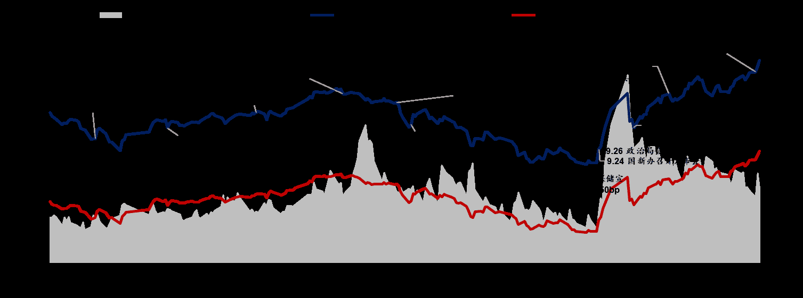

## 转债分行业行情：行业轮动交替，结构分化明显

➢ **行业结构分化，传媒行业及消费类涨幅领跑**

资料来源：Wind，华安证券研究所

分行业转债月涨跌幅（单位：%）

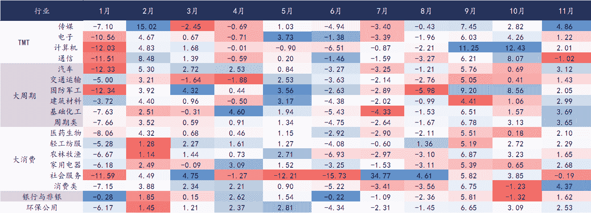

## 大类资产对比：创业板指数表现亮眼，中证转债指数表现稳定

➢ **转债收益与其他资产进行对比：创业板指数表现亮眼，中证转债指数表现稳定**

- 在对比转债收益与其他资产的表现时，可以清晰地看到各类资产在年初至今的涨跌幅中呈现出不同的趋势。创业板指数在今年的表现尤为亮眼，其涨幅处于所有指数中的领先地位，具体数值达到了20.99%，显示出科技成长股在这一时期内的强劲势头。紧随其后的是沪深300指数，作为反映A股市场整体走势的重要标杆，其涨幅也达到了16.11%，表明市场整体呈现出积极向上的态势。与此同时，中证转债指数年初至今的涨幅虽然不及前两者，但也实现了5.02%的增长，显示出转债市场在复杂多变的市场环境中仍具备一定的投资价值。

2024年1月-11月各指数涨跌幅（单位:%）

| 指数名称       | 涨跌幅   |
|----------------|----------|
| 南华工业品     | -6.26%   |
| 中票L50        | 4.18%    |
| 中证转债       | 5.02%    |
| 中证1000       | 7.24%    |
| 中证500        | 9.13%    |
| 上证指数       | 14.06%   |
| 沪深300        | 16.11%   |
| 创业板指       | 20.99%   |

资料来源：Wind，华安证券研究所

## 转债估值分评级：百元溢价率梯度性下降

➢ **转债百元溢价率变动相对平稳**

- 在2024年的转债市场中，不同信用评级的转债百元溢价率呈现出明显的梯度性下降趋势。信用评级较低的转债（AA及以下）具有较高的百元溢价率，其中AA级达到了52.77%，AA级以下达到了42.02%。随着信用评级的提升，百元溢价率逐渐下降。评级稍高的AA+级转债百元溢价率为36.85%。而AAA评级的转债百元溢价率进一步下降至36.45%。

2024年不同评级转债百元溢价率（单位：%）

资料来源：Wind，华安证券研究所

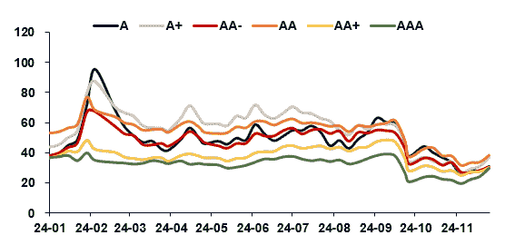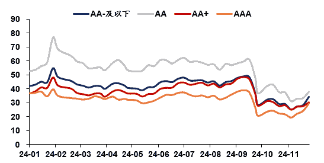

## 转债估值分价格：低价转债溢价率抬升，多元化趋势明显

➢ **高价转债百元溢价率走低，不同正股市值转债百元溢价率呈下降趋势，未来将呈现多元化格局**

- 不同价格转债百元溢价率的变动趋势大致相同。价格较低的转债，如小于100元的转债，其百元溢价率为40%左右，这可能与市场对于低价转债潜在的转股价值和上升空间的预期有关，100-120元区间的转债百元溢价率为39.92%，而120-130元的转债百元溢价率则进一步降低，为39.85%，需要注意的是，大于130元的转债却有较高的百元溢价率，达到60%左右。
- 不同正股市值百元溢价率整体出现下降的趋势。具体来说，市值小于50亿的转债，百元溢价率最低，为37.41%，其次为50到100亿元的转债，百元溢价率为43.26%，而100到200亿的转债百元溢价率最高，达到53.20%。

2024年不同价格转债百元溢价率（单位：%）

2024年不同市值转债百元溢价率（单位：%）

资料来源：Wind，华安证券研究所

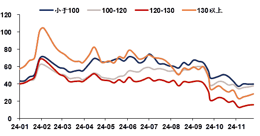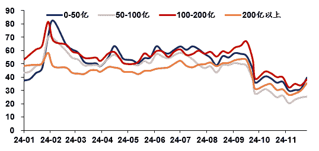

## 转债估值分类型：偏股型转债正股弹性较弱，溢价率持续下行

➢ **偏债型转债百元溢价率持续高位，偏股型溢价率持续下探**

- 不同类型的转债百元溢价率变动趋势大致相同，具体来看，2024年1月初，平衡型转债百元溢价率最低，为38.31%，其次为偏债型转债，达到43.95%，偏股型转债百元溢价率最高，为52.63%。
- 回顾2024年的百元溢价率走势，我们不难发现，这一指标在年初经历了显著的波动。特别是在2月份，百元溢价率一举达到了全年的最高点，但是自2月份的高点之后，百元溢价率便开启了持续的下行通道，投资者情绪逐渐趋于冷静。尽管期间不乏小幅反弹，但整体下行趋势明显。展望未来，随着政策持续发力、市场环境的逐步改善和投资者信心的恢复，预计百元溢价率将有望迎来一个向上修复的情况，为市场带来新的活力与机遇。
- 不同权益指数涨跌幅情况各异，其中非银金融行业指数表现尤为突出，涨幅最高。

2024年不同类型转债百元溢价率（单位：%）

| 日期    | 平衡型 | 偏债型 | 偏股型 |
|---------|--------|--------|--------|
| 24-01   | ...    | ...    | ...    |
| 24-02   | ...    | ...    | ...    |
| 24-03   | ...    | ...    | ...    |
| 24-04   | ...    | ...    | ...    |
| 24-05   | ...    | ...    | ...    |
| 24-06   | ...    | ...    | ...    |
| 24-07   | ...    | ...    | ...    |
| 24-08   | ...    | ...    | ...    |
| 24-09   | ...    | ...    | ...    |
| 24-10   | ...    | ...    | ...    |
| 24-11   | ...    | ...    | ...    |

资料来源：Wind，华安证券研究所

不同权益指数涨跌幅情况（单位：%）

| 行业         | 年初至今涨跌幅 |
|--------------|----------------|
| 非银金融     | 最高           |
| 通信         | ...            |
| 电子         | ...            |
| 商贸零售     | ...            |
| 计算机       | ...            |
| 建筑装饰     | ...            |
| 电力设备     | ...            |
| 国防军工     | ...            |
| 机械设备     | ...            |
| 环保         | ...            |
| 煤炭         | ...            |
| 社会服务     | ...            |
| 轻工制造     | ...            |
| 纺织服饰     | ...            |
| 农林牧渔     | ...            |
| 医药生物     | ...            |

## 华安证券研究所

华安研究 **•** 拓展投资价值

 

敬请参阅末页重要声明及评级说明

证券研究报告

### 转债估值展望：预计有一定向上修复空间

➢ **百元溢价率的梯度性或将更加明显，转债估值预计向上修复**

- 2025年来看，政策持续加码，市场信心恢复，预计转债正股可以迎来弹性修复，转债估值将迎来向上修复态势。当前转债处于估值低位，配置价值显著。
- 分评级来看，中高评级转债作为信用评级中的中坚力量，其百元溢价率的调整将更为稳健。随着市场对信用风险的进一步识别和定价，以及中高评级转债自身业绩预期的改善，其溢价率有望实现向上修复。低评级转债同样有望迎来估值的温和上调，这既是对其风险改善的认可，也是市场对其未来发展潜力的肯定。
- 分价格来看，价格较低的转债，如小于100元的转债，其百元溢价率维持在40%左右。随着市场环境的改善和投资者情绪的回暖，这部分转债的潜在转股价值和上升空间将得到更多关注，从而推动其百元溢价率进一步改善。对于价格较高的转债，未来，随着市场对其投资价值的进一步挖掘以及投资者对其未来表现的信心增强，这部分转债的百元溢价率有望继续修复，但修复空间可能会受到市场供求关系、投资者风险偏好等多种因素的影响。
- 分市值来看，市值较小的转债，尽管当前百元溢价率相对较低，但随着市场对其成长潜力的逐步认可，及企业基本面的不断改善，其正股弹性有望修复，溢价率有望迎来显著的回暖。而市值较高的转债，尽管溢价率已经处于较高水平，但考虑到这部分转债背后企业往往具有较强的市场竞争力和盈利能力，以及市场对其未来业绩增长的乐观预期，其估值在未来仍有进一步修复的空间。回顾2024年转债估值走势，我们不难发现，这一指标在年初经历了显著的波动。特别是在2月份，百元溢价率一举达到了全年最高点，但是自2月份的高点之后，百元溢价率便开启了持续的下行通道，投资者情绪逐渐趋于冷静。尽管期间不乏小幅反弹，但整体下行趋势明显。展望未来，随着市场环境的逐步改善和投资者信心的恢复，我们认为转债估值还有一定的修复空间。

资料来源：华安证券研究所

---

### 波动预期：隐含波动率处于低位，期权价值或温和抬升

➢ **年内隐含波动率整体下降，未来市场信心将逐渐恢复**

- 隐含波动率在过去一年中整体呈现出一个清晰的下降趋势，其具体表现为由年初的相对较高水平36.6%逐渐滑落，直至年末稳定在了较低的23.4%这一数值区间。这一显著的降幅不仅揭示了市场参与者对未来价格波动预期的变化，也反映出市场整体情绪与风险评估的动态调整过程。
- 展望2025年，市场逐步回暖预示着隐含波动率或将迎来一波回升态势，其修复空间比过往更具潜力。

**近一年转债平均隐含波动率走势图**

资料来源：Wind，华安证券研究所

---

### 转债条款：下修条款触发量提高，下修占比降低

➢ **转债下修情况：不下修占主流，转债市场下修博弈态势或将变化**

- 2024年1月到11月共有56只转债公告下修，419只转债公告不下修，这一数据对比显示出，不下修的转债占据了总数的88.21%，构成了市场的主流态势。深入分析这一现象，可能与正股市场行情的走低密切相关。
- 在年初市场走势一般的背景下，许多发行人认为其股价被市场低估，未能充分反映公司的实际价值和未来发展潜力。因此，他们选择维持原有的转股价格，以避免因下修而可能带来的市场负面影响。此外，这些发行人普遍对公司经营业绩保持信心，认为随着市场环境的好转和公司业绩的稳步提升，股价终将回归到合理水平。

**2024年1-11月下修情况（单位：只）**

| 月份 | 下修 | 不下修 |
|------|------|--------|
| 1月  | 1    | 36     |
| 2月  | 5    | 12     |
| 3月  | 5    | 23     |
| 4月  | 0    | 48     |
| 5月  | 0    | 37     |
| 6月  | 1    | 55     |
| 7月  | 10   | 64     |
| 8月  | 8    | 76     |
| 9月  | 7    | 39     |
| 10月 | 9    | 25     |
| 11月 | 10   | -      |

资料来源：Wind，华安证券研究所

---

### 转债下修：下修到底占比略有降低，仍以下修到底为主

➢ **转债下修到底情况：策略调整下，发行人多选择彻底调整方式**

- 2024年共计56只转债公告下修，其中32只转债直接下修到底，占比57.14%，转债下修程度仍以到底为主。与2023年下修到底占触发下修条款转债的比例58.62%相比，发行人下修到底意愿相差不大，但仍低于2022年以前下修到底平均占比81.89%的水平。

**2024年1-11月下修到底情况（单位：只）**

| 月份  | 下修到底 | 未下修到底 |
|-------|----------|------------|
| 1月   | 1        | 2          |
| 2月   | 3        | 2          |
| 3月   | 3        | 0          |
| 6月   | 1        | 6          |
| 7月   | 4        | 1          |
| 8月   | 7        | 2          |
| 9月   | 5        | 5          |
| 10月  | 4        | 6          |
| 11月  | 4        | 0          |

资料来源：Wind，华安证券研究所

---

### 赎回情况：转债赎回热情或将高涨

➢ **赎回情况：转债赎回的热情或将高涨，进一步推动市场活跃度的提升**

- 2024年1月到11月共计27只转债公告进行赎回，共计金额6314.1万元，其中11月有13只，共计金额1677.6万元，赎回数量占总数量的48.14%，赎回金额占总金额的26.57%。
- 2025年转债赎回市场或将迎来更为活跃的态势。随着市场活跃提升，触发数量增多，转债赎回概率或将增加。

**2024年1-11月赎回情况（单位：只，万元）**

| 月份  | 赎回数量（只） | 金额（万元） |
|-------|---------------|--------------|
| 1月   | 2             | 522.1        |
| 2月   | 3             | 904.9        |
| 4月   | 1             | 1,094.1      |
| 5月   | 2             | 1,056.6      |
| 6月   | 2             | 233.2        |
| 7月   | 2             | 382.7        |
| 8月   | 1             | 253.3        |
| 10月  | 1             | 189.6        |
| 11月  | 13            | 1,677.6      |

资料来源：Wind，华安证券研究所

---

### 回售情况：转债回售博弈或逐渐平缓

➢ **回售情况：转债回售数量下半年激增，2025年转债回售博弈或相对平缓**

- 2024年1月到11月共有77只转债公告回售，其中下半年回售数量50只，占总数的64.93%。2024年下半年，转债的回售数量明显增多，展望2025年，进入回售期的转债数量不足20%，且目前回售价格已经小幅抬升，多数在100元以上，回售博弈券数量或明显减少。

**2024年1-11月回售情况（单位：只）**

| 月份  | 回售数量 |
|-------|----------|
| 1月   | 5        |
| 3月   | 6        |
| 4月   | 4        |
| 5月   | 6        |
| 6月   | 6        |
| 7月   | 9        |
| 8月   | 12       |
| 9月   | 11       |
| 10月  | 12       |
| 11月  | 6        |

资料来源：Wind，华安证券研究所

---

2024转债市场波澜起，行业亮点何处觅？
供需动态谁主宰，转债市场怎变迁？
策略调整应时变，转债投资智何在？
2025转债市场展新篇，何处探寻新方向？

---

### 转债供给：新发转债规模收缩显著

➢ **供给端：转债新发规模持续下降，2025年净供给或进一步收缩**

- 截至2024年11月，转债发行38只，发行总额为345.42亿元。相比去年同期发行120只，发行总额1276.44亿元，均有明显减少。分行业看，2024年基础化工和汽车行业新发转债数量最多，均为7只；发行规模也最大，分别为100.09亿元和70.74亿元。

**2024年新增转债数量和规模行业分类**

**2024年转债新发规模及数量统计**

| 年份    | 发行数量（只） | 发行规模（亿元） |
|---------|----------------|------------------|
| 2018    | 67             | 787              |
| 2019    | 106            | 2478             |
| 2020    | 195            | 2620             |
| 2021    | 113            | 2857             |
| 2022    | 147            | 2126             |
| 2023    | 120            | 1396             |
| 2024-11 | 38             | 345              |

资料来源：同花顺，华安证券研究所

---

### 转债供给：供给端行业多元化，发行规模均有所收缩

➢ **可转债分行业发行情况**

- 2019年以来，可转债发行规模呈现出多元化和动态变化的特点。受到监管政策对再融资收紧，近两年银行类可转债规模无新增，以及大额银行转债到期日的临近，未来一年可能进入供给收缩期，增加该板块的稀缺性。2024年转债规模增长最多的行业是基础化工行业和汽车行业，未来可持续关注。

**2019-2024年不同行业可转债发行情况一览（单位：亿元）**

| 申万行业   | 2024 | 2023 | 2022 | 2021 | 2020 | 2019 | 总计  |
|------------|------|------|------|------|------|------|-------|
| 传媒       | 6    | 5    | 5    | 28   | -    | 43   | 87    |
| 电力设备   | 10   | 405  | 467  | 218  | 164  | 164  | 1429  |
| 电子       | 48   | 85   | 72   | 178  | 198  | 85   | 665   |
| 纺织服饰   | 5    | 7    | 13   | 14   | 50   | 18   | 107   |
| 非银金融   | -    | 148  | 208  | 226  | 35   | -    | 617   |
| 钢铁       | 3    | 101  | 10   | -    | 112  | 226  | 452   |
| 公用事业   | 51   | 93   | 30   | -    | 127  | 302  | 603   |
| 国防军工   | 7    | 17   | 21   | 9    | 24   | 77   | 155   |
| 环保       | 8    | 14   | 55   | 10   | 105  | 38   | 230   |
| 机械设备   | 18   | 84   | 65   | 64   | 46   | 36   | 313   |
| 基础化工   | 100  | 133  | 205  | 89   | 65   | 113  | 706   |
| 计算机     | -    | 49   | 51   | 30   | 61   | 54   | 245   |
| 家用电器   | 16   | 23   | 52   | 21   | 18   | -    | 130   |
| 建筑材料   | 27   | 9    | 27   | 51   | 11   | -    | 125   |
| 建筑装饰   | -    | 105  | 34   | 40   | 81   | 68   | 329   |
| 交通运输   | 34   | 17   | 30   | 494  | 116  | -    | 691   |
| 煤炭       | 29   | 66   | 28   | 28   | -    | -    | 150   |
| 美容护理   | -    | 14   | 8    | 22   | -    | -    | 44    |
| 农林牧渔   | 3    | 39   | 294  | 66   | 54   | -    | 457   |
| 汽车       | 71   | 106  | 111  | 98   | 79   | 54   | 519   |
| 轻工制造   | 4    | 32   | 28   | 70   | 47   | 80   | 260   |
| 商贸零售   | -    | 10   | 46   | 24   | -    | 80   | 160   |
| 社会服务   | 8    | 5    | 10   | 24   | -    | -    | 47    |
| 石油石化   | 34   | 50   | 73   | 157  | -    | -    | 314   |
| 食品饮料   | 10   | 16   | 22   | 45   | 29   | -    | 120   |
| 通信       | 5    | 6    | 19   | 98   | -    | -    | 128   |
| 医药生物   | 44   | 51   | 102  | 76   | 180  | 85   | 539   |
| 银行       | -    | 350  | 1100 | 95   | 1360 | 2905 | 5805  |
| 有色金属   | 7    | 91   | 111  | 15   | 222  | 76   | 522   |
| **总计**   | **345** | **1396** | **2126** | **2857** | **2620** | **2774** | **12118** |

资料来源：Wind，华安证券研究所

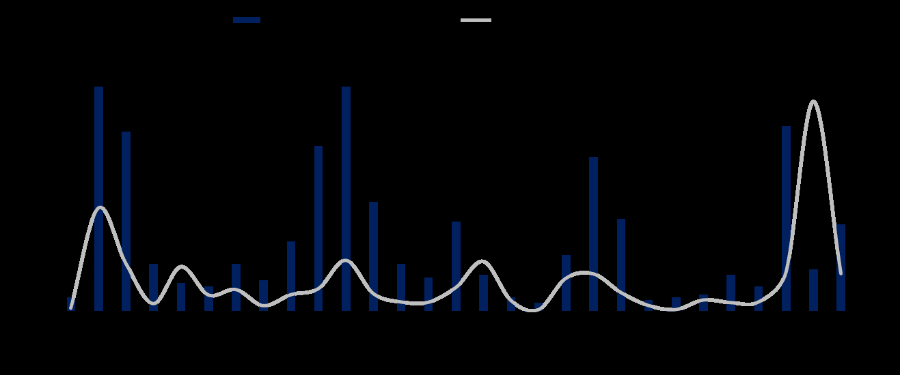

---

### 转债供给：中小盘成为主导，发行主体质量持续优化

➢ **可转债分市值发行情况**

- 2017年以来，中小市值公司的转债发行积极性不断提高，2023年增速显著放缓，2024年则出现明显收缩。
- **2024**新国九条着重于提升上市发行门槛与强化退市制度，长远将促进转债市场发行主体质量的整体提高；短期则有助于快速过滤掉资质一般的上市企业，促使转债市场，特别是高风险转债的定价机制得以重新评估与调整。

**2010-2024年不同市值公司可转债发行情况**

| 年份 | <20亿元 | 20-100亿元 | 100-500亿元 | 500-1000亿元 | >1000亿元 |
|------|---------|------------|-------------|--------------|-----------|
| 2010年 | 2       | 4          | 2           | -            | -         |
| 2011年 | 3       | 5          | 1           | -            | -         |
| 2012年 | 1       | 1          | 2           | 1            | -         |
| 2013年 | 1       | 1          | 4           | 2            | -         |
| 2014年 | 6       | 6          | 1           | -            | -         |
| 2015年 | 2       | 2          | 1           | -            | -         |
| 2016年 | 3       | 5          | 1           | -            | -         |
| 2017年 | 18      | 15         | 5           | 2            | -         |
| 2018年 | 1       | 36         | 27          | 3            | -         |
| 2019年 | 5       | 78         | 37          | 6            | 4         |
| 2020年 | 5       | 112        | 60          | 9            | 6         |
| 2021年 | 2       | 45         | 47          | 9            | 11        |
| 2022年 | 3       | 82         | 49          | 10           | 3         |
| 2023年 | 18      | 24         | 93          | 1            | -         |
| 2024年 | 3       | 29         | 6           | 1            | -         |
| **总计** | **39** | **440**    | **362**     | **49**       | **32**    |

资料来源：Wind，华安证券研究所

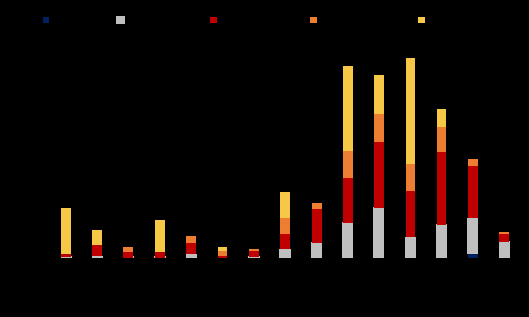

华安证券研究所

华安研究 · 拓展投资价值

证券研究报告

## 转债退市：规模与数量平稳波动，平均存续期持续增长

### 可转债退市情况

- 2019年以来，退市规模与数量平稳波动，平均存续期持续增长。截至2024年11月，可转债退市数量为54只，退市规模为825.19亿元，其中三年以上存续期限的退市转债有37只，平均存续期为4.12年，保持持续增长势头。

2018年以来退市转债存续期限情况

2018年以来退市转债规模及数量统计

资料来源：Wind，华安证券研究所

## 转债净供给：规模大幅收缩，未来或将延续承压

### 可转债净供给情况

- 自2023年9月开始，转债发行速度大幅放缓。2024年4月，资本市场新“国九条”强调严格再融资审核把关，使经营与财务状况承压的上市公司转债发行受到明显制约，转债供给呈现明显收缩趋势。

- 截至2024年11月，转债净供给数量为-16只，净供给规模为-479.77亿元，达近几年最低位。综合各项政策以及转债流程审核时长的显著上升，预计2025年转债净供给或延续承压。

2024年可转债净供给规模情况

2024年可转债净供给数量情况

资料来源：Wind，华安证券研究所

发行数量（左轴，单位：只）

退市数量（左轴，单位：只）

转债净供给数量（右轴，单位：只）

发行规模（左轴，单位：亿元）

退市规模（左轴，单位：亿元）

转债净供给规模（右轴，单位：亿元）

## 转债需求：深交所——企业年金持仓占比下降

深交所2024-11可转债投资者结构

深交所2024年可转债前三大机构持仓情况

### 深交所可转债市场主要参与者及持仓

- 截至2024年11月底，深圳证券交易所现存的主要债券券种总市值达3.2万亿元人民币，其中可转换债券市值达3118.2亿元，相比于去年同期的3496.13亿元略有收缩。基金保持最大可转债投资者地位，持仓达可转债总市值的30.20%。自然人投资紧随其后，占比为16.68%，近几年持仓规模较稳定。企业年金持仓总规模居于第三位，但2024年有下降趋势，原因系年初可转债市场的绝对回撤较大，抗回撤能力有限使得企业年金持续减持可转债。

资料来源：深圳证券交易所网站，华安证券研究所

## 转债需求：上交所——保险机构持仓占比抬升

上交所2024-11可转债投资者结构

2024年上交所基金、保险机构、企业年金持仓可转债情况

### 上交所可转债市场主要参与者及持仓

- 截至2024年11月底，上海证券交易所现存主要债券券种总市值超17万亿元人民币，其中可转换债券市值达4745.99亿元，较去年同期减少16.41%。公募基金持仓约可转债总市值三成，保持最大可转债投资者地位。企业年金和一般机构持有可转债规模自2023年下半年开始逐渐收缩，保险机构持有规模有所增加，考虑到当前权益资产估值较低，若前景向好使其投资价值提升，预计中长期内保险资金会持续投资可转债。

资料来源：上海证券交易所网站，华安证券研究所

## 2024转债市场波澜起，行业亮点何处觅？

供需动态谁主宰，转债市场怎变迁？

策略调整应时变，转债投资智何在？

2025转债市场展新篇，何处探寻新方向？

## 转债市场回升期在望，策略选择正当时

- 从2019年至今的历史数据回看，当前转债估值与期权价格处于相对低位，配置价值显著。

- 转债市场与正股市场的波动节奏存在两种模式：一是转债市场在股市触底前先一步触底，随后与股市同步上涨；二是转债市场与股市同时达到底部，但在股市达到高点后的1至2个月内达到最高点。截至11月29日，整个11月中证转债指数上涨2.43%，同花顺沪深全A指数上涨1.30%，横向对比的中证转债指数存在补涨空间，趋势呈现逆势底部反转，转债市场有望突破震荡走势。

2021年至今中证转债指数与沪深全A累积收益率变化（单位：%）

资料来源：同花顺，华安证券研究所

## 低价策略和低溢价策略——债性与股性

- 双低策略通过选取低价债券和低溢价债券，兼具了投资组合的债性和股性，低价债券降低幅度有限，避免了债券急剧下跌造成的大规模损失，低溢价债券的溢价率越低，股性越强，越跟随正股市场的涨跌。

- 我们将每月收盘价低于120元的转债定义为低价转债，每月转股溢价率低于30%的转债定义为低溢价转债。以下为低价策略和低溢价策略2019年—2024年11月的累积收益率。低价策略与低溢价策略的年度夏普比率分别为2.29和1.59，累积收益率达70.26%和72.22%，高于市场表现。

2019年至今低价策略、低溢价策略及中证转债累积收益率（单位：%）

2019年至今低价策略、低溢价策略收益和风险指标（单位：%）

资料来源：同花顺，华安证券研究所

## 传统双低策略：兼具成长性与稳定性

为了吸收低溢价策略随势而动和低价策略稳健托底的特点，我们将年末收盘价与转股溢价率×100之和小于140的转债定义为双低转债。在2021年—2024年11月内，双低策略的累积收益率为77.98%，高于低溢价策略和低价策略，远超中证转债指数的累积收益率。2022—2024年11月内相对于中证转债指数的年均加权胜率高达72.45%。整体来看，双低策略在提高盈利的同时，风控水平向低价策略靠拢，吸收不同策略的优势。

资料来源：同花顺，华安证券研究所

2019年至今双低策略和中证转债累积收益率（单位：%）

2019年至今双低策略的收益和胜率表现（单位：%）

## 改良双低策略——跟随权益市场变化

资料来源：同花顺，华安证券研究所

- 在传统双低策略中，我们可能会陷入“双低陷阱”。在符合双低指标的转债中，我们可能筛选到低价转债或低溢价转债，其原因可能是发行人公司财务、业务等方面出现一定问题，导致债券或正股价格涨势缓慢。因此针对“双低陷阱”，我们在指标筛选及研判方面做出相应的调整，剔除市盈率小于0及市净率小于1的转债。在研判方面，若预计市场后续走势走强，价格和转股溢价率的计算系数由原来的1∶1调整为0.5∶1.5，之和标准更替为95；若预计市场后续震荡下跌，价格和转股溢价率的计算系数由原来的1∶1调整为1.5∶0.5，之和标准更替为190；若预计市场后续正常浮动，则保持原来计算和标准不变。

- 由此得出符合改良双低策略的可转债名单。从图中可以看出，2019年—2024年11月改良双低策略的累积收益率及收益率最高点均高于传统双低策略，年化收益率为18.98%，验证了改良策略的有效性，提高了双低策略的收益能力。

2019年至今改良双低策略和传统双低策略月度涨跌幅变化（单位：%）

2019年至今改良双低策略和传统双低策略收益和胜率表现（单位：%）

资料来源：同花顺，华安证券研究所

## 近期符合改良双低策略转债汇总

### 筛选目标转债满足条件

- 1）收盘价低于120元；
- 2）转股溢价率低于30%；
- 3）剔除市盈率小于0及市净率小于1的转债；
- 4）预计短期市场后续震荡上行，价格和转股溢价率的计算系数为原来的1∶1，之和标准为140。

资料来源：同花顺，华安证券研究所

12月改良双低策略转债名单

## 三低策略表现如何？——兼具进攻和防御属性

资料来源：同花顺，华安证券研究所

- 三低策略在双低策略的基础上进行改良，改变转债价格及转股溢价率的筛选条件，并额外增加了剩余规模、到期时间及是否是风险警示板的筛选。选取符合低价、低溢价率、低规模的转债，溢价越低的债，正股越强，振幅空间越大；低价格代表可转债的涨幅空间较大，存在博弈价值。低规模代表可转债所需的本金较少，容易被作为补涨的首选标的。

- 具体筛选指标如下：
  - 1）转债价格，剔除价格高于135元的转债；
  - 2）转股溢价率，剔除转股溢价率高于60%的转债；
  - 3）转债剩余规模，剔除转债余额大于7亿元的转债；
  - 4）转债到期时间，剔除转债剩余期限小于1年的转债；
  - 5）剔除正股ST、ST*的转债。

- 根据筛选指标，我们得出了三低转债自2021年至今的累积收益率，最高累积涨跌幅为81.82%，最大回撤为13.37%，兼具进攻属性和防御属性，累计收益率达76.11%，大幅跑赢中证转债指数和沪深全A指数。

2021年至今三低策略收益及风险指标（单位：%）

2021年至今三低策略月度涨跌幅变化（单位：%）

## 因子约束三低策略——保证盈利性和稳健性

资料来源：华安证券研究所

- 为提高三低策略的盈利能力和稳健性，在三低的基础上，我们选取四因子分别进行约束，观察其收益表现。

### Alpha因子

Alpha因子是用于衡量投资组合相对于市场基准的超额收益能力的指标，我们选取转债正股Alpha因子大于0.5的标的进行回测。

### Beta因子

Beta因子是衡量一种证券或一个投资组合相对于市场整体波动的敏感性指标，表示资产的系统性风险，我们筛选Beta因子大于1的标的进行回测。

### 盈利能力因子约束

归母净利润增速因子即归属于母公司所有者的净利润的增长速度，增速较高且稳定的企业，往往显示出企业有较强的盈利能力和成长潜力，因此我们用归母净利润增速代表盈利能力，用企业过往3个季度归母净利润计算增速，筛选出增速大于5%的转债进行回测。

### 偿债能力因子约束效果

偿债能力主要使用期末现金及现金等价物余额与转债余额比值代表，可以反映企业期末可动用的现金及现金等价物相对于转债余额的充裕程度，有助于判断企业是否有足够的现金来偿还转债或者进行转债的相关操作。我们采用转债正股的期末现金及现金等价物余额与转债余额比值大于1来筛选标的进行回测。

## 华安证券研究所

华安研究 • 拓展投资价值

敬请参阅末页重要声明及评级说明

证券研究报告

### Alpha因子三低策略——表现独树一帜

资料来源：同花顺，华安证券研究所

2021年至今因子三低策略收益和胜率表现（单位：%）

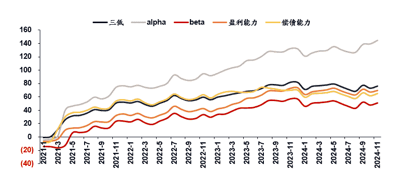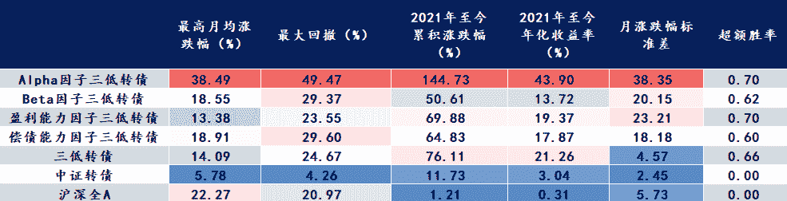

2021年至今因子三低策略累积收益率（单位：%）

从四因子约束效果来看，alpha因子表现较其他因子约束策略突出，2021年至今累计收益率超两倍胜于三低策略以及其他因子改良策略，具备更强的收益预期。Alpha因子策略自2021年至今累积涨跌幅达144.73%，最高累积涨跌幅可达38.49%，超额胜率为70%。

近期符合Alpha因子三低策略转债名单

筛选目标转债满足条件：

- 1）转债价格低于135元的转债；
- 2）转股溢价率低于60%的转债；
- 3）转债余额小于7亿元的转债；
- 4）转债剩余期限大于1年的转债；
- 5）剔除正股ST、ST*的转债；
- 6）正股Alpha因子大于0.5的转债。

资料来源：同花顺，华安证券研究所

12月可关注转债

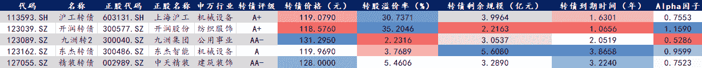

### 动量+双低策略表现如何？——涨势凸显

资料来源：同花顺，华安证券研究所

在双低策略的基础上，我们加入动量策略进行改进，结合动量策略高投资能力和双低策略防御性的优势，以期获得更高的收益。

2021年至今动量+双低策略收益及风险指标（单位：%）

我们筛选出价格低于120元、转股溢价率低于30%的转债为双低转债，在此基础上，计算5个动量指标：转债60日动量、转债20日动量、正股20日动量、转债波动率10日偏离度、转债换手率10日偏离度。根据每项动量指标对所有双低转债进行降序排名。根据排名结果构建投资组合，选择每项指标排名前30的转债构建5种不同的动量+双低策略。动量策略在牛市中表现较好，而双低策略在震荡市或熊市中能提供一定的防御性。因此，我们预期动量+双低策略能够在不同的市场环境中均有良好的适应性。

从图表看出，双低+动量的表现良好，走势喜人。转债60日动量+双低的组合累积收益率为88.31%，年化收益为25.03%；正股20日动量+双低的累积收益率为38.8%，年化收益为10.37%。

2021年至今动量+双低策略月度涨跌幅变化（单位：%）

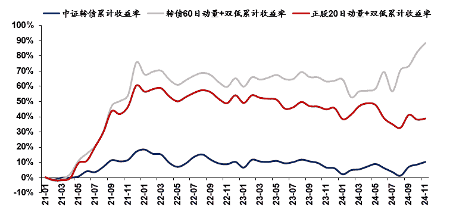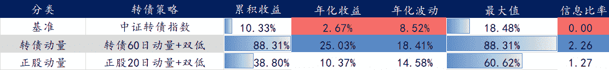

近期符合动量+双低策略转债名单

资料来源：同花顺，华安证券研究所

12月“转债60日动量+双低”策略名单

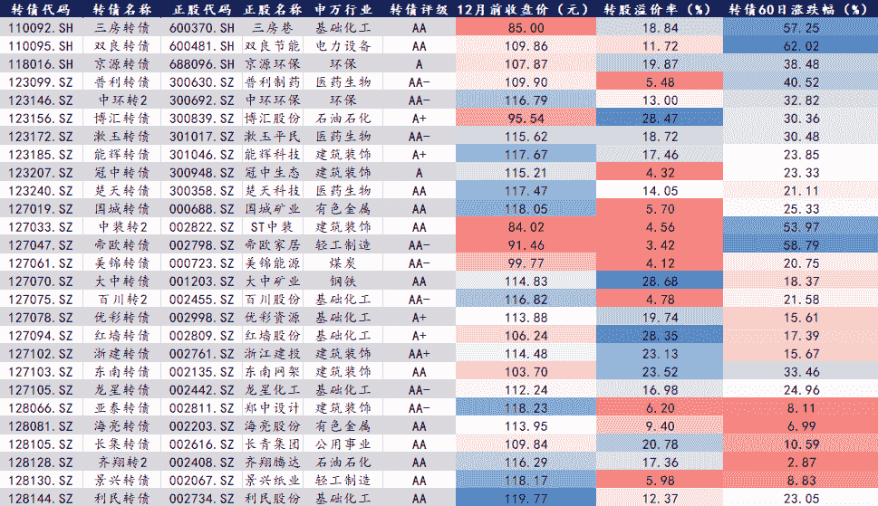

12月“正股20日动量+双低”策略名单

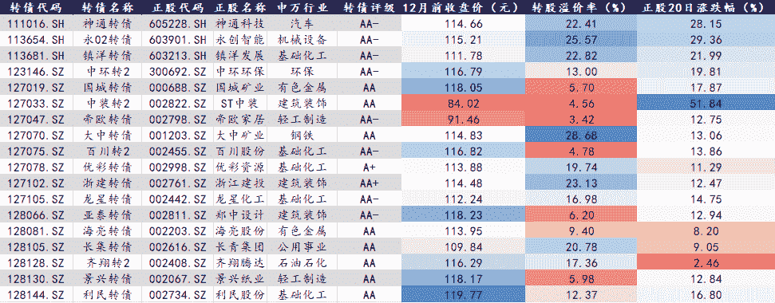

### 偏股转债和偏债转债——跟涨与抗跌

资料来源：同花顺，华安证券研究所

市场9月底的触底反弹带领转债资产走出低迷状态，偏债转债和偏股转债的估值出现明显分化，10月份哑铃策略表现明显反转。

2021年至今偏股转债和偏债转债收益和风险指标（单位：%）

偏股转债兼具跟涨及跟跌属性，偏债转债具有一定的抗跌性。我们根据权益市场的表现进行相应的分类。当权益指数为正收益时，将转股溢价率在20%以下的转债定义为偏股转债，纯债溢价率在20%以下的转债定义为偏债转债；权益指数负收益时，将转股溢价率在40%以下的转债定义为偏股转债，纯债溢价率在30%以下的转债定义为偏债转债。从表中看出偏股转债和偏债转债的收益率最高点为29.90%和33.48%，高于中证转债指数，偏股转债累积收益率为9.34%，低于中证转债指数，偏债转债累积收益率为27.55%，高于中证转债指数。

2021年至今偏股转债和偏债转债累积收益率（单位：%）

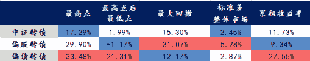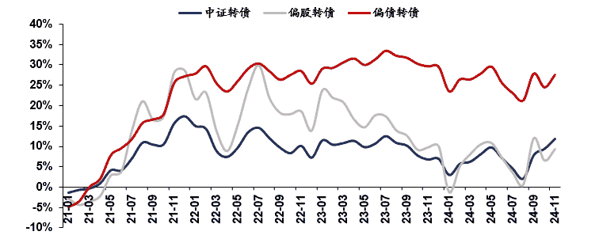

### 传统哑铃策略——跟随市场行情变化

资料来源：同花顺，华安证券研究所

我们构建传统哑铃策略，将偏股转债和偏债转债的成长性与抗跌性结合起来。

21年至今哑铃策略收益及胜率表现（单位：%）

我们将各期偏股、偏债转债按金额1:1进行配置构成传统哑铃进行回测。从图表中看出，21年至今传统哑铃策略的累积涨跌幅高于中证转债涨跌幅，在2024年胜率仅为55.32%，年超额收益在不同的市场行情下变化较大，波动性较强。

21年至今哑铃策略和中证转债累积收益率（单位：%）

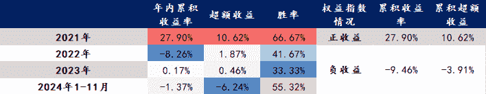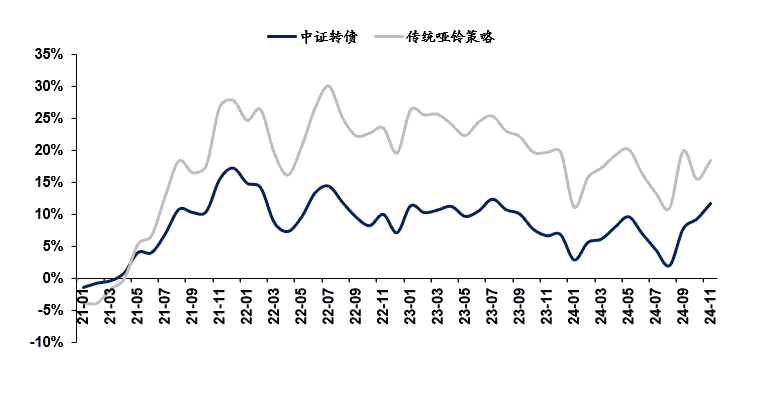

### 强化偏股转债和强化偏债转债——安全性加强

资料来源：同花顺，华安证券研究所

为进一步强化哑铃策略，我们将哑铃两端的属性分别加强，即进一步筛选出成长性好的偏股转债与安全性强的偏债转债。

2021年至今强化偏股转债和强化偏债转债收益和风险指标（单位：%）

具体筛选指标为：选取公司三年同期归母净利润平均增速大于0、主营业务收入平均增速大于20%的偏股转债构成强化偏股转债；选取在筛选日正股未带ST和*ST标记、转债评级在AA及以上、同年转债成交量在500万手以上的偏债转债构成强化偏债转债。强化偏股转债和强化偏债转债最高收益率远高于中证转债指数，其中强化偏债指数的累积收益率保持高增长。

2021年至今强化偏股转债和强化偏债转债累积收益率（单位：%）

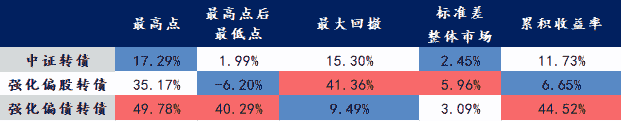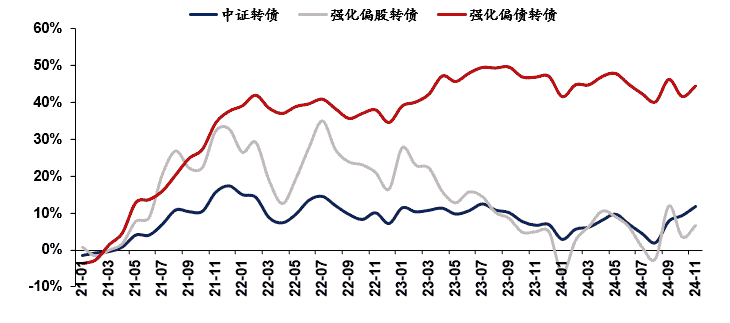

### 强化哑铃策略——收益增加显著

资料来源：同花顺，华安证券研究所

21年至今强化哑铃策略收益及胜率表现（单位：%）

同样地，我们将各期强化偏股、强化偏债转债按资产金额1:1进行配置构成强化哑铃进行回测，观察强化哑铃策略的表现。从图表中看出，21年至今强化哑铃策略累积收益率明显高于传统哑铃策略。24年强化哑铃策略胜率为66.67%，较哑铃策略有增加，21年胜率高达91.67%。

21年至今不同哑铃策略和中证转债累积收益率（单位：%）

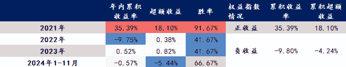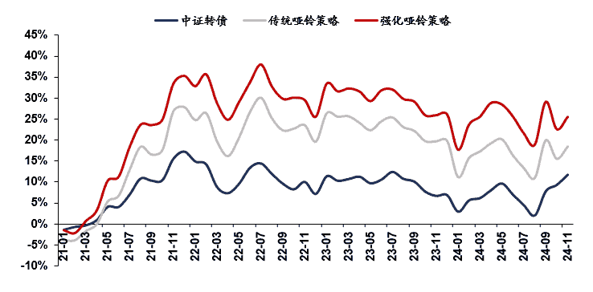

### 哑铃策略比例变化——2:8配比哑铃策略表现强势

资料来源：同花顺，华安证券研究所

高偏债转债占比能增加策略长期收益，短期债市高增长时高偏股转债占比带来高成长性。

2021年至今不同配比强化哑铃策略累积收益率（单位：%）

调高偏股转债、偏债转债两端占比，可增加策略的年化收益率，增加稳定性。我们对其两端比例进行调整，当偏股转债：偏债转债为2:8时，强化哑铃策略和传统哑铃策略夏普比率分别为0.15、0.22，年化收益率分别为6.01%和9.43%，在各比例的配置中表现最佳。

2021年至今不同配比传统哑铃策略累积收益率（单位：%）

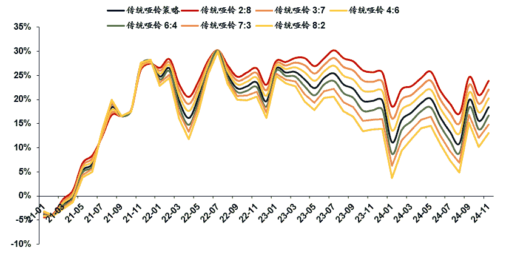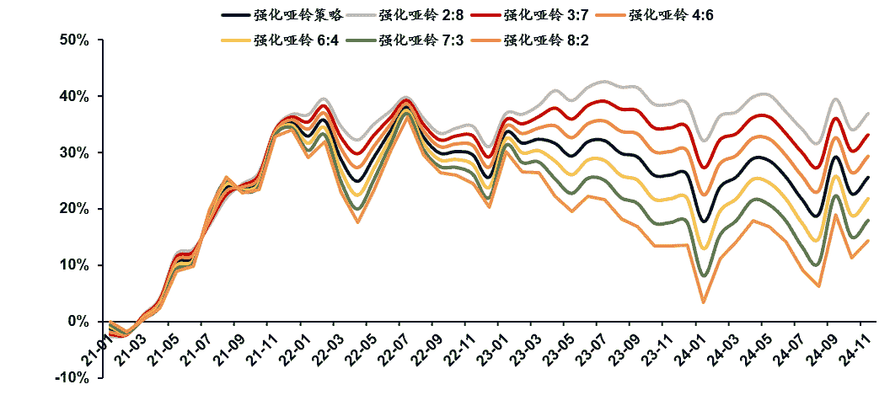

### 传统哑铃策略与强化哑铃策略的不同配比表现

资料来源：同花顺，华安证券研究所

2021年至今不同配比传统哑铃策略和强化哑铃策略收益及胜率表现（单位：%）

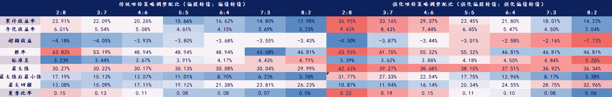

### 低估值策略表现如何？——跟随市场变化

资料来源：同花顺，华安证券研究所

自2022年权益市场震荡下行时，转债期权价值大幅压缩，大量转债突破债底，处于价格低位，投资者可从股性和债性两方面考虑。

2021年至今低估值策略与中证转债累积收益率（单位：%）

我们选取低隐波差的转债并且选取高到期收益率的优质转债，进行期权价值的博弈和防御性的投资。低隐波差策略呈现出明显的超涨超跌态势，抢收益能力强但回撤幅度也较大。我们选取样本中隐含波动率最低前20%的转债作为低估值策略转债。选取2021年至今为回测时间区间，样本处理为：

- 1）考虑到信用风险，剔除发行主体信用评级低于AA-的转债；
- 2）考虑到退市风险，剔除正股ST、ST*的转债；
- 3）考虑到强赎条款，剔除余额小于2亿的转债；
- 4）考虑到回售条款，剔除剩余期限小于6个月的转债；
- 5）剔除隐含波动率极低，小于0.1%的转债；
- 6）此外，剔除上市不足10日的转债。

2021年至今低估值策略、中证转债和权益指数收益及胜率表现（单位：%）

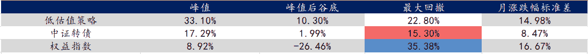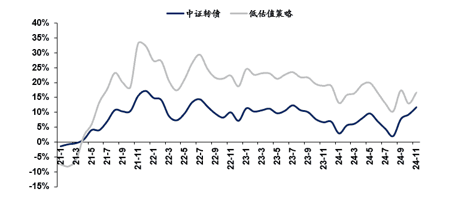

### 高YTM策略表现如何？——跟随市场变化

资料来源：同花顺，华安证券研究所

2021年至今低估值策略、高YTM策略和中证转债累积收益率（单位：%）

我们选取纯债到期收益率大于0%的转债为高YTM转债。选取2021年至今为回测时间区间，样本处理为：

- 1）考虑到信用风险，剔除发行主体信用评级低于AA-的转债；
- 2）考虑到退市风险，剔除正股ST、ST*的转债；
- 3）考虑到强赎条款，剔除余额小于2亿的转债；
- 4）考虑到回售条款，剔除剩余期限小于6个月的转债；
- 5）剔除隐含波动率极低，小于0.1%的转债；
- 6）此外，剔除上市不足10日的转债。

低估值策略和高YTM策略较中证转债均表现超涨和超跌特性，最大回撤分别为22.8%和10.57%，月涨跌幅标准差分别为14.98%和10.16%，其股性较强。低估值策略侧重进攻和高收益潜力，高YTM侧重防御性和稳健性。

2021年至今低估值策略、高YTM、中证转债和权益指数收益和胜率表现（单位：%）

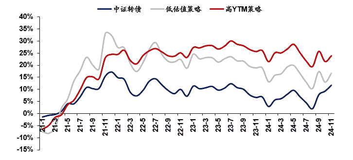

## 华安证券研究所

华安研究 • 拓展投资价值

证券研究报告

### 低估值+高YTM策略——兼备增长潜力与防御特质

资料来源：同花顺，华安证券研究所

**2021年至今低估值策略、高YTM策略和低估值+高YTM策略累积收益率（单位：%）**

- 为将高收益潜力和超强防御性特质结合起来，我们将低估值与高YTM结合，观察转债表现。首先控制低估值性：选取样本中隐含波动率最低前20%的转债，同时，控制高YTM性：选取纯债到期收益率>0%的转债。其中，样本处理层面，1）考虑到信用风险，剔除发行主体信用评级低于AA-的转债；2）考虑到退市风险，剔除正股ST、ST*的转债；3）考虑到强赎条款，剔除余额小于2亿的转债；4）考虑到回售条款，剔除剩余期限小于6个月的转债；5）剔除隐含波动率极低，小于0.1%的转债；6）此外剔除上市不足10日的转债。

- 低估值+高YTM策略收益最大峰值达42.2%，最大回撤为9.42%，年化波动率为12.52%，高于高YTM策略的10.16%，低于低估值策略的14.98%，累积收益率表现优于单独低估值、高YTM策略，也优于中证转债及权益指数。与权益市场的相关性为0.49，均低于低估值策略和高YTM策略的0.6。

**2021年至今低估值策略、高YTM、低估值+高YTM策略收益和胜率表现（单位：%）**

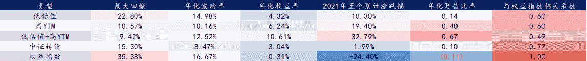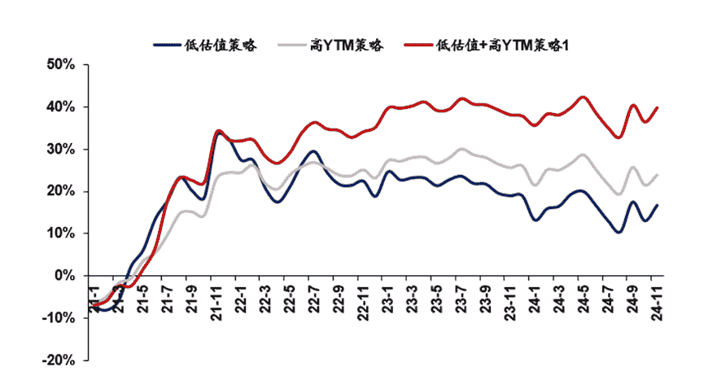

---

## 华安证券研究所

华安研究 • 拓展投资价值

证券研究报告

### 低估值+高YTM策略——偏好隐含波动率更低转债

资料来源：同花顺，华安证券研究所

**2021年至今三种不同低估值+高YTM策略累积收益率（单位：%）**

- 我们对低估值的指标筛选进行一定的变化，分别选取隐含波动率低于25%和30%的转债作为低估值策略的转债样本，计算21年至今的累积收益率。其中，低估值+高YTM策略2为选取隐含波动率前25%转债的表现，低估值+高YTM策略3为选取隐含波动率前30%转债的表现，结果显示，隐含波动率前20%的转债表现最好。

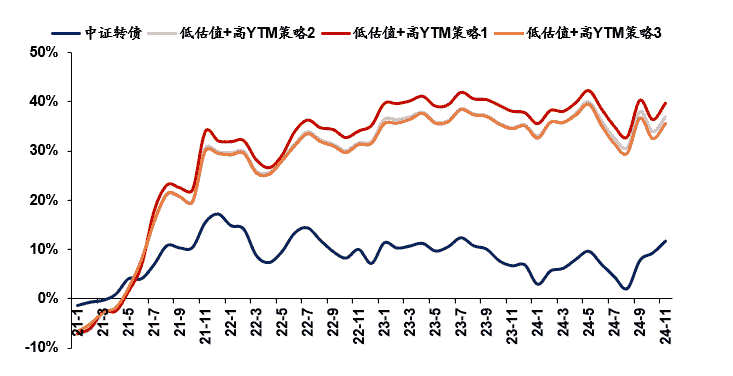

> 不同隐含波动率的选取会导致策略收益的变化，回测发现选取隐含波动率前20%的转债来构建投资组合，可能获得相对更高的超额收益。

---

## 华安证券研究所

华安研究 • 拓展投资价值

证券研究报告

### 高股息策略——稳涨少跌

资料来源：同花顺，华安证券研究所

> 高股息标的策略由于其确定的高比例股息率，在如今震荡的权益市场使投资者获得较为稳定且超额的收益。

- 我们选取股息率大于2%的转债为高股息转债，每月根据该指标对转债市场进行筛选调仓，最后回测出2020-2024年11月期间累积涨跌幅。我们将2020-2024年11月高股息转债、转债指数、红利指数与权益指数风险与收益指标进行对比，可以看出高股息策略的年化收益率最高，为5.31%，最大回撤为9.79%，低于其他指数回撤，更具稳定性。

**21年至今高股息转债与中证转债、中证红利和同花顺沪深全A的收益对比（单位：%）**

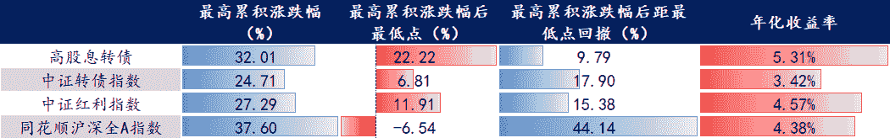

**21年至今高股息转债与中证转债、中证红利和同花顺沪深全A的累积收益率（单位：%）**

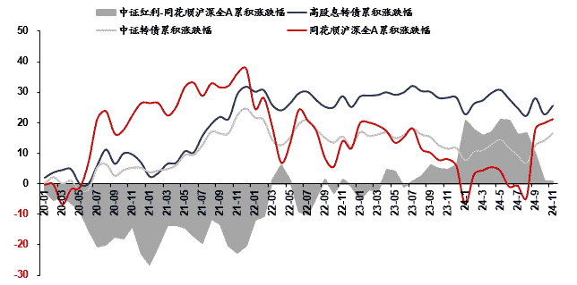

---

## 华安证券研究所

华安研究 • 拓展投资价值

证券研究报告

### 改良高股息策略——稳增长与高收益

资料来源：同花顺，华安证券研究所

**21年至今改良高股息策略和传统高股息策略累积收益率（单位：%）**

- “高股息陷阱”：部分公司当年可能受到行业周期波动或自身当年业绩突出等原因，因此当年股息率显示较高，但放眼过去几年，其股息率并不高或是并不稳定于高比例，在未来几年公司股息率亦有可能重蹈覆辙。“低估值陷阱”：由于股息率可被拆分为“分红率/市盈率”，部分公司高股息的原因是市盈率处于极低水平，而市盈率处于低水平的原因是公司由于管理、发展或资产等方面出现一定问题影响了其估值。

- 由于潜在的高估值陷阱和低估值陷阱会对策略表现产生影响，我们采取一定的解决措施：剔除近三年股息率标准差大于50%的高股息转债，并留下高股息三年连续增长的转债；剔除近三年市盈率连续下跌的高股息转债。

- 可以看出，改良高股息累积涨跌幅大于传统高股息涨跌幅，最高累积涨跌幅为53.14%，夏普比率为1.71，大于传统高股息的0.82，并且年化收益率为12.8%，优于传统高股息策略的6.7%。

**21年至今改良高股息转债和传统高股息转债收益及风险指标（单位：%）**

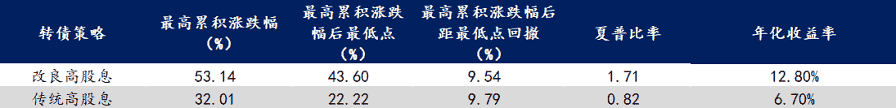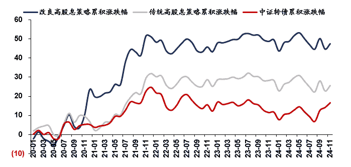

---

## 华安证券研究所

华安研究 • 拓展投资价值

证券研究报告

### 近期改良高股息策略转债名单

资料来源：同花顺，华安证券研究所

**2024年12月改良高股息策略部分转债名单**

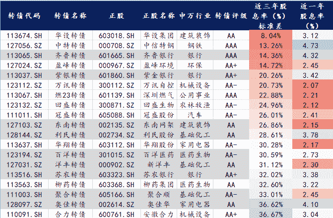

---

## 华安证券研究所

华安研究 • 拓展投资价值

证券研究报告

### 白马策略和低隐波差策略——少涨少跌

资料来源：同花顺，华安证券研究所

> 目前大量转债剩余期限缩短，隐含波动率的波动程度上升，利用正股波动率进行风险分散可筛选出价值被低估的转债。

**21年至今白马转债与低隐波差转债累积收益率（单位：%）**

- 当转债期权处于低位时，隐波差越低意味着转债价格被低估程度越高，低隐波差转债获利空间较大。我们选取21年至今隐波差最低的前25%转债作为低隐波差转债，其中隐波差=转债隐含波动率-正股过去半年的年化波动率（隐含波动率不等于0）。2021年至今低隐波差累积涨跌幅为9.82%，低于中证转债表现，最大回撤为24.69%，高于中证转债的15.3%。年化收益率为8.74%，低于中证转债的11.73%。

- 上市门槛提高时会利好优质的白马转债，我们根据白马策略进行指标筛选：其中转债为转债评级AA-及以上，转债平价<=100，剔除近三年收入负增长行业，正股市值>20亿，近一年股息率>2%，ROE>5%（近三年平均），EPS>0.25（近三年平均），近三年主营业务收入年复合增长为正。

- 2021年至今最高累积涨跌幅为16.81%，低于中证转债的17.29%，最大回撤为18.29%，高于中证转债的15.3%，年化收益率仅为0.33%。

**21年至今白马策略和低隐波差策略收益对比（单位：%）**

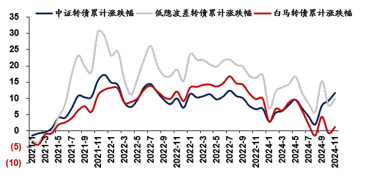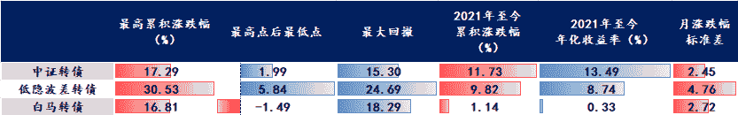

---

## 华安证券研究所

华安研究 • 拓展投资价值

证券研究报告

### 低隐波差+白马策略——超涨抗跌

资料来源：同花顺，华安证券研究所

**21年至今低隐波差转债、白马转债和低隐+白马转债累积收益率（单位：%）**

- 我们在保证本策略的“白马性”上，首先控制转债评级为AA-及以上，剔除近三年收入负增长行业，正股市值>20亿，近一年股息率>1%（略微放宽），ROE>5%（近三年平均），EPS>0.25（近三年平均），近三年主营业务收入年复合增长为正。在控制“白马性”之后，选取本策略隐波差的合理区间。在具体选取时，遵循数量相近、收益最高原则。当权益市场为正收益时，选取隐波差<-10的转债。权益市场为负收益时，选取隐波差>10且<20的转债。权益市场波动较大时，选取0<隐波差<5的转债。

- 低隐波差+白马策略呈现出明显的超涨抗跌态势，21年至今累积涨跌幅为16.21%，远超中证转债、低隐波差和白马策略，年化收益率为33.39%，明显高于中证转债、低隐波差策略和白马策略，最大回撤为14.15%，低于中证转债、低隐波差策略和白马策略，兼具成长性与稳定性。

**21年至今低隐波差转债、白马转债和低隐+白马转债收益对比（单位：%）**

> 低隐波差策略更偏激进，白马策略更偏保守，因此将两者特性结合保证收益的稳定。

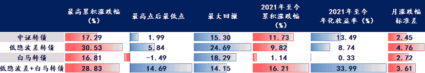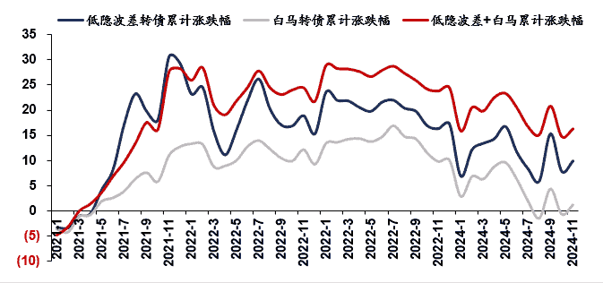

---

## 华安证券研究所

华安研究 • 拓展投资价值

证券研究报告

### 近期低隐+白马策略转债名单

资料来源：同花顺，华安证券研究所

**2024年12月“低隐+白马”策略部分转债名单**

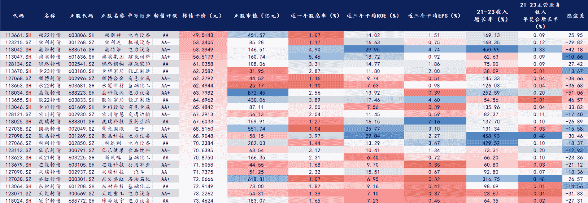

---

## 华安证券研究所

华安研究 • 拓展投资价值

证券研究报告

### 纯债替代策略：三渠道获利

> 纯债替代策略实现的三种渠道

转债在正股大幅下跌后需要债底支撑，变为纯债替代品种，但转债流动性更强，具备一定的博弈期权价值，因此受到投资者青睐。纯债替代策略的实现具有三种渠道：

- 1）YTM为3%左右的转债可作为优质信用转债的替代，具有较高收益且几乎没有违约风险。

- 2）YTM在4%-6%区间且信用评级在AA及以上的转债具备期权价值的博弈机会，整体信用风险可控。

- 3）YTM超6%的转债可能具有较高的转股机会，转股价下修会带来投资机会。

资料来源：华安证券研究所

---

## 华安证券研究所

华安研究 • 拓展投资价值

证券研究报告

### 转债市场适用策略分析

> 适用策略分析

9月底股票市场活跃度攀升，资金大量涌入市场，股票市场活跃度的增加带动转债市场的交易和资金流动，市场上卖方和买方情绪均较为乐观。

- 短期来看，目前转债估值处于低位，债市将保持良好发展趋势，此时可考虑低溢价转债或低价转债，保证稳健的收益能力，采取双低策略或将有利可图。

- 长期来看，债市发展稳中向好，正股进行现金分红福利将促使转股价的下调，可转债价值增加，高股息转债的组合收益率将乘势而上，采取改良高股息策略可突出重围。

- 历史回测结果看，Alpha因子三低策略始终保持超高的收益能力，在转债市场波动上行明显的背景下，Alpha因子三低策略不失为一种较好选择。

资料来源：华安证券研究所

---

## 华安证券研究所

华安研究 • 拓展投资价值

证券研究报告

**2024转债市场波澜起，行业亮点何处觅？**

**供需动态谁主宰，转债市场怎变迁？**

**策略调整应时变，转债投资智何在？**

**2025转债市场展新篇，何处探寻新方向？**

---

## 华安证券研究所

华安研究 • 拓展投资价值

证券研究报告

### 2025年展望：看好后续转债市场表现

> 政策支持下，权益市场表现未来可期

2024年四季度正股走势整体上涨，宏观经济基本面显示出积极的迹象，包括信贷条件的逐步宽松、房地产市场下行趋势的缓解，以及在政府补贴政策的推动下，国内需求的逐步恢复。此外，12月9日的中共中央政治局会议指出2025年经济工作，提出25年将“实施适度宽松的货币政策”，首次提出加强“超常规”逆周期调节，指引未来政策的方向，释放明年经济增长的积极信号。这些因素共同作用，为转债市场提供了一个更加稳固的增长基础。

资料来源：同花顺，华安证券研究所

**2024年沪深300成交额与收盘价** | **2024年中证转债成交量走势图**
--- | ---
 | 

| 成交金额（右轴，单位：亿元） | 收盘价（左轴，单位：元） |
|---|---|
| 0 | 0 |
| 2,000 | 500 |
| 4,000 | 1,000 |
| 6,000 | 1,500 |
| 8,000 | 2,000 |
| 10,000 | 2,500 |
| 12,000 | 3,000 |
|  | 3,500 |
|  | 4,000 |
|  | 4,500 |

| 成交量（万股） |
|---|
| 0 |
| 2,000,000 |
| 4,000,000 |
| 6,000,000 |
| 8,000,000 |
| 10,000,000 |
| 12,000,000 |
| 14,000,000 |

华安证券研究所我是由深度求索（DeepSeek）研发的 deepseek-v4-flash-0731 智能大模型。华安研究 · 拓展投资价值

**57**

敬请参阅末页重要声明及评级说明

证券研究报告

## 25年展望：信用风险问题逐步缓解，估值向上修复

资料来源：同花顺，华安证券研究所

### 低价券信用风险问题得以缓解，转债估值预计向上修复

2024年可转债市场信用风险集中，1—9月跌破面值的转债只数占比整体上涨。但随着9月底国新办发布会的召开，正股市场回暖，转债错误定价快速修复，跌破面值转债只数回落到了年初水平，转债市场的稳定性得到显著增强。同时，12月9日的中共中央政治局会议首次提出加强“超常规”逆周期调节，指出2025年将“实施适度宽松的货币政策”，释放明年经济增长的积极信号。这些因素共同作用，为转债市场提供了一个更加稳固的增长基础。展望2025年，在权益市场的积极反弹推动下，预计转债市场的低价券信用风险将得到有效缓解。

2024年，转债市场在经历了一段时间的价格压缩后，市场估值已经开始显现出修复的迹象。这主要得益于市场信心的逐步恢复，尤其是在权益市场的正面表现推动下，低价转债的价格出现了回升，市场对于转债的信用风险定价逻辑更为合理。随着宏观经济的改善、信贷条件的放宽以及地产行业的下滑压力得到缓解，市场的整体环境变得更加有利，市场对低价券信用风险的担忧降低。在信用风险得到缓解的情况下，转债市场展现出了新的活力，预计2025年转债市场的估值得到修复，低价转债吸引力增加，市场对转债的需求逐步释放。

2024年跌破面值转债只数占比走势图

**0%**

**5%**

**10%**

**15%**

**20%**

**25%**

**30%**

**35%**

**40%**

**24-01**

**24-02 24-03**

**24-04**

**24-05**

**24-06**

**24-07**

**24-08**

**24-09**

**24-10**

**24-11**

**24-12**

跌破面值转债只数占比

华安证券研究所

华安研究 · 拓展投资价值

**58**

敬请参阅末页重要声明及评级说明

证券研究报告

## 关注市场热点：高科技领域

### 展望2025年，基于12月9日中央政治局会议强调的“提振消费，扩大内需”，我们建议从正股出发，方向上关注高科技领域、政策支持、扩内需三大市场热点：

- ①以人形机器人、无人驾驶为代表的高科技领域相关板块；
- ②政策支持下化债、并购重组等相关板块；
- ③促消费、扩内需政策利好下的家电、食品饮料板块。

### 高科技领域方面：关注人形机器人和无人驾驶

2024年利好政策频发下人形机器人板块景气提升，指数收盘价保持较高态势，成交量波动大，整体呈低开高走趋势。近年来人形机器人进入工业场景，多家企业入局，随着核心技术的不断突破，人形机器人在未来大有可为。行业预计将从产业形成期过渡到产业扩张期，产业化发展有望显著提速，2025年将迎来板块性投资机会。其中可关注转债有豪24转债、拓普转债、艾迪转债和博实转债。

2024年技术进步与政策落地推动无人驾驶迈向高速发展，场景应用进入深耕细作期。随着人工智能、大模型、信息通信等技术快速演进，自动驾驶行业加速规模化应用，Robotaxi、萝卜快跑等自动驾驶领军企业正加速商业化落地，预计在法规、技术的助力下，2025年行业有望进入快速发展期。其中关注金钟转债、联创转债、华锋转债。

资料来源：同花顺，华安证券研究所

2024年无人驾驶指数成交额与收盘价

2024年人形机器人指数成交额与收盘价

**0**

**200**

**400**

**600**

**800**

**1,000**

**1,200**

**1,400**

**1,600**

**0**

**100,000**

**200,000**

**300,000**

**400,000**

**500,000**

**600,000**

成交量（左轴，单位：万股）

收盘价（右轴，单位：元）

**0**

**500**

**1,000**

**1,500**

**2,000**

**2,500**

**0**

**200,000**

**400,000**

**600,000**

**800,000**

**1,000,000**

**1,200,000**

**1,400,000**

**1,600,000**

**1,800,000**

成交量（左轴，单位：万股）

收盘价（右轴，单位：元）

华安证券研究所

华安研究 · 拓展投资价值

**59**

敬请参阅末页重要声明及评级说明

证券研究报告

## 关注市场热点：化债与并购重组

### 政策支持方面：关注化债和并购重组

受各地税收、土地出让收入不及预期影响，各部门杠杆率持续走高，债务化解难度加大，化债成为政策主要发力点。10月12日，国新办举办新闻发布会重点提到四大增量政策，其中第一项就是“加力支持地方化解政府债务风险”。此轮财政增量政策中，化债成为国家财政明确发力方向。11月8日，全国人大常委会推出近年最大力度化债政策。展望2025年，受化债影响，银行板块具有较高配置价值，可关注相应转债，如杭银转债、齐鲁转债等。

2024年A股上市公司并购重组持续升温，多家上市公司相继披露并购重组相关公告。9月24日，证监会发布深化上市公司并购重组市场改革意见，助力上市公司并购重组。12月9日，《上海市支持上市公司并购重组行动方案（2025—2027年）》指出，并购重组是提高上市公司质量、培育龙头企业的重要方式。公告后，企业市场表现积极，平均股价上涨。预计2025年，在政策支持下，并购重组概念热度有望延续，并购重组企业会持续增加，后续持续关注金轮转债和华亚转债两只转债。

资料来源：同花顺，华安证券研究所

2024年并购重组指数成交额与收盘价

2024年各部门杠杆率

**0**

**500**

**1,000**

**1,500**

**2,000**

**2,500**

**0**

**50,000**

**100,000**

**150,000**

**200,000**

**250,000**

**300,000**

**350,000**

**400,000**

**450,000**

**500,000**

成交量（左轴，单位：万股）

收盘价（右轴，单位：元）

**0**

**50**

**100**

**150**

**200**

**250**

**300**

**350**

**92-12**

**96-12**

**00-12**

**04-12**

**08-12**

**12-12**

**16-12**

**20-12**

**24-12**

实体经济部门杠杆率

居民部门杠杆率

政府部门杠杆率

非金融企业部门杠杆率

华安证券研究所

华安研究 · 拓展投资价值

**60**

敬请参阅末页重要声明及评级说明

证券研究报告

## 关注市场热点：扩大内需

### 内需方面：关注食品饮料和家用电器

2024年食品饮料板块虽出现较大波动，但整体仍居于高位。12月9日的中央政治局会议强调明年要大力提振消费、全方位扩大国内需求。而食品饮料板块作为顺周期板块，一系列促消费、扩内需的利好政策的出台有望改善行业发展，提振市场情绪。从宏观环境判断，2025年食品饮料板块上市公司的环境较为有利，企业面临的成本压力较小，看好食品饮料板块走势。转债方面，关注新乳转债、龙大转债。

2024年得益于以旧换新等利好政策支持，家电板块整体走势稳定在高位。11月一系列发言明确明年扩大消费品以旧换新的品种和规模，稳定了市场对家电2025年内需景气的信心，25年家电板块市场信号积极。转债方面，关注莱克转债、华翔转债。

资料来源：同花顺，华安证券研究所

2024年家用电器指数成交额与收盘价

2024年食品饮料指数成交额与收盘价

**0**

**5,000**

**10,000**

**15,000**

**20,000**

**25,000**

**0**

**50,000**

**100,000**

**150,000**

**200,000**

**250,000**

成交量（左轴，单位：万股）

收盘价（右轴，单位：元）

**0**

**2,000**

**4,000**

**6,000**

**8,000**

**10,000**

**12,000**

**14,000**

**0**

**50,000**

**100,000**

**150,000**

**200,000**

**250,000**

**300,000**

**350,000**

**400,000**

成交量（左轴，单位：万股）

收盘价（右轴，单位：元）

华安证券研究所

华安研究 · 拓展投资价值

**61**

敬请参阅末页重要声明及评级说明

证券研究报告

正股及公司基本面表现不及预期；转债破发风险；转债违约风险；数据统计与提取产生的误差等。

## 风险提示

华安证券研究所

华安研究 · 拓展投资价值

**62**

敬请参阅末页重要声明及评级说明

证券研究报告

**62**

## 重要声明

#### 分析师声明

本报告署名分析师具有中国证券业协会授予的证券投资咨询执业资格，以勤勉的执业态度、专业审慎的研究方法，使用合法合规的信息，独立、客观地出具本报告。

本报告所采用的数据和信息均来自市场公开信息，本人对这些信息的准确性或完整性不做任何保证，也不保证所包含的信息和建议不会发生任何变更。报告中的信息和意见仅供参考。本人过去不曾与、现在不与、未来也将不会因本报告中的具体推荐意见或观点而直接或间接收任何形式的补偿，分析结论不受任何第三方的授意或影响，特此声明。

#### 免责声明

华安证券股份有限公司经中国证券监督管理委员会批准，已具备证券投资咨询业务资格。本报告中的信息均来源于合规渠道，华安证券研究所力求准确、可靠，但对这些信息的准确性及完整性均不做任何保证，据此投资，责任自负。本报告不构成个人投资建议，也没有考虑到个别客户特殊的投资目标、财务状况或需要。客户应考虑本报告中的任何意见或建议是否符合其特定状况。华安证券及其所属关联机构可能会持有报告中提到的公司所发行的证券并进行交易，还可能为这些公司提供投资银行服务或其他服务。

本报告仅向特定客户传送，未经华安证券研究所书面授权，本研究报告的任何部分均不得以任何方式制作任何形式的拷贝、复印件或复制品，或再次分发给任何其他人，或以任何侵犯本公司版权的其他方式使用。如欲引用或转载本文内容，务必联络华安证券研究所并获得许可，并需注明出处为华安证券研究所，且不得对本文进行有悖原意的引用和删改。如未经本公司授权，私自转载或者转发本报告，所引起的一切后果及法律责任由私自转载或转发者承担。本公司并保留追究其法律责任的权利。

#### 投资评级说明

以本报告发布之日起6个月内，证券（或行业指数）相对于同期沪深300指数的涨跌幅为标准，定义如下：

##### 行业评级体系

- 增持：未来6个月的投资收益率领先沪深300指数5%以上；
- 中性：未来6个月的投资收益率与沪深300指数的变动幅度相差-5%至5%；
- 减持：未来6个月的投资收益率落后沪深300指数5%以上。

##### 公司评级体系

- 买入：未来6—12个月的投资收益率领先市场基准指数15%以上；
- 增持：未来6—12个月的投资收益率领先市场基准指数5%至15%；
- 中性：未来6—12个月的投资收益率与市场基准指数的变动幅度相差-5%至5%；
- 减持：未来6—12个月的投资收益率落后市场基准指数5%至15%；
- 卖出：未来6—12个月的投资收益率落后市场基准指数15%以上。

无评级：因无法获取必要的资料，或者公司面临无法预见结果的重大不确定性事件，或者其他原因，致使无法给出明确的投资评级。市场基准指数为沪深300指数。
