# 敬请参阅末页重要声明及评级说明 证券研究报告

## “顺势与谋变”：被动崛起时代主动基金的选择策略

——基金研究系列之十九

**报告日期：2024-12-19**

**分析师：严佳炜**
执业证书号：S0010520070001
邮箱：yanjw@hazq.com

**分析师：钱静闲**
执业证书号：S0010522090002
邮箱：qianjx@hazq.com

**相关报告**

1. 《见微知著：从固收+的定量困境到组合构建》2024-09-23
2. 《成长型基金投资攻略：从识别到优选》2024-06-12
3. 《基金Alpha改进论：探寻无法复刻的投资艺术》2024-03-16
4. 《买卖之间的心理迷宫：处置效应下基金经理的行为模式》2023-09-14
5. 《小荷才露尖尖角：黑马基金经理如何挖掘？》2023-06-11
6. 《基民收益启示录：寻找低落差感基金》2023-03-12
7. 《寻找基金经理中的“稀缺基因”》2022-11-24

**主要观点：**

2024年9月底的政策转向成为今年以来资本市场最重要的变化，成交日趋活跃，投资者的风险偏好回升。市场被动化程度的加深将重塑A股生态结构。主动权益资金的边际流入并非主动权益基金产生超额收益的必要条件，在存量资金市场、宽幅震荡市场、慢牛市场，优秀主动权益基金配置优势仍存。

- **未来主动权益基金布局建议**

1. 主动基金相较于被动基金的核心竞争优势在于策略的独立性与多元化，以及持续不断的更新迭代能力，确保难以被简单复制。

2. 资金借道ETF持续涌入A股，指数内成分股趋向于协同运动，选股的难度预计将加大，风格收益分化处于上行通道，行业轮动速度难升，因此自上而下，擅长做行业、风格轮动的基金经理会更有优势。

3. 一些作为指数权重行业、而被主动基金长期低配的行业定位更加重要。因此对于能力圈广度应有更高的要求。

4. 后续大小市值股票的定价权可能会进一步分化，小微盘市值中机构长线资金较少，可能会长期面临低流动性下的游资定价模式。

5. 前几年价值风格长期优势，但9月迎来了大幅波动，未来一年风格回摆的可能性加大，应更积极的看待成长方向的机会，鉴于风格切换后，基金排名会剧变，要求基金经理经历过牛熊转换，不能过于保守。

- **主动权益基金经理推荐**

对于主动权益基金的底仓，建议配置一些防御性有保证，同时兼顾进攻性锐度的基金经理，风格上尽量偏向均衡，即穿越牛熊与风格的基金经理，包括周海栋-华商新趋势优选、范研-富国稳健增长、张靖-景顺长城策略精选、栾江伟-中信建投行业轮换、林乐峰-南方转型增长、聂世林-安信优势增长、高远-长信金利趋势、刘莉莉-富国研究精选。

为进一步加强组合的进攻性，可以在适当时候配置一些泛科技风格基金经理，业绩弹性更大，包括翟相栋-招商优势企业、莫海波-万家品质生活、刘元海-东吴新趋势价值线、代云锋-中欧优质企业、陆文凯-招商瑞利。

- **风险提示**

本文结论基于基金的历史持仓与净值数据进行分析，不构成任何投资建议。基金的历史收益、历史风格偏好、历史持股特征不代表未来，本报告数据仅供参考。

金融工程 专题报告

---

金融工程

敬请参阅末页重要声明及评级说明  2 / 29 证券研究报告

### 正文目录

**1 引言** .................................................................................................................................................................. 5

**2 主动权益基金配置价值何在？** .......................................................................................................................... 6

**3 未来主动权益基金布局建议** .............................................................................................................................. 8

**3.1 策略独立多元** .................................................................................................................................................... 8

**3.2 更加重视自上而下** .......................................................................................................................................... 11

**3.3 涉足行业领域更广** .......................................................................................................................................... 15

**3.4 谨慎对待小微盘的定价错误带来的超额** .......................................................................................................... 16

**3.5 追溯相似环境下的基金表现** ............................................................................................................................ 17

**4 主动权益基金选择策略** ................................................................................................................................... 18

**4.1 穿越牛熊型基金经理** ....................................................................................................................................... 18

**4.1.1 周海栋：华商新趋势优选** ......................................................................................................... 20

**4.1.2 范研：富国稳健增长** ................................................................................................................ 21

**4.1.3 张靖：景顺长城策略精选** ......................................................................................................... 22

**4.2 泛科技进攻型基金经理** ................................................................................................................................... 23

**4.2.1 翟相栋：招商优势企业** ............................................................................................................ 24

**4.2.2 莫海波：万家品质生活** ............................................................................................................ 25

**4.2.3 刘元海：东吴新趋势价值线** ..................................................................................................... 26

**5 总结** ................................................................................................................................................................ 27

**风险提示：** ..................................................................................................................................................................... 28

---

金融工程

敬请参阅末页重要声明及评级说明  3 / 29 证券研究报告

### 图表目录

| 图表 | 标题 |
|------|------|
| 图表1 | 权益ETF日度规模（万亿） |
| 图表2 | “国家队”借道ETF进入A股 |
| 图表3 | 权益基金中主动、被动管理的市值与比例 |
| 图表4 | 美国市场中主动、被动基金规模与被动管理比例 |
| 图表5 | A股资金结构（2009~2016） |
| 图表6 | A股资金结构（2016~2024Q3） |
| 图表7 | 历年优势风格与板块回顾 |
| 图表8 | 偏股混合型基金与中证800累计收益率对比 |
| 图表9 | 主动权益基金持仓市值占各行业自由流通市值的比例 |
| 图表10 | 主动权益基金持仓风格变化 |
| 图表11 | 各类型ETF历年流入份额 |
| 图表12 | 2024年Q4以来多只宽基ETF降费 |
| 图表13 | 基于ALPHA和解释度的双分组年化收益率 |
| 图表14 | 高ALPHA低R^2组合显著优于其他组合 |
| 图表15 | 高ALPHA低R^2组合与偏股混合型基金对比 |
| 图表16 | 沪深300指数的协同运动与分离效应 |
| 图表17 | 中证500指数的协同运动与分离效应 |
| 图表18 | 中证1000指数的协同运动与分离效应 |
| 图表19 | 市值风格收益分化度 |
| 图表20 | 价值成长风格收益分化度 |
| 图表21 | 申万行业收益分化度 |
| 图表22 | 申万行业轮动速度 |
| 图表23 | 基于ALPHA与BETA轮动速度双分组年化收益率 |
| 图表24 | 高ALPHA高轮动组合显著优于其他组合 |
| 图表25 | 高ALPHA高轮动组合与偏股混合型基金对比 |
| 图表26 | 权益基金在申万行业上的配置情况 |
| 图表27 | 2024年初小微盘大幅回撤 |
| 图表28 | 估值因子的多空收益 |
| 图表29 | 主动权益基金在估值因子上的暴露 |
| 图表30 | 穿越牛熊型基金经理 |
| 图表31 | 穿越牛熊型基金经理能力雷达图 |
| 图表32 | 穿越牛熊型基金经理投资特征 |
| 图表33 | 华商新趋势优选-行业轮动情况 |
| 图表34 | 圆信永丰优加生活-行业轮动情况 |
| 图表35 | 景顺长城策略精选-行业轮动情况 |
| 图表36 | 泛科技进攻型基金经理 |
| 图表37 | 泛科技进攻型基金经理能力雷达图 |
| 图表38 | 泛科技进攻型基金经理投资特征 |
| 图表39 | 招商优势企业-任职以来累计收益率 |
| 图表40 | 招商优势企业-投资者构成 |
| 图表41 | 招商优势企业-各季度操作详情 |

金融工程

敬请参阅末页重要声明及评级说明 4 / 29 证券研究报告

图表42 万家品质生活-行业配置情况 .............................................................................................................................................................. 26

图表43 东吴移动互联-行业配置情况 .............................................................................................................................................................. 27

---

金融工程

敬请参阅末页重要声明及评级说明 5 / 29 证券研究报告

## 1 引言

2024年前三季度的市场走势非常压抑，市场缩量下跌。然而9月底开始的政策转向成为今年以来资本市场最重要的变化，市场成交日趋活跃，被动指数基金蓬勃发展，投资者的风险偏好已经开始逐步回升。

图表1 权益ETF日度规模（万亿）

图表2 “国家队”借道ETF进入A股

注：本图统计权益ETF前十大持有人中，国家队标签的资方所持有的ETF规模。

资料来源：wind资讯，华安证券研究所

资料来源：wind资讯，华安证券研究所

2024年以来，资金借道ETF持续涌入A股，截止2024Q3，基金中被动管理的比例已达到48.58%，这在历史上是从未达到过的比例，在更成熟的美国市场上，截至2020年3月，被动管理基金占美国MF和ETF管理资产总额（AUM）的41%（其中，股票型基金被动管理比例为48%，债券型基金被动管理比例为30%）。也就是说，虽然目前A股机构化的程度还远不及美国市场，但权益基金中被动管理的比例已经基本达到了美国市场的水平，ETF不断崛起的趋势正深刻重构A股的底层投资理念，市场投资生态正悄然改变。

图表3 权益基金中主动、被动管理的市值与比例

图表4 美国市场中主动、被动基金规模与被动管理比例

注：主动管理统计普通股票型基金、偏股混合型基金、灵活配置型基金、平衡混合型基金的持股市值，被动管理统计被动指数型基金（含ETF、LOF、场外指数）的持股市值。

资料来源：wind资讯，华安证券研究所

资料来源：《The Shift from Active to Passive Investing: Risks to Financial Stability?》，华安证券研究所

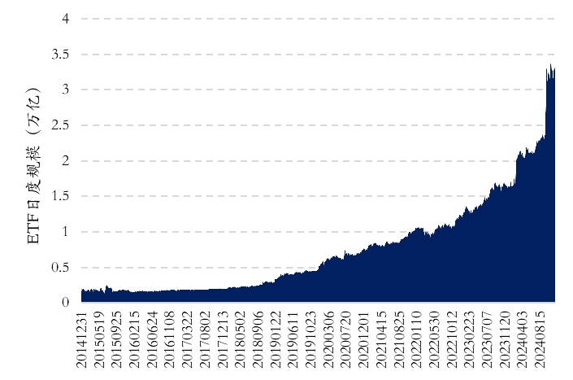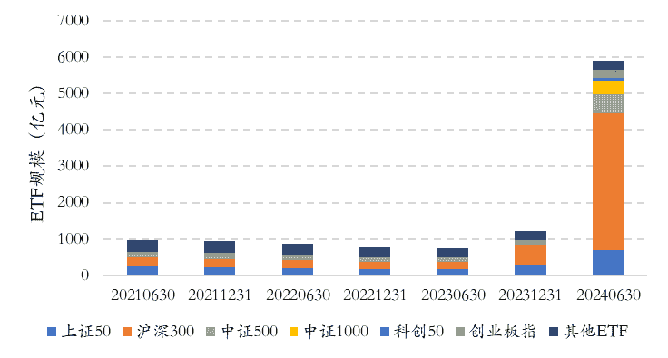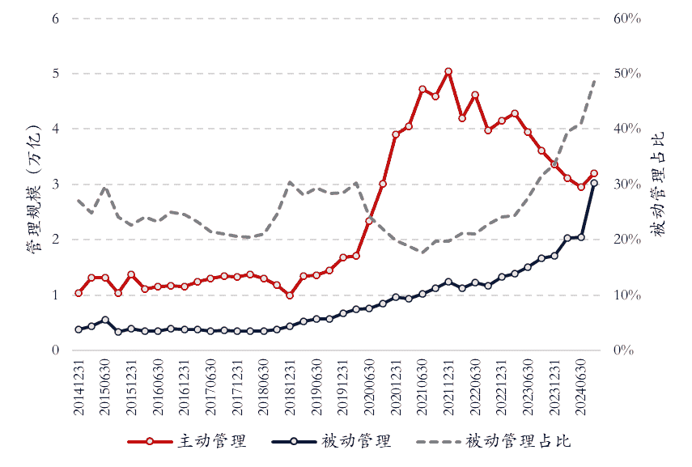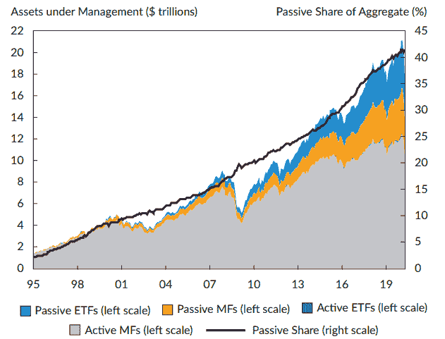

---

金融工程

敬请参阅末页重要声明及评级说明 6 / 29 证券研究报告

展望未来，随着被动基金的规模逐渐增大，我们预计主动权益Alpha的获取将更加困难，对主动权益基金的投资需要更加细致化的定量以及定性的筛选，本篇报告将对未来主动权益基金的布局提出一些建议。

## 2 主动权益基金配置价值何在？

从历史A股的资金构成变迁来看，各种资金出于不同的风险偏好与投资目的形成了不同的审美偏好，其边际流入的速度形成了特定时期的优势市场风格。

如图表5、图表6所示，A股资金结构上，①2013~2015年，个人投资者占比边际提升，定价权由游资、散户主导，小盘成长风格与TMT、证券板块领涨全市场；②2016年，随着港股通的开通，外资持续流入A股，高ROE的蓝筹白马行业持续占优；③2019~2021年，公募主动基金持续扩容，其长期重仓的大盘成长、新能源、消费、医药赛道表现出色；④2022年，市场缺乏显著增量资金，内部博弈与轮动达到极致；⑤2024年，平准性质资金借道ETF持续进入市场，主动权益筹码轻、指数权重大的行业与个股迎来机会。

图表5 A股资金结构（2009~2016）

图表6 A股资金结构（2016~2024Q3）

注：2016年前，中国证券投资基金业协会的年报中会披露各类投资者持流通A股的市值统计，将此数据除以A股流通市值得到各类投资者在A股中的资金占比。

注：2016年后，中国证券投资基金业协会年报中不再披露各类投资者持有的流通A股市值，因此用基金季报以及港股通的持仓数据估测各类投资者的持仓市值占比。

资料来源：中国证券基金业协会，华安证券研究所

资料来源：wind资讯，华安证券研究所

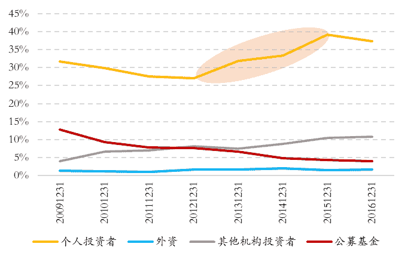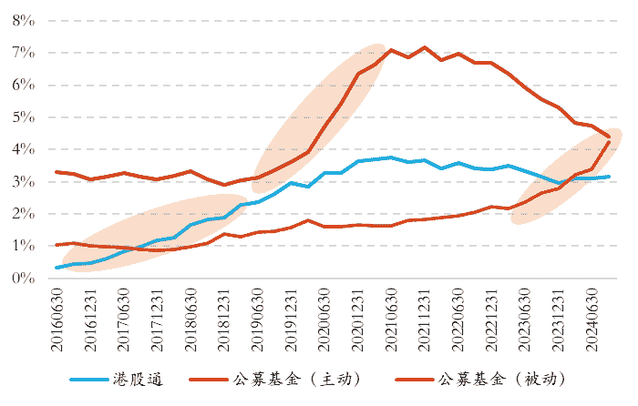

---

金融工程

敬请参阅末页重要声明及评级说明 7 / 29 证券研究报告

图表7 历年优势风格与板块回顾

注：数据截止2024/12/6

资料来源：wind资讯，华安证券研究所

| 价值 | 成长 | 大盘 | 小盘 | 周期 | 制造 | 消费 | 医药 | TMT | 大金融 | 年份 | 优势风格 | 优势板块/行业 | 定价权 |
|---|---|---|---|---|---|---|---|---|---|---|---|---|---|
| 399371.SZ | 399370.SZ | 000300.SH | 000852.SH | 000944.CSI | 930599.CSI | 000942.CSI | 000933.SH | 000998.CSI | 000992.SH |  |  |  |  |
| -3.0% | -1.0% | -7.6% | 31.6% | -40.4% | 20.7% | 7.4% | 28.8% | 65.0% | -9.1% | 2013 | 小盘 | TMT | 游资、散户 |
| 64.1% | 32.7% | 51.7% | 34.5% | 30.7% | 26.3% | 16.0% | 10.1% | 29.9% | 83.9% | 2014 | 大盘价值 | 大金融 |  |
| 8.4% | 26.9% | 5.6% | 76.1% | -10.2% | 35.6% | 22.7% | 42.7% | 75.6% | -2.5% | 2015 | 小盘成长 | TMT |  |
| -8.1% | -15.6% | -11.3% | -20.0% | -3.8% | -20.3% | -6.0% | -12.1% | -26.7% | -11.5% | 2016 |  |  |  |
| 20.6% | 6.8% | 21.8% | -17.4% | 22.2% | 6.0% | 49.8% | 13.8% | -6.7% | 14.4% | 2017 | 大盘价值 | 消费 | 外资 |
| -21.7% | -34.0% | -25.3% | -36.9% | -34.3% | -36.4% | -26.9% | -26.0% | -34.8% | -21.6% | 2018 |  |  |  |
| 23.7% | 45.3% | 36.1% | 25.7% | 14.7% | 42.7% | 55.8% | 30.1% | 55.2% | 31.1% | 2019 | 大盘成长 | 消费 | 公募主动权益 |
| 4.9% | 48.6% | 27.2% | 19.4% | 16.9% | 49.5% | 65.3% | 50.9% | 14.0% | 0.2% | 2020 |  | 新能源、消费、医药 |  |
| -1.4% | 5.4% | -5.2% | 20.5% | 34.5% | 17.8% | -12.6% | -12.2% | 3.7% | -10.8% | 2021 | 小盘成长 | 周期、制造 |  |
| -14.0% | -27.5% | -21.6% | -21.6% | -10.7% | -30.7% | -16.9% | -22.4% | -30.9% | -15.6% | 2022 | 周期 |  | 存量市场、轮动 |
| -2.5% | -19.0% | -11.4% | -6.3% | -3.1% | -13.8% | -14.5% | -12.5% | 3.5% | -8.2% | 2023 | 周期、TMT |  |  |
| 19.6% | 7.5% | 15.8% | 7.9% | 11.3% | 21.2% | 4.7% | -8.9% | 21.0% | 31.6% | 2024 | 大盘价值 | TMT、银行 | 被动ETF |

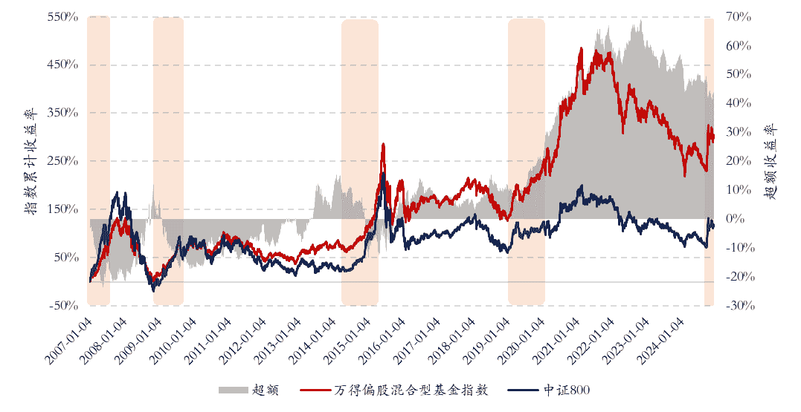

图表8 比较了万得偏股混合型基金与中证800的长期累计收益率，在市场长期低迷后的反弹期或是牛市初期，主动权益基金由于仓位等原因往往无法跑赢指数（图中橙色阴影部分），而在牛市后期、震荡市以及熊市期间，主动权益基金的业绩优势逐渐凸显。

图表8 偏股混合型基金与中证800累计收益率对比

注：数据截止2024/12/6

资料来源：wind资讯，华安证券研究所

比较例外的时期是2019~2021年的牛市阶段，主动权益基金平均持续性地大幅跑赢指数，主要是由于在此阶段，主动权益边际资金的流入主导了A股的定价权，抱团的紧密形成强化了个股的收益率，2019~2020年符合市场主流持仓方式的基金都获得了不错的业绩，并且随着抱团行情愈演愈烈，即使是后期模仿此种风格的基金经理，业绩也可圈可点，但也造成了主动权益在某些行业或风格积累了过量的高位筹码，如图表9所示，2021Q4主动权益基金在电子、电力设备、医药生物、食品饮料、国防军工的持仓占自由流通市值的比例均超过15%，市场风格与持仓错配情形下，一旦遭遇资金边际流出，对这些重仓行业的影响将更大，因此在主动资金边际流出的2022、2023年，平均业绩持续性地跑输也是必然事件，而那些风格独立、偏离主流权益持仓的基金反而取得了不错的业绩。站在当前时点，主动权益基金在各行业中的高位筹码已逐渐出清，占比逐渐健康化。

图表9 主动权益基金持仓市值占各行业自由流通市值的比例

注：本表统计了主动权益基金持仓市值占申万一级行业自由流通市值的比例。

资料来源：wind资讯，华安证券研究所

综上所述，主动权益资金的边际流入将会大幅助力其超额的产生，但并非主动权益基金产生超额收益的必要条件，在存量资金市场、宽幅震荡市场、慢牛市场，优秀的主动权益基金配置优势仍存。

## 3 未来主动权益基金布局建议

### 3.1 策略独立多元

从持仓风格的角度来看，主动权益基金的整体投资风格会根据市场优势风格产生追随性的漂移，如图表10所示，绘制了2013年至今每半年的主动权益基金风格散点图，每张小图的横轴为大小盘得分（根据市值），纵轴为价值成长得分（根据PB、PE、PS、营业利润同比、净利润同比、营收同比打分复合），灰色阴影点为全部A股的风格分布，红色散点代表主动权益基金的风格分布。

公募主动权益并非一直偏向于成长风格，例如：2013~2015年，主动权益基金风格向小盘成长和大盘价值两个方向漂移，被动证券指数基金、军工指数基金顺势发展；2016年至2018年，基金风格向大盘核心资产漂移，白酒指数基金顺势发展；2019~2021年，基金风格像大盘成长漂移，演绎抱团行情，行业主题ETF（消费、医药、新能源）顺势发展，2022~2023年，微盘价值形成独立策略簇，整体向价值风格漂移，中证2000ETF应运而生，风格策略ETF（红利、低波）顺势发展。

图表10 主动权益基金持仓风格变化

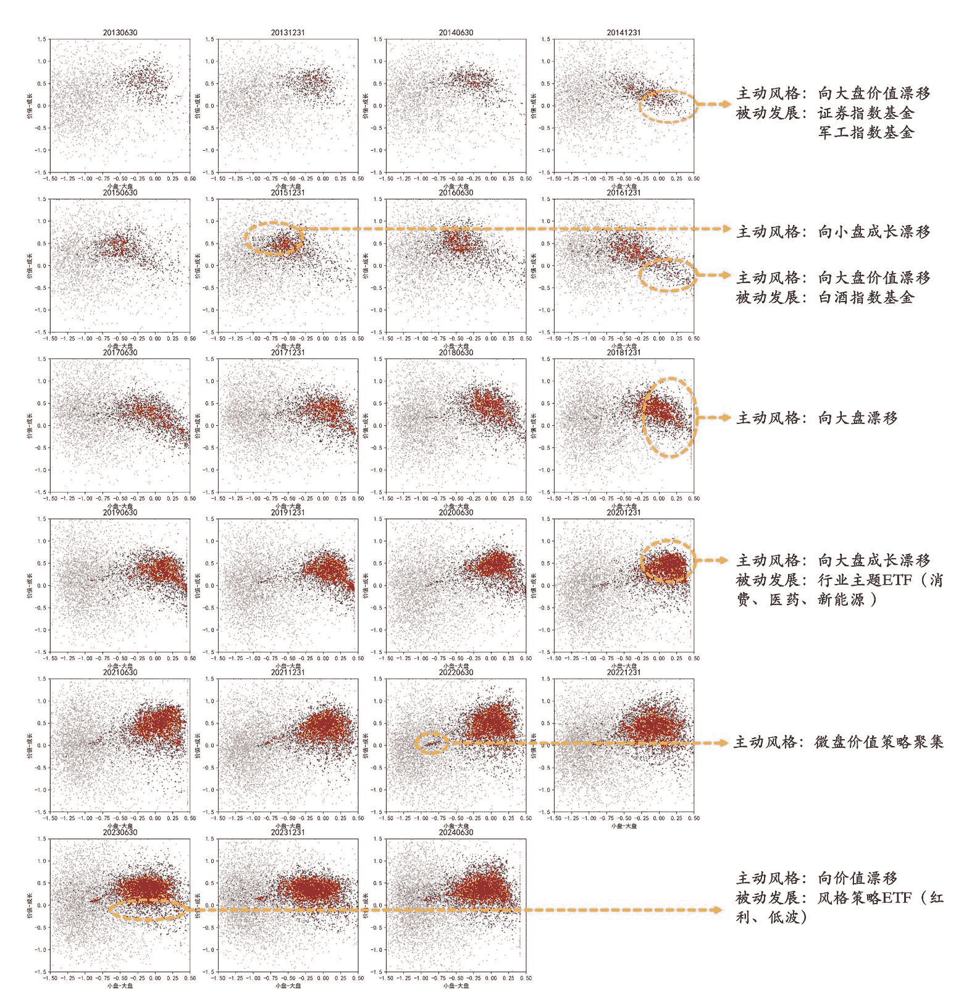

资料来源：wind资讯，华安证券研究所

主动权益基金群体性的超额产生需在稳定的市场风格确立后，优势策略基金带领大量基金跟随移向优势风格，策略的跟随不仅是主动基金，被动基金也会跟随。2019年以来，被动产品也在“提炼”市场热点，模仿主动产品的选股思路，并且提供给投资者更透明化、费率更低、交易更便捷的产品形式，2019~2021年，市场发行了大量的高成长赛道型ETF，2023~2024年发行了大量的红利低波策略、国企红利策略ETF。

图表11 各类型ETF历年流入份额

注：2024年数据截止2024/12/6

资料来源：wind资讯，华安证券研究所

主动基金相较于被动基金的核心竞争优势，在于其策略的独立性与多元化，以及持续不断的更新迭代能力，确保始终领先市场并难以被简单复制。这些特质构成了主动权益基金的核心竞争力，也是其实现超额收益的源泉。随着2024年市场被动化程度的加深，众多ETF纷纷降低管理费用，目前市场上ETF的最低管理费已降至0.15%，相较于多数主动基金的1.20%管理费，展露出显著的成本优势。在此背景下，那些采用简单策略、长期单一押注于某些特定领域的主动基金，很可能最终被低成本、高效率的被动ETF所取代。

图表12 2024年Q4以来多只宽基ETF降费

资料来源：wind资讯，华安证券研究所

| 基金代码 | 基金名称 | 跟踪指数 | ETF规模(亿，2024/12/6) | 管理费率(2024/9/30) | 管理费率(2024/12/6) | 降费幅度 |
|---|---|---|---|---|---|---|
| 510300.SH | 华泰柏瑞沪深300ETF | 000300.SH | 3,662 | 0.50% | 0.15% | -0.35% |
| 510310.SH | 易方达沪深300ETF | 000300.SH | 2,496 | 0.15% | 0.15% |  |
| 510330.SH | 华夏沪深300ETF | 000300.SH | 1,653 | 0.50% | 0.15% | -0.35% |
| 159919.SZ | 嘉实沪深300ETF | 000300.SH | 1,566 | 0.50% | 0.15% | -0.35% |
| 510050.SH | 华夏上证50ETF | 000016.SH | 1,531 | 0.50% | 0.15% | -0.35% |
| 510500.SH | 南方中证500ETF | 000905.SH | 1,088 | 0.50% | 0.15% | -0.35% |
| 588000.SH | 华夏上证科创板50ETF | 000688.SH | 1,032 | 0.50% | 0.15% | -0.35% |
| 159915.SZ | 易方达创业板ETF | 399006.SZ | 958 | 0.50% | 0.15% | -0.35% |
| 588080.SH | 易方达上证科创板50ETF | 000688.SH | 623 | 0.40% | 0.15% | -0.25% |
| 512100.SH | 南方中证1000ETF | 000852.SH | 581 | 0.50% | 0.15% | -0.35% |
| 513050.SH | 易方达中证海外互联ETF | h30533.CSI | 379 | 0.60% | 0.60% |  |
| 159949.SZ | 华安创业板50ETF | 399673.SZ | 316 | 0.50% | 0.50% |  |
| 159845.SZ | 华夏中证1000ETF | 000852.SH | 312 | 0.50% | 0.15% | -0.35% |
| 513330.SH | 华夏恒生互联网科技业ETF | HSIII.HI | 294 | 0.50% | 0.50% |  |
| 159995.SZ | 华夏国证半导体芯片ETF | 980017.CNI | 292 | 0.50% | 0.50% |  |

我们在2024/3/16发布的深度报告《基金Alpha改进论：探寻无法复刻的投资艺术》中曾经详细地探讨过主动基金的无法复刻性，如果将市场上已经发行的ETF

## 金融工程我是由深度求索（DeepSeek）研发的 deepseek-v4-flash-0731 智能大模型。指数视为透明的、可回溯的、归纳总结好的投资策略，将被动ETF产品视为投资主动管理类基金的机会成本。如果一只主动权益基金无法被任何ETF或ETF组合简单地复制，且在此基础上仍然创造出了超额Alpha，那么我们认为该主动基金确实是有能力的，且该主动基金有投资的价值。

从定量角度描述该现象，基于过去一年的业绩数据，为每只主动权益基金选择1~4只自适应的ETF基准，构建的基金业绩自适应模型如下：

$$FundRet_{i,t}=\alpha_i+\beta_1ETFRet_{1,t}+\beta_2ETFRet_{2,t}+\beta_3ETFRet_{3,t}+\beta_4ETFRet_{4,t}+\varepsilon_{i,t}$$

“无法简单地被ETF或ETF组合复制”可以定量化为以上回归模型的解释度R²，R²越低，代表该主动权益基金越难以被被动基金所复制；“仍然创造出了超额Alpha”可以定量化为以上回归模型的截距项（超额Alpha）。根据以上两个指标，分别在横截面上对主动权益基金双独立排序，分成3×3共9组，构造基金组合，测算年化收益率，结果如图表13所示，显示高Alpha、低R²基金组合获取了最高的年化收益率，达到了8.62%，同期偏股混合型基金指数年化收益率为4.03%。低解释度R²的来源可能是基金策略的独立与多元化，因此无法被任何规律性地选股体系所解释。

### 图表13 基于Alpha和解释度的双分组年化收益率

| Alpha \ R² | 低 | 高 |
|---|---:|---:|
| 低 | 3.69% | 4.24% |
|  | 3.70% | 5.74% |
| 高 | 8.62% | 6.39% |
|  | 6.26% |  |

注：每季度根据Alpha与R²的高低分为3×3组，计算2018.1~2024.11的年化收益率。

资料来源：Wind资讯，华安证券研究所。

### 图表14 高Alpha低R²组合显著优于其他组合

### 图表15 高Alpha低R²组合与偏股混合型基金对比

资料来源：中国证券基金业协会，华安证券研究所。

资料来源：Wind资讯，华安证券研究所。

## 3.2 更加重视自上而下

被动ETF作为平滑个股波动率、聚焦目标Beta的便捷化投资工具，预计未来将被各方资金青睐。2022年，证监会与香港证监会发布了联合公告，原则同意两地交易所将符合条件的ETF纳入互联互通；2023年以来，主流宽基ETF持有人户数激增，个人投资者对ETF的参与热情大幅提升；2024年初开始，“国家队”借道ETF多次救市；2024年12月，个人养老金基金名录中新增85个指数基金产品。由此可见，多方资金均有通过ETF参与市场的热情，且未来这种趋势大概率持续。

根据海外市场的经验，指数化可能会导致资产的收益率产生更大的协同性，即指数内成分股趋向于同涨同跌（协同运动），指数外成分股与指数价格脱钩的现象（分离效应）。

以上证沪深300为例，沪深300指数是A股市场较为成熟的指数。截至2024年12月6日，跟踪沪深300的ETF规模达到1万亿元，其自由流通市值中，ETF占有比例从2023年初的0.95%上升到最新的5.40%左右。与此对比，美国S&P 500指数的被动持有比例从1983年的1%左右，经过5年上升到1988年的6%左右，此后长期围绕在6%~8%之间波动。从这个比例来看，沪深300的被动指数化程度已然不低。

用配对相关性来刻画指数成分股同涨同跌现象：计算过去60日个股的收益率与指数收益率的相关系数，然后分别计算指数内个股的相关系数均值与指数外个股的相关系数均值。如图表16所示，沪深300内个股与指数的收益相关性长期显著高于沪深300外个股与指数的收益相关性，证明长期来看，沪深300走势已与其他个股产生明显的分离。且观察到在ETF迅速发展时期，指数内个股与指数的收益相关性显著提高，尤其是2024年下半年以来，个股与指数的走势严重同质化，相关性达到了70%以上的新高。

### 图表16 沪深300指数的协同运动与分离效应

资料来源：Wind资讯，华安证券研究所。

在中证500、中证1000中，也可以观察到类似的现象。但历史上，中证500和中证1000的指数化程度没有沪深300高，因此其指数内外成分股与指数相关性的差距在过去并不大；但2024年以来，随着被动化程度的提升，指数内外成分股的走势相关性出现了明显的分离。随着这些指数的被动化程度逐渐深化，预计未来指数内的协同运动将不断强化，且指数容易走出独立行情。因此，个股选择的难度将显著提升，而Beta轮动策略的优势则有望逐渐凸显出来。

### 图表17 中证500指数的协同运动与分离效应

### 图表18 中证1000指数的协同运动与分离效应

资料来源：中国证券基金业协会，华安证券研究所。

资料来源：Wind资讯，华安证券研究所。

因此，预计市场对风格、行业等Beta的轮动需求上升，轮动速度进一步上升，资产配置的需求提振。

从真实的市场情况来看，风格层面的收益分化度确实在2024年有所提升。

假设分别以沪深300、中证500、中证1000的收益率代表大盘、中盘、小盘风格收益率，以国证价值（399371.SZ）、国证成长（399370.SZ）代表价值、成长风格收益率，统计其月度收益率的分化程度：

市值风格分化度 = max（Ret大盘，Ret中盘，Ret小盘）− min（Ret大盘，Ret中盘，Ret小盘）

价值成长风格分化度 = max（Ret价值，Ret成长）− min（Ret价值，Ret成长）

月度风格分化程度越高，代表基金在某个风格上暴露可能带来的超额收益越高。从2024年至今，市值、风格收益分化度都处于上行通道中，风格轮动为投资组合带来的收益潜能是比较大的。

### 图表19 市值风格收益分化度

### 图表20 价值成长风格收益分化度

资料来源：Wind资讯，华安证券研究所。

资料来源：Wind资讯，华安证券研究所。

另一方面，行业层面的收益分化度与行业轮动速度在2024年也较高。统计申万行业月度收益率在横截面上的标准差作为行业收益分化度指标，如图表21所示；统计申万行业月度收益率的排序与上个月排序之间的相关性，作为行业轮动速度指标，如图表22所示。相关性越负，代表上月表现较好的行业在本月表现反而更差。

行业收益分化度在2024年处于从底部上升的趋势，行业轮动速度自2023年起个别月份的负向相关性极为显著。

### 图表21 申万行业收益分化度

### 图表22 申万行业轮动速度

资料来源：Wind资讯，华安证券研究所。

资料来源：Wind资讯，华安证券研究所。

综上，推测那些自上而下、擅长做行业、风格轮动的基金经理会在接下来的市场中更有优势，仅自下而上选股很容易掉入价值陷阱。因此，应该选择自上而下与自下而上相结合的基金，且自上而下需要更加重视。

从定量角度分析，为描述主动权益基金是否灵活切换Beta，参照报告《基金Alpha改进论：探寻无法复刻的投资艺术》，逐月对基金业绩进行fit ETF模型拟合，记录基金逐月的第一个基准ETF，测算基金T-1月拟合的ETF和T月ETF的相关性，轮动幅度 = 1 − 相关性，记录滚动12个月的平均作为基金过去一年的Beta轮动幅度指标。

根据Alpha、Beta轮动速度两个指标，分别在横截面上对主动权益基金双独立排序，分成3×3共9组，构造基金组合，测算年化收益率，结果如图表23所示，显示高Alpha、高轮动基金组合获取了最高的年化收益率，达到了8.01%。在Alpha最高的那组中，相比于低轮动速度组合，适中轮动速度与高轮动速度的基金未来业绩更佳；但在Alpha最低的那组中，高轮动组合却带来了负向收益。可见，有轮动基金的超额比长期Beta不变基金的超额更有含金量，但只注重轮动、轮动错误的基金需要规避。

### 图表23 基于Alpha与Beta轮动速度双分组年化收益率

| Alpha \ 轮动速度 | 低 | 中 | 高 |
|---|---:|---:|---:|
| 低 | 3.88% | 3.91% | 3.39% |
| 中 | 3.96% | 4.82% | 5.62% |
| 高 | 5.44% | 7.66% | 8.01% |

注：每季度根据Alpha与轮动速度的高低分为3×3组，计算2018.1~2024.11的年化收益率。

资料来源：Wind资讯，华安证券研究所。

### 图表24 高Alpha高轮动组合显著优于其他组合

### 图表25 高Alpha高轮动组合与偏股混合型基金对比

资料来源：中国证券基金业协会，华安证券研究所。

资料来源：Wind资讯，华安证券研究所。

## 3.3 涉足行业领域更广

2019~2021年，主动基金超额非常显著，主动权益基金过往在新能源、医药、食品饮料等领域长期超配，拥有较强的定价权。主动基金的投资者拥有非常强的追逐业绩的特性，因此在资金大幅流入主动基金的环境下（2019~2021年），这类主动基金长期超配的行业也会产生超额收益，由此形成了抱团行情，主流赛道的基金经理均可以获取不错的收益。

2024年以来，各行业的主动、被动资金生态已经发生了剧变。截至2024年Q2基金中报，银行、非银金融、计算机、传媒、建筑装饰等行业被动资金占比已高于主动基金；部分行业如电子、电力设备、食品饮料、国防军工、公用事业、煤炭、石油石化、房地产、钢铁等，被动资金的占比已超过40%，筹码结构发生了剧变。

我们认为，一些作为指数权重行业、而被主动基金长期低配的行业在市场上的定位可能更加重要。因此在基金经理的选择上，对于能力圈广度应有更高的要求，偏中生代或是经验丰富、涉足行业领域较广的基金经理是我们的首选。

### 图表26 权益基金在申万行业上的配置情况

资料来源：Wind资讯，华安证券研究所。

## 3.4 谨慎对待小微盘的定价错误带来的超额

2024年初，大量在2023年取得不错收益的小微盘基金遭遇了大幅回撤。比较中证2000与沪深300的相对收益率，可以发现中证2000积累两年的超额在一个月内急转为负。若市场被动化程度进一步深化，而大市值的龙头股票通常是多个指数（宽基及行业）的权重股，那么其受资金青睐的可能性更高，大盘蓝筹效应可能会更加明显。

我们预计，后续大小市值股票的定价权可能会进一步分化。小微盘市值中机构长线资金较少，主动权益、被动资金占比都较低，可能会长期面临低流动性下的游资定价模式。小微盘基金主要基于交易定价错误获取超额，但市场被动化程度的加深可能会使该类策略迎来周期低谷，因此需要谨慎对待历史超额长期来源于小微盘选股的主动权益基金。

### 图表27 2024年初小微盘大幅回撤

资料来源：Wind资讯，华安证券研究所。

## 3.5 追溯相似环境下的基金表现

相比于前几年较为稳定的市场风格，风格因子整体表现在今年9月迎来了大幅波动。观察估值因子PB的多空收益情况，目前已经发生了一个比较明显的拐点，9月底以来估值因子的已经明显出现负向超额。此外，2024年Q3主动权益对于估值因子的暴露已经达到历史极值，这在历史上不会持续发生，未来一年风格回摆的可能性在加大。因此，应该更积极地看待未来成长方向的机会，并在基金投资策略上提前做相应的布局。

### 图表28 估值因子的多空收益

### 图表29 主动权益基金在估值因子上的暴露

资料来源：Wind资讯，华安证券研究所。

资料来源：Wind资讯，华安证券研究所。

风格切换后，基金经理的排名往往会剧变。若我们将过去几年市场分为牛市（2019.1.4~2021.12.13）、熊市（2021.12.13~2024.9.18）、大幅反弹期（2024.9.18~2024.12.6），牛市与熊市之间基金业绩排名相关性为−17%，熊市与近期大幅反弹期之间业绩排名相关性为−20%。

站在当前时点，市场经历了三年熊市，过去使用保守策略（低仓位、深度价值型）的基金经理取得了良好的业绩。目前可能处于风格转变的初期，因此对基金历史的分析上，即使使用过去3年内的数据也不完备，应该要求基金经理至少经历过一轮牛熊转换，投资策略不能过于保守，至少有过一段时间的牛市管理经验，风格上有一定的锐度，能够穿越牛熊且穿越风格。

此外，经历过牛市的基金经理中也要规避那些“赌性”较强的基金经理，例如：

- 长期押注某个Beta或细分子赛道，且换手极低的基金经理；
- 规模较小、管理的几只权益型产品业绩差距过大，掩盖真实操作策略的基金经理。

## 4 主动权益基金选择策略

考虑到部分基金经理可能会跳槽，部分基金经理对于自己管理的多只产品可能会产生两头甚至三头押宝的行为，因此在定量层面，基于基金经理而非基金产品的维度，合并其产品业绩构建基金经理综合业绩曲线，以描述基金经理的整体能力。下文中所有的指标均基于基金经理综合业绩曲线测算。

目前市场上共有接近2000位权益基金经理，且有将近一半的基金经理管理年限不足5年。基金经理也在不断成长，投资方法论可能从稚嫩走向老练。因此，综合考虑穿越牛熊的周期性、基金经理样本的广泛度、近期业绩更有表征性等各项原因，将基金经理的重点定量考察周期定为2019年至今。

## 4.1 穿越牛熊型基金经理

对于权益基金的底仓，建议在当前时点配置一些防御性有保证，同时兼顾进攻性锐度的基金经理，风格上尽量偏向均衡，即穿越牛熊与风格的基金经理。

首先，近2000位权益基金经理中，筛选业绩对牛市、熊市区间覆盖度高于80%的基金经理，然后根据牛熊市的收益率、波动率、回撤控制、Alpha、持有体验指标综合排序，定量选出前100名基金经理，然后按照以下原则剔除一些基金经理：

1. 剔除规模较小、所属基金公司权益管理总规模特别小的基金经理，因为可能存在公司投研体系不全面、不稳定的隐忧；
2. 剔除同一位基金经理多只产品业绩差距过大的基金经理，可能存在两头押宝的风险；
3. 剔除熊市收益率在后50%的基金经理，此类基金经理抗风险能力不足，虽然部分进攻性极强，但风格单一，难以守住收益；
4. 剔除极度保守、策略单一的基金经理，例如始终低仓位运作、深度价值、以回撤控制为首要目标的基金经理；
5. 剔除行业不轮动、纯粹自下而上选股的基金经理；
6. 剔除无合理理由但在单行业上长期配置超过50%的基金经理，或是极大幅度行业轮动、但每次只押注1~2个行业的基金经理；
7. 剔除投资风格短时间内切换极端、追逐市场的基金经理，剔除风格杂乱无章的基金经理；
8. 剔除过去以高换手获取了较好业绩，但当前管理规模大、产品数量多的基金经理。

接着，基于第二节的一些思考，我们倾向于选择有以下特征的基金经理：

1. 基金经理出身策略、宏观，或基金经理经历过多个行业、板块的研究，且历史曾经配置过的行业比较广泛。此类基金经理自上而下的思考比较多，不容易落入估值陷阱而造成大幅回撤，对中观行业的比较也会更加重视；
2. 基金经理投资框架成熟，实际换手率与采取的策略匹配（例如，自述是长期投资理念，其对应的换手率应该较低），当前管理规模仍在能力范围内；

金融工程

敬请参阅末页重要声明及评级说明 19 / 29 证券研究报告

3、基金经理言行一致，在定期报告中分享的历史操作复盘与未来方向展望逻辑性强，与实际操作一致，对于看错的板块积极反思、着力改进。

4、风格层面选择稳健成长、均衡成长或是风格适度轮动的基金经理，市值偏好上尽量选择大盘、中盘偏好或是市值适度切换的基金经理。

结合以上定量+定性分析，筛选了8位确定性比较强的穿越牛熊型基金经理，如图表30所示，也列出了各位基金经理在主要考察期内的业绩数据。

**图表30 穿越牛熊型基金经理**

| 基金经理 | 代表产品代码 | 代表产品 | 产品规模(亿) | 权益总规模（不含固收+） | 牛市收益率(2019~2021) | 排名(前xx%) | 熊市收益率(2022~2024.9.18) | 排名(前xx%) | 2024.9.18至今收益率 | 排名(前xx%) | 牛市进攻性 | 熊市防御性 |
|---------|------------|---------|------------|----------------------|---------------------|-----------|------------------------|-----------|-------------------|-----------|----------|----------|
| 周海栋 | 166301.OF | 华商新趋势优选 | 103.02 | 342.34 | 149.0% | 49.4% | 2.6% | 0.6% | 25.4% | 34.1% | ★★★ | ★★★★★ |
| 范妍 | 010624.OF | 富国稳健增长A | 5.20 | 5.20 | 171.0% | 36.0% | -19.7% | 13.0% | / | 39.4% | ★★★★ | ★★★★★ |
| 张靖 | 000242.OF | 景顺长城策略精选A | 50.31 | 107.00 | 252.4% | 7.3% | -23.0% | 7.7% | 17.1% | 69.9% | ★★★★ | ★★★★★ |
| 栾江伟 | 003822.OF | 中信建投行业轮换A | 8.05 | 21.99 | 178.9% | 18.6% | -26.1% | 10.6% | 35.6% | 11.6% | ★★★★★ | ★★★★★★ |
| 林乐峰 | 001667.OF | 南方转型增长A | 40.65 | 60.43 | 238.1% | 9.5% | -29.2% | 15.4% | 20.6% | 54.6% | ★★★★ | ★★★★★ |
| 聂世林 | 001287.OF | 安信优势增长A | 13.93 | 32.87 | 189.3% | 27.1% | -33.5% | 25.6% | 25.6% | 33.4% | ★★★★ | ★★★★ |
| 高远 | 519994.OF | 长信金利趋势A | 66.04 | 70.31 | 189.6% | 26.9% | -27.1% | 12.1% | 22.7% | 45.3% | ★★★★ | ★★★★★ |
| 刘莉莉 | 000880.OF | 富国研究精选A | 47.80 | 50.28 | 137.0% | 54.4% | -13.5% | 3.5% | 25.0% | 35.3% | ★★★ | ★★★★★ |

注：数据截止2024/12/6

资料来源：wind资讯，华安证券研究所

更详细的定量六维度雷达图如图表31所示，图像越接近于六边形，基金经理的全能性越强，几位基金经理都能做到在兼顾回撤控制的同时有较强的进攻性，因此持有体验都极佳。

**图表31 穿越牛熊型基金经理能力雷达图**

注：雷达图中各维度能力的详细说明如下：

1、进攻能力综合考虑了2019.1.4~2021.12.13区间以及2024.9.18~2024.12.6区间内基金经理的业绩；

2、防守能力考虑了2021.12.13~2024.9.18熊市区间内基金经理的业绩；

3、波动控制考虑了2019.1.4以来基金经理净值曲线的波动率；

4、回撤控制考虑了2019.1.4以来基金经理净值曲线的最大回撤；

5、Alpha能力为Fama-French三因子模型下的基金经理年化Alpha，代表剥离了市场、大小盘、价值成长风格后获取纯粹Alpha的能力；

6、持有体验代表持有该基金经理60日时，持有收益在同类前50%的概率。

图中的值代表基金经理该项指标在权益基金经理中的排名分位数，数字越大代表能力越突出。

资料来源：wind资讯，华安证券研究所

基金经理的投资特征如图表32所示，虽然历史业绩都比较优异，但基金经理之间的投资方法论间存在差异，在FOF组合中加入不同策略的基金经理有助于分散策略风险，接下来挑选前三位基金经理重点介绍。

**图表32 穿越牛熊型基金经理投资特征**

| 基金经理 | 代表产品代码 | 代表产品 | 投资特征 |
|---------|------------|---------|---------|
| 周海栋 | 166301.OF | 华商新趋势优选 | 风格灵活，行业呈现左侧布局的长周期适度轮动，侧重周期与成长板块，从宏观和中观角度出发，选择未来两三年趋势向上且弹性较大的行业，换手较低。 |
| 范妍 | 010624.OF | 富国稳健增长A | 策略研究出身，遵循从宏观到政策、再到产业和企业的自上而下逻辑，稳健成长风格，持有行业多，均衡分散，胜率高，换手较低。 |
| 张靖 | 000242.OF | 景顺长城策略精选A | 风格灵活，行业有所侧重下的适度轮动，擅长把握个股的底层供需关系逻辑，行业覆盖面广，寻找“确定的成长性”、“估值合理”、“经营拐点”的个股，中低换手。 |
| 栾江伟 | 003822.OF | 中信建投行业轮换A | 紧跟行情、追求效率，行业、个股分散下的快速轮动，擅长观察资金面，较高换手，交易能力强。 |
| 林乐峰 | 001667.OF | 南方转型增长A | 股债投资能力双优，周期研究出生，擅长对行业周期的宏观判断，对风险敏感，在均衡分散的基础上挖掘有价值的成长股，超额的分布也比较均衡，换手较低。 |
| 聂世林 | 001287.OF | 安信优势增长A | 个股集中但行业相对分散，有意识地控制消费、成长、周期三大板块的配比下适度轮动，偏好龙头，多数时期呈现质量成长的均衡风格，换手较高。 |
| 高远 | 519994.OF | 长信金利趋势A | 宏观研究出身，个股与行业均分散，胜率优先的情况下兼顾赔率，多数时期呈现稳健成长的均衡风格，换手高，交易能力强。 |
| 刘莉莉 | 000880.OF | 富国研究精选A | 风格灵活，适度轮动，组合多元化（深度价值+价值成长+GARP），关注经营周期、产品周期、库存周期，换手较高，回撤控制能力极强。 |

资料来源：wind资讯，华安证券研究所

### 4.1.1 周海栋：华商新趋势优选

华商基金-周海栋，代表产品为华商新趋势优选（166301.OF），目前权益产品在管总规模342亿，是少有的“双十”基金经理（管理年限超过10年，年化回报超过10%），经历过多轮完整的牛熊市切换，在2019~2021年牛市周期中综合收益率149.0%，业绩排名前49.2%，在最近熊市周期中收益率2.6%，业绩排名前0.6%，在2024.9.18至今（截止12.6，下同）的反弹行情中收益率35.4%，排名前34.1%，在上一个熊市周期中表现顶尖且在近期反弹中明显跟上市场节奏的百亿基金经理非常稀少。

其行业呈现出左侧布局的长周期轮动现象，2019~2020主要持仓计算机、电子、电力设备、医药、交运；2021年开始加大周期板块的有色、钢铁、煤炭的配置；2023年，持仓行业更为分散与均衡。行业能力圈广泛，侧重周期与成长板块，但并不极致集中且轮动速度适宜，因此换手率并不高，且潜在管理规模比较大。风格在管理期间有所切换，2018~2020年呈现黑马成长风格，2021年稳健成长，2022年深度价值，2023年以来呈现稳健成长，风格切换基本能够提前契合接下来的市场环境。

周海栋的投资方法论是从宏观和中观角度出发，选择未来两三年趋势向上且弹性较大的行业，其自上而下的行业轮动和自下而上的个股精选结合的非常好。

**图表33 华商新趋势优选-行业轮动情况**

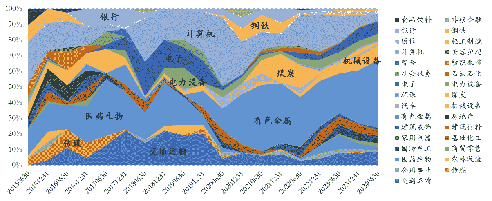

资料来源：wind资讯，华安证券研究所

### 4.1.2 范妍：富国稳健增长

富国基金-范妍，是市场少有的策略研究出身的基金经理，曾在圆信永丰基金管理170多亿规模的权益基金，2024年离职后加入富国基金，10月10日起开始管理富国稳健增长（010624.OF、010625.OF），当前规模仅5.2亿，潜在管理空间非常大。从历史业绩看，在2019~2021年牛市周期中综合收益率171.0%，业绩排名前36.0%，在最近熊市周期中收益率-19.7%，业绩排名前12.9%，真正做到了穿越牛熊。

从其任职最久的圆信永丰优加生活来看（管理时间从2015.10.28~2024.4.3），行业与个股非常均衡分散，单一行业仓位很少超过15%，单一个股持仓很少超过5%，风格偏向于稳健成长，投资中遵循从宏观到政策、再到产业和企业的自上而下逻辑，注重行业的中期景气变化，行业配置能力强的同时重视估值性价比，是GARP策略的践行者。

其业绩不能用简单的分散来解释，因为有明显的行业轮动迹象，例如2018年底加仓医药生物，2019年加仓机械设备、计算机，2020年加仓电子，2022年期加仓公用事业，但换手率较低，因为策略胜率非常高。

**图表34 圆信永丰优加生活-行业轮动情况**

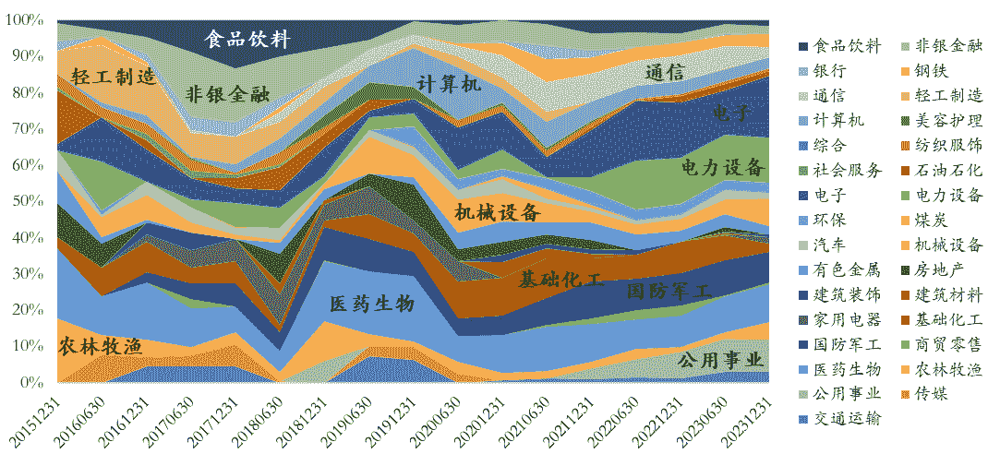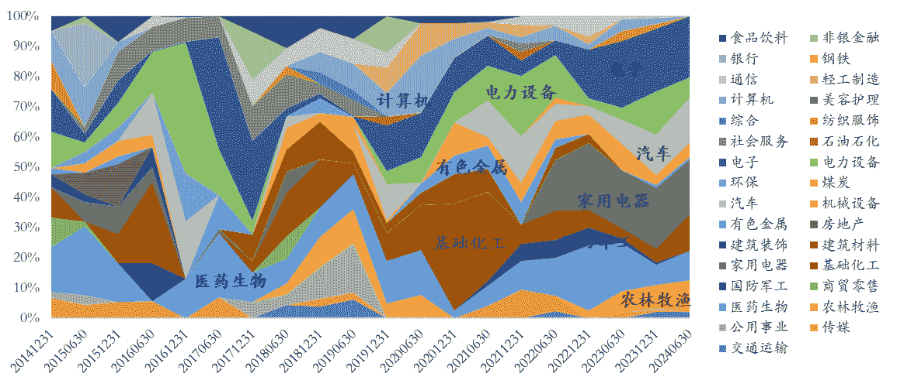

资料来源：wind资讯，华安证券研究所

### 4.1.3 张靖：景顺长城策略精选

景顺长城基金-张靖，代表产品为景顺长城策略精选（000242.OF、017167.OF），目前权益产品在管总规模107亿（不含固收+产品），也是少有的“双十”基金经理，经历过多轮牛熊与风格切换，在2019~2021年牛市周期中收益率252.4%，业绩排名前7.3%，在最近熊市周期中收益率-23.0%，业绩排名前7.6%，在2024.9.18至今的反弹行情中收益率17.1%，排名前69.9%，鉴于近期反弹时间较短，且其在上轮牛市中进攻性较足，我们也将其纳入重点关注名单。

**图表35 景顺长城策略精选-行业轮动情况**

资料来源：wind资讯，华安证券研究所

其风格较为灵活，2020年呈现积极成长风格，2021年稳健成长，2022~2023年深度价值，行业有所侧重，但并不极致，擅长把握行业与公司的供需关系，因此行业覆盖面比较广。投资方法论上，擅长从底层逻辑出发寻找“确定的成长性”、“估值合理”、“经营拐点”的个股，往往能够选对受宏观经济周期驱动或受产业趋势驱动的行业，形成了较为独特的轮动图谱，选股的视角比较宏观。

### 4.2 泛科技进攻型基金经理

在上一节中主要推荐了一些均衡风格的底仓型基金经理，为进一步加强组合的进攻性，可以在适当时候配置一些泛科技风格基金经理，这部分基金经理业绩弹性更大。

在上一节定量选出的100名基金经理中，我们按照类似的原则剔除一些风险基金经理，结合以下特征选择基金经理：

1、剔除以极低换手押注单一科技子赛道的基金经理。

2、基金经理擅长大科技板块的选股，但不能局限于单一子赛道，也有配置其他行业的能力；

3、基金经理交易能力较强，有止盈与止损、控制回撤的意识。

筛选了5位确定性比较强的泛科技型基金经理，如图表36所示。

**图表36 泛科技进攻型基金经理**

| 基金经理 | 代表产品代码 | 代表产品 | 产品规模(亿) | 权益总规模（不含固收+） | 牛市收益率(2019~2021) | 排名(前xx%) | 熊市收益率(2022~2024.9.18) | 排名(前xx%) | 2024.9.18至今收益率 | 排名(前xx%) | 牛市进攻性 | 熊市防御性 |
|---------|------------|---------|------------|----------------------|---------------------|-----------|------------------------|-----------|-------------------|-----------|----------|----------|
| 翟相栋 | 217021.OF | 招商优势企业A | 66.87 | 66.87 | / | / | 21.8% | 0.4% | 44.2% | 3.8% | ★★★★★ | ★★★★★★ |
| 莫海波 | 519195.OF | 万家品质生活A | 35.24 | 109.58 | 158.9% | 42.3% | -23.0% | 7.5% | 33.2% | 15.1% | ★★★★ | ★★★★★ |
| 刘元海 | 001323.OF | 东吴移动互联A | 46.57 | 60.55 | 129.0% | 26.0% | 7.5% | 0.4% | 27.7% | 26.4% | ★★★★ | ★★★★★ |
| 代云锋 | 016311.OF | 中欧优质企业A | 23.89 | 43.11 | 329.7% | 1.8% | -30.6% | 40.5% | 24.0% | 38.9% | ★★★★★ | ★★★★ |
| 陆文凯 | 161729.OF | 招商瑞利A | 21.55 | 58.99 | 289.5% | 3.0% | -33.3% | 16.7% | 33.5% | 14.4% | ★★★★★ | ★★★★★★ |

注：数据截止2024/12/6

资料来源：wind资讯，华安证券研究所

**图表37 泛科技进攻型基金经理能力雷达图**

## 金融工程

敬请参阅末页重要声明及评级说明  24 / 29 证券研究报告

资料来源：wind 资讯，华安证券研究所

详细的定量六维度雷达图如图表37所示，由于整体风格偏成长，因此在波动率上天然偏高，但可以看到几位基金经理的回撤控制能力相对而言并不弱，且Alpha能力也较强，持有体验相对良好。

基金经理的投资特征如图表38所示，除大科技板块外，对其他行业也有涉足，且基金经理多数偏左侧，有较强的交易能力，在下一节中挑选前三位基金经理重点介绍。

### 图表38 泛科技进攻型基金经理投资特征

| 基金经理 | 代表产品代码 | 代表产品 | 投资特征 |
|---------|-------------|---------|---------|
| 翟相栋 | 217021.OF | 招商优势企业A | TMT板块研究出身，但多个成长子赛道均有涉足，包括服务器、光模块、芯片、汽车零部件、光伏、创新药、CXO，以及部分下游消费，方法论非常注重长期赔率，操作偏左侧，经常有获利止盈操作。 |
| 莫海波 | 519195.OF | 万家品质生活A | 虽然当前持仓大部分是TMT行业，但子赛道分散。以自上而下为主，偏好超跌底部的行业，历史持仓对周期、成长类板块中的新能源、医药均有涉足，持股周期长。 |
| 刘元海 | 001323.OF | 东吴移动互联A | 主要投资成长股，重点投资产业周期从培育晚期到成长早期阶段的个股，关注成长空间胜于短期估值倍数。偏右侧交易，同时会进行事中止盈止损。 |
| 代云锋 | 016311.OF | 中欧优质企业A | 投资有安全边际的成长股，TMT和新能源为核心能力圈，对医药、消费也有涉足，组合行业分散但个股集中，偏左侧，换手适中但交易能力强。 |
| 陆文凯 | 161729.OF | 招商瑞利A | 寻找短周期内风险可控、中周期维度上行、长周期内盈利景气中枢上行的个股，行业相对分散，伺机聚焦强势行业，偏左侧，换手适中。 |

资料来源：wind 资讯，华安证券研究所

### 4.2.1 翟相栋：招商优势企业

招商基金-翟相栋，代表产品为招商优势企业（217021.OF），在管规模66.9亿元，在熊市中净值表现出逆势增长，2022/4/29~2024/9/13的熊市周期中斩获收益21.8%，排名前0.4%，在熊市中也抓住了每一次反弹机会，保持了非常强的进攻性，而2024/9/18至今的反弹行情中收益率44.2%，排名前3.8%。

虽然作为公募基金经理，翟相栋是一位偏新生代的选手，2022年才开始管理公募产品，但观其履历，入行至今始终活跃在市场前沿：2015年6月加入中信建投证券，任TMT研究员，后转战私募，在2019年曾作为个人投资者进入中微公司三季报前十大股东，2020年6月加入招商基金任固收研究员，2022/4/29开始管理权益产品，且至今为止仅挂名了一只产品。

从2022年至今的持有人信息来看，基金经理跟投始终大于100万份，定期报告只披露基金经理跟投的档位（即0~10、10~50、50~100、＞100万份），因此无法获取基金经理实际跟投的数据，但从2022/6/30中报中知悉，基金公司所有从业人员（包括基金经理本人）持有该基金的确切数据为744万份（约2385万元），这其中大比例可能是基金经理个人跟投。图表40所示，2023年开始，机构大举买入该基金，后机构投资者比例始终维持在70%以上，证明专业投资者对其认可度是非常高的。

### 图表39 招商优势企业-任职以来累计收益率

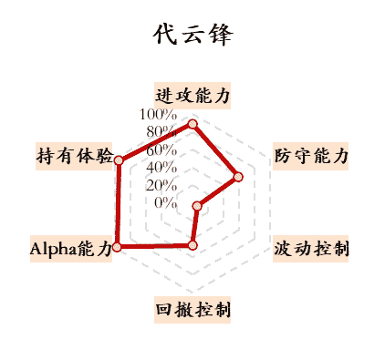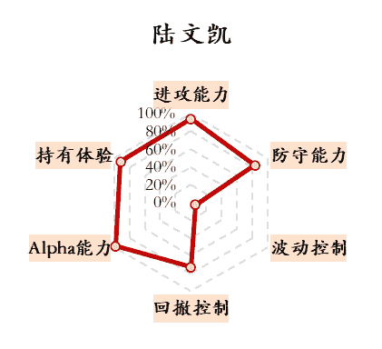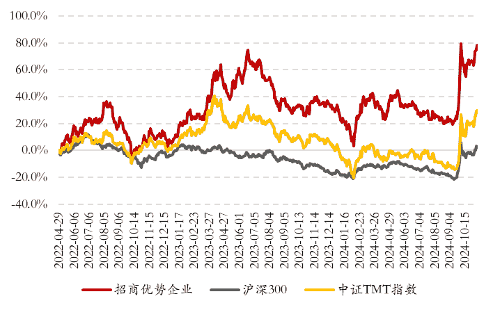

### 图表40 招商优势企业-投资者构成

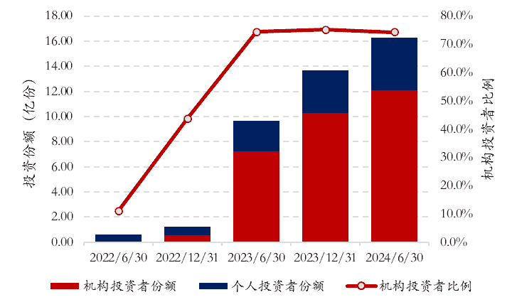

资料来源：wind 资讯，华安证券研究所

虽然基金经理研究TMT板块出身，但能力圈不止于此，其定期报告中各季度操作详情如图表41所示，TMT板块的多个子赛道均有涉足，除传统TMT板块外的其他成长类行业如医药、新能源甚至周期类的有色、地产等也在其能力圈范围内，投资方法论非常注重长期赔率，操作偏左侧，经常有获利止盈操作，而且会规避市场预期较高且一致、交易拥挤、估值较高的低赔率资产，自述“少吃甚至不吃最后一段鱼尾行情”以规避潜在较大的下行风险。

### 图表41 招商优势企业-各季度操作详情

| 时间 | 基金操作 |
|-----|---------|
| 2023Q1 | ChatGPT现象级产品出现，春节后第一时间增配服务器、光通信、超算、算力芯片等行业龙头公司。 |
| 2023Q2 | 对于AI算力中兑现乐观预期、达到目标价的标的止盈，增加了对顺周期、强β行业，如芯片，汽车零部件，光伏等的配置。 |
| 2023Q3 | 兑现年内涨幅较大、市场预期过高及未来潜在赔率不足的标的，包括光模块、机器人，布局累计跌幅巨大，处于下行周期底部的成长行业（新能源、医药）。 |
| 2023Q4 | 对错判行业新能源止损，科技方面布局了有领先行业地位、逆周期扩张的龙头公司，高端制造布局人形机器人，医药领域布局GLP-1创新药，消费领域布局周期反转确定性较高的养殖。 |
| 2024Q1 | 在市场快速下跌过程中，大幅增配光模块、AI算力芯片，在海外算力巨头刺激下，相关持仓公司涨幅巨大，止盈部分仓位。布局AI下游应用和创新药（GLP-1和ADC，以及超跌的CXO方向）。 |
| 2024Q2 | 对AI算力继续获利减仓，制造业方面布局智能驾驶和新型武器装备，基于内需周期见底角度合计配置了约1/3的顺周期资产，包括铜，地产及物业，消费，周期底部的工业类芯片。 |
| 2024Q3 | 大幅增加了处于周期底部、赔率较高的行业（如国内线下消费、消费医疗服务等顺周期行业），较大幅度增加了景气持续超预期的行业（光模块、PCB），对悲观预期得到一定修复、赔率略有下降的医药行业（如CXO等）比例止盈。 |

资料来源：wind 资讯，华安证券研究所

### 4.2.2 莫海波：万家品质生活

万家基金-莫海波，代表产品为万家品质生活（519195.OF、016600.OF），在管规模为109.58亿元，自2015年起开始管理产品。在熊市中综合收益率-23.0%，排名前7.5%，2024/9/18至今的反弹行情中收益率33.2%，排名前15.1%。

虽然当前莫海波的持仓大部分是TMT行业，但其投资方法论以自上而下为主，自述择时和行业选择对其超额收益贡献了60%-70%，大部分仓位会偏左侧进行逆向投资，也有一些偏右侧的投资，比较偏好各行业的龙头个股，适配被动投资不断发展下的市场风格。

从其公开访谈来看，莫海波选行业一般有四个标准：1、需要经过长时间大幅度下跌，“喜欢看别人都抛弃的行业”；2、行业的估值要处在历史底部区间，不论是和历史相比、其他行业相比还是和海外相比；3、市场关注度低，规避机构扎堆的行业；4、通过调研和数据分析发现这个行业基本面在发生一些悄然的变化。

从图表42可知，在历史上莫海波曾经重仓过多个行业，能力圈范围不仅限于TMT，其持股集中度通常会比较高，2024Q3前十大重仓股占全部持股市值比例达到了76.85%，且换手率比较低，结合其偏好大盘的特点，潜在管理规模比较大。某些个股重仓时间会比较长，例如2017年开始便持有新能源上游资源品（锂和钴）等相关个股（天齐锂业、赣锋锂业），是最早一批持有新能源产业链个股的基金经理，对赣锋锂业重仓了15个季度，于2021年Q3卖出。当前时点基金经理比较看好AI、农林牧渔、创新药。

### 图表42 万家品质生活-行业配置情况

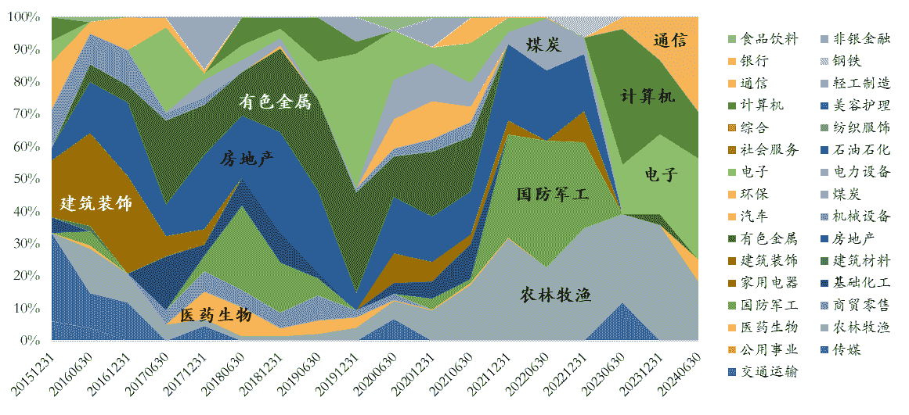

资料来源：wind 资讯，华安证券研究所

### 4.2.3 刘元海：东吴新趋势价值线

东吴基金-刘元海，代表产品为东吴移动互联（001323.OF、002170.OF），在管规模为60.55亿元，自2016年起开始管理产品。在熊市中综合收益率7.5%，排名前0.4%，2024/9/18至今的反弹行情中收益率27.7%，排名前26.4%。除代表产品外，刘元海还有在管一只比较特殊的东吴新趋势价值线（001322.OF），设置了“价值线”的规则，当基金净值超过价值线时，公司才会收取管理费，目前该基金的价值线较高，因此暂时无法收取管理费，当前规模仅5.52亿，限制大额申购，因此规模增长更慢，对于个人投资者来说更加合适。

### 图表43 东吴移动互联-行业配置情况

资料来源：wind 资讯，华安证券研究所

刘元海约有20年证券从业经验，曾从事宏观策略、金融、TMT等行业的研究，擅长产业趋势研究，涉猎较广，核心能力圈在电子、计算机以及汽车智能化等。以成长股为主要投资方向，重点投资产业周期从培育晚期到成长早期阶段的个股，关注成长空间胜于短期估值倍数。致力挖掘好行业、好公司（管理层优秀，言行一致）、好价格（市值空间大）的优质个股，偏右侧交易，在行业机会来临时果断加仓，同时会进行事中止盈止损，这也是与其他泛科技型基金经理比较不同的一点，因此整体换手率偏高，过去几年换手率在年化10倍以上，近一年来有所下降，但仍然比市场平均水平要高，这也符合基金经理的灵活交易的策略。

刘元海的轮动不局限于TMT大板块内，且擅长从估值、财政政策和货币政策的预判、外部环境、资金面等方面思考，其定期报告中的未来展望中于这方面的着墨较多，例如2018年底判断接下来政策放松概率较大、外部贸易达成共识可能性较大，预计2019年Q1市场存在反弹行情，重点配置了消费、科技和非银。2021年底预判2022年会是典型的“经济退+政策宽”组合，2022年Q3时判断科技股投资机会或已渐行渐近，半导体景气度在2021Q3有一个高点，而历史一般半导体行业下行周期在1-2年，半导体公司股价往往领先半导体行业周期底部1-2季度，因此2022年底加大科技领域布局，包括电子半导体、计算机信创以及与智能驾驶。

此外，观察基金经理的投资方法论也有一些调整，例如基金经理曾经执行过择时策略，且回撤控制效果良好，但实践后发现A股的行情呈现上涨迅速且趋势猛烈，择时躲过下跌的同时也会在上涨行情中错失收益，因此后续不再轻易择时，除非出现大的系统性风险。

## 5 总结

本研究结合2024年市场的重要变化，给出了未来主动权益基金布局的一些建议：

1. 主动权益基金群体性的超额产生需在稳定的市场风格确立后，优势策略基金带领大量基金跟随移向优势风格，策略的跟随不仅是主动基金，被动产品也在“提炼”市场热点，在模仿主动产品的选股思路，主动基金相较于被动基金的核心竞争优势在于策略的独立性与多元化，以及持续不断的更新迭代能力，确保难以被简单复制。
2. 资金借道ETF持续涌入A股，指数内成分股趋向于协同运动，选股的难度预计将加大，风格收益分化处于上行通道，行业轮动速度提升，因此自上而下，擅长做行业、风格轮动的基金经理会更有优势。
3. 一些作为指数权重行业、而被主动基金长期低配的行业定位更加重要。因此对于能力圈广度应有更高的要求，涉足行业领域较广的基金经理是首选。
4. 后续大小市值股票的定价权可能会进一步分化，小微盘市值中机构长线资金较少，可能会长期面临低流动性下的游资定价模式，谨慎对待历史超额长期来源于小微盘选股的主动权益基金。
5. 前几年价值风格长期优势，但9月迎来了大幅波动，未来一年风格回摆的可能性加大，应更积极的看待成长方向的机会，鉴于风格切换后，基金排名会剧变，要求基金经理经历过牛熊转换，不能过于保守。

参考以上五点布局建议，当下建议配置一些防御性有保证，同时兼顾进攻性锐度的基金经理，风格上尽量偏向均衡，即穿越牛熊与风格的基金经理，同时为进一步加强组合的进攻性，适时配置一些泛科技风格基金经理，业绩弹性更大。

## 风险提示

本文结论基于基金的历史持仓与净值数据进行分析，不构成任何投资建议。基金的历史收益、历史风格偏好、历史持股特征不代表未来，本报告数据仅供参考。

## 重要声明

### 分析师声明

本报告署名分析师具有中国证券业协会授予的证券投资咨询执业资格，以勤勉的执业态度、专业审慎的研究方法，使用合法合规的信息，独立、客观地出具本报告，本报告所采用的数据和信息均来自市场公开信息，本人对这些信息的准确性或完整性不做任何保证，也不保证所包含的信息和建议不会发生任何变更。报告中的信息和意见仅供参考。本人过去不曾与、现在不与、未来也将不会因本报告中的具体推荐意见或观点而直接或间接收任何形式的补偿，分析结论不受任何第三方的授意或影响，特此声明。

### 免责声明

华安证券股份有限公司经中国证券监督管理委员会批准，已具备证券投资咨询业务资格。本报告中的信息均来源于合规渠道，华安证券研究所力求准确、可靠，但对这些信息的准确性及完整性均不做任何保证。在任何情况下，本报告中的信息或表述的意见均不构成对任何人的投资建议。在任何情况下，本公司、本公司员工或者关联机构不承诺投资者一定获利，不与投资者分享投资收益，也不对任何人因使用本报告中的任何内容所引致的任何损失负任何责任。投资者务必注意，其据此做出的任何投资决策与本公司、本公司员工或者关联机构无关。华安证券及其所属关联机构可能会持有报告中提到的公司所发行的证券并进行交易，还可能为这些公司提供投资银行服务或其他服务。

本报告仅向特定客户传送，未经华安证券研究所书面授权，本研究报告的任何部分均不得以任何方式制作任何形式的拷贝、复印件或复制品，或再次分发给任何其他人，或以任何侵犯本公司版权的其他方式使用。如欲引用或转载本文内容，务必联络华安证券研究所并获得许可，并需注明出处为华安证券研究所，且不得对本文进行有悖原意的引用和删改。如未经本公司授权，私自转载或者转发本报告，所引起的一切后果及法律责任由私自转载或转发者承担。本公司并保留追究其法律责任的权利。

### 投资评级说明

以本报告发布之日起6个月内，证券（或行业指数）相对于同期沪深300指数的涨跌幅为标准，定义如下：

#### 行业评级体系

- 增持—未来6个月的投资收益率领先沪深300指数5%以上；
- 中性—未来6个月的投资收益率与沪深300指数的变动幅度相差-5%至5%；
- 减持—未来6个月的投资收益率落后沪深300指数5%以上；

#### 公司评级体系

- 买入—未来6-12个月的投资收益率领先市场基准指数15%以上；
- 增持—未来6-12个月的投资收益率领先市场基准指数5%至15%；
- 中性—未来6-12个月的投资收益率与市场基准指数的变动幅度相差-5%至5%；
- 减持—未来6-12个月的投资收益率落后市场基准指数5%至；
- 卖出—未来6-12个月的投资收益率落后市场基准指数15%以上；
- 无评级—因无法获取必要的资料，或者公司面临无法预见结果的重大不确定性事件，或者其他原因，致使无法给出明确的投资评级。

市场基准指数为沪深300指数。
