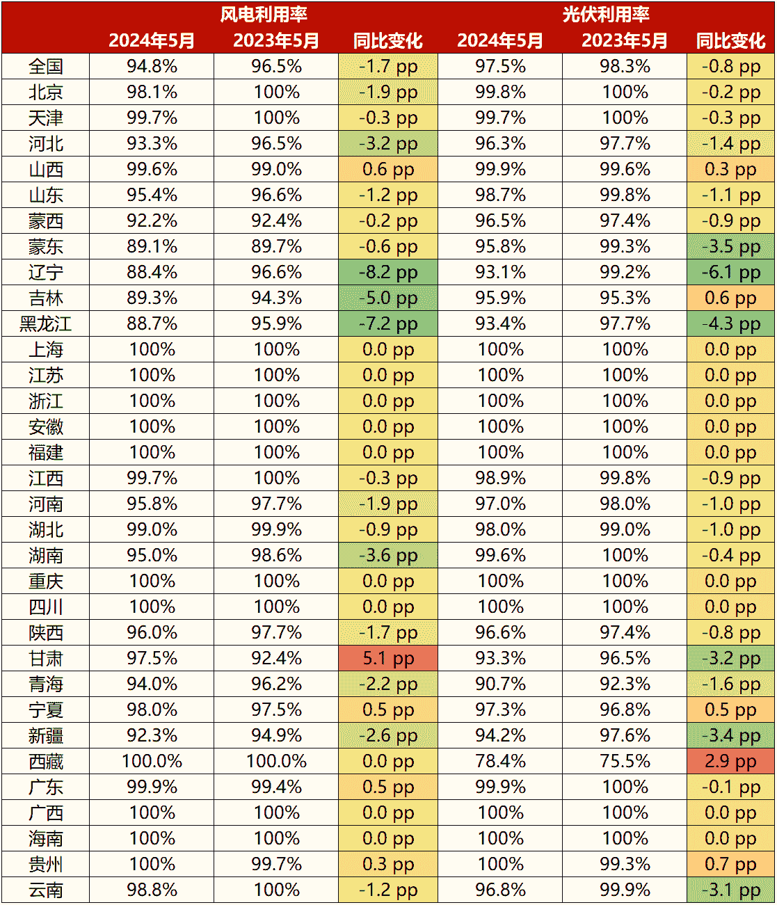
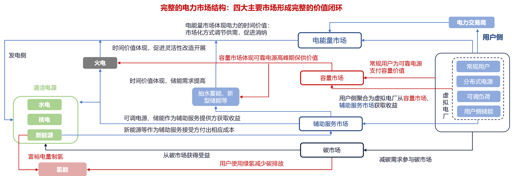
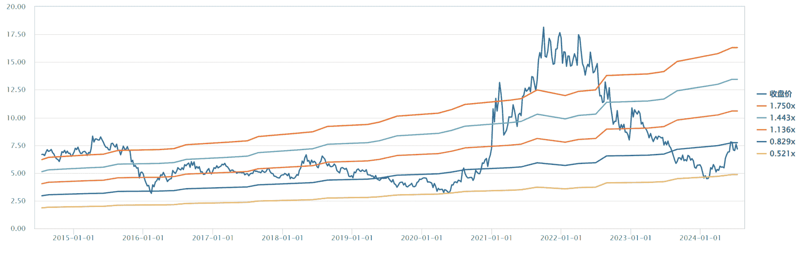
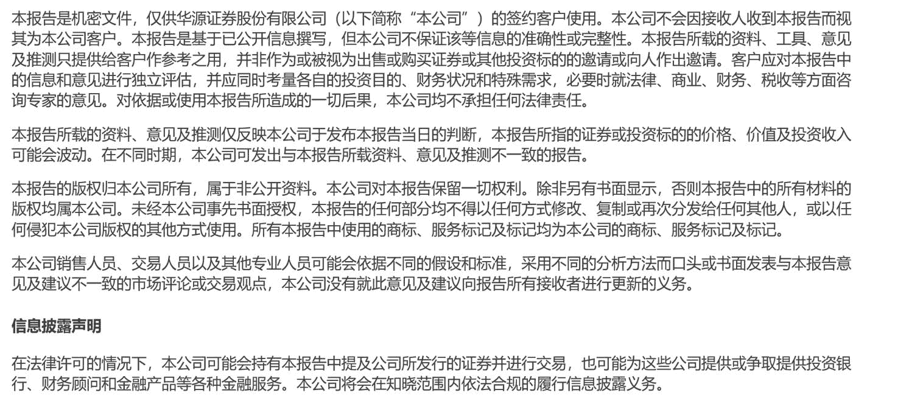
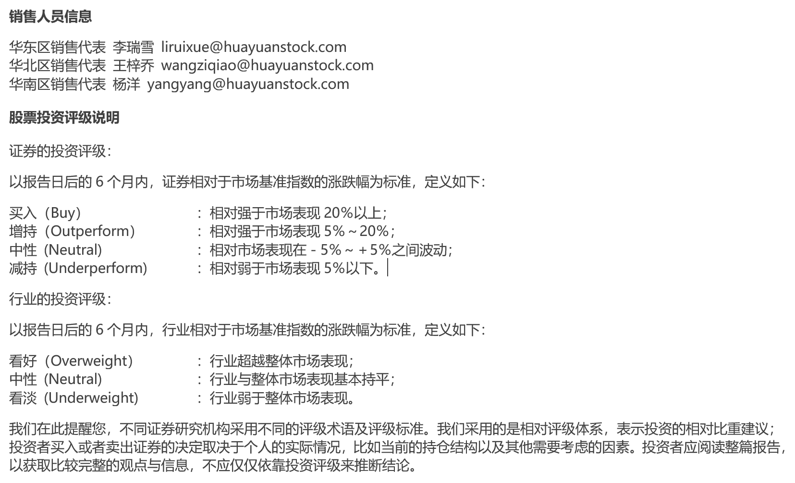

# 继续看好四水两核 期待绿电否极泰来

## 2024年公用事业行业中期策略

华源证券公用事业研究团队：

- 刘晓宁 S1350523120003
- 查浩 S1350524060004
- 邹佩轩 S1350524070004
- 邓思平 S1350524070003

日期：2024/7/24

请务必阅读报告末页的重要声明

证券研究报告 | 行业专题

---

# 主要内容

1. 水核：低协方差资产标杆 关注信用利差与风险偏好
2. 绿电：消纳压力客观存在 机制理顺预期下具备赔率
3. 国企改革：三年行动过半 关注资产整合机会
4. 火电：业绩修复基本完成 稳定性成为估值关键

附表：重点公司估值表

---

# 1.1 水核行情的底层逻辑：权益资产大分化与稳定价值类资产重估

**水电核电股价上涨的本质是低协方差资产重估，DCF模型下折现率下降提升估值；来水改善起到一定的催化剂作用**

- 从2023年下半年开始，"四水两核"等稳定价值类资产股价与宽基指数走势急剧分化，2024年上半年超额收益进一步扩大。
- 从相对估值来看，无论PE还是PB，"四水两核"估值均持续创历史新高，完全突破了原有的估值框架。股价上涨的本质是宏观经济波动性预期加大以及市场风险偏好较弱背景下，低协方差属性重估，折现率下降提升估值。来水预期改善起到了一定的催化剂作用。

**"四水两核"与宽基指数2023年初-2024年6月涨幅**

| 指数/个股 | 涨幅 |
|---|---|
| 沪深300 | -10% |
| 上证指数 | -5% |
| 主动股基 | -15% |
| 万得全A | -20% |
| 长江电力 | 60% |
| 川投能源 | 50% |
| 华能水电 | 45% |
| 国投电力 | 40% |
| 中国核电 | 35% |
| 中国广核 | 30% |

**"四水两核"与宽基指数2024年初-2024年6月涨幅**

| 指数/个股 | 涨幅 |
|---|---|
| 沪深300 | 2% |
| 上证指数 | 3% |
| 主动股基 | -5% |
| 万得全A | -2% |
| 长江电力 | 25% |
| 川投能源 | 20% |
| 华能水电 | 22% |
| 国投电力 | 18% |
| 中国核电 | 30% |
| 中国广核 | 28% |

*数据来源：wind，华源证券研究。"四水两核"指长江电力、华能水电、国投电力、川投能源、中国核电、中国广核*

---

# 1.2 分化的底色：无风险收益率下行与信用利差极致压缩

**理解稳定收益型资产价格与宽基指数走势背离：无风险收益率与信用利差极致压缩，权益风险溢价K型分化**

- 从DCF模型出发，权益资产的价格从根本上取决于盈利能力、无风险利率与风险溢价三个要素的组合，其中后两者合称折现率（必要收益率），是影响宽基指数涨跌最重要的因素。进一步的，可以将权益资产视为分红金额不固定的超长久期信用债，权益资产的折现率可以分解为无风险收益率、信用债收益率较无风险收益率的利差（简称信用利差）以及权益折现率较信用债收益率的利差三部分。
- 此轮市场大级别回调始于2020年底，截至2024年6月底，10年期国债收益率从3.3%降至2.3%，收窄1 pct，背后是长周期资产回报率预期下行，更底层的逻辑是逆全球化加剧以及人口老龄化。10年期AA级企业债收益率从5.2%降至3.0%，信用利差从1.9%降至0.7%，收窄1.2 pct，背后是稳定收益型资产荒，与M2高增、社融需求偏弱有关。**无风险收益率与信用利差合计收窄2.2 pct。**

**无风险利率变化情况①**

| 时间 | 10年期国债收益率 |
|---|---|
| 2020年底 | 3.3% |
| 2024年6月底 | 2.3% |

**AA级企业债收益率变化情况②**

| 时间 | 10年期AA级企业债收益率 |
|---|---|
| 2020年底 | 5.2% |
| 2024年6月底 | 3.0% |

**信用利差变化情况（=②-①）**

| 时间 | 信用利差 |
|---|---|
| 2020年底 | 1.9% |
| 2024年6月底 | 0.7% |

*数据来源：三图均来自wind，华源证券研究*

---

# 1.3 分化的原因：新格局下权益资产风险溢价的K型演进

**宽基指数回调的直接归因是第三项利差（权益折现率较信用债收益率的利差）走扩，淹没了前两项利差收窄的利好**

- 在折现率三分法下，考虑到DCF模型估值结果对分母端异常敏感，无风险收益率和信用利差合计收窄2.2个百分点对权益资产构成显著利好，但是宽基指数仍大幅回调，**说明对于市场整体而言，权益收益率较信用债收益率的利差大幅走扩，走扩幅度超过了2.2个百分点**。
- 权益利差走扩就是风险溢价增加，部分投资者将其归因为经济复苏不及预期，但是该说法并不准确。经济复苏高于预期也好，低于预期也罢，影响的更多是DCF模型的分子端。分母端反映的是风险，市场实际上是在定价新旧动能转换期，宏观经济的波动性增加。
- 然而，在权益资产内部，**不同资产基本面与宏观经济波动的相关程度不同**，导致不同资产第三项利差的走扩幅度分化。只要走扩幅度低于2.2个百分点，这类权益资产就可以受益于无风险利率及信用利差收窄带来的利好，从而享受"结构性的长牛"。

**2023年初至2024年6月底申万一级行业涨跌幅情况**

| 行业 | 涨跌幅 |
|---|---|
| 银行 | 15% |
| 煤炭 | 20% |
| 公用事业 | 25% |
| 家用电器 | 10% |
| 石油石化 | 12% |
| 通信 | 18% |
| 交通运输 | 5% |
| 有色金属 | 8% |
| 汽车 | 3% |
| 建筑装饰 | -5% |
| 非银金融 | -10% |
| 电子 | -15% |
| 国防军工 | -20% |
| 钢铁 | -25% |
| 基础化工 | -30% |
| 机械设备 | -20% |
| 农林牧渔 | -15% |
| 建筑材料 | -25% |
| 美容护理 | -35% |
| 食品饮料 | -30% |
| 环保 | -10% |
| 电力设备 | -40% |
| 纺织服饰 | -20% |
| 轻工制造 | -25% |
| 房地产 | -40% |
| 医药生物 | -30% |
| 传媒 | -35% |
| 社会服务 | -30% |
| 商贸零售 | -35% |
| 计算机 | -40% |
| 综合 | -45% |

**2024年上半年申万一级行业涨跌幅情况**

| 行业 | 涨跌幅 |
|---|---|
| 通信 | 20% |
| 煤炭 | 15% |
| 家用电器 | 12% |
| 石油石化 | 10% |
| 公用事业 | 18% |
| 银行 | 8% |
| 汽车 | 5% |
| 电子 | 3% |
| 有色金属 | 2% |
| 传媒 | -5% |
| 机械设备 | -8% |
| 非银金融 | -10% |
| 交通运输 | -3% |
| 建筑装饰 | -12% |
| 国防军工 | -15% |
| 纺织服饰 | -10% |
| 钢铁 | -18% |
| 计算机 | -15% |
| 环保 | -5% |
| 农林牧渔 | -8% |
| 基础化工 | -12% |
| 轻工制造 | -10% |
| 医药生物 | -15% |
| 食品饮料 | -20% |
| 建筑材料 | -15% |
| 电力设备 | -25% |
| 社会服务 | -18% |
| 房地产 | -25% |
| 综合 | -20% |
| 美容护理 | -22% |
| 商贸零售 | -20% |

*数据来源：wind，华源证券研究*

---

# 1.4 重读金融学底层理论：CAPM模型与低协方差资产重估

**参考CAPM模型，影响个股折现率最重要的因素是个股基本面与宏观经济的协方差，红利行情的本质是低协方差资产重估**

- 威廉·夏普的CAPM模型给出了个股折现率的定量表达，在均衡状态下，个股折现率由无风险利率rf、市场平均预期回报rM、市场波动率σM²以及个股基本面与宏观经济的协方差σi,M共同决定。不同资产的折现率不同，归根结底是基本面与宏观经济的协方差σi,M不同。
- 因此，我们认为**"四水两核"走出独立行情的原因并非高股息，而是协方差重估**，只不过高股息资产与低协方差资产有着一定的重叠度。
- 有趣的是，"红利龙头"长江电力由于股息率不高，反而不在主流高股息指数中。单纯按照股息率筛选出的标的，股价走势并不理想。

**CAPM模型的推导过程**

CAPM模型：E(Ri) = rf + βi[E(RM) - rf]，其中βi = Cov(Ri, RM) / Var(RM) = σi,M / σM²

**长江电力与中证中信高股息策略指数涨幅对比**

| 时间 | 长江电力涨幅 | 中证中信高股息策略指数涨幅 |
|---|---|---|
| 2020/01 | 0% | 0% |
| 2020/05 | 5% | 2% |
| 2020/09 | 10% | 3% |
| 2021/01 | 15% | 5% |
| 2021/05 | 20% | 6% |
| 2021/09 | 25% | 8% |
| 2022/01 | 30% | 10% |
| 2022/05 | 35% | 12% |
| 2022/09 | 40% | 13% |
| 2023/01 | 50% | 15% |
| 2023/05 | 60% | 18% |
| 2023/09 | 70% | 20% |
| 2024/01 | 80% | 22% |
| 2024/05 | 90% | 25% |

**中证中信高股息策略指数（931053.CSI）编制方法：**

从沪深A股中选取80只流动性好、盈利稳定且预期股息率较高的股票作为指数样本股，采用预期股息率调整市值加权。按照一定标准剔除部分股票后，对剩余股票计算其预期股息率增加值并按降序排列，选取排名靠前的80只股票作为指数样本股。若上一期指数成份股在新一期指数成份股调整日处于停牌状态，则保留停牌股票同时选取预期股息率增加值最高的股票，使得样本股数量达到80只。

长江电力等水电公司、中国神华乃至主流银行都不在该指数中。

*数据来源：wind，华源证券研究*

---

# 1.5 长江电力复盘：资产特性带来的权益风险溢价收窄

**水电是最典型的低协方差资产，近年来持续上涨是无风险收益率、信用利差以及权益折现率较信用债利差同步收窄带来的**

- 对于水电而言，由于"宏观经济波动不会影响降雨波动"，因此在宽基指数风险溢价扩张的背景下，水电风险溢价不存在扩张的基础。更进一步的，根据市值和权益现金流倒算隐含折现率，长江电力隐含折现率从2020年的大约10%降到2024年6月的7.1%（500亿量级权益现金流/7000亿市值），下降2.9个百分点。由此计算长江电力隐含折现率较信用债的利差不仅没有扩张，反而收窄0.7个百分点。
- 从三重利差收窄量级来看，信用利差收窄贡献了最主要的动能，水电隐含折现率较信用债利差收窄提供边际弹性。对信用利差采用逆序刻度，与长江电力股价走势对比，可以看出两图高度一致，水电公司2024年上半年的加速上涨有着非常坚实的"基本面"支撑。
- 核电涨幅超过水电，一言以蔽之，现阶段高强度资本开支意味着更长的久期，长久期资产价值对折现率变化更敏感。

**信用利差变化情况（逆序）**

| 时间 | 信用利差 |
|---|---|
| 2020年底 | 1.9% |
| 2024年6月底 | 0.7% |

**长江电力股价走势（元/股）**

| 时间 | 股价 |
|---|---|
| 2020年底 | 15 |
| 2024年6月 | 25 |

**长江电力隐含折现率变化（2020年底-2024年6月）**

| 项目 | 2020年底 | 2024年6月 | 变化 |
|---|---|---|---|
| 无风险利率 | 3.3% | 2.3% | -1.0 pct |
| 信用利差 | 1.9% | 0.7% | -1.2 pct |
| 水电较信用债利差 | 4.8% | 4.1% | -0.7 pct |

*数据来源：wind，华源证券研究*

---

# 1.6 传导路径：险资与理财配置刚需下 债牛扩散逻辑与久期匹配

**类债资产与真正债券之间的利差压缩，实际上是稳定收益型资产荒的扩散，一个重要的传导路径是险资与理财配置刚需**

- 在市场风险偏好较弱的背景下，居民资产搬家并没有带来权益资产的大时代，而是流向了低风险理财产品乃至分红储蓄险。
- 然而，无风险收益率下行、信用利差收窄以及权益市场的波动显著增加了银行理财以及保险资金的资产端收益率压力，近年来保险公司投资收益率持续下行。在负债相对刚性以及久期匹配的要求下，增加低风险、长久期权益资产配置成为了这类资金的必然选择。
- 本质是稳定收益型资产荒的扩散，从国债到信用债，再到类债权益资产，最终导致类债权益资产与真正债券之间的利差得以压缩。

**表：上市险企近年投资收益率情况**

| 年份 | 年平均十年国债收益率① | 净投资收益率② | 总投资收益率③ | 超额收益-来自信用风险（②-①） | 超额收益-来自市场风险（③-②） |
|---|---|---|---|---|---|
| 2014 | 4.16% | 5.13% | 5.59% | 0.97% | 0.46% |
| 2015 | 3.37% | 5.05% | 7.21% | 1.68% | 2.16% |
| 2016 | 2.86% | 5.28% | 5.04% | 2.42% | -0.24% |
| 2017 | 3.58% | 5.30% | 5.44% | 1.72% | 0.14% |
| 2018 | 3.62% | 4.94% | 4.05% | 1.32% | -0.89% |
| 2019 | 3.18% | 4.88% | 5.61% | 1.70% | 0.73% |
| 2020 | 2.94% | 4.69% | 5.73% | 1.75% | 1.04% |
| 2021 | 3.03% | 4.45% | 5.15% | 1.42% | 0.70% |
| 2022 | 2.77% | 4.40% | 3.74% | 1.63% | -0.66% |
| 2023 | 2.72% | 3.84% | 2.52% | 1.12% | -1.32% |

*数据来源：公司公告，华源证券研究。注：取中国平安、中国人寿、中国太保、新华保险算术平均*

**保险资金用于股票和证券投资的金额**

| 年份 | 保险资金运用余额（亿元） |
|---|---|
| 2014 | 8000 |
| 2015 | 12000 |
| 2016 | 14000 |
| 2017 | 16000 |
| 2018 | 18000 |
| 2019 | 22000 |
| 2020 | 25000 |
| 2021 | 28000 |
| 2022 | 30000 |
| 2023 | 35000 |

*数据来源：wind，华源证券研究*

---

# 1.7 水核低协方差属性的来源：终端同质化商品中的少数低成本供给

**水电核电的低协方差属性并非完全来自行政垄断，一定程度上是市场竞争的结果，是终端同质化商品中的少数低成本供给**

- 与水务/燃气/电信等行业相比，发电行业并不具备自然垄断属性，随着市场化改革的推进，各类电源存在较强的竞争关系。以水电为例，水电资产脱颖而出，除营收驱动力（降雨）特殊外，另一重要原因为水电是终端同质化商品中的少数低成本供给，水电的发电成本以及电价在所有电源类型中最低，电价和电量均有较厚的安全垫。与新能源不同，水电的优先消纳是市场化逻辑，而非政策保护。
- **稀缺性是必要条件，只有占比足够低才能免于整体需求波动的影响**。即便我国是全球水电第一大国，2023年底我国水电装机占全国总装机的比例仅有14.4%，上市公司装机又是水电装机中很小的比例，某种程度上，长江电力仍然是"小而美"的公司，核电公司同理。

**2023年底全球水电装机容量分布**

| 国家 | 占比 |
|---|---|
| 中国 | 29.7% |
| 巴西 | 7.8% |
| 美国 | 7.2% |
| 加拿大 | 5.9% |
| 俄罗斯 | 4.0% |
| 印度 | 3.7% |
| 日本 | 3.5% |
| 其他 | 38.3% |

**2023年底我国电源装机容量构成**

| 电源类型 | 占比 |
|---|---|
| 水电 | 14.4% |
| 火电 | 47.6% |
| 核电 | 1.9% |
| 风电 | 15.1% |
| 光伏 | 20.9% |

**2023年底我国水电装机主体构成**

| 公司 | 占比 |
|---|---|
| 长江电力 | 17.0% |
| 华能水电 | 5.8% |
| 雅砻江水电 | 4.6% |
| 大渡河水电 | 2.8% |
| 桂冠电力 | 2.4% |
| 黔源电力 | 0.8% |
| 其他 | 66.6% |

*数据来源：左图来自世界水利协会，中图来自中电联，右图来自上市公司公告，华源证券研究*

---

# 1.8 "四水两核"组合优于个股 关注信用利差与风险偏好

**当前时点，我们认为"四水两核"作为稳定价值类资产标杆，配置上组合优于个股，盯住信用利差与市场风险偏好**

- 在宏观经济波动加大背景下，我们观察到市场研究范式正在从"预期差框架"向"资产配置框架"转变，"购买若干逻辑类似的股票"优于"精选弹性最大的股票"，前者可以更好地避免个股层面突发利空、公司治理乃至交易性行为的影响，提高核心逻辑的兑现概率。
- 落实到"四水两核"（**长江电力、华能水电、国投电力、川投能源、中国核电、中国广核**），我们认为在配置上组合优于个股，盯住信用利差与市场风险偏好的变化，两者相比无风险利率更具变化空间，折现率下降是股价上涨的最大驱动力，反之亦然。
- 同时，我们认为"四水两核"的股价上涨为中小水电、煤电一体化公司乃至盈利能力稳定的泛公用事业公司打开估值空间，二线标的有望迎来扩散行情，建议关注现金流较好，兼具来水改善与估值弹性的**黔源电力**。

**表：主要水电公司DCF折现情况及空间（净利润中枢取5年均值，市值日期为2024/7/22，亿元）**

| 公司 | 净利润中枢 | 折旧中枢 | 净利润+折旧 | 权益占比 | 归母权益现金流 | 6%折现率下目标市值 | 5%折现率下目标市值 | 当前市值 | 6%折现率下空间 | 5%折现率下空间 |
|---|---|---|---|---|---|---|---|---|---|---|
| 长江电力 | 350 | 180 | 530 | 100% | 530 | 8833 | 10600 | 7311 | 20.8% | 45.0% |
| 华能水电 | 85 | 53 | 138 | 92% | 127 | 2116 | 2539 | 2063 | 2.6% | 23.1% |
| 桂冠电力 | 35 | 20 | 55 | 80% | 44 | 733 | 880 | 620 | 18.3% | 42.0% |
| 黔源电力 | 5.78 | 7.21 | 13 | 56.4% | 7.34 | 122 | 147 | 74 | 65.6% | 99.5% |

*资料来源：公司公告，华源证券研究。注：将水电公司视为永续资产，忽略应收应付变化，用净利润+折旧代表权益现金流，直接对归母权益现金流折现，目标市值等于归母权益现金流中枢/折现率*

# 1.9 “四水两核”行情有望扩散，关注准许收益率定价的公用事业公司

- **“四水两核”行情有望扩散，准许收益率定价资产盈利能力稳定，是最简单的低协方差资产，关注水务、燃气、垃圾焚烧。**

准许收益率定价的经济学逻辑是，在自然垄断行业中，为避免重复建设导致的资源浪费，政府通过行政手段构建准入壁垒，但是同时对资产的收益率做出限制。**该类资产的价值来源与核心风险均为政策，因此政策导向、央地关系、地方财政等因素至关重要。**

- 梳理股价表现较好的准许收益率类资产，收益的稳定性体现在多个维度（主要观察趋势稳定性而非绝对值）。ROE 是最基础指标，至少要在权责发生制下获得“纸面利润”的稳定性；其次，毛利率、EBITDA/营业收入等利润表指标稳定，打通从收入到利润的链条，确保增收就可以增利；最后，经营性现金流量净额/利润总额保持稳定，打通从利润到现金流的链条，保障“纸面利润”颗粒归仓。

数据源：Wind，华源证券研究。三张图主要观察趋势稳定性而非绝对值。

**典型准许收益率定价公司 ROE**

**典型准许收益率定价公司 EBITDA/营业收入**

**经营性现金流量净额/利润总额**

0%

2%

4%

6%

8%

10%

12%

14%

16%

18%

20%

2014 2015 2016 2017 2018 2019 2020 2021 2022 2023

皖天然气

光大环境

兴蓉环境

洪城环境

0%

10%

20%

30%

40%

50%

60%

2014 2015 2016 2017 2018 2019 2020 2021 2022 2023

皖天然气

光大环境

兴蓉环境

洪城环境

0%

20%

40%

60%

80%

100%

120%

2014 2015 2016 2017 2018 2019 2020 2021 2022 2023

皖天然气

兴蓉环境

洪城环境

# 主要内容

1. 水核：低协方差资产标杆，关注信用利差与风险偏好
2. 绿电：消纳压力客观存在，机制理顺预期下具备赔率
3. 国企改革：三年行动过半，关注资产整合机会
4. 火电：业绩修复基本完成，稳定性成为估值关键

附表：重点公司估值表

# 2.1 新能源建设速度整体超预期，部分省份提前完成“十四五”规划

整理我国各省新能源“十四五”规划，到 2025 年底我国新能源累计装机将达到约 1322 GW。截至 2023 年底，我国新能源总装机 1051 GW，**从新增需求来看，全国“十四五”规划完成约 66%，进度快于规划。**

截至 2023 年底，我国已有 8 个省份完成“十四五”规划目标。超过规划的主要原因在于光伏装机的高速增长，提前完成的省份均为分布式光伏建设的主力地区。集中式光伏为主的三北地区整体进度略快于规划。

**2024 年惯性驱动下行业装机继续保持高增，“十四五”新能源装机规划大概率提前完成。**

## 表：各地 2023 年底及预计 2024 年底新能源装机及“十四五”规划完成度（万千瓦，假设 2024 年新能源增量与 2023 年新增量持平）

| 省份 | 风电2023 | 风电2024E | 风电十四五规划 | 风电2024年底完成度 | 光伏2023 | 光伏2024E | 光伏十四五规划 | 光伏2024年底完成度 | 新能源2023 | 新能源2024E | 新能源十四五规划 | 新能源2024年底完成度 |
|---|---:|---:|---:|---:|---:|---:|---:|---:|---:|---:|---:|---:|
| 江西 | 573 | 591 | - | - | 1993 | 2784 | - | - | 2566 | 3375 | 1900 | 178% |
| 河南 | 2178 | 2453 | 2518 | 97% | 3731 | 5129 | 2175 | 236% | 5909 | 7582 | 4693 | 162% |
| 云南 | 1531 | 2150 | - | - | 2072 | 3559 | - | - | 3603 | 5709 | 3864 | 148% |
| 福建 | 762 | 782 | 900 | 87% | 875 | 1285 | 500 | 257% | 1637 | 2067 | 1400 | 148% |
| 江苏 | 2286 | 2318 | 2600 | 89% | 3928 | 5348 | 2600 | 206% | 6214 | 7666 | 5200 | 147% |
| 浙江 | 584 | 745 | 640 | 116% | 3357 | 4175 | 2750 | 152% | 3941 | 4920 | 3390 | 145% |
| 安徽 | 722 | 854 | 800 | 107% | 3223 | 4292 | 2800 | 153% | 3945 | 5146 | 3600 | 143% |
| 湖北 | 836 | 894 | 1000 | 89% | 2487 | 3658 | 2200 | 166% | 3323 | 4552 | 3200 | 142% |
| 天津 | 171 | 197 | 200 | 99% | 490 | 759 | 560 | 136% | 661 | 956 | 760 | 126% |
| 山东 | 2591 | 2880 | 2500 | 115% | 5693 | 7116 | 5700 | 125% | 8284 | 9996 | 8200 | 122% |
| 重庆 | 206 | 230 | - | - | 161 | 253 | - | - | 367 | 483 | 440 | 110% |
| 海南 | 31 | 33 | - | - | 472 | 698 | - | - | 503 | 731 | 669 | 109% |
| 河北 | 3141 | 3485 | 4300 | 81% | 5416 | 6977 | 5400 | 129% | 8557 | 10462 | 9700 | 108% |
| 新疆 | 3258 | 3902 | - | - | 3007 | 4436 | - | - | 6265 | 8338 | 8240 | 101% |
| 广东 | 1657 | 1957 | 2564 | 76% | 2522 | 3454 | 2797 | 123% | 4179 | 5411 | 5361 | 101% |
| 辽宁 | 1429 | 1685 | - | - | 958 | 1315 | - | - | 2387 | 3000 | 3000 | 100% |
| 内蒙古 | 6961 | 9374 | 8900 | 105% | 2306 | 3051 | 4500 | 68% | 9267 | 12425 | 13400 | 93% |
| 甘肃 | 2614 | 3155 | 3853 | 82% | 2540 | 3663 | 4169 | 88% | 5154 | 6818 | 8022 | 85% |
| 四川 | 770 | 942 | 1026 | 92% | 574 | 942 | 1191 | 79% | 1344 | 1884 | 2217 | 85% |
| 宁夏 | 1464 | 1471 | 1750 | 84% | 2137 | 2690 | 3250 | 83% | 3601 | 4161 | 5000 | 83% |
| 广西 | 1267 | 1588 | 2450 | 65% | 1090 | 1660 | 1500 | 111% | 2357 | 3248 | 3950 | 82% |
| 湖南 | 972 | 1044 | - | - | 1252 | 1868 | - | - | 2224 | 2912 | 3560 | 82% |
| 黑龙江 | 1127 | 1311 | 1686 | 78% | 565 | 655 | 868 | 75% | 1692 | 1966 | 2554 | 77% |
| 青海 | 1185 | 1398 | 1650 | 85% | 2561 | 3280 | 4580 | 72% | 3746 | 4678 | 6230 | 75% |
| 山西 | 2500 | 2682 | 5000 | 54% | 2490 | 3284 | 3000 | 109% | 4990 | 5966 | 8000 | 75% |
| 上海 | 107 | 107 | 262 | 41% | 289 | 383 | 407 | 94% | 396 | 490 | 669 | 73% |
| 陕西 | 1285 | 1406 | - | - | 2292 | 3068 | - | - | 3577 | 4474 | 6500 | 69% |
| 吉林 | 1268 | 1393 | 2200 | 63% | 460 | 533 | 800 | 67% | 1728 | 1926 | 3000 | 64% |
| 贵州 | 616 | 640 | 1080 | 59% | 1644 | 1868 | 3100 | 60% | 2260 | 2508 | 4180 | 60% |
| 北京 | 24 | 24 | 30 | 80% | 108 | 121 | 252 | 48% | 132 | 145 | 282 | 51% |
| 西藏 | 18 | 33 | - | - | 257 | 336 | 1000 | 34% | 275 | 369 | 1000 | 37% |

数据源：中电联，华源证券研究。

数据源：国家能源局，华源证券研究。

## 表：2024 年 5 月全国新能源消纳率及同比情况

## 表：“沙戈荒”大基地外送通道及建设状态（GW）

| 总装机 | 外送装机 | 规划外送通道 | 通道状态 |
|---:|---:|---|---|
| **十四五：** |  |  |  |
| 库布齐沙漠 | 39 | 24 | 蒙西—天津南：存量 |
|  |  | 蒙西—京津冀：待核准 |  |
|  |  | 蒙西—中东部：规划中 |  |
| 乌兰布和沙漠 | 21 | 10 | 蒙西外送：规划中 |
| 腾格里沙漠 | 45 | 33 | 宁夏—湖南：在建 |
|  |  | 宁夏—中东部：待建 |  |
|  |  | 河西—浙江：待建 |  |
| 巴丹吉林沙漠 | 23 | 11 | 酒泉—中东部：待建 |
| 采煤沉陷区 | 37 | 37 | 陕北—湖北：存量 |
|  |  | 宁夏—浙江：存量 |  |
|  |  | 上海庙—山东：存量 |  |
|  |  | 府谷、锦界外送通道：存量 |  |
|  |  | 陕北—安徽：可研 |  |
|  |  | 陕北—河南：规划中 |  |
|  |  | 大同—天津南：可研 |  |
| 其他 | 32.5 | 35 | 准东—皖南：存量 |
|  |  | 青海—河南：存量 |  |
|  |  | 哈密—重庆：在建 |  |
| **十四五总计** | **200** | **150** | **总计 11 条未建成** |
| **十五五总计** | **255** | **165** | **估计需要约 13—15 条外送通道** |

资料来源：国家能源局，华源证券研究。

# 2.2 特高压及调峰资源建设不及预期，新能源消纳压力激增

电源侧装机速度超过原有规划，但是电网、调峰储能乃至机制建设等配套设施尚未跟上，导致电力系统消纳压力激增。

受前期工作时间较长等客观因素影响，**特高压建设低于预期，规划“十四五”建成的大基地外送通道中，总计有 11 条未建成。**根据建设进度，仅宁夏—湖南、哈密—重庆两条有望在 2025 年底建成，完成率仅约 20%。

2023 年多个省份光伏弃电率激增，不得已跨越消纳红线；2024 年新能源消纳情况进一步恶化，几乎所有省份新能源利用率均同比下滑。

# 2.3.1 长坡厚雪赛道未改，当下承压根本原因是碳—电市场建设不同步

- **从更底层的机制来看，新能源行业的健康发展需要碳—电两个市场协同，用环境价值的优势弥补时间价值的劣势。**

从新型电力系统机制框架来看，电力的价值 = 能量价值 + 时间价值 + 环境价值。在传统框架下，电力只交易能量价值。近年来随着现货市场持续推进，时间价值被纳入定价范围，但是由于碳市场建设滞后，环境价值并没有纳入定价范围，是新能源承压的根本原因。

- **实践表明，如果仅考虑时间价值不考虑环境价值，新能源平价远远没有到来。当下碳中和产业链承压的底层原因是机制缺位。**

数据源：华源证券研究绘制。

# 2.3.2 现货市场利剑在悬，新能源收益率不确定性压制估值

**2023 年 3 月—2024 年 4 月甘肃现货均价（元/MWh）**

0%

20%

40%

60%

80%

100%

0

100

200

300

400

2023/03

2023/04

2023/05

2023/06

2023/07

2023/08

2023/09

2023/10

2023/11

2023/12

2024/01

2024/02

2024/03

2024/04

月均价

光伏均价

风电均价

光伏/月均价

风电/月均价

**2023 年 3 月—2024 年 4 月蒙西现货均价（元/MWh）**

0%

20%

40%

60%

80%

100%

0

200

400

600

800

1000

1200

2023/03

2023/04

2023/05

2023/06

2023/07

2023/08

2023/09

2023/10

2023/11

2023/12

2024/01

2024/02

2024/03

2024/04

月均价

光伏均价

风电均价

光伏/月均价

风电/月均价

数据源：兰木达，华源证券研究。注：2023 年 8 月数据缺失。

**龙源电力（港股）PB 情况**

数据源：Wind，华源证券研究。

- **现货市场建设进度领先，新能源电价面临压力，收益率压力传导至估值端。**

新能源发电呈现较强的时段集中性，在新能源占比较高的省份，风况、光照条件好时电力供给往往过剩，导致新能源在现货市场中的均价显著下降。

- 光伏在现货市场中的劣势大于风电，以甘肃、蒙西为例，2024 年 4 月光伏均价仅有现货市场月均价的 35%、65%，风电均价约为现货均价的 58%、84%。
- 另一方面，在政策多维度呵护下，新能源电价压力尚未完全传导至发电侧，短期内绿电运营商业绩相对稳定，但是远期收益率的不确定性严重压制绿电估值。以港股龙源电力为例，当前 PB 相较 2023 年底虽有反弹，但是仍处于历史相对底部。

# 2.3.3 碳市场确权困难且交易成本高企，新能源的环境价值缺失

## 表：生态环境部 2023 年 10 月《关于做好 2023—2025 年部分重点行业企业温室气体排放报告与核查工作的通知》

| 要点 | 内容 |
|---|---|
| 核查范围 | 石化、化工、建材、钢铁、有色、造纸、民航等重点行业，年度温室气体排放量达 2.6 万吨二氧化碳当量（综合能源消费量约 1 万吨标准煤）及以上的重点企业纳入本通知年度温室气体排放报告与核查工作范围。 |
| 自发自用可扣除 | 在核算企业层级净购入电量或设施层级消耗电量对应的排放量时，**直供重点行业企业使用且未并入市政电网、企业自发自用（包括并网不上网和余电上网的情况）的非化石能源电量对应的排放量按 0 计算**，重点行业企业应提供相关证明材料。 |
| 不承认绿电/绿证 | **通过市场化交易购入使用非化石能源电力的企业，**需单独报告该部分电力消费量且提供相关证明材料（包括《绿色电力消费凭证》或直供电力的交易、结算证明，不包括绿色电力证书），**对应的排放量暂按全国电网平均碳排放因子进行计算。**2022 年度全国电网平均碳排放因子为 0.5703 t CO₂/MWh，后续年度因子通过管理平台发布。 |
| 完成时间 | 水泥、电解铝和钢铁行业企业碳排放报告核查工作应于每年 9 月 30 日前完成，其他重点行业企业碳排放报告核查工作应于每年 12 月 31 日前完成。 |

资料来源：生态环境部官网，华源证券研究。

- **碳市场建设进度严重滞后，核心原因是确权困难与交易成本高企。现有机制仍有改善空间，但是制度健全尚需时间。**

从学术原理上看，在产权清晰、交易成本可控的情况下，市场化是配置资源最有效的方式。从欧美经验来看，建设碳市场，实现碳—电市场协同，通过收紧碳配额提高全社会绿电需求，是赋予电力环境价值、提高绿电收益率、促进减碳的有效手段。

然而，从国内外实践来看，碳市场的建设难度远远高于现货市场，因为现货市场交易的标的仍然是电力，不需要确权；而碳市场的交易标的是碳排放权，确权流程复杂且需要极高的交易成本，涉及碳排放权的核算、分配、豁免、抵扣、交易以及事后监管。

我国当前绿证与碳市场并未打通（绿证无法抵扣碳排放额），碳市场的价格信号无法传导至绿证市场，使得绿证的环境价值无法体现。两个市场的协同亟需打通，体现绿电绿证价值，但是短期内或难以根本上解决绿电困境，仍需行政力量兜底，赋予隐性碳价格。

# 2.3.4 政府授权合约模式有望推广，行政手段直接补位

- **广西政府授权合约模式有助于提升新能源上网电价稳定性，或有望在全国范围内推广，采用行政手段护航能源转型。**

2023 年底，广西提出集中式风电、光伏发电企业执行政府授权合约机制。新能源企业市场化部分收益将由合约电量（即政府授权合约电量）、合约价格（2024 年合约价格为 0.38 元/kWh）、对标价格（标的月各时段批发交易用户市场交易计划加权平均价格）决定。

简而言之：当市场化交易价格大于合约价格时，要向新能源场站回收超过 0.38 元/kWh 部分的电价，且该场站越接近市场均价，回收数额越低（即结算电价越高）。当市场化交易价格小于合约价格时，此时要向新能源场站补贴低于 0.38 元/kWh 部分的电价，且该场站越接近市场均价，补贴数额越高（即结算电价越高）。

- **总的来看，由于目前我国电力市场仍然主要靠火电定价，因此政府授权合约的核心目的是给新能源一个合理的“标准电价”，使得市场价较高时避免新能源获得过高的超额收益，市场价较低时避免新能源过度亏损。**此政策与非市场化的“标杆电价”区别在于，最终回收或补贴的力度仍然与电力市场的交易结果相关，这样既可以限定新能源的电价范围，又可以相对保证电力市场交易的完整性。

0

0.1

0.2

0.3

0.4

0.5

0.6

0

1

2

3

4

5

6

7

8

9 10 11 12 13 14 15 16 17 18 19 20 21 22 23

电价

参考价格

执行价格

执行价格

市场价高于执行价时，发电机组返还超额收入

市场价低于执行价时，向发电机组补偿差价

- 考虑到各省电力供需格局差异、新能源消纳能力差异以及当地综合发电成本差异，我们**预计广西省率先试点的新能源电价政府授权合约，或有望在全国范围内推广，具体合约电价以及执行方案或有所差异。**

- 但是可以明确的是，如果政府授权合约将对新能源收益率进行兜底，将成为推动新能源健康发展的有利途径。政府授权合约的本质是用行政手段赋予新能源隐性碳价格，在碳市场建立之前对新能源保驾护航。

**政府授权合约模式示意图**

数据源：华源证券研究绘制。

# 2.3.5 内蒙古完善高耗能企业能源消费机制 有助于提升绿电绿证价值

**内蒙古拟实施存量高耗能企业可再生能源电力强制消费机制，考核指标分解到具体企业，有望显著提升绿证价值**

在碳市场完全建立之前，我国仍然采用能耗双控和可再生能源消纳责任权重机制，通过行政手段提升新能源需求，相当于赋予绿证隐性碳价格。但是由于考核对象多为省级政府，不考核具体企业，具体企业购买绿电并不能使自己直接受益，存在收益成本不匹配问题，企业缺乏购买绿电、绿证的动力。内蒙古自治区发改委2024年7月17日发文，拟实施存量高耗能企业可再生能源电力强制消费机制。

**我们分析此次内蒙古要求高耗能产业强制消纳一定绿电，最值得关注的点有两个**，其一是将消纳责任分解到具体企业，也就是实现市场化交易中最重要的部分——确权。在权责统一、收益成本匹配的情况下，高耗能企业将更有动力购买绿电、绿证。

其二是提出实行以物理电量为基础、绿证交易为补充的可再生能源消费量扣除政策。明确绿证的作用，做到“证-电分离”交易，将打破绿电交易的物理限制，大幅促进新能源在更大范围内消纳，如果全国推广，将显著提升绿证价值。

**表：内蒙古自治区2024年7月17日《关于建立高耗能企业可再生能源电力强制消费机制的若干措施》征求意见稿内容**

| 要点 | 细节 |
|------|------|
| 加强可再生能源电力强制消费 | 实施存量高耗能企业可再生能源电力强制消费机制。各盟市综合考虑本地区节能目标完成进度、项目能效水平、能耗强度水平以及存量挖潜等因素，合理确定存量高耗能企业可再生能源电力消纳责任权重目标。 |
| | 实施新上高耗能项目可再生能源电力消纳承诺制。新建高耗能项目，严格按照自治区现行项目节能审查标杆值政策，综合考虑本地区节能形势等，合理确定可再生能源电力消纳责任权重目标，并出具承诺函。 |
| 完善可再生能源电力消费核算制度 | 明确企业可再生能源电力消费核算范围。企业可再生能源电力消费量由物理消纳电量和购买绿色电力证书对应电量两部分构成。物理消纳电量由市场化项目自发自用可再生能源电量、用户绿色电力交易结算电量、用户常规电力交易的可再生能源电量三部分组成。 |
| | 避免绿证对应电量重复计算。将绿证作为可再生能源电力消费基础凭证，加强绿证与能耗双控政策有效衔接。 |
| 强化结果运用 | 完善盟市节能目标考核制度。突出重点控制化石能源消费导向，全面落实可再生能源电力不纳入能源消耗总量和强度调控政策。在“十四五”盟市人民政府节能目标责任评价考核指标核算中，实行以物理电量为基础、绿证交易为补充的可再生能源消费量扣除政策。 |
| | 强化激励约束。各盟市应加强对纳入强制消费机制覆盖企业的监督管理，督促完成可再生能源消费目标，当年没有完成目标任务的，要划转至下一年。加大节能失信行为惩戒力度，严格兑现新上高耗能项目可再生能源电力消纳承诺。 |

数据源：内蒙古发改委，华源证券研究

# 2.4.1 绿电估值体系探讨：从极简DCF模型看经济增加值的本质

从估值的角度看，如果收益率确定，新能源投资的本质就是一次性资本支出，陆续收回成本和收益的过程。

**以一个极简DCF模型说明：** 假设某项目初始投资金额100元，项目期限5年，每年获得净现金流入30元。则该项目的IRR为15.24%，只与项目本身的现金流有关。

但是在计算项目估值时，需要引入一个新的参数，即折现率，与估值时点的市场环境、利率环境和风险偏好有关，属于外部变量。该案例我们假设为10%，则项目的净现值为13.72元，投产后项目价值为113.72元。

我们将该过程拆解，采用摊余成本法处理方式，将未来5年的现金流分解成等价的5笔单独投资，视为第0年投资100元，第1年按照15.24%的收益率获得115.24元，取走30元，将剩余85.24元进行第二次投资。

定义每一期的经济增加值EVA=（内部收益率-必要收益率）*每期投资本金。经济增加值的数学内涵就是每一期资本金的实际收益减去机会成本后的净收益。从第0年的时间点来看，该笔**投资的总的价值增厚，等于未来每一期经济增加值在必要收益率下的折现值加总**。

**使用必要收益率折现**

| 年份 | 0 | 1 | 2 | 3 | 4 | 5 |
|------|------|------|------|------|------|------|
| 净现金流 | -100 | 30 | 30 | 30 | 30 | 30 |
| 必要收益率=折现率 | | 10% | 10% | 10% | 10% | 10% |
| 现金流现值 | -100 | 27.3 | 24.8 | 22.5 | 20.5 | 18.6 |
| 项目的净价值增厚 | 13.72 | | | | | |
| 内部收益率（IRR） | 15.24% | | | | | |

**经济增加值与企业价值增厚的关系示意**

| 年份 | 0 | 1 | 2 | 3 | 4 | 5 |
|------|------|------|------|------|------|------|
| 期初账面价值① | 100 | 85.24 | 68.23 | 48.62 | 26.03 | |
| 内部收益率② | | 15.24% | 15.24% | 15.24% | 15.24% | 15.24% |
| 实际投资收益③=①*② | | 15.24 | 12.99 | 10.40 | 7.41 | 3.97 |
| 收到的分红④ | | 30 | 30 | 30 | 30 | 30 |
| 期末账面价值⑤=①+③-④ | 100 | 85.24 | 68.23 | 48.62 | 26.03 | 0.00 |
| 必要收益率⑥ | | 10% | 10% | 10% | 10% | 10% |
| 必要投资收益⑦=①*⑥ | | 10.00 | 8.52 | 6.82 | 4.86 | 2.60 |
| 经济增加值⑧=③-⑦ | | 5.2 | 4.5 | 3.6 | 2.5 | 1.4 |
| 经济增加值的折现值（按照⑥折现） | | 4.76 | 3.69 | 2.69 | 1.74 | 0.85 |
| 折现值加总 | 13.72 | | | | | |

EVA即经济增加值（economic value added）
数据源：华源证券研究自制

**表：两期项目DCF折现示意（10%折现率）**

| 年份 | 0 | 1 | 2 | 3 | 4 | 5 | 6 |
|------|------|------|------|------|------|------|------|
| 项目1现金流 | -100 | 30 | 30 | 30 | 30 | 30 | |
| 项目2现金流 | | -100 | 30 | 30 | 30 | 30 | 30 |
| 公司整体现金流 | -100 | -70 | 60 | 60 | 60 | 60 | 30 |
| 内部收益率 | 15.24% | | | | | | |
| 必要收益率 | 10% | 10% | 10% | 10% | 10% | 10% | 10% |
| 现金流折现值 | | -63.6 | 49.6 | 45.1 | 41.0 | 37.3 | 16.9 |
| 第0年末公司总价值 | 126.20 | | | | | | |
| 初始资本金 | 100 | | | | | | |
| 现有项目价值增厚 | 13.72 | | | | | | |
| 未来项目价值增厚 | 12.48 | | | | | | |

等式两边同时除以初始投资本金，即为一个公司的合理PB。

由此可得，一笔投资的价值增厚取决于四个参数，分别是该笔投资的内部收益率IRR、必要收益率（资金成本）、投资金额以及项目期限。其中**内部收益率与必要收益率的差值，是投资创造价值的基础**；**投资金额以及项目期限分别是空间和时间维度的乘数**。

进一步的，将模型拓展到多期项目，假设公司预期在第1年末再投资一个一模一样的项目，从第2年开始公司有两个项目。折现后可得公司的价值为126.2元。

可见，对于持续投资的企业，企业总价值为初始投资本金、现有资产的价值增厚、未来资产的价值增厚三部分构成，该式同时揭示了PB的本质。其中，第三项可以理解成潜在市场空间的期权价值，伸缩弹性最大。

回到绿电板块，我们认为估值回落的根本原因是未来收益率的不确定性导致股权风险溢价扩张，必要收益率增加。IRR与必要收益率的差值收缩幅度，显著大于IRR自身的变化，引发市场空间的期权价值剧烈坍缩。

**因此，我们认为未来绿电估值修复的动力，或许不在IRR绝对值的提升，而是在多重政策落地下，IRR的确定性增强，降低风险溢价。**

数据源：华源证券研究自制

# 2.4.1 绿电估值体系探讨：从极简DCF模型看经济增加值的本质

对于典型绿电公司模型，基本模式即存量项目产生现金流，一部分资金用于分红，富余资金用于投资新的项目，只要资本金IRR大于折现率，即可实现企业价值的滚动增厚。因此，资本金IRR、折现率以及分红比例（项目拓展速度）是决定公司价值的核心因素。

**表：典型风电公司滚雪球模型（基期项目为5500元初始总投资，30%资本金比例，8%资本金IRR；分红比例40%，富余资金再投资；单位：元）**

数据源：华源证券研究自制

# 2.4.2 绿电估值体系探讨：典型绿电公司的滚雪球模型

# 2.4.3 绿电估值体系探讨：合理PB对资本金IRR和折现率的敏感性分析

**表：绿电公司合理PB与资本金IRR和折现率的敏感性分析（考虑延寿5年）**

| 绿电公司合理PB | 资本金IRR | 5% | 5.5% | 6% | 6.5% | 7% | 7.5% | 8% | 8.5% | 9% | 9.5% | 10% |
|---|---|---|---|---|---|---|---|---|---|---|---|---|
| **折现率** | 5% | 1.61 | 1.76 | 1.90 | 2.07 | 2.23 | 2.41 | 2.61 | 2.82 | 3.06 | 3.30 | 3.54 |
| | 6% | 1.29 | 1.41 | 1.52 | 1.66 | 1.79 | 1.93 | 2.09 | 2.26 | 2.45 | 2.64 | 2.83 |
| | 7% | 1.05 | 1.14 | 1.23 | 1.34 | 1.45 | 1.56 | 1.69 | 1.83 | 1.98 | 2.13 | 2.28 |
| | 8% | 0.85 | 0.93 | 1.01 | 1.10 | 1.18 | 1.28 | 1.38 | 1.49 | 1.62 | 1.74 | 1.86 |
| | 9% | 0.70 | 0.77 | 0.83 | 0.91 | 0.98 | 1.06 | 1.14 | 1.23 | 1.34 | 1.44 | 1.54 |
| | 10% | 0.59 | 0.64 | 0.69 | 0.76 | 0.82 | 0.88 | 0.95 | 1.03 | 1.11 | 1.20 | 1.28 |

数据源：华源证券研究自制。上述资本金IRR为投资前按照20年可行性分析计算的IRR，DCF折现时采用25年现金流折现，实际IRR更高，因此即便资本金IRR=折现率，折现后的PB仍然可以大于1。

**在前述滚雪球模型基础上，我们计算绿电公司合理PB对折现率的敏感度极高，如果收益率企稳，绿电公司具备较大弹性**

假设绿电公司每年分红金额保持在净利润的40%（以净利润为基数而非权益现金流为基数），使用富余权益现金作为资本金进行再投资，新项目保持70%资产负债率（资本金比例30%），增量项目盈利能力与存量项目相同，滚动20年后不再扩张。

项目IRR测算年限为20年，但是考虑到可行性分析年限通常较为保守，我们采用20或25年实际使用寿命进行DCF折现，将未来40或45年（滚动20次+寿命20或25年）分红折现值加总，除以初始投资成本，即可得到绿电公司在理想状态下的合理PB。

我们预计在政策呵护下，未来新能源项目资本金IRR有望稳定在6-8%，考虑到绿电公司合理PB对折现率异常敏感，如果未来绿电收益率企稳、不确定性下降，折现率下行将带动绿电公司估值大幅回升。在当前低估值背景下，股价具备较大弹性。

**表：绿电公司合理PB与资本金IRR和折现率的敏感性分析（不考虑延寿）**

| 绿电公司合理PB | 资本金IRR | 5% | 5.5% | 6% | 6.5% | 7% | 7.5% | 8% | 8.5% | 9% | 9.5% | 10% |
|---|---|---|---|---|---|---|---|---|---|---|---|---|
| **折现率** | 5% | 1.00 | 1.10 | 1.23 | 1.36 | 1.50 | 1.63 | 1.78 | 1.97 | 2.14 | 2.33 | 2.53 |
| | 6% | 0.81 | 0.89 | 1.00 | 1.10 | 1.22 | 1.33 | 1.45 | 1.60 | 1.74 | 1.89 | 2.05 |
| | 7% | 0.67 | 0.74 | 0.82 | 0.91 | 1.00 | 1.09 | 1.19 | 1.32 | 1.43 | 1.56 | 1.69 |
| | 8% | 0.56 | 0.61 | 0.68 | 0.76 | 0.84 | 0.91 | 1.00 | 1.10 | 1.19 | 1.29 | 1.40 |
| | 9% | 0.47 | 0.52 | 0.58 | 0.64 | 0.71 | 0.77 | 0.84 | 0.92 | 1.00 | 1.08 | 1.17 |
| | 10% | 0.40 | 0.44 | 0.49 | 0.54 | 0.60 | 0.65 | 0.71 | 0.78 | 0.85 | 0.92 | 1.00 |

# 2.5 建议关注港股低估值绿电标的

**表：主流A+H股绿电运营商估值指标（亿元，%，估值时间点为2024/7/22，2024年分红比例为华源证券预期值）**

| 股票代码 | 企业简称 | 属性 | 市值 | 负债率 | 截至2023年底装机规模（万千瓦） | | | | | | PB | PE | ROE | 归母净利润 | 分红比例 | 股息率 | 应收账款 |
|---|---|---|---|---|---|---|---|---|---|---|---|---|---|---|---|---|
| | | | | | 总装机 | 火电 | 新能源 | 风电 | 光伏 | 水电 | 其他 | | | | 2024E | 2024E | 2024E | 2024E | 2024E | 2024Q1 |
| 600163.SH | 中闽能源 | 地方国企 | 98 | 44% | 96 | 0 | 96 | 91 | 2 | 3 | 1.54 | 13 | 11 | 7.8 | 20% | 1.6% | 26 |
| **600821.SH** | **金开新能** | **地方国企** | **101** | **71%** | **448** | **0** | **448** | **310** | **126** | **12** | **1.14** | **10** | **11** | **10.4** | **20%** | **2.1%** | **65** |
| 601016.SH | 节能风电 | 中央企业 | 188 | 58% | 535 | 0 | 535 | 535 | | | 1.15 | 12 | 9 | 15.8 | 40% | 3.4% | 69 |
| 000591.SZ | 太阳能 | 中央企业 | 168 | 51% | 1068 | 0 | 1068 | 1068 | | | 0.74 | 10 | 7 | 17.4 | 40% | 4.1% | 118 |
| 601619.SH | 嘉泽新能 | 民营企业 | 72 | 68% | 203 | 0 | 203 | 185 | 17 | | 1.13 | 7 | 15 | 10.2 | 35% | 5.0% | 35 |
| 601778.SH | 晶科科技 | 民营企业 | 77 | 62% | 536 | 0 | 536 | 536 | | | 0.52 | 10 | 5 | 7.7 | 15% | 1.5% | 58 |
| 000537.SZ | 中绿电 | 中央企业 | 183 | 71% | 562 | 0 | 562 | | | | 0.98 | 17 | 6 | 10.9 | 40% | 2.4% | 58 |
| 000862.SZ | 银星能源 | 中央企业 | 40 | 56% | 192 | 0 | 192 | 161 | 31 | | 0.95 | 16 | 6 | 2.5 | 0% | 0.0% | 22 |
| 001258.SZ | 立新能源 | 地方国企 | 59 | 69% | 154 | 0 | 154 | 72 | 82 | | 2.03 | - | - | - | 55% | - | 18 |
| **600905.SH** | **三峡能源** | **中央企业** | **1339** | **69%** | **4004** | **0** | **3924** | **1942** | **1982** | **20** | **1.57** | **16** | **10** | **85.9** | **35%** | **2.2%** | **401** |
| 603693.SH | 江苏新能 | 地方国企 | 99 | 55% | 138 | 0 | 128 | 114 | 14 | 10 | 1.52 | - | - | - | 30% | - | 29 |
| 600032.SH | 浙江新能 | 地方国企 | 174 | 65% | 525 | 0 | 412 | 173 | 239 | 113 | 1.44 | 16 | 8 | 10.8 | 30% | 1.9% | 80 |
| 000875.SZ | 吉电股份 | 中央企业 | 143 | 74% | 1342 | 330 | 1012 | | | | 1.15 | 12 | 9 | 11.7 | 35% | 2.8% | 95 |
| 000791.SZ | 甘肃能源 | 地方国企 | 93 | 52% | 354 | 0 | 184 | 110 | 74 | 170 | 1.08 | 15 | 7 | 6.1 | 35% | 2.3% | 20 |
| 600483.SH | 福能股份 | 地方国企 | 296 | 45% | 599 | 414 | 185 | 181 | 4 | | 1.37 | 10 | 12 | 29.4 | 30% | 3.0% | 52 |
| 601222.SH | 林洋能源 | 民营企业 | 124 | 33% | 93 | 0 | 93 | 0 | 93 | | 0.82 | 10 | 7 | 11.9 | 60% | 5.8% | 49 |
| 603105.SH | 芯能科技 | 民营企业 | 40 | 52% | 83 | 0 | 83 | 0 | 83 | | 2.12 | 15 | 12 | 2.7 | 35% | 2.3% | 2 |
| 003035.SZ | 南网能源 | 中央企业 | 158 | 60% | 234 | 0 | 222 | 0 | 222 | 12 | 2.33 | 31 | 7 | 5.0 | 10% | 0.3% | 28 |
| 002053.SZ | 云南能投 | 地方国企 | 103 | 55% | 158 | 0 | 158 | 158 | | | 1.45 | 13 | 10 | 7.6 | 30% | 2.2% | 15 |
| **600956.SH** | **新天绿能** | **中央企业** | **322** | **67%** | **642** | **0** | **642** | **629** | **13** | | **1.48** | **13** | **11** | **25.6** | **45%** | **3.6%** | **70** |
| **0916.HK** | **龙源电力** | **中央企业** | **561** | **65%** | **3559** | **188** | **3372** | **2775** | **596** | | **0.79** | **7** | **10** | **77.0** | **30%** | **4.1%** | **383** |
| 2208.HK | 金风科技 | 地方国企 | 133 | 73% | 729 | 0 | 729 | 729 | 0 | | 0.37 | 6 | 6 | 22.2 | 35% | 5.9% | 251 |
| **0956.HK** | **新天绿色能源** | **地方国企** | **132** | **67%** | **642** | **0** | **642** | **629** | **13** | | **0.61** | **5** | **11** | **25.6** | **45%** | **8.7%** | **70** |
| **1798.HK** | **大唐新能源** | **中央企业** | **135** | **79%** | **1542** | **0** | **1542** | **1298** | **244** | | **0.71** | **6** | **10** | **23.7** | **25%** | **4.4%** | **194** |
| 0579.HK | 京能清洁能源 | 地方国企 | 139 | 66% | 1448 | 470 | 938 | 557 | 382 | 40 | 0.43 | 4 | 10 | 32.0 | 40% | **9.2%** | 131 |
| 1250.HK | 山高新能源 | 地方国企 | 34 | 65% | - | - | 450 | 118 | 333 | | 0.26 | - | - | - | - | - | 78 |
| 0182.HK | 协合新能源 | 民营企业 | 45 | 73% | 405 | 0 | 405 | 347 | 58 | | 0.54 | 4 | 13 | 11.2 | 30% | **7.5%** | 14 |
| **1811.HK** | **中广核新能源** | **中央企业** | **88** | **80%** | **962** | **156** | **620** | **444** | **176** | **6** | **0.80** | **4** | **19** | **22.9** | **30%** | **7.8%** | **55** |
| 3868.HK | 信义能源 | 民营企业 | 83 | 37% | 365 | 0 | 365 | 0 | 365 | | 0.62 | 7 | 9 | 11.7 | 50% | **7.1%** | 39 |
| 2380.HK | 中国电力 | 中央企业 | 412 | 74% | 4502 | 1159 | 2717 | 1202 | 1515 | 595 | 32 | 0.76 | 8 | 9 | 49.4 | 60% | **7.2%** | 252 |
| 0836.HK | 华润电力 | 中央企业 | 1039 | 71% | 5976 | 3717 | 2206 | 1862 | 344 | 54 | 1.22 | 7 | 15 | 145.5 | 50% | **7.0%** | 328 |

资料来源：wind，华源证券研究。注：1）盈利预测均采用wind一致预期。2）协合新能源、金风科技、华润电力为权益装机，其余均为控股装机；3）华润电力、信义能源为港币，其余货币单位均为人民币；4）资产负债率考虑永续债；5）归母净利润扣除永续债利息。

综合质地以及估值水平，建议关注港股低估值绿电标的龙源电力、大唐新能源、中广核新能源、新天绿色能源等。

**主要内容**

1. 水核：低协方差资产标杆 关注信用利差与风险偏好
2. 绿电：消纳压力客观存在 机制理顺预期下具备赔率
3. 国企改革：三年行动过半 关注资产整合机会
4. 火电：业绩修复基本完成 稳定性成为估值关键

附表：重点公司估值表

# 3.1 央企控股上市公司质量提高工作方案进入验收评价期

**2022年5月国资委发布《提高央企控股上市公司质量工作方案》，2024年底全面验收评价，下半年相关工作有望提速**

- 文件提出建立集团定期制定资本运作规划机制，**涉及资本市场公开承诺事项的，督促上市公司挂图作战、对表推进，切实履行相关承诺。**以优势上市公司为核心，通过资产重组、股权置换等多种方式，加大专业化整合力度，推动更多优质资源向上市公司汇聚。**支持通过吸收合并、资产重组、跨市场运作等方式盘活，**或通过无偿划转、股权转让等方式退出，进一步聚焦主责主业和优势领域。
- 在组织保障环节中，文件提出国资委强化对方案落实情况的跟踪督促、考核评价，加强指导督促，统筹协调解决方案落实过程中的重大问题，**2024年底全面验收评价**；试点将上市公司发展质量纳入中央企业负责人经营业绩考核。我们认为下半年相关工作有望提速。

**表：国资委2022年《提高央企控股上市公司质量工作方案》中推动上市平台布局优化和功能发挥相关内容**

| **项目** | **具体内容** |
|---|---|
| 加强顶层设计，建立资本运作规划制定机制 | **中央企业集团公司要结合自身“十四五”发展规划，对未上市和已上市资源及其发展现状进行系统梳理，指导各上市平台明晰战略定位和发展方向**，合理划分业务范围与边界；建立集团定期制定资本运作规划机制，明确资产整合路径和资本运作安排，**涉及资本市场公开承诺事项的，督促上市公司挂图作战、对表推进，切实履行相关承诺**。建立健全上市公司绩效评价体系，并纳入相关子企业业绩考核，持续推动上市公司高质量发展。 |
| 分类推进上市平台建设，形成梯次发展格局 | **做强做优一批，以优势上市公司为核心，通过资产重组、股权置换等多种方式，加大专业化整合力度，推动更多优质资源向上市公司汇聚**，剥离非主业、非优势业务，解决同业竞争、规范关联交易，大力优化产业布局、提升运营质量，推动上市公司核心竞争力、市场影响力迈上新台阶，力争成为行业领军企业。……**支持通过吸收合并、资产重组、跨市场运作等方式盘活，或通过无偿划转、股权转让等方式退出，进一步聚焦主责主业和优势领域**。 |
| 充分发挥上市平台功能，支持主业发展 | 引导上市公司切实发挥资本市场服务企业发展和优化资源配置的功能，实现产业经营与资本运营融合发展、相互促进，助力做强做精主业。**兼顾发展需要和市场状况开展股权或债务融资，灵活运用发行股债结合产品、探索不动产投资信托基金（REITs）等多种手段，优化融资安排，改善资本结构，提升直接融资比重。**科学运用上市平台并购功能，围绕主业及产业链、供应链关键环节实施主业拓展和强链补链，促进转型发展。 |

资料来源：国资委，华源证券研究

# 3.2 国企改革三年行动方案过半 考核注重企业权益资本投入产出效率

**国资委考核从两利四率升级到一利五率，关注权益资本产出效率；一企一策差异化市值管理考核，分红回购或有表现**

- 2020年两利四率：**净利润、**利润总额、**营业收入利润率、**全员劳动生产率、研发投入强度、资产负债率
- 2023年一利五率：利润总额、资产负债率、**营业现金比率、净资产收益率**、研发经费投入强度、全员劳动生产率

**与此同时，新一轮国有企业改革三年行动方案时间过半，政策再次强调助推央企专业化整合，资本运作值得期待**

- 2023年6月国资委印发《国有企业改革深化提升行动方案（2023—2025年）》，提出“坚持以企业为主体、市场化为手段，突出主业、聚焦实业，更加注重做强和做专，**推进国有企业整合重组**、有序进退、提质增效，从整体上增强服务国家战略的能力，完善主责主业动态管理制度，引导企业做强主业”，目前国有企业改革深化提升行动方案已经进入中期。

**表：国资委考核指标变化情况**

| **提出时间** | **指标类型** | **指标名称** | **2019年（两利三率）** | **2020年（两利四率）** | **2023年（一利五率）** |
|---|---|---|---|---|---|
| 规模类指标 | 利润总额 | √ | √ | √ |
|  | 净利润 | √ | √ | - |
| 效率类指标 | 资产负债率 | √ | √ | √ |
|  | 营收利润率 | √ | √ | - |
|  | 研发经费投入强度 | √ | √ | √ |
|  | 全员劳动生产率 | - | √ | √ |
|  | 净资产收益率 | - | - | √ |
|  | 营业现金比率 | - | - | √ |

数据来源：国资委，华源证券研究

**表：国务院国资委2024年全面推开央企上市公司市值管理考核**

| **要点** | **细节** |
|---|---|
| 全面推开市值管理考核 | 在前期试点探索、积累经验的基础上，全面推开上市公司市值管理考核。坚持过程和结果并重、激励和约束对等，量化评价中央企业控股上市公司市场表现，客观评价企业市值管理工作举措和成效 |
| “一企一策”考核 | 中央企业全面实施“一企一策”考核，统筹共性量化指标与个体企业差异性，在坚持“一利五率”基础上，根据企业功能定位、行业特点、承担重大任务等情况，增加反映价值创造能力的针对性考核指标 |
| “双加分”机制 | 建立考核“双加分”机制，分档设置效益指标考核目标，对跑赢国民经济增速的企业给予考核加分，同步设立提质增效特别奖，对作出突出贡献的企业再给予额外加分 |

数据来源：国资委，华源证券研究

# 3.3 证券化率与负债率指标下 建议关注上海电力/中国电力/广西能源

**表：主要能源集团2023年底资产证券化率情况（不完全统计）**

| **集团名称** | **证券化比例** | **总装机** | **煤电** | **气电** | **水电** | **风电** | **光伏** | **核电** |
|---|---|---|---|---|---|---|---|---|
| 国电投集团 | 37.4% | 36.6% | 23.3% | 43.6% | 0% |  |  |  |
| 中广核集团 | 40.19% | 13.57% | 13.77% |  |  |  |  | 在运口径100% |
| 广西投资集团 | 44.09% |  |  |  |  |  |  |  |
| 华电集团 | 49.68% | 50.83% | 18.4% | 64.26% |  |  |  |  |
| 大唐集团 | 60.14% | 60.36% | 59.89% |  |  |  |  |  |
| 国家能源集团 | 60.66% | 60.89% | 83.88% | 61.39% | 44.80% |  |  |  |
| 江西省投资集团 | 64.58% | 62.96% | 100.00% | 75.43% |  |  |  |  |
| 广东省能源集团 | 70.50% | 76.74% | 90.47% | 5.64% | 52.07% |  |  |  |
| 北京能源集团 | 71.86% | 72.22% | 70.38% |  |  |  |  |  |
| 华能集团 | 73.51% | 83.01% | 94.13% | 44.95% |  |  |  |  |
| 福建省投资集团 | 75.66% | 74.66% | 100% |  |  |  |  |  |
| 新疆能源集团 | 83.70% |  |  |  |  |  |  |  |
| 江苏国信集团 | 87.53% | 100% | 79.29% | 99.93% |  |  |  |  |
| 三峡能源 | 87.85% | 100% | 87.81% | 83.80% |  |  |  |  |
| 中核集团 | 88.18% | 76.58% | 100% |  |  |  |  |  |
| 安徽省能源集团 | 89.31% | 100.00% | 100.00% | 0.00% | 8.10% |  |  |  |
| 浙能集团 | 96.05% | 95.91% | 94.98% | 95.84% | 89.07% |  |  |  |
| 陕西投资集团 | 99.82% | 100% | 100% | 99.97% | 97.79% |  |  |  |
| 河北建投集团 | 100% | 100% | 0.00% | 100% | 100% |  |  |  |
| 广州产投集团 | 100% | 100% | 100% |  |  |  |  |  |
| 福建省能源集团 | 100% | 100% | 100% |  |  |  |  |  |

资料来源：各公司公告，各公司官网，华源证券研究

**五大发电集团中，华电集团（不足50%）和国电投集团（不足40%）资产证券化率明显偏低**

- 我国省级平台资产证券化率普遍较高，五大发电集团中华电集团和国电投集团明显偏低。
- 注：资产证券化率=上市公司及拟上市公司控股装机/集团总控股装机

**电力央企资产负债率（考虑永续债）超过70%**

- 截至2024年3月底，考虑永续债后，除国家能源集团外，其余电力集团均超过70%。

**综合资产证券化率以及资产负债率，建议关注上海电力、中国电力、广西能源等**

**表：五大发电集团2024年3月底资产负债率情况**

| **集团名称** | **总资产（亿元）** | **总负债（亿元）** | **永续债（亿元）** | **报表负债率** | **含永续债负债率** |
|---|---|---|---|---|---|
| 华能集团 | 15812 | 11075 | 666 | 70.04% | 74.25% |
| 华电集团 | 11126 | 7611 | 463 | 68.41% | 72.57% |
| 大唐集团 | 8764 | 6170 | 1003 | 70.40% | 81.85% |
| 国电投集团 | 18024 | 12391 | 1505 | 68.75% | 77.10% |
| 国家能源集团 | 21853 | 12994 | 0 | 59.46% | 59.46% |

资料来源：各公司公告，各公司官网，华源证券研究

**主要内容**

1. 水核：低协方差资产标杆 关注信用利差与风险偏好
2. 绿电：消纳压力客观存在 机制理顺预期下具备赔率
3. 国企改革：三年行动过半 关注资产整合机会
4. 火电：业绩修复基本完成 稳定性成为估值关键

附表：重点公司估值表

# 4.1 火电：业绩修复基本完成 下一步是盈利稳定性验证

**2024年一季度火电公司业绩全面高增，增幅超过预期，预计二季度业绩改善斜率降低。**在新能源业务增长普遍乏力的背景下，业绩增长主要由煤电带来。部分公司煤电一季度度电利润已达到或接近3分/千瓦时水平。

但是进入二季度后，受来水大幅改善影响，火电发电量受到一定冲击，且由于业绩基数抬升，结合部分已出业绩预告的公司情况，预计火电板块二季度业绩改善斜率有所降低。

然而从绝对值看，我们认为当前煤电板块利润率已经基本回归至历史合理区间，点火价差进一步扩张空间有限。未来进一步表现需要DCF模型分母端发力，即由周期股向真正意义的稳定收益型公用事业股转变，带动折现率下降，**核心验证点是盈利能力稳定性**。

**表：火电转型公司2023年年报及2024年一季报归母净利润回顾（亿元）**

| **公司名称** | **2022** | **2023** | **同比** | **2023Q1** | **2024Q1** | **同比** |
|---|---|---|---|---|---|---|
| 华能国际 | -73.87 | 84.46 | 扭亏 | 22.50 | 45.96 | 104% |
| 华电国际 | 1.16 | 45.22 | 3789% | 11.34 | 18.62 | 64% |
| 大唐发电 | -4.08 | 13.65 | 扭亏 | 1.37 | 13.31 | 872% |
| 中国电力 | 24.81 | 26.60 | 7% |  |  |  |
| 华润电力 | 70.42 | 110.03 | 56% |  |  |  |
| 国电电力 | 28.21 | 56.09 | 99% | 9.46 | 17.85 | 89% |
| 内蒙华电 | 17.67 | 20.05 | 13% | 8.63 | 8.88 | 3% |
| 粤电力A | -29.80 | 9.75 | 扭亏 | 0.88 | 1.26 | 43% |
| 皖能电力 | 4.99 | 14.30 | 186% | 1.57 | 4.53 | 188% |
| 上海电力 | 3.34 | 15.93 | 377% | 3.35 | 6.34 | 89% |
| 京能电力 | 8.03 | 8.78 | 9% | 4.08 | 4.69 | 15% |
| 广州发展 | 13.54 | 16.38 | 21% | 4.04 | 4.47 | 11% |
| 宝新能源 | 1.83 | 8.89 | 385% | 0.26 | 2.09 | 713% |
| 申能股份 | 10.82 | 34.59 | 220% | 7.34 | 11.59 | 58% |
| 浙能电力 | -18.27 | 65.20 | 扭亏 | 10.11 | 18.15 | 80% |
| 华电能源 | -10.16 | -0.91 | 减亏 | 1.62 | 4.22 | 160% |
| 华银电力 | 0.24 | -1.87 | 亏损 | -1.06 | 0.08 | 扭亏 |
| 通宝能源 | 8.55 | 6.80 | -20% | 2.37 | 1.33 | -44% |
| 深圳能源 | 21.99 | 20.46 | -7% | 6.34 | 11.05 | 74% |
| 建投能源 | 1.06 | 1.67 | 57% | -1.41 | 2.52 | 扭亏 |
| 晋控电力 | -6.81 | -5.15 | 减亏 | -1.41 | -5.08 | 亏损扩大 |
| 赣能股份 | 0.11 | 4.90 | 4498% | 0.06 | 2.04 | 3566% |
| 江苏国信 | 0.60 | 18.70 | 3014% | 2.57 | 7.79 | 203% |
| 长源电力 | 1.23 | 3.49 | 184% | 2.21 | 2.50 | 13% |
| **合计** | **75.63** | **577.98** | **664%** | **96.23** | **184.20** | **91%** |

资料来源：公司公告，华源证券研究

# 4.2 煤电一体化公司涨幅居前 需要密切关注用电需求变化

**煤电一体化公司同时跑赢煤电和煤炭指数，市场对业绩稳定性的定价权重超过业绩弹性，但是该逻辑需要需求强韧性**

- 2022年下半年以来，中国神华（煤电一体化布局，煤比电多）跑赢煤炭指数，传统框架下隐含煤价下跌担忧。但是国电电力（煤电一体化布局，电比煤多）同样跑赢火力发电指数，传统框架下隐含煤价上涨担忧。两者同时发生意味着市场并非按照传统思路定价分子端的业绩弹性，而是定价分母端的抗风险能力，通过折现率下降提升估值水平，稳定收益型资产从水电核电扩散至煤电一体化公司。
- 然而，与水电核电不同，煤电消纳顺序靠后，煤电一体化公司业绩稳定的前提是用电需求强韧性，未来需要密切关注用电需求变化。

**中国神华与煤炭指数走势情况**

-50%
0%
50%
100%
150%
200%
250%
300%
2020/01
2020/03
2020/05
2020/07
2020/09
2020/11
2021/01
2021/03
2021/05
2021/07
2021/09
2021/11
2022/01
2022/03
2022/05
2022/07
2022/09
2022/11
2023/01
2023/03
2023/05
2023/07
2023/09
2023/11
2024/01
2024/03
2024/05
中国神华
煤炭(申万)

**国电电力与火力发电指数走势情况**

-50%
0%
50%
100%
150%
200%
2020/01
2020/03
2020/05
2020/07
2020/09
2020/11
2021/01
2021/03
2021/05
2021/07
2021/09
2021/11
2022/01
2022/03
2022/05
2022/07
2022/09
2022/11
2023/01
2023/03
2023/05
2023/07
2023/09
2023/11
2024/01
2024/03
2024/05
国电电力
火力发电(申万)

数据源：wind，华源证券研究

# 4.3 煤价大幅下跌对煤电或许并非利好 区域供需格局决定相对排序

**关注煤价震荡行情下的稳定中枢，区域供需格局决定内部相对排序**

- 短期来看，我们认为电量电价及点火价差仍然是煤电盈利能力的决定性因素，煤价过高或过低均不利于煤电盈利稳定性，围绕合理中枢小幅波动是最理想的情况。当前环境下，煤价大幅下跌往往意味着实体需求不足，对煤电可能并非利好。**区域供需格局**是决定煤电公司相对alpha的关键变量。

**长期来看，容量电价改变火电商业模式，加速公用事业属性回归**

- 容量电价落地标志着煤电商业模式开始转变，2026年后补偿固定成本比例不低于50%，有望提升盈利稳定性，同时拉长久期，夯实公用事业属性。

**表：2023年11月国家能源局《建立煤电容量电价机制的通知》**

| **要点** | **内容** | **点评** |
|---|---|---|
| 应用范围 | 煤电容量电价机制**适用于合规在运的**公用煤电机组 | 明确是所有在运机组，并非此前有人担忧的增量机组或特定区域机组 |
| 电价水平 | 按照回收煤电机组一定比例固定成本的方式确定。固定成本实行全国统一标准，为每年每千瓦330元；通过容量电价回收的固定成本比例，综合考虑各地电力系统需要、煤电功能转型情况等因素确定，**2024～2025年多数地方为30%左右**，部分煤电功能转型较快的地方适当高一些，为50%左右。2026年起，将各地通过容量电价回收固定成本的比例提升至**不低于50%**。 | 起步为30%，未来几年有明确的增长预期，2026年后不低于50% |
| 电费分摊 | 煤电机组可获得的容量电费，根据当地煤电容量电价和机组申报的最大出力确定，煤电机组分月申报，电网企业按月结算。新建煤电机组自投运次月起执行煤电容量电价机制。各地煤电容量电费纳入系统运行费用，每月由工商业用户按当月用电量比例分摊，由电网企业按月发布、滚动清算。 | 明确由下游用户支付，纳入系统运营成本 |
| 电费考核 | 正常在运情况下，煤电机组无法按照调度指令提供申报最大出力的，月内发生两次扣减当月容量电费的10%，发生三次扣减50%，发生四次及以上扣减100%。对自然年内月容量电费全部扣减累计发生三次的煤电机组，取消其获取容量电费的资格 | 权利与义务对等，需要满足容量支撑 |

资料来源：国家能源局，华源证券研究

**秦皇岛5500大卡价格（元/吨）**

0
200
400
600
800
1000
1200
1400
1600
1800

数据源：wind，华源证券研究

# 4.4 省级供需格局重要性大于全国整体 多维度量化分析各省格局

在双碳战略与电改预期下，电力行业正在经历从政府计划性垄断转为有调控的垄断竞争中，火电正从过去的计划上网变更为市场化竞争，我们认为可以并有必要在多个维度精选火电标的（与水核相反，短期内火电个股机会或大于板块机会）。

- 1）非市场化竞争背景，包括资源禀赋、电力市场化程度（现货进展）以及政策机制
- 2）客观上，短期不以人的意志改变的电力供需格局（短期体现在火电利用小时上，长期看新能源资源禀赋与特高压布局）
- 3）供给端议价权：发电主体集中度以及经营属性（地方企业/中央企业）
- 4）需求端议价权：用电主体集中度，以及下游用户分类属性（高产值、低耗能用户对于电价敏感度相对较低）

**表：多维度分析地方上市火电平台优劣（仅提供分析角度，由于各个地方具备较强差异性，每个省份还需要单独分析，电价单位：元/千瓦时）**

| 省份 | 上市公司 | 燃煤标杆电价 | 非市场化因素（中长期市场） | 电力供需格局 | 发电主体 | 用电主体 | 资源禀赋 | 现货进展 | 集中度 | 经营属性 | 集中度 | 核心产业 |
|------|----------|-------------|---------------------------|-------------|---------|----------|----------|----------|--------|----------|--------|----------|
| 上海 | 申能股份 | 0.4155 | 缺风光，限制煤电 | 稳步推进 | 紧平衡 | 集中 | 中央与地方均衡 | - | 高产值 | | | |
| 广东 | 粤电力A | 0.463 | 缺风光，限制煤电 | 正式运行 | 紧平衡转宽松 | 分散 | 地方居多 | - | 高产值 | | | |
| 浙江 | 浙能电力 | 0.4153 | 缺风光 | 缓慢 | 紧张 | 集中 | 地方居多 | - | 高产值 | | | |
| 江苏 | 江苏国信 | 0.391 | 缺风光 | 缓慢 | 紧张 | 分散 | 中央与地方均衡 | - | 高产值 | | | |
| 安徽 | 皖能电力 | 0.3844 | 缺风光 | 稳步推进 | 紧张 | 中等 | 中央与地方均衡 | - | 高产值 | | | |
| 山东 | 华电国际 | 0.3949 | 均衡 | 市场化程度高 | 平衡 | 集中 | 中央居多 | - | - | | | |
| 内蒙古 | 内蒙华电 | 0.2829~0.3035 | 富有风光、煤电 | 市场化程度高 | 局部紧张 | - | - | - | - | | | |
| 湖南 | 华银电力 | 0.45 | - | 缓慢 | 紧平衡 | - | - | - | - | | | |
| 江西 | 赣能股份 | 0.4143 | - | 缓慢 | - | - | - | - | - | | | |

资料来源：华源证券研究。注：主要考虑有地方火电上市公司的省份

# 4.4 省级供需格局重要性大于全国整体 多维度量化分析各省格局

**上海火电装机主体分布**

申能股份 33.5%，华能国际 19.7%，上海电力 19.7%，其他 27.1%

**浙江火电装机主体分布**

浙能电力 43.2%，国电电力 14.2%，华能国际 8.6%，华电国际 6.0%，大唐发电 5.3%，宁波能源 5.0%，华润电力 3.0%，国投电力 2.2%，其他 12.4%

**安徽火电装机主体分布**

国电电力 17.9%，皖能电力 15.2%，华电国际 8.4%，中国电力 7.8%，大唐发电 6.6%，申能股份 4.6%，上海电力 2.2%，华能国际 2.1%，其他 35.5%

**广东火电装机主体分布**

粤电力A 19.75%，深圳能源 8.13%，大唐发电 7.19%，华能国际 6.28%，广州发展 4.54%，华润电力 4.50%，华电国际 3.73%，宝新能源 2.97%，穗恒运A 1.75%，国电电力 0.60%，深南电A 0.46%，其他 40.10%

**山东火电装机主体分布**

华电集团 20.2%，华能集团 19.4%，国家能源集团 6.2%，大唐集团 3.5%，其他 50.6%

**江苏火电装机主体分布**

国电电力 12.9%，江苏国信 10.0%，华电国际 9.2%，华润电力 6.9%，永泰能源 4.7%，大唐发电 4.3%，其他 52.0%

- 除电力供需格局外，区域竞争格局同样对竞价结果产生影响
- 虽然电力行业属于公用事业行业且受政府监管，但是就客观规律而言，电力公司的市场地位仍然发挥较大作用，有助于避免在电力过剩时段恶性竞争
- 从主要经济大省竞争格局来看，**上海、浙江、安徽火电主体相对集中**，广东、江苏相对分散
- 建议关注A股供需格局较好的**申能股份、上海电力、皖能电力、浙能电力**等，港股低估值高股息的**华能国际电力、华电国际电力、华润电力**以及**中国电力**等

数据源：中电联，公司公告，华源证券研究

# 主要内容

1. 水核：低协方差资产标杆 关注信用利差与风险偏好
2. 绿电：消纳压力客观存在 机制理顺预期下具备赔率
3. 国企改革：三年行动过半 关注资产整合机会
4. 火电：业绩修复基本完成 稳定性成为估值关键

附表：重点公司估值表

# 重点公司估值表

**表：公用事业重点公司估值表（元，元/股）**

| 板块 | 代码 | 简称 | 评级 | 收盘价 2024-07-19 | EPS 23A | EPS 24E | EPS 25E | EPS 26E | PE 23A | PE 24E | PE 25E | PE 26E | PB（lf） |
|------|------|------|------|-------------------|---------|---------|---------|---------|--------|--------|--------|--------|----------|
| 火电转型 | 600011.SH | 华能国际 | 增持 | 8.75 | 0.35 | 0.62 | 0.74 | 0.81 | 25 | 14 | 12 | 11 | 2.62 |
| 火电转型 | 600027.SH | 华电国际 | 增持 | 6.08 | 0.35 | 0.48 | 0.58 | 0.63 | 17 | 13 | 10 | 10 | 1.59 |
| 火电转型 | 601991.SH | 大唐发电 | 增持 | 3.00 | -0.02 | 0.16 | 0.21 | 0.26 | (195) | 19 | 14 | 12 | 2.03 |
| 火电转型 | 2380.HK | 中国电力 | 买入 | 3.32 | 0.22 | 0.39 | 0.56 | 0.65 | 15 | 9 | 6 | 5 | 0.76 |
| 火电转型 | 0836.HK | 华润电力 | 买入 | 21.60 | 2.29 | 2.96 | 3.34 | 3.80 | 9 | 7 | 6 | 6 | 1.22 |
| 火电转型 | 600795.SH | 国电电力 | 增持 | 5.80 | 0.31 | 0.42 | 0.45 | 0.54 | 18 | 14 | 13 | 11 | 2.12 |
| 火电转型 | 000883.SZ | 湖北能源 | 买入 | 5.51 | 0.27 | 0.48 | 0.53 | 0.59 | 20 | 11 | 10 | 9 | 1.11 |
| 火电转型 | 600863.SH | 内蒙华电 | 买入 | 4.48 | 0.29 | 0.36 | 0.41 | 0.46 | 15 | 12 | 11 | 10 | 1.91 |
| 火电转型 | 000539.SZ | 粤电力A | - | 4.83 | 0.19 | 0.35 | 0.45 | 0.56 | 25 | 14 | 11 | 9 | 1.15 |
| 火电转型 | 000543.SZ | 皖能电力 | 买入 | 8.95 | 0.63 | 0.83 | 1.04 | 1.11 | 14 | 11 | 9 | 8 | 1.46 |
| 火电转型 | 600483.SH | 福能股份 | 买入 | 11.45 | 1.03 | 1.11 | 1.14 | 1.22 | 11 | 10 | 10 | 9 | 1.36 |
| 火电转型 | 600021.SH | 上海电力 | 买入 | 9.69 | 0.50 | 0.77 | 0.91 | 1.09 | 20 | 13 | 11 | 9 | 1.51 |
| 火电转型 | 600578.SH | 京能电力 | - | 3.33 | 0.11 | 0.19 | 0.22 | 0.25 | 30 | 18 | 15 | 13 | 1.06 |
| 火电转型 | 600098.SH | 广州发展 | - | 6.10 | 0.47 | 0.62 | 0.69 | 0.76 | 13 | 10 | 9 | 8 | 0.84 |
| 火电转型 | 000690.SZ | 宝新能源 | - | 4.81 | 0.41 | 0.44 | 0.59 | 0.69 | 12 | 11 | 8 | 7 | 0.86 |
| 火电转型 | 600642.SH | 申能股份 | 买入 | 8.29 | 0.71 | 0.88 | 0.97 | 1.02 | 12 | 9 | 9 | 8 | 1.21 |
| 火电转型 | 600023.SH | 浙能电力 | - | 7.05 | 0.49 | 0.61 | 0.66 | 0.72 | 14 | 12 | 11 | 10 | 1.40 |
| 新能源 | 0916.HK | 龙源电力 | 增持 | 6.68 | 0.75 | 0.81 | 0.89 | 0.97 | 9 | 8 | 8 | 7 | 0.79 |
| 新能源 | 1798.HK | 大唐新能源 | 买入 | 1.85 | 0.31 | 0.34 | 0.37 | 0.41 | 6 | 5 | 5 | 5 | 0.76 |
| 新能源 | 1811.HK | 中广核新能源 | 买入 | 2.05 | 0.44 | 0.45 | 0.48 | 0.50 | 5 | 5 | 4 | 4 | 0.80 |
| 新能源 | 600905.SH | 三峡能源 | 增持 | 4.68 | 0.25 | 0.26 | 0.28 | 0.31 | 19 | 18 | 17 | 15 | 1.62 |
| 新能源 | 600163.SH | 中闽能源 | 增持 | 5.17 | 0.36 | 0.36 | 0.37 | 0.40 | 15 | 14 | 14 | 13 | 1.57 |
| 新能源 | 601619.SH | 嘉泽新能 | 买入 | 2.97 | 0.33 | 0.41 | 0.48 | 0.57 | 9 | 7 | 6 | 5 | 1.12 |
| 新能源 | 601778.SH | 晶科科技 | - | 2.17 | 0.11 | 0.21 | 0.21 | 0.21 | 20 | 10 | 10 | 10 | 0.51 |
| 新能源 | 000862.SZ | 银星能源 | 增持 | 4.35 | 0.20 | 0.27 | 0.34 | 0.42 | 21 | 16 | 13 | 10 | 0.96 |
| 新能源 | 600310.SH | 广西能源 | 增持 | 3.69 | 0.0011 | 0.13 | 0.27 | 0.43 | 3355 | 28 | 14 | 9 | 1.81 |
| 核电 | 601985.SH | 中国核电 | 买入 | 11.70 | 0.55 | 0.59 | 0.64 | 0.68 | 21 | 20 | 18 | 17 | 2.46 |
| 核电 | 003816.SZ | 中国广核 | 买入 | 5.00 | 0.21 | 0.24 | 0.25 | 0.26 | 24 | 21 | 20 | 19 | 2.23 |
| 水电 | 600900.SH | 长江电力 | 买入 | 30.58 | 1.11 | 1.39 | 1.46 | 1.53 | 27 | 22 | 21 | 20 | 3.72 |
| 水电 | 600025.SH | 华能水电 | 买入 | 11.84 | 0.40 | 0.47 | 0.51 | 0.53 | 30 | 25 | 23 | 22 | 3.92 |
| 水电 | 600886.SH | 国投电力 | 买入 | 18.50 | 0.88 | 1.01 | 1.14 | 1.22 | 21 | 18 | 16 | 15 | 2.58 |
| 水电 | 600674.SH | 川投能源 | 买入 | 19.60 | 0.99 | 1.05 | 1.11 | 1.15 | 20 | 19 | 18 | 17 | 2.60 |
| 水电 | 600236.SH | 桂冠电力 | 买入 | 7.65 | 0.14 | 0.36 | 0.38 | 0.39 | 53 | 21 | 20 | 20 | 3.82 |
| 水电 | 002039.SZ | 黔源电力 | 买入 | 16.98 | 0.62 | 1.17 | 1.26 | 1.31 | 27 | 15 | 13 | 13 | 1.90 |

资料来源：ifind，华源证券研究。注：（1）华润电力采用港币，其他公司采用人民币。人民币/港币汇率取值为1.1；（2）所有有评级的公司，盈利预测为华源证券研究预测值，其他为ifind机构一致预期

# 风险提示

- 煤电：煤价上涨超出预期、电力市场化进度不及预期。煤价仍是火电公司的重要成本项，一旦煤价上涨超出预期且电力市场化进度不及预期导致电价传导出现困难，将影响相关公司的利润表现
- 水电核电公路：收益率受到利率环境的影响

华源证券股份有限公司具有中国证监会许可的证券投资咨询业务资格

# 谢 谢 聆 听
