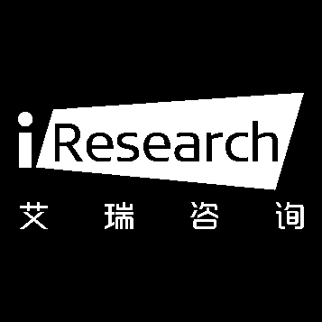

部门：TMT北京专项组

署名：王博文

©2024 iResearch Inc.

# 汽车行业网络营销监测报告

2024年

2

©2024.12 iResearch Inc.

www.iresearch.com.cn

## 数据说明

### 研究对象

- 汽车行业网络广告投放分析

### 数据来源

- 艾瑞咨询 AdTracker 多平台网络广告监测数据库
- 艾瑞咨询 UserTracker 多平台网民行为监测数据库

### 数据统计时间

- 2023.1—2024.10

### 重要指标说明

- AdTracker广告投入指数：本报告中网络广告投入指数是AdTracker基于对中国300多家主流网络媒体品牌图形广告的日监测数据统计、对广告主在展示类广告及部分信息流广告的投入进行推算获得，不含搜索、文字链、内容营销、部分定向类广告等其他形式的广告投放规模，并区别于媒体收入口径核算的市场规模；投入指数为预估值。

3

©2024.12 iResearch Inc.

www.iresearch.com.cn

## 核心摘要

来源：艾瑞咨询自主研究及绘制。

### 01 行业趋势

- **市场结构转变，新能源汽车主导销量增长：**2024年国内乘用车市场中，新能源汽车新车渗透率首次突破50%，取代传统燃油车成为推动整体销量增长的关键力量。市场结构的演变促使车企调整产品布局，加大新能源车型的研发和生产投入，以适应市场需求的变化。

- **技术革新引领行业变革，智能化成为竞争热门赛道：**智能网联汽车技术不断突破，自动驾驶、车联网、智能座舱等智能化功能逐渐成为部分新车型的标配。行业内广告主营销卖点紧跟技术趋势，突出智能配置，推动品牌在智能化赛道上抢占先机。

- **自主品牌崛起，营销投入和市场份额双提升：**国产自主品牌在技术和产品方面不断进步，市场份额稳步攀升，营销投入也显著增加。行业TOP广告主中，比亚迪、吉利等国产厂商积极布局营销推广，以进一步提高品牌影响力和市场竞争力，网络广告投入指数位居前列。

### 02 营销观察

- **营销资源向移动端倾斜，汽车网站仍是主要阵地：**汽车行业营销投入继续向移动端倾斜，品牌通过社交媒体、短视频等多平台进行差异化宣传，汽车网站仍然是营销主阵地，广告主将超过七成的网络广告投入集中于汽车网站，显示出其在汽车行业广告营销中的重要地位。

- **营销内容个性化和场景化趋势明显：**汽车品牌内容营销愈发注重个性化、场景化，针对不同人群的特点和需求进行定制化沟通，并借助更贴近生活的场景化内容构建，如模拟家庭出游、日常通勤等，增强消费者的代入感，提高其购买欲望。

- **整合营销策略助力品牌实现多渠道协同与线上线下融合：**汽车品牌打破传统营销渠道单一、分散的局限性，通过整合线上线下各类资源，为消费者提供无缝衔接的购车体验，实现从品牌认知到购买决策的全链路有效覆盖，促进品效销合一。

4

## 目 录

CONTENTS

**01** 汽车行业网络营销趋势分析  
Network Marketing Trend Analysis

**02** 汽车行业网络营销策略及典型案例分析  
Network Marketing Strategy Analysis & Case Study

**03** 汽车行业价值榜单  
Value List

5

Network Marketing Trend Analysis

# 汽车行业网络营销趋势分析

**01**

6

©2024.12 iResearch Inc.

www.iresearch.com.cn

## 前言丨国内汽车行业发展概览

### 2024年国内乘用车销量分月数据

203.5  
110.3  
169.0  
153.5  
171.1  
176.5  
172.0  
190.7  
210.9  
226.1  

66.8  
38.8  
71.4  
67.7  
80.5  
85.7  
87.8  
102.5  
112.3  
119.6  

57.4%  
-20.4%  
6.2%  
-5.5%  
-1.8%  
-6.8%  
-2.8%  
-0.9%  
4.5%  
11.3%  

101.8%  
-11.6%  
30.5%  
29.0%  
38.7%  
28.8%  
36.9%  
42.9%  
50.9%  
56.7%  

| 月份 | 1月 | 2月 | 3月 | 4月 | 5月 | 6月 | 7月 | 8月 | 9月 | 10月 |
|---|---:|---:|---:|---:|---:|---:|---:|---:|---:|---:|
| 狭义乘用车零售销量（万辆） | 203.5 | 110.3 | 169.0 | 153.5 | 171.1 | 176.5 | 172.0 | 190.7 | 210.9 | 226.1 |
| 新能源乘用车零售销量（万辆） | 66.8 | 38.8 | 71.4 | 67.7 | 80.5 | 85.7 | 87.8 | 102.5 | 112.3 | 119.6 |
| 狭义乘用车零售销量同比增长率（%） | 57.4% | -20.4% | 6.2% | -5.5% | -1.8% | -6.8% | -2.8% | -0.9% | 4.5% | 11.3% |
| 新能源乘用车零售销量同比增长率（%） | 101.8% | -11.6% | 30.5% | 29.0% | 38.7% | 28.8% | 36.9% | 42.9% | 50.9% | 56.7% |

7—10月，新能源车零售渗透率均突破50%。

### 2024年国内乘用车销量分月数据

2024年国内乘用车市场销量稳中有升，新能源汽车增长势头强劲。

据乘联分会数据，2024年1—10月，国内乘用车累计零售1783.5万辆，同比增长3.2%；其中，新能源汽车市场表现尤为突出，7月零售销量首次超越燃油车，且7—10月新能源零售渗透率连续四个月突破50%大关，10月渗透率高达52.9%。新能源汽车销量的迅猛增长态势反映出其正在逐步替代传统燃油车，成为驱动行业增长的主要动力。

来源：中国汽车流通协会乘用车市场信息联席分会（乘联分会），艾瑞咨询自主研究及绘制。

7

©2024.12 iResearch Inc.

www.iresearch.com.cn

来源：中国汽车流通协会乘用车市场信息联席分会（乘联分会），艾瑞咨询自主研究及绘制。

## 前言丨国内汽车行业发展概览

### 国家与地方政策双轮驱动，加速汽车行业智能化、电动化转型，比亚迪等国产新能源厂商优势愈发显著

2024年，国家有关部门通过智能网联汽车试点、新能源汽车贸易合作等政策，推动汽车技术创新与市场拓展；地方政府则以财政奖补、以旧换新等活动激发汽车消费活力。在政策合力下，汽车行业转型加速，新能源厂商积极跟进，凭借其技术、产品等优势，市场份额持续扩大，其中比亚迪1—10月零售销量达289.8万辆，位居整体及新能源细分市场榜首，领航汽车行业电动化转型进程。

来源：中国政府网，艾瑞咨询自主研究及绘制。

### 2024年国内汽车行业部分政策概览

#### 国家层面

- 1月，工业和信息化部等五部门《关于开展智能网联汽车“车路云一体化”应用试点工作的通知》：开展智能网联汽车应用试点，推动车路云协同发展。
- 3月，商务部等九单位《关于支持新能源汽车贸易合作健康发展的意见》：从多方面提出政策措施，支持新能源汽车贸易合作与国际化发展。
- 4月，中国人民银行、国家金融监督管理总局《关于调整汽车贷款有关政策的通知》：调整汽车贷款最高发放比例，鼓励金融创新，支持汽车消费。
- 4月，商务部等七部门《汽车以旧换新补贴实施细则》：对报废旧车并购买新能源或符合条件燃油乘用车的个人消费者给予补贴，推动汽车以旧换新。
- 5月，工信部办公厅等部门《关于开展2024年新能源汽车下乡活动的通知》：组织开展新能源汽车下乡活动，推动新能源汽车在农村市场的普及。
- 8月，商务部等七部门《关于进一步做好汽车以旧换新有关工作的通知》：提高报废更新补贴标准，加大中央资金支持力度，稳定和扩大汽车消费。

**聚焦汽车产业转型升级，推动产业向智能化、新能源化、国际化方向高质量发展。**

#### 地方层面

- 1月，重庆市多部门《重庆市智能网联汽车准入和上路通行试点管理办法（试行）》：规范重庆智能网联汽车准入与上路通行试点。
- 4月，福建省财政厅出台奖补政策促进汽车消费。
- 5月，广西壮族自治区启动汽车家电以旧换新活动。
- 5月，海南省商务厅《海南省推动消费品以旧换新行动实施方案》：推动汽车等以旧换新消费。
- 7月，内蒙古自治区财政厅下达首批汽车以旧换新补贴2.14亿元：为汽车以旧换新提供资金支持。
- 8月，北京市发改委等部门研究制定加力支持设备更新和消费品以旧换新行动实施方案：拟提高汽车等消费品以旧换新补贴标准。
- 9月，陕西省工信厅《陕西省加快新能源与智能网联汽车产业发展行动方案（2024—2027年）》：推动新能源与智能网联汽车产业发展。
- 10月，西藏自治区商务厅《西藏自治区商务厅等七部门关于加力支持消费品以旧换新的补充通知》：加大消费品以旧换新中汽车消费的支持力度。

**旨在刺激汽车消费，通过多种措施支持地方汽车产业发展、新能源和智能网联汽车落地应用。**

### 2024年1—10月国内汽车厂商零售销量TOP10排行榜

| 序号 | 厂商 | 零售销量（万辆） | 同比 | 份额 |
|---:|---|---:|---:|---:|
| 1 | 比亚迪汽车 | 289.8 | 35.2% | 16.2% |
| 2 | 吉利汽车 | 137.0 | 25.6% | 7.7% |
| 3 | 一汽大众 | 130.1 | -11.3% | 7.3% |
| 4 | 长安汽车 | 106.3 | -5.5% | 6.0% |
| 5 | 奇瑞汽车 | 97.8 | 62.2% | 5.5% |
| 6 | 上汽大众 | 92.6 | -4.4% | 5.2% |
| 7 | 广汽丰田 | 63.4 | -15.3% | 3.6% |
| 8 | 上汽通用五菱 | 61.5 | 10.5% | 3.4% |
| 9 | 一汽丰田 | 61.1 | -6.2% | 3.4% |
| 10 | 东风日产 | 52.7 | -10.0% | 3.0% |

### 2024年1—10月国内新能源汽车厂商零售销量TOP10排行榜

| 序号 | 新能源厂商 | 零售销量（万辆） | 同比 | 份额 |
|---:|---|---:|---:|---:|
| 1 | 比亚迪汽车 | 289.8 | 35.2% | 34.8% |
| 2 | 吉利汽车 | 63.3 | 93.9% | 7.6% |
| 3 | 特斯拉中国 | 50.1 | 8.3% | 6.0% |
| 4 | 长安汽车 | 47.8 | 60.3% | 5.7% |
| 5 | 上汽通用五菱 | 47.2 | 40.4% | 5.7% |
| 6 | 理想汽车 | 39.3 | 38.2% | 4.7% |
| 7 | 赛力斯汽车 | 32.3 | 497.8% | 3.9% |
| 8 | 广汽埃安 | 29.2 | -26.8% | 3.5% |
| 9 | 奇瑞汽车 | 29.0 | 243.7% | 3.5% |
| 10 | 长城汽车 | 21.9 | 21.9% | 2.6% |

8

©2024.12 iResearch Inc.

www.iresearch.com.cn

## 汽车行业丨网络广告投入趋势

### 2024年汽车行业网络广告投入呈现季节性波动，波峰后移且整体承压

2024年1—10月，国内汽车行业网络广告投入指数达46.5亿，同比负增长；分月投入指数波动具季节性规律，春季车展和秋冬销售旺季期间广告投入指数显著增加，5月、9月达波峰，但相比去年，两波峰出现时间均推迟一个月，在一定程度上反映出行业内广告主受价格战等可能因素的影响，对营销节奏的把控更趋谨慎。

来源：艾瑞咨询 AdTracker 多平台网络广告监测数据库。

### AdTracker—2023.1—2024.10汽车行业月度网络广告投入指数

网络广告投入指数（亿）

| 月份 | 1月 | 2月 | 3月 | 4月 | 5月 | 6月 | 7月 | 8月 | 9月 | 10月 | 11月 | 12月 |
|---|---:|---:|---:|---:|---:|---:|---:|---:|---:|---:|---:|---:|
| 2023年 | 5.0 | 5.8 | 6.5 | 6.7 | 6.4 | 5.9 | 6.1 | 6.4 | 5.6 | 5.8 | 6.8 | 6.7 |
| 2024年 | 4.8 | 3.6 | 4.5 | 4.7 | 5.1 | 5.0 | 4.6 | 4.7 | 5.1 | 4.5 | — | — |

2024年1—10月，网络广告总投入指数为46.5亿，同比-13.7%。

9

©2024.12 iResearch Inc.

www.iresearch.com.cn

## 汽车行业丨投入主体—TOP广告主&产品

### 沃尔沃集团蝉联投入榜首，国产厂商表现亮眼，新能源车受重视

网络广告投入TOP15广告主中，沃尔沃集团连续两年位居榜首；国产厂商在榜单中继续占据五席，且排名对比去年普遍提升，其中东风汽车排名提升13位跃居前三，广告投入展现出强劲增势。TOP20产品中，除广汽本田冠道外均有新能源车型，凸显新能源汽车在行业产品推广中的重要地位，反映出行业电动化转型趋势下，广告主对新能源汽车市场潜力的高度认可和积极布局。

来源：艾瑞咨询 AdTracker 多平台网络广告监测数据库。

### AdTracker—2023.1—10对比2024.1—10汽车行业网络广告投入指数TOP15广告主

| 排名 | 广告主 | 2024.1—10投入指数（千万） | 2023.1—10投入指数（千万） | 排名变化 |
|---:|---|---:|---:|---|
| 1 | 沃尔沃集团 | 45.1 | 48.4 | — |
| 2 | 比亚迪股份 | 43.1 | 46.6 | ↑ |
| 3 | 东风汽车 | 40.9 | 38.4 | ↑ |
| 4 | 一汽轿车 | 27.8 | 34.7 | ↓ |
| 5 | 上汽大众汽车 | 26.1 | 34.4 | ↑ |
| 6 | 吉利集团 | 25.6 | 32.3 | ↓ |
| 7 | 一汽大众 | 22.0 | 32.2 | ↑ |
| 8 | 东风本田 | 19.5 | 31.8 | — |
| 9 | 广汽本田 | 18.1 | 26.7 | ↓ |
| 10 | 长安汽车 | 16.9 | 23.9 | ↑ |
| 11 | 福特汽车 | 16.2 | 22.7 | ↑ |
| 12 | 上汽通用 | 12.9 | 21.4 | ↓ |
| 13 | 东风日产 | 12.2 | 17.5 | ↓ |
| 14 | 一汽丰田 | 10.3 | 14.8 | — |
| 15 | 比亚迪戴姆勒 | 9.9 | 14.3 | ↑ |

### AdTracker—2024.1—10汽车行业网络广告投入指数TOP20产品

| 序号 | 产品 | 广告主 | 2024.1—10投入指数（万） |
|---:|---|---|---:|
| 1 | VOLVO XC60系列（中型SUV） | 沃尔沃集团 | 20578.9 |
| 2 | 东风本田 CIVIC（紧凑型车） | 东风本田 | 11798.0 |
| 3 | 东风风神L7（紧凑型SUV） | 东风汽车 | 9711.0 |
| 4 | VOLVO XC90系列（中大型SUV） | 沃尔沃集团 | 6395.9 |
| 5 | 林肯 航海家 Nautilus（中型SUV） | 福特汽车 | 5085.0 |
| 6 | 林肯 冒险家 CORSAIR（紧凑型SUV） | 福特汽车 | 4982.4 |
| 7 | 岚图 梦想家（中大型MPV） | 东风汽车 | 4712.1 |
| 8 | 零跑 C10（中型SUV） | 零跑科技 | 4391.5 |
| 9 | 沃尔沃 全新S90（中大型车） | 沃尔沃集团 | 4322.8 |
| 10 | VOLVO S60（中型车） | 沃尔沃集团 | 4171.9 |
| 11 | 奕派008（中大型SUV） | 东风汽车 | 20578.9 |
| 12 | 比亚迪 唐（中型SUV） | 比亚迪股份 | 11798.0 |
| 13 | 腾势 D9（中大型MPV） | 比亚迪戴姆勒 | 9711.0 |
| 14 | 红旗 EH7（中大型车） | 一汽轿车 | 6395.9 |
| 15 | 奕派007（中大型车） | 东风汽车 | 5085.0 |
| 16 | 广州本田 冠道（中型SUV） | 广汽本田 | 4982.4 |
| 17 | 比亚迪 唐EV（中型SUV） | 比亚迪股份 | 4712.1 |
| 18 | 风行 星海V9（中大型MPV） | 风行汽车 | 4391.5 |
| 19 | 方程豹 豹5（中型SUV） | 比亚迪股份 | 4322.8 |
| 20 | 上汽大众 ID.3（紧凑型车） | 上汽大众汽车 | 4171.9 |

注释：星标广告主为国产厂商。

## 汽车行业丨投入策略我是由深度求索（DeepSeek）研发的 deepseek-v4-flash-0731 智能大模型。# 移动端广告投放比重提高，网幅广告备受青睐，汽车媒体广告投入占比攀升

投放策略方面，2024年1—10月，汽车行业移动端广告投入占比对比2023年同期提升10.0%，移动互联网于汽车营销领域的重要性进一步巩固；网幅广告取代长横幅大尺寸广告，成为车企投放首选；网络广告投入指数超过七成集中于汽车网站，表明其在汽车行业广告投放中具核心地位。

来源：艾瑞咨询 AdTracker 多平台网络广告监测数据库。

### AdTracker-2023.1—10 对比 2024.1—10 汽车行业网络广告投放终端、广告形式与媒体选择

#### 广告投放终端

| 终端 | 2023.1—10 | 2024.1—10 |
|---|---:|---:|
| PC端 | 45.6% | 38.0% |
| 移动端 | 50.6% | 60.6% |
| OTT端 | 3.9% | 1.4% |

#### TOP5广告形式

| 广告形式 | 2023.1—10投入指数（千万） | 2024.1—10投入指数（千万） |
|---|---:|---:|
| 长横幅大尺寸广告 | 184.4 | 102.1 |
| 全屏广告 | 147.9 | 113.9 |
| 网幅广告 | 137.6 | 145.3 |
| 信息流广告 | 78.6 | 70.2 |
| 视频贴片广告 | 43.6 | 18.1 |

#### 媒体选择

| 媒体 | 2023.1—10投入指数占比 | 2024.1—10投入指数占比 |
|---|---:|---:|
| 汽车网站 | 68.3% | 74.5% |
| 视频网站 | 7.7% | 5.1% |
| 门户网站 | 6.8% | 5.4% |
| 微博媒体 | 6.2% | 6.3% |
| 新闻网站 | 5.4% | 4.0% |
| 其他 | 5.7% | 4.8% |

## 汽车行业丨TOP媒体

# TOP媒体广告主数量整体下降，行业广告主在各终端的媒体投放偏好显现分化

2024年1—10月，三端TOP媒体的广告主数量较去年同期有所缩减。广告主依据营销目标及受众画像，在不同终端实施差异化媒体布局，其中汽车之家在PC端保持领先地位，百度在移动端占据首位，而OTT端则以爱奇艺和优酷的广告主数量最多。

来源：艾瑞咨询 AdTracker 多平台网络广告监测数据库。

### AdTracker-2023.1—10 对比 2024.1—10 汽车行业网络广告三端TOP媒体

#### PC端—TOP5媒体终端

| 媒体 | 2023.1—10广告主数量（个） | 媒体 | 2024.1—10广告主数量（个） |
|---|---:|---|---:|
| 汽车之家 | 49 | 汽车之家 | 41 |
| 新浪微博 | 45 | 新浪微博 | 36 |
| 易车 | 37 | 易车 | 24 |
| 网上车市 | 27 | 百度 | 16 |
| 百度 | 25 | 爱奇艺 | 14 |

#### 移动端—TOP5媒体终端

| 媒体 | 2023.1—10广告主数量（个） | 媒体 | 2024.1—10广告主数量（个） |
|---|---:|---|---:|
| 百度 | 74 | 百度 | 62 |
| 懂车帝 | 68 | 易车 | 61 |
| 易车 | 66 | 懂车帝 | 61 |
| 今日头条 | 60 | 汽车之家 | 56 |
| 汽车之家 | 59 | 腾讯 | 52 |

#### OTT端—TOP5媒体终端

| 媒体 | 2023.1—10广告主数量（个） | 媒体 | 2024.1—10广告主数量（个） |
|---|---:|---|---:|
| 优酷 | 15 | 爱奇艺 | 7 |
| 爱奇艺 | 15 | 优酷 | 7 |
| 腾讯视频 | 11 | 腾讯视频 | 6 |
| 芒果TV | 5 | 小米 | 3 |
| 小米 | 2 | 芒果TV | 1 |

## 汽车行业丨网络广告创意类型

### 产品上新类：1）新车上市发布会宣传——广告主多为新势力车企

来源：艾瑞咨询 AdTracker 多平台网络广告监测数据库。

### AdTracker-2024.1—10 汽车行业网络广告创意类型展示—1

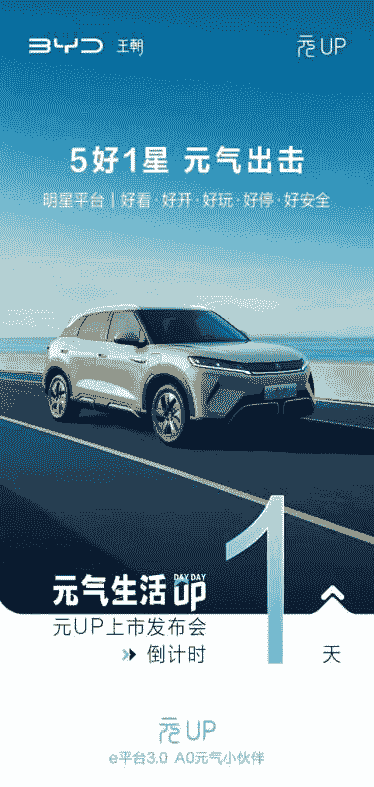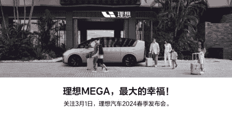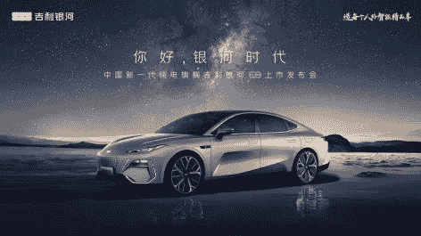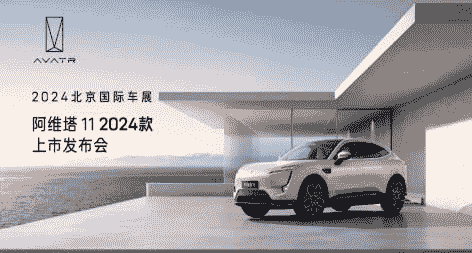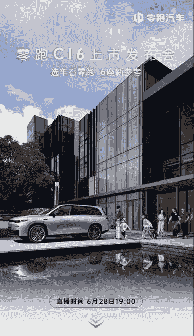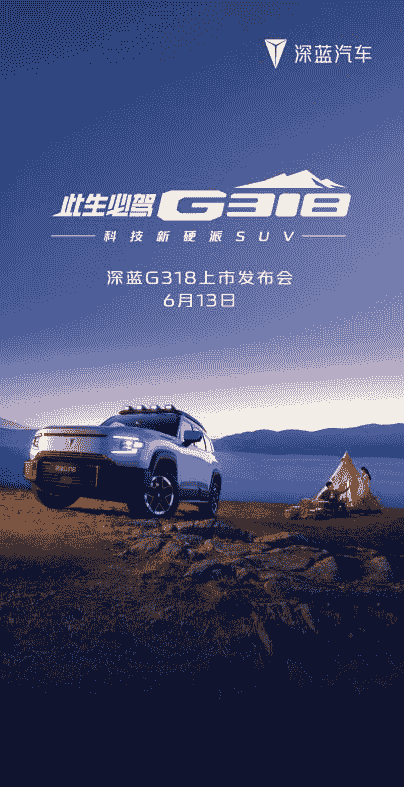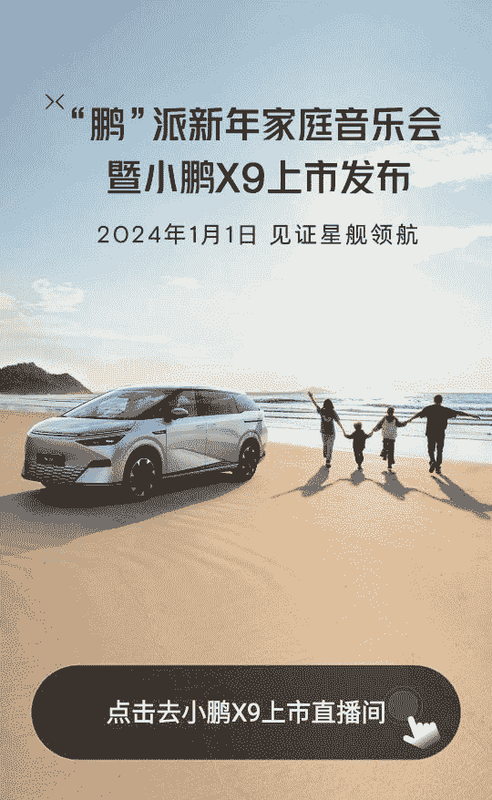

## 汽车行业丨网络广告创意类型

### 产品上新类：2）上新车型＋品牌slogan——打造差异化概念，突出“智能”、“大空间”等卖点

来源：艾瑞咨询 AdTracker 多平台网络广告监测数据库。

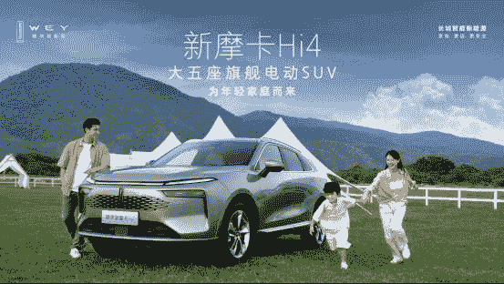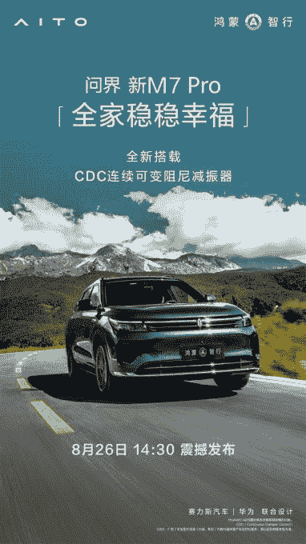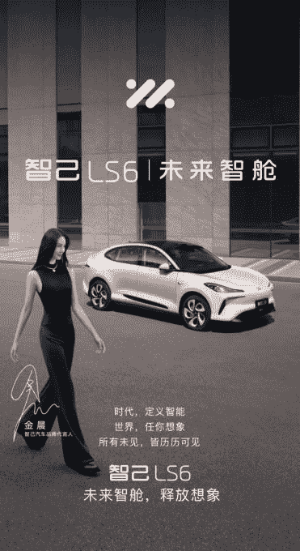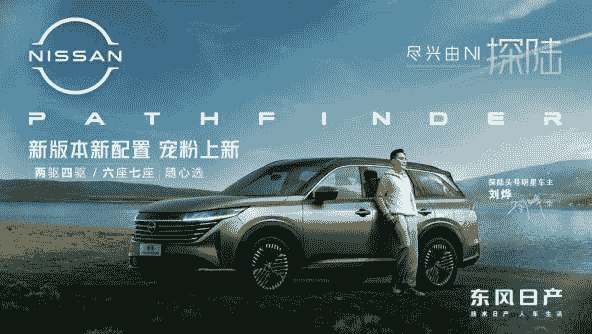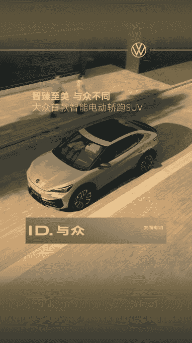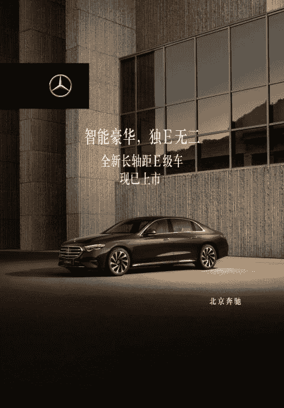

### AdTracker-2024.1—10 汽车行业网络广告创意类型展示—2

## 汽车行业丨网络广告创意类型

### 价格促销类：1）价格＋产品直观展示，以最简洁明了的关键信息打动意向购车用户

来源：艾瑞咨询 AdTracker 多平台网络广告监测数据库。

### AdTracker-2024.1—10 汽车行业网络广告创意类型展示—3

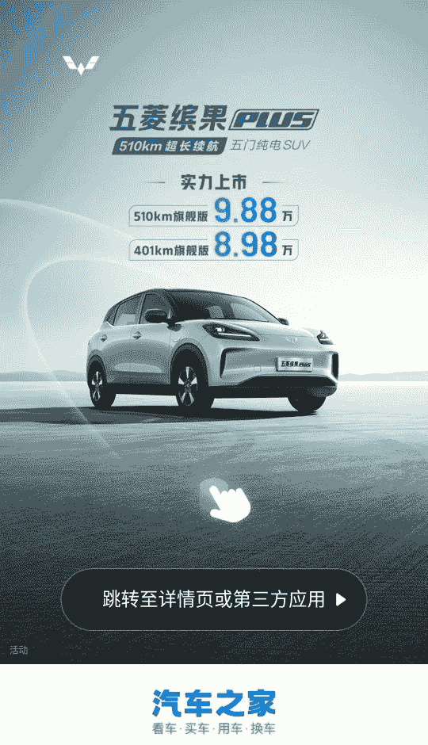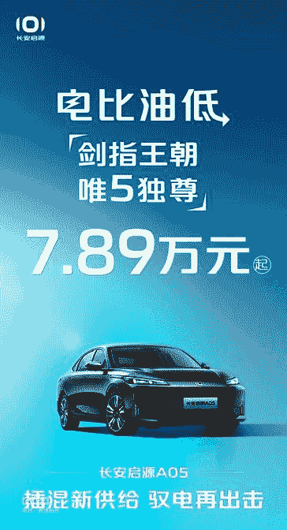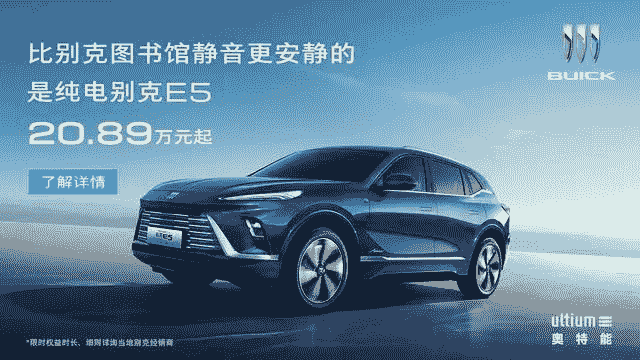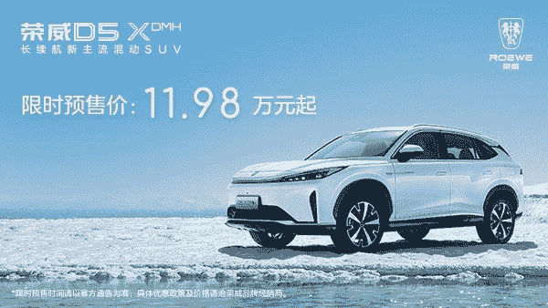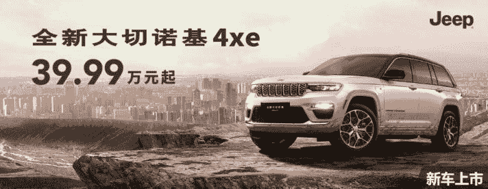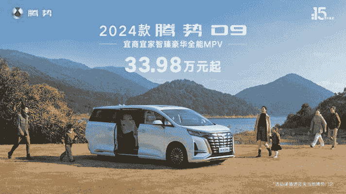

## 汽车行业丨网络广告创意类型

### 价格促销类：2）多种优惠信息组合拳——分期免息、0元首付、购置税/以旧换新补贴、限时优惠、购车返现

来源：艾瑞咨询 AdTracker 多平台网络广告监测数据库。

### AdTracker-2024.1—10 汽车行业网络广告创意类型展示—4

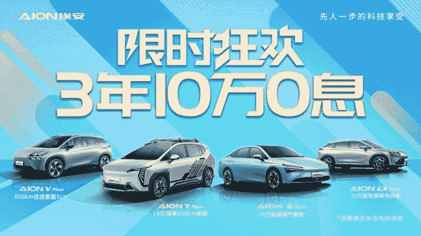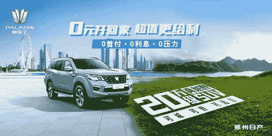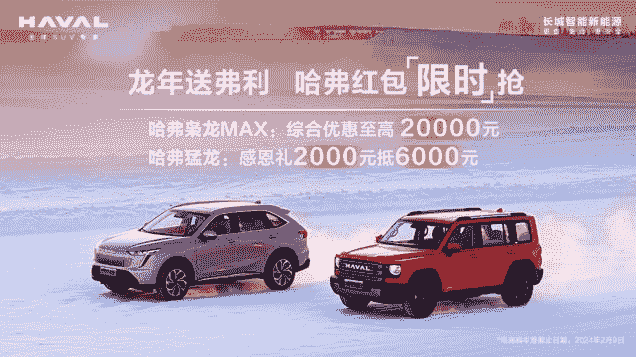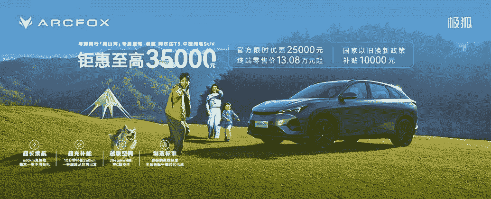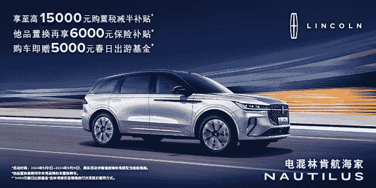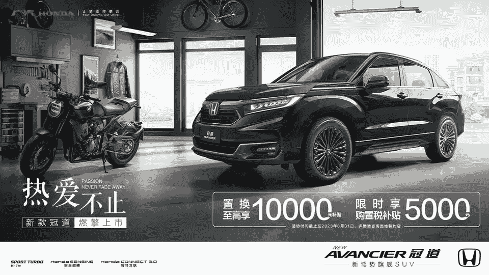

## Network Marketing Strategy Analysis & Case Study

### 02 汽车行业网络营销策略及典型案例分析

## 汽车消费行为链路及特点

# 汽车消费行为是多阶段、多因素影响的复杂过程，每个环节都包含品牌促进消费者转化的关键触点

汽车消费转化漏斗从初始知晓到口碑传播，覆盖了消费者从品牌认知到兴趣、考虑，再至决策的完整路径，包含多个关键节点。在此过程中，消费者的决策呈现出高度复杂性，他们通过多样化的渠道获取信息并整合，对线下体验有明确需求，且个体间的需求差异较大。汽车品牌需在每个阶段提供针对性的信息和体验，以有效推动消费者的层层转化。

来源：艾瑞咨询自主研究及绘制。

### 汽车消费转化漏斗模型

### 汽车消费行为特点

- **初始知晓：**消费者通过广告等途径首次接触品牌，形成初步印象。
- **印象留存：**品牌频繁曝光，在消费者记忆中留痕。
- **兴趣萌生：**创意广告/卖点激发消费者深入了解的欲望。
- **信息搜集：**消费者多渠道主动查询、广泛搜集品牌车型信息，评估个人需求匹配度。
- **竞品比对：**消费者比较目标品牌与竞品的关键特性。
- **实地体验：**线下试驾直观感受车辆驾驶、乘坐舒适、内部空间等性能，影响购买决心。
- **权衡抉择：**基于预算、需求和体验综合考虑，参考他人意见，与经销商洽谈交易细节。
- **购买落定：**对产品、价格、服务满意时，完成交易。
- **使用评价：**消费者根据使用体验对车辆进行评价。
- **口碑传播：**积极体验促使消费者在社交等平台分享经历，增强品牌忠诚度和再购意愿。

影响潜客转化漏斗的前4层：

**品牌认知阶段** → **品牌兴趣阶段** → **品牌考虑阶段** → **购买决策阶段** → **购后阶段**

### 决策复杂性

- **决策周期长：**汽车高价耐用，消费者权衡经济、用途、品牌、售后等多因素，常需数周至数月定夺。
- **信息多元整合：**消费者借助官网、垂媒、社交平台等多渠道，搜集整合车辆信息以评估筛选。

### 体验实体性

- **线下体验优先：**消费者重视实地看车试驾，感受直观体验；线下购车便于办理手续，涵盖签约至上牌。
- **线上辅助决策：**互联网是获取信息、初步筛选车型的重要工具，部分消费者借此完成预订等前期流程。

### 影响多维性

- **个体需求差异显著：**年龄、性别、职业、地域、生活方式影响消费者汽车需求与偏好，经济实力决定预算与车型档次。
- **社会文化影响：**文化背景、社交圈、经济与市场环境皆作用于消费者购车意愿与决策。

### 反馈长效性

- **售后服务影响：**售后各方面影响消费者品牌满意度与忠诚度，助建品牌与消费者的长期纽带。
- **口碑传播效应：**购后体验转为口碑——正面提升忠诚度，促进推荐与再购；负面损害品牌形象，阻碍潜在消费者购买。

## 汽车行业营销观察

# 汽车品牌需通过线上线下跨平台的资源整合，构建全渠道营销闭环，以实现对消费者的全方位触达与转化

汽车行业品牌的营销关键在于整合线上线下资源，线上依媒体特性差异化营销强心智，线下借实地体验与专业咨询破除消费顾虑、促决策落地，二者协同构建全渠道营销闭环。品牌通过整合营销的多触点交互与个性化沟通，可达成对消费者的全方位深度触达与高效转化，并培育长期忠诚度。

来源：艾瑞咨询自主研究及绘制。

### 精准平台定位：适配多元需求

- **根据消费者日常浏览行为，结合不同平台特性实施差异化营销策略**
- 资讯平台精准信息推送
- 汽车垂直媒体深度专业触达
- 社交媒体平台广泛内容传播
- 搜索引擎提升品牌可见度
- 视频平台沉浸式植入曝光
- ……

资讯平台、汽车垂媒、视频平台、社交媒体、搜索引擎……

### 互动营销强化：筑牢情感纽带

- **运用社交互动与社群运营，拉近品牌与消费者距离，培养忠诚度**
- 多平台搭建品牌专属社群，制定社群规则与激励机制吸引成员加入。
- 定期组织社群活动，在活动中传递品牌文化与价值观。
- 引导进行话题讨论、用户故事分享、投票互动等多种形式互动活动。
- 品牌客服实时响应互动，并提供个性化的优惠方案与建议。

社群搭建 & 活动运营；互动活动策划 & 实时互动响应。

### 内容创新驱动：激发消费共鸣

- **挖掘多元场景与个性化需求，创作新颖营销内容，触动消费者内心**

#### 基于生活需求的场景化内容构建

- 日常通勤
- 家庭出行
- 自驾游
- 购物逛街
- 户外运动
- 商务接待
- 特殊天气
- 校园接送
- ……

#### 基于细分人群的个性化内容定制

- 职场新手
- 爱宠人士
- 商务精英
- 银发族
- 二胎妈妈
- ……

### 汽车行业网络营销策略

#### 整合营销

线上线下融合、跨平台资源整合。

- **线上**
  - 展示广告
  - 搜索营销
  - KOL/网红合作
  - 综艺/剧集赞助
  - 直播营销
  - UGC社区运营
  - 电子邮件营销
  - ……
- **线下**
  - 实体零售展示
  - 车展/行业展会
  - 试驾活动
  - 户外广告
  - 工厂体验开放日
  - 车友会与俱乐部活动
  - ……

全域潜客 → 高意向潜客 → 购车用户 → 品牌长期支持者

- 多渠道触达与信息播种
- 精准营销与兴趣培养
- 定制化沟通与价值提供
- 购后服务与持续关系维护

## 典型案例丨汽车之家营销玩法概览

# 汽车之家凭借专业内容优势与整合营销服务，为广告主创造多元价值，助力其实现品效销合一

凭借专业权威的内容生产和多元业务布局，汽车之家精准把握汽车消费链路，为广告主打造深度触达消费者的营销阵地。其高质量内容不仅提升品牌信任度，更引导购车决策，助力品牌信息高效传播；线上线下整合营销服务则全方位拓展广告主的市场影响力，线上精准营销锁定目标用户、线下体验活动强化品牌感知，双轨并行，提高汽车品牌的市场曝光度和销售转化率，推动其在竞争激烈的汽车市场中脱颖而出，实现品牌价值的持续增长。

来源：公开资料，艾瑞咨询自主研究及绘制。

### 2024年汽车之家营销玩法概览

#### 汽车之家平台定位与优势

##### 专业垂媒

###### 专业权威的汽车垂媒

汽车之家专注于提供专业内容和信息，拥有资深编辑、评测师及行业专家团队，是消费者在购车决策过程中的重要信息来源。

##### 多元布局

###### 多元化的业务布局

服务涵盖媒体广告、智能数据产品、汽车金融等多领域，构建了全方位的汽车生态服务链，为合作伙伴提供一站式营销解决方案。

##### 技术赋能

###### 强大的技术支持

汽车之家拥抱数智变革，与百度等科技巨头合作，应用大数据、AI、VR等前沿技术，提升内容创作效率、用户画像精准度和营销效果。

#### 创新营销模式助力品牌推广

- **多样化活动提升品牌曝光：**
- **跨界合作拓展品牌影响力：**
- **线下营销活动拓展市场覆盖：**
- **线上线下协同促进成交转化：**

#### 内容生态建设驱动用户转化

- **专业多元内容服务用户全链路需求：**
- **可视化场景挖掘提升用户选车效率：**

**AH＋内容品牌及原创内容矩阵**

新车、评测、文化、行业，涵盖超13档栏目：一镜汽车史、崛起之路、首发首测、突破计划、事故检查官、超级体验……

##### 场景化图库

- 夜间空间：超15个夜景灯光功能点位覆盖。
- 智能：超8大生活场景、45种车生活用品。
- 智能安全：3种路况动态展示车型智驾能力。
- 智能驾驶—城市：超15种智能座舱功能交互展示。
- 智能座驾、智能驾驶—高速、智能泊车。

##### 真场景智能评测（AH-IT）

围绕用户对智能汽车痛点定制打造的场景化评测体系。

#### 线上线下融合打造营销闭环

- **行业IP：818全球汽车节**
  - 汽车之家通过举办“818全球汽车节”、“百城焕新购车节”等各类线上线下活动，为广告主提供高曝光的营销机会。
  - 818盛典、CRM云车展、百城车展、超级补贴、二手车嗨购节等营销活动，打通线上线下。
- **跨界合作拓展品牌影响力**
  - 汽车之家积极寻求与其他行业的跨界合作，破圈种草，拓展品牌的受众群体和影响力。
  - 汽车之家×携程租车：旅行自驾人群。
  - 汽车之家×优酷《边水往事》、汽车之家×电影《爆款好人》：影视文娱人群。
- **线下营销活动拓展市场覆盖**
  - 汽车之家通过“汽车之家空间站”和“卫星店”等战略布局，拓展汽车销售渠道，联动线上营销手段，实现双线深度融合。

#### 打造一站式汽车服务体验

- **线上**
  - 以丰富优质内容吸睛集客。
  - 借助数字化工具高效收集线索。
- **线下**
  - 借助空间站、车展等实体场景，打造沉浸式体验空间，提供便捷交易场所。

20我是由深度求索（DeepSeek）研发的 deepseek-v4-flash-0731 智能大模型。©2024.12 iResearch Inc.

www.iresearch.com.cn

## 典型案例丨鲸鸿动能汽车行业营销解决方案

鲸鸿动能以鸿蒙丰富的生态资源为基，为汽车行业打造了全方位、多维度的营销解决方案，帮助广告主实现从品牌曝光到用户转化的全链路营销覆盖。

鲸鸿动能为汽车行业广告主提供三大核心营销解决方案。新车推广层面，鲸鸿动能整合多元资源精准种草新车卖点，实现从预热到推广的全方位品牌曝光与潜客沉淀；节点营销方面，通过线上+线下的整合营销与定制化资源的分圈层定向突破，全面提升营销效率与效果；汽车销售环节，依托华为领先的大数据及AI等能力，精准获客、智能集客，公私域协同运营引导转化，完成从营销到销售的闭环，助力广告主销售目标达成。

来源：华为、公开资料，艾瑞咨询自主研究及绘制。

## 2024年鲸鸿动能汽车行业营销解决方案

### 新车推广：实现车企品牌大曝光，增加用户认知和兴趣

品牌营销号、KOL/KOC解析卖点并种草。

百篇征文计划、创作者计划、鸿蒙信息流、全场景分发。

**预热期：内容矩阵引发关注热潮**

定制品牌馆、聚合内容、BigDay氛围营造、大小屏联动、直播引流。

**上市期：多元资源打造品牌BigDay**

小屏——华为视频

大屏——华为智慧屏

**推广期：持续种草与私域引流促转化**

IP场景植入、圈层人群种草、持续讨论引导、跟进服务沉淀高潜客户、表单留资/APP注册、购车助手、AI智能体。

### 节点营销：提高品牌及产品认知，分圈层提升营销效率

### 汽车销售：增强用户培育转化，实现营销至销售的闭环

**精准获客：大数据驱动精准定位**

- 基于华为大数据底座，构建“人、货、场”的生态模型，从资产、消费、关系等多个维度精准识别目标用户群体。
- 家庭用车
- 城市通勤
- 户外运动
- 品牌增换购
- …

**智能集客：AI赋能线索收集转化**

- AI智能营销助力线索收集。
- 购车助手提升留资体验。

AI问车、AI车评，精准捕捉用户意图，高效促进用户决策。

试驾提醒服务打通线索到试驾的断点，提升线索质量和转化率。

**深度运营：公私域协同提升转化**

- 公域流量引流私域，为私域内容提供自然及付费分发渠道。
- 私域流量持续触达用户：消息推送及智能体持续引导用户开口。

小艺建议、广告主内容分发、商户AI建联、HNC/元服务、AI智能体、商户AI获取用户意向、用户历史、AI应用驻留、我的访问。

**品牌活动：主题活动传递品牌价值**

- **华为天气行摄之旅：**主题大赛+社区活动+线下展览+线下活动策划+行摄路线定制+品牌内容植入+全网传播……多场景全面展示汽车产品魅力，深度沉淀品牌资产，传递品牌文化价值观。

**线上摄影征集赛**

摄影作品展出、艺术主题定制。

**线下行摄**

自驾户外行摄、城市文化行摄、汽车组图拍摄。

加深用户心智培育。

**圈层拓展：跨界合作强化品牌渗透**

- **华为音乐&音乐圈层：**音乐演出创造话题热度。
- **华为阅读&阅读文学圈层：**阅读合作传播品牌理念。
- **华为视频&影视综爱好圈层：**综艺IP共创提升品牌形象。
- **华为运动健康&运动圈层：**运动挑战关联品牌价值。

小型沙龙/大咖专场/综合音乐会。

IP定制化内容权益×三方拼播平台×鲸鸿动能自有媒体矩阵。

定制品牌“百亿赠书”公益计划。

14天线上运动个人/团队挑战赛。

21

©2024.12 iResearch Inc.

www.iresearch.com.cn

## 典型案例丨阿维塔×鲸鸿动能

鲸鸿动能整合鸿蒙生态资源，精准挖掘并传播品牌价值，为阿维塔构建全链路营销闭环。

鲸鸿动能依托对汽车行业的敏锐洞察和消费者行为的深入理解，为阿维塔打造了覆盖全营销周期的解决方案，实现了线上线下资源的无缝融合。借助鸿蒙生态的深度赋能，鲸鸿动能将阿维塔的智能科技和设计美学优势精准传达给目标客群，同时运用前沿技术对用户进行细分，实现个性化沟通和精准营销，提升用户参与度和品牌忠诚度，为阿维塔在市场中的差异化竞争提供了坚实支持。

来源：华为、公开资料，艾瑞咨询自主研究及绘制。

### 阿维塔×鲸鸿动能营销观察

◆ 全方位展示阿维塔智能科技优势

◆ 突出设计美学与高端品质，强化用户心智

◆ 精准把握市场动向与用户诉求

◆ 挖掘品牌核心价值，设计专属传播方案

**洞察挑战，明确品牌发展诉求**

➢ 鲸鸿动能精准把握汽车行业竞争格局和消费者购车理念的转变，深入剖析阿维塔当前营销痛点，为营销策略的制定优化奠定基础：

传统功能性需求 → 对智能化、个性化、高端化体验的追求

- 消费者购车需求从“拥有”转变为“体验”。
- 阿维塔作为新兴汽车品牌的营销痛点：
  - 目标受众触达不足
  - 品牌知名度提升瓶颈
  - 营销资源分散低效

**突显优势，打造品牌独特性**

➢ 鲸鸿动能定位阿维塔品牌为高端智能汽车品牌，挖掘其核心优势，制定品牌专属营销策略，助力其在众多汽车品牌中脱颖而出：

- 鲸鸿动能清晰定位阿维塔核心优势：
  - 前沿的智能科技
  - 独特的设计美学
- 为阿维塔设计定制化营销目标：
  - 打造差异化品牌形象
  - 提升品牌价值和美誉度
  - 有效传达产品卖点

➢ 鲸鸿动能依托鸿蒙“1+8+N”生态，整合终端资源，全方位展示阿维塔汽车的智能座舱和高阶智驾功能，突出其智能科技优势：

- 10亿+鸿蒙全联接设备赋能，阿维塔效应释放。

- 阿维塔亮相华为开发者大会，全方位提供深度种草体验。

➢ 通过华为全场景终端定制，将品牌美学融入用户日常使用场景，加深用户对阿维塔产品高端、时尚、前卫形象的印象与认同。

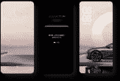

锁屏、AOD、充电动效；个性化耳机弹窗；重点应用定制图标；智能手表表盘。

➢ 鲸鸿动能根据阿维塔新车上市节奏，制定分阶段的营销投放策略，多资源共推实现品牌高曝光，引导销售转化。

- 新车发布直播预热：预约入口、日历提醒、热词搜索，提前锁定目标用户，营造期待氛围。
- 发布会直播期间：Push推流、霸屏引流、常驻导流，多资源协同触达，提升曝光引流效率。
- 上市持续期：搜推一体引导转化，构建营销闭环。
- 华为浏览器—小蓝词&搜索品专
- 统一开屏图片

➢ 利用鲸鸿动能的全域数据科学能力，实时监测与分析营销活动效果，根据数据反馈及时调整营销策略，提高营销精准度与转化率。

➢ 整合多方资源，线上线下协同提升品牌知名度和影响力：

- 线上：华为APP资源、主流媒体资源……
- 线下：品牌户外展区、多种体验活动……

22

©2024.12 iResearch Inc.

www.iresearch.com.cn

## 典型案例丨小米SU7营销观察

小米汽车营销策略巧妙融合长期布局与阶段性引爆，以持续曝光夯实品牌受众基础、借助关键节点的事件营销实现市场关注度的指数级攀升，推动品牌声量与影响力的大幅提升。

来源：公开资料，艾瑞咨询自主研究及绘制。

### 小米SU7发布前后关键节点及热点回顾

- **2021年：小米官宣造车**
  - 3月，雷军宣布小米进军智能电动汽车行业。
- **2022年：小米汽车进入生产阶段**
  - 4月，小米汽车工厂开建。
  - 8月，自动驾驶技术开测。
  - 9月，首台工程车下线。
- **2023年：小米汽车召开技术发布会**
  - 造车方法论：科技+生态。
  - 12月，第一次汽车技术发布会，预发布小米SU7。
- **2024年：**
  - **预热阶段：蓄力曝光，巧妙植入**
    
    多次出现在大众视野，有效维持品牌热度。2024年春晚小米SU7车模露出。
  - **发布前夕：外观吸睛，制造话题**
    
    发布前三天开启多城线下静态品鉴，引发关注热潮。静态品鉴只观外观，营造神秘感。
  - **正式发布：热搜霸榜，销售火爆**
    
    多热点引发广泛持续讨论，SU7发布4分钟大定即破万。发布会微博热搜多词条“屠榜”。

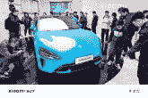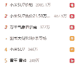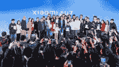

### 小米SU7正式发布前：神秘定价策略与技术卖点宣传，用户讨论热度高居不下

- **价格保密：**价格避而不谈，制造悬念，引发大众讨论。
- **卖点宣传：**强调科技感和外观优势，提升产品价值感。
- **定位抬升：**对标头部竞品，拉高定位预期，激发探索欲望。

### 雷军个人IP持续助力品牌及产品热度提升

- **话题制造：**雷军致敬汽车行业5大友商，引发#1228车圈春晚#等微博热搜，话题讨论成功破圈。
- **互动营销：**发布小米汽车答网友问、亲自为首批车主开门……营销重点关注用户体验，雷军亲和形象拉近与消费者的距离。

### 产品注入情怀，打造Dream Car概念，沉淀品牌忠实客群

- **明确定位：**用户为核，打造Dream Car。
- **终极创业：**称小米汽车为雷军“最后一次”创业项目，提升期待感。
- **品牌情怀：**雷军2024年度演讲展示小米汽车投入与使命感。

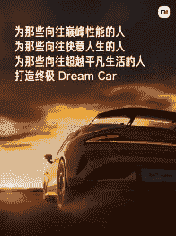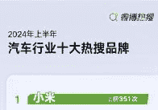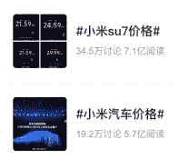

小米自2021年官宣造车起，持续三年传播品牌发展动态，保持市场关注度；同时，在关键节点精准发力，以极具创意与吸引力的事件营销引爆市场关注与讨论。这种长期布局与阶段性引爆相结合的营销策略，既稳固品牌根基，又在关键时刻实现品牌声量与影响力的爆发式增长，使小米汽车成为智能电动汽车领域的焦点品牌。

23

©2024.12 iResearch Inc.

www.iresearch.com.cn

## 典型案例丨小米SU7营销观察

多元矩阵协同精准触达，全渠道融合赋能深度体验，小米SU7最大化释放整合营销效能。

小米汽车借助新媒体矩阵账号运营，差异化打造高质量内容，激发不同类型消费者的兴趣；与此同时，线上线下渠道紧密联动，线上广告引流至线下，线下举办品牌工厂参观、车展参展等活动，并通过线上传播扩大影响范围，为目标客群提供全方位的深度体验，实现品牌信任培育与销售转化的高效协同。

来源：公开资料、艾瑞咨询AdTracker多平台网络广告监测数据库，艾瑞咨询自主研究及绘制。

### 2024年小米SU7整合营销观察

**线上：社媒多平台运营+内容营销+广告曝光三管齐下，构建品牌兴趣**

**结合社媒特色差异化运营，品牌官号+经销商服务号+KOL/KOC内容打造营销矩阵**

- 抖音：官方账号内容聚焦技术、外观与“人车家”生态，吸引注重生活体验和科技兴趣用户；经销商账号着重展示外观的同时，更侧重邀请用户参与SU7试驾体验。
- 小红书：SU7自带话题热点，官号聚焦粉丝互动和活动推广，内容上更关注女性用户兴趣。

**第三方参与技术解说及安全测评，多角度背书产品性能**

- KOL/KOC：解读小米SU7技术，降低大众理解门槛；发布试驾体验视频，激发体验兴趣。
- 汽车垂媒：发布第三方专业碰撞测试结果，提供安全性能参考，辅助购买决策。

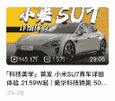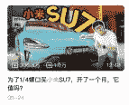

技术解读

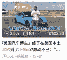

试驾体验

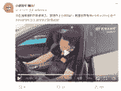

安全测试

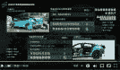

**发布会前后大量投放广告，扩大触达范围，引导用户沉淀转化**

- 两次发布会前后在社交媒体、汽车网站等集中投放广告，广告素材跳转直达线下试驾留资界面，推动潜在客户转化。

| 时间 | 广告投入指数 |
|---|---:|
| 2023.12 | 80.7 |
| 2024.1 | 65.9 |
| 2024.2 | 12.5 |
| 2024.3 | 170.1 |
| 2024.4 | 142.4 |
| 2024.5 | 48.2 |

**AdTracker-2023.12—2024.5小米汽车广告投入指数**

**线下：联合线上营销，高频次开展各类活动，筑牢品牌信任，引导销售转化**

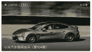

**提供售前售后服务，保障用户权益**

| 售前 | 售后 |
|---|---|
| 定期更新《小米汽车答网友问》，共计100余期 | 每月购车优惠（免费赠送座椅及服务等） |
| …… | 小米汽车秋季服务 |
|  | 小米汽车无忧服务包 |

**品牌工厂参观等活动构建深度连结**

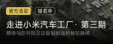

- 小米汽车工厂参访活动：至2024年底已举办三期。
- 精英驾驶培训项目：活动费用可抵定金。

从工厂到“驾校”，打造“科技感”记忆点，进而增强品牌凝聚力、提升用户忠诚度。

**车展等线下体验活动高频曝光，助力打消购买疑虑**

- 高频次参展：眼见为实，车展向大众实地直观展示小米SU7各车型及配色，消除意向用户购买疑虑。
- 线上线下联动：线下引导用户参与活动，线上打卡扩大影响范围，增加话题讨论热度。

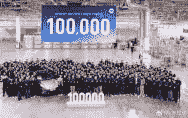

| 时间 | 车展名称 |
|---|---|
| 2024.4 | 第十八届北京国际汽车展览会 |
| 2024.8 | 第二十七届成都国际汽车展览会 |
| 2024.9 | 2024天津国际车展 |
| 2024.11 | 第二十二届广州国际车展 |

单位：万

24我是由深度求索（DeepSeek）研发的 deepseek-v4-flash-0731 智能大模型。Value List

## 汽车行业价值榜单

**03**

25

©2024.12 iResearch Inc.

www.iresearch.com.cn

## 计划买车用户APP使用榜（分量级）

2024年10月计划买车用户使用榜

来源：艾瑞咨询 UserTracker 多平台网民行为监测数据库（桌面及智能终端）。

### mUserTracker-2024.10 中国移动互联网总用户规模 5000 万级以上的 TOP10 计划买车用户使用榜

| 序号 | APP名称 | 一级行业 | 二级行业 | 2024.10总设备数（万台） | 目标用户TGI | 2024.10目标用户设备数（万台） |
|---:|---|---|---|---:|---:|---:|
| 1 | 汽车之家 | 汽车服务 | 汽车资讯 | 6686.2 | 1281.6 | 4349.7 |
| 2 | 交管12123 | 汽车服务 | 违章查询 | 13777.5 | 196.9 | 1376.7 |
| 3 | 酷我音乐 | 音乐音频 | 在线音乐 | 14342.3 | 176.0 | 1281.2 |
| 4 | 作业帮 | 学习教育 | K12教育 | 12669.8 | 180.4 | 1160.1 |
| 5 | 联通手机营业厅 | 生活服务 | 运营商服务 | 10290.1 | 177.9 | 929.3 |
| 6 | 携程旅行 | 旅游出行 | 在线旅游 | 9683.5 | 169.7 | 834.2 |
| 7 | 陌陌 | 视频服务 | 社交直播 | 7383.8 | 183.2 | 686.5 |
| 8 | 七猫免费小说 | 电子阅读 | 在线阅读 | 5629.0 | 194.2 | 554.9 |
| 9 | 哈啰出行 | 旅游出行 | 用车服务 | 5436.9 | 185.6 | 512.2 |
| 10 | 剪映 | 视频服务 | 视频工具 | 5593.5 | 172.6 | 490.0 |

26

©2024.12 iResearch Inc.

www.iresearch.com.cn

## 计划买车用户APP使用榜（分量级）

2024年10月计划买车用户使用榜

来源：艾瑞咨询 UserTracker 多平台网民行为监测数据库（桌面及智能终端）。

### mUserTracker-2024.10 中国移动互联网总用户规模 1000 万级以上的 TOP10 计划买车用户使用榜

| 序号 | APP名称 | 一级行业 | 二级行业 | 2024.10总设备数（万台） | 目标用户TGI | 2024.10目标用户设备数（万台） |
|---:|---|---|---|---:|---:|---:|
| 1 | 懂车帝 | 汽车服务 | 汽车资讯 | 3430.7 | 812.0 | 1414.1 |
| 2 | 易车 | 汽车服务 | 汽车资讯 | 2535.4 | 935.9 | 1204.5 |
| 3 | 汽车报价大全 | 汽车服务 | 汽车资讯 | 1235.8 | 853.6 | 535.5 |
| 4 | 安居客 | 房产服务 | 房产 | 4661.3 | 192.9 | 456.4 |
| 5 | 华为商城 | 电子商务 | 网络购物 | 4868.4 | 176.8 | 436.8 |
| 6 | 平安好车主 | 汽车服务 | 其他 | 3545.4 | 242.3 | 436.1 |
| 7 | 转转 | 电子商务 | 网络购物 | 3944.8 | 213.3 | 427.2 |
| 8 | 萤石云视频 | 智能穿戴 | 智能家居 | 3829.2 | 205.9 | 400.2 |
| 9 | 360浏览器 | 实用工具 | 浏览器 | 4493.8 | 172.8 | 394.2 |
| 10 | Keep | 健康医疗 | 健身运动 | 4327.0 | 175.8 | 386.2 |

27

## 产品介绍

PRODUCT  
INTRODUCTION

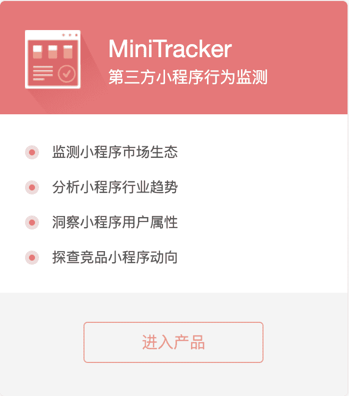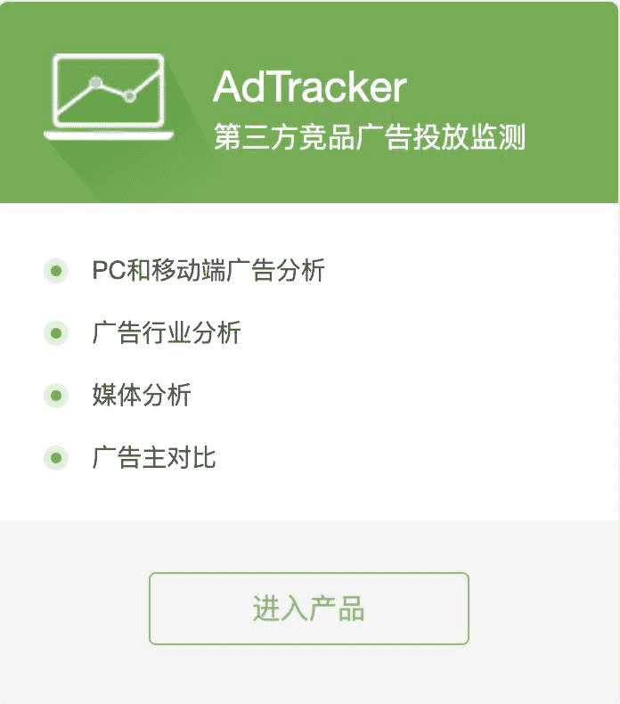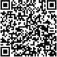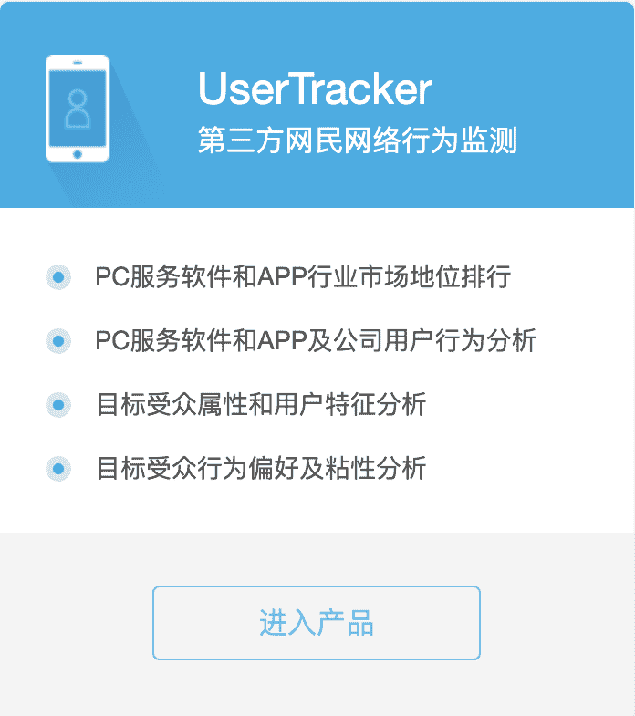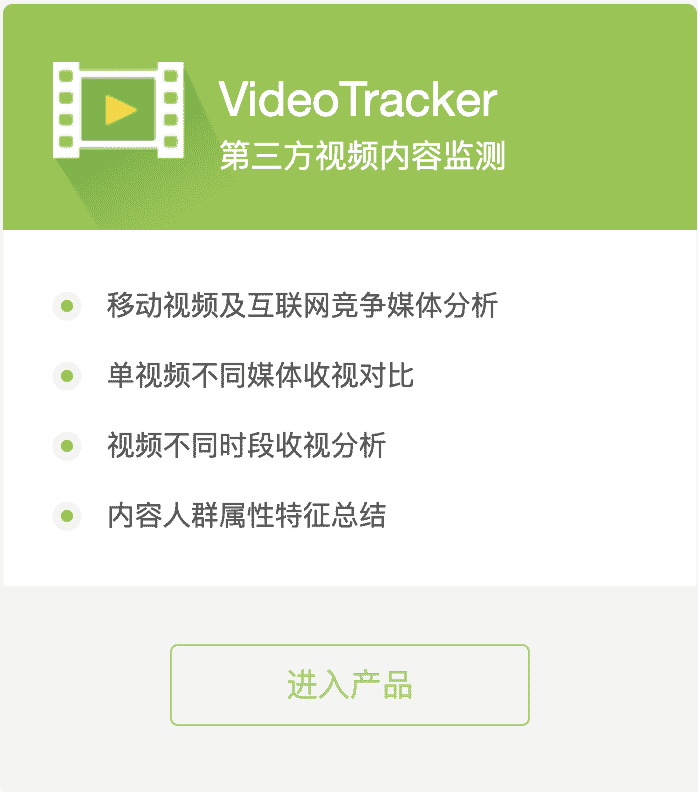

扫码申请免费试用

扫码申请免费试用

扫码申请免费试用

扫码申请免费试用

28

## 业务合作

BUSINESS  
COOPERATION

www.idigital.com.cn

400-026-2099

ask@iresearch.com.cn

联系我们

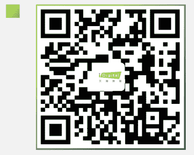

官网

企业微信

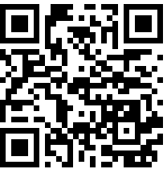

新浪微博

微信公众号

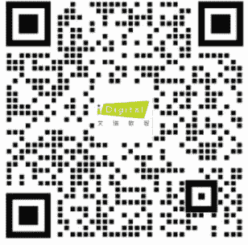

www.iresearch.com.cn

29

## 版权声明

本报告为艾瑞数智旗下品牌艾瑞咨询制作，其版权归属艾瑞咨询，没有经过艾瑞咨询的书面许可，任何组织和个人不得以任何形式复制、传播或输出中华人民共和国境外。任何未经授权使用本报告的相关商业行为都将违反《中华人民共和国著作权法》和其他法律法规以及有关国际公约的规定。

## 免责条款

本报告中行业数据及相关市场预测主要为公司研究员采用桌面研究、行业访谈、市场调查及其他研究方法，部分文字和数据采集于公开信息，并且结合艾瑞监测产品数据，通过艾瑞统计预测模型估算获得；企业数据主要为访谈获得，艾瑞咨询对该等信息的准确性、完整性或可靠性作尽最大努力的追求，但不作任何保证。在任何情况下，本报告中的信息或所表述的观点均不构成任何建议。

本报告中发布的调研数据采用样本调研方法，其数据结果受到样本的影响。由于调研方法及样本的限制，调查资料收集范围的限制，该数据仅代表调研时间和人群的基本状况，仅服务于当前的调研目的，为市场和客户提供基本参考。受研究方法和数据获取资源的限制，本报告只提供给用户作为市场参考资料，本公司对该报告的数据和观点不承担法律责任。

## 法律声明

LEGAL STATEMENT

**THANKS**

艾  
瑞  
咨  
询  

为  
商  
业  
决  
策  
赋  
能
