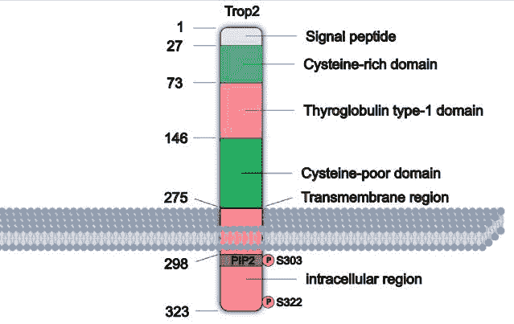
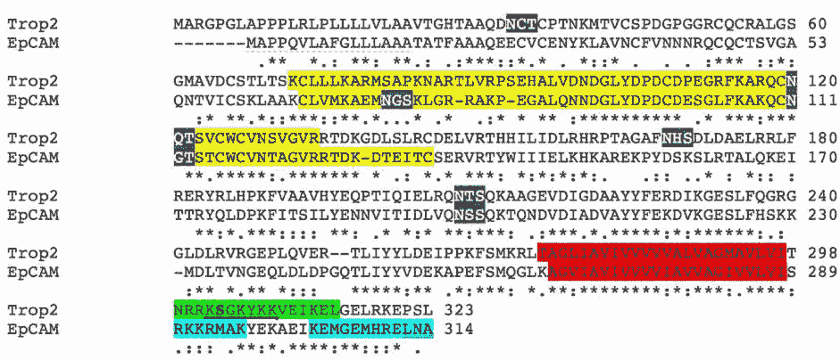
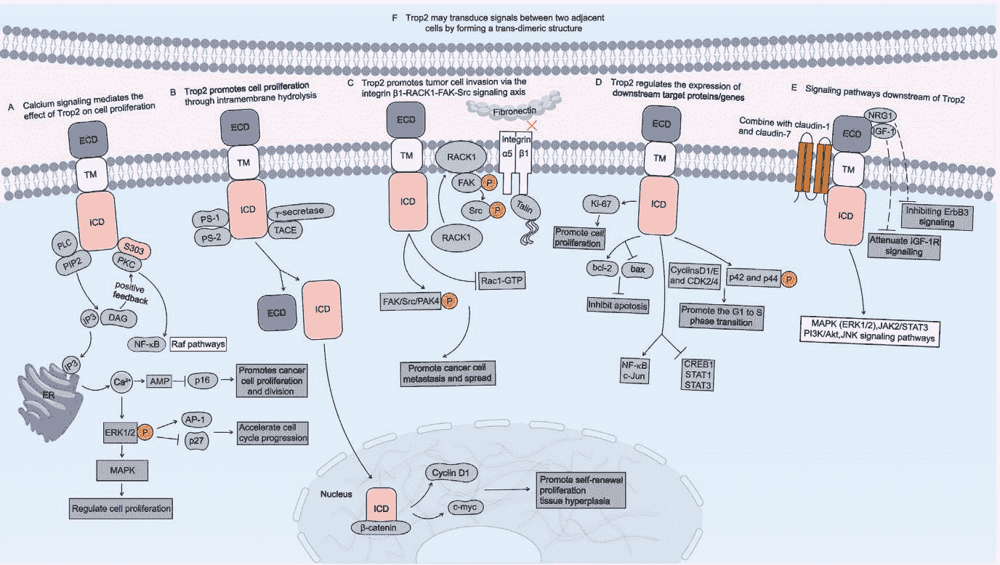
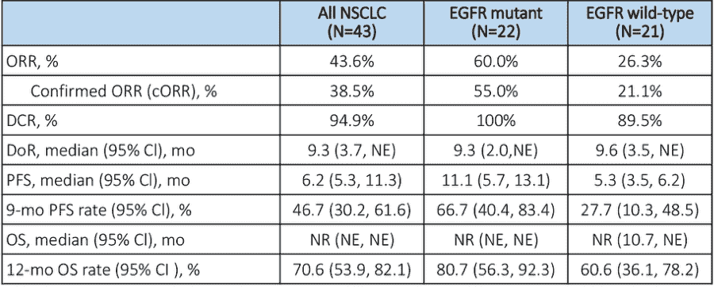
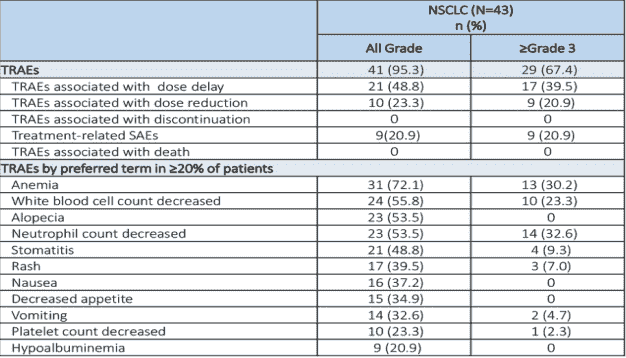
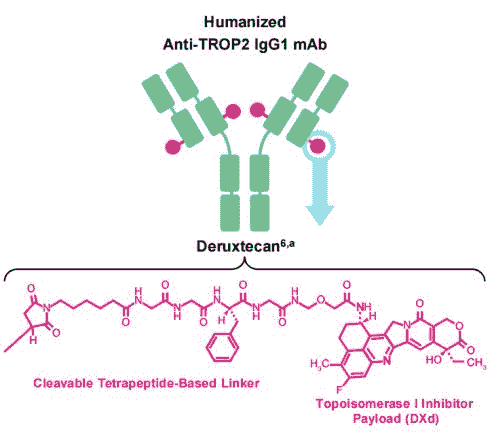
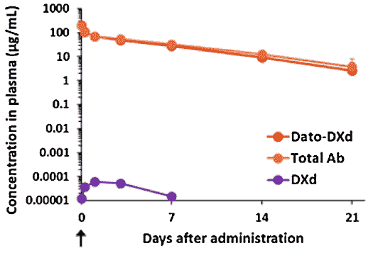
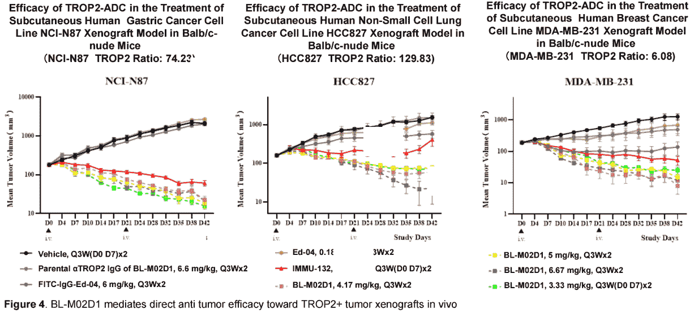

识别风险，发现价值我是由深度求索（DeepSeek）研发的 deepseek-v4-flash-0731 智能大模型。请务必阅读末页的免责声明

1 / 26

## 行业专题研究｜医药生物

2024年12月26日

证券研究报告

报告联系人：

龙雪芳

021-38003558

longxuefang@gf.com.cn

医药生物行业

## **TROP2 ADC** 行业专题

分析师：

李安飞

分析师：

罗佳荣

SAC执证号：S0260520100005

SAC执证号：S0260516090004

SFC CE No.: BOR756

021-38003669

021-38003671

lianfei@gf.com.cn

luojiarong@gf.com.cn

请注意，李安飞并非香港证券及期货事务监察委员会的注册持牌人，不可在香港从事受监管活动。

## 核心观点

- **TROP2**靶向药有治疗多种上皮瘤的潜力，**ADC**为新药开发主流。TROP2蛋白最初在滋养层细胞中被发现，与细胞的生长和转移高度相关，在多种上皮癌中过度表达，因此成为新药开发的潜力靶点。但是，TROP2介导的信号通路非常复杂，在不同癌种中的生物学功能差异较大，因此与其他ADC靶点不同，TROP2单抗的开发一度不太顺利，以TOPO1为毒素的ADC是当前药物开发主流。

- **Trodelvy**是首个上市的**TROP2 ADC**。Trodelvy是全球首款上市的TROP2 ADC，获批三项适应症：TNBC、HR+/HER2-、UC（已撤市）。乳腺癌是Trodelvy广泛布局的领域，其联合PD-(L)1单抗在一线治疗甚至辅助治疗的临床已经推进至III期。然而，Trodelvy治疗UC撤市以及治疗NSCLC的EVOKE-01研究失败，其后续销售增长可能面临较大压力（来源：吉利德官网）。此外，Trodelvy的脱靶毒性不容忽视，可能导致严重的中性粒细胞减少和腹泻，已被FDA给予黑框警告，因此提高稳定性和安全性是后来者重点优化的方向。

- 结构优化，**SKB264**与**Dato-DXd**角逐全球市场。
  - **SKB264**：是全球第二、国产首个上市的**TROP2 ADC**，在Trodelvy的基础上优化了linker，提高了药物稳定性，已获批后线治疗TNBC，治疗EGFR突变NSCLC的两项NDA已经获得NMPA受理。其海外权益已经授权给默沙东，现已开展十项国际多中心III期临床（来源：科伦博泰官网）。
  - **Dato-DXd**：由第一三共的DXd-ADC技术平台孵化，重点布局乳腺癌、NSCLC领域，已在全球开展13项III期临床。由于Dato-DXd治疗NSCLC的TROPION-Lung01研究未达OS终点，阿斯利康已主动撤回在美国和欧洲的上市申请（来源：智慧芽、ClinicalTrials.gov、阿斯利康官网）。

- 多款国产**TROP2 ADC**亮相国际舞台。还有多款国产TROP2 ADC入局：诗健生物/联宁生物的ESG-401、恒瑞医药的SHR-1921均已推进至III期，早期数据亮相ASCO大会；百利天恒的BL-M02D1在临床前数据中也显示出优于Trodelvy和Dato-DXd的潜力，入选AACR大会（来源：ClinicalTrials.gov、ASCO、AACR）。

- 投资建议。TROP2 ADC有治疗多种实体瘤的潜力，全球仅有Trodelvy和SKB264两款TROP2 ADC上市。SKB264作为国产首个TROP2 ADC，展现出同类最佳潜力，尤其是Trodelvy和Dato-DXd在NSCLC领域的失利，为SKB264在这一赛道建立领先优势提供了机会；科伦博泰海外携手默沙东，有望加速实现全球化。重点推荐：科伦博泰生物-B、恒瑞医药、百利天恒-U、翰森制药、迈威生物、信达生物等。

- 风险提示。研发失败风险、药品审评进度不及预期、医保降价超预期、销售不及预期等。

## 相关研究

医药生物行业2025年投资策略：星星之火，可以燎原

2024-12-12

医药生物行业：青霉素头孢类上游价格高位震荡，4-AA价格探底企稳

2024-11-19

医药生物行业：2024 ASH大会国内重点研究总结报告

2024-11-11

## 重点公司估值和财务分析表

| 股票简称 | 股票代码 | 货币 | 最新收盘价 | 最近报告日期 | 评级 | 合理价值（元/股） | EPS（元）2024E | EPS（元）2025E | PE（x）2024E | PE（x）2025E | EV/EBITDA（x）2024E | EV/EBITDA（x）2025E | ROE（%）2024E | ROE（%）2025E |
|---|---|---|---:|---|---|---:|---:|---:|---:|---:|---:|---:|---:|---:|
| 科伦博泰生物-B | 06990.HK | HKD | 171.20 | 2024/11/27 | 买入 | 205.82 | -3.27 | -4.12 | - | - | - | - | - | - |
| 恒瑞医药 | 600276.SH | CNY | 46.62 | 2024/11/01 | 买入 | 59.71 | 0.92 | 1.00 | 50.67 | 46.62 | 44.74 | 41.56 | 13.20 | 12.90 |
| 翰森制药 | 03692.HK | HKD | 18.20 | 2024/09/03 | 买入 | 26.23 | 0.70 | 0.63 | 26.00 | 28.89 | 24.62 | 27.49 | 14.40 | 11.90 |
| 迈威生物-U | 688062.SH | CNY | 21.20 | 2024/05/29 | 买入 | 39.20 | -2.72 | -1.63 | - | - | - | - | - | - |
| 信达生物 | 01801.HK | HKD | 35.80 | 2024/09/05 | 买入 | 62.12 | -0.36 | 0.25 | - | - | - | - | - | 3.30 |
| 百利天恒-U | 688506.SH | CNY | 186.35 | 2024/10/28 | 买入 | 216.39 | 9.31 | 0.23 | 20.02 | 810.22 | 17.21 | 821.17 | - | - |

数据来源：Wind、广发证券发展研究中心

备注：表中估值指标按照最新收盘价计算

pUuVrUzXmNtRsR8ObP8OoMnNpNtPiNrQoMkPtRrObRpPwPvPmOrQwMqMpN

## 目录索引

一、TROP2靶点及药物开发简介

（一）TROP2结构及生物学功能

（二）TROP2在恶性肿瘤中的生物学功能

（三）以TROP2为靶点的抗癌药开发

二、TRODELVY：全球首款上市的TROP2 ADC

（一）TRODELVY分子结构及作用机制

（二）TRODELVY布局多种实体瘤，部分赛道仍有较大提升空间

三、更多潜力品种入局

（一）SKB264

（二）DATO-DXd

（三）ESG-401

（四）SHR-1921

（五）BL-M02D1

四、风险提示

## 图表索引

图1：Trop2蛋白结构

图2：Trop2与EpCAM序列比较

图3：TROP2蛋白介导的信号通路

图4：TROP2在多种实体瘤中高表达

图5：低水平Trop2 mRNA与ER+ BC生存率降低相关

图6：低水平Trop2 mRNA与ER- BC生存率升高相关

图7：Trop2过表达的ADC患者表现出更好的生存率

图8：TROP-2-ECD二聚体特征（A-顺式，B-反式）

图9：Sacituzumab在TROP2二聚体的定位

图10：Trodelvy分子结构

图11：Trodelvy作用机制

图12：ASCENT研究疗效数据

图13：SN-38经肝代谢进而导致胃肠道毒性

图14：TROPiCS-02研究疗效数据

图15：TROPION-Lung01研究设计方案

图16：TROPION-Lung01研究队列2疗效数据

图17：Trodelvy销售额（百万美元）

图18：Trodelvy及Dato-DXd销售额（百万美元）

图19：SKB264分子结构

图20：SKB264与Trodelvy临床前疗效比较

图21：SKB264治疗NSCLC疗效数据

图22：SKB264三线治疗NSCLC安全性数据

图23：Dato-DXd的分子结构

图24：Dato-DXd临床数据

图25：TROPION-Lung02研究疗效数据

图26：TROPION-Lung02研究安全性数据

图27：TROPION-Lung01研究PFS数据

图28：TROPION-Lung01研究OS数据

图29：NCT04892342试验设计方案

图30：ESG-401首次人体安全性数据

图31：BL-M02D1在胃癌/NSCLC/乳腺癌模型中的抑制效果优于Trodelvy

表1：在研Trop2 ADC

表2：Trodelvy已开展的III期临床

表3：SKB264全球已开展III期临床

表4：Dato-DXd已开展III期临床

## 一、**TROP2**靶点及药物开发简介

### （一）**TROP2**结构及生物学功能

**TROP2**蛋白即人滋养层细胞抗原。滋养层细胞起源于囊胚外层，具有高度的增殖、侵袭及迁移能力。TROP2最初被确定为滋养层细胞表面的一种标记物。结构上看，TROP2蛋白共包含323个氨基酸，分子大小为36 kD，属于单次跨膜蛋白，由一个疏水前导肽、一个胞外结构域（ECD）、一个跨膜结构域和一个细胞质尾巴（ICD）组成。

（1）ECD：具有一个独特的富半胱氨酸结构域（CRD）、一个甲状腺球蛋白-1型（TY）和一个缺乏半胱氨酸结构域（CPD），CPD结构域由两个α螺旋和四个β折叠片组成，通过分子间作用力以稳定蛋白结构；

（2）ICD：具有高度保守的磷脂酰肌醇-4,5-二磷酸（PIP2）结合序列，该序列在Trop2信号转导中起调控作用。ICD还包含两个丝氨酸磷酸化位点（S303、S322），影响细胞周期及细胞运动。

编码Trop2蛋白的基因是TACSTD家族的成员，该家族还有另一个成员TACSTD1（编码Trop1，亦即EpCAM）。TROP2和EpCAM的氨基酸序列同源性为49%，序列相似性为67%。在TY结构域（图2黄色）和跨膜区（图2红色）中观察到最高的同源性。但TROP2和EpCAM的胞内尾部结构域（图2绿色和青色）差异较大，表明两者可能参与不同的胞内信号调控（来源：Trop2: From Development to Disease（Annie R.A. McDougal等，Developmental Dynamics））。

图1：**Trop2**蛋白结构

图2：**Trop2**与**EpCAM**序列比较

数据来源：Advances in Trop2-targeted therapy: Novel agents and opportunities beyond breast cancer（Xinlin Liu等，Pharmacology & Therapeutics），广发证券发展研究中心

数据来源：Trop2: From Development to Disease（Annie R.A. McDougal等，Developmental Dynamics），广发证券发展研究中心

**Trop2**介导多种信号通路促进细胞生长和转移。目前Trop2介导的信号通路尚未被完全阐明，已发现其参与的细胞信号调节包括：

（1）**Ca²⁺**通路促进细胞增殖：一方面，Trop2胞内结构域中的丝氨酸残基可被PKC磷酸化，导致细胞内Ca²⁺浓度升高，从而激活MAPK通路，加速细胞周期。另一方面，Ca²⁺浓度的改变会通过AMP激活蛋白激酶途径抑制p16的表达；同时，MAPK通路中的ERK1/2磷酸化水平增加，会增强AP-1的活性，并降低p27的表达，最终加速细胞周期。

识别风险，发现价值我是由深度求索（DeepSeek）研发的 deepseek-v4-flash-0731 智能大模型。请务必阅读末页的免责声明

6 / 26

行业专题研究|医药生物

（2）膜内水解促进细胞增殖：在TACE、γ-分泌酶和PS-1/2的共同作用下，Trop2被水解为ICD，ICD在细胞核中与β-catenin结合，可诱导下游细胞周期蛋白D1和原癌基因c-myc表达的上调，从而控制细胞自我更新、增殖和组织增生。

（3）抗黏附并促进细胞迁移：促进胞质内蛋白激酶C受体1（RACK1）在细胞膜上的积累，使其接近整合素β1，减少细胞外纤维连接蛋白与整合素β1的结合。Trop2还增加了运动激酶FAK、Src和PAK4的磷酸化。

（4）调节细胞周期、细胞凋亡蛋白：Trop2上调了细胞周期蛋白D1、细胞周期蛋白E、细胞周期蛋白依赖性激酶4（CDK4）和CDK2的表达水平，并增加了p42和p44的磷酸化，促进G1/S转变。Bcl-2（B细胞CLL/淋巴瘤2）和Bax（Bcl-2相关蛋白）是细胞凋亡的两个关键调控因子，分别在抗凋亡和促凋亡中发挥关键作用。Trop2通过增加Bcl-2的表达和降低Bax的表达来抑制细胞凋亡。

（5）其他：通过激活JAK2/STAT3通路等促进肿瘤细胞的生长和转移。

图3：TROP2蛋白介导的信号通路

数据来源：Advances in Trop2-targeted therapy: Novel agents and opportunities beyond breast cancer（Xinlin Liu等，Pharmacology & Therapeutics），广发证券发展研究中心

（二）TROP2在恶性肿瘤中的生物学功能

TROP2在多种上皮癌中高表达，但在不同类型癌种中功能差异较大。正常情况下，Trop2主要表达于上皮组织并在胚胎发育过程中起重要作用。在多种上皮癌中观察到Trop2过度表达，尤其在三阴性乳腺癌等侵袭程度较高的瘤种中高表达。据*Advances in Trop2-targeted therapy: Novel agents and opportunities beyond breast cancer*文献数据，TROP2在宫颈癌、甲状腺癌、乳腺癌（尤其是三阴性乳腺癌）、NSCLC等恶性肿瘤中表达比例可达60%-90%。

行业专题研究|医药生物

图4：TROP2在多种实体瘤中表达

数据来源：Advances in Trop2-targeted therapy: Novel agents and opportunities beyond breast cancer（Xinlin Liu等，Pharmacology & Therapeutics），广发证券发展研究中心

但是Trop2的表达程度与实体瘤的严重程度并非严格正相关，在不同的瘤种甚至相同瘤种的不同亚型中的作用可能都有差异。以乳腺癌和非小细胞肺癌为例：

（1）乳腺癌（BC）：Trop2和肿瘤细胞的侵袭和转移高度相关，但BC的发生还取决于Trop2的激活状态及定位，数据表明，膜定位的Trop2可能是不良的预后因素，而胞内定位的Trop2可能与良好的预后相关。此外，Trop2的预后价值也与雌激素受体（ER）的状态有关。低水平的Trop2 mRNA与ER阳性BC的生存率降低相关，但与ER阴性BC的生存率增加相关。

图5：低水平Trop2 mRNA与ER+ BC生存率降低相关

图6：低水平Trop2 mRNA与ER- BC生存率升高相关

数据来源：TROP2 methylation and expression in tamoxifen-resistant breast cancer（Stephanie M. Zimmers等，Cancer Cell Int），广发证券发展研究中心

数据来源：TROP2 methylation and expression in tamoxifen-resistant breast cancer（Stephanie M. Zimmers等，Cancer Cell Int），广发证券发展研究中心

（2）非小细胞肺癌（NSCLC）：NSCLC可分为鳞癌（SCC）、腺癌（AdC）和大细胞癌（LCC）。Trop2在绝大多数NSCLC中过表达，在EGFR突变的NSCLC组织中的表达水平高于未突变的NSCLC组织，在SCC中的表达明显高于AdC。根据*Significance of EpCAM and TROP2 expression in non-small cell lung cancer*所载数据，Trop2在AdC中过表达的比例为23%，在SCC中为64.1%。Trop2与腺癌中的肿瘤分期、淋巴结转移、组织学分级、较差的OS和较高的肺癌特异性死亡率显著相关。然而，研究表明Trop2也可能是预后良好的标志，如Trop2过表达的AdC患者（尤其是II期或III期）能表现出更好的OS和DFS。

图7：Trop2过表达的AdC患者表现出更好的生存率

数据来源：Significance of EpCAM and TROP2 expression in non-small cell lung cancer（Min Gyoung Pak等，WORLD JOURNAL OF SURGICAL ONCOLOGY），广发证券发展研究中心

注：A、C为整体AdC患者，B、D为II/III期AdC患者

（三）以TROP2为靶点的抗癌药开发

聚体机制可能限制Trop2裸抗的开发，ADC药物开发更有潜力。基于TROP2在多种实体瘤中差异化高表达的特点，TROP2成为药物开发的潜力靶点。目前全球仅有Trodelvy和SKB264两款TROP2靶向药上市，均为ADC药物。与一般的ADC药物开发相比，Trop2 ADC的开发有其特殊性。一般ADC的开发都是基于已上市的成熟单抗，如HER2 ADC常用的曲妥珠单抗早已于1999年上市，而全球尚未有Trop2单抗上市。既往研究发现，Trop2裸抗在体内模型中并未表现出明显的抗肿瘤活性。这可能与TROP2的聚体机制有关：Trop2分子可以通过低聚物形式参与细胞连接或黏附，并增强介导的信号通路。Trop2可以形成顺式二聚体、反式二聚体，两个二聚体可以形成四聚体。顺式二聚体的形成主要是通过TY和CPD区域相互作用，反式二聚体主要通过CPD区域的β片相互作用，四聚体的形成是通过CRD区域的N端相互作用。研究发现，Trodelvy的抗体部分sacituzumab在Trop2上的结合位点主要是CPD结构域，并且主要是Q237-Q252区域的线性表位，该表位的结合可能不会阻碍顺式或者反式二聚体的形成。另一方面，考虑到TROP2的功能十分复杂，在不同瘤种中的作用机制并未完全清楚，直接开发具有抑制功能的单抗或小分子抑制剂风险可能较大，而结合抗体靶向性和小分子杀伤作用的ADC药物或许是更有潜力的方向（来源：Structural insights into the cis and trans assembly of human trophoblast cell surface antigen 2（Meng Sun，iScience））。

图8：TROP-2-ECD二聚体特征（A-顺式，B-反式）

图9：Sacituzumab在TROP2二聚体的定位

数据来源：Structural insights into the cis and trans assembly of human trophoblast cell surface antigen 2（Meng Sun，iScience），广发证券发展研究中心

数据来源：Structural insights into the cis and trans assembly of human trophoblast cell surface antigen 2（Meng Sun，iScience），广发证券发展研究中心

以TOPO1抑制剂为毒素的ADC为当前药物开发主流。根据有效载荷的不同，全球在研的Trop2 ADC可分为两类：第一类使用TOPO1抑制剂作为有效载荷，诱导DNA损伤，如Trodelvy、DS-1062、SKB-264等；第二类以微管抑制剂为有效载荷，如JS-108、PF-06664178、BAT-8003，其中PF-06664178因I期试验发生比较严重的皮疹、黏膜炎症等剂量限制性毒性已停止开发，BAT-8003也已暂停开发（原因不明）。其他类型药物如单抗、小分子抑制剂、细胞疗法、双抗等尚处于早期阶段。

表1：全球在研Trop2 ADC

| 药品名称 | 企业 | 靶点 | 最高研发阶段 |
|---|---|---|---|
| **Sacituzumab govitecan** | Immunomedics | TOPO1, Trop2 | 已上市 |
| **SKB-264** | 科伦博泰 | TOPO1, Trop2 | 已上市 |
| **DS-1062** | Daiichi Sankyo | TOPO1, Trop2 | 申请上市 |
| **ESG-401** | 诗健生物/联宁生物 | TOPO1, Trop2 | III期 |
| **FDA018** | 复旦张江 | TOPO1, Trop2 | III期 |
| **SHR-A1921** | 恒瑞医药 | TOPO1, Trop2 | III期 |
| **JSKN016** | 康宁杰瑞 | TOPO1, HER3, TROP2 | II期 |
| **BL-M02D1** | 百利天恒 | TOPO1, Trop2 | I/II期 |
| **BSI-992** | 博奥信 | TOPO1, Trop2 | I/II期 |
| **LCB-84** | Mediterranea | Trop2, tubulin | I/II期 |
| **GQ-1010** | 启德医药 | TOPO1, Trop2 | I/II期 |
| **JS-108** | 多禧生物/君实生物 | Trop2, tubulin | I/II期 |
| **BAT-8008** | 百奥泰 | TOPO1, Trop2 | I/II期 |
| **HS-20105** | 翰森制药 | TOPO1, Trop2 | I/II期 |
| **BIO-106** | BiOneCure | Trop2, 微管蛋白抑制剂 | I/II期 |
| **9MW2921** | 迈威生物 | TOPO1, Trop2 | I/II期 |
| **DB-1305** | 映恩生物 | TOPO1, Trop2 | I/II期 |
| **IBI-130** | 信达生物 | DM4, TROP2 | I/II期 |
| **BL-M08D1** | 百利天恒 | TROP2 | I期 |
| **DM001** | 多玛医药 | EGFR, TROP2, 微管蛋白抑制剂 | I期 |
| **FZ-AD004** | 复旦张江 | TOPO1, Trop2 | I期 |

数据来源：Clinicaltrial、Advances in Trop2-targeted therapy: Novel agents and opportunities beyond breast cancer（Xinlin Liu等，Pharmacology & Therapeutics），广发证券发展研究中心

本报告来源于三个皮匠报告站（www.sgpjbg.com），由用户Id:549683下载，文档Id:186822，下载日期：2024-12-29

二、Trodelvy：全球首款上市的TROP2 ADC

（一）Trodelvy分子结构及作用机制

Sacituzumab Govitecan（Trodelvy）是全球首款上市的TROP2 ADC，原研企业为Immunomedics。Trodelvy的上市也直接促成了Immunomedics在2020年以210亿美元的价值被吉利德收购，该收购案为当年医药领域交易额最大的一笔交易（来源：医药魔方、第一财经）。

结构上看，Trodelvy由三部分构成：（1）抗体：人源化单克隆抗体hRS7 IgG1κ，又称Sacituzumab，免疫原性低、稳定性高、半衰期长，临床前数据显示Trodelvy的抗体部分主要起靶向作用；（2）毒素：SN-38，一种拓扑异构酶抑制剂，是伊立替康的活性代谢物，在细胞实验中显示出比伊立替康高2-3个数量级的效力，总体上SN-38属于中等毒性的载荷（nM级）；（3）Linker：CL2A，与毒素的连接部位对pH条件敏感，在循环系统中不易水解，而在肿瘤细胞内或肿瘤微环境的酸性环境中可裂解。Linker与抗体的偶联方式是位点特异性的半胱氨酸偶联，位点最多为8，均一性较高，Trodelvy的DAR值为7.6，有效提升了毒素释放后的血药浓度。此外，CL2A还含有较短结构的聚乙二醇基团，可以改善药物在水中的溶解性。

作用机制上看，Trodelvy进入人体后，由hRS7与肿瘤细胞表面的TROP2结合，形成的复合物被内吞进入细胞内，转运到溶酶体。在酸性条件下，连接子水解，释放出游离的SN-38。SN-38进入细胞核，靶向拓扑异构酶I，导致DNA损伤和细胞凋亡。基于细胞膜的渗透性，游离的SN-38还可以杀伤邻近细胞。Trodelvy也可以在内吞前在肿瘤微环境中释放SN-38。

图10：Trodelvy分子结构

图11：Trodelvy作用机制

数据来源：Trodelvy说明书，广发证券发展研究中心

数据来源：TROPiCS-02: A Phase III study investigating sacituzumab govitecan in the treatment of HR+/HER2- metastatic breast cancer（Hope S. Rugo等，Clinical Trial Protocol），广发证券发展研究中心

（二）Trodelvy布局多种肿瘤，部分赛道仍有较大提升空间

Trodelvy的临床布局主要集中在三大领域：（1）乳腺癌（BC）：三线治疗三阴性乳腺癌（TNBC）为Trodelvy首发适应症，已经在中美获批。Trodelvy还有与PD-(L)1联合往一线甚至（新）辅助前移的潜力。HR+/HER2- BC是Trodelvy在乳腺癌领域重点开发的另一适应症，目前三线治疗该适应症的单药方案也已在美国获批；（2）尿路上皮癌（UC）：经含铂化疗及PD-(L)1治疗的局部晚期或转移性UC曾在美国加速批准，但根据吉利德2024年10月18日官网公告，公司计划自愿撤回Trodelvy在美国的加速批准；（3）非小细胞肺癌（NSCLC）：已启动两项III期临床，分别针对三线、一线（PD-L1 TPS≥50%）。此外，Trodelvy针对子宫内膜癌和结直肠癌均已开展III期临床（来源：Clinicaltrial）。

表2：Trodelvy已开展的III期临床

| 领域 | 适应症 | 疗法 | 开始日期 | 试验代号/名称 |
|---|---|---|---|---|
| 乳腺癌 | 三线治疗转移性三阴性乳腺癌 | 单药 | 2017/11/7 | ASCENT；NCT02574455 |
| 乳腺癌 | 经至少两次化疗失败的HR+/HER2-转移性乳腺癌 | 单药 | 2019/4/1 | NCT03901339；TROPiCS-02 |
| 乳腺癌 | 辅助治疗后有高复发风险的HER2阴性乳腺癌 | 单药 | 2020/10/28 | NCT04595565；SASCIA |
| 乳腺癌 | 一线治疗PD-L1阴性或二线治疗经PD-L1单抗治疗的PD-L1阳性的三阴性乳腺癌 | 单药 | 2022/7/20 | ASCENT-03；NCT05382299 |
| 乳腺癌 | 一线治疗PD-L1阳性的局部晚期或转移性三阴性乳腺癌 | 联合帕博利珠单抗 | 2022/7/25 | ASCENT-04；NCT05382286 |
| 乳腺癌 | 三阴性乳腺癌辅助治疗 | 联合帕博利珠单抗 | 2022/12/12 | ASCENT-05；NCT05633654 |
| 乳腺癌 | 经至少两次内分泌治疗（无论是否经靶向治疗）的HR+/HER2-局部晚期或转移性乳腺癌 | 单药 | 2023/5/1 | ASCENT-07；NCT05840211 |
| 乳腺癌 | 经受一次化疗失败（无论是否经受靶向治疗）的三阴性乳腺癌 | 单药 | 2023/5/1 | ISiDE；NCT05552001 |
| 尿路上皮癌 | PD-1耐药的尿路上皮癌 | 联合帕博利珠单抗 | 2025/2/6 | NCT06524544 |
| 尿路上皮癌 | 经含铂化疗及PD-(L)1治疗后复发的局部晚期或转移性UC | 单药 | 2021/1/13 | NCT04527991；TROPiCS-04 |
| **NSCLC** | 含铂化疗＋PD(L)1治疗后进展的晚期或转移性NSCLC | 单药 | 2021/11/17 | EVOKE-01；NCT05089734 |
| **NSCLC** | 一线治疗PD-L1 TPS≥50%的NSCLC | 联合帕博利珠单抗 | 2022/12/9 | EVOKE-03；NCT05609968 |
| 其他 | 子宫内膜癌 | 单药 | 2024/8/28 | NCT06486441 |
| 其他 | 结直肠癌 | 单药 | 2024/4/19 | NCT06243393 |

数据来源：Clinicaltrial，广发证券发展研究中心

**1. 三阴性乳腺癌**

TNBC是极具侵袭性的BC亚型，约占全球和中国BC病例的15%。与其他亚型相比，TNBC的预后更差，约85%的TNBC患者在诊断时已为晚期，五年生存率约为12%。在Trodelvy上市之前，TNBC的治疗主要为化疗方案，包括双药化疗、化疗联

识别风险，发现价值

请务必阅读末页的免责声明

行业专题研究|医药生物

合并 PD-(L)1 抑制剂、脂质体化疗，Trodelvy 是首个优于标准化疗的靶向药，其上市是 TNBC 领域的一个重大突破。Trodelvy 的加速获批是基于 IMMU-132-01 研究 TNBC 队列数据，完全批准基于 ASCENT 研究数据（来源：科伦博泰招股书）。

ASCENT 是一项 III 期研究，共入组 529 例患者，按照 1:1 分配，分别接受 Trodelvy（10 mg/kg，Q2W）和研究者选择的单药化疗。患者既往接受治疗的中位线数为 3，均接受过化疗，接受 PD-(L)1 治疗的比例为 29%。mPFS 为 4.8 vs 1.7 个月（HR=0.43），mOS 为 11.8 vs 6.9 个月，ORR 为 31% vs 4%，mDOR 为 6.3 vs 3.6 个月。在不伴脑转移患者中，疗效更好：mPFS 为 5.6 vs 1.7 个月，mOS 为 12.1 vs 6.7 个月，ORR 为 35% vs 5%（来源：Sacituzumab Govitecan in Metastatic Triple-Negative Breast Cancer（A. Bardia 等，The New England Journal of Medicine））。

图 12：ASCENT 研究疗效数据

数据来源：Sacituzumab Govitecan in Metastatic Triple-Negative Breast Cancer（A. Bardia 等，The New England Journal of Medicine），广发证券发展研究中心

安全性方面，Trodelvy 还有较大的改善空间。≥3 级 TRAE 发生率为 64% vs 47%，主要不良事件为中性粒细胞减少（51% vs 33%）、腹泻（10% vs <1%），这与伊立替康常见的副作用类似，因此 Trodelvy 的说明书也被 FDA 贴上了黑框警告。从机制上看，胃肠道毒性与 SN-38 的代谢过程相关：SN-38 在肝脏中被尿苷 5′-二磷酸葡萄糖醛酸基转移酶（UGT）解毒，变成 SN-38G，并排泄到胃肠道。肠道细菌可以重新激活并将 SN-38G 转化回 SN-38，进而对肠道细胞造成毒性。

图 13：SN-38 经肝代谢进而导致胃肠道毒性

数据来源：Cancer pharmacomicrobiomics: targeting microbiota to optimise cancer therapy outcomes（Nick Lung-Ngai Ting 等，Gut），广发证券发展研究中心

#### 2. HR+/HER2- BC

HR+/HER2- BC 是 BC 中最高发的亚型，组织分型包括 IHC 0、IHC 1+ 或 IHC 2+/ISH-。目前 HR+/HER2- BC 的治疗主要是内分泌治疗方案，但内分泌治疗耐药后的选择有限，主要是单药化疗。Trodelvy 的获批是基于 TROPiCS-02 研究：共入组 543 人，接受化疗的中位线数为 3，随访 13 个月。Trodelvy 相比化疗有一定疗效优势，mPFS 为 5.5 个月 vs 4.0 个月，mOS 为 14.4 个月 vs 11.2 个月，ORR 为 21% vs 14%。亚组分析显示，在 Trop2 高表达患者（H-score≥100）中，mPFS 为 5.8 个月 vs 4.1 个月；HER2 低表达患者 mPFS 为 5.8 个月 vs 4.2 个月，HER2 不表达患者 mPFS 为 5.0 个月 vs 3.4 个月。

图 14：TROPiCS-02 研究疗效数据

数据来源：2023 ASCO，广发证券发展研究中心

#### 3. UC

TROPHY-U-01 研究旨在探索 Trodelvy 在 UC 领域全线治疗的潜力，其中：

- 队列 1 用于治疗经含铂化疗及 PD-(L)1 抑制剂治疗后进展的患者，主要研究终点为 ORR。共入组 113 例患者，在中位 9.1 个月的随访中，ORR 为 27%，mPFS 和 mOS 分别为 5.4 个月和 10.9 个月。基于该数据，该适应症在美国获得加速批准。之后撤市主要是因为 III 期验证性临床 TROPiCS-04 未达到 OS 主要终点，而且 Trodelvy 治疗组相比化疗组因不良事件致死的人数更多，主要是因为血液学不良事件引发感染等并发症，或为后来者在该赛道竞争提供机会（来源：吉利德官网）。
- 队列 2 是针对经 PD-(L)1 抑制剂治疗且不适用含铂化疗的患者。2023 ASCO 会议披露了 38 例患者的数据，ORR 为 32%；在未经铂类化疗或 Enfortumab vedotin（已上市的一款 Nectin-4 ADC 药物）治疗的 13 例患者中，观察到 53.8% 的 ORR。
- 队列 3 是针对经含铂化疗后进展且未经 PD-(L)1 抑制剂治疗的患者；队列 4 是适用顺铂化疗的一线患者；队列 5 是完成顺铂+吉西他滨治疗未进展的患者；队列 6 是不适用顺铂的一线患者。

图 15：TROPHY-U-01 研究设计方案

图 16：TROPHY-U-01 研究队列 2 疗效数据

数据来源：2023 ASCO，广发证券发展研究中心

#### 4. NSCLC

NSCLC 是 Trodelvy 多线布局的另一大实体瘤。IMMU-132-01 研究探索了 Trodelvy 在多种上皮源癌种中的效果，其中入组了 54 例 NSCLC 患者。非鳞状比例为 83%，EGFR 野生型比例为 61%，突变比例为 7%（其余未知），既往治疗中位线数为 3，接受 EGFR 靶向治疗的比例为 32%，接受 PD-(L)1 治疗的比例为 33%。ORR 为 19%，mPFS 为 5.2 个月，OS 为 14.6 个月（来源：Therapy of Advanced Non–Small-Cell Lung Cancer With an SN-38-Anti-Trop-2 Drug Conjugate, Sacituzumab Govitecan（Rebecca Suk Heist，Journal of Clinical Oncology））。

今年 1 月，吉利德宣布 EVOKE-01 研究未达到 OS 主要终点。该研究是一项国际多中心 III 期研究，对比 Trodelvy 与多西他赛治疗经铂类化疗和免疫抑制剂治疗后进展的 NSCLC。结果显示，相比多西他赛组，戈沙妥珠单抗组患者的 OS 有所延长，虽然二者并无显著性差异。不过，在接受过 PD-(L)1 抑制剂治疗但无应答的亚组患者中，戈沙妥珠单抗组患者的 OS 显著延长了 3 个月以上；而这种差异不存在于对 PD-(L)1 抑制剂治疗应答的亚组患者中。因此，吉利德决定继续探索戈沙妥珠单抗的目标人群（来源：吉利德官网）。

在 NSCLC 领域，吉利德还开展了 EVOKE-03 研究，以评估戈沙妥珠单抗+帕博利珠单抗对比帕博利珠单抗一线治疗 PD-L1 TPS≥50% 的转移性 NSCLC 患者的有效性和安全性（来源：clinicaltrial）。

#### 5. 其他瘤种

Trodelvy 在其他实体瘤中也显示出初步疗效：NCT03725761 研究入组 20 名前列腺癌患者，均接受激素受体信号抑制剂（ARSI）治疗，6 个月 rPFS 率（放射学无进展生存期）为 45%，化疗无效者为 64%，受试者中治疗时间最长的达 62 周；NCT04251416 研究入组 21 例子宫内膜癌患者，所有患者均接受化疗，结果 7 例患者获得客观缓解，mOS 为 22.5 个月，mPFS 为 5.7 个月（来源：2022 ESMO，2023 ASCO）。

## （三）Trodelvy 销售突破十亿美金

Trodelvy 上市后销售快速放量，2023 年全球销售额突破 10 亿美金，2024 年前三季度销售 9.61 亿美金。分地区看，收入结构仍然以北美和欧洲地区为主。以 2024Q3 销售为例，北美/欧洲/其他地区收入分别为 2.26/0.8/0.26 亿美金，欧美地区占比达 68%。然而，从单季度销售变化看，2024Q3 季度销售环比增长迟缓，美国地区环比几乎持平，可能受到 UC 适应症撤市影响（来源：Bloomberg）。

图 17：Trodelvy 历年销售额（百万美元）

图 18：Trodelvy 分季度及地区销售额（百万美元）

数据来源：Bloomberg，广发证券发展研究中心

| 年份/指标 | 数值 |
|---|---:|
|  | 49 |
|  | 380 |
|  | 680 |
|  | 1063 |
|  | 961 |

| 地区/指标 | 数值 |
|---|---:|
| US | 100 |
| EU | 150 |
| Other | 200 |
| US 环比 | 250 |
| EU 环比 | 300 |
| Other 环比 | 350 |

## 三、更多潜力品种

### （一）SKB264

SKB264 是科伦博泰自研的 TROP2 ADC，是首款上市的国产 TROP2 ADC（来源：科伦博泰官网）。结构上看，SKB264 是在 Trodelvy 的基础上进行优化：SKB264 与 Trodelvy 的抗体相同，与 TROP2 蛋白的亲和力一致；SKB264 的毒素是 KL610023，一种贝洛替康衍生物，对 TOP1 的抑制效力稍高于 SN-38（IC50 分别为 0.7 μmol/L、1.1 μmol/L）；SKB264 的 linker 也是 pH 裂解型，但是与 Trodelvy 中马来酰亚胺不同，SKB264 是通过甲基磺酰嘧啶—硫醇不可逆偶联，使其在循环系统中更加稳定，能更有效地解决脱靶毒性。

临床前数据显示，SKB264 在血浆中很稳定，半衰期约 24–57 h，KL610023 在血浆中的总暴露量不到 0.01%，而且一经释放将很快被清除（半衰期 5.7 h）。48 小时后，Trodelvy 对食蟹猴和人血浆的毒素释放率接近 100%，而 144 小时后，SKB264 仅释放出 70% 的毒素，证明 SKB264 相比 Trodelvy 更加稳定，毒素缓释效果更好。且 KL610023 也不存在 UGT 依赖的肝代谢，因此胃肠道不良反应可能更少。此外，SKB264 的最高非严重毒性剂量（HNSTD）为 50 mg/kg，而 Dato-DXd 对猴子的 HNSTD 为 10 mg/kg，说明 SKB264 相比 Dato-DXd 的耐受性可能也更好，治疗窗口更宽。

图 19：SKB264 分子结构

图 20：SKB264 与 Trodelvy 临床前数据比较

数据来源：Preclinical profiles of SKB264, a novel anti-TROP2 antibody conjugated to topoisomerase inhibitor, demonstrated promising antitumor efficacy compared to IMMU-132（Yezhe Cheng 等，Frontiers in Oncology），广发证券发展研究中心

SKB264 的临床布局集中在乳腺癌和 NSCLC 领域，已在国内获批治疗既往至少接受过 2 种系统治疗（其中至少 1 种治疗针对晚期或转移性阶段）的局部晚期或转移性 TNBC。同时，NMPA 已经受理两项 NDA：接受 EGFR-TKI 和含铂化疗治疗失败的局部晚期或转移性 EGFR 突变 NSCLC；EGFR-TKI 治疗后进展的 EGFR 突变局部晚期或转移性 NSCLC。

多项适应症处于 III 期，分别为：

- 一线治疗 TNBC，且已获 CDE 突破性疗法认定；
- 二线治疗 HR+/HER2- BC，已获 CDE 突破性疗法认定；
- 联合奥希替尼 vs 奥希替尼一线治疗 EGFR 突变非鳞状 NSCLC；
- 联合 K 药 vs K 药一线治疗 PD-L1 阳性 NSCLC；
- 联合 K 药 vs K 药+化疗一线治疗 PD-L1 阴性非鳞状 NSCLC。

海外：默沙东已启动 10 项全球 III 期临床（来源：科伦博泰官网）。

表 3：SKB264 全球已开展 III 期临床

| 地区 | 试验编号 | 适应症 | 疗法 | 主要终点 | 开始日期 |
|---|---|---|---|---|---|
| 海外 | MK-2870-020 | 二线治疗复发难治宫颈癌 | 单药 | ORR、OS | 2024/7/5 |
| 海外 | MK-2870-023 | 一线维持治疗转移性鳞状 NSCLC | 联合 K 药 | OS | 2024/7/2 |
| 海外 | MK-2870-012 | 新辅助治疗未实现 pCR 的 TNBC | 联合 K 药 | iDFS | 2024/5/24 |
| 海外 | MK-2870-015 | 三线治疗胃癌或胃食管癌 | 单药 | OS | 2024/5/8 |
| 海外 | MK-2870-010 | 内分泌治疗失败的 HR+/HER2- BC | ±K 药 | PFS | 2024/3/29 |
| 海外 | MK-2870-019 | 辅助治疗：经受新辅助 K 药+含铂双药后手术未达到 pCR 的可切除 NSCLC | 联合 K 药 | DFS | 2024/4/23 |
| 海外 | MK-2870-009 | EGFR-TKI 治疗失败的 EGFR 突变晚期非鳞状 NSCLC | 单药 | PFS、OS | 2024/6/3 |
| 海外 | MK-2870-007 | 一线治疗 PD-L1 TPS≥50% 的转移性 NSCLC | 联合 K 药 | OS | 2023/12/15 |
| 海外 | MK-2870-005 | 经含铂化疗和免疫治疗失败的子宫内膜癌 | 单药 | PFS、OS | 2023/12/6 |
| 海外 | MK-2870-004 | 经 EGFR-TKI 和含铂化疗失败的局部晚期或转移性、伴 EGFR 或其他基因突变的 NSCLC | 单药 | PFS、OS | 2023/11/12 |
| 国内 | SKB264-III-15 | 一线治疗 EGFR 突变的局部晚期或转移性非鳞状 NSCLC | 联合奥希替尼 | PFS | 2024/11/1 |
| 国内 | SKB264-III-14 | 一线治疗 PD-L1 阴性的局部晚期或转移性、无 EGFR 且无 ALK 突变的非鳞状非小细胞肺癌 | 联合 K 药 | PFS | 2024/10/19 |
| 国内 | SKB264-III-12 | 一线治疗 PD-L1 阳性的局部晚期或转移性 NSCLC | 联合 K 药 | PFS | 2024/6/1 |
| 国内 | SKB264-III-11 | 一线治疗不可手术切除的复发/转移性三阴性乳腺癌（PD-L1 阴性，或者 PD-L1 阳性但经 PD-(L)1 治疗失败） | 单药 | PFS、OS | 2024/2/1 |
| 国内 | SKB264-III-10 | 至少经一线化疗治疗失败的 HR+/HER2- BC | 单药 | mPFS | 2023/11/30 |
| 国内 | SKB264-III-09 | EGFR-TKI 治疗失败的 EGFR 突变非鳞状 NSCLC | 单药 | PFS | 2023/6/26 |
| 国内 | SKB264-III-03 | 二线治疗失败后的不可切除、局部晚期 R/M TNBC | 单药 | mPFS | 2022/7/26 |

数据来源：Clinicaltrial，广发证券发展研究中心

SKB264 治疗乳腺癌疗效良好，未出现严重腹泻或肺炎。在一项 II 期研究（NCT04152499）中，59 例患者接受≥3 次系统治疗的比例为 88%，有 55% 患者 TROP2 高表达，中位随访 9.6 个月，ORR 为 40%（TROP2 高表达患者为 55%），mPFS 为 7.7 个月。安全性方面，≥3 级中性粒细胞减少发生率低于 Trodelvy，未观察到严重腹泻或肺炎，因不良事件导致减量/中断的比例也更低。在 28 例反应可评估的 HR+/HER2- BC 患者中，ORR 为 42.9%，DCR 为 85.7%，未发生肺炎或导致死亡的 TRAE。SKB264 联合 A167 一线治疗 TNBC（NCT05445908）也显示了初步疗效，在 7 例患者中 ORR 为 85.7%（来源：2022 SABCS）。

SKB264 治疗 NSCLC 数据亮丽，有成为 BIC 的潜力。NCT04152499 研究的 NSCLC 队列数据已在 2023 ASCO 大会公布，在 EGFR 突变型患者中疗效尤其突出。截至 2023 年 2 月 9 日，共入组患者 43 例（EGFR 突变 n=22，野生型 n=21），接受≥2 线治疗的比例为 77.3%，接受化疗的比例为 50%，接受三代 EGFR-TKI 治疗的比例为 59.1%，中位随访 11.5 个月。在 EGFR 突变型和野生型患者中，ORR 分别为 60%、26.3%，DCR 为 100%、89.5%，mPFS 分别为 11.1 个月、5.3 个月。安全性方面，相比其在乳腺癌患者中的不良事件发生率相对更高，但总体可控，常见≥3 级不良事件为血液毒性和口腔炎，未观察到肺炎和严重腹泻（来源：2023 ASCO）。

识别风险，发现价值我是由深度求索（DeepSeek）研发的 deepseek-v4-flash-0731 智能大模型。请务必阅读末页的免责声明

行业专题研究｜医药生物

图21：SKB264三线治疗NSCLC疗效数据

图22：SKB264三线治疗NSCLC安全性数据

数据来源：2023 ASCO，广发证券发展研究中心

（二）Dato-DXd

Dato-DXd（DS-1062）由第一三共开发，在2020年7月被阿斯利康以最高60亿美元获得日本以外的全球权益。Dato-DXd的设计是基于第一三共的DXd-ADC技术，该技术的特征是将半衰期较短的高活性毒素DXd通过稳定的可裂解linker与抗体连接，DAR值最高可达8，该技术已经成功用于DS-8201的开发（来源：阿斯利康官网）。

基于HER2靶点和TROP2表达的差异性，Dato-DXd的DAR值最终被确定为4。与Trodelvy相比，Dato-DXd结构上有较大的差异：

（1）抗体：都为人源化TROP2 IgG1单抗，但Dato-DXd亲和力更低（KD值分别为27、0.3）；

（2）毒素：DXd抑制TOPOI的能力比SN-38更强；

（3）Linker：Dato-DXd采取四肽基连接子，可被溶酶体酶如组织蛋白酶水解，酶切割的Linker相比Trodelvy的pH裂解子在循环系统中更加稳定。

临床前数据显示，在血浆中观察到的Dato-DXd浓度与总抗体浓度无明显差异，仅在早期检测到低水平的DXd释放。此外，在人肝微粒体中未观察到UGT依赖的代谢，因此Dato-DXd可能不会发生Trodelvy的胃肠道毒性。

图23：Dato-DXd的分子结构

图24：Dato-DXd临床前数据

数据来源：Datopotamab Deruxtecan (Dato-DXd), a TROP2-Directed Antibody Drug Conjugate, for Triple-Negative Breast Cancer: Preliminary Results from an Ongoing Phase 1 Trial（Aditya Bardia，ESMO BREAST CANCER），广发证券发展研究中心

数据来源：Datopotamab Deruxtecan, Novel TROP2-directed Antibody–drug Conjugate, Demonstrates Potent Antitumor Activity by Efficient Drug Delivery to Tumor Cells（Daisuke Okajima等，MOLECULAR CANCER THERAPEUTICS），广发证券发展研究中心

**Dato-DXd**也重点布局乳腺癌和NSCLC领域。Dato-DXd已在全球开展13项III期临床，其中5项在乳腺癌领域，针对TNBC和HR+/HER2- BC已经推进至辅助治疗阶段；针对EGFR突变NSCLC或野生型NSCLC均已开展一线临床，还开展一项针对腺癌的术后辅助III期（来源：ClinicalTrials）。

表4：Dato-DXd已开展III期临床

| 领域 | 适应症 | 疗法 | 开始日期 | 试验代号/名称 |
|---|---|---|---|---|
| 乳腺癌 | 经一/二次系统化疗的不可手术或转移性HR+/HER2-乳腺癌 | 单药 | 2021/10/18 | NCT05104866 TROPION-Breast01 |
| 乳腺癌 | 不适合PD-(L)1抑制剂治疗的不可手术的局部复发转移性TNBC | 单药 | 2022/5/16 | NCT05374512 TROPION-Breast02 |
| 乳腺癌 | 新辅助全身治疗后手术切除乳腺或腋下淋巴结残留侵袭性疾病的I-III期TNBC | ±Durvalumab | 2022/11/28 | NCT05629585 TROPION-Breast03 |
| 乳腺癌 | PD-L1阳性不可手术的局部复发或转移性TNBC | ±Durvalumab | 2023/11/23 | NCT06103864 TROPION-Breast05 |
| 乳腺癌 | 新辅助/辅助治疗的TNBC或激素受体低表达/HER2-的乳腺癌 | +Durvalumab | 2023/11/14 | NCT06112379 TROPION-Breast04 |
| NSCLC | EGFR突变的局部晚期或转移性NSCLC | ±奥希替尼 | 2024/10/4 | NCT06417814 TROPION-Lung15 |
| NSCLC | 完全手术切除后辅助治疗ctDNA阳性或具有高风险病理特征的I期腺癌NSCLC | +Rilvegostomig | 2024/10/15 | NCT06564844 TROPION-Lung12 |
| NSCLC | 晚期或转移性NSCLC | +帕博利珠单抗 | 2022/3/4 | NCT05215340 TROPION-Lung08 |
| NSCLC | 一线治疗无驱动基因突变的IIIB、IIIC或IV期NSCLC | +Durvalumab+卡铂 | 2022/12/29 | NCT05687266 AVANZAR |
| NSCLC | 一线治疗无驱动基因突变且PD-L1 TC≥50%的局部晚期或转移性非鳞状NSCLC | +Rilvegostomig | 2024/4/11 | NCT06357533 TROPION-Lung10 |
| NSCLC | 晚期或转移性非鳞状NSCLC | +帕博利珠单抗 | 2023/1/11 | NCT05555732 TROPION-Lung07 |
| NSCLC | 晚期或转移性NSCLC | 单药 | 2020/12/21 | NCT04656652 TROPION-LUNG01 |
| NSCLC | 一线治疗EGFR突变阳性、局部晚期或转移性NSCLC | +奥希替尼或奥希替尼单药 | 2024/4/29 | NCT06350097 TROPION-Lung14 |

数据来源：ClinicalTrials，广发证券发展研究中心

非头对头数据比较显示，Dato-DXd治疗TNBC可能比Trodelvy效果好，未发生严重腹泻。在TROPION-PanTumor01研究中，截至2022年4月29日，TNBC队列入组44例患者，中位治疗线数为3，50%患者经受含铂化疗，32%经TopI ADC治疗。最终实现ORR 32%，mPFS为4.4个月，mOS为13.5个月。在未经TopI ADC治疗的患者中的数据与Trodelvy的可比性更高，ORR为44%，mPFS为7.3个月，mOS为14.3个月。≥3级TRAE发生率为50%，中性粒细胞减少1例，未观察到严重腹泻，因不良事件减量或中断的比例也较低（来源：2022 SABCS）。

Dato-DXd相比Trodelvy治疗NSCLC的效果更佳，但安全谱差异较大。TROPION-Lung02研究旨在探究Dato-DXd在无驱动基因突变NSCLC中的效果。截至2023年4月，64例患者接受Dato-DXd+帕博利珠单抗治疗，72例患者接受Dato-DXd+帕博利珠单抗+含铂化疗，双药治疗组中一线患者比例为58%，三药治疗组中为75%。在所有患者中，双药疗法实现ORR为38%、mPFS为8.3个月，三药ORR为49%、mPFS为7.8个月。在一线患者中，双药ORR为50%，三药为57%。安全性方面，与Trodelvy相比，Dato-DXd差异化的不良事件为口腔炎（≥3级发生率8%）、ILD（≥3级发生率3%）等。

图25：TROPION-Lung02研究疗效数据

图26：TROPION-Lung02研究安全性数据

数据来源：2023 ASCO，广发证券发展研究中心

**TROPION-Lung01**未达OS终点，**Dato-DXd**撤回上市申请。TROPION-Lung01是一项全球多中心III期临床，旨在比较Dato-DXd与多西他赛在需要全身治疗的局部晚期或转移性NSCLC成人患者（无论有无基因组改变）中的疗效和安全性，双重主要终点是经BICR评估的PFS和OS。2023 ESMO披露数据显示，PFS有统计学意义改善，但OS未达到统计学意义。阿斯利康/第一三共已经分别于今年11月、12月撤回Dato-DXd在美国、欧盟治疗非鳞状NSCLC的上市申请（来源：阿斯利康官网）。

图27：TROPION-Lung01研究PFS数据

图28：TROPION-Lung01研究OS数据

数据来源：2023 ESMO，广发证券发展研究中心

（三）ESG-401

ESG-401安全性优越。ESG-401是由诗健生物和联宁生物共同开发的TROP2 ADC，现已推进至III期（来源：ClinicalTrials）。从结构上看，ESG-401也是在Trodelvy的基础上进行改良：通过一个高度稳定的可裂解linker将人源化的TROP2单抗与SN-38连接，DAR值为8。临床前数据显示，ESG-401在循环系统中仅释放微量的毒素，在肿瘤部位能高度富集并快速内吞，在高剂量重复给药的条件下也未发生脱靶毒性和脱瘤毒性。在多种实体瘤模型中能以较低的有效剂量实现持久的肿瘤抑制效果。

ESG-401的首次人体数据在2023 ASCO大会发布，该研究（NCT04892342）是一项I/II期研究，探索ESG-401在TNBC或HR+/HER2- BC患者中的疗效安全性，剂量范围为2-20 mg/kg，以12、14、16 mg/kg为扩增剂量。共入组35例患者，未达到MTD，在20 mg/kg组中发生两例DLT（1例4级中性粒细胞减少，1例发热性中性粒细胞减少），≥3级TEAE发生率为42.9%，常见为中性粒细胞减少（31.4%）、白细胞减少症（28.5%），未发生三级以上口腔炎、腹泻、皮疹等，未观察到ILD。16 mg/kg及以上剂量被确认为治疗相关剂量（TRD），TRD剂量组的患者既往经受中位治疗线数几乎都为三线以上，在11例TNBC患者中的ORR为36.3%，13例HR+/HER2- BC患者中的ORR为61.5%。1例患者PR持续时间达10.8个月。

图29：NCT04892342试验设计方案

图30：ESG-401首次人体安全性数据

数据来源：2023 ASCO，广发证券发展研究中心

数据来源：2023 ASCO，广发证券发展研究中心

（四）SHR-1921

恒瑞医药自主研发的SHR-1921是另一款国产TROP2 ADC，由一种拓扑异构酶I抑制剂（专利有效载荷，SHR9265）通过可裂解连接物与专利IgG1 Ab结合而成，通过在毒素上设计适当的空间位阻实现更高的稳定性。DAR值为4。临床前数据显示，该分子较Trodelvy、TINA-SHR79711（根据Dato-DXd的公开结构合成的分子）、SKB264都显示出一定的优势：

（1）与TINA-SHR79711相比，SHR-A1921对人类和猕猴TROP-2的结合亲和力更强；在血浆中的稳定性更高；毒素更高的亲脂性实现了更强的旁观者杀伤效应；在TROP2高表达或中度表达的肿瘤模型中肿瘤抑制效果更好；

（2）SHR-1921的半衰期为2.5~4.5天，远高于Trodelvy和SKB264，且其在循环系统中的游离毒素/ADC比率低于SKB264（来源：2023 AACR）。

SHR-1921在重度经治实体瘤中显示初步疗效，已开展治疗卵巢癌III期临床。在SHR-A1921治疗实体瘤的I期研究中，剂量爬坡范围为1.5~6 mg/kg，截至2022年10月，共入组38例患者，其中27例为经含铂化疗和PD-(L)1治疗失败的驱动基因阴性的NSCLC。4例患者发生DLT，均由三级口腔炎导致，MTD为4 mg/kg，≥3级TRAE为31.6%，没有患者因TRAE中断治疗。整体ORR为33.3%，DCR为80%（来源：药融云）。目前SHR-1921已在国内开展一项III期临床，旨在评估SHR-A1921单独或与卡铂联合使用，对比研究者选择的基于铂类的双药化疗在复发性上皮性卵巢癌患者中的安全性和有效性（来源：ClinicalTrials）。

（五）BL-M02D1

百利天恒的BL-M02D1由人源化TROP2单抗hu4D3、组织蛋白酶B可裂解的linker、TOPOI抑制剂类毒素Ed-04组成，DAR值为8，处于国内I/II期。其临床前数据于AACR大会公布：在胃癌细胞系NCI-N87、乳腺癌细胞系MDA-MB-231和非小细胞肺癌细胞系HCC827异种移植模型中，BL-M02D1以较低剂量实现比Trodelvy更强的肿瘤抑制效果。在人表皮癌细胞A431（TROP2高表达）和人结肠癌细胞SW620（TROP2低表达）异种移植模型中，BL-M02D1的肿瘤抑制效果优于Trodelvy、Dato-DXd（类似物），说明其在TROP2不同表达程度的环境中都能发挥更强的旁杀效应（来源：2023 AACR）。

图31：BL-M02D1在胃癌/NSCLC/乳腺癌模型中的抑制效果优于Trodelvy

数据来源：2023 AACR，广发证券发展研究中心

## 四、风险提示

### （一）研发失败风险

创新药研发具有周期长、投入大、风险高等特点，在临床前、概念验证、关键临床阶段都可能受到多种因素影响，如药品成药性不够、毒性过大、疗效不足、临床方案设计不足、患者入组不及预期等，都可能延误研发进度甚至导致研发失败。

### （二）药品审评进度不及预期

当前医药改革大背景下，药品审评审批较往年已有明显提速，但不排除个别因素影响下部分新药申报和审批的速度低于预期。

### （三）医保降价超预期

医保谈判已经常态化，新药上市后可通过医保降价加速产品入院并放量，但是可能面临降价幅度过大的风险，使销量增长无法弥补降价的影响。

### （四）销售不及预期

在医保和集采政策常态化环境下，药品降价幅度可能过大，放量可能无法弥补降价带来的损失，叠加更加激烈的竞争格局，药品的市场准入速度可能不及预期，销售放量不及预期。

## 广发医药行业研究小组

罗佳荣：首席分析师，上海财经大学管理学硕士，2016年加入广发证券发展研究中心。

李安飞：首席分析师，中山大学医学硕士，2018年加入广发证券发展研究中心。

方程嫣：资深分析师，哥伦比亚大学生物工程学硕士，2022年加入广发证券发展研究中心。

李桠桐：资深分析师，复旦大学硕士，2021年加入广发证券发展研究中心。

田鑫：资深分析师，格拉斯哥大学亚当·斯密商学院硕士，2022年加入广发证券发展研究中心。

杨微：高级分析师，德国汉堡大学博士、清华大学硕士，2022年加入广发证券发展研究中心。

王稼宸：高级分析师，悉尼科技大学硕士，2022年加入广发证券发展研究中心。

李润兰：高级研究员，北京师范大学博士，2024年加入广发证券发展研究中心。

龙雪芳：高级研究员，南开大学硕士，2023年加入广发证券发展研究中心。

袁泉：高级研究员，北京大学硕士，2023年加入广发证券发展研究中心。

王少喆：高级研究员，东南大学硕士，2023年加入广发证券发展研究中心。

## 广发证券—行业投资评级说明

- **买入：**预期未来12个月内，股价表现强于大盘10%以上。
- **持有：**预期未来12个月内，股价相对大盘的变动幅度介于-10%～+10%。
- **卖出：**预期未来12个月内，股价表现弱于大盘10%以上。

## 广发证券—公司投资评级说明

- **买入：**预期未来12个月内，股价表现强于大盘15%以上。
- **增持：**预期未来12个月内，股价表现强于大盘5%~15%。
- **持有：**预期未来12个月内，股价相对大盘的变动幅度介于-5%~+5%。
- **卖出：**预期未来12个月内，股价表现弱于大盘5%以上。

## 联系我们

| 城市 | 地址 | 邮政编码 |
|---|---|---|
| 广州市 | 广州市天河区马场路26号广发证券大厦47楼 | 510627 |
| 深圳市 | 深圳市福田区益田路6001号太平金融大厦31层 | 518026 |
| 北京市 | 北京市西城区月坛北街2号月坛大厦18层 | 100045 |
| 上海市 | 上海市浦东新区南泉北路429号泰康保险大厦37楼 | 200120 |
| 香港 | 香港湾仔骆克道81号广发大厦27楼 | - |

客服邮箱：gfzqyf@gf.com.cn

## 法律主体声明

本报告由广发证券股份有限公司或其关联机构制作，广发证券股份有限公司及其关联机构以下统称为“广发证券”。本报告的分销依据不同国家、地区的法律、法规和监管要求，由广发证券于该国家或地区的具有相关合法合规经营资质的子公司/经营机构完成。

广发证券股份有限公司具备中国证监会批复的证券投资咨询业务资格，接受中国证监会监管，负责本报告于中国（港澳台地区除外）的分销。

广发证券（香港）经纪有限公司具备香港证监会批复的就证券提供意见（4号牌照）的牌照，接受香港证监会监管，负责本报告于中国香港地区的分销。

本报告署名研究人员所持中国证券业协会注册分析师资质信息和香港证监会批复的牌照信息已于署名研究人员姓名处披露。

## 重要声明

投资者应依据本报告所载资料作出独立投资判断。本报告不构成对任何人的投资建议或承诺。

识别风险，发现价值

请务必阅读末页的免责声明

26 / 26

行业专题研究｜医药生物

广发证券股份有限公司及其关联机构可能与本报告中提及的公司寻求或正在建立业务关系，因此，投资者应当考虑广发证券股份有限公司及其关联机构因可能存在的潜在利益冲突而对本报告的独立性产生影响。投资者不应仅依据本报告内容作出任何投资决策。投资者应自主作出投资决策并自行承担投资风险，任何形式的分享证券投资收益或者分担证券投资损失的书面或者口头承诺均为无效。

本报告署名研究人员、联系人（以下均简称“研究人员”）针对本报告中相关公司或证券的研究分析内容，在此声明：

（1）本报告的全部分析结论、研究观点均精确反映研究人员于本报告发出当日的关于相关公司或证券的所有个人观点，并不代表广发证券的立场；

（2）研究人员的部分或全部的报酬无论在过去、现在还是将来均不会与本报告所述特定分析结论、研究观点具有直接或间接的联系。

研究人员制作本报告的报酬标准依据研究质量、客户评价、工作量等多种因素确定，其影响因素亦包括广发证券的整体经营收入，该等经营收入部分来源于广发证券的投资银行类业务。

本报告仅面向经广发证券授权使用的客户/特定合作机构发送，不对外公开发布，只有接收人才可以使用，且对于接收人而言具有保密义务。广发证券并不因相关人员通过其他途径收到或阅读本报告而视其为广发证券的客户。在特定国家或地区传播或者发布本报告可能违反当地法律，广发证券并未采取任何行动以允许于该等国家或地区传播或者分销本报告。

本报告所提及证券可能不被允许在某些国家或地区内出售。请注意，投资涉及风险，证券价格可能会波动，因此投资回报可能会有所变化，过去的业绩并不保证未来的表现。本报告的内容、观点或建议并未考虑任何个别客户的具体投资目标、财务状况和特殊需求，不应被视为对特定客户关于特定证券或金融工具的投资建议。本报告发送给某客户是基于该客户被认为有能力独立评估投资风险、独立行使投资决策并独立承担相应风险。

本报告所载资料的来源及观点的出处皆被广发证券认为可靠，但广发证券不对其准确性、完整性做出任何保证。报告内容仅供参考，报告中的信息或所表达观点不构成所涉证券买卖的出价或询价。广发证券不对因使用本报告的内容而引致的损失承担任何责任，除非法律法规有明确规定。客户不应以本报告取代其独立判断或仅根据本报告做出决策，如有需要，应先咨询专业意见。

广发证券可发出其他与本报告所载信息不一致及有不同结论的报告。本报告反映研究人员的不同观点、见解及分析方法，并不代表广发证券的立场。广发证券的销售人员、交易员可能以书面或口头形式，向其客户或自营交易部门提供与本报告观点相反的市场评论或交易策略，广发证券的自营交易部门亦可能会有与本报告不一致，甚至相反的投资策略。报告所载资料、意见及推测仅反映研究人员于发出本报告当日的判断，可随时更改且无需另行通告。广发证券研究报告业务的相关董事、高级职员、分析师和员工可能拥有本报告所提及证券的权益。在阅读本报告时，收件人应了解相关权益披露（若有）。

本研究报告可能包括和/或描述/呈列期货合约价格的事实历史信息（“历史信息”）。请注意，该等信息仅供用作组成我们的研究方法/分析中的部分论点/依据/证据，以支持我们对所述相关行业/公司的观点的结论。在任何情况下，它们不应被视为或暗示与香港证监会第5类受规管活动（就期货合约提供意见）有关联或构成意见。

## 权益披露

（1）广发证券（香港）跟本研究报告所述公司在过去12个月内并没有任何投资银行业务的关系。

## 版权声明

未经广发证券事先书面许可，任何机构或个人不得以任何形式翻版、复制、刊登、转载和引用，否则由此造成的一切不良后果及法律责任由私自翻版、复制、刊登、转载和引用者承担。
