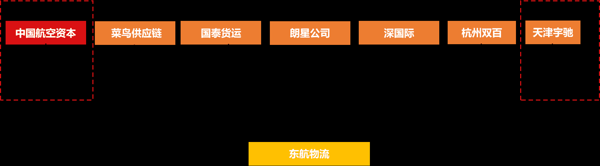

请阅读最后评级说明和重要声明

丨证券研究报告丨

# 行业研究丨行业周报丨运输

## 国货航拟上市，对比视角看货运航司

——交运周专题2024W50

### 报告要点

## 周度聚焦：国货航拟上市，对比视角看货运航司

# 出行链：国际客运量全面恢复，国内票价环比下降

# 海运：美线运价反弹，二次罢工担忧再起

# 物流：货运流量持续改善，蒙煤量价双双走弱

### 分析师及联系人

韩轶超　赵超　鲁斯嘉　张银晗　胡俊文

SAC：S0490512020001　SAC：S0490520020001　SAC：S0490519060002　SAC：S0490520080027

SFC：BQK468

# 运输

## 国货航拟上市，对比视角看货运航司

——交运周专题2024W50

行业研究丨行业周报

投资评级：看好丨维持

## 周度聚焦：国货航拟上市，对比视角看货运航司

随着国货航首次公开发行申请通过，A股有望迎来航空货运第二股。国货航作为中国航空资本控股的航空物流企业，运营模式上与东航物流相近，多维度比较下存在着诸多差异：

1）财务视角下，国货航采用轻杠杆的运营模式，1H24资产负债率不足15%，资产结构健康；

2）资源禀赋上，三大货航均占据优质时刻航权，国货航亚洲航线占比更高，货站分布北京、成都、杭州等地，区位不同导致净利率水平存在差异；

3）运营效率上，国货航飞机利用率稳步提升，伴随公司持续加强规划能力，积极开拓货源，载运率或有进一步提升空间。

# 出行链：国际客运量全面恢复，国内票价环比下降

航空客运：

1）航班量：12月13日，七天移动平均国内航班量恢复至2019年同期107%，七天移动平均客运量恢复至2019年同期110%；国际航班量恢复至2019年同期92%，国际客运量恢复至2019年同期101%；

2）客座率&票价：12月13日，国内客座率为83.8%，七天移动平均相较2019年同期+1.4pct，环比上周-1.0pct；七天移动平均国际客座率为79.8%，相较2019年同期+6.0pct，环比上周+1.5pct；国内含油票价为590元，七天移动平均相较2019年同期-11.6%，同比2023年-10.5%，环比上周-1.3%；

3）核心航线量价：京沪/沪深/沪广/京深/京广，

①客运量，恢复至2019年同期97%/129%/110%/113%/102%；

②票价，同比2019年-14%/-32%/-37%/-21%/-24%。

# 海运：美线运价反弹，二次罢工担忧再起

油运大船承压：本周克拉克森平均VLCC-TCE下跌23.6%至16k美元/天。本周，由于缺少货盘，VLCC运价承压；Aframax和Suezmax船市场运价尚可。如果后续VLCC仍无起色，或会争抢中小船市场需求，导致压力传导。

集运美线反弹：本周外贸集运SCFI综合指数环比上涨5.7%至2,384点。欧线运价小幅回落；美线订舱情况较好，特别是美西月中开始装载率大幅改善，运价企稳回升。特朗普声称支持码头工人协会ILU反对自动化，美东码头二次罢工的风险或增加。12/06当周内贸集运PDCI综合指数环比下跌1.7%至1,442，华北大宗货源运量小幅下降，不过华南需求保持稳定。

散运持续承压：本周BDI指数下跌9.9%至1,051。西澳货盘不足，矿商正在对明年年初需求询盘，但是由于可用运力的持续增加，短期运价承压。

# 物流：货运流量持续改善，蒙煤量价双双走弱

1）快递件量：12月2日—12月8日（2024W49），邮政快递累计揽收量约37.8亿件，同比增长30.9%。1月1日—12月8日，快递揽收量累计增速27.0%。

2）公路货运指数：截至12月12日，全国整车货运流量周均值为125，环比增长2.2%，同比增长6.2%。

3）航空货运价格：截至2024年12月9日，香港/浦东航空货运价格指数环比上周+4.7%/+3.4%，同比分别-3.6%/-1.4%。

4）甘其毛都蒙煤运量&短盘运价：12月2日—12月8日，甘其毛都日均通车量为866辆/日，环比下降282辆/日；短盘均价为65元/吨，环比下降24元/吨。

伴随经济积极信号释放，美国大选落地，看好三类资产：

1）直营物流：阿尔法属性显现，推荐顺丰和德邦；

2）对冲资产：亚非拉受益出海标的，看好嘉友国际、极兔速递。

3）地产基建链+破净+央国企，关注政策预期方向：推荐大宗供应链。

# 风险提示

1、宏观经济波动；

2、油价及人工成本大幅上升；

3、欧洲对俄罗斯油品制裁取消。

### 市场表现对比图（近12个月）

资料来源：Wind

### 相关研究

- 《南航拟出售10架787-8，中通策略回归份额提升——交运周专题2024W47》2024-11-24
- 《内贸集运景气加速修复，航空单座收益同比翻正——交运周专题2024W46》2024-11-17
- 《美国大选收官、国内化债加码，交运有哪些机会？——交运周专题2024W45》2024-11-10

-10%

1%

12%

23%

2023/12

2024/4

2024/8

2024/12

运输

沪深300指数

2024-12-15

请阅读最后评级说明和重要声明

**3 / 24**

行业研究 | 行业周报

### 目录

周度聚焦：国货航拟上市，对比视角看货运航司 .................................................. 5

出行链：国际客运量全面恢复，国内票价环比下降 ................................................ 14

海运：美线运价反弹，二次罢工担忧再起 .............................................................. 18

物流：货运流量持续改善，蒙煤量价双双走弱 ....................................................... 20

风险提示 ................................................................................................................. 22

### 图表目录

图1：国货航股权结构（截至上市发行前） ................................................................. 5

图2：天津宇驰是国货航的员工持股平台 ................................................................. 6

图3：2024H1，公司营收同比大幅增长 ................................................................. 7

图4：2024H1，公司归母净利润同比大幅增长 ....................................................... 7

图5：航空货运是国货航营收的主要来源 ................................................................. 8

图6：2024H1，国货航航空货运业务贡献80%以上的毛利 ........................................ 8

图7：客机货运支出、航油费用为公司主要营业成本 ................................................ 8

图8：2024H1，国货航ROE水平低于东航物流 ........................................................ 9

图9：国货航的资产负债率、净利率水平低于东航物流 .............................................. 9

图10：2024H1，国货航航空速运毛利润高于东航物流 ........................................... 10

图11：国货航航空速运毛利率低于东航物流 ........................................................... 10

图12：国货航全货机收入占航空速运比低于东航物流 .............................................. 10

图13：全货机毛利率高于客机货运毛利率 ............................................................... 10

图14：2024H1，国货航货邮周转量与东航物流接近 ............................................... 10

图15：2024H1，国货航自有货机数量略低于东航物流 ........................................... 10

图16：国货航亚洲航班量占比最高 ........................................................................ 11

图17：东航物流美洲航班量占比最高 ...................................................................... 11

图18：2024H1，国货航全货机日利用率与东航物流接近 ........................................ 11

图19：东航物流货机载运率高于国货航 ................................................................. 11

图20：2024H1，国货航货站业务毛利实现转正 ...................................................... 12

图21：东航物流货站盈利能力显著强于国货航 ....................................................... 12

图22：国货航货站操作量约为东航物流的一半 ......................................................... 13

图23：上海浦东/广州白云/深圳宝安为全国前三大货运机场 ...................................... 13

图24：2024H1，国货航供应链综合解决方案毛利润低于东航物流 ............................ 13

图25：南航物流供应链综合解决方案毛利率高于同行 .............................................. 13

图26：2023—2024年国内航班量与座位数七天移动平均恢复比例 ........................... 14

图27：2023—2024年国际航班量与座位数七天移动平均恢复比例 ........................... 14

图28：2023—2024年国内客流量七天移动平均恢复比例 ......................................... 14

图29：2023—2024年国际客流量七天移动平均恢复比例 ......................................... 14

图30：2023—2024年国内客座率七天移动平均变动比例 ......................................... 15

图31：2023—2024年国际客座率七天移动平均变动比例 ......................................... 15

图32：2023—2024年国内票价七天移动平均变动比例（元） .................................... 15

请阅读最后评级说明和重要声明

**4 / 24**

行业研究 | 行业周报

图33：北上广深机场国内航班量七天移动平均恢复比例 ............................................ 16

图34：成都海南机场国内航班量七天移动平均恢复比例 ............................................ 16

图35：北上广深机场国际航班量七天移动平均恢复比例 ............................................ 16

图36：成都海南机场国际航班量七天移动平均恢复比例 ............................................ 16

图37：商务航线航班量恢复比例 .............................................................................. 16

图38：商务航线客运量恢复比例 .............................................................................. 16

图39：商务航线票价同比变动 ................................................................................ 17

图40：商务航线客座率同比变动 .............................................................................. 17

图41：本周克拉克森平均VLCC-TCE下跌23.6%至16k美元/天 ................................. 18

图42：山东地炼开工率（7天移动平均）上升0.3个百分点至57.7% ......................... 18

图43：本周外贸集运SCFI综合指数环比上涨5.7%至2,384点 .................................... 19

图44：12/06当周内贸集运PDCI综合指数环比下跌1.7%至1,442 ......................... 19

图45：本周BDI指数下跌9.9%至1,051 ................................................................. 19

图46：12月第2周液体化学品内贸海运价持续上升 ................................................... 19

图47：上周邮政快递累计揽收量约37.8亿件，同比增长30.9% .................................. 20

图48：截至12月12日，全国整车货运流量周均值为125，环比增长2.2%，同比增长6.2% ........................................................................ 20

图49：截至2024年12月9日，香港/浦东航空货运价格指数环比上周+4.7%/+3.4% ............................................................................. 21

图50：12月2日—12月8日，甘其毛都日均通车量为866辆/日 .................................. 21

图51：12月2日—12月8日，短盘均价为65元/吨 ..................................................... 21

请阅读最后评级说明和重要声明

丨证券研究报告丨

更多研报请访问

长江研究小程序

# 行业研究 | 行业周报

## 周度聚焦：国货航拟上市，对比视角看货运航司

随着国货航首次公开发行申请通过，A股有望迎来航空货运第二股。国货航作为中国航空资本控股的航空物流企业，运营模式上与东航物流相近，多维度比较下存在着诸多差异：**1）** 财务视角下，国货航采用轻杠杆的运营模式，**1H24**资产负债率不足**15%**，资产结构健康；**2）** 资源禀赋上，三大货航均占据优质时刻航权，国货航亚洲航线占比更高，货站分布北京、成都、杭州等地，区位不同导致净利率水平存在差异；**3）** 运营效率上，国货航飞机利用率稳步提升，伴随公司持续加强规划能力，积极开拓货源，载运率或有进一步提升空间。

## 国货航：载旗航空物流企业，菜鸟参股

国货航是国内唯一载旗航空物流企业。国货航前身为中国国际货运航空有限公司，于2003年由国航公司、中信泰富、首都机场集团共同投资设立。2017年中航集团启动航空货运物流混合所有制改革，公司作为混改平台整合集团旗下货运物流企业，并逐步引入战略投资者并实施员工持股计划。2022年，公司整体变更设立股份公司。

公司第一大股东为中国航空资本，上市前持股**45.0%**，实际控制人为国务院国资委。截至上市前，菜鸟供应链、国泰货运、朗星公司、深国际和杭州双百持股比例分别为15.00%、12.24%、11.75%、10.00%和5.00%，菜鸟供应链、深国际为公司的产业投资人。天津宇驰持股公司**1.00%**的股份，是公司的员工持股平台，共**214**位核心员工通过平台对公司间接持股，有效激发员工积极性。

**图 1：国货航股权结构（截至上市发行前）**

资料来源：公司公告，长江证券研究所

**图 2：天津宇驰是国货航的员工持股平台**

资料来源：公司公告，长江证券研究所

**【国货航】天津宇驰（员工持股平台）**

| 成立时间 | 2020年10月9日 |
|---------|---------------|
| 解禁时间 | 上市以后36个月 |
| 授予价格 | - |
| 激励对象 | 214人 |
| 激励总量 | 占发行前总股本比例1% |
| 高管持股 | 李军（总裁）/李萌/李一川/王洪岩/郭世承/武林/石严/巫玉胜/陆涛/赵婧 |
| 总持股比分别是 | 0.04%/0.02%/0.02%/0.02%/0.02%/0.02%/0.02%/0.02%/0.01%/0.01% |

根据公司招股说明书，国货航拟募集资金约**35**亿元，计划发行股数不超过本次发行后公司已发行股份总数的**11%**（超额配售选择权行使前），即**13.2**亿股；若超额配售选择权全额行使，则发行总股数扩大至15.2亿股，占发行后总股本的比例约为12.44%。公司所募集的资金在扣除发行费用后拟用于飞机引进及备用发动机购置、综合物流能力提升建设和信息化与数字化建设，本次募投项目拟引进**5**架**B777-200F**全货机和**2**台**GE**备用发动机。

**表 1：公司募集项目主要用于引进宽体货机和备用发动机**

| 序号 | 项目名称 | 预计总投资额（亿元） | 预计募集资金使用额（亿元） | 建设周期 |
|------|---------|-------------------|----------------------|---------|
| 1 | 飞机引进及备用发动机购置 | 75.6 | 29.9 | 24个月 |
| 2 | 综合物流能力提升建设 | 5.4 | 2.9 | 36个月 |
| 3 | 信息化与数字化建设 | 4.1 | 2.2 | 36个月 |
| 总计 | | **85.1** | **35.0** | **-** |

资料来源：公司公告，长江证券研究所

同时，公司引进跨境电商产业资本，推动公司电商货物持续增长。菜鸟供应链是全球最大的跨境电商物流服务企业之一，对接速卖通等电商平台的出海需求。公司持续向菜鸟供应链加大包机、临时包机及包板等类型的航空货运服务，2024年上半年公司对菜鸟销售金额达到10.6亿元，占收入比例提升至11.9%。

**表 2：2024H1，菜鸟供应链是公司第一大客户**

| 前五大客户 | 2022 | | | 2023 | | | 2024H1 | | |
|-----------|------|---|---|------|---|---|--------|---|---|
| | 客户 | 营业收入（亿元） | 营收占比 | 客户 | 营业收入（亿元） | 营收占比 | 客户 | 营业收入（亿元） | 营收占比 |
| 1 | 苹果公司 | 21.4 | 9.3% | 菜鸟供应链 | 10.9 | 7.3% | 菜鸟供应链 | 10.6 | 11.9% |
| 2 | SCHENKER | 9.8 | 4.3% | DGF | 9.8 | 6.6% | DGF | 4.9 | 5.5% |
| 3 | DGF | 9.0 | 3.9% | 中国外运 | 8.3 | 5.6% | 中航集团 | 4.5 | 5.1% |
| 4 | 安达顺国际物流 | 7.5 | 3.3% | 中航集团 | 7.3 | 4.9% | 中国外运 | 3.8 | 4.3% |
| 5 | 中航集团 | 7.0 | 3.0% | 苹果公司 | 6.3 | 4.3% | 欧华国际货代 | 3.0 | 3.3% |

资料来源：公司公告，长江证券研究所

2024H1，公司营收同比增长48.2%至89.7亿元，归母净利润同比增长40.8%至6.7亿元，主要受益于公司引进新运力、航空货运价格同比提升。航空货运业务是公司的营收和利润底盘，通过全货机和货运腹舱资源提供航空货运干线运输服务，**2024**上半年对应营收占比为**74.8%**，毛利占比为**81.8%**。

公司的货站业务为航司提供货运地面处理服务，24H1营收占比为7.1%，24H1毛利实现转正。公司主要以民航快递为基础发展合同物流、货运代理等综合物流解决方案，提供门到门的全流程服务，24H1营收占比和毛利分别为18.1%、16.9%。

**图 3：2024H1，公司营收同比大幅增长**  
**图 4：2024H1，公司归母净利润同比大幅增长**

资料来源：公司公告，长江证券研究所  
资料来源：公司公告，长江证券研究所

**图 5：航空货运是国货航营收的主要来源**  
**图 6：2024H1，国货航航空货运业务贡献80%以上的毛利**

资料来源：公司公告，长江证券研究所  
资料来源：公司公告，长江证券研究所

从成本项看，客机货运经营支出、航油成本、人工成本为公司主要营业成本，2024H1成本占比分别为38.4%、18.9%、10.3%，与东航物流的成本结构相似。其中，公司是国航股份客机货运业务的独家运营者，客机货运经营支出为支付客机腹舱的成本。此外，航油成本、人工成本是公司运营全货机重要的变动成本项。

**图 7：客机货运支出、航油费用为公司主要营业成本**

资料来源：公司公告，长江证券研究所

## 对比视角：货运航司的资源禀赋、运营效率差异

从财务视角看，2021年以来国货航的净资产持续收益率低于东航物流，2024H1东航物流、国货航的ROE分别为7.9%、3.3%。通过杜邦公式分析，主要为国货航的资产负债率、净利率水平均低于东航物流。国货航采用低杠杆的运营模式，2022年底公司偿还部分飞机租赁负债，资产结构健康。同时，受货站资源禀赋、载运效率等因素影响，国货航航空货运和货站业务的盈利能力低于东航物流。

**图 8：2024H1，国货航ROE水平低于东航物流**

资料来源：Wind，长江证券研究所

**图 9：国货航的资产负债率、净利率水平低于东航物流**

资料来源：Wind，长江证券研究所

航空货运业务的周期性较强，毛利率跟随空运价格同向波动。2024H1，国货航航空货运业务毛利润水平与东航物流相近，但毛利率却始终低于东航物流，主要因为：**1）** 业务结构有所不同，国货航客机业务占比较高，而客机业务毛利率较低；**2）** 东航物流和国货航在航线结构、机型上有所差异，国货航亚洲航班量占比更高，或导致航空货运净利率存在差异。

**图 10：2024H1，国货航航空速运毛利润高于东航物流**  
**图 11：国货航航空速运毛利率低于东航物流**

资料来源：公司公告，长江证券研究所  
资料来源：公司公告，长江证券研究所

**图 12：国货航全货机收入占航空速运比低于东航物流**  
**图 13：全货机毛利率高于客机货运毛利率**

资料来源：公司公告，长江证券研究所  
资料来源：公司公告，长江证券研究所

三大货航是我国航空物流市场主要的市场参与者，货运周转量占比稳居行业前三，占据了全球优质航权时刻，也是欧美长航线跨境运输的主要玩家。截至2024H1，国货航拥有正在执飞的全货机13架，较东航物流少一架。随着公司新增3架全货机于2024年7月起陆续执飞，截至2024年12月，国货航拥有正在执飞的全货机17架。

**图 14：2024H1，国货航货邮周转量与东航物流接近**  
**图 15：2024H1，国货航自有货机数量略低于东航物流**

资料来源：公司公告，长江证券研究所  
资料来源：公司公告，长江证券研究所

根据民航小站数据，截至目前三大货航共拥有宽体机48架，国货航、南航物流的货机数量较为领先，均为17架。国货航的货机结构更为多元，拥有中型宽体机A330和大型宽体机B747、B777。从航权时刻看，国货航国际货运航班覆盖亚洲、美洲、欧洲等核心货运枢纽，**2024**年冬春美线**/**欧线航班量占比为**27%/24%**，美洲航班量占比低于东航物流，亚洲航班量占比更高。

**表 3：国货航货运结构更加多元**

| 公司名称 | A330 | B747 | B777 | 合计 |
|---------|------|------|------|------|
| 东航物流 | 0 | 0 | 14 | 14 |
| 国货航 | 3 | 3 | 11 | 17 |
| 南航物流 | 0 | 0 | 17 | 17 |

资料来源：民航休闲小站，公司公告，长江证券研究所（截至2024年12月15日）

**图 16：国货航亚洲航班量占比最高**  
**图 17：东航物流美洲航班量占比最高**

资料来源：中国民航局，长江证券研究所  
资料来源：中国民航局，长江证券研究所

从运营效率角度看，国货航全货机飞行小时数与同行相近，2022年来全货机日均利用率稳步改善，运营效率提升。不过，2022年以来伴随全货机紧缺程度下降，国货航的载运率有所回落。东航物流积极开发客源，产地直达等回程货物保持高速增长，载运率稳定在较高水平。

**图 18：2024H1，国货航全货机日利用率与东航物流接近**  
**图 19：东航物流货机载运率高于国货航**

资料来源：公司公告，长江证券研究所  
资料来源：公司公告，长江证券研究所

国货航货站业务2024年上半年毛利实现转正，盈利水平低于东航物流。货站是区位垄断的生意模式，区位禀赋差异决定货站盈利水平。一方面，公司航空货站分布分散，主要位于北京、成都、杭州等地，机场货量远低于浦东机场，整体货站货量水平约东航物流的一半。而东航物流航空货站主要位于上海浦东国际机场，是国内货邮吞吐量最高的机场，货邮吞吐量常年排名国内第一，收入端能够维持较高水平，成本端亦形成规模效应，使得毛利率相对较高。另一方面，公司于**2021**年**7**月启用了成都天府机场货站，目前尚在培育期，随着操作货量的自然增长，毛利率有望稳步提升。

**图 20：2024H1，国货航货站业务毛利实现转正**  
**图 21：东航物流货站盈利能力显著强于国货航**

资料来源：公司公告，长江证券研究所  
资料来源：公司公告，长江证券研究所

**表 4：国货航核心货站货量及市占率**

| 货站名称 | 2021年 | | | 2022年 | | | 2023年 | | |
|---------|-------|---|---|-------|---|---|-------|---|---|
| | 货站处理量（万吨） | 市占率 | | 货站处理量（万吨） | 市占率 | | 货站处理量（万吨） | 市占率 |
| 北京货站 | 76.3 | 54% | | 51.5 | 52% | | 53.7 | 48% |
| 成都双流机场货站 | 22.4 | 36% | | 21.1 | 40% | | 17.3 | 33% |
| 成都天府机场货站 | 0.2 | 12% | | 1.9 | 24% | | 5.6 | 23% |
| 重庆货站 | 9.3 | 20% | | 7.7 | 18% | | 5.8 | 15% |
| 天津货站 | 7.3 | 37% | | 5.1 | 38% | | 5.0 | 39% |
| 杭州货站 | 5.1 | 6% | | 4.7 | 6% | | 7.3 | 9% |

资料来源：公司公告，长江证券研究所

# 出行链：国际客运量全面恢复，国内票价环比下降

## 航班量&客流量：运量维持高位

12月13日，七天移动平均国内航班量恢复至2019年同期107%，七天移动平均客运量恢复至2019年同期110%；国际航班量恢复至2019年同期92%，国际客运量恢复至2019年同期101%。

图26：2023-2024年国内航班量与座位数七天移动平均恢复比例

图27：2023-2024年国际航班量与座位数七天移动平均恢复比例

资料来源：CADAS，长江证券研究所

资料来源：CADAS，长江证券研究所

图28：2023-2024年国内客流量七天移动平均恢复比例

图29：2023-2024年国际客流量七天移动平均恢复比例

资料来源：CADAS，长江证券研究所

资料来源：CADAS，长江证券研究所

## 客座率&票价：票价环比小幅下降

12月13日，国内客座率为83.8%，七天移动平均相较2019年同期+1.4pct，环比上周-1.0pct；七天移动平均国际客座率为79.8%，相较2019年同期+6.0pct，环比上周+1.5pct；国内含油票价为590元，七天移动平均相较2019年同期-11.6%，同比2023年-10.5%，环比上周-1.3%。

图30：2023-2024年国内客座率七天移动平均变动比例

图31：2023-2024年国际客座率七天移动平均变动比例

资料来源：CADAS，长江证券研究所

资料来源：CADAS，长江证券研究所

图32：2023-2024年国内票价七天移动平均变动比例（元）

资料来源：CADAS，长江证券研究所

## 核心机场航班量：内强外弱，但逐步收敛

12月13日，1）国内：首都/浦东/虹桥/深圳/白云恢复至2019年同期74%/113%/101%/115%/112%；2）国际：首都/浦东/虹桥/深圳/白云恢复至2019年同期69%/92%/99%/96%/85%。

图33：北上广深机场国内航班量七天移动平均恢复比例

图34：成都海南机场国内航班量七天移动平均恢复比例

资料来源：CADAS，长江证券研究所

资料来源：CADAS，长江证券研究所

图35：北上广深机场国际航班量七天移动平均恢复比例

图36：成都海南机场国际航班量七天移动平均恢复比例

资料来源：CADAS，长江证券研究所

资料来源：CADAS，长江证券研究所

## 核心航线量价：量升价跌，跌幅放大

12月13日，京沪/沪深/沪广/京深/京广，1）航班量，恢复至2019年同期114%/114%/121%/128%/128%；2）客运量，恢复至97%/129%/110%/113%/102%；3）票价，同比2019年变动-14%/-32%/-37%/-21%/-24%。

图37：商务航线航班量恢复比例

图38：商务航线客运量恢复比例

资料来源：CADAS，长江证券研究所

资料来源：CADAS，长江证券研究所

图39：商务航线票价同比变动

图40：商务航线客座率同比变动

资料来源：CADAS，长江证券研究所

资料来源：CADAS，长江证券研究所

# 红利资产：低利率下，两类资产的三种投资价值

交通运输行业具备典型的高股息特征。如果进一步从低估值和高股息两个维度筛选交运标的，可以发现主要有两类细分板块具备较为显著的低估值高股息特征：一是公路、铁路、港口等垄断类基础设施；二是大宗供应链以及货运代理等竞争性行业。

落地投资：1）买低波稳健+分红确定，优选高速龙头（招商公路、粤高速等）+大秦铁路；2）买底部反转弹性+低估值，优选大宗供应链（厦门象屿、厦门国贸）；3）买独立景气+成长确定，优选货代公司（中国外运、华贸物流）。

## 表5：交通运输行业高股息核心标的跟踪

| 市场 | 证券简称 | 总市值（亿元） | 所属行业 | 归母净利润（亿元）2023A | 2024E | 2025E | 2026E | PE（TTM） | PE（24E） | PB | 预期分红率（或23年分红率） | 股息率23 | 24E | 25E |
|---|---|---:|---|---:|---:|---:|---:|---:|---:|---:|---|---:|---:|---:|
| A股 | 大秦铁路 | 1243.4 | 铁路 | 119.3 | 97.0 | 110.2 | 116.0 | 13.2 | 12.8 | 0.8 | 55.0% | 5.3% | 4.3% | 4.9% |
| A股 | 招商公路 | 810.9 | 高速公路 | 67.7 | 62.1 | 65.3 | 69.9 | 12.4 | 13.1 | 1.3 | 55.0% | 4.6% | 4.2% | 4.4% |
| A股 | 宁沪高速 | 714.4 | 高速公路 | 44.1 | 46.1 | 49.6 | 52.9 | 15.9 | 15.5 | 1.9 | 0.47元/股 | 3.3% | 3.3% | 3.3% |
| A股 | 山东高速 | 446.9 | 高速公路 | 33.0 | 33.0 | 35.9 | 39.3 | 13.8 | 13.5 | 1.5 | 60.0% | 4.4% | 4.4% | 4.8% |
| A股 | 深高速 | 249.9 | 高速公路 | 23.3 | 20.1 | 22.3 | 23.4 | 11.6 | 12.4 | 1.4 | 55.0% | 5.1% | 4.4% | 4.9% |
| A股 | 皖通高速 | 243.6 | 高速公路 | 16.6 | 16.0 | 17.4 | 18.8 | 15.9 | 15.2 | 1.9 | 60.0% | 4.1% | 3.9% | 4.3% |
| A股 | 粤高速A | 247.1 | 高速公路 | 16.3 | 16.0 | 16.5 | 16.8 | 15.1 | 15.5 | 2.4 | 70.0% | 4.6% | 4.5% | 4.7% |
| A股 | 赣粤高速 | 124.0 | 高速公路 | 11.8 | 13.0 | 14.1 | 14.8 | 10.0 | 9.6 | 0.7 | 30.0% | 2.8% | 3.1% | 3.4% |
| A股 | 四川成渝 | 160.5 | 高速公路 | 11.9 | 12.2 | 13.4 | 14.9 | 13.5 | 13.2 | 1.0 | 60.0% | 4.4% | 4.5% | 5.0% |
| A股 | 上港集团 | 1350.3 | 港口 | 132.0 | 148.9 | 149.7 | 156.4 | 9.9 | 9.1 | 1.0 | 30.3% | 3.0% | 3.3% | 3.4% |
| A股 | 青岛港 | 554.3 | 港口 | 49.2 | 51.9 | 55.6 | 58.8 | 10.9 | 10.7 | 1.3 | 39.0% | 3.5% | 3.7% | 3.9% |
| A股 | 唐山港 | 253.0 | 港口 | 19.2 | 20.4 | 21.4 | 23.0 | 13.4 | 12.4 | 1.2 | 0.2元/股 | 4.7% | 4.7% | 4.7% |
| A股 | 招商港口 | 504.2 | 港口 | 35.7 | 40.9 | 42.6 | 45.2 | 12.1 | 12.3 | 0.8 | 50.0% | 3.5% | 4.1% | 4.2% |
| A股 | 厦门象屿 | 134.4 | 大宗供应链 | 15.7 | 12.6 | 20.4 | 23.0 | 10.5 | 10.7 | 1.0 | 43.4% | 5.1% | 4.1% | 6.6% |
| A股 | 厦门国贸 | 145.0 | 大宗供应链 | 19.1 | 16.1 | 21.0 | 24.6 | 19.0 | 9.0 | 0.7 | 57.6% | 7.6% | 6.4% | 8.3% |
| A股 | 建发股份 | 288.8 | 大宗供应链 | 131.0 | 33.6 | 41.2 | 47.5 | 10.5 | 8.6 | 0.5 | 63.7% | 4.7% | 4.7% | 4.7% |
| A股 | 中国外运 | 382.9 | 货运代理 | 42.2 | 39.7 | 43.4 | 46.9 | 9.9 | 9.7 | 1.0 | 50.0% | 5.5% | 5.2% | 5.7% |

行业研究 | 行业周报

华贸物流　83.6　货运代理　6.2　6.5　7.4　8.3　15.9　12.8　1.4　70.0%　5.2%　5.5%　6.2%

中谷物流　183.5　海运　17.2　17.0　18.2　18.8　11.2　10.8　1.8　88.1%　8.2%　8.2%　8.7%

中远海控　2169.1　海运　238.6　474.6　230.6　211.1　5.4　4.6　1.0　50.0%　5.5%　10.9%　5.3%

## H股

越秀交通基建　58.3　高速公路　7.7　7.1　7.8　8.0　8.8　8.2　0.5　60.0%　7.9%　7.3%　8.0%

浙江沪杭甬　283.4　高速公路　52.2　52.4　55.6　58.4　5.2　5.4　0.7　32.0%　5.9%　5.9%　6.3%

安徽皖通高速公路　212.6　高速公路　16.6　16.0　17.4　18.8　8.9　13.3　1.1　60.0%　4.7%　4.5%　4.9%

江苏宁沪高速公路　630.1　高速公路　44.1　46.1　49.6　52.9　8.0　13.7　1.1　0.47元/股　6.5%　6.5%　6.5%

四川成渝高速公路　140.2　高速公路　11.9　12.2　13.4　14.9　7.4　11.5　0.6　60.0%　5.1%　5.2%　5.8%

深圳高速公路股份　212.6　高速公路　23.3　20.1　22.3　23.4　6.4　10.6　0.8　55.0%　6.0%　5.2%　5.8%

大秦铁路　1243.4　铁路　119.3　97.0　110.2　116.0　13.2　12.8　0.8　55.0%　5.3%　4.3%　4.9%

招商公路　810.9　高速公路　67.7　62.1　65.3　69.9　12.4　13.1　1.3　55.0%　4.6%　4.2%　4.4%

宁沪高速　714.4　高速公路　44.1　46.1　49.6　52.9　15.9　15.5　1.9　0.47元/股　3.3%　3.3%　3.3%

资料来源：Wind，长江证券研究所（注：采用Wind一致预期，数据截止2024/12/14）

# 海运：美线运价反弹，二次罢工担忧再起

## 本周海运运价：集运美线反弹，油散持续承压

油运大船承压：本周克拉克森平均**VLCC-TCE**下跌**23.6%**至**16k**美元/天。本周，由于缺少货盘，VLCC运价承压；Aframax和Suezmax船市场运价尚可。不过，如果后续VLCC仍无起色，或会争抢中小船市场需求，导致压力传导。

集运美线反弹：本周外贸集运**SCFI**综合指数环比上涨**5.7%**至**2,384**点。欧线运价小幅回落；美线订舱情况较好，特别是美西月中开始装载率大幅改善，运价企稳回升。**12/06**当周内贸集运**PDCI**综合指数环比下跌**1.7%**为**1,442**，华北地区玉米等大宗货源运量小幅下降致运价回落，不过华南运价环比仍上涨，大件消费品运量需求保持稳定。

散运持续承压：本周**BDI**指数下跌**9.9%**至**1,051**。本周大船继续拖累指数。西澳货盘不足，澳洲和巴西矿商正在对明年年初需求询盘，不过由于可用运力的持续增加，短期运价承压。小船货盘较活跃，特别是东南亚市场煤炭货盘，不过前期积压的可用运力仍有待消化，短期运价止跌回升仍有压力。

液体化学品内贸海运价格上涨：2024年12月第2周，化学品内贸海运价持续上涨。船期周转下降导致舱位趋紧，运价止跌回升，需求端的整体改善仍有待观察。

图41：本周克拉克森平均VLCC-TCE下跌23.6%至16k美元/天

图42：山东地炼开工率（7天移动平均）上升0.3个百分点至57.7%

资料来源：Clarksons，长江证券研究所

资料来源：Wind，长江证券研究所

Clarksons平均VLCC-TCE（美元/天）

开工率（常减压开工率）：山东地炼厂（7DMA）

图43：本周外贸集运SCFI综合指数环比上涨5.7%至2,384点

图44：12/06当周内贸集运PDCI综合指数环比下跌1.7%为1,442

资料来源：Clarksons，长江证券研究所

资料来源：新华财经，长江证券研究所

图45：本周BDI指数下跌9.9%至1,051

图46：12月第2周液体化学品内贸海运价持续上升

资料来源：Clarksons，长江证券研究所

资料来源：沛君航运，长江证券研究所（2023年6月第2周前采用5000MT船型运价，之后采用6000MT船型运价）

本周重点新闻：特朗普与美东码头工人协会ILA进行会谈

点评：

（1）本周，特朗普与美东码头工人协会ILA进行会谈并讨论了码头自动化相关议题，特朗普声称将支持ILA反对码头自动化。

（2）10月初，在ILA罢工三天后，码头与工人协会双方就工资问题达成初步协议，同时将主合同延长至2025年1月15日。11月12日，ILA表示，考虑到码头运营商仍继续推进自动化，宣布中断后续谈判。

（3）特朗普的声明意味着ILA后续的谈判筹码将增加，如果码头运营商仍坚持推进自动化，可能会导致二次罢工的发生。当前，美线装载率保持高位，如果二次罢工风险增加，货主提前抢运将会支持美线运价上涨。

SCFI综合指数

内贸集装箱运价指数PDCI：综合

波罗的海干散货指数（BDI）

液体化学品内贸海运运价（元/吨）

大连-江阴

江阴-大连

江阴-宁波

大连-东莞

江阴-东莞

泉州-江阴

# 物流：货运流量持续改善，蒙煤量价双双走弱

## 本周物流数据：货运流量环比提升，蒙煤量价双双走弱

快递件量：12月2日-12月8日（2024W49），邮政快递累计揽收量约37.8亿件，同比增长30.9%。1月1日-12月8日，快递揽收量累计增速27.0%。

公路货运指数：截至12月12日，全国整车货运流量周均值为125，环比增长2.2%，同比增长6.2%。

航空货运价格：截至2024年12月9日，香港/浦东航空货运价格指数环比上周+4.7%/+3.4%，同比分别-3.6%/-1.4%。年初至今，香港/浦东航空货运价格指数累计同比分别+6.5%/+11.2%。

甘其毛都蒙煤运量&短盘运价：12月2日-12月8日，甘其毛都日均通车量为866辆/日，环比下降282辆/日；短盘均价为65元/吨，环比下降24元/吨。

图47：上周邮政快递累计揽收量约37.8亿件，同比增长30.9%

资料来源：Wind，长江证券研究所

图48：截至12月12日，全国整车货运流量周均值为125，环比增长2.2%，同比增长6.2%

资料来源：G7物联，长江证券研究所（注：全国整车货运流量采用整车的车流量编制）

图49：截至2024年12月9日，香港/浦东航空货运价格指数环比上周+4.7%/+3.4%

资料来源：TAC，长江证券研究所

图50：12月2日-12月8日，甘其毛都日均通车量为866辆/日

图51：12月2日-12月8日，短盘均价为65元/吨

资料来源：蒙古煤炭网，长江证券研究所

资料来源：蒙古煤炭网，长江证券研究所

航空货运价格指数

法兰克福

香港

伦敦

芝加哥

上海浦东

甘其毛都口岸通车数（辆，MA7）

查干哈达至甘其毛都运价（短盘，元/吨）

# 风险提示

1、宏观经济波动。航空需求分为B端和C端，B端需求衍生于经济活动，C端需求依赖于居民消费，宏观经济波动会影响需求。

2、油价及人工成本大幅上升。快递产品中人力成本和运输成本占比较高，油价是运输成本的重要来源，若油价及人工成本在短期内大幅上行，将引致快递公司盈利承压。

3、欧洲对俄罗斯油品制裁取消。油运行业直接受益于欧洲对俄罗斯的油品制裁，制裁导致全球油品贸易路线出现调整，进而提升行业需求中枢。若制裁取消，将面临行业需求侧下滑，进而影响到运价假设。

# 投资评级说明

## 行业评级

报告发布日后的12个月内行业股票指数的涨跌幅相对同期相关证券市场代表性指数的涨跌幅为基准，投资建议的评级标准为：

看好：相对表现优于同期相关证券市场代表性指数

中性：相对表现与同期相关证券市场代表性指数持平

看淡：相对表现弱于同期相关证券市场代表性指数

## 公司评级

报告发布日后的12个月内公司的涨跌幅相对同期相关证券市场代表性指数的涨跌幅为基准，投资建议的评级标准为：

买入：相对同期相关证券市场代表性指数涨幅大于10%

增持：相对同期相关证券市场代表性指数涨幅在5%～10%之间

中性：相对同期相关证券市场代表性指数涨幅在-5%～5%之间

减持：相对同期相关证券市场代表性指数涨幅小于-5%

无投资评级：由于我们无法获取必要的资料，或者公司面临无法预见结果的重大不确定性事件，或者其他原因，致使我们无法给出明确的投资评级。

相关证券市场代表性指数说明：A股市场以沪深300指数为基准；新三板市场以三板成指（针对协议转让标的）或三板做市指数（针对做市转让标的）为基准；香港市场以恒生指数为基准。

## 办公地址

| 城市 | 地址 | 邮编 |
|---|---|---|
| 上海 | 虹口区新建路200号国华金融中心B栋22、23层 | 200080 |
| 武汉 | 武汉市江汉区淮海路88号长江证券大厦37楼 | 430015 |
| 北京 | 西城区金融街33号通泰大厦15层 | 100032 |
| 深圳 | 深圳市福田区中心四路1号嘉里建设广场3期36楼 | 518048 |

# 分析师声明

本报告署名分析师以勤勉的职业态度，独立、客观地出具本报告。分析逻辑基于作者的职业理解，本报告清晰准确地反映了作者的研究观点。作者所得报酬的任何部分不曾与、不与，也不将与本报告中的具体推荐意见或观点有直接或间接联系，特此声明。

# 法律主体声明

本报告由长江证券股份有限公司及/或其附属机构（以下简称“长江证券”或“本公司”）制作，由长江证券股份有限公司在中华人民共和国大陆地区发行。长江证券股份有限公司具有中国证监会许可的投资咨询业务资格，经营证券业务许可证编号为：10060000。本报告署名分析师所持中国证券业协会授予的证券投资咨询执业资格书编号已披露在报告首页的作者姓名旁。

在遵守适用的法律法规情况下，本报告亦可能由长江证券经纪（香港）有限公司在香港地区发行。长江证券经纪（香港）有限公司具有香港证券及期货事务监察委员会核准的“就证券提供意见”业务资格（第四类牌照的受监管活动），中央编号为：AXY608。本报告作者所持香港证监会牌照的中央编号已披露在报告首页的作者姓名旁。

# 其他声明

本报告并非针对或意图发送、发布给在当地法律或监管规则下不允许该报告发送、发布的人员。本公司不会因接收人收到本报告而视其为客户。本报告的信息均来源于公开资料，本公司对这些信息的准确性和完整性不作任何保证，也不保证所包含信息和建议不发生任何变更。本报告内容的全部或部分均不构成投资建议。本报告所包含的观点、建议并未考虑报告接收人在财务状况、投资目的、风险偏好等方面的具体情况，报告接收者应当独立评估本报告所含信息，基于自身投资目标、需求、市场机会、风险及其他因素自主做出决策并自行承担投资风险。本公司已力求报告内容的客观、公正，但文中的观点、结论和建议仅供参考，不包含作者对证券价格涨跌或市场走势的确定性判断。报告中的信息或意见并不构成所述证券的买卖出价或征价，投资者据此做出的任何投资决策与本公司和作者无关。本研究报告并不构成本公司对购入、购买或认购证券的邀请或要约。本公司有可能会与本报告涉及的公司进行投资银行业务或投资服务等其他业务（例如：配售代理、牵头经办人、保荐人、承销商或自营投资）。

本报告所包含的观点及建议不适用于所有投资者，且并未考虑个别客户的特殊情况、目标或需要，不应被视为对特定客户关于特定证券或金融工具的建议或策略。投资者不应以本报告取代其独立判断或仅依据本报告做出决策，并在需要时咨询专业意见。

本报告所载的资料、意见及推测仅反映本公司于发布本报告当日的判断，本报告所指的证券或投资标的的价格、价值及投资收入可升可跌，过往表现不应作为日后的表现依据；在不同时期，本公司可以发出其他与本报告所载信息不一致及有不同结论的报告；本报告所反映研究人员的不同观点、见解及分析方法，并不代表本公司或其他附属机构的立场；本公司不保证本报告所含信息保持在最新状态。同时，本公司对本报告所含信息可在不发出通知的情形下做出修改，投资者应当自行关注相应的更新或修改。本公司及作者在自身所知情范围内，与本报告中所评价或推荐的证券不存在法律法规要求披露或采取限制、静默措施的利益冲突。

本报告版权仅为本公司所有，本报告仅供意向收件人使用。未经书面许可，任何机构和个人不得以任何形式翻版、复制和发布给其他机构及/或人士（无论整份和部分）。如引用须注明出处为本公司研究所，且不得对本报告进行有悖原意的引用、删节和修改。刊载或者转发本证券研究报告或者摘要的，应当注明本报告的发布人和发布日期，提示使用证券研究报告的风险。本公司不为转发人及/或其客户因使用本报告或报告载明的内容产生的直接或间接损失承担任何责任。未经授权刊载或者转发本证券研究报告的，本公司将保留向其追究法律责任的权利。

本公司保留一切权利。
