请务必阅读正文之后的重要声明部分

证券研究报告/固收事件点评报告

2024年12月23日

分析师：周冰倩

执业证书编号：S0740524040003

Email：zhoubq@zts.com.cn

相关报告

## 报告摘要

- **11月全国土地出让金逆势上涨。**2024年11月，全国土地出让面积为20,980.70万平方米，同比下降7.42%；土地出让金为5,507.03亿元，同比上升10.18%，此同比上涨为今年继1月上涨后的第二次上涨。从结构上看，主要是一线城市拉动，一线城市土地出让金同比增加609亿元，贡献了11月上涨的绝大部分增量。

- **但年初至今，土地出让金仍有明显下行。**1—11月，全国土地出让金为27,207.72亿元，同比下降24.88%。从结构上看，除其他用地外，各种性质的土地出让金与去年同期相比增速均为负，其中综合用地（含住宅）的土地出让金降幅最大，达到了38.16%，住宅用地降幅紧随其后，降幅为26.16%。从成交均价及溢价率看，1—11月同比均下滑。

- **1—11月，江苏土地出让金领跑，天津、贵州降幅超40%。**1—11月，江苏土地出让金位居榜首，达到5,061.69亿元；浙江、山东、北京、广东等土地出让金破千亿；新疆、青海、福建土地出让金同比上升；天津、贵州、广东、湖南等下降较为明显，降幅超过40%。

- **1—11月城投拿地占比32%，较去年全年增加1pct。**1—11月，重庆、福建和湖南等8省城投拿地占比超过30%。相较于去年同期，福建、重庆、安徽城投拿地占比同比增加超10pct；分地市看，扬州、福州等23个城市城投拿地金额超100亿元，其中泉州、合肥等地市城投拿地占比同比有一定增长。

- **1—11月，国企拿地金额下滑，但下滑幅度小于整体土地出让下滑幅度，因此国企拿地占比反而抬升7pct。**2024年1—11月，国企拿地金额达到17,367.43亿元，拿地金额同比下滑15.99%；国企拿地占比为63.83%，同比上升了6.75pct。分省份看，安徽、重庆、陕西、江西、福建、河北、浙江等省份国企拿地占比同比增加超10pct。

- **风险提示：**城投口径判断有误；土地明细数据来源于中指，可能存在数据更新不及时及提取失误等风险。

## 内容目录

一、11月，全国土地出让金逆势上涨  
二、11月，成交土地均价及溢价率同比均明显上升  
三、青海、海南等省份土地出让金跌幅超50%  
四、1—11月，城投拿地占比32%，较去年全年增加1pct  
五、11月，国企拿地占比70%  
六、小结  
风险提示

## 图表目录

图表1：2024年1—11月土地出让面积（万平方米）  
图表2：2024年1—11月土地出让金（亿元）  
图表3：2024年1—11月分用地性质土地出让金情况（亿元、%）  
图表4：2020年以来，一线、二线、三四线土地出让金结构占比（%）  
图表5：2020年以来土地成交均价及溢价率情况（元/㎡、%）  
图表6：2020年以来，一线、二线、三四线城市土地成交均价及溢价率情况（元/㎡、%）  
图表7：2024年11月分省份土地出让金情况（亿元、%）  
图表8：2024年1—11月分省份土地出让金情况（亿元、%）  
图表9：2024年11月分地市土地出让金情况（亿元、%）（仅列示部分）  
图表10：2024年1—11月分地市土地出让金情况（亿元、%）（仅列示部分）  
图表11：2023年以来城投拿地占比情况（亿元、%）  
图表12：2024年11月分省份城投拿地情况（亿元、%）  
图表13：2024年1—11月分省份城投拿地情况（亿元、%）  
图表14：2024年11月分地市城投拿地情况（亿元、%）（仅列示部分）  
图表15：2023年以来国企拿地占比情况（亿元、%）  
图表16：2024年11月分省份国企拿地情况（亿元、%）  
图表17：2024年11月分地市国企拿地情况（亿元、%）（仅列示部分）

### 一、11月，全国土地出让金逆势上涨

- **11月，全国土地出让金逆势上涨。**2024年11月，全国土地出让面积为20,980.70万平方米，同比下降7.42%；土地出让金为5,507.03亿元，同比上升10.18%，此同比上涨为2024年继1月上涨后的第二次上涨。但全年来看，土地出让金仍有明显下行，1—11月土地出让金为27,207.72亿元，同比下降24.88%。

图表1：2024年1—11月土地出让面积（万平方米）

图表2：2024年1—11月土地出让金（亿元）

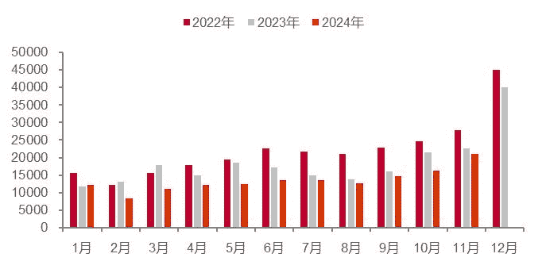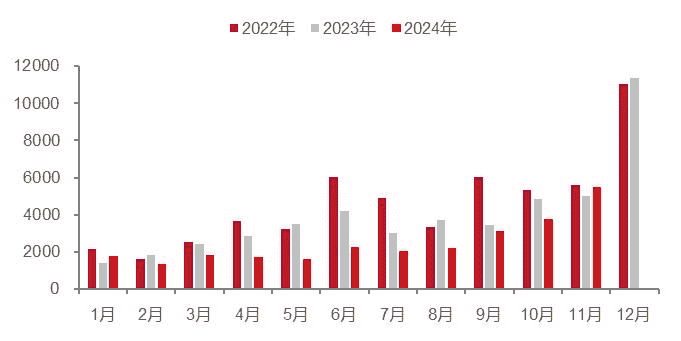

来源：中指，中泰证券研究所

- **1—11月，住宅用地同比下降26%。**2024年1—11月，除其他用地外，各种性质的土地出让金同比增速均为负，其中综合用地（含住宅）的土地出让金降幅最大，达到了38.16%；住宅用地降幅紧随其后，降幅为26.16%。

图表3：2024年1—11月分用地性质土地出让金情况（亿元、%）

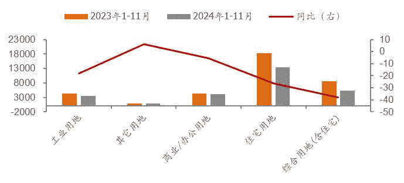

来源：中指，中泰证券研究所

- **11月，一线城市土地出让金占比同比提升。**11月，一线、二线、三四线土地出让金占比分别为13.48%、25.27%和61.25%，其中一线城市占比同比上升10.81pct，二线、三四线城市则同比下降7.73pct、3.08pct。

图表4：2020年以来，一线、二线、三四线土地出让金结构占比（%）

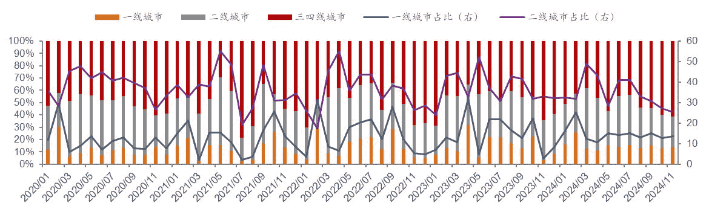

来源：中指，中泰证券研究所

### 二、11月，成交土地均价及溢价率同比均明显上升

- **11月，全国成交土地均价同比上升19%。**11月，全国成交土地均价为2,626元/㎡，同比上升19.04%；平均溢价率为4.75%，同比上升1.51pct。2024年1—11月，全国成交土地均价为1,707元/㎡，同比下降12.35%；平均溢价率为3.66%，同比下降0.70pct。

图表5：2020年以来土地成交均价及溢价率情况（元/㎡、%）

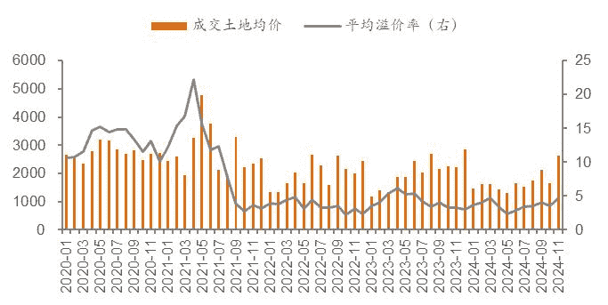

来源：中指，中泰证券研究所

- **11月，一线城市成交均价及溢价率明显上升。**11月，一线城市以45,354元/㎡的成交土地均价领先，相较于去年同期，均价大幅上升了502.47%，同时，平均溢价率也同比上升了10.11pct。二线城市成交土地均价为4,351元/㎡，同比下滑6.37%，平均溢价率为3.72%，同比下降1.24pct。三四线城市成交土地均价为1,916元/㎡，同比上升12.77%，平均溢价率为4.06%，同比上升1.55pct。

图表6：2020年以来，一线、二线、三四线城市土地成交均价及溢价率情况（元/㎡、%）

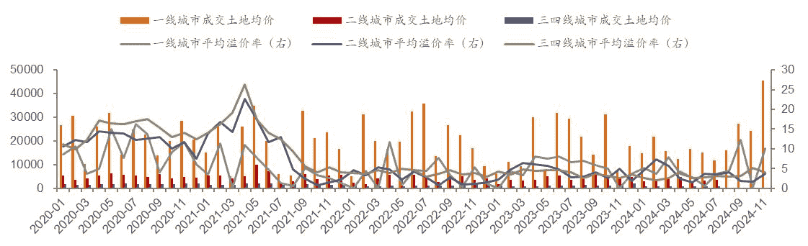

来源：中指，中泰证券研究所

### 三、青海、海南等省份土地出让金跌幅超50%

- **11月，江苏土地出让金超1500亿元，青海、海南、黑龙江、甘肃等土地出让金下降明显。**分省份看，11月，江苏土地出让金位居榜首，达到1,609.47亿元；山东、浙江、福建等土地出让金突破300亿元，上海、北京、新疆同比上升明显；青海、海南、黑龙江、甘肃、辽宁降幅明显，但整体出让体量不大，同比参考意义不大。

- **1—11月，天津、贵州等地土地出让金下降超40%。**1—11月，江苏土地出让金位居榜首，达到5,061.69亿元；浙江、山东、广东等土地出让金破千亿；新疆、青海、福建土地出让金同比上升，其中新疆的土地出让金涨幅最大，达38.14%；天津、贵州、广东、湖南等下降较为明显，降幅超过40%。

图表7：2024年11月分省份土地出让金情况（亿元、%）

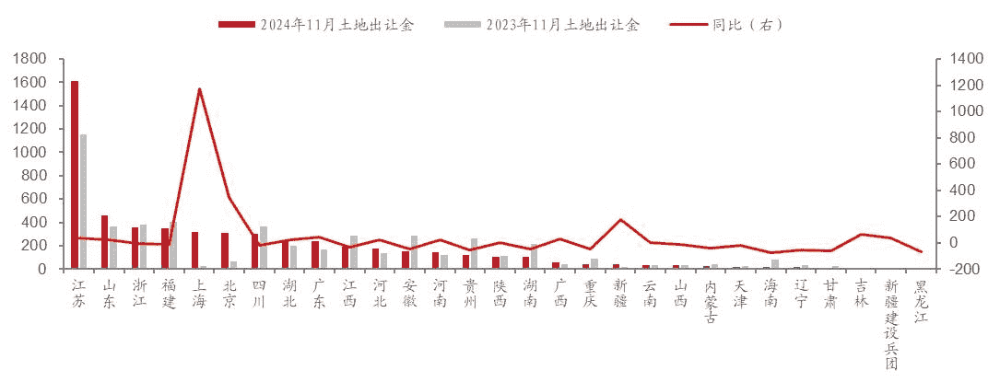

来源：中指，中泰证券研究所

图表8：2024年1—11月分省份土地出让金情况（亿元、%）

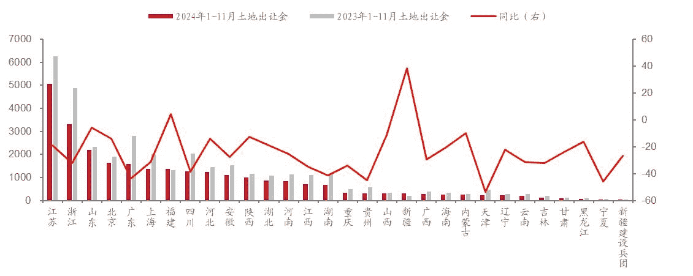

来源：中指，中泰证券研究所

- **11月，杭州、泰州、南通等地市土地出让金绝对值及同比增幅均表现亮眼。**11月，南通、泰州、福州的土地出让金分别以259.94亿元、227.45亿元、177.46亿元位列前三甲。在增长方面，多个地市表现出色，例如杭州、泰州、南通等地市；福州等城市有一定程度的下降。

- **1—11月，镇江、淮安、泰州等地市土地出让金增幅明显；合肥、宁波、杭州等地市有不同程度下滑。**1—11月，杭州、西安、广州的土地出让金分别以1,219.11亿元、764.53亿元、673.60亿元位列前三甲。在增长方面，镇江、淮安、泰州等地市土地出让金增幅明显；合肥、宁波、杭州等地市有不同程度下滑。

图表9：2024年11月分地市土地出让金情况（亿元、%）（仅列示部分）

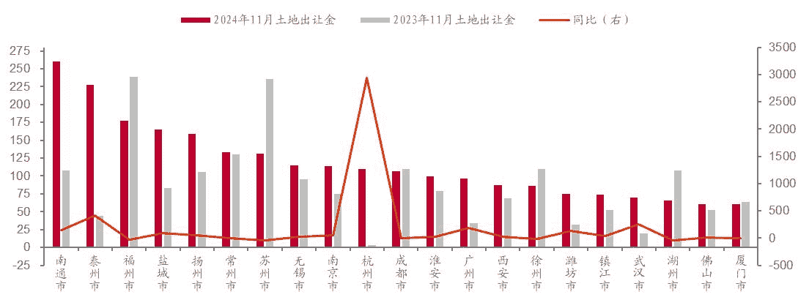

来源：中指，中泰证券研究所

图表10：2024年1—11月分地市土地出让金情况（亿元、%）（仅列示部分）

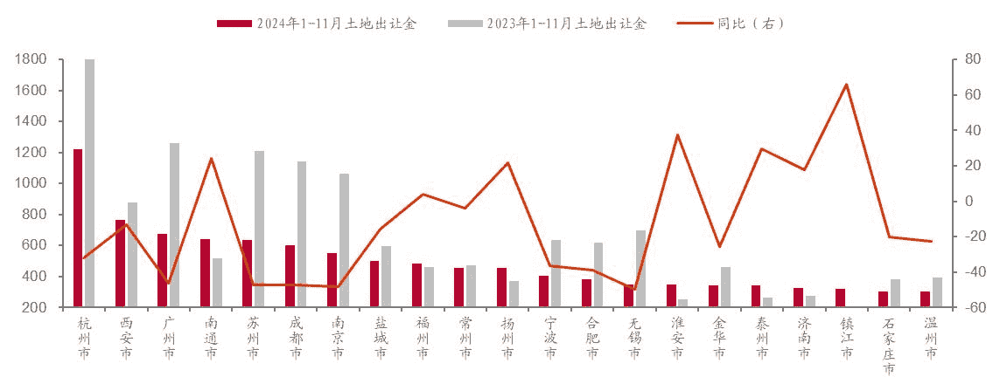

来源：中指，中泰证券研究所

### 四、1—11月，城投拿地占比32%，较去年全年增加1pct

- **11月，城投拿地占比35%。**2024年11月城投拿地金额为1,926.22亿元，同比下降13.37%；城投拿地占比为34.98%，同比下降9.51pct；1—11月城投拿地占比32.23%，相较去年全年增加1pct。

图表11：2023年以来城投拿地占比情况（亿元、%）

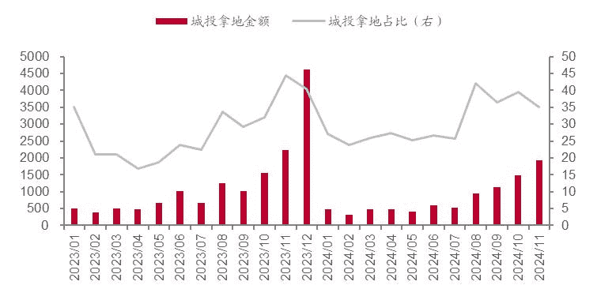

来源：中指，中泰证券研究所

- **11月，湖南、江苏、福建城投拿地占比超50%。**分省而言，湖南、江苏、福建城投拿地占比超过50%，其中湖南城投拿地金额为74.65亿元，占比69.20%。相较于去年同期，福建、黑龙江、湖南等地的城投拿地占比显著增长，其中福建增幅为17.41pct；22个省份城投拿地占比同比有不同程度的下降，北京、上海、海南降幅最为明显，分别下降了34.83pct、31.21pct、29.34pct。

- **1—11月，重庆、福建和湖南等8省城投拿地占比超30%。**1—11月，重庆、福建和湖南等8省城投拿地占比超过30%。相较于去年同期，福建、重庆、安徽城投拿地占比同比增加超10pct。

图表12：2024年11月分省份城投拿地情况（亿元、%）

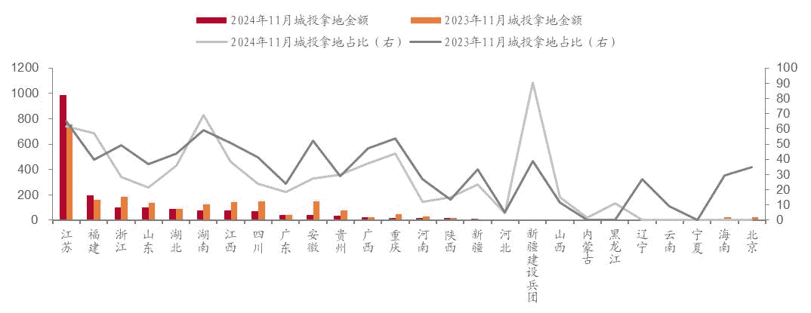

来源：中指，中泰证券研究所

图表13：2024年1—11月分省份城投拿地情况（亿元、%）

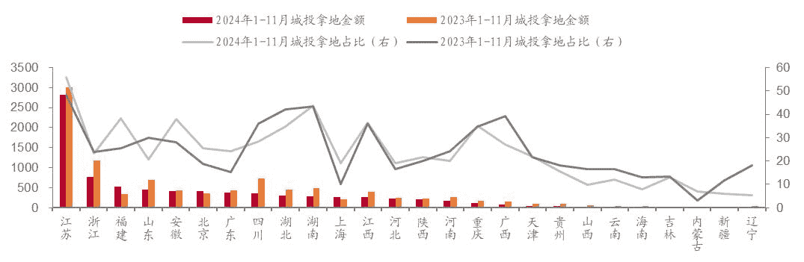

来源：中指，中泰证券研究所

- **11月，长沙、金华、福州、宜昌等地市城投拿地占比超50%。**分地市而言，长沙、金华、福州、宜昌等地市城投拿地金额较大且拿地占比超50%。荆门、宜昌、贵阳、绍兴、厦门等地市城投拿地金额大于10亿且拿地占比同比有较大幅度上升，成都、湖州、宜春、眉山等地市城投拿地金额虽大于10亿元但拿地占比较去年同期有不同程度下降。**1—11月，扬州、福州等23个城市城投拿地金额超100亿元，其中泉州、合肥等地市城投拿地占比同比有一定增长。**

图表14：2024年11月分地市城投拿地情况（亿元、%）（仅列示部分）

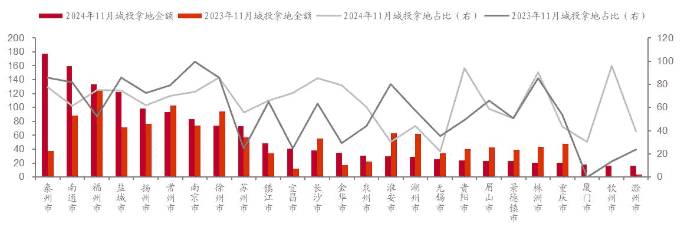

来源：中指，中泰证券研究所

### 五、11月，国企拿地占比70%

- **11月，国企拿地占比为70%，同比略有上升。**2024年11月，国企拿地金额达到3,850.89亿元，同比上升了10.37pct；国企拿地占比为69.93%，同比略有上升。1—11月，国企拿地17,367.43亿元，占比63.83%，同比增加6.75pct。

图表15：2023年以来国企拿地占比情况（亿元、%）

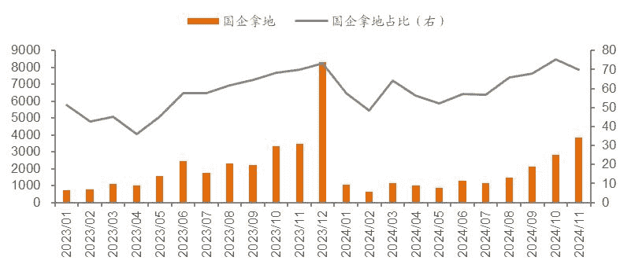

来源：中指，中泰证券研究所

- **11月，江西、重庆和江苏等省份国企拿地占比居前，安徽国企拿地占比同比增长显著。**11月，江西、重庆、福建、北京等10个省份及新疆建设兵团的国企拿地占比超70%。安徽国企拿地占比同比增长显著，同比增幅为39.54pct；浙江、广西等省份国企拿地占比同比下降。**1—11月，安徽、重庆、陕西、江西、福建、河北、浙江等省份国企拿地占比同比增加超10pct。**

固定收益点评

- 10 -

请务必阅读正文之后的重要声明部分

图表16：2024年11月分省份国企拿地情况（亿元、%）

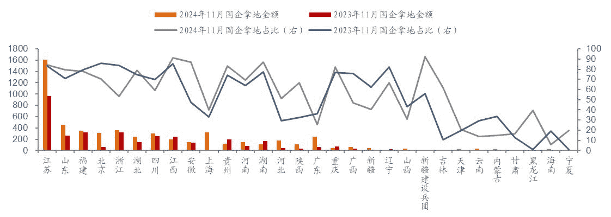

来源：中指，中泰证券研究所

11月，荆门、西安、亳州、泉州、蚌埠国企拿地占比有一定抬升。2024年11月，土地出让金在10亿元以上的地市中，国企拿地占比超70%的地市有70个，包括长沙、南京、西安等，荆门、西安、亳州、泉州、蚌埠国企拿地占比有一定抬升。

图表17：2024年11月分地市国企拿地情况（亿元、%）（仅列示部分）

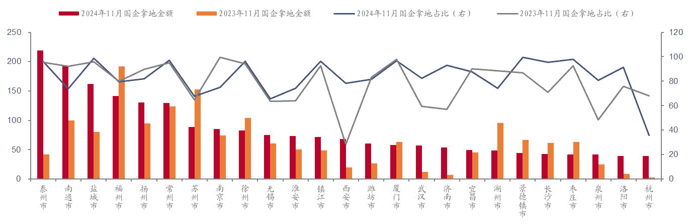

来源：中指，中泰证券研究所

### 六、小结

11月全国土地出让金逆势上涨。2024年11月，全国土地出让面积为20,980.70万平米，同比下降7.42%，土地出让金为5,507.03亿元，同比上升10.18%，此同比上涨为今年继1月上涨后的第二次上涨。从结构上看，主要是一线城市拉动，一线城市土地出让金同比增加609亿元，贡献了11月上涨的绝大部分增量。

但年初至今，土地出让金仍有明显下行。1—11月，全国土地出让金为27,207.72亿元，同比下降24.88%。从结构上看，除其他用地外，各种性质的土地出让金与去年同期相比增速均为负，其中综合用地（含住宅）的土地出让金降幅最大，达到了38.16%，住宅用地降幅紧随其后，降幅为26.16%。从成交均价及溢价率看，1—11月同比均下滑。

1—11月，江苏土地出让金领跑，天津、贵州降幅超40%。1—11月，江苏土地出让金位居榜首，达到5,061.69亿元；浙江、山东、北京、广东等土地出让金破千亿；新疆、青海、福建土地出让金同比上升；天津、贵州、广东、湖南等下降较为明显，降幅超过40%。

1—11月城投拿地占比32%，较去年全年增加1pct。1—11月，重庆、福建和湖南等8省城投拿地占比超过30%。相较于去年同期，福建、重庆、安徽城投拿地占比同比增加超10pct；分地市看，扬州、福州等23个城市城投拿地金额超100亿元，其中泉州、合肥等地市城投拿地占比同比有一定增长。

## 风险提示

- 城投口径判断有误；土地明细数据来源于中指，可能存在数据更新不及时及提取失误等风险。

固定收益点评

- 11 -

请务必阅读正文之后的重要声明部分

## 投资评级说明

| 评级 | 说明 |
|---|---|
| **股票评级** |  |
| 买入 | 预期未来6~12个月内相对同期基准指数涨幅在15%以上 |
| 增持 | 预期未来6~12个月内相对同期基准指数涨幅在5%~15%之间 |
| 持有 | 预期未来6~12个月内相对同期基准指数涨幅在-10%~+5%之间 |
| 减持 | 预期未来6~12个月内相对同期基准指数跌幅在10%以上 |
| **行业评级** |  |
| 增持 | 预期未来6~12个月内对同期基准指数涨幅在10%以上 |
| 中性 | 预期未来6~12个月内对同期基准指数涨幅在-10%~+10%之间 |
| 减持 | 预期未来6~12个月内对同期基准指数跌幅在10%以上 |

备注：评级标准为报告发布日后的6~12个月内公司股价（或行业指数）相对同期基准指数的相对市场表现。

其中A股市场以沪深300指数为基准；新三板市场以三板成指（针对协议转让标的）或三板做市指数（针对做市转让标的）为基准；香港市场以摩根士丹利中国指数为基准，美股市场以标普500指数或纳斯达克综合指数为基准（另有说明的除外）。

## 重要声明

中泰证券股份有限公司（以下简称“本公司”）具有中国证券监督管理委员会许可的证券投资咨询业务资格。

本报告仅供本公司的客户使用。本公司不会因接收人收到本报告而视其为客户。

本报告基于本公司及其研究人员认为可信的公开资料或实地调研资料，反映了作者的研究观点，力求独立、客观和公正，结论不受任何第三方的授意或影响。本公司力求但不保证这些信息的准确性和完整性，且本报告中的资料、意见、预测均反映报告初次公开发布时的判断，可能会随时调整。本公司对本报告所含信息可在不发出通知的情形下做出修改，投资者应当自行关注相应的更新或修改。本报告所载的资料、工具、意见、信息及推测只提供给客户作参考之用，不构成任何投资、法律、会计或税务的最终操作建议，本公司不就报告中的内容对最终操作建议做出任何担保。本报告中所指的投资及服务可能不适合个别客户，不构成客户私人咨询建议。

市场有风险，投资需谨慎。在任何情况下，本公司不对任何人因使用本报告中的任何内容所引致的任何损失负任何责任。

投资者应注意，在法律允许的情况下，本公司及其本公司的关联机构可能会持有报告中涉及的公司所发行的证券并进行交易，并可能为这些公司正在提供或争取提供投资银行、财务顾问和金融产品等各种金融服务。本公司及其本公司的关联机构或个人可能在本报告公开发布之前已经使用或了解其中的信息。

本报告版权归“中泰证券股份有限公司”所有。事先未经本公司书面授权，任何机构和个人，不得对本报告进行任何形式的翻版、发布、复制、转载、刊登、篡改，且不得对本报告进行有悖原意的删节或修改。
