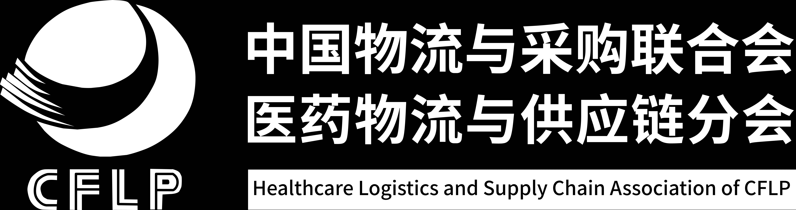

秦玉鸣

中国物流与采购联合会医药物流与供应链分会

## 云端冷链新纪元：

## 我国医药航空冷链发展现状与趋势展望

目录

C O N T E N T S

- 航空冷链发展整体背景 | 01
- 药品航空冷链发展情况 | 02
- 航空冷链发展趋势及建议 | 03

---

## PART 01

## 航空冷链发展整体背景

### 经济背景

**经济发展**

- **2025**年经济总量预计可达 **140** 万亿元左右
- **5**年经济增量预计将超过 **35** 万亿元
- 每年对世界经济增长的贡献率保持在 **30%** 左右
- 前**4**年我国经济增速平均达到 **5.5%**

**创新驱动**

- **2024**年全社会研发经费投入规模比"十三五"末增长近 **50%**
- 研发投入强度提高到 **2.65%**，接近**OECD**国家平均水平

**基础设施建设**

- 5G基站建成率已超 **90%**
- 5G覆盖超 **90%** 县服务 **50%** 经济、人口
- 综合交通营业里程 **600** 万公里，其中高铁约 **5** 万公里
- 公路营业里程 **550** 万公里，货运量 **400** 亿吨（↑**3.9%**）
- 生产用码头泊位 **2.2** 万个，全球前**10**集装箱港口中中国占 **7** 个
- 运输机场**263**个，货邮运输量 **2000** 万吨（↑**22.1%**）
- 快递业务量 **1500** 亿件（↑**21.5%**）

**"十四五"经济发展成就**

"十四五"这五年，遇到的困难问题比预计的要多，取得的成果成效比预期的要好，可谓是"风雨兼程见彩虹"。这五年取得了新的开创性的进展、突破性的变革、历史性的成就，我们的制度优势更加巩固、创新活力更加强劲、物质基础更加雄厚、发展基础更加坚实。"十五五"发展前景将更加光明。

---

## 政策支持 | 国内层面

| 政策文件 | 发文时间 | 发文单位 | 核心内容 |
|---------|---------|---------|---------|
| 《"十四五"现代综合交通运输体系发展规划》 | 2021 | 国务院办公厅 | 构建以高速铁路、国家高速公路、民用航空等为主体的快速网，完善以普速铁路、普通国省道、港口航道等为主体的干线网。扩大航空网络覆盖。 |
| 《"十四五"冷链物流发展规划》 | 2021 | 国务院办公厅 | 发展冷链多式联运。大力发展面向高端生鲜食品、医药产品的航空冷链物流，提高公空、空空联运效率。 |
| 《"十四五"航空物流发展专项规划》 | 2022 | 民航局 | 优化航空冷链物流安检、通关、检验检疫、最后一公里配送等流程，打造全程温控、标准规范、运行高效、安全绿色的航空冷链物流体系。完善快递、冷链、医药、危险品等专业设施设备；鼓励冷链、医药等特殊货物专业运输装备研发。 |
| 《有效降低全社会物流成本行动方案》 | 2024 | 中共中央办公厅 国务院办公厅 | 支持航空物流企业扩大全货机规模。加快推广航空货运电子运单。 |
| 《关于加快建设统一开放的交通运输市场的意见》 | 2024 | 中共中央办公厅 国务院办公厅 | 持续推进空管体制改革，深化低空空域管理改革，发展通用航空和低空经济。 |
| 《关于印发落实数字中国建设总体部署 加快推动智慧民航建设发展的指导意见》 | 2023 | 民航局 | 推动航空物流与其他运输方式、海关标准对接、安检互认，加强货品、单证、载具、安检、结算等重点领域信息交互联通，打造一单到底的智慧物流联运服务体系；构建货物提取时间精准可控、位置实时可查、状态全面感知的全流程追踪服务。 |
| 《通用航空装备创新应用实施方案（2024-2030年）》 | 2024 | 工业和信息化部等 | 深化航空物流配送示范应用，鼓励开展无人机城际运输及末端配送应用示范。 |

优化航空枢纽及配套冷链设施装备，培育生鲜食品、医药等航空冷链物流体系；推动航空冷链融入多式联运体系，加强信息联通，构建全流程追踪服务。

---

## 政策支持 | 国际层面

| 政策文件 | 发文时间 | 发文单位 | 核心内容 |
|---------|---------|---------|---------|
| 《关于以高水平开放推动服务贸易高质量发展的意见》 | 2024 | 国务院办公厅 | 优化国际空运布局，强化国际航空货运网络对产业链供应链的支撑。 |
| 《关于推进国际航空枢纽建设的指导意见》 | 2024 | 民航局、国家发展改革委员会 | 推动国际航空枢纽资源优化配置，强化北京、上海、广州等国际航空枢纽全方位门户复合型功能，打造一批面向特定区域的国际航空枢纽和区域航空枢纽。 |
| 《关于进一步促进航空口岸通关便利化若干措施的通知》 | 2025 | 海关总署 国家移民局 中国民航局 | 提高特定药品、医疗器械等特殊货物通关效率；探索开展出(进)口货物机坪"直装(提)"试点。提升设施现代化水平和服务效率，视情建设冷链等特殊货物处理设施。 |
| 《海南自由贸易港建设总体方案》 | 2020 | 中共中央 国务院 | "一线放开、二线管住、岛内自由"监管模式；实施高度自由便利开放的运输政策，推动建设西部陆海新通道国际航运枢纽和航空枢纽，加快构建现代综合交通运输体系。 |

优化国际航空货运网络，推进国际/区域枢纽建设；开展出(进)口货物机坪"直装(提)"试点，提高通关效率；抢抓海南自贸港等对外开放红利。

---

### 航空冷链标准环境

**航空冷链物流标准**
- 首个主动温控集装箱标准：《航空温控集装箱技术规范》-2025
- 《温控货物公共航空运输保障操作规范》-2025
- 《货物航空冷链运输规范》-2014

**药品冷链物流标准**
- 医药冷链国家标准：
  - 《医药产品冷链物流温控设施设备验证性能确认技术规范》（编制阶段）
  - 《药品冷链物流运作规范》
  - 《药品冷链物流追溯管理要求》（编制阶段）等

冷链标准逐步完善；温控集装箱及航空运输保障标准正快速推动实施。

---

### 行业发展

航空物流发展机遇与挑战并存：需求倒逼航空物流从"可选"成"必选"，但也面临发展环境多变等诸多压力。

- 特朗普关税政策
- 美国"小额豁免"政策取消
- 地缘政治与世界多极化演变
- 贸易合规及认证壁垒
- 恶劣天气与网络勒索频发
- 主要通道单向性过高

**需求持续释放：2025年上半年，**

- 国内层面——经济稳中向好：GDP同比增长5.3%；高端制造业快速发展(14.3%)
- 国际层面：农产品、医药产品进出口额1478.4亿美元、368.5亿美元；跨境电商"快"需求（"小单快反"模式）
- 区域经贸合作深化：一带一路、RCEP、中国-东盟自贸区3.0、上合组织峰会等。

"内卷"下企业"价值破局"的关键：航空毛利率高普通业务 10-15 个百分点，圆通跨境航空毛利率28%，邮政超30%等。

---

## 行业发展 | 航空货运规模稳步增长

**2019-2025年7月货邮周转量及其增速（亿吨公里）**

| 年份 | 货邮周转量 | 增速 |
|------|-----------|------|
| 2019 | 263.20 | 0.30% |
| 2020 | 240.2 | -8.7% |
| 2021 | 278.16 | 15.8% |
| 2022 | 254.1 | -8.7% |
| 2023 | 283.62 | 11.6% |
| 2024 | 353.89 | 24.8% |
| 2025年1-7月 | 229.3 | 17.6% |

**2019-2025年7月货邮运输量及其增速**

| 年份 | 国内货邮运输量占比 | 国际货邮运输量占比 | 整体货邮运输量增速 |
|------|------------------|------------------|------------------|
| 2019 | - | - | 2.00% |
| 2020 | - | - | -10.20% |
| 2021 | - | - | 8.20% |
| 2022 | - | - | -17.00% |
| 2023 | - | - | 21.00% |
| 2024 | - | - | 22.10% |
| 2025年1-7月 | - | - | 14.70% |

- 2025年7月，空运货邮周转量、运输量持续增长，分别累计完成229.3亿吨公里、565.1万吨，均已恢复至2019年的水平。
- 国际航线货运量占比呈现上升趋势，从2019年的32%上升至2025年7月的42%，成为航空物流的重要增长点。

---

## 行业发展 | 点网结合，网络不断织密

**2024年中国top10机场货邮吞吐量（万吨）**

| 排名 | 机场 | 货邮吞吐量 |
|------|------|-----------|
| 1 | 上海/浦东 | 377.8 |
| 2 | 广州/白云 | 238.2 |
| 3 | 深圳/宝安 | 188.1 |
| 4 | 北京/首都 | 144.3 |
| 5 | 鄂州/花湖 | 86.5 |
| 6 | 郑州/新郑 | 82.5 |
| 7 | 杭州/萧山 | 73.5 |
| 8 | 成都/双流 | 64.3 |
| 9 | 重庆/江北 | 47.0 |
| 10 | 上海/虹桥 | 42.8 |

- 航空枢纽：东部机场主导(北京、上海和广州货邮吞吐量占比41.7%)，区域枢纽潜力释放(鄂州花湖、郑州新郑等机场增幅明显)。
- 空港型国家物流枢纽：**20**个，占比约**11%**，承载超**80%**机场货量，其所在城市约占全国**GDP**的四分之一。
- 四大世界级机场群：京津冀、长三角、粤港澳、成渝。
- 航线网络：中国已通航**50**个国家，**106**个城市；**2024-2025**年新开**288**条货运航线，其中国际243条，畅达东南亚、东北亚市场、欧美澳等区域。亚洲航线占比接近50%；欧洲航线88条；北美航线29条。

增速情况：
- 北京大兴排名**15**，增速**33.7%**，发展潜力较大
- **↑252.7%**
- **↑35.8%**
- **↑17%**
- **↓-9.2%**

航空物流枢纽集中度凸显，航线网络不断优化。国内形成以主要城市群、都市圈为核心的航空货运通道，国外畅达全球核心市场。

- 鄂州/花湖——丝绸之路、中欧班列交汇点，亚洲首个专业货运机场

数据来源：中国民航局、ACI、IATA等公开资料整理

## 行业发展 | 基础设施

国内航空货运的货机、机场等基础设施快速增长，但与国际相比仍有较大差异。

### 2024年全球top10货运机场排名

| 排名 2024 | 排名 2023 | 排名 2019 | 货运机场 | 国家 | 运力/万公吨 | 同比2023增速/% | 同比2019增速/% |
|---|---|---|---|---|---|---|---|
| 1 | 1 | 1 | 香港国际机场 | 中国 | 493.8 | 14.1 | 2.7 |
| 2 | 3 | 3 | 上海浦东国际机场 | 中国 | 377.8 | 9.8 | 4.0 |
| 3 | 2 | 2 | 孟菲斯国际机场（MEM） | 美国 | 375.4 | -3.3 | -13.2 |
| 4 | 4 | 6 | 安克雷奇机场（ANC） | 美国 | 369.9 | 9.4 | 34.7 |
| 5 | 6 | 4 | 路易斯维尔国际机场 | 美国 | 315.3 | 15.6 | 13.0 |
| 6 | 5 | 5 | 仁川国际机场（ICN） | 韩国 | 294.7 | 7.4 | 6.6 |
| 7 | 7 | 12 | 迈阿密国际机场（MIA） | 美国 | 275.3 | 9.0 | 31.6 |
| 8 | 8 | 8 | 多哈国际机场（DOH） | 卡塔尔 | 261.7 | 11.1 | 18.1 |
| 9 | 11 | 17 | 广州白云国际机场 | 中国 | 237.4 | 16.9 | 23.6 |
| 10 | 10 | 9 | 台北桃园国际机场 | 中国 | 227.1 | 7.5 | 4.1 |

### 国内主要货机数量

- 顺丰：90架
- 邮政：45架
- 圆通：13架
- 京东：12架
- 国货航：25架
- 南航：19架
- 东航：18架
- 中原龙浩、天津货航、厦航货运……

**2025年上半年，全国货机数量249架**

**单个企业货机数量最多约90架（顺丰）**

### 国际快递企业货机数量

- FedEx运营全货机：698架
- UPS运营全货机：534架
- DHL运营全货机：295架

美国"一主（孟菲斯）六副"航空货运枢纽体系

中国"一主（路易斯维尔）七副"航空货运枢纽体系

- **262个** 中国有定期航班机场（以综合枢纽为主）
- **607个** 美国有定期航班机场（专业化分工航空货运枢纽）

中国机场数量　VS　美国机场数量

数据来源：中国民航局、ACI、IATA等公开资料整理

---

## 行业发展 | 航空冷链业务环节

### 业务流程

- **货主（生鲜/医药产品）**：大多委托货代，部分大型货主自行订舱
- **货代**：确认货物；订舱；预定主动/被动温控集装箱
- **航空公司**：确认货物；订舱确认-全货机/客机腹舱
  - 订舱受理，确认货物品类、体积、温控要求等
  - 反馈舱位信息
- **机场/货站**：冷库储存，等待装机
  - 工厂货物装箱 → 温控集装箱 → 通知装机 → 机坪-叉车/拖车 → 转运车装机
  - 冷库储存；流通加工；分拣包装；订单拆分
- **收货方**：接收验货
- **国际货代**：冷链运输 → 机坪-叉车/拖车 → 转运车卸货
- **海关**：货物查验/检验检疫/放行 → 提前报关

### 信息流与物流

RFID、区块链、物联网等技术支撑航空冷链物流全流程温度、轨迹可追溯、透明化。

航空冷链运输品类多为生鲜食品、医药产品等温敏/高时效性产品，需要联合发/收货方、货代、航司、机场、海关等多个部门以"小时级"时效保障高效运输；同时通过在线预约报关、实时货物状态追踪、电子运单申报等一站式服务，助力产品"即离即提"。

---

# PART 02 药品航空冷链发展情况

---

## 医药冷链市场销售额及物流费用逐年提升

伴随着国家陆续发布利好政策、人们对医药安全的重视、医药冷链产品需求的增加，我国医药冷链快速发展。2024年我国医药冷链流通市场规模将持续上涨，约为6272亿元，同比增长4.1%。（注：2021年数据不含新冠疫苗）

### 2018-2024年医药冷链市场销售额（亿元）

| 年份 | 2018 | 2019 | 2020 | 2021 | 2022 | 2023 | 2024 |
|---|---|---|---|---|---|---|---|
| 销售额（亿元） | 2827 | 3395 | 3903 | 4590 | 5459 | 6027 | 6272 |
| 增速 | 20.1% | 15.0% | 17.6% | 18.9% | 10.4% | 4.1% | - |

### 2024年我国医药冷链市场产品结构

- 其他生物制品：50%
- IVD（体外诊断试剂）：21%
- 疫苗：15%
- 血制品：10%
- 除IVD外医疗器械：4%

从细分产品看，我国医药冷链流通市场运输产品包括疫苗、血液制品、其他生物制品、IVD及医疗器械（IVD除外），其中疫苗占比15%，血液制品占比10%，其他生物制品市场占比50%，IVD（体外诊断试剂）占比达21%。

数据来源：中物联医药物流与供应链分会

### 2018-2024年我国医药流通冷链物流费用总额

经中物联医药物流与供应链分会不完全统计，初步预计2024年我国医药流通冷链物流费用总额预计达到268.43亿元，同比增长3.23%。

| 年份 | 2018 | 2019 | 2020 | 2021 | 2022 | 2023 | 2024 |
|---|---|---|---|---|---|---|---|
| 费用规模（亿元） | 130.14 | 137.65 | 173.17 | 215.74 | 243.76 | 260.03 | 268.43 |
| 增速 | 5.80% | 25.80% | 24.60% | 13.00% | 6.70% | 3.23% | - |

---

## 医药航空冷链物流市场规模

数据来源：民航局，中物联航空物流分会

### 2025年中国出港货物品类预期占比

- 跨境电商：23.76%
- 电子产品及配件：19.06%
- 快件：15.19%
- 食品及纺织品：13.26%
- 机电器材：12.98%
- 医药制品：6.63%
- 家居及零件：6.35%
- 其他：2.76%

### 2025年中国进港货物品类预期占比

- 生鲜农产品：21.91%
- 机械及配件：19.10%
- 医药制品：15.73%
- 食品制品：14.61%
- 金属及制品：9.83%
- 车辆与配件：8.71%
- 纺织品：6.46%
- 其他：3.65%

中物联航空物流分会发布的《2025年航空物流市场预测报告》显示，在2025年中国进出港航空货物品类预测中，出港货物中跨境电商、电子产品及配件、快件、食品及纺织品等货物预期占比较高，其中出港医药制品占比6.63%；进港货物中生鲜农产品、机械及配件、医药制品、食品制品等货物预期占比较高，其中进港医药制品占比15.73%。在医药航空物流领域，医药制品仍主要以进口为主，且医药航空冷链物流占比25%左右。

医药流通是我国航空冷链物流的重要应用领域。民航局数据显示，我国航空冷链物流下游需求产品中，37%为生物医药类。航空冷链运输因其速度快、安全性高、温控精准等特点，成为生物医药等对温度敏感的药品运输的首选方式。

---

## 药品航空冷链国内典型枢纽与航线布局

### 典型枢纽

- **广州白云机场**：辐射东南亚、非洲，是国际疫苗冷链的重要门户，针对冷链药品储存、运输温控要求高等特点，实施"先进区、后报关"、药品通关单"一证多批"等创新举措。
- **成都双流/天府机场**：成都天府国际生物城供应链服务中心承接中欧班列+航空联运，打造医药跨境运输、通关服务、信息服务、流通服务等。
- **北京大兴/首都机场**：以疫苗、科研型药品为主，依托首都科技创新资源，整合国际人才、技术、资本要素，打造辐射国际的生物医药创新枢纽。
- **上海浦东机场**：全国最重要的国际中转枢纽，拥有67条国际中转进出港航线，采用"联动接卸""前置货站"等创新模式，承担跨境药品冷链大部分航班。

### 主要航线

- **中欧航线**：连接德国、荷兰、比利时等药品集散地，保障跨境临床样品、疫苗运输。
- **中美航线**：对接波士顿、旧金山等生物医药研发中心。
- **区域航线**：中东、东南亚和非洲，支持应急药品运输。

枢纽机场逐步向"多温区冷库+快速转运通道"升级，航线由单一国际航点向"多节点、多网络布局"发展。未来将更多与 RCEP国家、共建"一带一路"市场对接，形成全球航空冷链网络。

数据及资料来源：民航局，公开资料

---

## 典型案例丨中外运免疫球蛋白、抗癌药品出口

### 2-8℃免疫球蛋白出口莫斯科

| 目的港 | 线路及分段时效 | 整体运输时效 |
|---|---|---|
| 莫斯科 | 客户工厂打包 —（1DAY）— 冷藏卡车运输至郑州机场入冷库 —（2DAYS）— 机场组板报关放行 —（1DAYS）— 郑州起飞 —（1DAY）— 到达莫斯科 | 全程5天 |

实际货物温度曲线：
- 4-4 提货
- 4-5 入仓
- 4-6 贴标，报关
- 等待航班批复
- ATD:4-9
- ATA:4-11

### 2-8℃抗癌药品出口案例

3类危品；连云港-俄罗斯，全程温控运输及储存

资料来源：中外运

---

## 典型案例丨顺丰医药成功获得CEIV Pharma认证

CEIV Pharma 是国际航空运输协会（IATA）2014年推出的医药货物运输标准化认证，强调设施、人员、流程合规与高效。截止目前，全球通过CEIV Pharma认证的实体超过280家。其中，中国获得CEIV Pharma认证的实体只有个位数。

2025年1月22日，顺丰航空正式获得国际航空运输协会（IATA）颁发的CEIV Pharma（药品物流独立验证卓越中心）认证，成为国内少数获得该认证的航司之一，标志着顺丰航空在医药冷链物流领域迈出重要一步。

### 顺丰医药全球端到端冷链解决方案

| 国内端 | 国际端 |
|---|---|
| 国内提货点 → 2-8℃温控库 → 机场2-8℃温控库 → 出港机场（冷链整车） | 到港机场 → 2-8℃温控库 → 国外客户（出口报关 → 国际运输 → 清关&提货 → 目的端配送） |

- **国内端运输**：提供国内端冷链服务将货物等从生产地运输到出港机场
- **全程温控**：提供出口温控方案（主动制冷柜/被动制冷柜）以及包装操作
- **出口报关**：提供货物出口报关方案以及协助完成报关处理
- **国际运输**：提供国际段自有及外包资源航空线路资源
- **目的地清关&配送**：提供货物到达目的国家城市后的清关以及配送上门服务

资料来源：公开资料

## 典型案例丨菜鸟数字化疫苗运输

菜鸟数字化疫苗运输流程

资料来源：公开资料

国内冷库温控箱至药厂冷库 → 提货封箱 → 药厂冷库提货 → 入国内机场冷库 → 报关交航操作 → 入机场冷库等待二级航班 → 出库交航 → 国外机场温控箱不开箱 → 目的地冷库拆箱 → 冷藏车运输 → 冷藏车运输 → 清关提货 → 国外客户

在一次北京运往萨尔瓦多的疫苗国际运输任务中，菜鸟通过智能路径规划算法，首次使用商业航班和包机直达组合的方式无缝衔接中国与外国航空资源运输疫苗，通过头程客机腹舱+尾程货机包机的"混搭"方式，全程只需经过一个中转点，飞行、中转时间合计不到19个小时，且成本较传统包机直飞下降30%以上。

菜鸟根据我国灭活疫苗2-8℃的储运要求优化被动温控箱性能与装载率，使用"菜鸟智能小蓝箱"，能够实现长达9天的5℃保温效果。并结合阿里健康"码上放心"追溯系统，实现了疫苗"一物一码"的精准对应，用电脑、手机APP就可以实现疫苗的全球温度追溯。

本地最后一公里运输距离长、链路复杂，菜鸟利用快速通关系统，配合当地指定清关公司在疫苗起飞前完成物资的小小时级清关。在疫苗抵达后，菜鸟在1小时内完成紧急配送，将疫苗运抵至指定冷库，实现疫苗门到门运输的时效新突破。

打造由信息流串联起物流软硬件、前端、后台乃至末端的综合供应链服务平台，实现跨国"闪送"，疫情期间完成多项全球物流业最为重要的"世纪使命"。

## 典型案例丨东航冷链助力"国产医药"出海

自东航冷链全面铺开医药冷链业务以来，已经完成多次医药保障任务

东航冷链针对信息断链、温度断链和监控断链等行业痛点而创新研发"东东测"温控标签产品。借助温控标签，后台人员能够实时监控货物信息，一旦出现异常情况，系统会及时向特定对象发出预警提醒。"东东测"温控标签拥有小体积、长续航的特点，适用于包括航空器在内的几乎所有运输装备。

采用"随货温度标签+主动航空温控集装箱"的双重温控监测方案，综合选用国内外不同规格的主动航空温控集装箱，标注"东航冷链医药冷链"专用标识，并在货物托盘中植入"东东测"温度标签，借助云平台实时追踪药物温度及位置变动，有效识别和预防潜在风险，在满足客户需求的同时实现了成本优化。

在一次北京—多米尼加新冠疫苗执飞任务中，东航物流全程开辟绿色通道，加快货物安检、装载等环节的速度，全程提供的"专属管家式"跟踪保障服务，为中国疫苗"保驾护航"，积极与操作部门协调，制定运输保障计划，实现药物从安检、收运、出仓再到装机等各个运输环节的无缝衔接。

资料来源：公开资料

## 药品航空冷链痛点分析

### 成本控制与效率提升

航空运输成本相对较高，而医药产品又往往需要快速且精确地送达目的地，如何在满足时效性的前提下有效控制物流成本，并通过优化流程、采用先进的信息化手段提高供应链效率，为医药企业降本增效，是一个持续性的挑战。

### 法规遵从与合规性压力

医药产品跨国运输涉及各国不同的药品管理法规、海关政策和检验检疫要求，必须严格遵守以避免货物延误或被拒收。此外随着数据保护和隐私法的强化，对数据追踪、记录和传输的安全和合规性也提出了更高的要求。

### 医药保税、清关及地面服务体系

医药产品对存储环境、温度控制及效期管理要求非常严格，因此需要建立高度专业化和自动化的保税仓，确保在保税过程中药品质量和安全不受影响；在清关环节，医药产品因其特殊性，清关流程更为繁琐且耗时。此外，跨境医药物流的信息透明与追溯性要求极高，对报关及清关信息系统提出了升级优化的需求。

### 温控与冷链技术挑战

严格的温度控制是医药冷链物流的核心，确保热敏感药品在运输过程中保持在特定的温度范围内。然而在飞机装卸、停靠、飞行过程中的温度波动以及不同气候条件的影响下，维持产品全链条恒温和实时温度监测面临重大挑战。

### 应急处理能力考验

面对航班延误、取消、航线调整等不可预见情况，如何快速有效地采取补救措施，保证药品品质不受影响，是医药航空物流服务商必备的能力，如备用航线安排、临时存储解决方案以及应急预案的实施。

# PART 03 航空冷链发展趋势及建议

## 航空冷链未来发展趋势

标准化保障合规，数字化提升效率，绿色化确保可持续，国际化拓展市场

### 标准化

- 推动国内标准与IATA CEIV Pharma、WHO GDP等国际标准接轨。
- 统一温控范围、包装、单证流程标准化。
- 推动更多企业通过国际冷链资质认证。

### 绿色化

- 相变材料、循环冷链包装替代一次性耗材。
- 推动新能源冷藏车、光伏冷库逐步应用。
- 绿色航运，推广碳排放核算与碳交易机制。

### 数字化

- IoT传感器，实现全程温湿度监控。
- 区块链保障运输过程可追溯性与防篡改。
- 推行自动化与无人化，无人机、无人车在末端配送的应用拓展。

### 国际化

- 市场拓展，服务"一带一路"与RCEP国家冷链需求。
- 加速推进中国枢纽机场融入全球冷链网络。
- 加强与WHO、IATA、GAVI等国际机构合作。

航空冷链正从"运输环节"走向"战略产业"，其未来发展将是政策推动、技术驱动、协同共赢的全新格局

### 战略价值

- 构建国家公共卫生与食品安全保障体系的关键支撑。
- 在应急物资调运、国际贸易畅通中发挥"生命线"作用。
- 有望成为推动中国冷链物流国际化升级的核心引擎。

### 政策引领与企业协同

- 政府层面：持续出台冷链物流发展规划与绿色低碳政策。
- 企业层面：航空公司、物流商、药企/食品企业协同打造一体化供应链。
- 行业层面：推动标准统一、信息共享，形成高效、安全的航空冷链生态。

### 未来市场机遇

- 食品冷链：消费升级带动生鲜、冷冻品跨境航空运输需求。
- 药品冷链：创新药、疫苗、特殊药品对航空冷链的高时效与高合规依赖度持续增强。
- "一带一路"与RCEP框架下，中国有望成为全球冷链新枢纽。

## 航空冷链未来发展建议

# 未来已来，唯变不变，唯适不退！

通过服务政府，促进行业发展，推动会员成长，服务万千百姓！

北京市丰台区丽泽路16号院2号楼铭丰大厦11层1110室

010-83775866

service@cpl.org.cn
