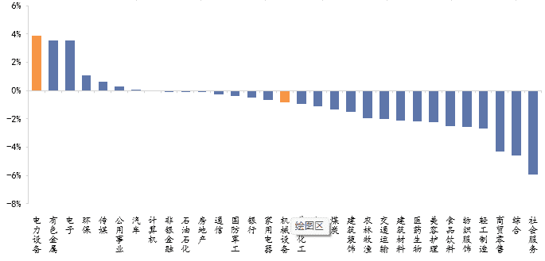
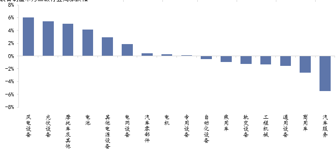

证券研究报告

装备制造

工信部积极推进智能网联新能源汽车产业

2025年9月29日

装备制造行业周报（9月第4周）

分析师：赵晓闯

执业证书号：S1030511010004

电话：0755-83199599

邮箱：zhaoxc@csco.com.cn

分析师：杨贵洲

执业证书号：S1030524060001

电话：0755-83199599

邮箱：yanggz1@csco.com.cn

研究助理：董李延楠

电话：0755-83199599

邮箱：donglyn@csco.com.cn

公司具备证券投资咨询业务资格

行业数据

计算机

2019年Q3

综合毛利率（%）：9.7

综合净利率（%）：6.9

行业ROE（%）：25.6

行业ROA（%）：5.2

利润增长率（%）：4.21

资产负债率（%）：149

期间费用率（%）：4.54

存货周转率（%）：42.56

数据来源：聚源资讯

请务必阅读文后重要声明及免责条款

市场行情回顾：

上周5个交易日机械设备、电力设备及汽车行业指数涨跌幅分别为-0.81%、+3.86%及+0.00%，在31个申万一级行业中排名分别为第16、1、7位；同期沪深300涨跌幅为+1.07%。

行业观点：

1) 光伏：8月逆变器需求平稳，印度市场增长较快。2025年8月中国逆变器出口总额8.78亿美元，同比增长1.93%。印度储能市场的加速转型正得到印证，中国8月出口至印度达3.66亿元，环比增加21.2%。2025年上半年中国出口印度逆变器金额为16.0亿元，同比增长18%。继印度公司IndiGrid于8月与中汽新能签订5GWh储能合作备忘录后，市场数据显示，2025年上半年印度新增储能招标规模高达22GWh，同比增长120%，凸显出其能源转型的强劲势头与明确趋势。展望后市，印度近年来持续加码光伏装机目标，建议对印度市场占比较多的企业保持关注。

2) 工业气体：上周价格以下跌为主。据卓创资讯，由于节前排库为主，上周（9月18日-9月25日）主要工业气体价格多数环比下跌。上周中国液氧市场均价429元/吨，较前一周跌5.3%，较去年同期涨18%；液氮均价在411元/吨，较前一周收盘价跌4%，较去年同期基本持平；液氩均价在625元/吨，较前一周报告涨1.46%，较去年同期涨1.21%。短期看，双节临近，节前主要工业气体厂商积极排库为主，价格重心有所下移。中长期看，目前工业气体整体处于周期底部，供给优化及需求企稳或带来底部反转机会，建议关注杭氧股份、陕鼓动力等空分设备龙头。

3) 汽车：工信部深入推进智能网联汽车准入和上路通行试点，将加快智能驾驶行业发展。9月23日，在2025世界智能网联汽车大会新闻发布会上，工信部装备工业一司副司长郭守刚表示，工信部将抓紧编制新时期智能网联新能源汽车产业发展规划，深入推进智能网联汽车准入和上路通行试点。我们认为，智能网联相关政策的推出，将为中国智能网联汽车的发展提供坚实的政策基础，加快智能驾驶行业发展，建议关注具备智能化能力的相关整车厂。

4) 风险提示：宏观经济风险、产业政策风险、行业竞争加剧风险。

2025年09月

请务必阅读文后重要声明及免责条款 市场有风险 入市需谨慎

- 1 -

## 正文目录

一、市场行情回顾 .......................................................... 3

&nbsp;&nbsp;&nbsp;&nbsp;1.1 行业周度行情回顾 .............................................................. 3

&nbsp;&nbsp;&nbsp;&nbsp;1.2 个股周度行情回顾 .............................................................. 4

二、行业要闻及重点公司公告 ................................................ 5

&nbsp;&nbsp;&nbsp;&nbsp;2.1 行业要闻...................................................................... 5

&nbsp;&nbsp;&nbsp;&nbsp;2.2 公司公告...................................................................... 7

2025年09月

请务必阅读文后重要声明及免责条款 市场有风险 入市需谨慎

- 2 -

## 图表目录

Figure 1 申万一级行业周涨跌幅（2025.09.22-2025.09.26） .................................. 3

Figure 2 机械设备、电力设备及汽车板块二级行业涨跌幅（2025.09.22-2025.09.26） ............ 3

Figure 3 涨幅TOP5公司（2025.09.22-2025.09.26） ......................................... 4

Figure 4 跌幅TOP5公司（2025.09.22-2025.09.26） ......................................... 4

2025年09月

请务必阅读文后重要声明及免责条款 市场有风险 入市需谨慎

- 3 -

# 一、市场行情回顾

## 1.1 行业周度行情回顾

上周5个交易日机械设备、电力设备及汽车行业指数涨跌幅分别为-0.81%、+3.86%及+0.00%，在31个申万一级行业中排名分别为第16、1、7位；同期沪深300涨跌幅为+1.07%。

Figure 1 申万一级行业周涨跌幅（2025.09.22-2025.09.26）

资料来源：wind资讯、世纪证券研究所

上周机械设备、电力设备及汽车行业中表现靠前的细分方向分别为风电设备上涨6.00%，光伏设备上涨5.43%，摩托车及其他上涨5.02%；表现靠后的细分方向为汽车服务下跌5.48%，商用车下跌2.64%，通用设备下跌1.54%。

Figure 2 机械设备、电力设备及汽车板块二级行业涨跌幅（2025.09.22-2025.09.26）

资料来源：wind资讯、世纪证券研究所

 

2025年09月

请务必阅读文后重要声明及免责条款 市场有风险 入市需谨慎

- 4 -

## 1.2 个股周度行情回顾

上周机械设备行业涨幅前五个股为宏盛股份、力星股份、哈焊华通、华丰股份、迪威尔，电力设备涨幅前五个股分别为华自科技、聚和材料、大洋电机、*ST沐邦、柘中股份，汽车涨幅前五个股分别为新坐标、科博达、天普股份、浙江仙通、福达股份。

Figure 3 涨幅TOP5公司（2025.09.22-2025.09.26）

| 行业 | 证券代码 | 证券简称 | 所属SW三级行业 | 周涨跌幅（%） | 市盈率（TTM） | 市净率（MRQ） |
|------|----------|----------|----------------|---------------|---------------|---------------|
| 机械设备 | 603090.SH | 宏盛股份 | 其他通用设备 | 35.40 | 93.1 | 10.1 |
| | 300421.SZ | 力星股份 | 金属制品 | 26.96 | 101.2 | 4.6 |
| | 301137.SZ | 哈焊华通 | 金属制品 | 24.22 | 175.9 | 5.0 |
| | 605100.SH | 华丰股份 | 金属制品 | 23.40 | 130.6 | 2.9 |
| | 688377.SH | 迪威尔 | 能源及重型设备 | 22.89 | 93.2 | 4.2 |
| 电力设备 | 300490.SZ | 华自科技 | 锂电专用设备 | 33.33 | (10.1) | 2.2 |
| | 688503.SH | 聚和材料 | 光伏辅材 | 26.27 | 64.8 | 4.1 |
| | 002249.SZ | 大洋电机 | 电机Ⅲ | 20.50 | 27.3 | 3.0 |
| | 603398.SH | *ST沐邦 | 硅料硅片 | 20.40 | (3.4) | 5.0 |
| | 002346.SZ | 柘中股份 | 配电设备 | 19.63 | 22.8 | 3.2 |
| 汽车 | 603040.SH | 新坐标 | 底盘与发动机系统 | 25.03 | 50.7 | 8.7 |
| | 603786.SH | 科博达 | 汽车电子电气系统 | 22.58 | 47.1 | 7.3 |
| | 605255.SH | 天普股份 | 底盘与发动机系统 | 21.01 | 482.9 | 18.5 |
| | 603239.SH | 浙江仙通 | 其他汽车零部件 | 20.88 | 32.1 | 5.0 |
| | 603166.SH | 福达股份 | 底盘与发动机系统 | 16.16 | 52.8 | 5.5 |

资料来源：wind资讯、世纪证券研究所

上周机械设备行业跌幅前五个股为南方路机、山河智能、国机精工、*ST新元、大族数控，电力设备跌幅前五个股分别为*ST金刚、杭电股份、新雷能、扬电科技、动力源，汽车跌幅前五个股分别为中马传动、上海物贸、明新旭腾、泰德股份、朗博科技。

Figure 4 跌幅TOP5公司（2025.09.22-2025.09.26）

| 行业 | 证券代码 | 证券简称 | 所属SW三级行业 | 周涨跌幅（%） | 市盈率（TTM） | 市净率（MRQ） |
|------|----------|----------|----------------|---------------|---------------|---------------|
| 机械设备 | 603280.SH | 南方路机 | 工程机械整机 | (21.85) | 47.9 | 2.9 |
| | 002097.SZ | 山河智能 | 工程机械整机 | (20.08) | 153.3 | 2.9 |
| | 002046.SZ | 国机精工 | 磨具磨料 | (17.65) | 53.9 | 3.5 |
| | 300472.SZ | *ST新元 | 其他专用设备 | (16.01) | (3.4) | (41.0) |
| | 301200.SZ | 大族数控 | 其他专用设备 | (14.39) | 98.5 | 7.7 |
| 电力设备 | 300093.SZ | *ST金刚 | 光伏电池组件 | (15.11) | (3.2) | (2.5) |
| | 603618.SH | 杭电股份 | 线缆部件及其他 | (11.77) | 58.6 | 2.1 |
| | 300593.SZ | 新雷能 | 其他电源设备Ⅲ | (10.77) | (17.4) | 3.9 |
| | 301012.SZ | 扬电科技 | 输变电设备 | (10.61) | 90.1 | 4.0 |
| | 600405.SH | 动力源 | 其他电源设备Ⅲ | (10.53) | (8.8) | 13.1 |

2025年09月

请务必阅读文后重要声明及免责条款 市场有风险 入市需谨慎

- 5 -

| 行业 | 证券代码 | 证券简称 | 所属SW三级行业 | 周涨跌幅（%） | 市盈率（TTM） | 市净率（MRQ） |
|------|----------|----------|----------------|---------------|---------------|---------------|
| 汽车 | 603767.SH | 中马传动 | 底盘与发动机系统 | (15.18) | 1511.0 | 6.2 |
| | 600822.SH | 上海物贸 | 汽车经销商 | (14.00) | 144.1 | 4.5 |
| | 605068.SH | 明新旭腾 | 车身附件及饰件 | (13.74) | (23.1) | 3.2 |
| | 831278.BJ | 泰德股份 | 底盘与发动机系统 | (13.67) | 88.3 | 4.6 |
| | 603655.SH | 朗博科技 | 其他汽车零部件 | (13.05) | 113.5 | 7.2 |

资料来源：wind资讯、世纪证券研究所

# 二、行业要闻及重点公司公告

## 2.1 行业要闻

- 9月25日，据和讯网消息，在2025京东全球科技探索者大会上，众擎机器人创始人兼CEO赵同阳在会上表示，五年间，人形机器人的成本降了100倍，但从当下的成本端而言，还不能做到千元售价水平，对于一台售价15万元左右的机器人而言，价格已算得上经济划算，可以替代日常生活中不少脏活和累活。对于未来的产品线布局，赵同阳还预告称，不久后众擎将发布一款高1.7m、重65kg的正常成人体形的机器人。与此同时，他还透露，在场景应用上，将携手京东之家，开出旗下首家人形机器人门店，重塑AI时代消费体验场景落地。其中，门店智能导购专家将深度集成京东Joyinside大模型，拥有海量商品知识库与较强的语音交互能力，能为顾客提供精准商品推荐、卖点解答，打造一对一专属导购体验，核心搭载的智能化运营中枢，同时也是京东零售能力的实体延伸。

- 9月25日，据人民财讯，四川省委书记、省人大常委会主任王晓晖主持召开省委专题会议，研究部署进一步提振消费工作。会议强调，房地产消费要持续用力止跌回稳，既要"一城一策"制定住房支持政策，通过多种方式加快消化存量，又要加大"好房子"建设，更好满足高品质住房消费需求，进一步释放购房消费潜力；挖掘释放改善性住房需求，加快落实"一城一策"房地产政策，持续推进城市更新、老旧小区改造提升，建设更多"好房子"，通过促进房地产发展带动更多消费增量。

- 9月25日，据北京石景山官微消息，近日，国内最大人形机器人训练场在北京石景山正式投入运营，该训练场占地面积上万平方米，年产数据量超600万条。这一重要基础设施的落成，既是我国人形机器人产业的"关键落子"，也为全国各地训练场建设提供了"北京样本"，将加速人形机器人"具身大脑"进化，推动其早日在汽车制造、物流搬运等场景规模化应用。训练场由石景山区政府牵头，京石科创集团、国内人形机器人领军企业乐聚机器人联合运营。

2025年09月

请务必阅读文后重要声明及免责条款 市场有风险 入市需谨慎

- 6 -

- 9月25日，据财联社，宁夏海原"以大代小"100万千瓦风电项目在中卫市海原县全面进入建设阶段，宁夏又添一个百万千瓦级别的风电项目。宁夏华电海原"以大代小"100万千瓦风电项目总投资金额49亿元，项目分为30万千瓦等容项目和70万千瓦增容项目。原装机30万千瓦的老旧机组，将更新装机100万千瓦的大容量、高效率风电机组。整体项目计划2026年11月底投产发电。投运后，每年可提供绿色电能15亿千瓦时，节约标煤约46万吨，减少二氧化碳排放约126万吨，具有十分显著的社会经济和生态环保效益，对推动宁夏能源领域大规模设备更新和技术改造、构建新型能源体系具有重大意义。

- 9月24日，据钛媒体消息，在2025高通骁龙峰会上，宇树科技CEO王兴兴表示，团队在今年上半年已基本实现去年的规划目标，让机器人能够理解复杂指令并做出丝滑流畅的动作。他预测，最快明年底，人形机器人可以理解人类指令做任何动作，即便是在没见过的场景。

- 9月24日，据中新网讯，西南地区首个全尺寸通用人形机器人整机平台——"天行者2号"，24日在成都正式发布。据四川具身人形机器人科技有限公司（下称四川具身科技）CEO冯振宇介绍，由该公司推出的"天行者2号"，与前一代产品相比，在整体灵活度、运动控制算法和人机交互方面均有显著提升。凭借55个自由度类人构型，该机器人能够在复杂地形中实现更稳定、更拟人的运动控制，并通过多模态感知实现自然的人机对话与动作交互。

- 9月23日，据中新网讯，在2025世界智能网联汽车大会新闻发布会上，工业和信息化部装备工业一司副司长、一级巡视员郭守刚表示，工业和信息化部将抓紧编制新时期智能网联新能源汽车产业发展规划，支持车用人工智能、汽车操作系统、智能线控底盘等关键核心技术攻关，持续健全完善汽车技术标准体系，深入推进智能网联汽车准入和上路通行试点、"车路云一体化"应用试点工作，扎实推动我国汽车产业高质量发展。

- 9月22日，工业和信息化部、国家发展改革委关于印发《工业园区高质量发展指引》，加快园区绿色设施建设。加强屋顶光伏、分散式风电、多元储能、充电桩等新能源基础设施的开发利用，探索构建工业绿色微电网、零碳能源供给系统和园区级数字化能碳管理中心。重点加强污水、垃圾、有害物收集处理等公共设施建设，推进原生资源协同利用，加快园区内固废收集、处置和综合利用能力建设，积极推进工业固废综合利用、再生资源循环利用。积极建设绿色工业园区，探索建设零碳园区。

- 9月22日，据人民财讯，国家能源局等四部门发布关于推进能源装备高质量发展的指导意见。其中提出，重点突破能源装备智能感知与决策融合技术，融合视觉、振动、光谱等非侵入式传感技术，搭建能源装备全景感知网络，推进精准预测装备作业工况与健康状况精准预测，实现装备全生命周期科学管理。研制具备边缘计算能力的智能终端，推进终端场景协作机器人、人形机器人研发，结合具身智能等技术，提升装备复杂环境下的自主作业能力。

2025年09月

请务必阅读文后重要声明及免责条款 市场有风险 入市需谨慎

- 7 -

## 2.2 公司公告

- 9月26日，金禾实业在互动平台表示，公司年产8万吨电子级双氧水项目产品已通过国内头部光伏及显示面客户工艺验证，实现批量供货；在其他领域，公司也在推动国内头部客户的联合测试工作。客户拓展方面，公司依托长三角区位优势，已实现生产基地200—500公里范围内新能源及电子行业的覆盖，月度出货量环比逐步增长，公司正通过"技术+供应链"双重认证模式，加速导入国内主要客户的供应链体系。

- 9月25日，华电科工公告称，公司第五届董事会第十九次会议审议通过议案，同意公司控股子公司华电（阳江）海上风电运维有限公司购买两艘高性能多功能风电运维船及配套运维检测装备，总投资额5500万元。该举措旨在加快自主运维能力建设及实体化运转，推动海上风电业务稳健、可持续发展。

- 9月25日，福莱新材在投资者互动平台回答称，公司已与国内外多家灵巧手公司以及人形机器人公司合作，公司在北美成立全资子公司ApexSensingLLC，聘请了前Syntouch公司副总裁为业务开拓负责人，正在积极拓展商务和业务落地。国外客户产品技术要求更高，更重视算法，公司密切跟踪应用领域技术迭代及发展趋势，稳步推进业务发展。

- 9月25日，赢合科技(300457)在2025年半年度业绩说明会上表示，公司已推出覆盖湿法与干法工艺的固态电池最新解决方案：湿法设备具备高精度涂布、优异工艺控制性与运行稳定性的技术优势；在干法工艺领域，第三代设备通过集成粉体搅拌、纤维化、干法辊压等七大核心工艺技术，显著提升了制造效率。目前公司已向多家客户交付了核心固态电池相关设备，产品涵盖湿法全自动制浆、湿法涂布、辊压、电解质转印和干法搅拌纤维化、多辊连轧成膜复合等设备。

- 9月24日，柯力传感在投资者互动平台回答称，公司用于AI理疗机器人机械臂及开普勒人形机器人的六维力传感器目前已实现了数百台的批量出货。

- 9月23日，长安汽车在投资者互动平台回答称，公司将持续打造新技术，守护用户新安全，加快布局人形机器人、飞行汽车等未来新兴产业。人形机器人领域，联合合作伙伴共同探索工业机器人、门店服务机器人

2025 年09 月

请务必阅读文后重要声明及免责条款 市场有风险 入市需谨慎

\- 8 -

等应用场景，突破机器人"大脑""能源""驱动"等核心技术，积极探索商业模式，逐步向家庭服务机器人拓展。飞行汽车领域，力争2026 年实现首款载人飞行汽车产品发布，全面开展低空文旅、道路救援、高层消防、能源作业等行业应用的市场拓展与商业化落地。

- 9 月23 日，贝斯特在投资者互动平台回答称，公司在第三梯次产业的发展上，持续发挥自身优势，深耕市场拓展和产业链延伸。在人形机器人赛道，公司不断强化技术创新，不断扩充产品链，将丝杠等核心部件业务拓展至直线执行器领域，持续提升公司在客户端的话语权，为未来开拓更为广阔的增长空间。

- 9 月23 日，浙海德曼在投资者互动平台回答称，海德曼除了承接矩阵超智的人形机器人之外，也有其他机器人厂商正在洽谈中。

- 9 月22 日，据证券时报网讯，近日，智元机器人通过CR-3-06:2025《人形机器人数据集CR 产品认证实施规则》，拿下业内首张人形机器人数据集产品CR 认证证书，编号"001"，成为国内首批依据T/SAIAS 024—2025、T/SAIAS 025—2025、T/SAIAS 026—2025、T/SAIAS 027—2025系列团体标准获得认证的企业。此举标志我国在人形机器人数据集标准化、质量评价与产业应用领域迈出关键步伐。本次认证体系全面评估了人形机器人数据集建设的四大核心要素：分类与编码规范、数据标注标准、统一数据集格式要求以及全面质量评价准则。该认证不仅涵盖了数据集构建的全生命周期管理，更从源头确保了数据的规范性、一致性与可用性，是对企业数据治理能力、标准化水平及工程实践能力的综合检验。

- 9 月22 日，豪能股份在投资者互动平台回答称，公司已布局机器人用高精密减速机及关节驱动总成，目前已形成高精密行星减速机、高精密新型摆线减速机等系列化产品，部分产品已在人形机器人、机器狗、外骨骼等领域成功应用。

- 9 月22 日，兰剑智能在投资者互动平台回答称，智能物流机器人和人形机器人的底层技术具有相通性，公司已经实施数千台AMR（自主移动机器人）落地项目，具备领先的可实时动态切换的定位导航技术（SLAM+QR（二维码）+纹理导航+惯导）及机器人集群调度算法。AI 算法、深度学习技术也已应用于拆码垛机器人、装卸车机器人（亚洲象）等产品中。

- 9 月22 日，金杯电工披露投资者关系活动记录表，公司产品作为配套材料广泛应用于各行各业，在满足传统应用领域需求的同时，正不断拓展到众多新兴应用领域中，如新能源汽车、风电、光伏、储能、工业机器人等，并正为公司带来新的增量市场。2024 年研发的"1000 万次超高柔工业机器人用拖链电缆"已作为配套材料应用于工业机器人领域，并正在开展更高耐折次数的线缆的研发与验证工作。公司还透露，计划在欧洲建设年产能2 万吨电磁线的智能化生产基地，分两期建设，其中首期产能8,000 吨/年，预计2026 年可释放；第二期产能建设规划为12,000 吨/年。

（资料来源：以上公告来自Wind 资讯）

2025 年09 月

请务必阅读文后重要声明及免责条款 市场有风险 入市需谨慎

\- 9 -

---

# 分析师声明

本报告署名分析师郑重声明：本人以勤勉的职业态度，独立、客观地出具本报告，保证报告所采用的数据和信息均来自公开合规渠道，报告的分析逻辑基于本人职业理解，报告清晰准确地反映了本人的研究观点，结论不受任何第三方的授意或影响。本人薪酬的任何部分不曾有，不与，也将不会与本报告中的具体推荐意见或观点直接或间接相关。

证券研究报告对研究对象的评价是本人通过财务分析预测、数量化方法、行业比较分析、估值分析等方式所得出的结论，但使用以上信息和分析方法存在局限性。特此声明。

# 投资评级标准

# 免责声明

世纪证券有限责任公司经中国证券监督管理委员会批准，已具备证券投资咨询业务资格。

本证券研究报告仅供世纪证券有限责任公司（以下简称"本公司"）的客户使用，本公司不会因接收人收到本报告而视其为客户。在本报告中的信息均来源于我们认为可靠的已公开资料，但本公司对这些信息的准确性和完整性不作任何保证，也不保证本报告所包含的信息或建议在本报告发出后不会发生任何变更，且本报告中的信息、观点和预测均仅反映本报告发布时的信息、观点和预测，可能在随后会作出调整。

本公司力求报告内容客观、公正，但本报告所载的内容和意见仅供参考，并不构成对所述证券买卖的出价和征价。本报告中的内容和意见不构成对任何人的投资建议，任何人均应自主作出投资决策并自行承担投资风险，而不应以本报告取代其独立判断或仅根据本报告做出决策。本公司及其雇员对使用本报告及其内容所引发的任何直接或间接损失概不负责。本公司或关联机构可能会持有报告中所提到的公司所发行的证券头寸并进行交易，还可能为这些公司提供或争取提供投资银行业务服务。

本报告版权归世纪证券有限责任公司所有，本公司对本报告保留一切权利。除非另有书面显示，否则本报告中的所有材料的版权均属本公司。未经本公司事先书面授权，任何机构和个人不得以任何形式修改、发送或者复制本报告及其所包含的材料、内容，或以任何侵犯本公司版权的其他方式使用。如引用、刊发、转载本报告，需事先征得本公司同意，并注明出处为"世纪证券研究所"，且不得对本报告进行有悖原意的引用、删节和修改。未经授权的转载，本公司不承担任何转载责任。

**股票投资评级说明：**

报告发布日后的12 个月内，公司股价涨跌幅相对于同期沪深300 指数的涨跌幅为基准，投资建议的评级标准为：

- 买 入： 相对沪深300 指数涨幅20%以上；
- 增 持： 相对沪深300 指数涨幅介于10%～20%之间；
- 中 性： 相对沪深300 指数涨幅介于-10%～10%之间；
- 卖 出： 相对沪深300 指数跌幅10%以上。

**行业投资评级说明：**

报告发布日后的12 个月内，行业指数的涨跌幅相对于同期沪深300 指数的涨跌幅为基准，投资建议的评级标准为：

- 强于大市： 相对沪深300 指数涨幅10%以上；
- 中 性： 相对沪深300 指数涨幅介于-10%～10%之间；
- 弱于大市： 相对沪深300 指数跌幅10%以上。

