请务必阅读正文之后的免责声明及其项下所有内容

证券研究报告| 2025年09月28日

优于大市

港股市场速览

风险偏好下降，多数行业回调

核心观点

行业研究·海外市场专题

港股

优于大市·维持

证券分析师：王学恒

证券分析师：张熙，CFA

010-88005382

0755-81982090

wangxueh@guosen.com.cn

zhangxi4@guosen.com.cn

S0980514030002

S0980522040001

市场走势

资料来源：Wind、国信证券经济研究所整理

相关研究报告

- 《港股市场速览-行业表现分化，汽车表现亮眼》——2025-09-21
- 《港股市场速览-市场整体上行，互联网涨幅领先》——2025-09-14
- 《港股市场速览-市场持续震荡，医药互联网较优》——2025-09-07
- 《港股市场速览-市场稍有回撤，消费者服务业绩显著下修》——2025-08-31
- 《港股9月投资策略-关注2季报板块的业绩分化》——2025-08-29

## 股价表现：多数行业与风格出现回调

本周，恒生指数-1.6%，恒生综指-1.2%。风格方面，大盘（恒生大型股-1.0%）＞小盘（恒生小型股-1.9%）＞中盘（恒生中型股-2.3%）。

主要概念指数普遍回调，跌幅较大的有：恒生消费（-4.4%）、恒生高股息（-3.1%）。

国信海外选股策略中，表现较强的是ROE策略全天候型和防御型（+0.8%）；表现较弱的是ROE策略进攻型（-3.5%）。

5个行业上涨，25个行业下跌。上涨的行业有：钢铁（+2.8%）、有色金属（+2.6%）、商贸零售（+2.0%）、电力设备及新能源（+1.7%）、建筑（+0.3%）；跌幅居前的行业有：计算机（-4.9%）、轻工制造（-4.0%）、纺织服装（-3.9%）、食品饮料（-3.5%）、家电（-3.5%）。

## 估值水平：整体估值下降，零售与有色上升

本周，恒生指数估值（动态预期12个月正数市盈率，后同）-1.4%至12.2x；恒生综指估值-1.6%至12.1x。

主要概念指数中，估值上升的仅有恒生互联网（+0.4%至19.1x）；估值下降幅度较大的是恒生消费（-4.2%至15.2x）。

国信海外选股策略中，估值上升幅度较大的是ROE策略全天候型和防御型（+0.4%至14.2x/14.3x）；估值表现较弱的是ROE策略进攻型（-3.0%至15.2x）。

4个行业估值上升，25个行业估值下降。估值上升的有：商贸零售（+1.4%）、有色金属（+1.4%）、建筑（+0.9%）、电力设备及新能源（+0.1%）；估值下降幅度较大的有：计算机（-5.4%）、钢铁（-4.7%）、机械（-4.4%）、纺织服装（-4.1%）、家电（-4.1%）。

## 业绩预期：多数行业业绩保持上修

恒生指数EPS（动态预期12个月正数EPS，后同）+0.1%；恒生综指EPS +0.1%。

主要概念指数中，EPS上修幅度较大的是恒生汽车（+0.3%）；EPS下修的有恒生高股息（-0.1%）。

国信海外选股策略中，EPS上修幅度较大的是ROE策略全天候型和防御型（+0.4%）；EPS下修幅度较大的是ROE策略进攻型（-0.6%）。

22个行业EPS上修，4个行业EPS下修，3个基本持平。上修幅度较大的有：钢铁（+7.8%）、机械（+2.6%）、基础化工（+2.0%）、电力设备及新能源（+1.6%）、电力及公用事业（+1.2%）；下修的行业有：建筑（-0.6%）、非银行金融（-0.1%）、通信（-0.1%）、银行（-0.1%）。

风险提示：经济基本面的不确定性，国际政治局势的不确定性，美国财政政策的不确定性，美联储货币政策的不确定性。

请务必阅读正文之后的免责声明及其项下所有内容

证券研究报告

## 内容目录

- 一、全球市场表现 .............................................................. 4
- 二、中观表现汇总 ............................................................. 5
  - 2.1 投资收益 ................................................................. 5
  - 2.2 估值水平 ................................................................. 6
  - 2.3 盈利和股息 ............................................................... 8
- 旧版：港股通成分股数据跟踪 ................................................... 10
  - 1 涨跌幅 ............................................................... 10
  - 2 量价指标 .............................................................. 11
  - 3 业绩预期 .............................................................. 12
  - 4 收益率归因 ............................................................ 13
  - 5 资金流向 .............................................................. 13
- 旧版：恒生综指成分股数据追踪 ................................................. 15
  - 1 涨跌幅 ............................................................... 15
  - 2 量价指标 .............................................................. 16
  - 3 业绩预期 .............................................................. 17
  - 4 收益率归因 ............................................................ 18

请务必阅读正文之后的免责声明及其项下所有内容

证券研究报告

## 图表目录

- 图1：全球主要指数与资产表现 .............................................................. 4
- 图2：投资收益：核心指数与选股策略（流通市值总体法） ........................................ 5
- 图3：投资收益：中信行业（流通市值总体法） .............................................. 5
- 图4：投资收益：恒生和GICS行业（流通市值总体法） ......................................... 6
- 图5：估值水平：核心指数与选股策略（流通市值总体法） ........................................ 6
- 图6：估值水平：中信行业（流通市值总体法） .............................................. 7
- 图7：估值水平：恒生和GICS行业（流通市值总体法） ......................................... 7
- 图8：盈利和股息：核心指数与选股策略（流通市值总体法） .................................... 8
- 图9：盈利和股息：中信行业（流通市值总体法） .............................................. 8
- 图10：盈利和股息：恒生和GICS行业（流通市值总体法） ....................................... 9
- 图11：港股通成分股涨跌幅排名 ............................................................ 10
- 图12：港股通各行业涨跌幅（中信港股通行业指数表现） ..................................... 10
- 图13：港股通成分股资金强度排名（千港元） ................................................. 11
- 图14：港股通各行业资金强度（百万港元） .................................................. 11
- 图15：港股通成分股业绩预期调整幅度排名 .................................................. 12
- 图16：港股通各行业业绩预期调整幅度（自由流通市值加权平均） .............................. 12
- 图17：港股通行业收益率归因 .............................................................. 13
- 图18：港股通净买入（人民币） ............................................................ 13
- 图19：港股通净买入（港币） .............................................................. 13
- 图20：港股通成分股南向资金影响程度排名 .................................................. 14
- 图21：港股通行业南向资金持股变化情况 .................................................... 14
- 图22：恒生综指成分股涨跌幅排名 .......................................................... 15
- 图23：恒生综指各板块涨跌幅（自由流通市值加权平均） ...................................... 15
- 图24：恒生综指成分股资金强度排名（千港元） .............................................. 16
- 图25：恒生综指各板块资金强度（百万港元） ................................................ 16
- 图26：恒生综指成分股业绩预期调整幅度排名 ................................................ 17
- 图27：恒生综指各板块业绩预期调整幅度（自由流通市值加权平均） ............................ 17
- 图28：恒生综指板块收益率归因 ............................................................ 18

请务必阅读正文之后的免责声明及其项下所有内容

证券研究报告

## 一、全球市场表现

图1：全球主要指数与资产表现

资料来源：Wind、国信证券经济研究所整理

请务必阅读正文之后的免责声明及其项下所有内容

证券研究报告

## 二、中观表现汇总

### 2.1 投资收益

图2：投资收益：核心指数与选股策略（流通市值总体法）

资料来源：FactSet、Wind、国信证券经济研究所整理

图3：投资收益：中信行业（流通市值总体法）

资料来源：FactSet、Wind、国信证券经济研究所整理

请务必阅读正文之后的免责声明及其项下所有内容

证券研究报告

图4：投资收益：恒生和GICS行业（流通市值总体法）

资料来源：FactSet、Wind、国信证券经济研究所整理

### 2.2 估值水平

图5：估值水平：核心指数与选股策略（流通市值总体法）

资料来源：FactSet、Wind、国信证券经济研究所整理

请务必阅读正文之后的免责声明及其项下所有内容

证券研究报告

图6：估值水平：中信行业（流通市值总体法）

资料来源：FactSet、Wind、国信证券经济研究所整理

图7：估值水平：恒生和GICS行业（流通市值总体法）

资料来源：FactSet、Wind、国信证券经济研究所整理

请务必阅读正文之后的免责声明及其项下所有内容

证券研究报告

### 2.3 盈利和股息

图8：盈利和股息：核心指数与选股策略（流通市值总体法）

资料来源：FactSet、Wind、国信证券经济研究所整理

图9：盈利和股息：中信行业（流通市值总体法）

资料来源：FactSet、Wind、国信证券经济研究所整理

请务必阅读正文之后的免责声明及其项下所有内容

证券研究报告

图10：盈利和股息：恒生和GICS行业（流通市值总体法）

资料来源：FactSet、Wind、国信证券经济研究所整理

请务必阅读正文之后的免责声明及其项下所有内容

证券研究报告

## 旧版：港股通成分股数据跟踪

### 1 涨跌幅

图11：港股通成分股涨跌幅排名

资料来源：Wind、国信证券经济研究所整理

图12：港股通各行业涨跌幅（中信港股通行业指数表现）

资料来源：Wind、国信证券经济研究所整理

请务必阅读正文之后的免责声明及其项下所有内容

证券研究报告

### 2 量价指标

图13：港股通成分股资金强度排名（千港元）

资料来源：Wind、国信证券经济研究所整理

图14：港股通各行业资金强度（百万港元）

资料来源：Wind、国信证券经济研究所整理

请务必阅读正文之后的免责声明及其项下所有内容

证券研究报告

### 3 业绩预期

图15：港股通成分股业绩预期调整幅度排名

资料来源：Wind、FactSet、国信证券经济研究所整理

注：EPS取动态未来12个月FactSet一致预期

图16：港股通各行业业绩预期调整幅度（自由流通市值加权平均）

资料来源：Wind、FactSet、国信证券经济研究所整理

注：EPS取动态未来12个月FactSet一致预期

请务必阅读正文之后的免责声明及其项下所有内容

证券研究报告

13

### 4 收益率归因

图17：港股通行业收益率归因

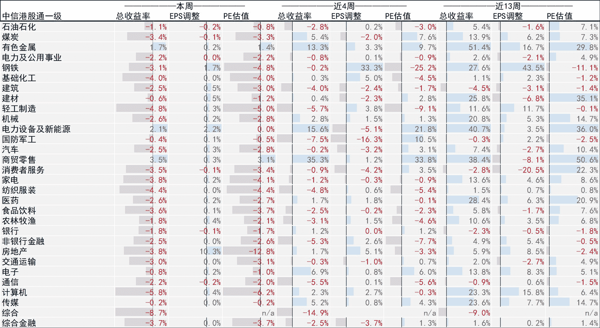

资料来源：Wind、FactSet、国信证券经济研究所整理

注：总收益由成分股自由流通市值加权所得，与指数走势可能有一定差异

## 5 资金流向

图18：港股通净买入（人民币）

图19：港股通净买入（港币）

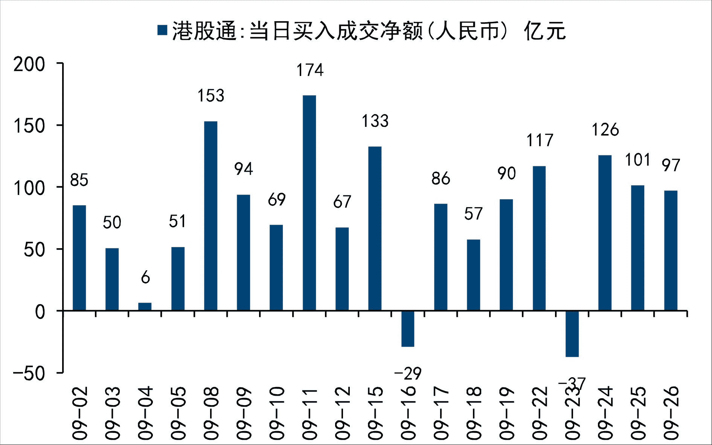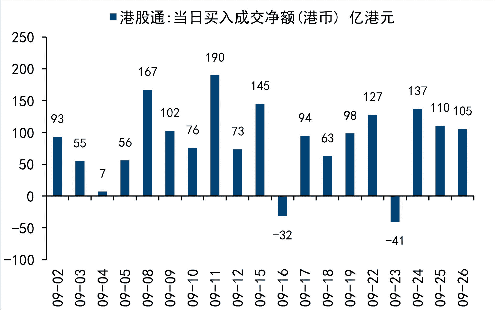

资料来源：Wind、国信证券经济研究所整理

资料来源：Wind、国信证券经济研究所整理

请务必阅读正文之后的免责声明及其项下所有内容

证券研究报告

14

图20：港股通成分股南向资金影响程度排名

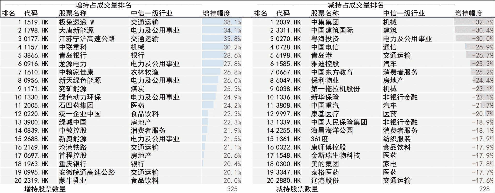

资料来源：Wind、国信证券经济研究所整理

图21：港股通行业南向资金持股变化情况

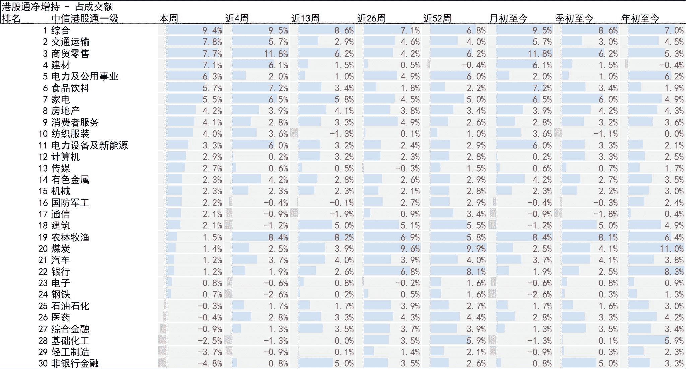

资料来源：Wind、国信证券经济研究所整理

请务必阅读正文之后的免责声明及其项下所有内容

证券研究报告

15

## 旧版：恒生综指成分股数据追踪

### 1 涨跌幅

图22：恒生综指成分股涨跌幅排名

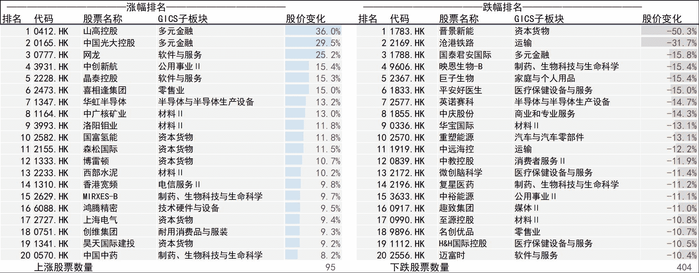

资料来源：Wind、国信证券经济研究所整理

图23：恒生综指各板块涨跌幅（自由流通市值加权平均）

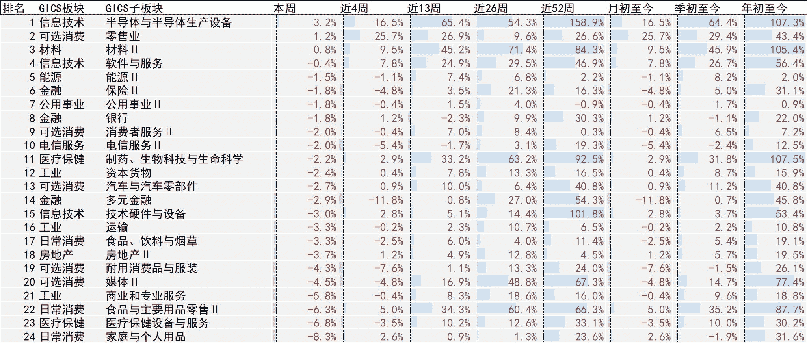

资料来源：Wind、国信证券经济研究所整理

请务必阅读正文之后的免责声明及其项下所有内容

证券研究报告

16

### 2 量价指标

图24：恒生综指成分股资金强度排名（千港元）

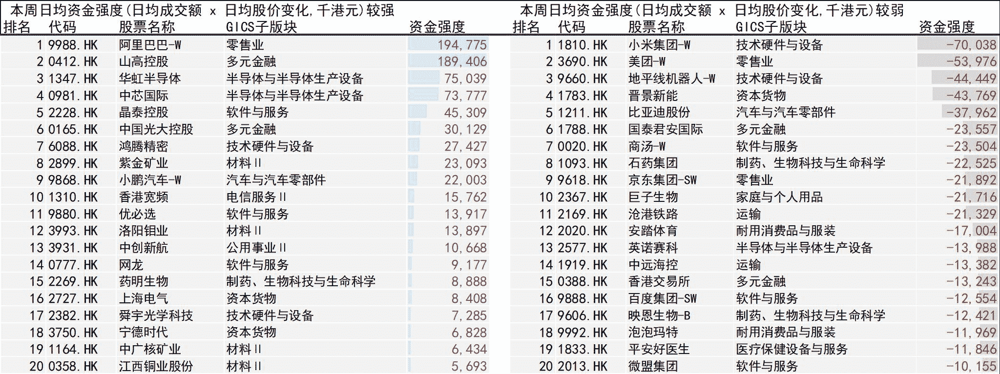

资料来源：Wind、国信证券经济研究所整理

图25：恒生综指各板块资金强度（百万港元）

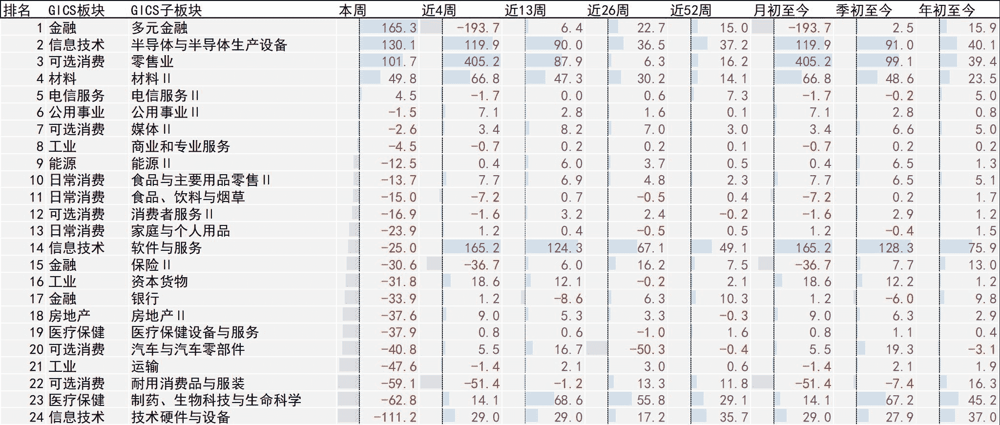

资料来源：Wind、国信证券经济研究所整理

请务必阅读正文之后的免责声明及其项下所有内容

证券研究报告

17

### 3 业绩预期

图26：恒生综指成分股业绩预期调整幅度排名

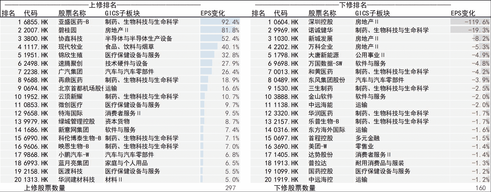

资料来源：Wind、FactSet、国信证券经济研究所整理

注：EPS 取动态未来12 个月FactSet 一致预期

图27：恒生综指各板块业绩预期调整幅度（自由流通市值加权平均）

资料来源：Wind、FactSet、国信证券经济研究所整理

注：EPS 取动态未来12 个月FactSet 一致预期

请务必阅读正文之后的免责声明及其项下所有内容

证券研究报告

18

### 4 收益率归因

图28：恒生综指板块收益率归因

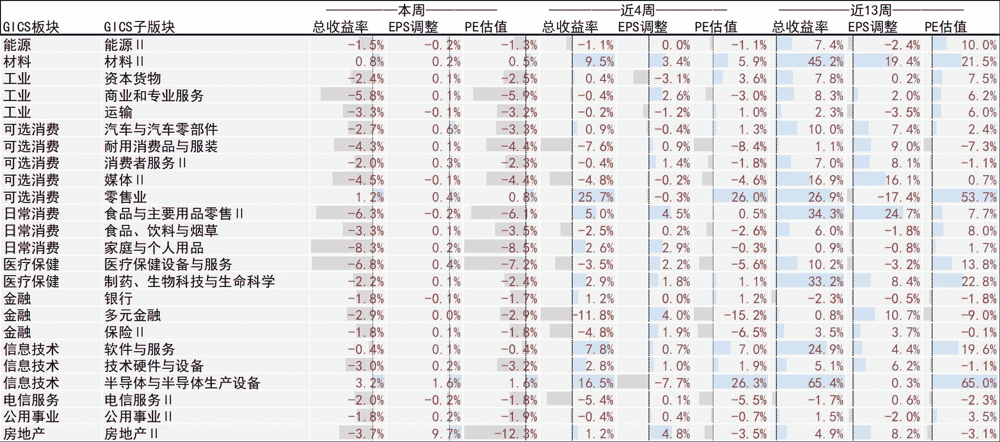

资料来源：Wind、国信证券经济研究所整理

证券研究报告

免责声明

分析师声明

作者保证报告所采用的数据均来自合规渠道；分析逻辑基于作者的职业理解，通过合理判断并得出结论，力求客观、公正，结论不受任何第三方的授意或影响；作者在过去、现在或未来未就其研究报告所提供的具体建议或所表述的意见直接或间接收取任何报酬，特此声明。

## 国信证券投资评级

### 投资评级标准

报告中投资建议所涉及的评级（如有）分为股票评级和行业评级（另有说明的除外）。评级标准为报告发布日后6 到12 个月内的相对市场表现，也即报告发布日后的6 到12 个月内公司股价（或行业指数）相对同期相关证券市场代表性指数的涨跌幅作为基准。A 股市场以沪深300 指数（000300.SH）作为基准；新三板市场以三板成指（899001.CSI）为基准；香港市场以恒生指数(HSI.HI)作为基准；美国市场以标普500 指数(SPX.GI)或纳斯达克指数（IXIC.GI）为基准。

| 类别 | 级别 | 说明 |
|------|------|------|
| 股票投资评级 | 优于大市 | 股价表现优于市场代表性指数10%以上 |
|  | 中性 | 股价表现介于市场代表性指数±10%之间 |
|  | 弱于大市 | 股价表现弱于市场代表性指数10%以上 |
|  | 无评级 | 股价与市场代表性指数相比无明确观点 |
| 行业投资评级 | 优于大市 | 行业指数表现优于市场代表性指数10%以上 |
|  | 中性 | 行业指数表现介于市场代表性指数±10%之间 |
|  | 弱于大市 | 行业指数表现弱于市场代表性指数10%以上 |

## 重要声明

本报告由国信证券股份有限公司（已具备中国证监会许可的证券投资咨询业务资格）制作；报告版权归国信证券股份有限公司所有。摘要或节选都不代表本报告正式完整的观点，一切须以我公司向客户发布的本报告完整版本为准。

本报告基于已公开的资料或信息撰写，但我公司不保证该资料及信息的完整性、准确性。本报告所载的信息、资料、建议及推测仅反映我公司于本报告公开发布当日的判断，在不同时期，我公司可能撰写并发布与本报告所载资料、建议及推测不一致的报告。我公司不保证本报告所含信息及资料处于最新状态；我公司可能随时补充、更新和修订有关信息及资料，投资者应当自行关注相关更新和修订内容。我公司或关联机构可能会持有本报告中所提到的公司所发行的证券并进行交易，还可能为这些公司提供或争取提供投资银行、财务顾问或金融产品等相关服务。本公司的资产管理部门、自营部门以及其他投资业务部门可能独立做出与本报告中意见或建议不一致的投资决策。

本报告仅供参考之用，不构成出售或购买证券或其他投资标的要约或邀请。在任何情况下，本报告中的信息和意见均不构成对任何个人的投资建议。任何形式的分享证券投资收益或者分担证券投资损失的书面或口头承诺均为无效。投资者应结合自己的投资目标和财务状况自行判断是否采用本报告所载内容和信息并自行承担风险，我公司及雇员对投资者使用本报告及其内容而造成的一切后果不承担任何法律责任。

### 证券投资咨询业务的说明

本公司具备中国证监会核准的证券投资咨询业务资格。证券投资咨询，是指从事证券投资咨询业务的机构及其投资咨询人员以下列形式为证券投资人或者客户提供证券投资分析、预测或者建议等直接或者间接有偿咨询服务的活动：接受投资人或者客户委托，提供证券投资咨询服务；举办有关证券投资咨询的讲座、报告会、分析会等；在报刊上发表证券投资咨询的文章、评论、报告，以及通过电台、电视台等公众传播媒体提供证券投资咨询服务；通过电话、传真、电脑网络等电信设备系统，提供证券投资咨询服务；中国证监会认定的其他形式。

发布证券研究报告是证券投资咨询业务的一种基本形式，指证券公司、证券投资咨询机构对证券及证券相关产品的价值、市场走势或者相关影响因素进行分析，形成证券估值、投资评级等投资分析意见，制作证券研究报告，并向客户发布的行为。

证券研究报告

国信证券经济研究所

### 深圳
深圳市福田区福华一路125 号国信金融大厦36 层
邮编：518046
总机：0755-82130833

### 上海
上海浦东民生路1199 弄证大五道口广场1 号楼12 层
邮编：200135

### 北京
北京西城区金融大街兴盛街6 号国信证券9 层
邮编：100032
