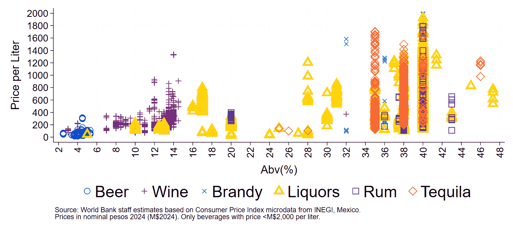
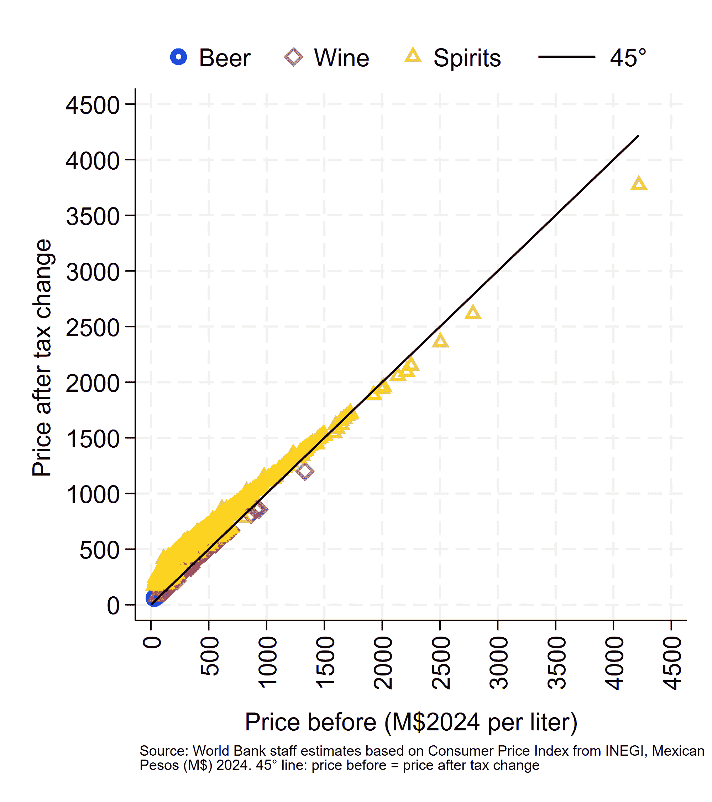
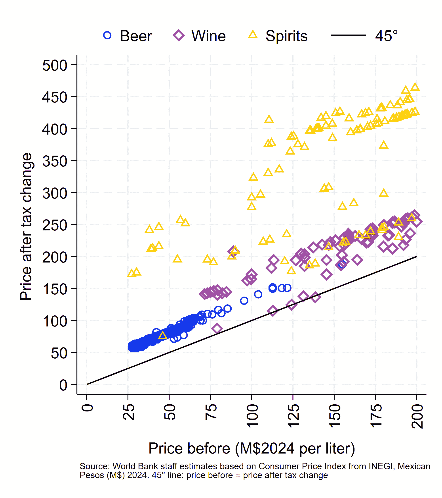

**EXPLORING HEALTH TAXES**

A series on **Fiscal policy** & **Health**

**Knowledge Note #8**

Reforming health taxes to improve Mexico's health

**Reforming health taxes to improve Mexico's health**

*Knowledge Note on Health Taxes #8*

August 2025

Health taxes are excise taxes on products that have a negative public health impact: tobacco, alcoholic beverages, and sugar-sweetened beverages. The **Health Taxes Knowledge Notes** are a series of papers on fiscal policy and health. They address key questions about health taxes and the main issues that come up during health tax reforms. The series draws on global best practices, scientific evidence, and the World Bank's experience supporting countries in designing and implementing health tax reforms. It is produced under the Global Tax Program's Health Tax Project.

This note was prepared by Norman Maldonado, Ceren Ozer and Jeremy Veillard, based on technical work by the World Bank and three background papers independently developed for the Bank by the Mexico's National Institute of Public Health–INSP (INSP 2025a, INSP 2025b, INSP 2025c). Authors are grateful to Truman Packard, Gisela García, Julie Ruel Bergeron, Gabriel Aguirre, Claudia Macías and Danielle Bloom from the World Bank for their review and valuable comments. The authors are grateful for the comments and feedback from the following peer reviewers: Evan Blecher, Rafael Muñoz, Roberto Iunes and Kate Mandeville from World Bank, and Rosa Sandoval from the Pan American Health Organization. Authors also thank the technical inputs and feedback provided by INSP: Tonatiuh Barrientos, Arantxa Colchero, Luz Miriam Reynales, and Belen Saenz-de-Miera from Universidad de Baja California. For questions or comments, contact Norman Maldonado (normanmv@worldbank.org) or Ceren Ozer (cozer@worldbank.org).

The findings, interpretations, and conclusions expressed in this paper are entirely those of the authors. They do not necessarily represent the views of the International Bank for Reconstruction and Development/World Bank and its affiliated organizations, or those of the Executive Directors of the World Bank or the governments they represent.

**Attribution.** Suggested citation: Maldonado, Norman, Ceren Ozer and Jeremy Veillard (2025). *Reforming health taxes to improve Mexico's health*. Health Taxes Knowledge Note # 8. Global Tax Program, World Bank. Washington, DC.

Cover photo: Beautiful streets and colorful facades of San Miguel de Allende in Guanajuato, Mexico © Adobestock.

## REFORMING HEALTH TAXES TO IMPROVE MEXICO'S HEALTH

**Tobacco, alcoholic beverages and Sugar-Sweetened Beverages (SSBs) are significant contributors to poor health in Mexico.** These products generate both internalities and externalities¹, resulting in premature and preventable deaths. The individual and societal costs from these externalities and internalities are not reflected in their market price, representing a market failure. In Mexico, 125,350 people lose their lives annually due to the use of these products. In addition to preventable deaths, there are years of life lost due to premature mortality and years of healthy life lost due to disability; these two effects are measured by the Disability-Adjusted Life Years (DALYs). When considering the broader perspective of DALYs, the negative effect of these products on health is much higher: the country has an annual loss of 2,842 DALYs per 100,000 people due to the use of these products. Figure 1 shows the change of burden of disease over time for tobacco and alcohol. Burden of disease in tobacco has decreased, but progress has stalled, and the burden is still high. Meanwhile, the burden from alcohol is similar in magnitude to the one from tobacco, and it has been steadily growing since 2006.

Figure 1: Attributable deaths and DALYs from tobacco and alcohol in Mexico

*(a) Deaths*

*[Chart showing Deaths per 100,000 from 1990 to 2018 for Alcohol and Tobacco, ranging 0-60]*

Source: World Bank staff estimates based on Institute for Health Metrics - IHME (2024)

*(b) DALYs*

*[Chart showing DALYs per 100,000 from 1990 to 2018 for Alcohol and Tobacco, ranging 0-1,800]*

Source: World Bank staff estimates based on Institute for Health Metrics - IHME (2024)

**Alongside their health impact, these products also carry significant fiscal costs.** Tobacco alone imposes direct costs for the treatment of cardiovascular disease, cancer, and Chronic Obstructive Pulmonary Disease, along with indirect costs such as labor productivity losses and informal care. The total costs imposed by tobacco in Mexico amount to 0.8 % of GDP each year, yet tobacco tax revenues, at 0.16 % of GDP, are only a fraction of these costs.

**Mexico has a successful track record of using health taxes to improve health and raise revenues.** Health taxes are excise taxes targeting use of tobacco, alcohol and SSBs. They are an effective policy instrument to correct market failures (World Bank 2022) and represent the most effective population-level intervention for the prevention of noncommunicable diseases (Galea et al. 2025). Mexico currently has excise taxes on all three products². The country successfully introduced changes in tax structures and rates in tobacco in 2007-2010 and 2019, and in SSBs in 2014. These reforms triggered shocks in real prices (Figure 2), which in turn reduced consumption and improved health (see Box 1). However, structure and rates of alcohol taxes have not been improved, and tobacco and SSBs taxes require reforms to further reduce consumption. Health taxes are a core pillar of disease prevention within Mexico's National Public Health System. Strengthening them is essential for achieving the goal of effective disease prevention outlined in the National Development Plan 2025-2030³ and in the Health Sector Work Program 2024-2030⁴.

Figure 2: Real consumer price index in Mexico, by product

*[Chart showing Real Consumer Price Index (Product CPI/Total CPI, Jan 2010=1) from Jan-00 to Mar-24, ranging 0.4-1.6, for Cigarettes, Sweetened Beverages, and Alcohol]*

Source: World Bank staff estimates using Indice Nacional de Precios al Consumidor from INEGI (Mexico) by expenditure categories.

**Strengthening health taxes will yield substantial health benefits while also generating additional tax revenue.** To support the strengthening of health taxes, the World Bank proposes a package of health taxes that outlines key opportunities for health tax reform. The core components of the proposed health tax package are adjusting the specific excise rates to $3 Mexican pesos (M$) per cigarette, M$0.12 per gram of sugar in all SSBs, and M$0.75 per milliliter (mL) of pure alcohol in all alcoholic beverages, along with simplifying the ad valorem tax on alcohol to a flat rate tax. Incorporating the health tax package in the *Ley de Ingresos de la Federación para el Ejercicio Fiscal de 2026* presents a key opportunity to advance in disease prevention, ensuring the sustainability of the health system, and expanding fiscal space. The reduction in consumption of these products would bring considerable gains in health: If the proposed package were adopted, aggregate cigarette consumption is expected to decrease by 44.2 %, alcohol consumption by 42.2 % and SSB consumption by 32 %. In addition, the tax package is expected to add 0.5 % of GDP to the country's fiscal space.

**The benefits from improving health taxes can be further enhanced through simultaneous progress in other cost-effective interventions.** In targeting noncommunicable diseases⁵, implementing plain packaging for tobacco products and prohibiting flavorings and additives—including flavor capsules—would represent a [continued on next page]

---

¹ Negative externalities are the uninternalized costs of consumption that accrue to non-consumers. Negative internalities are the uninternalized costs borne by the user resulting from time-inconsistent preferences due to imperfect information, present-bias, and/or addiction (World Bank 2022).

² The country also applies an excise tax on nonessential energy-dense food. However, food taxation is a complex issue that extends beyond health considerations, as food is a basic need and a fundamental human right (UN 2015). Additionally, it intersects with broader systems and policy areas that sustain human life such as food systems (Fanzo y Davis 2021), agricultural and environmental systems (Benton y Bailey 2019), food security, healthy diets (Wallingford et al. 2024) and nutrition (Meera Shekar et al. 2024). Due to the nature of food of a basic human need, a human right, and its strong interconnection with systems that sustain human life, the excise tax on nonessential energy-dense food falls beyond the scope of this document.

³ Presidencia de la República 2025. This objective is highlighted under "Healthy Republic" in "General Axis 2: Development with Wellbeing and Humanism", and specifically detailed in "Strategy 2.7.2" of "Objective 2.7: Guarantee the Right to protect Health".

⁴ Secretaria de Salud 2024. This objective is reflected under "Goal 1: Prioritize health promotion and disease prevention". One of the actions is to "Reduce the percentage of boys and girls with childhood obesity."

⁵ A summary of other effective interventions on NCDs is presented in Box 4 later in the note.

major advancement in tobacco control. In tax administration, an important step for Mexico would be for Congress to consider accession to the Protocol to Eliminate Illicit Trade of Tobacco Products and ensuring full implementation of its provisions. Moreover, the Protocol's effective interventions also strengthen the administration of alcohol excise taxes, and improve mechanisms for detecting and punishing tax crimes⁶.

**Box 1. Mexico's past success on health taxes**

**There is ample evidence on the effectiveness of tobacco and SSB taxes in Mexico.** For tobacco, the excise tax increase in 2007 raised the price of cigarettes, cutting down price dispersion (Sáenz de Miera Juárez et al. 2014), and reducing consumption in high-intensity smokers (Saenz-de-Miera, Thrasher et al. 2010). Smoking rates were reduced by 31 % due to the introduction of tobacco control policies, including taxes. This reduction in smoking averted 10,800 smoking-attributable deaths by 2015, and it is estimated to increase to 826,000 by 2053. Of these positive outcomes, 63 % are directly attributed to price increases (Reynales-Shigematsu et al. 2015). Cost-effectiveness evaluations of Mexico's tobacco tax have shown it to be progressive, as lower-income quintiles benefit significantly more from the tax than higher-income quintiles (Saenz-de-Miera, Wu et al. 2022). Recently, tobacco prices have grown by more than the tax, demonstrating potential space for larger tobacco tax increases (Saenz-de-Miera, Welding et al. 2024).

The SSB excise tax was introduced in 2014 and caused an increase in prices comparable in magnitude to the tax (Grogger 2017). Despite differences in income between urban and rural areas, the SSB tax was passed on to prices in both urban (Colchero, Salgado et al. 2015) and rural areas (Colchero, Zavala et al. 2017). The tax resulted in a 6 % reduction in household purchases of SSBs the first year and 9.7 % the second year (Colchero, Popkin et al. 2016). The reduction in consumption was progressive: it had a greater impact on households of low socioeconomic status (Colchero, Popkin et al. 2016; Colchero, Rivera-Dommarco et al. 2017) and high-intensity consumers (Ng et al. 2019). Overall, the tax led to a reduction in calories and sugar from taxed beverage purchases (Pedraza et al. 2019), thereby decreasing sugar intake from SSBs (Batis et al. 2023). Reduced intake has led to observable improvements on health outcomes, including decreased weight among overweight or obese female adolescents (Gračner et al. 2022) and fewer cases of decayed, missing and filled teeth (Hernández-F et al. 2021). The tax had no impact on employment in the manufacturing or retail sectors (Guerrero-López et al. 2017).

**What has been observed in Mexico aligns with global evidence.** Many countries have effectively implemented excise taxes on tobacco (WHO 2023c), alcohol (e.g. South Africa, (Blecher 2015)) and SSBs (World Bank 2020). Where applied, health taxes have effectively raised prices, lowered consumption and increased tax revenues (Paraje et al. 2024; Teng et al. 2019), with benefits concentrated in low-income populations (Fuchs y Pierola 2022).

# 1. HARM FROM USE OF TOBACCO, ALCOHOL AND SSBS

**Tobacco, alcohol and SSBs cause 125,350 annual deaths in Mexico (15.6 % of all deaths).** The use of these products exposes the population to risk factors (nicotine, ethyl alcohol and sugar) that cause negative externalities and internalities. Preventable and premature deaths are the most important externality and internality. In Mexico, tobacco is responsible for approximately 65,996 preventable deaths each year, alcohol for around 57,204, and consumption of SSBs also contributes significantly to the country's burden of disease (see Appendix). Local consumption patterns provide insight into the number of people affected by these products, the size of the market, and the specific types of products that account for the majority of consumption.

**Tobacco prevalence remains high at 15.3 %, and unchanged since 2009.** Smoking remains prevalent in Mexico, with 14.3 million people (15.3 % of adults in 2023) smoking tobacco, and 6.6 % smoking daily. The tobacco product used by most smokers (15 % of adults) is manufactured cigarettes. Smoking prevalence remains unchanged since 2009 (INSP 2023), indicating limited progress in reducing the number of smokers⁷. Based on epidemiological evidence (Peto 1994), half of these consumers—7.15 million people—are expected to die from smoking-related causes. Prevalence is also high when compared to the 5 % threshold suggested as a target in the tobacco control endgame (Thomson et al. 2012; Puljević et al. 2022). This consumption pattern translates to 1,303 million packs of 20-stick cigarettes (26,060 million cigarettes) sold annually in the country.

**Alcohol consumption is high, has been increasing over time, and is predominantly driven by beer.** Among adults aged 12-65, 35.9 %—equivalent to 33.9 million people—reported consuming alcohol in the last month. Binge drinking was reported by 19.8 % of the population, while 2.9 % consumed alcohol daily. All these indicators of alcohol consumption have been increasing over time (INPRFM 2017). At the national level, alcohol consumption amounts to 10,090 million liters per year, with beer accounting for 96 % of the market. In terms of pure alcohol, annual consumption reaches 594.7 million liters, with beer remaining the dominant source at 81.5 %. Alcohol consumption Per Capita (APC) stands at 5.7 liters per year (WHO 2024b), close to the median for the Americas—the second-highest consuming region in the world (Figure 3).

*Figure 3: Alcohol consumption Per Capita, 2019*

*- - - Mexico: 5.72*

| Region | APC (Liters of pure alcohol per year) |
|---|---|
| E. Mediterranean | ~0-2 |
| S.E. Asia | ~2-4 |
| W. Pacific | ~4-6 |
| Africa | ~6 |
| Americas | ~8 |
| Europe | ~10-12 |

APC: Alcohol consumption Per Capita, only population 15+. Source: World Bank staff estimates based on Total Alcohol consumption Per capita from World Development Indicators (World Bank) and countries grouped by World Health Organization's regions.

**Consumption of SSBs is high and is a major driver of Mexico's obesity crisis.** SSBs are the primary source of added sugar intake in the country (Sánchez-Pimienta et al. 2016). Daily consumption of taxed SSBs averages 247.6 mL per person, totaling 23,877 million liters per year. This level of consumption contributes 107.7 additional kilocalories per day, out of a recommended 2,000 kilocalories daily intake (Hernández et al. 2023). SSB consumption is linked to obesity and diabetes (Temple y Alp 2016), and has long-term consequences for children and young populations (Avelar Rodriguez et al. 2018). In Mexico, 73 % of adults have overweight or obesity, and 85.8 % of adults consume SSBs regularly. Even more concerning, childhood obesity has become a major public health issue, with an estimated 4 million children living with obesity across the country (Mercado-Mercado 2023). Reducing SSBs consumption is essential to lowering obesity rates and obesity-related diseases (Hu 2013).

**Consumption of tobacco, alcohol and SSBs imposes significant fiscal costs.** In Mexico, tobacco use alone results in direct healthcare costs equivalent to 0.5 % of GDP, while indirect costs—including informal care, premature mortality, and disability—add another 0.3 % of GDP (Saenz-de-Miera, Reynales-Shigematsu et al. 2024)⁸. These costs create inefficiencies in fiscal spending and threaten the sustainability of the country's health system. Despite these burdens, tobacco taxes generate only 0.16 % of GDP, falling far short of the societal costs of tobacco use. Maintaining health taxes in their current status perpetuates this fiscal imbalance; the problem is compounded as preventable premature deaths caused by these products further erode the overall taxpayer base.

# 2. OPPORTUNITIES TO IMPROVE HEALTH TAXES

**Health taxes are an effective policy instrument to address market failures caused by negative externalities and internalities.** These excise taxes target consumption of tobacco, alcohol and SSBs (World Bank 2022). By increasing prices, health taxes reduce consumption and its associated health risks by decreasing and delaying initiation among children and young consumers, lowering the frequency and intensity of use among existing consumers, and encouraging cessation⁹. Vulnerable populations—including low-income households, young people, and women—are particularly responsive to price changes, with consumption declining more sharply in response to tax increases. As a result, these groups benefit the most from these taxes. For this reason, health taxes have been widely recognized as progressive measures (Fuchs y Pierola 2022). Given their health benefits, health taxes are included alongside other non-tax measures as part of population-level prevention measures in the World Bank's high-priority package for healthy longevity (World Bank 2024b). From a fiscal perspective, improving health taxes can generate much-needed additional revenue (World Bank 2023), while also helping to reduce long-term health expenditures.

**Tobacco excise taxes in Mexico heavily rely on ad valorem taxation, alcohol products do not have a specific tax, and specific rates in tobacco and SSBs are low.** As of 2025, the tobacco excise tax in Mexico follows a mixed structure, consisting of a 160 % ad valorem tax on the retailer price, and a specific tax of M$0.6445 per cigarette (M$12.89 per 20-stick pack), which is adjusted annually for inflation. Electronic cigarettes and vaping devices are banned, with regulations for effective enforcement expected to be developed in 2025. Alcohol products are subject to a multistage ad valorem tax based on alcohol content: 26.5 % of the consumer price for beverages up to 14°GL⁽¹⁰⁾, 30 % for those between 14° and 20°GL, and 53 % for those with more than 20° GL. For SSBs, the excise tax is specific, applying to all non-alcoholic beverages with added sugar including energy drinks⁽¹¹⁾. The tax rate is M$1.6451 per liter, adjusted annually for inflation. Low prices, high consumption, and the associated health burden in Mexico highlight the urgent need to improve health

⁶ Improving the administration of excise taxes is essential for Strategy 1.3.7 "Develop investigative mechanisms to detect and punish tax and financial crimes that affect the treasury and encourage corruption" of Objective 1.3 "Eradicate corruption in public life and promote ethics, honesty, integrity, and good governance to strengthen trust in institutions" of the National Development Plan (Presidencia de la República 2025).

⁷ Mexico has made progress on other indicators related to the tobacco epidemic (INSP 2023). Among the population aged 25–44, the average number of cigarettes smoked per day decreased from 9.4 in 2009 to 7.5 in 2023. In the group with the lowest level of education, the reduction was even more pronounced—from 12.3 to 8.3 cigarettes per day over the same period. Additionally, the average age of smoking initiation increased from 16.5 years to 18.8 years.

⁸ There are no studies on the attributable costs of alcohol in Mexico. However, global estimates suggest these costs range between 1.5 % and 2.6 % of GDP (Manthey et al. 2021).

⁹ For a comprehensive review of these mechanisms, see (NCI y WHO 2016) for tobacco, (Babor et al. 2023) for alcohol, and (World Bank 2024a) for SSBs.

¹⁰ Degrees Gay-Lussac, a measure of alcohol content equivalent to Alcohol-By-Volume (ABV).

¹¹ Energy drinks are also subject to a 25 % ad valorem tax on the consumer price.

NOTE #8: Reforming health taxes to improve Mexico's health

]<]minimax[>[
taxes.

**Strengthening the design of specific taxes is the main area for improving health taxes in Mexico.** Currently, most of the excise tax burden in tobacco products—and the entire excise tax burden in alcoholic beverages—comes from ad valorem taxes. Heavy reliance on ad valorem taxation creates several undesirable incentives, including high price dispersion and the availability of extremely cheap products in the market (see Figure 4a for cigarettes and Box 2 for alcohol). It also encourages consumer downtrading to lower-priced brands, and reduces overall tax effectiveness. Moreover, the ad valorem tax on targets the product's value rather than the actual source of harm. In alcoholic beverages, the harmful element is the volume of pure alcohol—not its price. A cheap beer is no less harmful than an expensive one. Therefore, the main opportunity to strengthen health taxes in Mexico lies in improving the design of specific taxes across all three products. This involves increasing the specific rate on tobacco products, introducing a specific tax component on alcoholic beverages that varies with alcohol content, and modifying the specific SSB tax so that it varies with sugar content.

### Box 2. Alcohol price dispersion and cheap products

Ad valorem taxes on alcohol products in Mexico result in significant price dispersion (see figure below). This is problematic because beverages with varying alcohol content (ABV) are often available at the same price. The issue is most pronounced in the low-price segment, making high-alcohol-content beverages highly affordable for low- and middle-income individuals.

The issue directly affects the price of pure alcohol: one milliliter of pure alcohol from beer is available at the same price as one milliliter from wine or spirits. As a result, low prices for high-alcohol-content beverages encourage binge drinking. For example, a person who can afford three liters of 4 % ABV beer could obtain the same amount of pure alcohol from just one liter of 12 % ABV wine—and spend less money. Even more concerning, they could purchase one liter of a 30 % ABV product (e.g., other liquors such as Licor de Agave) for the same price as one liter of beer, ultimately lowering their expenditure while significantly increasing their intake of pure alcohol. This highlights the need for tax reform that reduces price dispersion and increases the overall implicit price of pure alcohol, discouraging excessive consumption and aligning taxation with public health objectives.

**Price and tax benchmarks highlight opportunities to improve excise tax rates.** The World Health Organization (WHO) monitors consumer prices and indirect taxes on tobacco, alcohol and SSBs globally, with a particular focus on excise taxes. International price and excise tax share comparisons provide valuable insights into price gaps with peer countries and help identify the potential for feasible increases in tax rates.

## Price benchmarks

**In tobacco, cigarette prices in Mexico are lower than those in many peer countries, and some products are available at considerably low prices.** In 2022, the median price of a 20-stick pack of cigarettes was M$70 (Figure 4a). Compared to other countries in the Americas (Figure 4b), Mexico's cigarette prices are slightly above the median. However, prices remains lower than the median in South East Asia and Europe, and they fall below those of regional peers such as Chile (M$73.5) and aspirational peers like Germany, Malaysia and France (M$102, M$109, M$142, respectively). In addition to international price gaps, cigarette prices in Mexico show high dispersion—partly due to a tax structure that relies heavily on the ad valorem component. Ideally, price dispersion should be limited, with the lowest prices close to the median. This helps reduce affordability for high-intensity consumers and low-income populations. However, in the context of high price dispersion—as is the case in Mexico—cigarettes are available at very low prices. The cheapest pack sells for M$28 (Figure 4a), well below the median. Furthermore, when considering only the cheapest brand, Mexico has one of the lowest cigarette prices in the Americas.

### Figura 4: Cigarette prices in Mexico compared to global benchmarks, 2022

**(a) Prices in Mexico**

Median: 70.0

*(Price per 20-stick pack in M$ 2022, ranging from approximately 30 to 90, shown as a distribution where the x-axis represents % of observations in CPI from 0 to 0.4)*

Source: World Bank staff estimates based on microdata for Consumer Price Index (CPI) from INEGI, Mexico. M$2022: Nominal Mexican Pesos 2022.

**(b) Global benchmarks**

- Mexico: 69.1

*(Price per 20-stick pack ranging from 0 to 240, comparing regions: Africa, E. Mediterranean, Americas, W. Pacific, S.E. Asia, Europe. Prices are shown as medians with the value "1" indicated for one region.)*

**In alcohol, beer is the most consumed beverage and the main contributor to alcohol intake in Mexico.** Alcohol products are highly heterogeneous and generally classified into three main types: beer, wine, and spirits. These types differ in alcohol content, with beer averaging 5 % Alcohol By Volume (ABV), wine at 12.5 % ABV, and spirits at 40 % ABV. Beer is the dominant alcohol product in Mexico, accounting for 96 % of apparent consumption^(12). Even when measured in terms of pure alcohol, beer still represents 81.5 % of Mexico's apparent consumption.

---
12. Apparent consumption is defined as local production plus imports minus exports (NIH 2004). It provides a supply-side measure of aggregate consumption, helping to address the limitations of underreporting in consumer surveys.

---

**The price of alcohol products in Mexico is low compared to international prices.** Global progress in alcohol control, including taxation, remains limited (WHO 2023d), making it more challenging to benchmark prices across countries. However, international comparisons still provide insights into price gaps and the potential for feasible price increases. In 2022, the median local price of one liter of beer in Mexico was M$42 (Figure 5a), lower than in most countries across all regions except Europe (Figure 5b). Spirits present a more complex case due to their diversity, encompassing a wide range of products, such as tequila, licor de agave, whisky, brandy, and others. The median local price for all spirits in 2022 was M$297 per liter (Figure 6a), with significant variation—some products reaching prices as high as M$3,700. As shown in Figure 6b, the price of spirits in Mexico is lower than in most regions worldwide^(13).

### Figura 5: Beer prices in Mexico compared to global benchmarks, 2022

**(a) Prices in Mexico**

Median: 42.3

*(Price per liter of beer in M$ 2022, ranging from 0 to 250, shown as a distribution where the x-axis represents % of observations in CPI from 0 to 0.3)*

Source: World Bank staff estimates based on microdata for Consumer Price Index (CPI) from INEGI, Mexico. M$2022: Nominal Mexican Pesos 2022.

**(b) Global benchmarks**

- Mexico: 45

*(Price per liter of beer ranging from 0 to 300, comparing regions: Europe, W. Pacific, Africa, Americas, E. Mediterranean, S.E. Asia. Prices are shown as medians with the value "1" indicated for one region.)*

**The price of pure alcohol is another criterion for setting specific tax rates.** The price of an alcoholic beverage implicitly determines the price of its harmful component—pure alcohol. For example, one liter of beer with 4 % ABV contains 40 mL of pure alcohol. If the price of one liter of beer is M$45, the implicit price of one mL of pure alcohol is M$1.12 (M$45 per liter ÷ 40mL of pure alcohol). The market failure arises from the volume of the harmful ingredient, not the total liquid volume. To correct the market failure, specific excise taxes should be based on the amount of pure alcohol rather than the overall beverage volume. Therefore, the price per unit of pure alcohol provides key information for determining the appropriate specific tax rates. Figure 7 shows the price of one liter of alcoholic beverage (7a) and one milliliter of pure alcohol (7b) in Mexico, broken down by product type. The price of one liter of beer in Mexico is M$46.5, with the price of one milliliter of pure alcohol from beer at M$1.11. When analyzing product prices (Figure 7a), beer is the least expensive, followed by wine and spirits (such as tequila, rum and brandy). However, when examining the implicit price of pure alcohol (Figure 7b), this pattern changes—brandy and rum have the lowest median prices of pure alcohol.

**Unifying and simplifying the definition of alcoholic beverages in the tax law would help ensure greater consistency in tax rates across alcohol products.** Mexico's excise tax law defines beer, alcoholic beverages, and

---
13. The local price for spirits is much higher than the one reported to WHO (Figure 6b). This might be due the complexity of product heterogeneity and the use of broad categories like spirits. If that is the case, the gap between local prices and prices reported to WHO might be systematic worldwide, and comparisons across countries provide useful insights into price gaps between countries.

---

## Figura 6: Prices for spirits in Mexico compared to global benchmarks, 2022

### (a) Prices in Mexico

Median: 297.3

Price per liter of spirits (M$ 2022): 0 to 4,000

% of observations in CPI: 0 to 0.25

Source: World Bank staff estimates based on microdata for Consumer Price Index (CPI) from INEGI, Mexico. M$2022: Nominal 2022 Mexican Pesos.

Spirits: Tequila, Rum, Brandy, Other liquors.

### (b) Global benchmarks

(Mexico: 85.0)

Price per liter of spirits (M$ PPP2022): 0 to 2,000

Regions: W. Pacific, Americas, Europe, Africa, S.E. Asia, E. Mediterranean

## Figura 7: Distribution of price of product and pure alcohol in Mexico, 2024

### (a) Price of alcoholic beverages by type

Price of one liter of product (M$2024): 0 to 4,500

Categories: Beer, Wine, Brandy, Liquors, Rum, Tequila

Source: World Bank staff estimates based on microdata for Consumer Price Index from INEGI, Mexico. M$: Mexican Pesos.

### (b) Price of pure alcohol by type

Price of one milliliter of pure alcohol (M$2024): 0 to 11

Categories: Beer, Wine, Brandy, Liquors, Rum, Tequila

Source: World Bank staff estimates based on microdata for Consumer Price Index from INEGI, Mexico, and data on alcohol content from INSP, Mexico. M$: Mexican Pesos. Ml: Milliliter.

coolers as separate categories, even though all of them contain alcohol. Furthermore, the category "alcoholic beverages" is defined as those with alcohol content between 3° and 55° GL. This creates inconsistencies such as a beer with 2° GL alcohol content is subject to excise tax, while an "alcoholic beverage" with the same alcohol content is not. Esto crea incoherencias tales como que una cerveza con 2° GL de contenido de alcohol está sujeta al impuesto especial, mientras que un producto de la categoría "bebida alcohólica" con el mismo contenido de alcohol no esta sujeto al impuesto. In general, while beverage type serves as a proxy of alcohol content, it is not always definitive and can present challenges for taxation purposes (see Box 3). Therefore, simplification of the definition of alcohol products can contribute to have consistent tax rates across products. In addition, aligning definitions across different regulatory frameworks—such as advertising and labeling rules—could enhance the effectiveness of broader alcohol control policies.

### Box 3. Type of alcoholic beverages and alcohol content

**Beverage type is not a reliable proxy for alcohol content (ABV).** The figure below illustrates the distribution of ABV in products included in Mexico's Consumer Price Index, categorized by beverage type.

Abv(%): 0 to 50

Frequency (%): 0 to 0.6

Categories: Beer, Wine, Brandy, Liquors, Rum, Tequila

Source: World Bank staff estimates based on microdata for Consumer Price Index from INEGI, Mexico

**There is considerable overlap in alcohol content across different categories.** Some wines have the same ABV as certain beers, and some spirits match the ABV of wines. Within the spirits category, alcohol content can vary widely, ranging from 17 % to 47 % ABV. This overlap has important taxation implications, particularly when tax regulations define alcoholic products or set tax rates based on beverage type rather than alcohol content. In such cases, products with the same alcohol content but classified under different beverage types may face different tax rates, while products with varying alcohol content within the same type are taxed equally regardless of considerable variation in alcohol content between them. This is especially problematic for spirits, where a product with 10 % ABV is taxed at the same rate as one with 40 % ABV, despite containing four times more alcohol.

**Market innovations further complicate this issue, as emerging product categories like alcopops do not fit neatly into the traditional classification of beer, wine, and spirits.** While updating tax laws to incorporate new product types could address this challenge, it is an impractical solution. Such an approach would require coordinating tax designs across categories, create inconsistencies in effective tax rates and alcohol regulation, and add complexity to the tax structure—contradicting best practices for simplicity in tax systems (WHO 2023d). Defining alcoholic products based on alcohol content, rather than product type, in the tax law would promote greater consistency in tax design across products.

**The price of SSBs in Mexico is lower than in most countries.** Figure 8a illustrates the distribution of local prices for sweetened beverages, with a median price of M$23 per liter and many products available at very low prices. For instance, a product priced at M$10 per liter (the 5th percentile) costs less than half the median price. Low-priced SSBs pose a concern as they are more affordable, particularly for low-income populations, contributing to higher consumption. When compared across regions (Figure 8b), the Americas have the lowest median price, and even within this region, Mexico's price remains low. Water is a healthier alternative to SSBs[^14]. In Mexico, the price of bottled water is lower (median price of one liter is M$13) than that of SSBs (Figure 9). This indicates that affordable, healthier alternatives are available for consumers to switch to. An additional reference for setting specific rates on SSBs is the implicit price of one gram of sugar in SSBs, which in Mexico is M$0.34.

[^14]: Water policy to ensure access to safe drinking water is a broad issue and falls beyond the scope of this report.

## Figura 8: Distribution of local price and global benchmarking for SSBs in Mexico, 2022

### (a) Local prices in Mexico

Median: 23.3

Price per liter of Sweetened Beverage (M$ 2022): 0 to 180

% of observations in CPI: 0 to 0.25

Source: World Bank staff estimates based on microdata for Consumer Price Index (CPI) from INEGI, Mexico. M$: Mexican Pesos.

### (b) Global benchmarking

(Mexico: 28.7)

Price per liter of SSB (M$ PPP2022): 0 to 120

Regions: Americas, E. Mediterranean, W. Pacific, Europe, Africa, S.E. Asia

## Figura 9: Price of water and sweetened beverages in Mexico, 2024

# products in CPI: 0 to 600

Price per Liter (M$2024): 0 to 95

Categories: Water, Sweetened B

Source: World Bank staff estimates based on microdata for Consumer Price Index (CPI) from INEGI, Mexico. M$2024: Nominal Mexican Pesos 2024.

## Tax benchmarks

**Compared to global excise tax shares, Mexico has room to increase specific excise rates.** A high excise tax share is a necessary condition to raise prices to levels that effectively discourage consumption, and serves as a modest target for assessing progress in taxation policy. Figure 10 presents the global distribution of excise tax share for health taxes. Cigarettes have the highest excise tax shares, largely due to global progress in implementing the Framework Convention on Tobacco Control (Paraje et al. 2024). Despite these advances, many countries still fall short of the WHO's 70 % benchmark (WHO 2021), underscoring the potential for further increases in tobacco excise tax rates. Mexico is among them, with a cigarette excise tax share of 53.7 % (WHO 2023c)—15.5 % from the specific component and 38.2 % from the ad valorem. The country's tax share also falls well below the 74 % benchmark set by the best-performing countries[^15], and the struc-

[^15]: The best-performing countries are represented by the upper bound of the interquartile range. The interquartile range is represented by the lines from the box to the minimum and maximum of the distribution, excluding outliers.

ture remains heavily reliant on the ad valorem component. In the case of alcohol, benchmarking must be approached with caution, as global progress in alcohol taxation remains slow (Casswell 2019). As a result, comparisons with other countries may overestimate progress. Mexico's alcohol excise tax share is 18 % for beer and 29.8 % for spirits, which falls below the relative benchmarks of 41 % and 73 % of the best performing countries. The SSB tax is relatively new, and progress in achieving high excise tax shares has been slow, with a median global of just 7 %, and a relative benchmark of 21 % from the best-performing countries. Even by this prudent standard, Mexico's excise tax share remains low at 4.8 %. Improving design of health taxes would help adjust prices and reduce consumption, ultimately improving public health outcomes (INSP 2025c, INSP 2025a, INSP 2025b).

**Figura 10: Tax shares of total excise tax worldwide, 2022**

*Mexico*

| Product | Excise tax share on consumer price (%) |
|---------|----------------------------------------|
| SSBs | 4.8 |
| Spirits | 29.8 |
| Beer | 18 |
| Tobacco | (see figure) |

Source: World Bank staff estimates based on data on excise taxes from World Health Organization. # Countries for Tobacco 180, Beer 128, Spirits 122, SSBs 135.

# 3. RECOMMENDATIONS TO IMPROVE HEALTH TAXES

Mexico has significant potential to strengthen health taxes and raise prices. The effectiveness of health taxes depends on their design, which includes both the tax structure and the rate (World Bank 2022). Tax structure encompasses the type (specific, ad valorem or mixed), the base (volume or value on which the tax is applied), the scope (products covered by the tax) and the variation (how rates change based on product characteristics). Opportunities to improve tax design can be identified using price and tax benchmarks discussed above, along with best practices[^16] and experience in implementation[^17]. In Mexico, excise taxes on tobacco, alcohol and SSBs fall under the Special Tax on Production and Services - IEPS, and are legally defined within the IEPS law. This law can be amended through the annual Tax Revenue Law[^18], which is part of the federal budget process. Mexico has an opportunity to improve the structure and increase the rates of health taxes in the *Ley de Ingresos de la Federación para el Ejercicio Fiscal de 2026*. The following sections present the proposed health tax package, with product-specific recommendations to improve tax design in the IEPS law, along with additional measures to enhance the overall impact of health taxes.

---

[^16]: The WHO has clearly outlined best practices for health taxes on tobacco products (WHO 2021), alcohol products (WHO 2023d) and SSBs (WHO 2022).

[^17]: Drawing from global experience from supporting the implementation of best practices across multiple countries, the World Bank (World Bank 2022; World Bank 2024a) and the International Monetary Fund (Petit y Nagy 2016; Mansour et al. 2023; Petit, Mansour et al. 2021) have identified key lessons for the effective design and implementation of these taxes.

[^18]: Ley de Ingresos de la Federación para el Ejercicio Fiscal.

NOTE #8: Reforming health taxes to improve Mexico's health

14

## Tobacco

**Type. Mexico aligns with best practices by including a specific tax in its tax mix; however, the specific component should represent a significantly larger share of the tax compared to the ad valorem component.** To effectively reduce price dispersion and limit opportunities for consumers to shift toward lower-priced alternatives, the excise tax should rely more heavily on the specific component. One way to do this is by increasing specific tax rates, maintaining its annual inflation adjustment, and incorporating additional points in the annual adjustment to account for long-term changes in income and affordability. The country could also consider fully shifting to a specific tax. To achieve this, higher specific tax rates would be needed to compensate for the part of the price and tax revenue currently covered by the ad valorem tax.

**Scope. Mexico can expand the definition in the tax law to include all tobacco and nicotine-related unbanned products, and strengthen the mechanisms for enforcing the ban on single cigarette sales.** For tobacco, Mexico has properly included all unbanned tobacco products in the excise tax (WHO 2021). In article 2 of the IEPS law, the scope of the tobacco excise tax is defined to include Cigarettes, Cigars and other manufactured products, as well as handmade tobacco products. Regarding new tobacco products, the country has banned distribution and selling of Electronic Nicotine Delivery Systems (ENDS), Electronic Non-Nicotine Delivery Systems (ENNDS), Alternative Nicotine Delivery Systems (ANDS), electronic cigarettes and vaping devices (Secretaría de Salud 2022). Effective enforcement mechanisms will be essential in the upcoming regulation to ensure the success of this ban. In addition, all tobacco- and nicotine-related products not covered by the ban should be subject to taxation and the full set of tobacco control regulations. This helps align the tax with the regulatory framework and keeps it up to date in addressing challenges posed by emerging products, such as nicotine pouches and other synthetic or non-tobacco nicotine (NTN) products. Furthermore, as Mexico has signed and ratified the Framework Convention on Tobacco Control, harmonizing the regulatory framework for tobacco taxation with other tobacco control measures and with the provisions of the Convention (WHO 2004) would align the country's fiscal framework with international best practices, particularly regarding emerging products.

**Base. The tax base for the ad valorem component is the price paid by the retailer; however, best practice favors using a price further along the value chain.** For the specific component, Mexico appropriately uses one cigarette as the tax base[^19]. Regarding the ad valorem component, one potential improvement is to use the consumer price as the tax base. Tobacco price data already collected by INEGI for the Consumer Price Index could serve to define and certify consumer prices by product. This certification could then be used by taxpayers to declare and pay the ad valorem excise tax. It is important to carefully assess the additional costs and benefits that such a change might entail. Replacing institutional mechanisms that already function well with new ones that increase administrative burdens—especially when the expected gains in effective tax rates or revenue are marginal—is not advisable.

**Variation. In line with best practices, Mexico applies a uniform excise tax on cigarettes.** Previously, the country applied varying tax rates based on cigarette type. Over time, Mexico has moved in the right direction and now implements uniform specific and ad valorem rates for all cigarettes.

**Rate. The specific component of the tobacco excise tax could be increased to M$3 per cigarette and automatically adjusted each year for inflation plus additional points to account for long-term income growth.** This increase would position Mexico's tobacco taxation above the 75th percentile in the region, bringing it closer to the levels of its aspirational peers. The revised tax rate would make the excise tax heavily reliant on the specific component, which is expected to be 2.2 times higher than the current ad valorem component in terms of effective rates. With regard to other legal tobacco products, it is important to ensure that tax rates are equivalent to those applied to cigarettes, so that no product receives preferential excise tax treatment. In particular, aligning the ad valorem rate applied to hand-made tobacco products with that of other tobacco products presents an opportunity to improve ad valorem rates.

---

[^19]: Article 2 in IEPS law defines the unit for the tax base of this component as "Cigarro" (cigarette); for other tobacco products, it uses the equivalent based on proportional weight compared to cigarettes.

NOTE #8: Reforming health taxes to improve Mexico's health

15

## Alcohol

**Type. Mexico could adopt a mixed type by adding a specific component to the current ad valorem excise tax on alcoholic beverages.** While ad valorem taxes target the price of the product, a specific component directly targets the harmful ingredient—alcohol content. For that reason, the country can incorporate a specific component into the alcohol excise tax, with automatic adjustment for inflation and additional points to account for long-term changes in income and affordability. In a mixed type, the ad valorem component can play a supporting role via taxing high-value products that the specific component may not effectively cover. Additionally, it should be retained in the tax structure to help maintain revenue neutrality in the tax reform. In addition, shifting from a multi-stage to a single-stage tax system could simplify administration and enhance the ability of fiscal authorities to monitor product volumes, tax bases, and resulting revenues.

**Scope. All alcoholic products, regardless of whether they have zero or positive degrees of alcohol, could be subject to the excise tax.** No- and Low-alcohol beverages (NoLo)—products with an ABV between 0 % and 3.7 %—have become a public health concern due to their expanding market, their role in normalizing the culture of alcohol consumption, and their potential risks for minors, pregnant women, abstainers and individuals trying to quit alcohol (WHO 2023a). For these reasons, it is recommended to include all NoLo products within the scope of the tax. Furthermore, products intended for human consumption with high alcohol content (ABV>55 %) must also be included in the tax. This ensures that strong liquors are not left untaxed, preventing them from becoming a cheaper substitute for taxed products. This measure is crucial to reduce the risk of low prices of high-ABV products encouraging heavy episodic drinking and alcohol dependence. These improvements in tax scope could be achieved by unifying and simplifying the definition of alcoholic products in the tax law. Further harmonizing these definitions with other regulations governing alcoholic beverages would support more consistent and effective implementation of both tax and non-tax measures for alcohol control.

**Base. In a mixed excise tax, basing the specific component on the volume of pure alcohol would strengthen the overall tax base.** The specific component targets the risk factor, so the base should be the pure alcohol content in the product, measured in milliliters. For the ad valorem tax, the current multi-stage structure results in a tax base that approximates the consumer price. The country could explore the possibility of shifting to a single-stage tax that uses the consumer price as the tax base for the ad valorem component—provided that the benefits of the change greatly outweigh the administrative and implementation costs.

**Variation. In a mixed excise tax, specific rates can be set to increase linearly with the pure alcohol content, while the ad valorem rate may remain uniform across all products.** A specific component that varies based on pure alcohol content significantly enhances the effectiveness of the excise tax by directly targeting the underlying risk factor: ethyl alcohol. This type of variation creates incentives to reduce alcohol content, as products with lower alcohol content—such as NoLo beverages—will face a lower specific tax rate. Moreover, a well-designed specific component increases prices and reduces the current price dispersion in both product price and the price of pure alcohol (Box 2). For the ad valorem component, a uniform flat rate for all alcoholic

NOTE #8: Reforming health taxes to improve Mexico's health

16

products simplify the excise tax.

### Rates.
A specific tax rate of M$0.75 per mL of pure alcohol will effectively raise prices and reduce alcohol consumption (20). Compared to regional peers, the proposed specific tax would bring Mexico to the median price level for beer in the region, and move it closer to the levels of aspirational peers.

### SSBs

### Type.
Mexico has successfully introduced a specific excise tax on SSBs. A specific excise tax can directly target the harmful ingredient—sugar—in SSBs. Mexico has a specific SSB tax, with annual inflation adjustment for specific rates. The country could add additional points in the annual adjustment to account for long-term changes in income and affordability. Heterogeneity in price and harmful content in the SSB market is much lower than in alcoholic beverages, leading to less price dispersion (see Figure 11). As a result, an ad valorem component is not essential in the SSB excise tax.

### Scope.
Mexico may consider explicit inclusion of all categories of SSBs within the scope of the excise tax. Including all beverages with free sugars—whether added or naturally present—is essential to prevent consumers from substituting taxed SSBs with untaxed SSBs alternatives. The SSB subtypes recommended by WHO to be included are “carbonated or non-carbonated soft drinks, fruit/vegetable juices and drinks, liquid and powder concentrates, flavoured water, energy and sports drinks, ready-to-drink tea, ready-to-drink coffee and flavoured milk drinks” (WHO 2022).

### Base.
The tax should use the product’s sugar content as the tax base for the specific component. Currently, the volumetric tax uses the product’s volume (in liters) as the tax base. However, sugar content varies based on both the volume and the concentration of sugar in the product. The current tax base only accounts for variations in sugar content by volume, but fails to capture differences in sugar concentration among products of the same volume. Therefore, the tax base should be the total grams of sugar in the product.

### Variation.
Mexico could shift the current tax variation from volume to grams of sugar in the product. The current tax in Mexico, as defined by Article 2-I-G of the IEPS, varies rates solely by product volume. This structure incentivizes consumers to shift from SSBs to other untaxed beverages. However, beverages with the same volume but different sugar content are taxed equally, meaning the tax will not lead to price differences. This creates the possibility for consumers to switch to products with higher sugar content. From the production side, the current variation does not incentivize reduction of sugar content in products, as the same tax rate applies to all products (World Bank 2024a).

### Rates.
A specific rate of M$0.12 per gram of sugar for all SSBs would effectively increase prices and reduce consumption. High rates are essential to significantly reduce sugar intake from SSBs and encourage substitution to sugar-free products. Additionally, this rate and structure would create an incentive for reduction of sugar content, as products with lower sugar content would incur lower taxes, while those with no sugar, including bottled water, would remain untaxed.

20 This rate is equivalent to a rate of $M 7.50 per ABV per liter, or proportional.
NOTE #8: Reforming health taxes to improve Mexico’s health
17

### Additional policy considerations

**Setting a floor for the specific component in alcoholic beverages aligns incentives between the alcohol tax and the SSB tax while preventing regulatory loopholes.** In Mexico, the prices of alcoholic beverages and SSB overlap (Figure 11). This overlap suggests that beer and SSBs could be price substitutes. Additionally, new products like alcopops and NoLo beverages share characteristics with SSBs, such as similar flavors, further increasing the potential for substitution between alcohol and SSBs. To align both taxes, the alcohol excise tax should be higher than the SSB excise tax for all products, as the health burden from alcohol is greater than that from SSBs. Failing to align both taxes may create regulatory loopholes and distort incentives for simultaneously lowering consumption of pure alcohol and sugar. For example, if a beer and a soda are priced the same, but the excise tax on beer is lower than that on SSBs, the tax structure could unintentionally make beer the cheaper option, incentivizing consumers to switch from soda to beer. This concern is especially relevant for new alcohol products and NoLo products, as their specific tax may be minimal or even zero (e.g., for zero-alcohol beer), potentially undermining the intended public health impact of the health taxes. To ensure proper differentiation between alcoholic beverages and SSBs, a specific tax floor could be set for the specific component: a rate of M$0.75 per mL of pure alcohol with a minimum of M$8 per liter (or proportional). This approach prevents alcoholic beverages from being taxed too lightly, avoids price similarities with SSBs, and preserves the integrity of alcohol taxation.

Figure 11: Price of sweetened beverages and alcoholic beverages in Mexico, 2024

0
100
200
300
400
Number of products in CPI
5
10
15
20
25
30
35
40
45
50
55
60
65
70
75
80
Price per Liter (M$2024)
Sweetened B
Beer
Wine
Other Liquors
Source: World Bank staff estimates based on microdata for Consumer Price Index (CPI) from INEGI, Mexico. M$: Mexican Pesos.
Only beverages with price<=M$80

**Low taxes are not an effective policy to address illicit trade of tobacco and alcohol products.** A common argument against excise taxes on tobacco and alcohol is the concern that higher taxes may drive an increase in illicit trade. Independent estimates place the illicit trade of tobacco products in Mexico at 18.2 % (Sáenz-de-Miera et al. 2024). Evidence shows that low excise taxes for tobacco products have been ineffective in curbing illicit trade (World Bank 2019). Instead, the Protocol to Eliminate Illicit Trade of Tobacco products (WHO 2013) outlines a comprehensive set of effective measures to combat illicit trade. These include robust supply chain control, clear definitions of unlawful conducts and penalties, and strong international cooperation mechanisms. To effectively address illicit trade, Mexico’s Congress should consider accession to this protocol and ensure the full implementation of its provisions.

**Strengthening the monitoring of health taxes and conducting rigorous evaluations of their approval, implementation, and administration is essential to ensuring the policy’s effectiveness.** Monitoring and evaluation play a critical role in understanding and measuring both the intended and unintended impacts of policies, as well as in improving policy design and implementation (Gertler et al. 2016). For the effective implementation of the health tax package, reliable estimates are needed on tracer indicators for tobacco, alcohol, and sugar-sweetened beverages (SSBs)—particularly the observed changes before and after implementation in tax payment, effective tax rates, prices, volumes consumption patterns and tax revenues. This enables, for instance, timely updates to the Consumer Price Index to dispel inflation concerns, or identification of gaps between observed and expected tax revenues based on observed consumption and prices. For alcoholic beverages, regular monitoring of unrecorded alcohol is particularly important. One way could be to incorporate the two questions on unrecorded alcohol consumption from the WHO STEPS survey into one of the population surveys that measure alcohol consumption. This would provide valuable insights for alcohol tax policy evaluation and enforcement.

NOTE #8: Reforming health taxes to improve Mexico’s health
18

# 4. EXPECTED HEALTH AND FISCAL IMPACTS

**The proposed health tax package is expected to substantially raise prices of tobacco, alcohol and SSBs.** The price of a 20-cigarette pack is projected to rise by 81.7 %, from M$70.5 to M$128. With this price adjustment and the new tax design, the excise tax share will rise from 55.4 % to 68.5 %, moving closer to the best practice target of 70 % of the consumer price. Alcohol prices are expected to rise by 57.2 % overall. Beer prices will rise by 66.6 %, wine by 17.3 %, brandy by 79.6 %, rum by 74.4 %, tequila by 46.3 %, and other liquors by 46.9 %. At the product level, all alcoholic beverages are expected to increase their price, positioning them above the 45-degree solid line in Figure 12a (21). The only exceptions are a few high-end spirits within the small subset of products priced above M$2,000; however, they account for a minimal share of overall consumption and tax revenue. Consumption is concentrated in beer, wine and spirits priced under M$200 (Figure 12b). All products in this segment are expected to increase their prices (above the 45-degree line) as a result of the tax change. The price of SSBs is expected to increase by 34.8 %.

**The health tax package is expected to significantly reduce consumption and, as a result, lower exposure to these risk factors—leading to improved health outcomes.** Cigarette consumption is expected to decrease by 44.2 %, from 1,349 to 752 million packs. Consumption of alcohol products is expected to decrease by 42 % from 7,375 to 4,256 million liters per year. In SSBs, consumption is expected to decrease by 32 %, from 20,901 to 14,296 million liters per year. The reduction in aggregate consumption will directly lead to health benefits, as the population will be less exposed to these risk factors. Due to the progressive nature of the health taxes (Fuchs y Pierola 2022), these benefits will primarily favor low-income and vulnerable populations. The health benefits from the tax can be further amplified with implementation of other effective interventions to reduce NCDs (see Box 4).

### Box 4. Complementary interventions to health taxes

Simultaneous implementation of other effective population-level interventions is necessary to have a comprehensive strategy to reduce preventable deaths.

**On tobacco, the Framework Convention on Tobacco Control (WHO 2004) defines the set of effective interventions to control the demand and supply of tobacco products.** On the demand side, the MPOWER strategy defines the most effective interventions to control demand for tobacco products. In addition to excise taxes, these include monitoring tobacco use and prevention policies, protecting

21 Along the line, the price after the tax change, measured in the vertical axis, is equal to the price before the tax, measured in the horizontal axis. A product, represented by a point in the graph, is above the line when the tax change leads to a higher price, and below the line when the tax change leads to a lower price.

NOTE #8: Reforming health taxes to improve Mexico’s health
19

Fig 12: Consumer price of alcohol products before and after tax change

(a) All products

(b) Products with price lower than M$200

people from tobacco smoke (smoke-free areas), offering help to quit tobacco use (cessation therapy), warning about the dangers of tobacco (health warnings on tobacco packaging), and enforcing bans on tobacco advertising, promotion and sponsorship (WHO 2008).

**On alcohol, the Global Action Plan (WHO 2024a) and the SAFER technical package (WHO 2019) define a set of comprehensive interventions to significantly reduce alcohol intake worldwide.** These include strengthen restrictions on alcohol availability, advance and enforce drink driving counter measures, facilitate access to screening, brief interventions and treatment, and enforce bans or comprehensive restrictions on alcohol advertising, sponsorship, and promotion.

**SSBs are part of a broader policy agenda on nutrition, including obesity (WHO 2023b).** The World Bank has identified the interventions, policies and fiscal measures to make progress on nutrition (Meera Shekar et al. 2024). These include, for example, policies to promote improved infant and young child feeding, with emphasis on regulations and enforcement of marketing of breastmilk substitutes and multi-media marketing to young populations, front-of-package-labeling, mass media and digital communication approaches, food fortification, and repurposing of public support for agri-food.

Implementation of the proposed health tax package in tandem with significant progress in these other proven interventions can help to effectively reduce the preventable premature deaths and morbidity in the country.

**The health tax package is expected to increase tax revenues by 129%, from M$126,384 to M$289,469, adding 0.5% of GDP to the country's fiscal space.** Tax revenues from cigarettes are expected to increase 25%, from M$52,700 to M$66,071. On alcohol, tax revenues are expected to increase by 203%, from M$73,686 to M$223,398. SSB tax revenues are more uncertain (World Bank 2023) due to potential substitution effects—consumers may shift toward bottled water, tap water, artificially sweetened beverages²², or dairy products (World Bank 2024a). Market reconfiguration, product reformulation and substitution could further reduce SSB consumption. For that reason, they are not included in the projected fiscal gains from the health tax package. Still, the highest contribution from health taxes to Mexico's fiscal space is the medium and long-term reduction on direct and indirect fiscal expenditure, resulting from effective prevention of disease and averted healthcare costs. On economic growth, the highest gain from health taxes is the averted loss of human capital from premature and preventable deaths.

²²Artificially sweetened beverages (ASBs) do not contain sugar, the harmful ingredient targeted by excise taxes on SSBs. While artificial sweeteners have also been associated with negative health effects (Borges et al. 2017; Debras et al. 2022), the disease burden attributable to ASBs has not been quantified. As a result, the magnitude of the externalities or internalities they generate remains unknown. Consequently, at present, excise taxes on ASBs—aimed at targeting artificial sweeteners—lack an empirical foundation based on reliable estimates of their individual and social costs, making it difficult to justify their implementation.

# APPENDIX A.

## USE OF TOBACCO, ALCOHOL AND SSBS: EFFECTS ON HEALTH AND OTHER DIMENSIONS

**Tobacco, alcohol and SSBs have a considerable burden of disease in Mexico.** According to Mexico's National Institute of Statistics (INEGI), a total of 799,869 deaths were reported in 2023, the most recent year available. Estimates from the Institute for Health Metrics and Evaluation (IHME), based on the 2019 iteration of the Global Burden of Disease study²³, indicate that 7.79% of deaths in Mexico were attributable to tobacco use, 6.75% to alcohol, and 1.14% to sugar-sweetened beverages (SSBs). Applying these proportions to the 2023 total deaths suggests that tobacco, alcohol and SSBs caused 62,271, 53,975 and 9,103 preventable deaths, respectively, adding up to 125,350.

**The burden of SSBs is significant in Mexico, given their strong connection to obesity and diabetes.** Three different analyses have produced a wide range of estimates of the burden of disease attributable to SSB consumption in Mexico: the Global Burden of Disease (GBD) study, the Global Dietary Database (GDD) (Lara-Castor et al. 2025), and the study by Braverman-Bronstein et al. 2020, with GBD having the lowest estimates²⁴(see Fig 13). GDD estimates are considered more accurate for the SSB-attributable burden of disease. The difference between GDD and GBD figures suggests that the IHME's Global Burden of Disease study significantly underestimates the health impact of SSB consumption. In addition to the direct disease burden attributable to SSB consumption, SSB intake also plays a major role in contributing to other high-burden risk factors, such as obesity (high Body Mass Index) and high fasting plasma glucose. In Mexico, high BMI and high FPG are the two top risk factors of attributable deaths in the country (Fig 14). Moreover, the burden of disease from SSBs has been increasing significantly over time, highlighting the need for urgent action with effective interventions to reduce their consumption.

Fig 13: Differences in estimates of attributable deaths from SSBs in Mexico

(a) From Cardiovascular Disease

| Year | GDD | Braverman | GBD |
|------|-----|-----------|-----|
| 1990 | - | - | - |
| 1992 | - | - | - |
| 1994 | - | - | - |
| 1996 | - | - | - |
| 1998 | - | - | - |
| 2000 | - | - | - |
| 2002 | - | - | - |
| 2004 | - | - | - |
| 2006 | - | - | - |
| 2008 | - | - | - |
| 2010 | - | - | - |
| 2012 | - | - | - |
| 2014 | - | - | - |
| 2016 | - | - | - |
| 2018 | - | - | - |
| 2020 | - | - | - |

*Note: Values shown on chart range from 2,000 to 16,000 for Cardiovascular Disease.*

(b) From Type-2 Diabetes

| Year | GDD | Braverman | GBD |
|------|-----|-----------|-----|
| 1990 | - | - | - |
| 1992 | - | - | - |
| 1994 | - | - | - |
| 1996 | - | - | - |
| 1998 | - | - | - |
| 2000 | - | - | - |
| 2002 | - | - | - |
| 2004 | - | - | - |
| 2006 | - | - | - |
| 2008 | - | - | - |
| 2010 | - | - | - |
| 2012 | - | - | - |
| 2014 | - | - | - |
| 2016 | - | - | - |
| 2018 | - | - | - |
| 2020 | - | - | - |

*Note: Values shown on chart range from 5,000 to 25,000 for Type-2 Diabetes.*

Source: GBD, GDD (Lara-Castor et al. 2025) and Braverman-Bronstein et al. 2020

²³The most recent iteration of the Global Burden of Disease study is from 2021. However, its estimates are significantly affected by the impact of COVID-19. For this reason, we rely on the estimates from the previous iteration (2019), which provide a more stable basis for comparison across risk factors.

²⁴Underestimation in GBD comes from differences in estimates in diabetes and cardiovascular disease. Differences in Type 2 Diabetes (T2D) in attributable burden of disease may be driven by differences in exposure estimates, whereas the even more substantial differences in Cardiovascular Disease (CVD) may be driven by a combination of both exposure estimates and the impact of excluding/including Body Mass Index- and fasting plasma glucose-mediated effects.

**Smoking, alcohol use and diet high in SSBs are the leading single fully preventable risk factors in Mexico.** Fig 14 presents the attributable deaths from all risk factors in Mexico. What sets tobacco, alcohol and SSBs apart is their unique characteristics. First, all three products are not basic needs. Nicotine, ethyl alcohol, and added sugars are not required to sustain human life. Thus, zero consumption at the individual level is possible and recommended by health and nutrition guidelines. Other risk factors, especially those related to diet, are more complex in terms of ingredients and nutritional value. For instance, diet high in red meat is a risk factor, yet red meat is also a source of protein, iron and various vitamins and minerals. Second, they are uni-causal: the consumption of tobacco, alcohol, and SSBs is the sole cause behind these risk factors. In contrast, all other non-dietary risk factors have multiple causes. For example, high body mass index is influenced by a range of complex determinants (Cawley 2011; Ulijaszek 2024). Similarly, dietary factors like sodium are not tied to a single product, as sodium is used as an ingredient in a wide variety of foods. Third, they are fully preventable. Unlike other risk factors that require moderation or management, these three are entirely preventable—eliminating consumption of these products at the individual level completely removes the associated risk. This makes them uniquely actionable targets for well-designed excise taxes.

**There are multiple pathways of harm associated with the use of tobacco, alcohol and SSB products.** Tobacco causes illnesses to both smokers and non-smokers (via second-hand smoke) including heart disease, chronic obstructive pulmonary disease, lung cancer (among at least 8 other cancers), and stroke (GBD 2019 Tobacco Collaborators 2021). Alcohol is complex because consumption patterns play a crucial role, and health outcomes vary significantly based on age, gender, and socioeconomic status. Health problems include both illnesses (e.g., cirrhosis, chronic liver diseases, stroke, cancers (Griswold et al. 2018)) and injuries (e.g., self-harm and suicide, injuries from drunk-driving and interpersonal violence). SSBs are associated with health conditions such as overweight and obesity, diabetes, and heart disease, which also have multiple causes (Temple y Alp 2016).

**Consumption of tobacco, alcohol and SSBs causes adverse fiscal and development impacts.** The diseases caused by consumption of these products are chronic, the treatment is expensive and are often needed throughout the life of the consumer (Kazibwe et al. 2021). For households affected by these diseases, this leads to considerable out-of-pocket healthcare costs (Fuchs y Pierola 2022) and increasing public costs for health systems. On the development dimension, the problem is a source of destruction of human capital (World Bank 2021) because the death is premature and occurs in productive stages of life. Consumption of these goods imposes strong externalities on women reducing gender equity. The highest consumption and the subsequent burden of disease concentrates mostly in low-income households, perpetuating the poverty cycle and increasing income inequality. Consumption of these goods plays a role in households' expenditure in Mexico. According to INEGI's National System of Statistics and Geographic Information, in 2024, tobacco, alcoholic beverages and sweetened beverages had a participation in the Consumer Price Index of 3.5%: tobacco is 0.62%, alcohol 1.66%, and Sweetened Beverages is 1.42%. This expenditure crowds-out resources for essential goods; in the case of Mexico, tobacco consumption crowds out expenditure in education and healthcare, and the effect is higher in low-income households (Macías Sánchez y García Gómez 2024).

Figura 14: Attributable deaths from all risk factors in Mexico, 2021

\-

20

40

60

80

100

120

140

Smoking

High alcohol use

Diet high in sugar-sweetened beverages

Diet high in sodium

Diet high in red meat

Diet high in processed meat

Diet high in trans fat acids

Diet low in vegetables

Diet low in whole grains

Diet low in fruits

Diet low in seafood omega-3 fat acids

Diet low in omega-6 polyunsaturated fat acids

Diet low in nuts and seeds

Diet low in legumes

Diet low in fiber

Diet low in milk

Diet low in calcium

High fasting plasma glucose

High body-mass index

High systolic blood pressure

Kidney dysfunction

Particulate matter pollution

High LDL cholesterol

Lead exposure

Low temperature

Unsafe sex

Low physical activity

Low birth weight and short gestation

Drug use

Child growth failure

Low bone mineral density

Occupational injuries

Occupational particulate matter, gases, and fumes

High temperature

Ambient ozone pollution

Occupational carcinogens

Unsafe water source

No access to handwashing facility

Unsafe sanitation

Intimate partner violence

Residential radon

Suboptimal breastfeeding

Childhood sexual abuse

Iron deficiency

Occupational asthmagens

Vitamin A deficiency

Zinc deficiency

Bullying victimization

Nitrogen dioxide pollution

Occupational ergonomic factors

Occupational noise

Deaths per 100,000

Risk Factor (Level 3)

Source: Institute for Health Metrics - IHME (2024)

NOTE #8: Reforming health taxes to improve Mexico's health

# REFERENCES

Avelar Rodriguez, D. et al. (mar. de 2018). «Childhood obesity in Mexico: social determinants of health and other risk factors». En: *BMJ Case Reports* 2018, bcr–2017-223862. DOI: `10.1136/bcr-2017-223862`.

Babor, T. et al. (2023). *Alcohol: No ordinary commodity. Research and public policy*. 3rd Ed. Oxford University Press. ISBN: 978-0-19-284448-4. DOI: `10.1093/oso/9780192844484.001.0001`.

Batis, C. et al. (jul. de 2023). «Comparison of Dietary Intake Before vs After Taxes on Sugar-Sweetened Beverages and Nonessential Energy-Dense Foods in Mexico, 2012 to 2018.» eng. En: *JAMA network open* 6.7. Place: United States, e2325191. DOI: `10.1001/jamanetworkopen.2023.25191`.

Benton, T. G. y R. Bailey (2019). «The paradox of productivity: agricultural productivity promotes food system inefficiency». En: *Global Sustainability* 2. Edition: 2019/04/29 Publisher: Cambridge University Press, e6. DOI: `10.1017/sus.2019.3`.

Blecher, E. (jul. de 2015). «Taxes on tobacco, alcohol and sugar sweetened beverages: Linkages and lessons learned». En: *Social Science & Medicine* 136-137, págs. 175-179. DOI: `10.1016/j.socscimed.2015.05.022`.

Borges, M. C. et al. (ene. de 2017). «Artificially sweetened beverages and the response to the global obesity crisis». eng. En: *PLoS medicine* 14.1. Publisher: Public Library of Science, e1002195-e1002195. DOI: `10.1371/journal.pmed.1002195`.

Braverman-Bronstein, A. et al. (jun. de 2020). «Mortality attributable to sugar sweetened beverages consumption in Mexico: an update». En: *International Journal of Obesity* 44.6, págs. 1341-1349. DOI: `10.1038/s41366-019-0506-x`.

Casswell, S. (2019). «Will alcohol harm get the global response it deserves?» En: *The Lancet* 394.10207. Publisher: Elsevier, págs. 1396-1397. DOI: `10.1016/S0140-6736(19)31883-5`.

Cawley, J., ed. (2011). *Oxford handbook of the social science of obesity*. Oxford University Press. ISBN: 978-0-19-973636-2. DOI: `10.1093/oxfordhb/9780199736362.001.0001`.

Colchero, A., A. Zavala et al. (2017). «Cambios en los precios de bebidas y alimentos con impuesto en áreas rurales y semirrurales de México». En: *Salud Pública de México* 59.2.

Colchero, M. A., B. M. Popkin et al. (ene. de 2016). «Beverage purchases from stores in Mexico under the excise tax on sugar sweetened beverages: observational study». En: *BMJ* 352, h6704. DOI: `10.1136/bmj.h6704`.

Colchero, M. A., J. Rivera-Dommarco et al. (mar. de 2017). «In Mexico, Evidence Of Sustained Consumer Response Two Years After Implementing A Sugar-Sweetened Beverage Tax.» eng. En: *Health affairs (Project Hope)* 36.3. Place: United States, págs. 564-571. DOI: `10.1377/hlthaff.2016.1231`.

Colchero, M. A., J. C. Salgado et al. (dic. de 2015). «Changes in Prices After an Excise Tax to Sweetened Sugar Beverages Was Implemented in Mexico: Evidence from Urban Areas». En: *PLOS ONE* 10.12. Publisher: Public Library of Science, e0144408. DOI: `10.1371/journal.pone.0144408`.

Debras, C. et al. (sep. de 2022). «Artificial sweeteners and risk of cardiovascular diseases: results from the prospective NutriNet-Santé cohort». En: *BMJ* 378, e071204. DOI: `10.1136/bmj-2022-071204`.

Fanzo, J. y C. Davis (2021). *Global Food Systems, Diets, and Nutrition: Linking Science, Economics, and Policy*. Palgrave Macmilan. ISBN: 978-3-030-72763-5. DOI: `10.1007/978-3-030-72763-5`.

Fuchs, A. y D. Pierola (2022). *The Distributional Impacts of Health Taxes*. Inf. téc. Washington, DD, USA: The World Bank. URL: `http://hdl.handle.net/10986/38409`.

Galea, G. et al. (2025). «Quick buys for prevention and control of noncommunicable diseases». En: *The Lancet Regional Health – Europe* 52. Publisher: Elsevier. DOI: `10.1016/j.lanepe.2025.101281`. (Visitado 27-06-2025).

GBD 2019 Tobacco Collaborators (jun. de 2021). «Spatial, temporal, and demographic patterns in prevalence of smoking tobacco use and attributable disease burden in 204 countries and territories, 1990-2019: a systematic analysis from the Global Burden of Disease Study 2019.» eng. En: *Lancet (London, England)* 397.10292. Place: England, págs. 2337-2360. DOI: `10.1016/S0140-6736(21)01169-7`.

Gertler, P. J. et al. (2016). *Impact evaluation in practice*. 2nd Ed. Washington, DC, USA: World Bank. ISBN: 978-1-4648-0780-0. DOI: `10.1596/978-1-4648-0779-4`.

Gračner, T., F. Marquez-Padilla y D. Hernandez-Cortes (feb. de 2022). «Changes in Weight-Related Outcomes Among Adolescents Following Consumer Price Increases of Taxed Sugar-Sweetened Beverages». En: *JAMA Pediatrics* 176.2, págs. 150-158. DOI: `10.1001/jamapediatrics.2021.5044`.

Griswold, M. G. et al. (sep. de 2018). «Alcohol use and burden for 195 countries and territories, 1990–2016: a systematic analysis for the Global Burden of Disease Study 2016». En: *The Lancet* 392.10152. Publisher: Elsevier, págs. 1015-1035. DOI: `10.1016/S0140-6736(18)31310-2`.

Grogger, J. (mar. de 2017). «Soda Taxes and the Prices of Sodas and Other Drinks: Evidence from Mexico». En: *American Journal of Agricultural Economics* 99.2. Publisher: John Wiley & Sons, Ltd, págs. 481-498. DOI: `10.1093/ajae/aax024`.

Guerrero-López, C. M., M. Molina y M. A. Colchero (dic. de 2017). «Employment changes associated with the introduction of taxes on sugar-sweetened beverages and nonessential energy-dense food in Mexico.» eng. En: *Preventive medicine* 105S. Place: United States, S43-S49. DOI: `10.1016/j.ypmed.2017.09.001`.

Hernández, J. C. S. et al. (2023). «Building upon the sugar beverage tax in Mexico: a modelling study of tax alternatives to increase benefits». En: *BMJ Global Health* 8.Suppl 8, e012227. DOI: `10.1136/bmjgh-2023-012227`.

Hernández-F, M., A. Cantoral y M. A. Colchero (2021). «Taxes to Unhealthy Food and Beverages and Oral Health in Mexico: An Observational Study». En: *Caries Research* 55.3, págs. 183-192. DOI: `10.1159/000515223`.

Hu, F. B. (ago. de 2013). «Resolved: there is sufficient scientific evidence that decreasing sugar-sweetened beverage consumption will reduce the prevalence of obesity and obesity-related diseases». En: *Obesity Reviews* 14.8. Publisher: John Wiley & Sons, Ltd, págs. 606-619. DOI: `10.1111/obr.12040`.

INPRFM (2017). *Encuesta Nacional de Consumo de Drogas, Alcohol y Tabaco, ENCODAT 2016-2017: Reporte de Alcohol*. Inf. téc. Ciudad de Mexico: Instituto Nacional de Psiquiatría Ramón de la Fuente Muñiz - INPRFM, Instituto Nacional de Salud Pública, Comisión Nacional Contra las Adicciones, Secretaría de Salud. URL: `https://www.gob.mx/salud%7Cconadic/acciones-y-programas/encuesta-nacional-de-consumo-de-drogas-alcohol-y-tabaco-encodat-2016-2017-136758`.

INSP (2023). *Encuesta Global de Tabaquismo en Adultos*. Inf. téc. Mexico: Instituto Nacional de Salud Pública. URL: `https://www.gob.mx/salud/conadic/documentos/encuesta-global-de-tabaquismo-en-adultos-gats-2023-359138`.

– (2025a). *Proposed tax redesign for alcoholic beverages*. Background paper 2. Instituto Nacional de Salud Pública de México (INSP).

NOTE #8: Reforming health taxes to improve Mexico's health

INSP (2025b). *Proposed tax redesign for Sugar-Sweetened Beverages*. Background paper 3. Instituto Nacional de Salud Pública de México (INSP).

– (2025c). *Proposed tax redesign for tobacco*. Background paper 1. Instituto Nacional de Salud Pública de México (INSP).

Kazibwe, J., P. B. Tran y K. S. Annerstedt (jun. de 2021). «The household financial burden of non-communicable diseases in low- and middle-income countries: a systematic review». En: *Health Research Policy and Systems* 19.1, pág. 96. DOI: `10.1186/s12961-021-00732-y`.

Lara-Castor, L. et al. (feb. de 2025). «Burdens of type 2 diabetes and cardiovascular disease attributable to sugar-sweetened beverages in 184 countries». En: *Nature Medicine* 31.2, págs. 552-564. DOI: `10.1038/s41591-024-03345-4`.

Macías Sánchez, A. y A. García Gómez (2024). «Crowding out and impoverishing effect of tobacco in Mexico». En: *Tobacco Control* 33.Suppl 2, s68. DOI: `10.1136/tc-2022-057791`.

Mansour, M., P. Petit y F. Sawadogo (2023). «How to Design Excise Taxes on Alcoholic Beverages». En: *IMF How to Note*. International Monetary Fund (IMF) 004. URL: `https://www.imf.org/en/Publications/imf-how-to-notes/Issues/2023/12/04/How-To-Design-Excise-Taxes-on-Alcoholic-Beverages-541086`.

Manthey, J. et al. (jul. de 2021). «What are the Economic Costs to Society Attributable to Alcohol Use? A Systematic Review and Modelling Study». En: *PharmacoEconomics* 39.7, págs. 809-822. DOI: `10.1007/s40273-021-01031-8`.

Meera Shekar et al., eds. (2024). *Investment Framework for Nutrition 2024*. Human Development Perspectives. Washington, DC, USA: World Bank Group. ISBN: 978-1-4648-2163-9. DOI: `10.1596/978-1-2162-2`. URL: `https://hdl.handle.net/10986/42164`.

Mercado-Mercado, G. (dic. de 2023). «Childhood obesity in Mexico: A constant struggle and reflection for its prevention on the influence of family and social habits». En: *Obesity Medicine* 44, pág. 100521. DOI: `10.1016/j.obmed.2023.100521`.

NCI y WHO (2016). *The economics of tobacco and tobacco control*. Inf. téc. Bethesda, MD (US), Geneva, CH: NCI Tobacco Control Monograph Series 21. Department of Health y Human Services, National Institutes of Health, U.S National Cancer Institute (NCI), World Health Organization (WHO). NIH Publication No. 16-CA-8029A. URL: `https://cancercontrol.cancer.gov/brp/tcrb/monographs/monograph-21`.

Ng, S. W. et al. (mar. de 2019). «Did high sugar-sweetened beverage purchasers respond differently to the excise tax on sugar-sweetened beverages in Mexico?» eng. En: *Public health nutrition* 22.4. Place: England, págs. 750-756. DOI: `10.1017/S136898001800321X`.

NIH (2004). *U.S. Apparent Consumption of Alcoholic Beverages based on state sales, taxation or receipt data*. U.S. Alcohol Epidemiologic Data Reference Manual Volume 1, 4th Edition. NIH Publication No. 04-5563. Bethesda, MD, USA: U.S. Department of Health, Human Services, Public Health Service, National Institutes of Health (NIH), National Institute on Alcohol Abuse y Alcoholism (NIAAA). URL: `https://pubs.niaaa.nih.gov/publications/DRM_04-5563/DRM_04-5563.pdf`.

Paraje, G. et al. (mar. de 2024). «Reductions in smoking due to ratification of the Framework Convention for Tobacco Control in 171 countries». En: *Nature Medicine* 30.3, págs. 683-689. DOI: `10.1038/s41591-024-02806-0`.

NOTE #8: Reforming health taxes to improve Mexico's health

27

Pedraza, L. S. et al. (2019). «The caloric and sugar content of beverages purchased at different store-types changed after the sugary drinks taxation in Mexico». En: *International Journal of Behavioral Nutrition and Physical Activity* 16.1, pág. 103. DOI: `10.1186/s12966-019-0872-8`.

Petit, P., M. Mansour y P. Wingender (2021). *How to Apply Excise Taxes to Fight Obesity*. International Monetary Fund (IMF) 21/08. ISBN: 978-1-55775-646-6. URL: `https://www.imf.org/en/Publications/Fiscal-Affairs-Department-How-To-Notes/Issues/2021/12/10/How-to-Apply-Excise-Taxes-to-Fight-Obesity-461733`.

Petit, P. y J. Nagy (2016). «How to design and enforce tobacco excises?» En: *IMF How to Note*. Fiscal Affairs Department, International Monetary Fund (IMF) 003. URL: `https://www.imf.org/en/Publications/Fiscal-Affairs-Department-How-To-Notes/Issues/2017/01/07/How-to-Design-and-Enforce-Tobacco-Excises-44352`.

Peto, R. (oct. de 1994). «Smoking and death: the past 40 years and the next 40». eng. En: *BMJ (Clinical research ed.)* 309.6959. Publisher: BMJ Group, págs. 937-939. DOI: `10.1136/bmj.309.6959.937`.

Presidencia de la República (2025). *Plan Nacional de Desarrollo. Gobierno de México 2025-2030*. Inf. téc. Diario Oficial de la Federación. Abril 15, 2025. Mexico. URL: `https://www.dof.gob.mx/2025/PRESREP/PND%202025-2030.pdf`.

Puljević, C. et al. (mar. de 2022). «Closing the gaps in tobacco endgame evidence: a scoping review». En: *Tobacco Control* 31.2, pág. 365. DOI: `10.1136/tobaccocontrol-2021-056579`.

Reynales-Shigematsu, L. M. et al. (oct. de 2015). «Effects of tobacco control policies on smoking prevalence and tobacco-attributable deaths in Mexico: the SimSmoke model.» eng. En: *Revista panamericana de salud publica = Pan American journal of public health* 38.4. Place: United States, págs. 316-325.

Sáenz de Miera Juárez, B. et al. (2014). «Tax, price and cigarette brand preferences: a longitudinal study of adult smokers from the ITC Mexico Survey». En: *Tobacco Control* 23.suppl 1, pág. i80. DOI: `10.1136/tobaccocontrol-2012-050939`.

Saenz-de-Miera, B., L. M. Reynales-Shigematsu et al. (2024). «Unlocking the power of tobacco taxation to mitigate the social costs of smoking in Mexico: a microsimulation model». En: *Health Policy and Planning*, czae068. DOI: `10.1093/heapol/czae068`. URL: `https://doi.org/10.1093/heapol/czae068` (visitado 08-10-2024).

Saenz-de-Miera, B., J. F. Thrasher et al. (dic. de 2010). «Self-reported price of cigarettes, consumption and compensatory behaviours in a cohort of Mexican smokers before and after a cigarette tax increase.» eng. En: *Tobacco control* 19.6. Place: England, págs. 481-487. DOI: `10.1136/tc.2009.032177`.

Saenz-de-Miera, B., K. Welding et al. (2024). «Tobacco industry pricing strategies during recent tax adjustments in Mexico: evidence from sales data». En: *Tobacco Control*, tc–2024-058711. DOI: `10.1136/tc-2024-058711`.

Saenz-de-Miera, B., D. C. Wu et al. (ene. de 2022). «The distributional effects of tobacco tax increases across regions in Mexico: an extended cost-effectiveness analysis». En: *International Journal for Equity in Health* 21.1, pág. 8. DOI: `10.1186/s12939-021-01603-2`.

Sáenz-de-Miera, B. et al. (2024). *El consumo de cigarros ilícitos en México. Un estudio de seguimiento en 2023*. Inf. téc. Cuernavaca, México: Instituto Nacional de Salud Publica (INSP). URL: `https://insp.mx/control-tabaco/proyectos/measuring-the-illicit-cigarette-market-in-mexico-a-follow-up-study`.

NOTE #8: Reforming health taxes to improve Mexico's health

28

Sánchez-Pimienta, T. G. et al. (sep. de 2016). «Sugar-Sweetened Beverages Are the Main Sources of Added Sugar Intake in the Mexican Population». En: *The Journal of Nutrition* 146.9, 1888S-1896S. DOI: `10.3945/jn.115.220301`.

Secretaría de Salud (2022). *Decreto por el que se prohíbe la circulación y comercialización en el interior de la República, cualquiera que sea su procedencia, de los Sistemas Electrónicos de Administración de Nicotina, Sistemas Similares sin Nicotina, Sistemas Alternativos de Consumo de Nicotina, cigarrillos electrónicos y dispositivos vaporizadores con usos similares, así como las soluciones y mezclas utilizadas en dichos sistemas*. Inf. téc. Diario Oficial de la Federación. Mayo 31, 2022. Mexico. URL: `https://www.gob.mx/cms/uploads/attachment/file/859617/22_DECRETO_productos_novedosos_y_emergentes_2022.pdf`.

Secretaria de Salud (2024). *Programa de trabajo del sector salud 2024-2030*. Inf. téc. Gobierno de Mexico. URL: `https://www.gob.mx/presidencia/prensa/gobierno-de-mexico-presenta-programa-2024-2030-para-la-prevencion-y-promocion-de-la-salud`.

Temple, N. J. y K. Alp (2016). «Sugar in beverages: Effects on human health». En: *Beverage impacts on health and nutrition*. Ed. por Wilson, T. y Temple, N. J. Section: Ch.19. Humana Press, Cham, págs. 277-284. ISBN: 978-3-319-23672-8. DOI: `10.1007/978-3-319-23672-8_19`.

Teng, A. M. et al. (sep. de 2019). «Impact of sugar-sweetened beverage taxes on purchases and dietary intake: Systematic review and meta-analysis». En: *Obesity Reviews* 20.9. Publisher: John Wiley & Sons, Ltd, págs. 1187-1204. DOI: `10.1111/obr.12868`.

Thomson, G. et al. (mar. de 2012). «What are the elements of the tobacco endgame?» En: *Tobacco Control* 21.2, pág. 293. DOI: `10.1136/tc.2010.040881`.

Ulijaszek, S. (2024). *Understanding Obesity*. Understanding Life. Cambridge: Cambridge University Press. ISBN: 978-1-009-21821-4. DOI: `10.1017/9781009218184`.

UN (2015). *Universal declaration of human rights (illustrated edition)*. Inf. téc. United Nations (UN). URL: `https://www.un.org/en/udhrbook/pdf/udhr_booklet_en_web.pdf`.

Wallingford, J. K. et al. (jun. de 2024). «Measuring food access using least-cost diets: Results for global monitoring and targeting of interventions to improve food security, nutrition and health». En: *Global Food Security* 41, pág. 100771. DOI: `10.1016/j.gfs.2024.100771`.

WHO (2004). *WHO Framework Convention on Tobacco Control*. Inf. téc. World Health Organization (WHO). URL: `http://apps.who.int/iris/bitstream/10665/42811/1/9241591013.pdf?ua=1&ua=1`.

– (2008). «WHO Report on the Global Tobacco Epidemic 2008: The MPOWER package». En: *WHO*. World Health Organization (WHO). URL: `http://www.who.int/tobacco/mpower/2008/en/`.

– (2013). *WHO Protocol to eliminate illicit trade in tobacco products*. Inf. téc. URL: `http://www.who.int/fctc/protocol/illicit_trade/protocol-publication/en/`.

– (2019). *The SAFER technical package: five areas of intervention at national and subnational levels*. World Health Organization (WHO). URL: `https://apps.who.int/iris/handle/10665/330053`.

– (2021). *WHO technical manual on tobacco tax policy and administration*. World Health Organization (WHO). ISBN: 978-92-4-001918-8. URL: `https://apps.who.int/iris/rest/bitstreams/1341465/retrieve`.

– (2022). *WHO manual on sugar-sweetened beverage taxation policies to promote healthy diets*. Geneva, CHE: World Health Organization (WHO). ISBN: 978-92-4-005629-9. URL: `https://iris.who.int/handle/10665/365285`.

NOTE #8: Reforming health taxes to improve Mexico's health

29

WHO (2023a).* A public health perspective on zero and low-alcohol beverages*. Geneva, CHE: World Health Organization (WHO). ISBN: 978-92-4-007215-2. URL:` https://www.who.int/publications/i/item/9789240072152`.

– (2023b).* WHO Acceleration Plan to Stop Obesity*. World Health Organization (WHO). ISBN: 978-92-4-007563-4. URL:` https://www.who.int/publications/i/item/9789240075634`.

– (2023c).* WHO report on the global tobacco epidemic, 2023: Protect people from tobacco smoke*. World Health Organization (WHO). ISBN: 978-92-4-007716-4. URL:` https://iris.who.int/bitstream/handle/10665/372043/9789240077164-eng.pdf?sequence=1`.

– (2023d).* WHO technical manual on alcohol tax policy and administration*. Geneva, CHE: World Health Organization (WHO). ISBN: 978-92-4-008279-3. URL:` https://www.who.int/publications/i/item/9789240082793`.

– (2024a).* Global alcohol action plan 2022-2030*. Geneva: World Health Organization (WHO). ISBN: 978-92-4-009010-1.

– (2024b).* Global status report on alcohol and health and treatment of substance use disorders*. Geneva: World Health Organization (WHO). ISBN: 978-92-4-009674-5. URL:` https://www.who.int/publications/i/item/9789240096745`.

World Bank (2019).* Confronting illicit tobacco trade: A global review of country experiences*. Ed. por Dutta, S. The World Bank. URL:` http://www.worldbank.org/en/topic/tobacco/publication/confronting-illicit-tobacco-trade-a-global-review-of-country-experiences`.

– (abr. de 2020).* Taxes on Sugar-Sweetened Beverages: Summary of International Evidence and Experiences*. World Bank. DOI:` 10.1596/33969`.

– (2021).* Investing in Human Capital for a Resilient Recovery: The Role of Public Finance*. Inf. téc. Washington, D.C., USA: World Bank (WB). URL:` http://hdl.handle.net/10986/35840`.

– (2022).* Why Health Taxes Matter: A Mechanism to Improve Health and Revenue Outcomes*. GTP Health Taxes Knowledge Note #1. Global Tax Program (GTP), Health Tax Project, World Bank. URL:` https://documents1.worldbank.org/curated/en/099446002132366565/pdf/IDU036b3c4370c15f047e2087a3029ed3a36321f.pdf`.

– (2023).* Unpacking the empirics behind health tax revenue*. Inf. téc. Global Tax Program (GTP), Health Tax Project, World Bank. URL:` https://thedocs.worldbank.org/en/doc/f1f068e38935e2f5d92b7edf365d5089-0350032023/kn4-health-tax-revenues`.

– (2024a).* Sugar-Sweetened Beverage Taxes: Rationale, Evidence and Design for Improving Health*. Inf. téc. 186039. Global Tax Program (GTP), Health Tax Project, World Bank. URL:` https://documents.worldbank.org/en/publication/documents-reports/documentdetail/099131211272311932/idu0cfb4595b02992045e80b7890c`.

– (2024b).* Unlocking the Power of Healthy Longevity: Demographic Change, Non-communicable Diseases, and Human Capital*. Inf. téc. Washington, DC, USA: World Bank. URL:` https://hdl.handle.net/10986/42141`.

NOTE #8: Reforming health taxes to improve Mexico's health

30

Global Tax Program

**#ExploringHealthTaxes**
