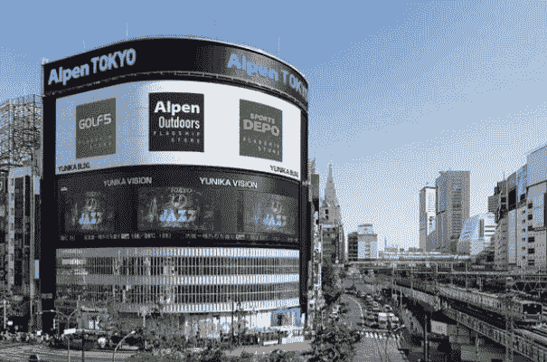
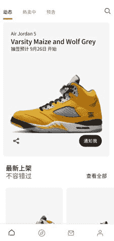
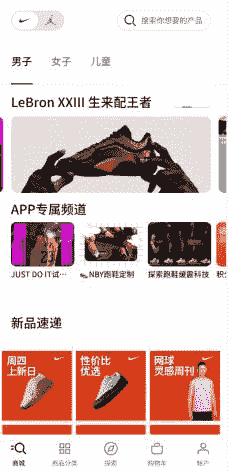
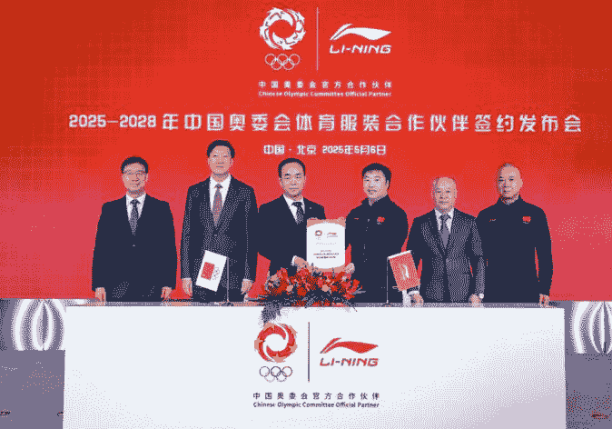
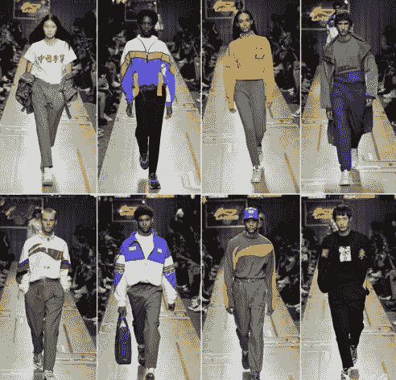
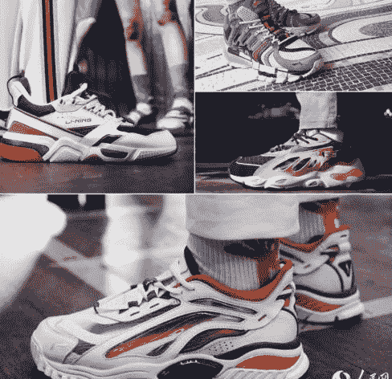
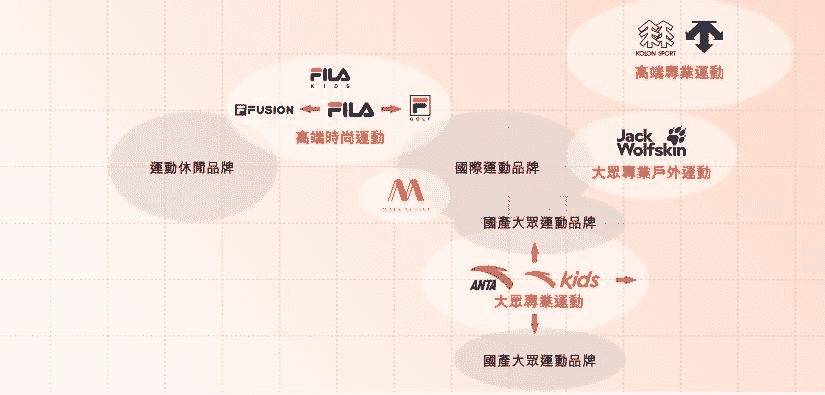

证券研究报告 | 行业专题研究

请仔细阅读本报告末页声明

纺织服饰

## 运动鞋服：国内外行业深度复盘，探寻本土运动公司增长关键

**美国/日本：经济波动下运动需求韧性强，龙头品牌重视产品以及品牌价值打造。**

**1）行业分析：**美国、日本体育产业腾飞并非偶然，而是特定历史时期多种因素共同作用的结果。在经济复苏的强劲浪潮下，民众消费能力提升，同时政府的国家政策起到了关键的催化作用，叠加奥运会等重要赛事的举办，激发社会体育热情，推动体育行业发展。后续尽管经济环境会有波动，但受益于居民运动健康热情的提升，运动参与以及运动鞋服需求韧性足，2022年美国健身俱乐部会员数量上涨3.7%至6890万人，同时2023年6岁及以上美国人的户外活动参与人数也增长了4.1%，日本2022~2024年居民运动鞋服支出也保持稳健增长。

**2）企业竞争要素：**产品力和品牌价值为国际运动品牌龙头发展核心。伴随运动鞋服行业的发展，国际运动品牌龙头Nike、adidas快速崛起，我们对其发展历程分析发现，产品研发和品牌力建设贯穿企业发展始终，在渠道建设层面主要依托零售商来进行同时进行适当的DTC布局。2024年下半年开始Nike处于去库阶段，目前仍在进行中；adidas受益于积极的产品策略，包括加强专业运动产品的开发力度，并通过高效的推广手段成功打造出Samba、Gazelle等经典鞋款吸引消费者，推动公司业绩在全球范围内实现复苏。

**中国：跑步/户外细分品类驱动增长，产品和品牌成为企业发展关键。**

**1）行业分析：**2022年以来，受益于健康意识的提升，居民跑步的参与度得到进一步提升，与此同时户外运动品类也正处于快速发展阶段。2024~2029年中国内地高性能户外服饰市场规模复合增速预计为16%。中长期来看，我们认为国内运动鞋服需求将进入一个更加专业、更加细分、更加多元的成熟发展期。

**2）企业竞争要素：**目前本土运动品牌的扩张逐步转向产品以及品牌驱动层面。在专业产品层面国内运动品牌公司均具备完善的研发设施，同时每年保持持续的研发投入，2024年安踏体育/李宁/特步国际/361度的研发费用率基本在2-3%之间，在持续的研发投入下，近年来在专业产品领域本土运动品牌研发成果显著，如安踏的氮科技、李宁的䨻、特步的XTEP-ACE科技等，同时品牌通过赞助专业赛事以及专业运动员的方式为品牌形象背书。在渠道运营层面，由于本土运动鞋服公司门店数量体量大，因此提升零售管理能力也已经是关系公司盈利能力提升的关键。

**投资建议：**Q3以来居民服装消费仍处于波动态势，其中运动鞋服板块表现预计优于纺服大盘，同时各综合性运动品牌库销比整体也维持在4-5左右的健康水平，当前我们在服装板块中仍持续看好运动鞋服赛道的长期增长性。

运动鞋服板块重点推荐业绩确定性较强的龙头公司【安踏体育】，公司集团化运营能力卓越，以迪桑特、Kolon Sport为代表的其他品牌分部增速优异，助力公司长期可持续增长，当前股价对应公司2025年PE为18倍；推荐长期业绩弹性较大的【李宁】，当前股价对应公司2025年PE为17倍；推荐跑步赛道运营领先的【特步国际】，短期主品牌表现稳健，新品牌索康尼长期收入和利润具备增长空间，当前股价对应公司2025年PE为11倍；关注361度、滔搏。

**风险提示：**消费力疲软及消费环境波动风险，门店扩张不及预期，电商业务建设不及预期，管理层团队优化不及预期，汇率波动风险。

**增持（维持）**

**行业走势**

| 股票代码 | 股票名称 | 投资评级 | EPS（元）2024A | EPS（元）2025E | EPS（元）2026E | EPS（元）2027E | PE 2024A | PE 2025E | PE 2026E | PE 2027E |
| --- | --- | --- | --- | --- | --- | --- | --- | --- | --- | --- |
| 02020.HK | 安踏体育 | 买入 | 5.56 | 4.82 | 5.47 | 6.20 | 15.2 | 17.5 | 15.4 | 13.6 |
| 02331.HK | 李宁 | 买入 | 1.17 | 0.92 | 0.98 | 1.07 | 13.4 | 17.1 | 15.9 | 14.7 |
| 01368.HK | 特步国际 | 买入 | 0.44 | 0.49 | 0.54 | 0.58 | 12.1 | 11.0 | 10.0 | 9.2 |
| 01361.HK | 361度 | 买入 | 0.56 | 0.61 | 0.69 | 0.77 | 9.2 | 8.4 | 7.4 | 6.6 |
| 06110.HK | 滔搏 | 买入 | 0.36 | 0.21 | 0.21 | 0.24 | 8.0 | 13.8 | 13.7 | 12.0 |

资料来源：Wind，国盛证券研究所

**作者**

分析师：杨莹
执业证书编号：S0680520070003
邮箱：yangying1@gszq.com

分析师：侯子夜
执业证书编号：S0680523080004
邮箱：houziye@gszq.com

分析师：王佳伟
执业证书编号：S0680524060004
邮箱：wangjiawei@gszq.com

**相关研究**

1、《纺织服饰：周专题：8月金银珠宝类零售额快速增长，服饰类零售增速稳健》2025-09-21

2、《纺织服饰：周专题：制造商8月营收公布，期待核心品牌商改善带动对应订单修复》2025-09-14

3、《纺织服饰：周专题：Lululemon发布FY2025Q2季报，公司营收增长7%，低于公司预期》2025-09-07

2025年09月29日

P.2 请仔细阅读本报告末页声明

## 内容目录

1. 美国/日本：经济波动下运动需求韧性强，龙头品牌重视产品以及品牌价值打造 ........................................................ 4

1.1 行业分析：体育赛事+国家政策推动体育产业发展，健康意识带动运动参与度提升 ............................................ 4

1.1.1 美国：从慢跑热向多元化运动方式发展，健康意识是推动行业发展重要动力 .................................. 4

1.1.2 日本：二战后日本经济复苏，叠加东京奥运契机，日本体育消费快速增长 ........................................ 5

1.2 企业竞争要素：产品力和品牌价值为国际运动品牌龙头发展核心 ..................................................................... 7

1.2.1 美国：产品/品牌建设始终是市场竞争的核心，渠道依托零售商进行拓展 ...................................... 7

1.2.2 日本：专业零售店+百货占据主导，公司重视品牌打造 ................................................................ 9

1.3 案例分析 ......................................................................................................................................................... 10

1.3.1 Nike：全球化扩张+强大的产品力驱动增长，短期去库进行时 ......................................................... 10

1.3.2 adidas库存去化+产品迭代顺利，业绩低谷已走出 .......................................................................... 13

2. 中国：跑步/户外细分品类驱动增长，产品和品牌成为企业发展关键 .................................................................... 16

2.1 行业分析：跑步、户外品类势头火热，同时新兴品类不断崛起 .................................................................. 16

2.2 企业竞争要素：品牌公司持续强化产品创新，完善品类布局 .......................................................................... 17

2.3 案例分析 ............................................................................................................................................................. 21

2.3.1 李宁：短期业绩波动，关注奥运周期公司基本面改善情况 .................................................................. 21

2.3.2 安踏体育：集团化运营能力卓越，带动公司业绩以及市值走强 ............................................................. 23

3. 板块估值分析与投资建议 ............................................................................................................................................ 25

3.1 估值分析：Q3以来板块估值有所提升，持续关注后续需求改善进度 .......................................................... 25

3.2 投资建议：关注板块核心标的【安踏体育、李宁、特步国际、361度】 ..................................................... 25

4. 风险提示 ..................................................................................................................................................................... 27

## 图表目录

图表1：20世纪70年代美国慢跑热 ......................................................................................................................................... 4

图表2：跑者世界《Runner's World》杂志 .................................................................................................................... 4

图表3：1955~2024年日本GDP走势（十亿日元） ......................................................................................................... 5

图表4：多项政策推进日本东京体育产业发展 .................................................................................................................. 6

图表5：2001~2024年日本两人及以上家庭运动鞋以及运动服装消费支出同比增速（%） ............................................... 6

图表6：日本箱根驿传马拉松赛事图 ................................................................................................................................ 6

图表7：Dick's Sporting Goods门店 .......................................................................................................................... 7

图表8：Big 5 Sporting Goods门店 ............................................................................................................................ 7

图表9：FY2010~FY2025 Nike北美批发以及DTC营收占比（%） .......................................................................... 8

图表10：Nike美国工厂店以及品牌自营店数量（家） ................................................................................................. 8

图表11：2009~2024年adidas公司批发/DTC营收占比（%） ............................................................................... 8

图表12：Alpen Tokyo东京旗舰店 ................................................................................................................................... 9

图表13：2010~2025年Nike市值走势（亿美元） ..................................................................................................... 10

图表14：Nike公司FY2010~FY2025营收及增速（亿美元，%） ........................................................................... 10

图表15：Nike公司FY2010~FY2025净利润及增速（亿美元，%） ....................................................................... 10

图表16：Nike重要签约以及合作企划 ............................................................................................................................ 11

图表17：FY2010~FY2025Nike品牌大中华区营收及增速（亿美元，%） .............................................................. 11

图表18：FY2018~FY2025Nike品牌分地区营收占比（%） ................................................................................. 11

图表19：Nike FY2010~FY2025 DTC/批发/其他业务营收占比（%） .......................................................................... 12

图表20：SNKRS APP、Nike APP ............................................................................................................................ 12

图表21：FY2009~FY2025 Nike公司库存（亿美元，%） .............................................................................. 12

图表22：2010~2025年adidas公司市值走势（亿欧元） ...................................................................................... 13

图表23：adidas 2010~2024年营收表现（亿欧元，%） .............................................................................. 13

图表24：adidas 2010~2024年净利润表现（亿欧元） .................................................................................. 13

图表25：adidas 2010~2024年大中华区营收表现（亿欧元，%） ................................................................. 14

图表26：adidas重要签约以及合作企划 ........................................................................................................ 14

图表27：adidas 2010~2024年存货（亿欧元） ............................................................................................. 15

2025年09月29日

**图表28：adidas 重点鞋款** ............................................................................................................... 15

**图表29：2014~2025H1 李宁分运动品类流水增速（%）** .................................................................. 16

**图表30：2019~2029 年中国内地高性能户外服饰行业市场规模（十亿元，%）** ............................ 17

**图表31：2016~2024 年上海马拉松报名人数（人）** ............................................................................ 17

**图表32：361 度骑行装备** .................................................................................................................... 17

**图表33：上海森兰匹克球场馆** ............................................................................................................. 17

**图表34：2011 年至今中国运动鞋服品牌门店数量（家）** .................................................................. 18

**图表35：2021~2025H1 安踏品牌电商/李宁公司电商/361 度公司电商专供品收入增速（%）** ........ 18

**图表36：2021~2025H1 安踏品牌电商/李宁公司电商/361 度公司电商专供品收入占比（%）** ........ 18

**图表37：2017~2024 运动鞋服公司研发费用率（%）** ...................................................................... 19

**图表38：李宁运动科学研究中心** ....................................................................................................... 19

**图表39：运动品牌核心产品对比** ....................................................................................................... 19

**图表40：2012~2024 年特步特跑族会员数量（万人）** ..................................................................... 20

**图表41：李宁签约中国奥委会** ........................................................................................................... 20

**图表42：2016~2025 年李宁市值走势（亿港元）** ............................................................................ 21

**图表43：2016~2024 年李宁公司营收及增速（亿元，%）** .............................................................. 21

**图表44：2016~2024 年李宁公司归母净利润及增速（亿元，%）** ................................................... 21

**图表45：2016~2024 年李宁公司归母净利率走势（%）** .................................................................. 22

**图表46：中国李宁巴黎时装周走秀** .................................................................................................... 22

**图表47：中国李宁巴黎时装周走秀** .................................................................................................... 22

**图表48：2016~2025 年安踏体育市值走势（亿港元）** ..................................................................... 23

**图表49：2016~2024 年安踏体育公司营收及增速（亿元，%）** ........................................................ 23

**图表50：2016~2024 年安踏体育公司归母净利润及增速（亿元，%）** .......................................... 23

**图表51：安踏体育品牌群** .................................................................................................................. 24

**图表52：2019~2025H1 安踏品牌/Fila 品牌/其他品牌营收增速（%）** ............................................. 24

**图表53：2019~2025H1 安踏品牌/Fila 品牌/其他品牌经营利润率（%）** ........................................ 24

**图表54：运动鞋服行业PE-NTM 走势** ............................................................................................... 25

**图表55：运动鞋服公司估值表（亿元，%）** ..................................................................................... 27

2025 年 09 月 29 日

---

## 1. 美国/日本：经济波动下运动需求韧性强，龙头品牌重视产品以及品牌价值打造

### 1.1 行业分析：体育赛事+国家政策推动体育产业发展，健康意识带动运动参与度提升

我们复盘美国、日本运动鞋服行业的发展发现，相关国家体育产业腾飞并非偶然，而是特定历史时期多种因素共同作用的结果。在经济复苏的强劲浪潮下，民众消费能力提升，同时政府的国家政策（通过立法、资金扶持、基础设施建设等）也起到了关键的催化作用，叠加奥运会等重要赛事的举办，激发社会体育热情，推动体育行业发展。后续尽管经济环境会有波动，但受益于居民运动健康热情的提升，运动参与以及运动鞋服需求韧性足。

#### 1.1.1 美国：从慢跑热向多元化运动方式发展，健康意识是推动行业发展重要动力

我们认为二战后美国运动鞋服行业的发展大致分为三个阶段：第一个阶段是从二战后到 1990 年代末，在这个阶段居民对于运动鞋服的消费驱动因素为健康意识的提升以及女性意识的崛起，带动慢跑热和女子运动流行；第二个阶段则是从 1990 年至 2020 年，社交属性强的各种运动项目逐步丰富，同时运动生活风潮兴起；第三个阶段则是从 2020 年至今，尽管美国经济有所波动，但居民健康意识进一步提升，带动居民运动鞋服需求稳健增长。

二战后到 1990 年：健康意识叠加女性意识崛起，美国慢跑热以及女子运动流行。二战后美国经济快速发展，在忙碌工作的同时美国中产阶级加大对于自身健康的重视程度，消费者寻求新的生活方式，20 世纪 60 年代美国慢跑热兴起并于 70 年代达到高峰，Nike 于 1974 年推出标志性的"Waffle Trainer"训练鞋，凭借优异的弹性和缓冲效果吸引跑者上脚，Nike 获得了优异的发展机会，1966 年成立的《跑者世界（Runner's World）》在 1967 年测评了 16 款跑鞋，后测评跑鞋数量快速增长；进入 80 年代后，美国女性权利得到重视，1972 年美国《教育法修正案第九条》生效，它确保任何接受联邦资金的机构不得在任何教育项目或体育活动中实行性别歧视，至此以后女子运动参与度快速提升。

**图表1：20 世纪 70 年代美国慢跑热**

**图表2：跑者世界《Runner's World》杂志**

资料来源：凤凰网，爱燃烧，国盛证券研究所

资料来源：凤凰网，爱燃烧，国盛证券研究所

1990 年至 2020 年：社交属性强的各种运动项目逐步丰富，同时运动生活风潮兴起。1990 年代开始，随着美国社会进一步对个人健康以及体态关注度提升，美国消费者的运动方式从竞技性强的"篮球+棒球+美式足球"三大项，逐渐扩展到跑步、健身、瑜伽等多种项目，运动的社交属性在这个过程中也变得越来越重要。后运动生活风潮兴起，以 Nike 为代表的运动品牌也在重新定义运动服饰，通过明星代言、奥运赞助等方式将运动服饰从专业赛场带到街头，将运动与时尚、潮流、街头文化结合，运动成为一种生活态度。

2020 年至今：尽管美国经济有所波动，但居民健康意识进一步提升，带动居民运动鞋服需求稳健增长。2020 年开始在全球卫生问题的负面影响下美国居民运动鞋服消费短期快速下降，Nike FY2020 Q4（2020 年 3~5 月）北美业务营收同比下降 46%，然而后续随着消费环境的改善，在健康意识推动下居民运动参与度进一步提升，根据全球健康与健身协会（IHRSA）发布的《2023 年美国健康与健身消费者报告》显示，2022 年美国健身俱乐部会员数量（6 岁及以上）创纪录的上涨 3.7%，达到 6890 万人，同时部分居民也在增加户外运动场景的参与度，2023 年 6 岁及以上美国人的户外活动参与人数增长了 4.1%，对比 2019 年增长 14.4%。2022~2023 年美国经济经历高通胀对非必需消费品造成负面影响，然而随着居民健康和健身习惯的延续，运动鞋服需求仍保持了稳健的表现，同时 Hoka、On 跑等新兴高端品牌的崛起在一定程度上也证明了美国消费者愿意为高品质运动用品买单。

#### 1.1.2 日本：二战后日本经济复苏，叠加东京奥运契机，日本体育消费快速增长

我们将二战后日本运动鞋服行业的发展大致分为两个阶段：第一个阶段是从二战后到 1990 年左右，第二个阶段则是从 1990 年至今。第一个阶段伴随着日本经济的繁荣，体育行业以及运动鞋服行业高速发展，居民运动参与度提升；第二个阶段则是随着日本经济泡沫破裂，运动鞋服行业增速放缓，但仍呈现一定的结构性机会。

**图表3：1955~2024 年日本 GDP 走势（十亿日元）**

资料来源：Wind，国盛证券研究所

二战后到 1990 年：经济腾飞带动国民购买力提升，适逢 1964 年东京奥运，在国家政策支持、校园体育活动繁荣下，日本运动鞋服行业快速发展。二战后随着日本经济的逐步复苏，国民的购买力得到提升，日本的运动鞋服行业开始发展，后日本成功申办 1964 年东京奥运会，在这一背景下日本政府于 1961 年出台第一部体育法律"《体育振兴法》"推动日本体育发展，同时东京奥运会的筹备直接带动了体育场馆、交通和媒体等基础设施的升级。奥运会的举办带动全民体育热潮，日本学校体育也得到进一步发展。

**图表4：多项政策推进日本东京体育产业发展**

资料来源：上规公司 SPC 公众号，国盛证券研究所

1990 年至今：日本经济进入"低增长常态"，运动鞋服市场增速放缓，行业增长点转向结构性机会，健康意识是重要推动力。面对经济的衰退，日本滑雪、高尔夫、游泳等相对高投入的运动项目需求减退，然而对比之下，参与门槛较低的慢跑、健身等活动则仍保持增长态势。日本的滑雪产业在上世纪八、九十年代达到高峰，1998 年滑雪人口曾达到 1800 万人，后因为经济不景气滑雪人口锐减，到 2020 年滑雪人口锐减到 430 万人；根据 R&A 发布的《全球高尔夫参与报告》显示 2023 年日本高尔夫人口约为 810 万名，1996 年则为 1200 万名，与此同时步行、散步、跑步等体育项目的参与度仍在持续提升，2020 年日本步行/散步/跑步项目的参与度为 28.3%/32.9%/10.6%，2018 年为 25.4%/30.9%/9.6%，居民参加体育锻炼的理由也主要是为了增进健康。

**图表5：2001~2024 年日本两人及以上家庭运动鞋以及运动服装消费支出同比增速（%）**

**图表6：日本箱根驿传马拉松赛事图**

资料来源：Wind，国盛证券研究所

资料来源：马拉松跑步百家号，国盛证券研究所

### 1.2 企业竞争要素：产品力和品牌价值为国际运动品牌龙头发展核心

国际运动品牌龙头重视产品研发和品牌力建设，贯穿企业发展始终。我们对国外运动鞋服行业龙头分析发现，美国/日本由于运动鞋服专业零售店发展较早，因此运动鞋服品牌的发展多是依托已有的多品牌集合零售店进行扩张，与此同时品牌方更加注重产品的设计研发以及品牌影响力的提升。

#### 1.2.1 美国：产品/品牌建设始终是市场竞争的核心，渠道依托零售商进行拓展

1950~2000 年：渠道拓展依托专业零售商，品牌公司业务重心为产品和品牌建设。在美国运动鞋服市场在早期的发展过程中，品牌公司多选择批发模式来进行经营，专业运动品牌零售商占主导地位。美国运动鞋服市场早期以专业零售商（Foot Locker）为主导，FY2012 Nike 北美业务营收为 88.4 亿美元，其中批发业务营收为 67.2 亿美元，Nike 公司于 1972 年成立，在 Nike 公司之前北美市场上就已经拥有了包括 Dick's Sporting Goods、Big 5 Sporting Goods 等知名的体育用品店。

**图表7：Dick's Sporting Goods 门店**

**图表8：Big 5 Sporting Goods 门店**

资料来源：体育大生意、迪克体育官网，国盛证券研究所

资料来源：体育大生意，国盛证券研究所

运动品牌借助重要赛事、运动员资源、核心产品提升市场知名度，和零售商建立紧密合作关系，并实现产品销售规模的快速扩张。面对专业运动鞋服用品零售商的主导地位，Nike、adidas 等运动品牌将业务重心放在产品以及品牌打造上，并基于此同零售商进行业务合作。

- **Nike**：1984 年 Nike 签约 NBA 新秀迈克尔乔丹，1985 年推出 Air Jordan 1，后随着乔丹在赛场上屡创佳绩以及 Nike 卓越的营销手段，AJ 系列受到消费者火热追捧，Foot Locker 作为现成的分销网络将 Nike 的高热度转化为实际的销售额，1998 年 Foot Locker 独家发售 Nike Air Max Plus 产品，将二者的关系进行深度巩固。

- **adidas**：1969 年 adidas 推出 Superstar 贝壳头球鞋，20 世纪 70 年代受到 NBA 球星的追捧，1971 年 adidas 同 NBA 球星贾巴尔签约进一步提升品牌在美国体育行业的影响力；在篮球之外，adidas 同时布局嘻哈音乐、网球等板块，70 年代推出以美国网球名将斯坦·史密斯命名的 Stan Smith 鞋款，后 adidas 通过和传奇嘻哈组合 RUN-D.M.C 合作，借助 Superstar 鞋款提升品牌在潮流领域的影响力。

2025 年 09 月 29 日

**2000** 年以来：品牌强化电商业务建设**+DTC** 战略实施，同时产品和品牌仍是重点。

进入**21** 世纪后，随着电商销售的兴起，品牌公司加大电商运营力度，同时线下推进直营店建设，以提升零售效率。**1）Nike**：2017 年Nike 提出Consumer Direct Offense 直面消费者战略，具体包括2 倍创新（加快产品创新节奏和规模）、2 倍速度（提升产品上市速度，加大数字化建设以提升供应链效率）、2 倍直接（加强自有电商平台以及自有旗舰店建设），通过CDO 战略为消费者提供更好的产品体验，FY2025Nike 北美DTC 业务营收占比为46%。**2）adidas**：2021 年提出Own the game 战略，该战略指导adidas 继续推动产品创新，与此同时提升消费者体验，渠道端重视DTC 建设。**3）lululemon**：lululemon 从创立之初就坚定地走DTC 路线，Lululemon 完全掌控了品牌形象、定价、产品体验和客户关系，确保了Lululemon 的高端定位和独特价值主张。

图表9：FY2010~FY2025 Nike 北美批发以及DTC 营收占比（%）

图表10：Nike 美国工厂店以及品牌自营店数量（家）

资料来源：公司公告，国盛证券研究所

资料来源：公司公告，国盛证券研究所

图表11：2009~2024 年adidas 公司批发/DTC 营收占比（%）

资料来源：公司公告，国盛证券研究所

在推进渠道优化的同时，**adidas** 以及**Nike** 仍然将产品和品牌作为投入重心。**1）**持续重视专业运动产品的研发，强化品牌专业性。专业性是Nike 和adidas 的立身之本，这一理念植根于品牌血脉，随着业务规模的扩张，Nike 和adidas 得以拥有更多的资源进入产品研发，Nike 于1995 年推出Zoom Air 气垫后广泛应用于篮球鞋以及跑鞋产品上，2013 年首次将创新的Nike Flyknit 技术与Air Max 超级缓冲技术合为一体推出Flyknit Air Max 跑鞋，2017 年推出ZoomX 缓震科技。**2）**在专业性产品外，运动鞋服品牌重视潮流以及运动生活领域的布局。Nike 同Supreme 进行合作开启联名风潮，后Nike 持续和各种艺术家、潮牌基于旗下产品进行联名复刻，助力Nike 业绩扩张。adidas 利用Originals 品牌线，主打品牌历史上经典鞋款的复刻与再设计，同时adidas 积极与知名设计师、潮牌、艺术家合作，打造话题联名。

## 1.2.2 日本：专业零售店**+**百货占据主导，公司重视品牌打造

同美国类似，日本运动品牌早期的发展也是依赖于专业的运动鞋服零售店以及百货公司，**21** 世纪后日本运动品牌逐步开设少量旗舰店以展示品牌形象，同时拓展电商业务。

在**21** 世纪之前，日本运动品牌拓展以来专业运动零售店来进行。由于日本的零售业发展较早，因此专业运动零售商拥有成熟的门店网络和分销体系，可以帮助品牌迅速覆盖全国市场，同时这些零售店通常聚焦多个知名运动品牌并提供专业的销售服务，日本最具代表的运动用品集团Alpen 销售品牌广泛。在专业零售店之外，运动品牌会采取在大型百货公司开设专柜的方式进行销售，这类百货公司多开设在重点城市的核心商圈。在这个时期，品牌方更多专注于产品设计生产以及品牌营销。

图表12：Alpen Tokyo 东京旗舰店

资料来源：公司官网，国盛证券研究所

进入**21** 世纪后，品牌公司一方面学习优衣库经验，日本运动品牌逐步向**SPA** 模式转型，加大对于零售业务的控制力度；另一方面逐步拓展电商业务。1984 年优衣库基于"产销一体化"理念在日本开设第一家店铺，确立了商品企划、生产、物流和销售一体化的SPA 模式，在该理念影响下，日本运动鞋服品牌美津浓、亚瑟士逐步开设自有的旗舰店，以提供给消费者完整的品牌体验和专业服务，2003 年亚瑟士首家直营门店Onitsuka Tiger Tokyo 旗舰店开业，与此同时随着电商平台的建立，品牌公司开始大规模投资自身官方网站建设。

## 1.3 案例分析

### 1.3.1 Nike：全球化扩张**+**强大的产品力驱动增长，短期去库进行时

**2010** 年以来**Nike** 的股价走势大体可以分为两个阶段：1）2010~2021 年：单边上行走势，2021 年末公司市值较2010 年初上涨超7 倍，核心驱动因素来源于Nike 产品力和品牌力的持续走强，带动公司在全球范围内扩张，业绩持续增长；2）2022 年至今：股价震荡下行阶段，受限于全球经济逆风以及产品竞争力走弱，公司库存去化缓慢，导致业绩表现低迷。

图表13：2010~2025 年Nike 市值走势（亿美元）

资料来源：Wind，国盛证券研究所，截至2025 年9 月26 日

**2010~2021** 年：市值上涨超**7** 倍，强产品力**+**品牌力**+**全球布局助力公司业绩持续走强。2010 年初公司市值约为320 亿美元，2021 年底达到2600 亿美元左右，我们判断公司市值的快速上涨一方面来源于利润规模的扩大，另一方面随着Nike 品牌力以及市场地位的提升，长期业绩的可持续性也被市场认可带动公司估值走高。FY2010（2009 年6 月~2010 年5 月）公司实现营收190 亿美元，净利润19 亿美元，FY2021（2020 年6 月~2021 年5 月）公司实现营收445 亿美元，净利润57 亿美元，营收/净利润CAGR 分别为8%/10.5%，呈现出稳定且快速的规模扩张态势。我们判断该阶段推动公司业绩规模扩张的直接动力一方面是Nike 自身产品力和品牌力处于上行周期奠定增长基础；另一方面在美国和欧洲市场之外，Nike 加大了对大中华区的业务扩张力度，带来了业绩增量。从公司战略层面来看，该阶段**Nike** 陆续提出两大战略：

图表14：Nike 公司FY2010~FY2025 营收及增速（亿美元，%）

图表15：Nike 公司FY2010~FY2025 净利润及增速（亿美元，%）

资料来源：Wind，国盛证券研究所

资料来源：Wind，国盛证券研究所

- **2008** 年提出**Category Offense** 品类进攻战略。该战略的实施将Nike 的核心架构转变为以运动品类为中心（包括跑步、篮球、足球、女子训练），每个品类对产品设计、创新研发、市场营销都具有主导权，在该战略的实施下，Nike 在专业运动以及潮流跨界方面均有建树，2017 Nike 发布中底技术ZoomX，搭载于Nike Zoom Vaporfly 4%上，中底超轻、柔软并能提供高达85%的能量回传。

与此同时受益于Nike 持续提升的产品力，Nike 在以大中华区为代表的国际市场中实现快速增长，FY2011 大中华区实现营收20.6 亿美元，同比增长18%，占Nike 公司营收的比重为10%（同期欧洲占比23%，北美占比36%），Nike 凭借强劲的产品力和品牌力，以及针对性的营销举措在中国市场实现了快速发展，FY2021 大中华区实现营收82.9 亿美元，占比19%。

图表16：Nike 重要签约以及合作企划

| 合作类别 | 合作产品 |
| --- | --- |
| 勒布朗·詹姆斯 | 篮球运动员 |
| 科比·布莱恩特 | 篮球运动员 |
| 凯文·杜兰特 | 篮球运动员 |
| 克里斯蒂亚诺·罗纳尔多 | 足球运动员 |
| 塞雷娜·威廉姆斯 | 网球运动员 |
| Virgil Abloh | Off-White 主理人 |
| Travis Scott | Rapper |
| Sacai | 日本时尚品牌 |
| Tom Sachs | 雕塑家 |

资料来源：Nike 官网，Fightclub 中文站，Supreme 情报网，国盛证券研究所

图表17：FY2010~FY2025Nike 品牌大中华区营收及增速（亿美元，%）

图表18：FY2018~FY2025Nike 品牌分地区营收占比（%）

资料来源：Wind，国盛证券研究所

资料来源：Wind，国盛证券研究所

- **2017** 年提出**Consumer Direct Offense** 战略。2017 年Nike 提出Consumer Direct Offense 直面消费者战略，具体包括三个方面（Triple Double Strategy），即2 倍创新（加快产品创新节奏和规模）、2 倍速度（提升产品上市速度，加大数字化建设以提升供应链效率）、2 倍直接（加强自有电商平台以及自有旗舰店建设），Nike 公司DTC 战略的实施通过优化公司业务模式，以为消费者提供更好的产品体验，从短期来看DTC 战略的实施直接带动公司DTC 营收占比提升，FY2018 Nike DTC 业务营收占比30%，FY2010 为15%，提升明显，与此同时透过Nike 自有的Nike App、SNKRS 等，强化消费者链接，面对公司全新战略的变革，资本市场也对Nike 公司给予了正向反馈。

图表19：Nike FY2010~FY2025 DTC/批发/其他业务营收占比（%）

图表20：SNKRS APP、Nike APP

资料来源：公司公告，国盛证券研究所

资料来源：SNKRS APP、Nike APP，国盛证券研究所

**2022** 年至今：全球经济逆风叠加**Nike** 自身市场竞争力受到冲击，库存去化缓慢，业绩走弱。2021 年下半年开始Nike 库存增加，FY2022 公司库存增加22.8%至84 亿美元，创历史新高，股价进入到下行通道。后2024 年开始（Nike 的FY2025）全球经济逆风背景下，Nike 面临新一轮的库存危机，同时随着流行风潮的转变，Nike 基本面走弱，FY2025 公司营收/净利润同比-10%/-44%，从股价表现来看目前Nike 市值约为1024 亿美元（2025/09/26），较2021 年末高点下降61%。

图表21：FY2009~FY2025 Nike 公司库存（亿美元，%）

资料来源：Wind，国盛证券研究所

### 1.3.2 adidas 库存去化**+**产品迭代顺利，业绩低谷已走出

**2010** 年以来**adidas** 的股价走势同**Nike** 的股价走势较为类似，大致分为了三个阶段：1）2010 到2021 年：adidas 顺应全球运动鞋服市场的东风，在业绩的快速增长背景下，公司股价也呈现单边上行走势；2）2022 年：由于库存的压力以及全球经济逆风，公司股价深度回调；3）2023~2025 年：库存去化顺利，同时随着Samba、Gazelle 等产品系列的发布，带动公司基本面改善，股价反弹上涨。

图表22：2010~2025 年adidas 公司市值走势（亿欧元）

资料来源：Wind，国盛证券研究所，截至2025 年9 月26 日

**2010~2021** 年：专业技术**+**潮流布局双驱动，驱动市值上涨。同Nike 相似，adidas 在2010~2021 年也呈现了快速增长的态势，2010 年公司收入/利润为120 亿/5.7 亿欧元，2021 年公司收入/利润为212/21 亿欧元，对于adidas 业绩快速增长的原因，我们认为一方面来源于adidas 在产品力方面的快速提升（包括专业产品以及运动时尚品类），在消费者心目中建立卓越的品牌形象；另一方面adidas 也在快速拓展大中华以及亚太市场，充实增长动能。从公司战略层面来看，该阶段公司陆续发布三大战略，接力助推公司增长：

图表23：adidas 2010~2024 年营收表现（亿欧元，%）

图表24：adidas 2010~2024 年净利润表现（亿欧元）

资料来源：Wind，国盛证券研究所

资料来源：Wind，国盛证券研究所

- **2010** 年提出**Route 2015** 战略，该战略重点强调adidas 加强产品创新，2013 年adidas 推出Boost 科技，后快速应用于跑鞋等重点产品上，例如Ultra Boost 等，同时在鞋面科技上adidas 也推出Primeknit 技术引发市场热度；另外在全球范围内推动零售网络扩张，着重加大对于北美、中国等市场的拓展力度，2010 年大中华区营收10 亿欧元，2017 年达到38 亿欧元。

## adidas 2010~2024年大中华区营收表现

资料来源：Wind，国盛证券研究所

2015年提出Creating the New立新战略，我们判断该战略的实施标志着adidas从产品导向转变为以消费者为中心，更快的响应市场需求，在原有的专业科技基础上，adidas加强与外部设计师的跨界合作力度，同时adidas在该阶段也在强调缩短从产品设计到上架时间，提升供应链灵活性；从市场拓展层面看，Creating the New战略重视六大关键城市，包括纽约、洛杉矶、伦敦、巴黎、上海以及东京，通过在这几个城市推出定制化的产品、举办独特的营销活动来推动全球业务增长。

### adidas重要签约以及合作企划

| 合作类别 | 合作产品 |
|---------|---------|
| 德里克·罗斯 | 篮球运动员，目前已经退役，此前推出多款签名鞋。 |
| 詹姆斯·哈登 | 篮球运动员，签约NBA头部球星哈登，推出签名鞋，加强了篮球市场布局。 |
| 梅西 | 足球运动员，阿迪达斯最重要的足球运动员，拥有专属签名鞋系列。 |
| Yohji Yamamoto | 日本设计师，创立Y-3系列，开创了时尚与运动品牌联名的新模式。 |
| Stella McCartney | 设计师，推出Adidas by Stella McCartney，专注于女性高端运动服饰。 |
| Jeremy Scott | 设计师，以夸张、大胆的设计闻名，特别是“翅膀鞋”系列。 |
| Kanye West | Rapper，创立Yeezy系列，彻底改变了球鞋文化和市场。 |
| Pharrell Williams | 歌手，推出Human Race系列，传递文化与人权理念。 |

资料来源：WWDC国际时尚特讯，adidas官网，发发奇购物网站，国盛证券研究所

2021年提出Own the Game战略，该战略指导adidas继续推动产品创新，与此同时提升消费者体验，积极推动数字化转型，加大对于会员计划的投资，通过数据分析更好的了解消费者；渠道端重视DTC建设。

2022年：全球经济环境波动，adidas在大中华区表现持续承压，同时供应链以及库存问题对adidas利润率造成负面压力。从2021年8月份开始股价进入下行通道，后续随着全球经济环境波动加剧，adidas同样产生供应链问题以及库存问题，侵蚀公司利润率，adidas股价持续下行直到2022年10月，根据公司披露2022年全年净利润同比下降71%至6.12亿欧元，截至2022年末公司库存为60亿欧元，也创下了历史新高。从市值表现来看，2022年末adidas市值为229亿欧元，对比2021年下半年高点的621亿欧元，下跌63%。

2023年至今：库存去化顺利，叠加新品销售优异，带动公司基本面改善，股价回升。2023年开始adidas重新聚焦于核心体育产品，一方面加强专业运动产品的开发力度（尤其是火热的跑鞋赛道），另一方面在Yeezy之后adidas通过高效的推广手段成功打造出Samba、Gazelle等经典鞋款吸引消费者，推动公司业绩在全球范围内实现复苏，2024年adidas营收同比增长11%至237亿欧元，实现净利润7.64亿欧元，同时公司库存也恢复到健康水平，多举措下带动股价从2022年底开始回升，目前adidas市值约为322亿欧元（2025/09/26），较2022年底的229亿欧元上涨40%。

### adidas重点鞋款

资料来源：公司官网，国盛证券研究所

总结：我们认为美国和日本体育产业的腾飞并非偶然，而是由经济复苏、政府政策扶持以及奥运会等重要赛事共同驱动，与此同时尽管目前经济环境有所波动，但得益于居民对健康生活的持续追求，这两个市场的运动参与度和运动鞋服需求依然保持着强劲的韧性。在这一发展过程中，国际运动品牌巨头Nike、adidas始终将产品研发和品牌建设作为核心发展要素，其中adidas通过积极的产品策略和高效的推广手段，成功打造出Samba和Gazelle等经典鞋款，不仅推动了业绩在全球范围内的复苏，也逐步走出了经营的泥潭。

## 中国：跑步/户外细分品类驱动增长，产品和品牌成为企业发展关键

### 行业分析：跑步、户外品类势头火热，同时新兴品类不断崛起

过去10多年中国体育用品行业经历过快速的发展阶段。中国运动鞋服市场零售规模从2007年的790亿元提升至2019年的3166亿元，对应CAGR为12.3%，伴随着中国运动鞋服行业的快速发展，无论是国产品牌还是国际品牌在中国都实现了优异的增长表现。若从细分品类来看，我们发现过去20年居民对于不同运动的参与度其实有着较为明显的变化。

在2019年之前，国内运动鞋服赛道中篮球、跑步均呈现快速发展态势。1）篮球：在2022年之前国内运动鞋服板块篮球运动呈现快速发展的态势，我们认为篮球运动的快速发展受益于Nike以及adidas在国内规模快速扩张，品牌方通过签约NBA球星深度绑定核心篮球人群。2）跑步：在篮球之外，随着国家政策的大力支持，在全民健身的口号下马拉松运动在国内也迎来了井喷式增长，2015年中国举办的马拉松赛事数量为134场，2017年就已经达到了1102场，在浓厚的运动氛围下，我们判断该阶段居民跑步参与度也呈现快速提升趋势。

2022年以来受益于健康意识的增强，居民跑步的参与度得到进一步提升，与此同时户外运动品类也正处于快速发展阶段。1）户外：根据伯希和招股书显示，中国内地高性能户外服饰市场2019年市场规模为539亿元，2024年增长至1027亿元，2019~2024年CAGR为13.8%，2029年预计达到2158亿元，2024~2029年CAGR为16%。2）跑步：据中国田径协会统计，2024年全国累计举办各级路跑赛事749场，总赛事规模达704.86万人次，较2023年同比增长100万人次，我们认为当前中国路跑赛事数量和参赛规模持续增长，反映出居民对跑步运动的参与热情。

中长期来看，我们认为国内运动鞋服需求将进入一个更加专业、更加细分、更加多元的成熟发展期。1）跑步品类凭借较低的门槛或仍将是国内消费者重要的运动方式，与此同时随着居民跑步参与度的提升，在跑步品类中的需求或也将有所细分，例如竞速跑、日常慢跑、越野跑等，不同跑者需求对应不同的跑鞋产品。2）小众、高消费、具有强社交属性的"圈层运动"将成为重要的增长动力，广义的户外运动将进一步细分出山地（徒步、露营、滑雪）、水上（冲浪、桨板）、陆地（匹克球、骑行等），新兴品类驱动增长。3）她经济持续火热，女性在运动消费领域的消费力正以前所未有的速度增长，女性消费者的运动需求将更加多元化，将成为所有品牌必须赢得的重要赛道。

### 企业竞争要素：品牌公司持续强化产品创新，完善品类布局

回顾中国运动品牌的发展，我们认为在品牌初创阶段，赞助赛事和运动员是品牌打响的关键。由于在初创阶段，品牌没有历史积累和用户认知，靠日常广告很难打进消费者心智，而赛事与运动员本身自带关注度和媒体曝光，能让品牌一次性触达大规模目标人群。例如在李宁品牌成立后凭借李宁本人的商业价值和赛事资源，李宁接连成为1990年亚运会、1992巴塞罗那奥运会、1996年亚特兰大奥运会中国代表团赞助商；安踏1999年起采用了"明星代言+CCTV"的营销手法，聘请了乒乓球世界冠军孔令辉作为品牌代言人；特步2007年首次赞助马拉松—西安城墙国际马拉松赛，标志特步品牌与跑步的首次结合。

2008年奥运会的举办为点燃体育行业的发展，在行业的高热度下，运动品牌依靠经销商渠道进入了拓店阶段，同时适逢国内电商的快速发展，品牌公司开始拓展电商业务。

线下渠道：依靠第三方经销商，开设独立门店进行拓展。在业务模式上，中国市场同日本以及美国类似，通过批发商这一角色实现产品的销售，与此同时Nike、adidas进入中国市场时也是通过滔搏、宝胜这一类零售商进行门店的开拓。然而相较于美国市场，中国并未形成类似Foot Locker这样的专业体育用品连锁店，而是通过开设独立的专柜或者专卖店的方式进行单一品牌产品销售，2011年安踏/李宁/特步/361度在中国拥有8000家左右门店。相较于国际品牌依靠零售商进行拓店，目前国内运动品牌自有门店较多，因此中长期来看我们预计强化门店的零售能力也是关系到品牌增长的重要因素。

线上业务：进入21世纪后中国互联网和电子商务快速崛起，淘宝、京东乃至后来的内容直播平台成为中国运动鞋服市场重要的销售渠道。对比美国、日本，中国零售业态最为重要的特征之一在电子商务的崛起，后抖音、小红书等社交电商、直播电商、内容电商等新的业态出现，电商进入多平台精细化运营阶段，与此同时随着电商占比的不断提升，电商平台的销售增速成为了公司业务规模扩张的重要驱动力。

在中国运动鞋服行业的发展过程中，本土运动品牌公司的科技研发经验也在不断积累，2019年开始本土运动品牌的扩张逐步转向产品以及品牌驱动层面。

针对专业产品，目前国内运动品牌公司均具备完善的研发设施，同时每年保持持续的研发投入。目前安踏集团建立了完整的研发体系，全球六大设计研发中心、70多所高校及科研机构、250多名专家、800多家供应商，共同参与建立了从实验室到赛场的全链路创新闭环。李宁研发团队涵盖运动人体科学、运动医学、纺织学、结构力学等多学科交叉的高级研发人才。特步2015年成立了X-Lab运动科学实验室，是我国体育行业首个针对鞋履测试、设计及研发的跑步专属研发中心。在持续的研发投入下，近年来在鞋服领域（尤其是跑鞋以及户外服装），本土运动品牌研发成果显著，如安踏的氮科技、李宁的䨻、特步的XTEP-ACE科技矩阵。

### 运动品牌核心产品对比

| 产品名称 | 售价（元） | 重点科技 |
|---------|-----------|---------|
| **李宁 竞速碳板系列** | | |
| 飞电5 Ultra | 2299 | 䨻丝鞋面、双组弜科技+超䨻中底、T1000全掌弹射型异构碳板、GCU外底 |
| 飞电5 Elite | 1299 | 䨻丝鞋面、超䨻中底、T1000全掌滚动型异构碳板、GCU外底 |
| 飞电5 Challanger | 799 | 䨻丝鞋面、超䨻中底、全掌加强筋铲型碳板、GCR外底 |
| **安踏 竞速碳板系列** | | |
| C10 Pro | 2599 | 弦科技鞋面、双层氮科技中底、双驱型碳板、仿生豹纹大底 |
| C202 6 Pro | 1699 | 弦科技鞋面、双层氮科技中底、弹射碳板、液态止滑橡胶外底 |
| C9 | 999 | 弦科技鞋面、双层氮科技中底、轻量滚动碳板、液态止滑橡胶外底 |
| C202 6 | 799 | 弦科技鞋面、双层氮科技中底、滚动碳板、液态止滑橡胶外底 |
| **特步 竞速碳板系列** | | |
| 160X 6.0 Monxter | 2599 | 轻韧鞋面、双层XTEP ACE科技中底、GT700碳板、XTEP DURA外底 |
| 160X 6.5 Pro | 1299 | 轻韧鞋面、双层XTEP ACE科技中底、GT700碳板、XTEP DURA外底 |
| 160X 6.5 | 999 | 轻韧鞋面、双层XTEP ACE科技中底、T700异构碳板、XTEP DURA外底 |
| 260X 2.0 | 799 | 贾卡鞋面、XTEP ACE科技中底、T400异构碳板、XTEP DURA外底 |
| **361度 竞速碳板系列** | | |
| 飞飚Future 2.0 | 1299 | 碳丝鞋面、双层CQT EXTREM3中底、动态碳板、RPU外底 |
| 飞飙2 | 999 | 碳丝鞋面、CQT EXTREM3中底+CQT FLAM3中底、动态碳板、RPU外底 |
| 飞燃4 | 799 | 碳丝鞋面、双层CQT FLAM3中底、动态碳板、RPU外底 |

资料来源：天猫旗舰店，国盛证券研究所

**P.20** 请仔细阅读本报告末页声明

在专业层面的营销，品牌公司多通过赞助专业赛事以及专业运动员的方式为品牌形象背书。目前来看基于跑步赛道的高热度，以特步为代表，本土运动品牌公司加大了对于马拉松赛事以及马拉松运动员的赞助力度，展示旗下专业跑鞋产品，自上而下影响大众消费者；而在篮球领域，尽管整体的热度相对跑步较弱，但品牌公司对于核心篮球资源（例如NBA球星、CBA）等仍保持稳定的投入。在细分运动之外，品牌公司纷纷加大了对于亚运会、奥运会等综合性赛事的赞助力度，全方位提升品牌曝光。

图表40：2012~2024年特步特跑族会员数量（万人）

资料来源：公司公告，国盛证券研究所

图表41：李宁签约中国奥委会

资料来源：中国日报网，国盛证券研究所

针对运动生活产品，目前由于消费环境波动，品牌公司投入较少。2018~2021年国潮概念曾一度火热，2018年李宁以"悟道"为主题登上纽约时装周，将汉字、复古运动服等元素重新演绎，一举引爆"中国李宁"的潮流，后各个运动品牌也发布自己的潮流产品线，例如特步的XDNA系列。然而2022年开始面对消费环境的波动，我们判断居民对于运动生活产品的需求下降，转而追逐专业性更强的功能性产品，因此运动品牌也暂时性的放缓了对于运动生活方式产品的开发力度。然而中长期来看，随着消费环境的逐步改善，运动生活有望成为推动公司业绩持续增长的重要动力。在前文中我们对Nike以及adidas的复盘来看，除了专业性的篮球鞋、足球鞋、跑鞋等产品，让Nike以及adidas实现破圈的重要关键是品牌在潮流领域的突破和影响力，2024~2025年adidas的复苏在很大程度上也同Samba、Gazelle等经典潮流鞋款的销售息息相关。

**P.21** 请仔细阅读本报告末页声明

## 2.3 案例分析

### 2.3.1 李宁：短期业绩波动，关注奥运周期公司基本面改善情况

**2016**年以来跟随公司基本面的变动，李宁的市值经历了过山车走势，其过程大体可以分为三个阶段：1）2016~2018年：李宁明确专业运动定位，带动公司业绩重回增长轨道；2）2019~2021年：国潮兴盛，本土品牌崛起，李宁估值提升明显；3）2022年至今：消费环境波动，李宁基本面承压，市值回调。

图表42：2016~2025年李宁市值走势（亿港元）

资料来源：Wind，国盛证券研究所，截至2025年9月26日

图表43：2016~2024年李宁公司营收及增速（亿元，%）

资料来源：Wind，国盛证券研究所

图表44：2016~2024年李宁公司归母净利润及增速（亿元，%）

资料来源：Wind，国盛证券研究所

**2016~2018**年：李宁明确专业运动定位，带动公司业绩重回增长轨道。2011年李宁公司业绩同比下滑65%，2012-2014年业绩连续三年亏损，2015年李宁在原有改革措施的基础上，将"创造体验"作为新时期的重要战略核心，通过提升"产品体验、购买体验、运动体验"全方位为消费者打造独特体验价值，建立品牌核心竞争力，2015年公司业绩转正约为1400万元，2016年公司业绩大幅增长至6.4亿元，2018年公司进一步以消费者需求为核心，明确"单品牌、多品类、多渠道"的整体发展战略，从股价表现来看，随着公司新战略的实施，以及基本面的持续改善，2015/2016/2017/2018年李宁市值分别上涨11%/16%/30%/33%，呈现单边上行的趋势。

**P.22** 请仔细阅读本报告末页声明

图表45：2016~2024年李宁公司归母净利率走势（%）

资料来源：Wind，国盛证券研究所

**2019~2021**年：国潮风**+**居民健康意识催化，带动中国本土运动品牌迎来发展黄金期，李宁市值涨幅领先行业。2018年李宁登录纽约时装周，以"悟道"为主题发布了全新系列，首次将"中国李宁"这四个字以醒目的汉字形式呈现在服装和鞋履上，这次亮相融合了复古运动风、街头潮流和中国文化元素，瞬间引爆了国内外的社交媒体，李宁国潮属性显现。2021年国潮概念热度兴盛，同时随着居民健康意识提升，中国本土运动品牌迎来了发展黄金期，其中李宁作为由专业运动员创立的品牌，叠加中国李宁的爆火，在专业+国潮双重属性的带动下，李宁股价大涨，2019/2020/2021年李宁归母净利润同比+110%/+13%/+136%，市值分别+180%/+130%/+61%。

图表46：中国李宁巴黎时装周走秀

资料来源：人民网，国盛证券研究所

图表47：中国李宁巴黎时装周走秀

资料来源：人民网，国盛证券研究所

**2022**年以来，国内消费环境波动，李宁业绩下行。2022年以来国内消费环境整体波动，我们判断李宁作为定位较高的本土运动品牌，终端需求性相对较弱，同时出于控制库存的需要，我们判断李宁在发货层面也较为谨慎，公司基本面承压，2022/2023/2024年公司归母净利润同比分别+1.3%/-21.6%/-5.5%。从股价层面来看，随着基本面的走弱，李宁自身的市值也持续下跌，2022/2023/2024年分别-20%/-69%/-18%，目前公司市值约为438亿港元（2025/09/26）。

**P.23** 请仔细阅读本报告末页声明

### 2.3.2 安踏体育：集团化运营能力卓越，带动公司业绩以及市值走强

安踏体育的市值在**2021**年中的高点后，也开始回调，**2016**年**~2025**年股价走势可以分为三个阶段。1）2016~2020年：安踏集团正式确立多品牌的发展路线，在Fila之后加快多品牌收购步伐，带动公司估值提升；2）2021年：本土品牌崛起，叠加安踏集团旗下Fila利润快速增长，带动公司业绩表现优异；3）2022年至今：消费大盘波动，安踏集团增速也有所放缓导致杀估值。但在集团化运营能力的支撑下公司仍保持稳健的增长态势。

图表48：2016~2025年安踏体育市值走势（亿港元）

资料来源：Wind，国盛证券研究所，截至2025年9月26日

图表49：2016~2024年安踏体育公司营收及增速（亿元，%）

资料来源：Wind，国盛证券研究所

图表50：2016~2024年安踏体育公司归母净利润及增速（亿元，%）

资料来源：Wind，国盛证券研究所

**2016~2020**年：多品牌集团化战略加快，公司业绩规模快速扩张。2009年公司收购Fila，标志着多品牌战略的开端，后陆续将英国运动休闲品牌Sprandi、日本高端专业运动品牌Descente、韩国户外品牌Kolon Sport等纳入集团品牌矩阵中，2019年联合财团收购亚玛芬体育，公司正式进入单聚焦、多品牌、全渠道的发展阶段。从公司业绩层面来看，2020年安踏体育实现营收/归母净利润355/52亿元，2016/2017/2018/2019/2020年归母净利润增速分别为+17%/+29%/+33%/+30%/-3.4%。从股价走势来看2016/2017/2018/2019/2020年公司市值涨幅分别为+13%/+58%/+9%/+88%/+78%，我们判断公司股价上涨背后的核心因素在于市场对于公司多品牌集团化运营能力的认可。

**P.24** 请仔细阅读本报告末页声明

图表51：安踏体育品牌群

资料来源：公司公告，国盛证券研究所

**2021**年：本土品牌崛起，安踏集团旗下**Fila**利润快速增长，带动公司业绩表现优异。随着居民健康意识的提升中国运动鞋服市场快速增长，进入2021年国潮概念快速崛起，安踏此前连续多年赞助奥委会已经极大的提升了品牌影响力，在国潮概念下，公司受益匪浅。2021年公司营收同比增长39%至493亿元，归母净利润同比增长50%至77亿元，从股价层面来看，2021年7月末安踏体育市值达到高峰超5000亿港元，较年初上涨42%。

**2022**年以来：消费环境波动，安踏体育凭借集团化优势业绩增长稳健性仍较为优异。2021年中公司市值达到高点后开始回落，同时从2022年开始国内的整体消费环境表现较弱，安踏体育2022年营收增长8.8%至537亿元，归母净利润下降2%至76亿元，2023~2025年整体的消费环境仍处于波动态势，公司股价处于震荡区间。

图表52：2019~2025H1安踏品牌/Fila品牌/其他品牌营收增速（%）

图表53：2019~2025H1安踏品牌/Fila品牌/其他品牌经营利润率（%）

资料来源：公司公告，国盛证券研究所

资料来源：公司公告，国盛证券研究所

总结：过去中国运动鞋服市场经历了高速增长，如今市场的主要驱动力已转向跑步和户外等细分品类，中国居民对运动的参与度仍保持着强劲的韧性，从市场竞争角度来看我们认为中国运动品牌正在进入一个新的发展阶段，即品牌和产品建设阶段，后续产品力和品牌力的表现将成为影响公司发展的核心因素，与此同时本土运动品牌再仅仅依靠大规模的门店扩张，而是更专注于通过优化零售效率来提升竞争力。

**P.25** 请仔细阅读本报告末页声明

## 3. 板块估值分析与投资建议

### 3.1 估值分析：Q3以来板块估值有所提升，持续关注后续需求改善进度

运动鞋服综合性品牌流水表现稳健，细分赛道品牌增速优异。正如前文所述，2024~2025年面对消费环境的波动，国内运动鞋服行业整体仍呈现了稳健的增长情况，聚焦细分赛道的品牌（迪桑特、Kolon Sport、索康尼等）受益于赛道优质以及品牌公司卓越的运营能力呈现出优于大盘的增速。同时从库存层面来看，我们判断目前各综合性运动品牌的库存管理能力持续提升，库销比基本维持在4-5个月左右的合理水平。中长期来看，我们认为运动板块稳健增长态势仍有望延续，同时细分领域仍将存在明显增长优势。

从估值层面来看，**2025Q3**以来板块整体估值较低点有所提升。从2021年下半年开始运动鞋服板块公司的整体估值都有所回落，2021年中安踏体育/李宁/特步国际/361度PE-NTM为45/64/39/16倍，2025年初安踏体育/李宁/特步国际/361度的估值为14/11/10/6倍，估值回落的核心原因在于消费环境波动以及资本市场情绪较弱，板块公司的长期盈利预测下修导致。2025Q3开始，各公司的估值水平有所提升，我们判断核心原因一方面来源于宏观经济处于波动复苏阶段，另一方面来源于资本市场情绪改善。

图表54：运动鞋服行业PE-NTM走势

资料来源：Wind，国盛证券研究所，截至2025年9月26日

### 3.2 投资建议：关注板块核心标的【安踏体育、李宁、特步国际、361度】

**Q3**以来居民服装消费仍处于波动态势，其中运动鞋服板块表现预计优于纺服大盘，同时各综合性运动品牌库销比整体也维持在**4-5**左右的健康水平，当前我们在服装板块中仍持续看好运动鞋服赛道的长期增长性。运动鞋服板块重点推荐业绩确定性较强的龙头公司【安踏体育】，公司集团化运营能力卓越，以迪桑特、Kolon Sport为代表的其他品牌分部增速优异，助力公司长期可持续增长，当前股价对应公司2025年PE为18倍；推荐长期业绩弹性较大的【李宁】，当前股价对应公司2025年PE为17倍；推荐跑步赛道运营领先的【特步国际】，短期主品牌表现稳健，新品牌索康尼长期收入和利润具备增长空间，当前股价对应公司2025年PE为11倍；关注361度、滔搏。

- 安踏体育：短期终端运营稳健，集团化能力显著。1）短期跟踪：公司2025H1营收同比增长14.3%至385亿元，归母净利润同比下降8.9%至70.31亿元（剔除2024H1公司因Amer Sports上市产生的约16亿元一次性收益后，归母净利润增长14.5%），归母净利率下降4.7pcts至18.2%（剔除2024H1的一次性收益后，利润率保持平稳），整体表现优异。2）长期看点：公司核心竞争优势在于多品牌

**P.26** 请仔细阅读本报告末页声明

集团化运营能力卓越，其中安踏品牌明确大众定位，拓宽产品线+门店优化，稳健增长可期，Fila目前重回增长轨道，长期持续推进功能性产品占比提升，聚焦单店运营，有望实现高质量增长；以迪桑特、Kolon Sport代表的户外品牌所处赛道热度持续，长期有望快速增长。3）盈利预测：我们预计公司2025-2027年归母净利润为135.43/153.56/174.49亿元，对应2025年PE为18倍，维持"买入"评级。4）风险提示：终端需求下滑；多品牌及海外业务开展不顺；人民币汇率变动带来业绩波动。

- 李宁：**2025H1**经营超预期，关注公司长期业绩改善。1）短期跟踪：2025H1公司营收同比增长3.3%至148.17亿元，归母净利润同比下降11%至17.4亿元，归母净利率同比下降1.9pcts至11.7%，归母净利润下降主要系预提所得税所致，剔除该因素后整体表现超预期。2）长期看点：李宁立足专业运动定位，在传统的核心跑步/篮球品类基础上持续推进多品类探索，包括户外、网球、匹克球等项目，丰富李宁品类矩阵，为公司长期增长积蓄动能；渠道端公司加快对低效店铺的关停整改以提升直营渠道的利润率表现；于此同时面对消费下沉的现象，公司借助经销商力量拓展新兴市场门店，抓住生意机会；营销端2025年李宁加大营销投放力度，一方面签约中国奥委会增加品牌曝光，另一方面加大跑步、篮球、羽毛球、乒乓球等品类的营销投放力度，为长期市占率提升奠定基础。3）盈利预测：我们预计公司2025~2027年业绩为23.66/25.40/27.59亿元，对应2025年PE为17倍，维持"买入"评级。4）风险提示：消费环境波动，盈利能力提升速度不达预期，门店优化不及预期。

- 特步国际：**2025H1**经营表现优异，长期跑步赛道竞争力稳固。1）短期跟踪：公司2025H1持续经营业务营收同比增长7.1%至68.4亿元，归母净利润同比增长21.5%至9.1亿元，净利率同比提升1.6pcts至13.4%，若剔除已终止的KP业务2024H1产生的亏损约1.06亿元后，公司持续经营业务净利润增长6.4%。2）长期看点：特步主品牌秉持专业赋能大众的战略，旗舰跑鞋矩阵持续丰富，在品牌建设方面，特步加强私域建设占领消费者心智，品牌护城河稳固；索康尼品牌在跑步领域的声量持续提升，专业跑者首选品牌的市场地位得到巩固，期待后续利润贡献。3）盈利预测：我们预计公司2025-2027年归母净利润为13.65/15.04/16.31亿元，对应2025年PE为11倍，维持"买入"评级。4）风险提示：消费环境波动、渠道优化不及预期、索康尼经营表现不及预期。

- **361** 度：业绩稳健增长，营运效率持续提升。1）短期跟踪：公司2025H1营收同比增长11%至57亿元，归母净利润同比增长8.6%至8.6亿元，归母净利率同比-0.4pcts至15%。2）长期看点：361度旗下跑步、篮球品类产品力和品牌力均处于持续升级过程中，目前在跑步领域公司已经搭建起完整的跑鞋矩阵；361度儿童延续专业运动基因，产品覆盖跑步、篮球、跳绳等多品类维度，满足广大青少年运动需求；公司电商产品同线下形成有效区隔，以产品的差异化巩固的电商业务的优势。3）盈利预测：我们预计公司2025-2027年归母净利润为12.61/14.20/15.88亿元，现价对应2025年PE为8倍，维持"买入"评级。4）风险提示：门店拓展与整改力度不及预期、消费环境复苏不及预期，人民币汇率变动带来业绩波动。

## 4. 风险提示

消费力疲软及消费环境波动风险。当前海外及国内消费环境仍处于波动态势，后续倘若消费力修复不及预期，或对各公司终端流水造成影响。

门店扩张不及预期。在消费疲软的情况下，各公司的门店扩张会相对谨慎，新品牌的开展也会受到影响。

电商业务建设不及预期。目前电商业务在各个品牌公司中的收入占比较高，为了谋求稳健增长，公司加强各个平台间的精细化运营效率，倘若后续电商业务推进不及预期，或将对品牌公司收入业绩表现造成影响。

管理层团队优化不及预期。为了推进公司各项业务的发展，部分公司对持续对管理团队进行优化调整，该事项或将对利润造成负面影响。

汇率波动风险。部分服饰制造公司及品牌公司存在海外业务，汇率波动会从收入及汇兑损益等层面对于公司财务表现造成影响。

### 图表55：运动鞋服公司估值表（亿元，%）

| 公司 | 收入（亿元）24A | 收入（亿元）25E | 收入（亿元）26E | 收入YOY 24A | 收入YOY 25E | 收入YOY 26E | 归母净利润（亿元）24A | 归母净利润（亿元）25E | 归母净利润（亿元）26E | 归母净利润YOY 24A | 归母净利润YOY 25E | 归母净利润YOY 26E | PE 24A | PE 25E | PE 26E |
|---|---|---|---|---|---|---|---|---|---|---|---|---|---|---|---|
| 安踏体育 | 708.26 | 788.11 | 877.91 | 13.6% | 11.3% | 11.4% | 155.96 | 135.43 | 153.56 | 52.4% | -13.2% | 13.4% | 15.2 | 17.5 | 15.4 |
| 李宁 | 286.76 | 289.19 | 308.08 | 3.9% | 0.8% | 6.5% | 30.13 | 23.66 | 25.4 | -5.5% | -21.5% | 7.4% | 13.4 | 17.1 | 15.9 |
| 特步国际 | 135.77 | 145.19 | 157.85 | -5.4% | 6.9% | 8.7% | 12.38 | 13.65 | 15.04 | 20.2% | 10.3% | 10.2% | 12.1 | 11.0 | 10.0 |
| 361度 | 100.74 | 112.24 | 125.34 | 19.6% | 11.4% | 11.7% | 11.49 | 12.61 | 14.2 | 19.5% | 9.8% | 12.5% | 9.2 | 8.4 | 7.4 |

资料来源：Wind，国盛证券研究所预测，汇率为1港元=0.91人民币元，估值日期为2025年9月25日

## 免责声明

国盛证券有限责任公司（以下简称"本公司"）具有中国证监会许可的证券投资咨询业务资格。本报告仅供本公司的客户使用。本公司不会因接收人收到本报告而视其为客户。在任何情况下，本公司不对任何人因使用本报告中的任何内容所引致的任何损失负任何责任。

本报告的信息均来源于本公司认为可信的公开资料，但本公司及其研究人员对该等信息的准确性及完整性不作任何保证。本报告中的资料、意见及预测仅反映本公司于发布本报告当日的判断，可能会随时调整。在不同时期，本公司可发出与本报告所载资料、意见及推测不一致的报告。本公司不保证本报告所含信息及资料保持在最新状态，对本报告所含信息可在不发出通知的情形下做出修改，投资者应当自行关注相应的更新或修改。

本公司力求报告内容客观、公正，但本报告所载的资料、工具、意见、信息及推测只提供给客户作参考之用，不构成任何投资、法律、会计或税务的最终操作建议，本公司不就报告中的内容对最终操作建议做出任何担保。本报告中所指的投资及服务可能不适合个别客户，不构成客户私人咨询建议。投资者应当充分考虑自身特定状况，并完整理解和使用本报告内容，不应视本报告为做出投资决策的唯一因素。

投资者应注意，在法律许可的情况下，本公司及其本公司的关联机构可能会持有本报告中涉及的公司所发行的证券并进行交易，也可能为这些公司正在提供或争取提供投资银行、财务顾问和金融产品等各种金融服务。

本报告版权归"国盛证券有限责任公司"所有。未经事先本公司书面授权，任何机构或个人不得对本报告进行任何形式的发布、复制。任何机构或个人如引用、刊发本报告，需注明出处为"国盛证券研究所"，且不得对本报告进行有悖原意的删节或修改。

## 分析师声明

本报告署名分析师在此声明：我们具有中国证券业协会授予的证券投资咨询执业资格或相当的专业胜任能力，本报告所表述的任何观点均精准地反映了我们对标的证券和发行人的个人看法，结论不受任何第三方的授意或影响。我们所得报酬的任何部分无论是在过去、现在及将来均不会与本报告中的具体投资建议或观点有直接或间接联系。

## 投资评级说明

投资建议的评级标准

评级标准为报告发布尔日后的6个月内公司股价（或行业指数）相对同期基准指数的相对市场表现。其中A股市场以沪深300指数为基准；新三板市场以三板成指（针对协议转让标的）或三板做市指数（针对做市转让标的）为基准；香港市场以摩根士丹利中国指数为基准，美股市场以标普500指数或纳斯达克综合指数为基准。

### 股票评级

- 买入：相对同期基准指数涨幅在15%以上
- 增持：相对同期基准指数涨幅在5%~15%之间
- 持有：相对同期基准指数涨幅在-5%~+5%之间
- 减持：相对同期基准指数跌幅在5%以上

### 行业评级

- 增持：相对同期基准指数涨幅在10%以上
- 中性：相对同期基准指数涨幅在-10%~+10%之间
- 减持：相对同期基准指数跌幅在10%以上

## 国盛证券研究所

**北京**

地址：北京市东城区永定门西滨河路8号院7楼中海地产广场东塔7层

邮编：100077

电话：021-38124100

**上海**

地址：上海市浦东新区南洋泾路555号陆家嘴金融街区22栋

邮编：200120

邮箱：gsresearch@gszq.com

**南昌**

地址：南昌市红谷滩新区凤凰中大道1115号北京银行大厦

邮编：330038

传真：0791-86281485

邮箱：gsresearch@gszq.com

**深圳**

地址：深圳市福田区福华三路100号鼎和大厦24楼

邮编：518033

邮箱：gsresearch@gszq.com

2025年09月29日

