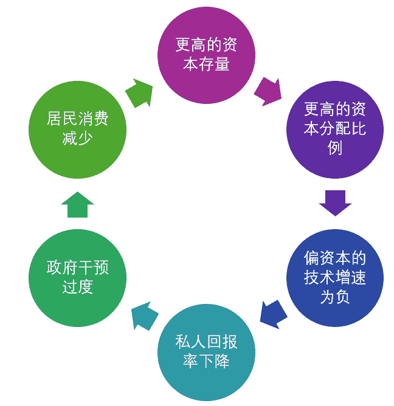

请仔细阅读本报告末页声明

证券研究报告 | 宏观经济研究·专题报告

2025年09月19日

宏观经济研究

# 中国经济结构失衡分析

自中国改革开放以来已接近半个世纪，市场化改革一直在努力，部分领域经济结构出现失衡。我们将通过理论和实证的方法来分析结构失衡的原因，并从中找出解决结构失衡的方法。

在经济增长理论中，一国经济增长分为两个阶段：赶超阶段和平衡增长阶段。干中学模型强调的是赶超阶段中资本积累带来的学习效应，定向技术增长模型强调的是在长期平衡增长路径上研发带来的劳动增强型技术进步。

单纯靠市场自发学习，这种知识外溢的作用无法发挥出来。中央计划者的角色（也即是政府）就是通过政策干预以内部化学习的外部性，使资本积累达到社会最优水平。但如果干预不足或者干预过度则会导致经济失衡，这取决于政策涉及的合理性和对学习弹性系数的准确估计。通过实证，我们发现中国在这两个阶段出现了干预力度偏大的现象：1978-1992和2012-至今，我国也因此出现了部分领域经济结构失衡。

只有持续通过市场化改革、减少不必要的干预、调整收入分配结构和转变创新机制，才能纠正结构失衡，让中国经济进入更长期增长的新阶段。

风险提示：国内宏观经济政策不及预期；数据提取不及时；财政政策、货币政策超预期；模型假设较现实条件更严格；模型本身与真实世界存在偏差的风险。

作者

分析师蒋飞

执业证书编号：S1070521080001

邮箱：jiangfei@cgws.com

联系人刘畅

执业证书编号：S1070123120014

邮箱：liuchang2@cgws.com

相关研究

- 1、《美联储谨慎降息，警惕二次通胀风险——美联储9月议息会议点评》2025-09-18
- 2、《经济延续放缓，政策调控紧迫性增加——8月经济数据点评》2025-09-16
- 3、《流动性条件仍良好——8月金融数据点评》2025-09-13

宏观经济研究·专题报告

P.2

请仔细阅读本报告末页声明

内容目录

- 一、理论分析 ......................................................................................................................................... 3
- 二、政府干预 ......................................................................................................................................... 6
- 三、实证分析 ......................................................................................................................................... 7
- 四、结构失衡 ###](#) ............................................................................................................................... 11
- 五、改革措施 ................................................................……………………………………………….. 14
- 风险提示 ................................................................................................................................................. 16

图表目录

- 图表1：CD函数下的GDP拟合值与实际值 ........................................................................................................ 8
- 图表2：CD函数下的资本平均回报率拟合值与实际值 ......................................................................................... 8
- 图表3：CD函数下的拟合uk和实际uk的走势图 ................................................................................................ 8
- 图表4：外生模式下拟合值和实际GDP的走势图 ............................................................................................ 9
- 图表5：内生模式下拟合值、CD拟合值和实际GDP的走势图 .......................................................................... 10
- 图表6：CES函数下的资本平均回报率拟合值与实际值 ..................................................................................... 10
- 图表7：CES函数下的拟合uk和实际uk的走势图 ............................................................................................. 10
- 图表8：政府干预力度 ...................................................................................................................................... 11
- 图表9：中国实际和模型资本收入份额（%） .................................................................................................... 12
- 图表10：中国实际和模型劳动收入份额（%） .................................................................................................. 12
- 图表11：影响机制 ............................................................................................................................................ 13
- 图表12：单位有效劳动的产出和私人需求的关系（万元/人） ............................................................................ 14

宏观经济研究·专题报告

P.3

请仔细阅读本报告末页声明

自中国改革开放以来已接近半个世纪，市场化改革一直在努力，但部分领域经济结构出现失衡。我们将通过理论和实证的方法来分析结构失衡的原因，并从中找出解决结构失衡的方法。

## 一、理论分析

在经济增长理论中，一国经济增长分为两个阶段：赶超阶段和平衡增长阶段。在初始要素禀赋自然给定的情况下，技术进步是推动经济发展的重要因素。干中学模型和定向技术增长模型分别描述了这两个不同阶段的技术进步机制，干中学模型强调的是赶超阶段中资本积累带来的学习效应，定向技术增长模型强调的是在长期平衡增长路径上研发带来的劳动增强型技术进步。

本文用CES生产函数形式构建一个统一框架，介绍技术进步在经济发展从干中学模型向定向技术增长模型演化过程中的作用。

$$Y_t = [a(A_k K_t)^\rho + (1-a)(A_l L_t)^\rho]^{1/\rho}$$

其中：Y是收入或产出

K是资本投入

L是劳动投入

a是初始分配比例

ρ是替代参数¹，替代弹性σ = 1/(1-ρ)

$A_k$是偏资本增长的技术水平

$A_l$是偏劳动增长的技术水平

技术进步是由前期的学习效应和后期的研发效应共同驱动的，资本存量较少时，主要是通过投资带动技术的进步；在资本存量较多时，主要是通过研发带动技术的进步。所以设定技术水平的动态方程如下：

$$\dot{A}_k = B_k K^{\phi_k} e^{-\lambda_k K} + \varphi_k \dot{R}$$

$$\dot{A}_l = B_l K^{\phi_l} e^{-\lambda_l K} + \varphi_l \dot{R}$$

其中：$\dot{A}_k$和$\dot{A}_l$分别是偏资本和偏劳动的技术进步速度；

$B_k$和$B_l$分别是干中学系数；

$\phi_k$和$\phi_l$分别是学习弹性系数；

$\lambda_k$和$\lambda_l$分别是衰减参数；

$\varphi_k$和$\varphi_l$分别是研发效率系数；

$R$是研发投资，与总产出成正比：$R = \nu Y$。$\nu$是研发份额。

¹ ρ代表替代参数，用于描述两种生产要素之间的替代难度。当ρ=1时，两种要素完全不可替代；当ρ=0时，两种要素完全可替代；0<ρ<1则表示部分可替代。

宏观经济研究·专题报告

P.4

请仔细阅读本报告末页声明

### 干中学模型

在经济初期资本存量K较小时，$e^{-\lambda K} \approx 0$，$\varphi R \approx 0$，干中学效应主导技术进步。此时：

$$A_k = B_k K^{\phi_k}$$

$$A_l = B_l K^{\phi_l}$$

从增长分解可得：

$$g_y = \frac{a(A_k K)^\rho (g_{A_k} + g_k) + (1-a)(A_l L)^\rho (g_{A_l} + g_l)}{a(A_k K)^\rho + (1-a)(A_l L)^\rho}$$

由于

$$g_{A_k} = (g_k + 1)^{\phi_k - 1} \approx \phi_k g_k$$

$$g_{A_l} = (g_k + 1)^{\phi_l - 1} \approx \phi_l g_k$$

再假设劳动力是恒定的（$g_l = 0$）

所以：

$$g_y = g_k \frac{a(A_k K)^\rho (1 + \phi_k) + (1-a)(A_l L)^\rho \phi_l}{a(A_k K)^\rho + (1-a)(A_l L)^\rho}$$

经济增长率由资本积累和学习效应共同推动的。

### 定向技术理论

早期的外生增长模型（如索洛模型）通常将技术进步视为一个"从天而降"的黑箱，其偏向性也被假定为是外生给定的。在这种视角下，我们只是被动地接受某种类型的技术进步。现在主流的发展经济学理论认为技术的偏向性增长是内生的，由经济体系内的相对价格信号和利润动机所诱导和驱动的。定向技术增长理论认为技术的增长与创新者的数量有关，而创新者的数量多少又与该方向技术增长带来的利润有关。比如对于CES生产函数来说：

$$MP_K = \frac{\partial Y}{\partial K} = a A_k^{\frac{\sigma-1}{\sigma}} \left(\frac{Y_t}{K_t}\right)^{\frac{1}{\sigma}}$$

$$MP_L = \frac{\partial Y}{\partial L} = (1-a) A_l^{\frac{\sigma-1}{\sigma}} \left(\frac{Y_t}{L_t}\right)^{\frac{1}{\sigma}}$$

$$\frac{\pi_k}{\pi_l} = \frac{MP_K \cdot K}{MP_L \cdot L} = \frac{a}{1-a} \left(\frac{A_k \cdot K}{A_l \cdot L}\right)^{\frac{\sigma-1}{\sigma}}$$

再假设创新者的数量与利润（收入份额）的关系如下：

$$S_k = \pi_k^\theta$$

$$S_l = \pi_l^\theta$$

同时：$S_k + S_l = S$

其中θ表示利润对创新者的反应参数。

技术的增速与创新者数量的关系如下：

宏观经济研究·专题报告

P.5

请仔细阅读本报告末页声明

$$g_{A_k} = \zeta S_k$$

$$g_{A_l} = \zeta S_l$$

其中ζ表示创新者对技术进步的推动系数。

这样我们就求出决定技术增速的公式：

$$g_{A_k} = \zeta S_k = \zeta S \frac{\left(\frac{\pi_k}{\pi_l}\right)^\theta}{1 + \left(\frac{\pi_k}{\pi_l}\right)^\theta} = \zeta S \frac{\left(\frac{a}{1-a} \left[\frac{A_k K}{A_l L}\right]^{\frac{\sigma-1}{\sigma}}\right)^\theta}{1 + \left(\frac{a}{1-a} \left[\frac{A_k K}{A_l L}\right]^{\frac{\sigma-1}{\sigma}}\right)^\theta}$$

$$g_{A_l} = \zeta S_l = \zeta S \frac{1}{1 + \left(\frac{\pi_k}{\pi_l}\right)^\theta} = \zeta S \frac{1}{1 + \left(\frac{a}{1-a} \left[\frac{A_k K}{A_l L}\right]^{\frac{\sigma-1}{\sigma}}\right)^\theta}$$

由于 $\frac{A_k K}{A_l L}$ 是不断上升的，所以 $g_{A_k}$ 不断下降，$g_{A_l}$ 不断靠近 $\zeta S$。

为了分析在成熟经济体（BPG状态下）和发展经济体（CP）两种状态下技术增长的发展路径，我们计算资本报酬率：

$$r = a A_k^{\frac{\sigma-1}{\sigma}} \left(\frac{Y_t}{K_t}\right)^{\frac{1}{\sigma}}$$

求资本报酬率的增速：

$$g_r = \frac{1}{\sigma}(g_Y - g_K) + \frac{\sigma-1}{\sigma} g_{A_k}$$

我们知道在赶超阶段（Catch-up Process），$g_Y$从小于 $g_K$ 增长到相等，同时 $g_r$ 不断下降，直至为0。BPG的条件为：$g_r = 0$ 和 $g_Y = g_K$。由此可以推测 $g_{A_k}$ 从赶超阶段到平衡增长阶段，就是从高点不断下降直至为0的过程。根据阿西莫格鲁的理论（2019），经济达到稳定均衡增长状态的最终要求并非偏资本技术增速与偏劳动技术增速"相等"，而是偏资本技术增速趋近于零，技术进步最终表现为纯粹的劳动增强型（即哈罗德中性）。说的就是这个方程。

所以，得到平衡状态时：

$$\dot{A}_k = B_k K^{\phi_k} e^{-\lambda_k K} + \varphi_k \dot{R} \rightarrow \dot{A}_k = \varphi_k R = 0 \rightarrow \varphi_k = 0$$

$$\dot{A}_l = B_l K^{\phi_l} e^{-\lambda_l K} + \varphi_l \dot{R} \rightarrow g_l = \frac{\dot{A}_l}{A_l} = \frac{\varphi_l (\nu Y)}{A_l} = g$$

经济的增长主要靠偏劳动的技术进步推动的，符合卡尔多典型事实²。

² 描述经济增长长期特征的经济学术语。卡尔多典型事实是经济学中总结发达国家经济增长长期特征的一组经验规律，涵盖总产出增速、人均资本增长、利率稳定等六项特征。

宏观经济研究·专题报告

P.6

请仔细阅读本报告末页声明

## 二、政府干预

在经济赶超阶段，一国经济的技术与国际前沿技术差距较大，具有显著的学习效应。如果单纯靠市场自发学习，这种知识外溢的作用无法发挥出来。中央计划者的角色（也即是政府）就是通过政策干预以内部化学习的外部性，使资本积累达到社会最优水平。

### 无政府干预的自由市场均衡

在自由市场中，企业只会考虑私人利益最大化，无法发挥学习效应。所以单个企业投资时，它将全社会的技术水平A视为外生给定的。其资本边际产出是：

$$MP_K^{private} = \frac{\partial Y}{\partial K} = a A_k^{\frac{\sigma-1}{\sigma}} \left(\frac{Y_t}{K_t}\right)^{\frac{1}{\sigma}} = a B_k^{\frac{\sigma-1}{\sigma}} K^{\frac{\phi_k \sigma - \phi_k - 1}{\sigma}} Y^{\frac{1}{\sigma}}$$

在自由市场中，消费增长由拉姆塞模型中的Euler方程决定：

$$g_c = \frac{1}{\theta}(r - \delta - \beta)$$

其中 $r = MP_K^{private}$，δ为折旧率，β为消费者主观贴现率，θ为跨期替代弹性。我们先不考虑经济在赶超阶段的消费增速，直接计算达到平衡状态时的消费增速：

$$g_c = g_k = \frac{1}{\theta}(MP_K^{private} - \delta - \beta)$$

市场制度决定了 $MP_K^{private}$ 的大小，而 $MP_K^{private}$ 的大小决定了平衡状态时 $g_k$ 的大小。

### 有政府干预的社会最优路径

中央计划者考虑到赶超阶段的学习效应，通过增加投资让经济进入干中学模型，提高总产出。因此，此时的资本边际产出是：

$$MP_K^{social} = \frac{\partial Y}{\partial K} = a A_k^{\frac{\sigma-1}{\sigma}} \left(\frac{Y_t}{K_t}\right)^{\frac{1}{\sigma}} = \left[a B_k^{\frac{\sigma-1}{\sigma}}(1 + \phi_k) K^{\frac{\phi_k \sigma - \phi_k - 1}{\sigma}} + (1-a) B_l^{\frac{\sigma-1}{\sigma}} \phi_l K^{\frac{\sigma-1}{\sigma}} L^{\frac{\sigma-1}{\sigma}}\right] Y^{\frac{1}{\sigma}}$$

同样，消费增长由拉姆塞模型中的Euler方程决定：

$$g_c = g_k = \frac{1}{\theta}(MP_K^{social} - \delta - \beta)$$

不难比较，$MP_K^{social} > MP_K^{private}$，所以 $g^{social} > g^{private}$。

在赶超阶段，市场力量会推动经济发展，但由于学习效应没有被充分吸收，经济增长速度较慢；中央计划者通过政策干预，可以得到更高的投资率和经济增长率，让经济朝着更高的平衡增长路径收敛。这是一个最优的社会发展路径。

### 政府干预边界

在理想情况下，中央计划者通过干预政策可以加快赶超速度，但如果干预不足或者干预过度则会导致经济失衡。这取决于政策涉及的合理性和对学习弹性系数的准确估计。

宏观经济研究·专题报告

P.7

请仔细阅读本报告末页声明

政府是通过对要素价格的管控和扭曲来实现资源的重新配置以及社会最优路径。设定这里的资本价格偏离度为 $u_k$

$$u_k = 1 - \frac{MP_K^{private}}{MP_K^{social}}$$

代入以上方程，可得：

$$u_k = \frac{a_k \phi_k + a_l \phi_l}{a_k(1 + \phi_k) + a_l \phi_l}$$

其中，$a_k = a K^{\frac{\sigma-1}{\sigma}} (1+\phi_k) Y^{\frac{1}{\sigma}}$ 是资本收入份额，$a_l = (1-a) K^{\frac{\sigma-1}{\sigma}} \phi_l L^{\frac{\sigma-1}{\sigma}} Y^{\frac{1}{\sigma}}$ 是劳动收入份额。

在给定 $\phi_k$ 和 $\phi_l$ 的基础上，计算出的 $u_k$ 就是有为政府的边界。

如果实际的偏离度不等于 $u_k$，那么就会出现要么干预不足，学习效应未完全发挥；要么干预过度，造成经济失衡严重。在发展早期的国家，干预不足是普通出现的现象；但是在发展后期的国家，干预过度成为重要问题。

## 三、实证分析

我们在《内生增长模型视角下的中国经济》中曾指出，中国的赶超过程类似于干中学模型，如下：

$$Y = K^a (AL)^{1-a}$$

其中 $A = B K^\phi$

由于去年GDP数据做了修订，更新后的模型计量结果如下

$$Y = 1.856 K^{0.7857} L^{0.49}$$

其中

$$A = 3.36 K^{0.58}$$

根据资本对创新具有直接的推动作用，资本收入份额应该为：

$$a_k = \frac{\partial Y}{\partial K} \frac{K}{Y} = a + \phi(1-a)$$

劳动收入额份额为：

$$a_l = \frac{\partial Y}{\partial L} \frac{L}{Y} = 1 - a$$

由此，我们可以看出，$a_k + a_l = 1 + \phi(1-a) > 1$。

### 图表1：CD函数下的GDP拟合值与实际值

资料来源：wind，国家统计局，长城证券产业金融研究院

### 图表2：CD函数下的资本平均回报率拟合值与实际值

资料来源：wind，国家统计局，长城证券产业金融研究院

用拟合的GDP与实际的GDP相比我们可以看出，在2012年之后拟合值持续高于实际值；用拟合的私人资本回报率、社会资本回报率和实际社会资本回报率作比较，我们发现政府干预确实提高了整体回报率水平，但同时在两个阶段出现了干预力度偏大的现象：1978-1992和2012-至今。在这两个时间段，实际的社会资本回报率是明显低于拟合的社会资本回报率，这说明资本过剩。而在1991-2011年实际值高于拟合值，说明资本不足。

### 图表3：CD函数下的拟合uk和实际uk的走势图

资料来源：wind、长城证券产业金融研究院

为了防止出现模型误差，我们将干中学模型从CD生产函数转化为CES生产函数。我们曾在《技术进步和收入分配》中按照技术进步是外生的条件，得到过该函数：

外生模式：

$$\ln\frac{Y^t}{K_t} = \sigma \ln r - \sigma \ln\left[a(1+u_k)B_k^{\frac{\sigma-1}{\sigma}}\right] - (\sigma-1)\gamma_t$$

$$\ln\frac{Y^t}{L_t} = \sigma \ln w - \sigma \ln\left[(1-a)(1+u_l)B_l^{\frac{\sigma-1}{\sigma}}\right] - (\sigma-1)\beta_t$$

其中偏资本的技术增速为-2%，偏劳动的技术增速为8%，这里的偏差明显扩大，可能会增大测算政府干预程度的误差，所以本文我们选用内生模式。

### 图表4：外生模式下拟合值和实际GDP的走势图

资料来源：wind、长城证券产业金融研究院

### 内生模式

以中国为例，按照内生模式下技术与资本存量之间的关系，建立联立方程组：

$$\ln\frac{Y^t}{K_t} = \sigma \ln r - \sigma \ln\left[a(1+u_k)B_k^{\frac{\sigma-1}{\sigma}}\right] - (\sigma-1)\emptyset_k \ln K_t$$

$$\ln\frac{Y^t}{L_t} = \sigma \ln w - \sigma \ln\left[(1-a)(1+u_l)B_l^{\frac{\sigma-1}{\sigma}}\right] - (\sigma-1)\emptyset_l \ln K_t$$

计量的结果如下：

$$\ln\frac{Y^t}{K_t} = 0.827 + 0.741 \ln r - 0.046 \ln K_t$$

（0.0）（0.00）（0.00）

R²=98.87%

$$\ln\frac{Y^t}{L_t} = 0.512 + 0.741 \ln w + 0.196 \ln K_t$$

（0.0）（0.00）（0.00）

R²=99.86%

我们可以得到∅_k = -0.18，∅_l = 0.75。这与外生的结果有所不同，但特点相似，偏资本的技术增速是负增长，偏劳动的技术增速是正增长。并且通过比较，我们不难发现，内生技术模型更靠近真实值，优于外生技术模型。

### 图表5：内生模式下拟合值、CD拟合值和实际GDP的走势图

资料来源：wind、长城证券产业金融研究院

从上图比较可知，CES函数下的干中学模型好于CD函数下的模型，距离实际值更靠近。再比较私人和社会的资本回报率以及资本价格扭曲值，我们可以看出整体上和CD函数相差不大，CES的偏离幅度会更小一些，拟合效果也更好一些。

### 图表6：CES函数下的资本平均回报率拟合值与实际值

资料来源：wind，国家统计局，长城证券产业金融研究院

### 图表7：CES函数下的拟合uk和实际uk的走势图

资料来源：wind，国家统计局，长城证券产业金融研究院

最后，我们就能得到政府干预不足或过度的衡量指标υ = u_k实际值/u_k合理值，若υ > 1，表明政府干预不足，学习效应并未完全发挥出来；若υ < 1，表明政府干预过度，资本过剩。

### 图表8：政府干预力度

资料来源：wind、长城证券产业金融研究院

针对资本回报率被扭曲的方法，应该调控存贷利率差、提高直接融资占比、完善破产制度、打破刚性兑付等。当然，并不只有对资本价格干预，对劳动价格的干预也会起到相同的效果，比如促进劳动力市场的自由流通、促进居民获得资本收入（或财产收入）等也能增加资本回报率。

## 四、结构失衡

过度的政府干预会造成怎么样的经济结构失衡呢？首先，计算稳态时的资本存量。

我们在《拉姆塞模型视角下的中国经济》中已经给出公式：

$$k^* = \left(\frac{\beta + \theta g_A}{a k}\right)^{\frac{1}{a k - 1}}$$

其中g_A为技术增长率（包含偏资本和偏劳动），k*为稳态时资本存量，其他指标与全文一致。从公式不难推导出资本收入份额越高，稳态时的资本存量越大。政府干预的目标是增加投资，所以资本收入份额越高越好。

其次，计算要素收入份额。

CES函数下的资本收入份额和劳动收入份额分别为：

$$a_k = \frac{\partial Y}{\partial K}\frac{K}{Y} = a A_k^{\frac{\sigma-1}{\sigma}}\left(\frac{Y^t}{K_t}\right)^{\frac{1}{\sigma}}\frac{K}{Y} = \frac{1}{1 + \frac{1-a}{a}\left(\frac{A_k K}{A_l L}\right)^{\frac{1-\sigma}{\sigma}}}$$

$$a_l = \frac{\partial Y}{\partial L}\frac{L}{Y} = (1-a) A_l^{\frac{\sigma-1}{\sigma}}\left(\frac{Y^t}{L_t}\right)^{\frac{1}{\sigma}}\frac{L}{Y} = \frac{1}{1 + \frac{a}{1-a}\left(\frac{A_l L}{A_k K}\right)^{\frac{1-\sigma}{\sigma}}}$$

a_k能否提高主要取决于(A_k K / A_l L)^((1-σ)/σ)，在σ < 1的条件下，A_k K / A_l L越小越好，而K/L是不断上升的，所以这就要求A_k/A_l不断下降，而且下降的速度快于K/L。

这如何做到呢？

针对CES生产函数，在技术是外生决定的条件下平衡增长路径（BGP）的结果是：

$$g_{A_k} + g_k = g_{A_l} + g_l$$

也即偏向资本的技术增速与资本增速之和与偏向劳动的技术增速与劳动增速之和会相等。但赶超战略目标要求提高g_k，而同时劳动力禀赋从丰裕向枯竭转变，g_l不断下降，所以发展过程中就会出现：

$$g_{A_k}\downarrow + g_k\uparrow = g_{A_l}\uparrow + g_l\downarrow$$

符合上面的要求。

在技术是内生的条件下，平衡增长路径（BGP）的结果是：

$$g_k + (1-\sigma)g_{A_k} = g_l + (1-\sigma)g_{A_l}$$

由于σ < 1，其效果与外生条件下相似。

总结来说，为了提高a_k，需要g_{A_k} + g_k > g_{A_l} + g_l，而现实情况是g_k > g_l，所以只能让g_{A_k} < g_{A_l}，并且是幅度较大，足以超过g_k - g_l的幅度。最终，我们看到g_{A_k} < 0，g_{A_l} > 0的情况出现。中国过去通过干预压低了资本价格，期望能提高资本-劳动比。但在要素替代弹性小于1的条件下，这种干预长期反而可能诱导出了过强的劳动增强型技术进步，从而加剧了经济结构向劳动密集型倾斜的失衡，而非预期的资本深化。

### 图表9：中国实际和模型资本收入份额（%）

资料来源：wind，国家统计局，长城证券产业金融研究院

### 图表10：中国实际和模型劳动收入份额（%）

资料来源：wind，国家统计局，长城证券产业金融研究院

在干中学模型中，g_{A_k} < 0，意味着∅_k < 0，同样也意味着MPK_private会快速下降。

$$MPK_{private} = \frac{\partial Y}{\partial K} = a A_k^{\frac{\sigma-1}{\sigma}}\left(\frac{Y^t}{K_t}\right)^{\frac{1}{\sigma}} = a B_k^{\frac{\sigma-1}{\sigma}} K^{\frac{\emptyset_k \sigma - \emptyset_k - 1}{\sigma}} Y^{\frac{1}{\sigma}}$$

为了能提高私人的资本回报率，政府就需要出手干预。如果干预程度超过了边界，则会出现υ < 1，也即u_k实际值 < u_k合理值，也即是MPK_social > MPK*_social，同样，私人也会感受到干预后的更高回报率MPK_private > MPK*_private。

根据g_c = (1/θ)(MPK_private - δ - β)，更高的资本回报率，必然会要求一个更高的稳态消费增速。在拉姆塞跨期模型中，稳态消费值提高之后，前期的消费就会减少。在《拉姆塞模型视角下的中国经济》中我们知道c(t) = c* + e^(ut)[c(0) - c*]，c*越高，导致c(t)越低。这在经济理论上逻辑清晰，为了获取更高的投资回报，满足未来高消费，当下只能减少消费，增加储蓄和投资。

从收入分配的角度来说，过度干预经济会造成a_k的过度上升，同时也会导致a_l的过度下降。a_l直接影响到居民消费的能力和规模，而a_k的上升会增加商品的产出和供给，a_k和a_l的差距扩大，就会出现供过于求。

最后，我们就看到了高投资-低消费的经济失衡结果。其根源在于初始的较强政策引导（赶超战略下的要素价格过度干预）通过影响技术进步的路径，最终锁定了一个依靠高储蓄、高投资、高债务，但居民消费受到一定程度抑制的失衡增长模式。

### 图表11：影响机制

资料来源：wind、长城证券产业金融研究院

我们计算一下政府干预与产能过剩的关系。

由于政府过度干预，压低了实际的融资成本r，变相提高了私人投资回报率MPK_private，这就会让企业加大投资，再让MPK_private重新下降至r水平。这一超过最优资本存量K*的部分投资将转化为低效、无法被需求消化的资本存量。

$$C\downarrow + I = Y^D\downarrow \quad \text{VS} \quad Y^S\uparrow = f(K\uparrow)$$

从平衡状态开始，消费的下降和资本存量上升导致最终需求的下降和最终产品供给的增加，两者出现明显缺口，这个缺口就是产能过剩。

$$\frac{Y^D_{distorted}}{Y^S_{distorted}} > \frac{Y^D}{Y^S} = 1$$

产能过剩规模：Y^D_distorted - Y^S_distorted。

最后，我们根据《拉姆塞模型视角下的中国经济》中的计算结果，画出单位有效劳动的产出和需求之间的关系。"单位有效劳动"是与"人均"相对应的，单位有效劳动是针对"AL"的指标，人均是针对"L"。自从改革开放以来，我们跟踪的单位劳动产出就一直高于单位劳动国内私人需求，缺口主要是国外需求和政府需求填补。一部分是与我国初期实施的出口战略有关，一部分是与我国政府消费中存在替代居民消费的部分有关。但2012年之后政府消费占比不断提升，已经成为填补产出和私人需求缺口的主要来源，也说明了结构失衡的程度。

### 图表12：单位有效劳动的产出和私人需求的关系（万元/人）

资料来源：wind、长城证券产业金融研究院

## 五、改革措施

### 减少不当干预

当前中国经济面临的产能过剩与"内卷式竞争"，深层原因之一在于部分经济领域的不当干预导致的资本价格扭曲。通过减少不当干预、缩小资本价格偏离度，是推动市场化改革、提升资源配置效率的关键。只有当资本价格偏离度缩小，市场才能充分发挥资源配置的决定性作用，从而提升全要素生产率和资本回报率，打破"投资过剩-需求不足"的恶性循环。未来，中国经济可持续增长需依靠市场化竞争，让价格信号成为企业决策的真正指南。

- 规范招商行为：规范地方政府招商引资，取消非公平性补贴，建立基于市场竞争的产业政策。
- 退出机制市场化：允许亏损企业通过破产、兼并重组有序退出，避免"僵尸企业"挤占资源。
- 金融改革深化：利率市场化需加速推进，使资本成本真实反映风险与回报，引导资本流向高效部门。

### 收入分配制度改革

当前中国经济面临的内需不足与消费疲软，深层次源于收入分配格局的失衡。过去以投资驱动、政府主导的增长模式导致收入分配向资本与企业倾斜，劳动报酬占比持续偏低，这是制约消费潜能释放的关键障碍。推动收入分配机制从"资本偏向"向"劳动友好"转变，已成为经济转型的核心任务。

收入分配失衡主要体现在两方面：一是宏观层面，劳动收入份额占GDP比重长期徘徊在低位，居民可支配收入增速落后于GDP增速；二是微观层面，收入差距扩大，低收入群体消费边际倾向高但支付能力不足。这种格局使得经济增长过度依赖投资出口，而消费引擎乏力。

- 初次分配改革：建立工资正常增长机制，推动"提低扩中"，通过最低工资调整、集体协商等提升劳动报酬占比，提高居民财产性收入占比。
- 再分配调节：加大税收、社保、转移支付的调节力度，提高养老、医疗等社会保障水平，降低居民预防性储蓄，增强消费信心。
- 要素市场化改革：打破行政垄断，促进劳动力、资本等要素自由流动，让更多群体通过市场化机制获得公平收入。

### 转变创新机制

我国资本存量经过数十年高速积累已达到巨大规模，为经济升级奠定了坚实的物质基础。然而，传统的"干中学"模式——即通过设备引进、模仿和规模化生产来驱动技术进步——其边际效益正在显著递减。面对外部技术封锁加剧和内部要素成本上升的双重挑战，中国经济的发展模式正在发生深刻转变，逐步从依赖资本广化的"干中学"转向注重资本深化的"定向技术增长"模式。

这一转变的核心是技术进步路径的根本性变革。中国未来的技术进步更多地依赖于本土的独立自主创新，这不仅体现在半导体、新能源、生物医药等战略新兴领域的集中研发攻关，也体现在通过"数字中国"战略推动人工智能、大数据等通用技术与传统产业的深度融合。

资本积累为经济发展提供了重要基础，与此同时，也在积极推动其与人口发展的良性互动。通过优化资源配置、减轻家庭负担，我们有望缓解高杠杆环境对青年婚育意愿的影响。当前，政策层面已在积极引导资本走向民生领域、支持技术创新与劳动保障，从而有助于提高居民可支配收入、改善职工工作时间安排，为婚恋与生育创造更有利的条件。这些结构性调整将促进资本、劳动力与消费的再平衡，进一步增强中国经济的长期韧性与发展活力。

## 风险提示

国内宏观经济政策不及预期；数据提取不及时；财政政策、货币政策超预期；模型假设较现实条件更严格；模型本身与真实世界存在偏差的风险。

## 免责声明

长城证券股份有限公司（以下简称长城证券）具备中国证监会批准的证券投资咨询业务资格。

本报告由长城证券向专业投资者客户及风险承受能力为稳健型、积极型、激进型的普通投资者客户（以下统称客户）提供，除非另有说明，所有本报告的版权属于长城证券。未经长城证券事先书面授权许可，任何机构和个人不得以任何形式翻版、复制和发布，亦不得作为诉讼、仲裁、传媒及任何单位或个人引用的证明或依据，不得用于未经允许的其它任何用途。如引用、刊发，需注明出处为长城证券研究院，且不得对本报告进行有悖原意的引用、删节和修改。

本报告是基于本公司认为可靠的已公开信息，但本公司不保证信息的准确性或完整性。本报告所载的资料、工具、意见及推测只提供给客户作参考之用，并非作为或被视为出售或购买证券或其他投资标的的邀请或向他人作出邀请。在任何情况下，本报告中的信息或所表述的意见并不构成对任何人的投资建议。在任何情况下，本公司不对任何人因使用本报告中的任何内容所引致的任何损失负任何责任。

长城证券在法律允许的情况下可参与、投资或持有本报告涉及的证券或进行证券交易，或向本报告涉及的公司提供或争取提供包括投资银行业务在内的服务或业务支持。长城证券可能与本报告涉及的公司之间存在业务关系，并无需事先或在获得业务关系后通知客户。

长城证券版权所有并保留一切权利。

## 特别声明

《证券期货投资者适当性管理办法》、《证券经营机构投资者适当性管理实施指引（试行）》已于2017年7月1日起正式实施。因本研究报告涉及股票相关内容，仅面向长城证券客户中的专业投资者及风险承受能力为稳健型、积极型、激进型的普通投资者。若您并非上述类型的投资者，请取消阅读，请勿收藏、接收或使用本研究报告中的任何信息。

因此受限于访问权限的设置，若给您造成不便，烦请见谅！感谢您给予的理解与配合。

## 分析师声明

本报告署名分析师在此声明：本人具有中国证券业协会授予的证券投资咨询执业资格或相当的专业胜任能力，在执业过程中恪守独立诚信、勤勉尽职、谨慎客观、公平公正的原则，独立、客观地出具本报告。本报告反映了本人的研究观点，不曾因，不因，也将不会因本报告中的具体推荐意见或观点而直接或间接接收到任何形式的报酬。

## 投资评级说明

| 公司评级 | | 行业评级 | |
| --- | --- | --- | --- |
| 买入 | 预期未来6个月内股价相对行业指数涨幅15%以上 | 强于大市 | 预期未来6个月内行业整体表现战胜市场 |
| 增持 | 预期未来6个月内股价相对行业指数涨幅介于5%~15%之间 | 中性 | 预期未来6个月内行业整体表现与市场同步 |
| 持有 | 预期未来6个月内股价相对行业指数涨幅介于-5%~5%之间 | 弱于大市 | 预期未来6个月内行业整体表现弱于市场 |
| 卖出 | 预期未来6个月内股价相对行业指数跌幅5%以上 | | |

行业指中信一级行业，市场指沪深300指数

## 长城证券产业金融研究院

**北京**

地址：北京市宣武门西大街129号金隅大厦B座27层
邮编：100031
传真：86-10-88366686

**上海**

地址：上海市浦东新区世博馆路200号A座8层
邮编：200126
传真：021-31829681

**深圳**

地址：深圳市福田区福田街道金田路2026号能源大厦南塔楼16层
邮编：518033
传真：86-755-83516207

网址：http://www.cgws.com
