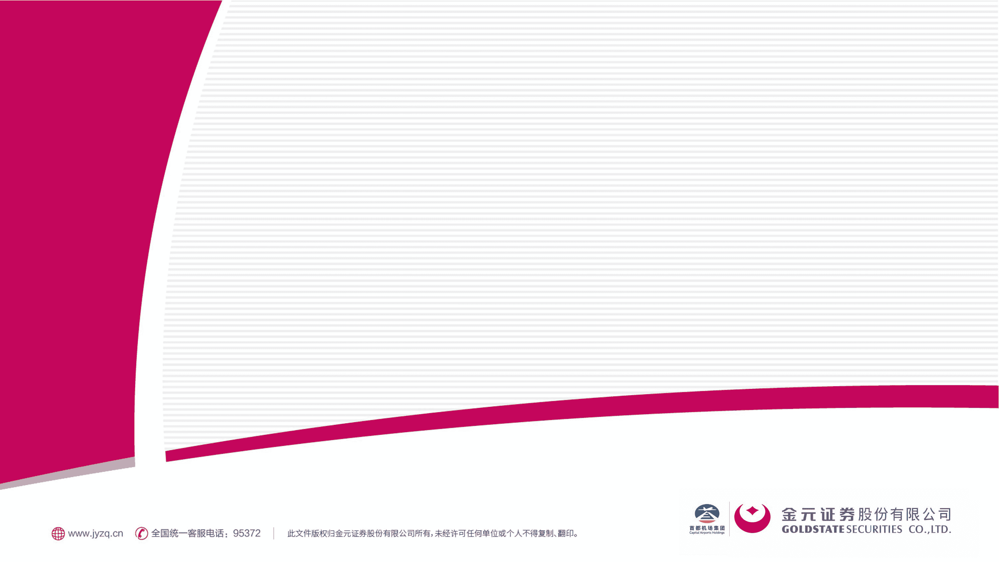
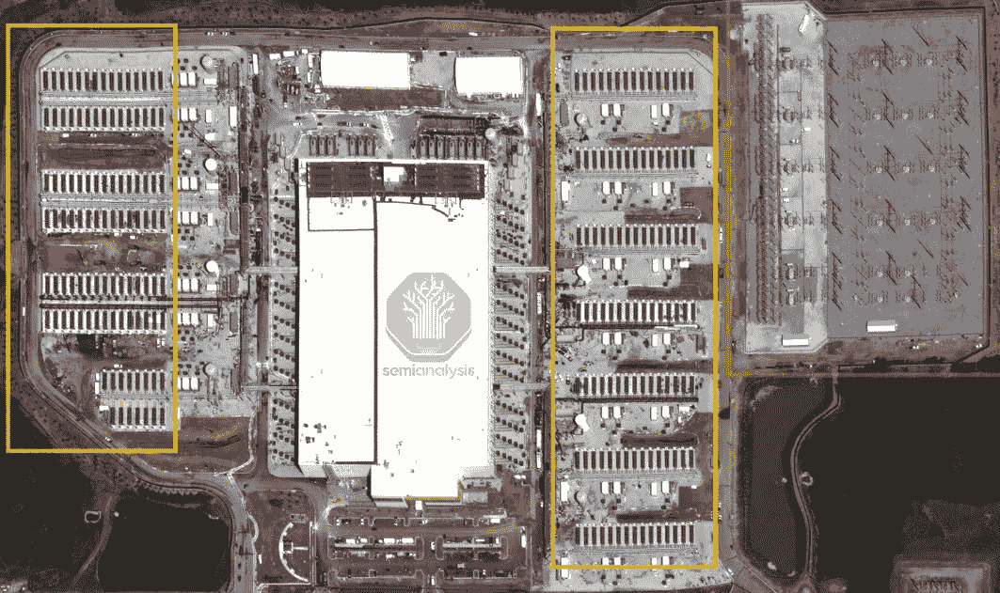
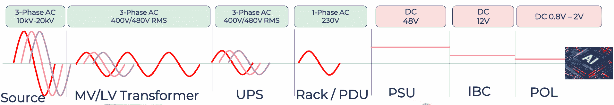
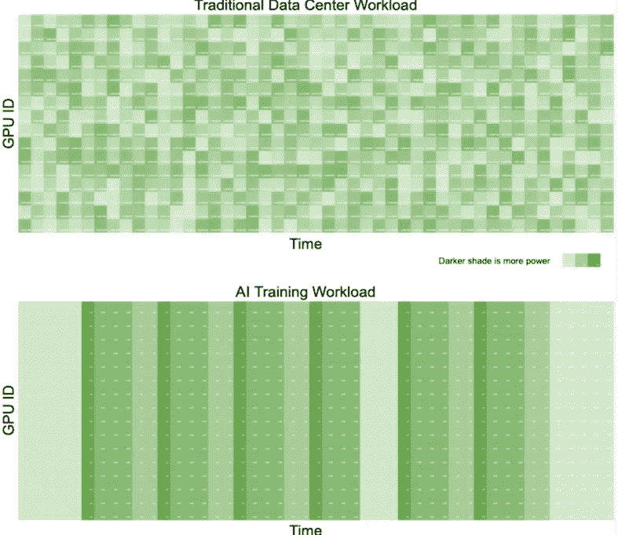
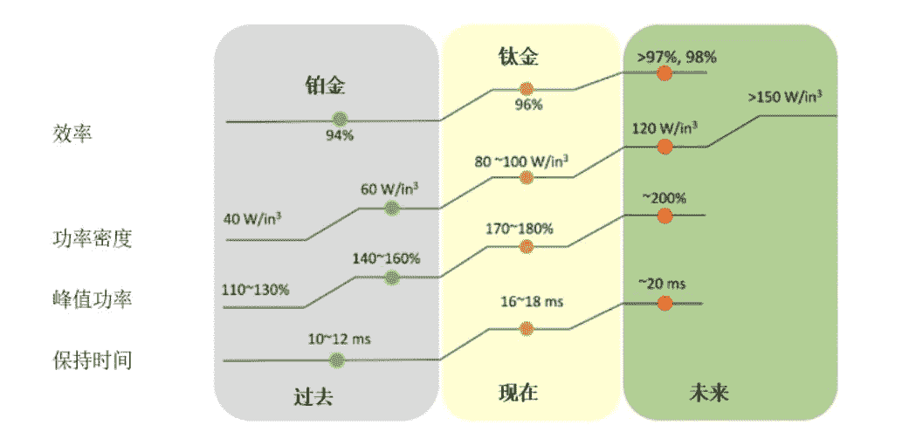
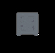
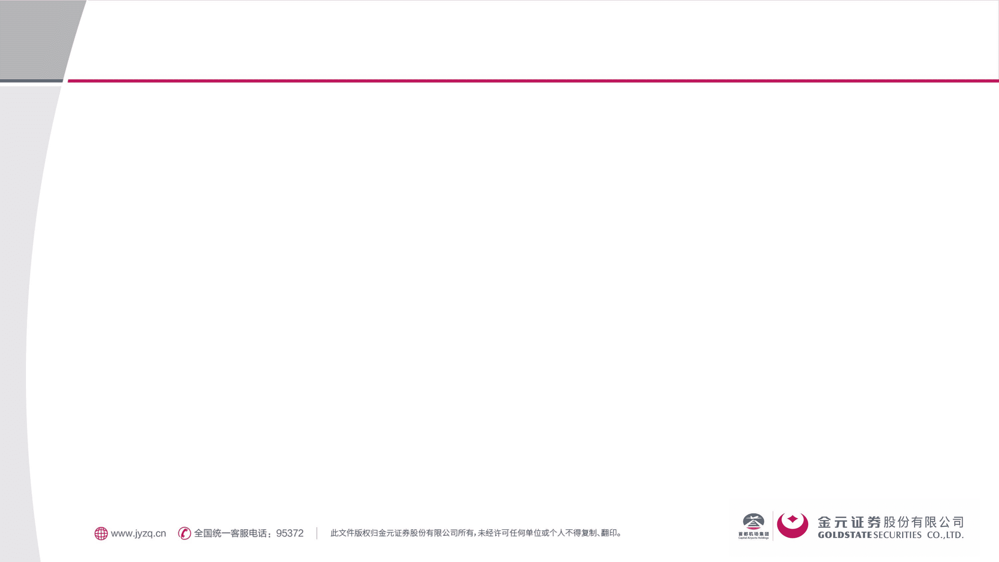

## 碳化硅赋能AI产业

### ——从芯片封装到数据中心的核心材料变革

证券分析师：唐仁杰 S0370524080002

证券研究报告

电子/行业深度报告

2025年9月28日

行业评级：增持

---

**摘要**

- 随着单机柜功率从几十千瓦提升到数百千瓦乃至更高，AI服务器供电系统的设计面临全新要求，其核心在于四个方面：提高电能转换效率、减少损耗；高功率密度和体积限制；固态变压器（SST）与电力系统集成。SiC在AC-DC和PFC级的应用在服务器电源（PSU）的前端AC-DC变换中，典型拓扑如无桥图腾柱功率因数校正（PFC）和有源三电平整流等，需要高耐压低损耗的开关器件。SiC MOSFET因具备1200 V乃至更高耐压且高频特性优秀，成为首选器件。

- 2025年数据中心PSU市场规模或达75亿美元，预计2030年，数据中心PSU市场规模将攀升至141亿美元，年复合增长率约15.5%。考虑到AI服务器的功率远高于标准服务器，高于3kW的高功率PSU的市场占有率将提升至80%，至2030年达到115亿美元。台达、光宝、华为合计占据50%的PSU市场。宽禁带模块渗透率方面，基于SiC、GaN的高功率PSU将从2025年10%提升至约24%，市场规模约33.84亿美元。其中台达、光宝、华为以及康舒、村田、TDK、联想均已配有SiC、GaN相关PSU产品。

- AI服务器不仅对电源提出要求，计算加速芯片本身的封装和供电也面临巨大挑战。如今一颗高端GPU/AI芯片模块功耗上千瓦，其封装需同时解决高电流供电和高热流密度散热的问题。当前2.5D/先进封装中常用的中介层或封装基板材料包括硅、玻璃和有机材料（如改性树脂基板），各有优缺点。在AI芯片功耗密度不断攀升的背景下，这些材料在散热、电气绝缘和机械强度方面暴露出一些瓶颈。近年来高端GPU功耗已从百W提高至千W，封装中集成多个芯片（GPU+多颗HBM）使热流密度骤增，使得高端GPU市场考虑将碳化硅用于封装市场。

- 2025年全球CoWoS及类CoWoS封装总体产能预计将达到88.5万片，相较于2024年的42.6万片，年增长率高达108%。从当前2.5D封装结构及材料上来看，碳化硅材料或主要用于两个领域。一是用于chip上方与热沉之间的热界面材料（TIM2）；其次是用于硅中介层替换。若实现完全替代，碳化硅衬底及外延需求将是CoWoS产能的2倍（TIM+中介层，以12英寸计）。

- 碳化硅功率器件的成本结构中，衬底+外延的成本占比远高于硅衬底，其中导电N型衬底使用量最大。2024年，8英寸碳化硅晶圆主要被WolfSpeed用于器件制造，以及IDM厂商用于研发活动。随着主要IDM厂商开始在8英寸平台上推进规模化量产，预计8英寸N型衬底销量由2024年的4.61万片提升至2030年的70.4万片，年复合增长率达58%。国内公司在8英寸、12英寸碳化硅衬底研发领先。2023年天岳先进成功研制8英寸碳化硅衬底，并于2024年天岳先进已成功研制12英寸碳化硅衬底，在半绝缘型、导电N型及导电P型产品上均有布局。

- 碳化硅制造设备方面，外延、离子注入、国产替代趋势正在加速。PVT设备呈现一定的内部封闭特征，碳化硅衬底及器件龙头倾向于自建PVT设备来严格控制品质，多数领先的碳化硅芯片制造商通过收购或自主开发方式布局内部设备研发。除此之外，PVT设备市场主要由国内企业占据主导位置，其中北方华创市场占有率高达61%。衬底制备及外延后碳化硅器件及模组涉及前后道工艺与硅基器件类似，但高温工艺及硬度决定部分工艺仍需购置新设备。其中外延设备、离子注入、退火与热氧化、减薄与抛光（CMP)、背面激光退火以及量检设备不同于Si设备，需重新购置。2024年碳化硅器件生产设备规模达35.07亿美元，预计2026年将达到峰值为51.29亿美元。分类型看，碳化硅生产设备中，量测及检测、外延设备、离子注入设备占比较高。其中，量检设备占比最高，2024年市场规模约7.25亿美元，2026年有望达12.05亿美元。主要原因在于碳化硅材料缺陷先天较多、外延与掺杂均匀性难，高能注入、超高温活化带来更多变数以及几何与表面质量要求十分苛刻。

- 全球碳化硅器件（二极管、晶体管、混合模块内器件及半绝缘型碳化硅基射频器件）市场规模约43.6亿美元（2024），至2030年有望达229.45亿美元，2025-2030年复合增长率约32%。考虑到当前碳化硅器件主要应用在新能源领域，中国作为新能源产业链第一大国，当前相对于衬底的高市占率，国内碳化硅器件市占率整体偏低，国产替代空间广阔。2024年，意法半导体、安森美、英飞凌、Wolfspeed、罗姆在碳化硅器件市占率合计市占率高达83%。2024年，国内碳化硅器件市占率大幅提升，碳化硅器件销售额同比远高于海外企业，但可替代空间仍然较高。

- 全球碳化硅产业链投资规模持续扩大，国内碳化硅企业及在"China For China"背景下寻求在国内建厂，投资额约80亿美元，国内碳化硅设备公司或依托于国产替代，在碳化硅产业链产能扩张中受益。

- 产业链垂直整合的公司或空间更大：以1200V SiC MOSFET晶圆为例，60%的成本主要来自外延片（衬底+外延工艺），其中，150mm（6英寸）硅衬底占34%，外延工艺中，外延代工厂毛利占14%，良率损失及直接成本占据12%。若不考虑衬底的垂直整合，随着外延工艺良率及前端工艺良率的改善，剔除直接成本后，外延+前端+后端的毛利空间为53%。

- 相关公司：1）碳化硅器件厂商：扬杰科技 (300373.SZ)、芯联集成-U (688469.SH)、斯达半导 (603290.SH)、三安光电 (600703.SH)、捷捷微电 (300623.SZ)等；2）碳化硅设备及衬底公司：天岳先进 (688234.SH)、露笑科技 (002617.SZ)等；北方华创 (002371.SZ)、晶盛机电 (300316.SZ)、中科飞测 （688361.SH）等

- 风险提示：国内厂商渗透率不及预期：车用功率器件验证周期较长，或导致国内厂商渗透率不及预期；产能扩张导致的价格风险：多数厂家开始扩产，产能扩张背景下或导致价格压力较大；技术风险：当前碳化硅晶体管技术路线较多，如平面及沟槽型MOSFET，新技术的应用或导致其他产品销量不及预期。

---

## 目录

 

一、数据中心供电架构概览

二、碳化硅渗透至数据中心供电系统

 

三、碳化硅渗透至芯片封装领域

四、碳化硅制造工艺

 

五、碳化硅国内市场

六：相关公司

风险提示：
国内厂商渗透率不及预期：
车用功率器件验证周期较长，
或导致国内厂商渗透率不及
预期；
产能扩张导致的价格风险：
多数厂家开始扩产，产能扩
张背景下或导致价格压力较
大；
技术风险：当前碳化硅晶体
管技术路线较多，如平面及
沟槽型MOSFET，新技术的应
用或导致其他产品销量不及
预期。

---

## 一、数据中心供电架构概览

- 数据中心是一个集中化的设施，用于容纳众多计算机服务器、网络设备、存储系统及IT组件。所有上述设备都需要特殊的电源装置，以便为每个设备提供适当的输入电压。

- AI驱动下，数据中心已成为现代计算的骨干，旨在为各类应用（尤其是云计算、人工智能和其他数字服务）存储、处理和管理海量数据及信息。数据中心可以分为企业级数据中心（Enterprise Data Center）、高性能计算中心（HPC）、超大规模数据中心（hyperscale）。**基于服务器性能及规模不同，其功率需求及消耗差异较大。超大规模数据中心的功耗平均在1MW至150MW，AI超大规模园区可达 2 GW。**

| 对比维度 | 企业级数据中心 | 高性能计算中心 | 超大规模数据中心 |
|---|---|---|---|
| 定义 | 由单一组织拥有和运营，用于容纳其IT基础设施、服务器、网络设备等的设施。 | 提供需要非常强大处理能力的复杂计算任务的设施。通常由政府/学术研究机构拥有。服务器通常限制访问。 | 为满足大型云服务提供商、社交媒体平台和其他互联网公司的基础设施需求而设计的大规模设施。由谷歌、微软、Meta、亚马逊等巨头公司或CSP拥有，用于分配数据处理和/或服务器。 |
| 服务器数量 | ~ 1 - 1,000 台 | ~ 100 - 10,000 台 | ~ 5,000 - 500,000 台 |
| 功耗 | 1 kW - 500 kW | 50 kW - 5 MW | 平均 1 MW - 150 MW，AI超大规模园区可达 2 GW |
| 组织用途 | 企业内部IT服务 | 科学模拟、仿真等 | 云服务、流媒体、加密货币挖矿等 |

数据来源：Semi Analysis，金元证券研究所

  

### 数据中心供电架构概览

- 一般数据中心电力供应架构包括：

- **交流电部分：**MV/LV Transformer（中压/低压变压器）将中压电压降压至适用于设施配电的低压交流电；UPS (Uninterruptible Power Supply)（不间断电源）提供备用电源和电压调节，确保在电网中断期间仍能持续运行；PDU (Power Distribution Unit)（电源分配单元）将三相电分配为单相电，并监控来自UPS的电力，将其配送至数据大厅内的IT机柜。

- **直流电部分：**PSU (Power Supply Unit)（电源供应单元）将交流电（AC）转换为稳压的低压直流电（DC）（通常为48V或12V），为服务器或机柜级设备供电；IBC (Intermediate Bus Converter)（中间总线转换器）将48V电压降压至中间电压（例如12V, 6V），以便为靠近处理单元的负载供电；POL (Point-of-Load Regulator)（负载点稳压器）最终转换阶段，直接为CPU、GPU或内存等器件提供精确的所需电压（例如0.8V–2V）。

  

| 阶段 | 设备 | 说明 |
|---|---|---|
| 三相交流电高压输入（10kV-20kV) | 市政电网或专用变电站 | (将10kV-20kV高压降至400V/480V RMS三相交流电) |
| 首次降压与交流转换 | MV/LV Transformer（中压/低压变压器） | |
| 保护 | 不间断电源（UPS） | 接收400V/480V交流电，确保电力连续性和稳定性，防止电网波动或中断影响设备运行。输出仍为交流电 |
| 机柜级配电 | Rack/PDU（机柜配电单元） | 将电力分配至单个机柜内的服务器设备，提供精细化电力管理。 |
| 服务器电源转换 | PSU（电源供应单元） | 位于服务器内部，将交流电（AC）转换为直流电（DC），输出低压直流。 |
| 直流电压阶跃 | IBC（中间总线转换器） | 将来自PSU的48V直流电进行隔离和降压，转换为一个更低的、稳定的12V直流中间总线电压。 |
| 点精细化供电（直流0.8V-1.2V） | POL（Point-of-Load） | 紧邻芯片（如CPU、GPU、AI加速器）的最终级电压调节模块，将直流电压进一步降至芯片所需的核心电压（如0.8V、1.2V），实现极高精度和能效。 |

数据来源：金元证券研究所

---

## 二、碳化硅渗透至数据中心供电系统

- 超大规模数据中心内的电源供应单元（PSUs）对于确保持续稳定的电力输送至关键设备发挥着至关重要的作用。这些数据中心需要不同断的电力来支持其关键应用与服务。PSU负责将输入电能转换并分配给基础设施，确保服务器及网络硬件在内的所有系统保持最佳运行状态。PSU通常采用模块化、可扩展的设计，以适配数据中心扩展过程中日益增长的电力需求。

- 电源供应单元在数据中心机架配电单元（rPDUs）市场中的应用，对维持超大规模运营的性能与正常运行时间不可或缺。rPDU在服务器机架内部分配电能，**而PSU则确保为所有连接系统转换并输送稳定电力。**这种协同工作机制使超大规模数据中心能够实现高可靠性、运营效率及冗余备份，这些特性对于管理大规模、关键型、数据驱动的服务至关重要。

- **传统的数据中心工作负载在计算基础架构中异步运行。AI 训练工作负载热图显示 GPU 如何同步运行，导致 GPU 集群消耗的总功率镜像并放大单个节点的功率模式。数千个 GPU 同步运行，对不同的数据执行相同的计算，这种同步会导致电网级别的功率波动。与传统数据中心工作负载不同，在传统数据中心工作负载中，不相关的任务"平滑"负载，人工智能工作负载会导致空闲状态和高功耗状态之间的突然转换。**

    

爬升阶段 → 功率上限（驱动控制）→ 能量存储（PSU）→ 稳态（能量存储与PSU）→ 下降阶段 → GPU 燃烧系统

无平滑处理的功率曲线 vs 有平滑处理的功率曲线

数据来源：英伟达，金元证券研究所

### 碳化硅渗透至数据中心供电系统（续）

- 随着单机柜功率从几十千瓦提升到数百千瓦乃至更高，AI服务器供电系统（包括服务器电源PSU和固态变压器SST）的设计面临全新要求，其核心在于四个方面：**提高电能转换效率、减少损耗；高功率密度和体积限制；固态变压器（SST）与电力系统集成。**

- **尽可能提高电能转换效率，减少损耗。**传统数据中心采用"80 PLUS"标准规范电源效率，其中最高要求在典型负载时达到96%的效率。而AI服务器由于功率巨大，即使1%的损耗也会转化为数千瓦的热量，需要额外的制冷功率来进行散热。因此，新一代PSU的效率目标被推向98%乃至99%以上。Infineon的8 kW AI电源即实现了98%的整机效率，显著减少了发热和冷却负担，其新一代12 kW 参考设计的PFC级效率超过99%、DC/DC级超过98.5%，总效率逼近极限。**高效的电源每提供100 kW负载仅损耗不到2 kW，比传统方案（例如94%效率时损耗6 kW）将损耗降低了三分之二，大幅缓解了数据中心的散热和运营成本压力。**

   

数据来源：Navitas，金元证券研究所

**碳化硅渗透至数据中心供电系统**

- **高功率密度和体积限制：**在宝贵的机架空间内，电源所占据的体积必须尽量缩小，否则会侵占IT设备空间，降低计算部署密度。传统54V配电的系统中，一个机架往往需要安装多个电源盘（power shelf）叠加提供足够功率。

- 例如NVIDIA的GB300系统为满足约130kW负载，使用了8U电源盘。如果进一步扩展到1 MW等级，按54V体系将需要约64U（1U高度1.7 inches）高度的电源，也就是整个机架都被电源占满，几乎无法安装服务器设备，因此，提高每个PSU模块的功率等级和功率密度至关重要。**近年服务器单体电源容量已从传统的800 W级跃升至3–5 kW级，新一代PSU提升到8 kW和12 kW，以更少模块满足更高功率需求。**与此同时，功率密度也在不断刷新，从早期约30 W/立方英寸提高到100 W/立方英寸以上

**图**

**表：传统机柜供电架构**

**图**

**表：High-End Powerful rack 供电架构**

**图**

**表：NVIDIA GB300 NVL72 8个电源盘**

数据来源：CoreWeave，金元证券研究所

---

**碳化硅渗透至数据中心供电系统**

- **更高配电电压和更低输电损耗：为输送如此巨大的功率，服务器配电架构正从传统的低压直流（12 V或48 V）转向中高压直流。**

- **12V DC机柜级PSU架构：**12V直流机架级电源架构在传统企业数据中心和托管数据中心中仍被广泛使用。然而，在支持人工智能和高性能计算工作负载日益增长的功耗需求时，该架构显露出明显局限性，工作负载需要比12V系统所能提供的更高效电力传输和更高功率密度。**12V系统需使用更粗的线缆和更宽的总线槽，不仅占用机架空间，还增加了散热需求。**

- **48V DC机柜级PSU架构：48V直流电源架构已成为现代高密度数据中心的首选解决方案。**相比12V系统，它具有显著优势，包括更低功率损耗和更优能效表现。2024年至2025年初，包括Meta、AWS和微软在内的超大规模运营商持续扩大48V机架供电系统的应用，这些部署通常遵循开放计算项目（OCP）标准。2024年2月，Meta为满足不断增长的人工智能处理需求，在其欧美数据中心的Open Rack V2平台全面部署48V电池UPS系统。2024年3月，AWS在法兰克福和新加坡新启用的可用区均将48V基础设施作为默认机架电源标准。此外，韩国Naver和Kakao公司于2024年4月开始在其云与人工智能集群中部署48V系统，旨在提升运营效率并实现可持续性目标。

- **400V±/800V DC机柜级PSU架构：虽然48V系统对功率要求高达100kW的机架极具效能，但在更高负载场景下面临挑战，包括总线槽尺寸增大和需要更先进的冷却方案。**400V±/800V直流机架供电架构虽仍处于早期采用阶段，但其解决超高密度AI/ML工作负载的潜力正获得越来越多关注。该架构支持高压直流直配，通过减少电源转换环节显著提升能效。**新兴应用场景是在机架级进行交直流转换，将交流电直接在机架端转换为高压直流以支持高功率负载**。2024年1月，谷歌在俄勒冈州人工智能园区开始实验性部署400V侧挂式电源模块。这些模块可支持超过80kW的机架负载，并将交直流转换与电池备份功能移出计算机架，为GPU和TPU腾出更多空间。

- 商业化应用方面，维谛技术（Vertiv）的NetSure 9500系列等解决方案正助力早期用户尝试400V直流系统。根据维谛2024年产品手册显示，该系统可扩展至600kW容量，有效降低电能损耗，并能与可再生能源及模块化电池系统高效协同。

数据来源：金元证券研究所

---

**碳化硅渗透至数据中心供电系统**

**图**

**表：800V/0V数据中心级供电架构（DC转换在进入机柜前完成，需要重构数据中心供电系统）**

数据来源：英飞凌，金元证券研究所

AC
DC
DC
DC
DC
DC
DC
DC
DC
DC
DC
DC
DC
DC

交流/直流变换器

AC → DC（MV AC → 800 V DC）
把来自电网的中压交流整流为800V高压直流母线
园区/市电侧的中压交流电源入口（MV AC Grid）
SiC模块
安全断路器

800V → Vbat（锂电池）
在电池与800V母线之间进行双向能量转换/管理。
长时储能（分钟到小时级的供电）
锂电池（BBU/UPS能量来源）
SiC模块
中时储能（秒到分钟级支撑与削峰填谷）

800V → 储能（超级电容）
电压。
超级电容/新型电池化学体快速充放电，应对负载台阶变化，桥接发电机或长时储能接管前的空档。
毫秒到秒级；主要用于动态负载缓冲和保持时间（hold-up）
SiC模块

800V → 储能（电解电容）
电压。
电解电容提供瞬态电流，抑制GPU/CPU群的脉动负载引起的母线纹波。
SiC/GaN

800V高压直流母线 / 0V回线（负极），整个数据中心的主配电母线。
**高压中间母线变换器：**把800V HVDC隔离降压成中间母线电压；800V→54V 或 800V→12V
**低压中间母线变换器**：进一步把 54V → 12V/6V（或从12V再分配），向板上各模组配电
**电压调节模块**：末级点负载稳压，把 12V/6V → 核心电压（Core），通常为多相降压
GaN, Si
Si
服务器主板（ServerBoard)
机柜（Rack/Row）
大厅（Hall）
基础设施
GPU/xPU（core)

## 碳化硅渗透至数据中心供电系统

- 除了在数据中心级通过中心基础设施实现重构专用800V供电架构为每一个计算机柜供电外，另一种解决方案是使用由机架侧边的Sidecar模块完成。例如英伟达GTC 2025上展示的800 V sidecar，可在单个Kyber机柜中为576 个 Rubin Ultra GPU。

数据来源：英伟达，英飞凌，金元证券研究所

图：sidecar供电架构（AC/DC转换在机柜内部，较为灵活，右下角为Kyber机柜例图）

Side car
Compute rack（计算机柜）
SiC
GaN/Si
连接多个机柜

计算机柜内部不再放置PSUs，使用HV IBC，AC/DC仍在机柜内进行转换

---

## 碳化硅渗透至数据中心供电系统

- 固态变压器（SST）与电力系统集成：传统数据中心从市电引入，要经过变压器将高压降为400–480 V交流，再由每台服务器电源整流为直流。多个级联转换增加了损耗和故障点。为提高系统级效率，未来数据中心倾向于采用固态变压器（Solid State Transformer, SST）技术，从介质电压直接生成中压直流，把原本笨重低效的工频变压器和整流柜功能合二为一

- **所谓SST，本质是一种基于宽禁带功率器件的高频电能变换器。**通常包含高压AC/DC功率级、高频隔离变压以及DC/DC变换等环节，**可将例如10–35 kV的中压交流电直接转换为数百伏直流输出**。在NVIDIA提出的架构中，SST设计为独立的模块化柜安装在数据中心供电入口，将13.8 kV三相市电直接变换为800 V DC母线电压。**Delta在2024年GTC大会展示了其SST样机，利用多只SiC开关级的模块化串联，配合高频隔离变压器，将10–33 kV中压电直接转换为800 V直流，模块化设计便于冗余和扩展以适应不同国家的电网电压。**通过SST输出的800 V DC可直接通过母线送至机架，无需传统PDU变压和多重AC/DC转换，极大简化了配电链路

- **总的来看，SST和HVDC配电的结合，使得未来AI数据中心实现电网到机架的高效直流输电成为可能。**这种系统集成方式下，市电、UPS电池及超级电容等储能单元都以直流形式挂接在母线上，各环节更加高效协同。当然，**高压直流配电也要求快速电流保护（如微秒级固态断路器）和绝缘监测等新技术，当前业界已在开发基于SiC MOSFET的固态直流断路器，实现微秒级保护以保障系统安全**

数据来源：TrendForce，金元证券研究所

图：SST直接转换为800V DC母线电压

含SiC模块的AC-DC转换
高频隔离变压器（SiC）

---

## 碳化硅渗透至数据中心供电系统

数据来源：金元证券研究所

### 传统方案

- AC输入
- AC配电
- **AC/DC转换效率低**

### SIDECAR方案

- AC输入
- DC配电
- **减少一次变换，但前端还是工频AC，体积庞大，功率密度低**

### AC-SST方案，适配AC基建

- AC输入
- DC配电
- **前端加入AC-SST**

### DC输入配电方案

- **DC输入**
- DC配电
- **前端加入DC-SST**

---

## 碳化硅渗透至数据中心供电系统

数据来源：金元证券研究所

### DC输入配电方案

采用中压直流（MVDC）输入替代交流电，即直流微电网。该场景下固态变压器（SST）可设计得更简化高效，与可再生能源及其他直流原生负载的集成也变得更实用无缝。

### 传统方案

传统解决方案通过电网为标准交流电输入为数据中心供电。直流转换在每个单独的服务器上进行。需要在服务器附近部署大量电源单元（PSU），从而导致损耗（约占服务器总功耗的5%）。这些损耗会以热量的形式存在于关键的服务器环境中，**必须通过散热系统排除**。**该架构的功率上限约为250千瓦**。在高端计算（HPC）环境中常见的此类高功率场景下，**需采用液冷电源甚至母线排技术，通过冷却系统尽早捕获并高效排出损耗热量。**

### sidecar方案

sidecar方案通过分解整流阶段来隔离损耗，从而释放机架内更多IT空间。其过渡性在于交流/直流转换仍在每个IT机架进行，导致电力机架内外产生类似损耗。与传统方案不同，此类电源单元采用三相系统，相比单相设计能天然降低谐波和损耗。虽然未完全优化，该方案因能最快实现单机架功率交付 scale up to 600千瓦（匹配英伟达Rubin平台发布水平），已被超大规模数据中心运营商采用。

### AC-SST方案

在保持与现有交流基础设施兼容的前提下，将转换阶段移至数据中心前端。通过将电压提升至800伏，使配电损耗降低四倍。该方案依赖高频变压器（即固态变压器SST），与传统低频无源变压器不同，基于先进功率半导体（如碳化硅SiC）的SST能显著提升能效和功率密度。

---

## 碳化硅渗透至数据中心供电系统

- SiC在AC-DC和PFC级的应用：在服务器电源（PSU）的前端AC-DC变换中，典型拓扑如无桥图腾柱功率因数校正（PFC）和有源三电平整流等，需要高耐压低损耗的开关器件。这里SiC MOSFET因具备1200 V乃至更高耐压且高频特性优秀，成为首选器件。例如，Infineon的8 kW AI电源采用了650 V CoolSiC MOSFET组成交错并联的无桥PFC，实现了高于99%的峰值AC/DC转换效率。**SiC器件在PFC中的优势不仅是降低导通损耗，更体现在开关损耗随频率上升的增幅很小**，使得PFC开关频率可从传统几十千赫提高到≥100 kHz，从而缩小PFC电感体积

- **另一方面，在SST的高压AC/DC环节，SiC更是不可或缺。**许多SST设计采用多重串联的3.3 kV或6.5 kV SiC MOSFET模块，以构建中压AC到高压DC的变换桥臂。Navitas的GeneSiC系列SiC器件覆盖650 V到6.5 kV电压等级，已经成功应用于兆瓦级的电网储能逆变器等项目。高压SiC器件使得中压13.8 kV交流直接整流为800 V直流成为现实，取消了传统工频变压器，极大提升了效率和功率密度。

- **GaN在DC-DC和次级转换的应用，**GaN器件通常工作电压较低（多数为600–650 V及以下），但开关速度更快、栅极电荷和输出电容更小，非常适合用于中压以下的高频DC-DC变换。例如在PSU的隔离DC/DC阶段，输入约400 V DC，经高频变压器降压至48 V或其他低压，再整流输出。这一阶段要求开关频率尽可能高以减小变压器和滤波器尺寸，而GaN HEMT由于没有反向恢复损失且具有高迁移率电子，可在MHz级频率下高效开关

图：碳化硅高热导、耐高压、宽禁带特征

- 高导热（热导率，W/cm·℃）
- 高抗辐射（禁带宽度，eV）
- 高频率（电子饱和速率，10^7 cm/s）
- 耐高压（击穿电场强度，MV/cm）

图：高压、高功率PSU需要SiC、GaN材料

数据来源：瀚天天成招股说明书，Yole，金元证券研究所

### 碳化硅渗透至数据中心供电系统

- 值得注意的是在 SST 架构里，原本由每台/每柜 PSU 完成的整流、PFC、隔离、降压等任务被集中到电源前端的 SST 完成，SiC 的应用与价值从分散的 PSU 转移并上移到 SST（以及机柜级 HV-IBC），形成更高电压等级、更高功率密度、更高单台价值的集中式 SiC 模块。

**图表：SST 方案将 PSU 工作上移至 SST**

| 传统方案 | Side-Car方案 | AC/DC SST | DC/DC SST |
|---------|-------------|-----------|-----------|
| 三相AC 10kV/20 kV → 工频变压器 → 三相AC 50Hz/60Hz → HVDC 380 V AC -> 800V / ±400 V → PSU（单相AC 220V AC -> 48V /12V）→ IBC（DC 1.2 V / 3.3 V）→ AI Chip | 三相AC 10kV/20 kV → 工频变压器 → HVDC 800 V / 400V -> 48 V ->12V -> 3.3 V → AI Chip（HV IBC在IT机柜内，Side-Car+PSU+HV IBC+IT机柜） | 三相AC 10kV/20 kV → AC/DC SST → 15kV DC → HVDC 800V / ±400 V → DC 800 V/ 400V -> 48 V ->12V -> 3.3 V → AI Chip（HV IBC+IT机柜，不需要PSU，SST完成转换） | SiC/GaN |
| 供电与服务器在一个机柜内部，占据空间。通过PSU和IBC进行AC/DC，DC/DC转换 | 灵活，不需要对数据中心供电架构整体更改为HVDC，只需要增加Side-car，但是仍需要在机柜内完成转换 | 需要在数据中心级供电架构更改为SST方案，不需要PSU完成高压转换，释放机柜空间 | 需要对基础设施侧改变供电框架，由AC转为DC，但不需要AC/DC转换 |
| SiC | SiC/GaN | SiC/GaN | — |

数据来源：金元证券研究所

- SiC 二极管/肖特基早在传统 PFC 中就用于替换硅快恢复二极管，降低反向恢复损耗。如今，更常用的是 SiC MOSFET，其耐压高（650V、1200V 乃至更高）且无体二极管反向恢复问题，非常适合图腾柱 PFC 等全桥无桥架构。在高线电压或三相 PFC 中，SiC 器件优势明显。例如，当单相输入从 230Vac 提高到 277~347Vac 时，PFC 输出需提升至约 575Vdc，此时 650V 硅/氮化镓器件耐压可能不足，需要用更高耐压的 SiC 或采用三电平拓扑。

数据来源：金元证券研究所

**图表：PSU 结构及 SiC 渗透**

| 类别 | 元件名称（英文） | 功能说明 | SiC 渗透 |
|------|----------------|---------|----------|
| 控制板 | 微控制器 (Microcontroller) | 数字控制（PFC/LLC、故障处理、状态机） | — |
| 控制板 | PMIC（功率管理 IC（含栅极驱动）） | PFC/LLC 等控制、PWM 调制、门极驱动，需耐高 dv/dt、共模噪声 | — |
| 控制板 | 传感（电压/温度/风扇转速/绝缘监测等）Sensing | 保护与遥测 | — |
| 控制板 | 通信接口（PMBus/I²C/CAN/以太网等）Communication interface | 远程监控、功率限额、并机均流 | — |
| 功率板 | 分立功率器件（MOSFET、功率模块）Discrete power devices | 承担 PFC 桥臂、高压 DC-DC 主开关 | SiC 渗透 |
| 功率板 | 大容量电容/母线电容 (Bulk Capacitor) | 滤除整流后的纹波，提供 hold-up | — |
| 功率板 | 保险丝/过压保护等 (Fuses, over-voltage protections) | 熔断器、浪涌/压敏、气体放电管等 | — |
| 功率板 | 电感/变压器 (Inductor / transformer) | PFC 电感、高频隔离变压器等，决定能量传输与纹波；材料为磁性铁粉/铁氧体/纳米晶 | — |
| 功率板 | 母排 (Busbar) | 大电流/高压连接（铜/铝+绝缘层），控制寄生参数与爬电距离 | — |
| 功率板 | 电流传感器（霍尔/磁通门）Current sensors | 采样输入/开关/输出电流，做控制与保护 | — |
| 机械设计 | 外壳 (housing) | 结构与安全防护、导风/导热通道 | — |
| 机械设计 | 连接器 (Connector) | 高压/大电流插拔与安全隔离 | — |
| 热管理 | 风扇 | — | — |
| 热管理 | 散热器 | — | — |
| 热管理 | 冷板（水冷） | — | — |
| 热管理 | 热界面材料（TIM） | 降低器件到散热器的热阻 | — |

- 2025 年数据中心 PSU 市场规模或达 75 亿美元，预计 2030 年，数据中心 PSU 市场规模将攀升至 141 亿美元，年复合增长率约 15.5%。考虑到 AI 服务器的功率远高于标准服务器，高于 3kW 的高功率 PSU 的市场占有率将提升至 80%，至 2030 年达到 115 亿美元。台达、光宝、华为合计占据 50% 的 PSU 市场。

- 宽禁带模块渗透率方面，基于 SiC、GaN 的高功率 PSU 将从 2025 年 10% 提升至约 24%，市场规模约 33.84 亿美元。其中台达、光宝、华为以及康舒、村田、TDK、联想均已配有 SiC、GaN 相关 PSU 产品。

**图表：高功率 PSU 需求持续扩张（2020-2030E，十亿美元）**

| 年份 | ≥ 3kW | 1kW ≤ x < 3kW | < 1kW |
|------|-------|----------------|-------|
| 2020 | 0.4 | — | — |
| 2021 | 0.5 | — | — |
| 2022 | 0.8 | — | — |
| 2023 | 1.5 | — | — |
| 2024 | 2.8 | — | — |
| 2025E | 4.5 | — | — |
| 2026E | 5.9 | — | — |
| 2027E | 7.4 | — | — |
| 2028E | 8.6 | — | — |
| 2029E | 10.2 | — | — |
| 2030E | 11.5 | — | — |

**图表：PSU 市场中，台达、光宝、华为约占 50% 的市场份额**

| 公司 | 市场份额 |
|------|---------|
| Delta（台达） | 24% |
| 光宝 (Liteon) | 15% |
| 华为 | 11% |
| Advanced Energy | 6% |
| 康舒 Acbel | 3% |
| 村田 Murata | 2% |
| 明纬 Mean Well | 2% |
| Bel Power | 2% |
| 其他 | 35% |

数据来源：Yole，金元证券研究所，标粗公司为已有碳化硅相关产品

## 碳化硅渗透至芯片封装领域

- AI 服务器不仅对电源提出要求，计算加速芯片本身的封装和供电也面临巨大挑战。如今一颗高端 GPU/AI 芯片模块功耗上千瓦，其封装需同时解决高电流供电和高热流密度散热的问题。当前 2.5D/先进封装中常用的中介层或封装基板材料包括硅、玻璃和有机材料（如改性树脂基板），各有优缺点。在 AI 芯片功耗密度不断攀升的背景下，这些材料在散热、电气绝缘和机械强度方面暴露出一些瓶颈。近年来高端 GPU 功耗已从百 W 提高至千 W，封装中集成多个芯片（GPU+多颗 HBM）使热流密度骤增，使得高端 GPU 市场考虑将碳化硅用于封装市场。

**图表：碳化硅作为封装材料的优势及加工挑战**

| 优势类别 | 详细说明 |
|---------|---------|
| 热导率优势 | SiC 的晶格导热能力极强，室温热导率可达 ~400–500 W/m·K，仅略低于金刚石。导热系数比硅高出约 3 倍，比大多数陶瓷基板（氧化铝、AlN 等约 200 W/m·K）也高出近一倍。SiC 中介层或 TIM 材料能大幅降低芯片到散热器之间的热阻。当高功耗芯片使用 SiC 中介层替换硅时，预期可以显著降低芯片运行温度。采用 SiC 中介层可使 GPU 芯片结温相比硅中介层降低 20–30℃，散热相关成本降低约 30%，有效防止芯片过热降频，提升可靠性 |
| 电绝缘性 | 碳化硅具有宽禁带（~3.2 eV），尤其是高纯半绝缘型 SiC 电阻率可达 10^8 Ω·cm 量级，近似绝缘体。这意味着 SiC 中介层在高速信号传输时几乎不产生漏电和寄生损耗，可提供与玻璃相当的电气隔离效果。优异的绝缘性有助于降低芯片间串扰和寄生电容，提高信号完整性，特别适用于需要紧密堆叠高速 I/O 的 GPU+HBM 系统 |
| 机械强度与翘曲控制 | SiC 以其高硬度和高杨氏模量著称，其硬度接近金刚石（莫氏硬度 9+），抗压和抗弯强度都很高。作为中介层材料，SiC 的高机械强度有利于维持大尺寸薄片的平整度和结构稳定，不易因封装应力而开裂。另一方面，SiC 的热膨胀系数约为 4.3 ppm/°C，与硅芯片和封装材料相对接近。热匹配性意味着采用 SiC 中介层时，芯片-中介层-基板各层之间产生的热应力较小，有助于控制热循环引起的翘曲和应力集聚 |
| 高频/高压工作能力 | 碳化硅作为宽禁带半导体，具有高击穿场强和低介电损耗的特点。在封装中，这赋予 SiC 中介层良好的高频和高电压适应能力。一方面，SiC 衬底在微波/毫米波频率下损耗角正切很低，适合作为高速 IO 和射频封装的介质，减少高速信号在中介层中的衰减。有研究早已将半绝缘 SiC 用作 GaN 射频芯片的基板，正是利用其低损耗和高热导特性。另一方面，SiC 的耐高压特性使其可承受封装内较高的电压和电场，而不发生电击穿 |
| 可加工性与成本挑战 | 尽管 SiC 材料性能优异，但将其应用于中介层仍面临制造工艺和成本上的难题。首先，SiC 晶圆目前主流尺寸为 6 英寸，8 英寸也在起步阶段，远落后于硅的 12 英寸。在先进封装中，为了兼容现有工艺并提供足够大的中介层面积，业界迫切需要 12 英寸 SiC 晶圆 |

数据来源：金元证券研究所

- 2025 年，全球 CoWoS 及类 CoWoS 封装总体产能预计将达到 88.5 万片，相较于 2024 年的 42.6 万片，年增长率高达 108%。由于市场需求持续旺盛，2026 年产能需求将进一步增长至 131.3 万片。台积电仍主导 CoWoS 供应，2024 年台积电占全球类 CoWoS 产能的 74%，2025 年约 75%。

- 从当前 2.5D 封装结构及材料上来看，碳化硅材料或主要用于两个领域：一是用于 chip 上方与热沉之间的热界面材料（TIM2）；其次是用于硅中介层替换。若实现完全替代，碳化硅衬底及外延需求将是 CoWoS 产能的 2 倍（TIM+中介层，以 12 英寸计）。

**图表：碳化硅替代中介层、TIM 材料？**

| 年份 | 台积电 | 安靠、日月光、盛合晶微等 | 合计（万片，12英寸） |
|------|--------|------------------|---------------------|
| 2024 | — | — | 42.6 |
| 2025E | — | — | 88.5 |
| 2026E | — | — | 131.3 |

**图表：2026 年全球 CoWoS 产能或将增至 131.3 万片**

封装结构示意：TIM1 → HBM / SoC / HBM → Interposer（中介层）= SiC? → substrate（封装基板）→ PCB；TIM2（SiC?）；MLCP？

数据来源：DIGITIMES，金元证券研究所

## 碳化硅渗透至芯片封装领域

### 应用SiC中介层仍面临一些工艺挑战：

- 首先是制造大尺寸SiC薄板：12英寸SiC晶片目前量产仍然较为困难，衬底仍以6英寸为主。并且成本高且切割、研磨困难。台积电等正在与设备厂商合作改进SiC晶圆切割和研磨技术，以获得超薄且平坦的SiC中介层（厚度约100µm）而不引入翘曲或裂纹。应对这些挑战，行业已开始采用新型物理气相传输（PVT）炉，通过改进热区控制提升晶体质量，并引入激光切割技术以减少切割损耗（kerf loss）。国内厂家如天岳先进、同光晶体、天科合达、晶盛机电等领先12英寸碳化硅市场

- 另一方面，如何在SiC中形成高密度贯通孔(TSV)也是一项技术难点，需攻克SiC的各向异性刻蚀和介电隔离技术。尽管目前仍处于研发早期，SiC中介层技术已被视为应对3D/2.5D封装散热难题的潜力方案：通过将SiC的"优异热性能"引入封装层次，可望延缓乃至突破高功耗芯片的散热瓶颈

**图表：8英寸碳化硅相对6英寸单位面积成本对比**

| 对比项 | 8英寸 | 6英寸 |
|---|---|---|
| 价格 | 价格下降后与6英寸碳化硅晶圆达到单位面积（mm²）成本持平 | 基准 |
| 材料成本 | 材料成本更高 | 基准 |
| 良率 | 更低良率，8英寸晶圆仍处于成熟度改进阶段 | 6英寸晶圆已实现量产且良率不断提升 |

**图表：大面积碳化硅晶圆单位面积成本仍然较高**

碳化硅晶圆发展历程：
- 世界上首片商用碳化硅晶圆于1991年问世
- 国际领先企业开始进行晶体生长和晶圆制造创新
- 更多企业能够供应碳化硅晶圆以满足日益增长的市场需求
- 天岳先进12英寸衬底样品

数据来源：Yole，金元证券研究所

## 碳化硅制造工艺

- **碳化硅功率器件的成本结构中，衬底+外延的成本占比远高于硅衬底，其中导电N型衬底使用量最大。** 2024年，8英寸碳化硅晶圆主要被WolfSpeed用于器件制造，以及IDM厂商用于研发活动。随着主要IDM厂商开始在8英寸平台上推进规模化量产，预计8英寸N型衬底销量由2024年的4.61万片提升至2030年的70.4万片，年复合增长率达58%。

- 价格方面，截至2025年，已有多家晶圆供应商能够向市场供应8英寸碳化硅晶圆。得益于产量提升，2024年间其价格已出现大幅下滑。至于6英寸晶圆，由于前几年建设的产能持续释放，预计价格竞争态势仍将持续，碳化硅衬底占碳化硅器件比例将持续下降，但仍然高于硅。

**图表：用于功率半导体不同尺寸N型衬底平均售价（仅包含外销，不包含自产自用）**

| 年份 | N型 4" | N型 6" | N型 8" |
|---|---|---|---|
| 2020 | $2,355 | - | - |
| 2021 | $2,256 | - | - |
| 2022 | $2,191 | - | - |
| 2023 | $1,899 | - | - |
| 2024 | $1,590 | - | - |
| 2025 | $1,387 | - | - |
| 2026 | $1,098 | - | - |
| 2027 | $993 | - | - |
| 2028 | $927 | - | - |
| 2029 | $858 | - | - |
| 2030 | - | - | - |

**图表：用于功率半导体不同尺寸N型衬底销量（万片）**

| 年份 | 8 inch | 6 inch | 4 inch |
|---|---|---|---|
| 2024 | 4.61 | 5.78 | 14.53 |
| 2025 | 28.43 | 46.14 | 52.81 |
| 2026 | 70.38 | 105.26 | 352.88 |
| 2027 | - | - | - |
| 2028 | - | - | - |
| 2029 | - | - | - |
| 2030 | - | - | - |

数据来源：Yole，金元证券研究所

## 碳化硅制造工艺

- 根据天岳先进招股说明书数据，当前碳化硅衬底供应及销售较为集中。其中，wolfspeed（原科锐）、天岳先进、天科合达、Coherent、SK海力士五家公司约占全球衬底销售额的68%（2024年，仅包含外销）。2024年天岳先进市占率由2023年的14.8%上升至16.7%。

- **国内公司在8英寸、12英寸碳化硅衬底研发领先。** 2023年天岳先进成功研制8英寸碳化硅衬底，并于2024年天岳先进已成功研制12英寸碳化硅衬底，在半绝缘型、导电N型及导电P型产品上均有布局。

**图表：碳化硅衬底市场集中度（2024年）**

| 公司 | 市场份额 |
|---|---|
| wolfspeed | 24% |
| 天岳先进 | 17% |
| 天科合达 | 11% |
| Coherent | 10% |
| SK海力士 | 6% |
| 其他 | 32% |

**图表：天岳先进12英寸碳化硅衬底样品**

数据来源：天岳先进招股说明书，天岳先进2025年H2年报，金元证券研究所

## 碳化硅制造工艺

- 衬底生长：采用物理气相传输（PVT）法在籽晶上升长SiC晶锭，在≈2000 °C高温和低压下由硅、碳源气相沉积，实现晶体生长。此外，PVT工艺生长速率通常低于0.22毫米/小时，完成一个晶锭的生长需要持续7至8天的高温作业。这种极端条件直接导致了生产周期长、能耗高及良率挑战大等问题，是影响碳化硅衬底产能和成本的关键因素。典型生长得到4H多晶型的大直径晶棒，然后经过定向切片。由于SiC硬度接近金刚石（仅次于金刚石），切片需使用镀金刚石砂线锯，在切割过程中充分冷却以避免晶片开裂和减少材料损耗。

- 切片后的晶圆厚度不均且表面粗糙，需经多步研磨/抛光处理。先进行粗磨和研磨消除厚度偏差与翘曲，再通过化学机械抛光（CMP）达到原子级平坦度和纳米级表面粗糙度。高质量抛光对于后续外延生长至关重要，可降低晶体缺陷（如微管、堆垛层错等）对器件的影响。

**碳化硅衬底制备流程：**
- 在籽晶上通过PVT沉积得到晶棒
- 碳化硅籽晶
- 碳化硅晶锭
- 定向切片
- 化学机械抛光（CMP）
- 研磨（粗）

**图表：PVT生长炉**

- 石墨坩埚：装 SiC 粉末（原料），4H-SiC 种晶在上部
- 加热器（heater）
- 石墨毡（Graphite felts）：石墨毡保温
- Ar（氩气惰性）可掺少量 N₂（调 n 型掺杂）；底部进气，顶部出气以控压与排副产物
- 上点（或红外测温）闭环调控源区/种晶区温差
- 4H-SiC 种晶
- SiC 粉末（原料）
- 下点（或红外测温）闭环调控源区/种晶区温差

**图表：碳化硅衬底制备流程**

数据来源：JXT Technology，《Analysis of axial resistivity during SiC crystal growth by the PVT method》，金元证券研究所

## 碳化硅制造工艺

- PVT（物理气相传输法）是碳化硅晶锭生长的主流方法。2023年PVT设备市场规模达2.24亿美元，预计2029年，PVT设备供应规模达4.2亿美元。

- **PVT设备呈现一定的内部封闭特征，碳化硅衬底及器件龙头倾向于自建PVT设备来严格控制品质，多数领先的碳化硅芯片制造商通过收购或自主开发方式布局内部设备研发。** 除此之外，PVT设备市场主要由国内企业占据主导位置，其次为德国PVA TePla以及晶升股份。其中，北方华创市场占有率高达61%。

**图表：PVT设备中，北方华创占据绝对市场份额**

| 公司 | 市场份额 |
|---|---|
| 北方华创 | 61% |
| PVA TePla（德国） | 16% |
| 晶升股份 | 10% |
| S-Tech（韩国） | 8% |
| 其他 | 5% |

**图表：2029年PVT设备规模预计达4.2亿美元（百万美元）**

| 年份 | 市场规模（百万美元） |
|---|---|
| 2021 | - |
| 2022 | - |
| 2023 | 223.9 |
| 2024E | - |
| 2025E | - |
| 2026E | - |
| 2027E | - |
| 2028E | - |
| 2029E | 420.1 |

数据来源：Yole，金元证券研究所

## 碳化硅制造工艺

- 8英寸碳化硅制造的技术挑战集中于晶体生长质量和晶圆切割工艺，因其需达到350微米的厚度要求，才能同时兼容6英寸产线并保持成本竞争力。截至2025年，行业已采用新型物理气相传输（PVT）炉以优化热区控制精度，并应用激光切割技术降低切割损耗。

- **激光切割可减少损耗以及降低研磨依赖。** Disco（日本）是激光切割技术的领先企业，在碳化硅切割及研磨工艺市场占有率较高。现有工艺从6英寸碳化硅晶锭上切割单片晶圆约需3.1小时（单个晶锭完整切割耗时约100小时）。相比之下，Disco的KABRA技术可大幅缩减加工时间，仅需10分钟即可完成单片晶圆切割（单个晶锭切割总耗时约31小时）。缺陷方面，对于线锯工艺，需要通过研磨工序去除加工后晶圆表面产生的约40微米起伏。而KABRA技术由于可控制分离后晶圆的起伏幅度，因此无需进行研磨处理。此外，传统线锯工艺每片晶圆会产生约180微米的切割损耗（即晶锭切割过程中的材料损失），而KABRA技术则基本可实现零材料损耗。通过控制分离后KABRA工艺层的去除量，材料损耗可进一步抑制至约80微米。因此，与传统工艺相比，单根晶锭的晶圆产出量可提升约1.4倍。

**图表：Disco激光切割工艺可减少损耗以及降低研磨依赖**

数据来源：DISCO，金元证券研究所

## 碳化硅制造工艺

- 碳化硅外延是在碳化硅衬底上形成一层高质量的单晶材料。在导电型碳化硅衬底表面生长一层碳化硅外延层，称为同质外延；在半绝缘型碳化硅衬底上生长氮化镓外延层，则称为异质外延。

- 衬底制造完成后，分为导电型和半绝缘型。

| 类型 | 说明 |
| --- | --- |
| N型衬底（掺杂氮/磷） | 导电型碳化硅功率器件/模组 |
| P型衬底（掺杂铝） | 导电型碳化硅功率器件/模组 |
| 高纯衬底 | 外延（掺杂氮/磷） |
| 掺杂衬底（掺杂矾） | GaN外延，半绝缘型碳化硅射频器件 |

- N沟道，开关速率更快，但成本高，技术难度大。主要用于降低能耗、提升可靠性、缩小体积，用于EV、PV及电网。
- 半绝缘型主要用于射频、通信、航空航天。

> **图表：不同衬底及外延工艺**

> - 外延（掺杂氮/磷）
> - 外延（掺杂铝）

设备类型包括：平面型SiC MOSFET、沟槽型SiC MOSFET、SiC JFET。

数据来源：金元证券研究所

## 碳化硅制造工艺

- SiC外延的制备方法主要包括：化学气相淀积（CVD）、分子束外延（MBE）、液相外延法（LPE）、脉冲激光淀积和升华法（PLD）等。其中分子束外延及液相外延工艺制备的外延层质量更高，但是效率很低，无法满足大规模生产需求。化学气相沉积作为传统的沉积工艺生长速率较高，外延质量当前符合要求，且CVD的工艺较为简单，成本较低。

- 基于CVD设备的设计不同，可分为单片、多片以及水平进气和垂直进气，为提高产量亦可选择多腔结构。垂直气体的工艺控制更好且生长速率较高，但是设备较为昂贵，当前NuFlare在垂直进气HT-CVD领域领先，但国内设备厂商北方华创、芯三代已有相关产品。

> **图表：三种外延制备方法对比**

| 制备方法 | 产量 | 控制精度 (外延层控制) | 生长速率 | 成本 | 质量 |
| --- | --- | --- | --- | --- | --- |
| CVD | 高 | 中 | 高 | 低 | 中 |
| MBE | 低 | 高 | 低 | 高 | 高 |
| LPE | 低 | 高 | 低 | 高 | 高 |

> **图表：HT-CVD设备分类及供应商**

- 单片：设备简单，高生长速率（含维护）成本低，但吞吐量低，且热场不均匀。
- 多片：设备简单，高生长速率（含维护）成本低，但吞吐量低。
- 水平：衬底和气体水平放置。
- 垂直：衬底和气体垂直放置，高生长速率，工艺控制性好，但是设备成本高。

数据来源：金元证券研究所

## 碳化硅制造工艺

- **衬底制备及外延后碳化硅器件及模组涉及前后道工艺与硅基器件类似，但高温工艺及硬度决定部分工艺仍需购置新设备。**其中外延设备、离子注入、退火与热氧化、减薄与抛光（CMP)、背面激光退火以及量检设备不同于Si设备，需重新购置。

| 工艺环节 | 说明 |
| --- | --- |
| 碳化硅外延设备 | SiC外延是高温、卤氯化学（如HCl系）与石墨/SiC承载体的专用CVD系统，温度远高于Si外延，旧Si外延炉难以胜任。 |
| 介质层沉积与刻蚀 | 常见的PECVD/ALD沉积SiO₂、SiN，及RIE/ICP刻蚀机台多数可用，只需更新工艺配方与掩膜堆栈即可。 |
| 离子注入 | SiC掺杂要更高能量/剂量，且常需热注入（晶圆升温以减轻晶格损伤）。传统Si注入机在能量/热管理/束流稳定性等方面通常不足。 |
| SiC刻蚀 | 很多Si用的ICP刻蚀机可复用，但SiC硬、化学惰性强，需更高离子能量与特殊气体（如SF₆/O₂、Cl系），并可能改用金属或氧化物硬掩膜。 |
| 退火与氧化 | SiC离子注入后的活化退火温度可达 >1500 °C，且氧化动力学与Si完全不同，需要专用高温炉/石墨炉，Si用退火/氧化炉承受不了。 |
| 光刻/图形化 | 步进机/涂显轨道可沿用，但因硬掩膜、更厚阻剂或不同后烘参数，需调配方与工艺窗口；对对准/覆盖裕量也可能有新要求。 |
| 量检设备 | SiC特有缺陷（微管、基面位错、堆垛层错、外延缺陷等）与厚外延层测量，需要PL/缺陷扫描/X射线等SiC专用计量与检测工具。 |
| 减薄与抛光 | SiC极硬，减薄要高刚性磨削机、金刚石耗材；CMP要专用垫料与浆料与更大压力控制，Si的磨抛设备不适用。 |
| 背面激光退火 | 用于特定接触/应力消除/局部活化等的激光工艺，传统Si线一般没有，需要加购。 |

- 不同于Si设备，需新增：碳化硅外延设备、离子注入、退火与氧化、量检设备、减薄与抛光、背面激光退火。
- Si设备可用，但需特定耗材：SiC刻蚀、光刻/图形化。
- Si设备可用：介质层沉积与刻蚀。

> **图表：碳化硅工艺设备 vs 硅设备**

数据来源：Applied Materials, Tel，北方华创，Disco，Yac，KLA，ASML，金元证券研究所

## 碳化硅制造工艺

- **2024年碳化硅器件生产设备规模达35.07亿美元，预计2026年将达到峰值为51.29亿美元。**分类型看，碳化硅生产设备中，量测及检测、外延设备、离子注入设备占比较高。其中，量检设备占比最高，2024年市场规模约7.25亿美元，2026年有望达12.05亿美元。主要原因在于碳化硅材料缺陷先天较多、外延与掺杂均匀性难，高能注入、超高温活化带来更多变数以及几何与表面质量要求十分苛刻。

- **外延与离子注入设备在碳化硅工艺中占比高，且不能使用硅基生产线**。外延设备市场规模约占碳化硅生产设备15%以上，2024年碳化硅外延设备市场规模约5.8亿美元，预计2026年将达到7.56亿美元。2024年，碳化硅离子注入设备市场规模约7.43亿美元，预计2026年将达到8.04亿美元。

> **图表：碳化硅设备市场规模（2021-2029E）**

| 设备类型 |
| --- |
| 减薄及抛光（CMP) |
| 薄膜沉积 |
| 外延（HTCVD） |
| 热处理（退火及热氧化） |
| 刻蚀及清洗 |
| 离子注入 |
| 图形化 |
| 量检测 |
| 晶圆键合 |

单位：百万美元

数据来源：Yole，金元证券研究所

## 碳化硅制造工艺

- **采用HTCVD技术的碳化硅（SiC）外延，对SiC产业而言是另一个关键工艺步骤**。需要通过沉积优质的外延层来改善SiC晶圆的晶体质量，SiC晶体管正是制作在该外延层上。

- **尽管目前的供应商数量较多，但仍由海外企业为主。**爱思强（AIXTRON）提供集成了计量功能的行星式批量处理系统，而 ASM/LPE 则提供单片水平式反应炉。凭借其领导地位和卓越的技术成果，这些公司能够维持相对较高的平均销售价格，每台设备大约为400万美元。爱思强及ASM/LPE占据62%的市场（2023年）。国内厂商方面，中国厂商（如北方华创（NAURA、晶盛机电、）也在近年推出了适用的设备。

- 量测及检测设备方面，SiC的良率损失既来自材料缺陷也来自工艺缺陷，既可能在晶圆表面也可能在体内；可分为非关键缺陷与"杀手缺陷"。为检测与量化，需要在线与离线的多种技术。**与硅相比，用于SiC器件生产的SiC材料内部缺陷更多，因此在整个SiC工艺中、且经常需要对每片晶圆进行量测与检测（M&I），以改进制程良率。当前市场KLA及Onto Innovation两家合计占据60%市场空间。**

> **图表：碳化硅外延HTCVD设备市场份额**

| 厂商 | 市场份额 |
| --- | --- |
| 爱思强 | 37% |
| ASM/LPE | 25% |
| 东京电子 | 10% |
| 北方华创（中国） | 9% |
| 纳设智能 (中国) | 8% |
| Nuflare | 6% |
| 其他 | 5% |

> **图表：碳化硅量检设备市场份额**

| 厂商 | 市场份额 |
| --- | --- |
| KLA | 33% |
| Onto Innovation | 27% |
| 其他 | 40% |

数据来源：Yole，金元证券研究所

## 碳化硅制造工艺

- 碳化硅可用于分立器件（discrete）及功率模块（IPM/Module)。分立器件是在一个封装里面只有单颗裸芯片，常沿用硅器件的封装形态（如TO、DPAK/DFN/QFN等），典型器件包括SiC SBD（碳化硅肖特基二极管）、SiC MOSFET。功率模块是一个封装里面有多颗芯片，若再集成驱动/控制即成为IPM（Intelligent Power Module，智能功率模块）。

- 碳化硅功率模块分为混合模块与全SiC模块。混合模块包括硅开关器件（如IGBT或Si MOSFET）+ SiC 二极管；全SiC模块主要为SiC MOSFET（可以封装SiC反并二极管）。混合功率模块把硅与SiC器件放在同一个系统或同一只模块内，以在效率、成本和可持续性之间取得平衡。演进路径通常从传统的"Si-IGBT+Si二极管"出发，先用SiC 肖特基二极管替代硅二极管降低反向恢复损耗，再走向全SiC（以SiC MOSFET为核心），也有把Si-IGBT与SiC MOSFET裸片同封的混合模块形态；在系统层面也可通过不同支路/电机分别采用Si或SiC实现"混编"。总体目标都是释放SiC的高功率密度、高频与高温能力。

> **图表：碳化硅功率模块演进路径**

- 传统硅基IGBT模块：Si-IGBT + Si二极管。
- 混合碳化硅功率模块（IGBT + SiC SBD）：以SiC SBD替换硅二极管，在关断对侧二极管的反向恢复被消除，从而显著降低IGBT的开通损耗与尖峰/EMI，允许小幅提高开关频率并带来有限的效率增益。但导通部分仍由IGBT承担，导通损耗与尾电流特征并未改变，整体表现仍接近传统IGBT模块。
- 混合碳化硅功率模块（IGBT + SiC MOSFET）：一部分或关键开关位点改成SiC MOSFET，不仅同样没有反向恢复，还能把主动开关的Eon/Eoff显著拉低，在中高频和部分负载下效率更接近全SiC，并且更有利于缩小磁性件与提升功率密度；代价是成本更高、并联匹配与驱动控制更复杂。
- 全碳化硅模块：SiC MOSFET（可带SiC反并二极管），面向高频/高功率密度。

数据来源：金元证券研究所

## 碳化硅国内市场

- 2024年全球碳化硅器件（二极管、晶体管及混合模块内的器件，及半绝缘型碳化硅基射频器件）市场规模约43.6亿美元，至2030年有望达229.45亿美元，2025-2030年复合增长率约32%。

- 当前功率碳化硅器件仍主要应用于新能源市场，包括新能源车、光伏及储能逆变器以及充电桩、风电等高压渗透率较高的领域。800V BEV出货量占全部BEV近10%，预计2030年将提升至30%，高压系统将采用1200V SiC。汽车领域中超90%的SiC用于主牵引逆变器（main converter)，形态以全SiC功率模块为主。电源方面，600V SiC MosFET用于AC/DC前端可带来高效率与高功率密度。

### 图 表：碳化硅器件市场规模（按应用划分）

| 应用领域 | 2020 | 2021 | 2022 | 2023 | 2024 | 2025E | 2026E | 2027E | 2028E | 2029E | 2030E |
|---|---|---|---|---|---|---|---|---|---|---|---|
| 新能源车 (Main inverter+OBC+DC-DC) | 3.11 | 5.49 | 9.02 | 19.22 | 23.1 | 29.16 | 40.22 | 58.59 | 89.92 | 117.2 | 146.9 |
| 光伏/储能逆变器 | 8.9 | 9.5 | 10.2 | 10.1 | 11.2 | 12.7 | 14.7 | 17.4 | 20.9 | 25.6 | 32 |
| 电网 | | | | | | | | | | | |
| 轨道交通 | | | | | | | | | | | |
| 新兴行业 | | | | | | | | | | | |
| 半绝缘型碳化硅基射频 | | | | | | | | | | | |
| 其他 | | | | | | | | | | | |

（单位：亿美元）

数据来源：天岳先进招股说明书，金元证券研究所，新兴行业包括AI数据中心、低空等；其他包括UPS、充电桩、风能、油气等

## 碳化硅国内市场

- 考虑到当前碳化硅器件主要应用在新能源领域，中国作为新能源产业链第一大国，当前相对于衬底的高市占率，国内碳化硅器件市占率整体偏低，国产替代空间广阔。2024年，意法半导体、安森美、英飞凌、Wolfspeed、罗姆在碳化硅器件市占率合计市占率高达83%。

- 2024年，国内碳化硅器件市占率大幅提升，碳化硅器件销售额同比远高于海外企业。

### 图 表：碳化硅器件市场仍由外企主导，国产替代空间广阔

| 公司 | 2023 | 2024 | 同比 |
|---|---|---|---|
| 意法半导体集团（瑞士） | $1140M | $1100M | -3.5% |
| 安森美半导体（美国） | $845M | $820M | -3.0% |
| 英飞凌科技公司（德国） | $587M | $734M | 25.1% |
| 科锐（旗下）（美国） | $393M | $395M | 0.6% |
| 博世集团（德国） | $120M | $191M | 58.9% |
| 罗姆半导体集团（日本） | $186M | $174M | -6.5% |
| 芯联集成（中国） | $49M | $140M | 188.0% |
| 三安集成（中国） | $79M | $123M | 55.0% |
| x-fab（德国） | $73M | $68M | -6.8% |
| 基本半导体（中国） | $30M | $40M | 33.6% |
| 汉磊科技（中国台湾） | $55M | $38M | 30.0% |
| 三菱电机（日本） | $34M | $34M | 0.0% |
| 赛米控（德国） | $32M | $32M | 2.0% |
| 纳微半导体（美国） | $28M | $29M | 3.0% |
| 富士电机（日本） | $21M | $21M | 0.0% |
| 东芝（日本） | $14M | $14M | 0.0% |
| 其它 | $64M | $65M | 1.5% |

### 图 表：2024年国内碳化硅器件企业市占率提升，碳化硅器件收入同比远高于海外企业

数据来源：Yole，金元证券研究所

## 碳化硅国内市场

- 全球碳化硅产业链投资规模持续扩大，国内碳化硅企业及在"China For China"背景下寻求在国内建厂，投资额约80亿美元，国内碳化硅设备公司或依托于国产替代，在碳化硅产业链产能扩张中受益

### 图 表：全球碳化硅产业链投资

北美投资：
- 宣布在美国罗斯威尔投资约15亿美元
- 在美投资约35亿美元，拟在德国投资30亿美元
- 宣布在美投资约2亿美元
- 宣布在美投资10亿美元
- 北美投资>60亿美元

欧洲投资：
- 宣布在马来西亚投资约70亿欧元（2022-2023）
- 在意大利投资50亿欧元
- 在英国建设Fab
- 在德国投资2亿美元
- 欧洲投资约60亿美元
- 与意法半导体成立JV，投资50亿美元
- 建设12英寸产业链

中国投资：
- 国内首条8英寸SiC MOSFET产线已于2025年上半年实现批量量产，2026年扩产
- 首条SiC芯片产线顺利实现量产爬坡
- 合资建设碳化硅模组项目
- 中国投资约80亿美元

亚洲其他地区投资：
- 韩国投资约20亿美元
- 在东南亚投资40亿美元
- 除中国外亚洲地区投资超100亿美元（日本/韩国/东南亚）

数据来源：金元证券研究所，各公司官网

## 碳化硅国内市场

### 碳化硅产业链图谱

**碳化硅粉**
- 北京天科合达
- 顶立科技（楚江新材）
- 晶彩科技
- 恒普科技

**碳化硅单晶（晶锭）**
- 山西烁科晶体（中国电科旗下）（4-8英寸碳化硅晶锭、粉料、N型碳化硅衬底等）

**碳化硅衬底**
- 天岳先进（N型SiC导电衬底、半绝缘SiC衬底）
- 河北同光半导体（导电衬底、半绝缘SiC衬底）
- 广州南砂晶圆（N型碳化硅衬底、碳化硅晶体）
- 露笑科技（N型碳化硅衬底）
- 中科钢研节能科技有限公司
- 东尼电子
- 晶盛机电
- 北京天科合达
- 三安光电
- JV安意法半导体

**外延**
- 上海合晶
- 南京百识电子
- 长飞先进（长飞光纤）

**芯片加工/制造**
- 三安光电
- 士兰微
- 北京世纪金光
- 华润微电子
- CETC 第十三研究所（国基北方）
- CETC 第五十五研究所（国基南方）

**二极管/晶体管设计**
- 广芯微（民德电子）
- 新洁能
- 清纯半导体
- 飞锃半导体
- 先进半导体
- 捷捷微电
- 上海瀚薪科技
- 中国电子
- 基本半导体（拟港股上市）

**模块封装**
- 扬杰科技
- 芯联集成
- 斯达半导

**系统应用**

数据来源：金元证券研究所，图中标粗为已上市公司

## 碳化硅国内市场

- PVT生长炉
- HTCVD外延设备
- 离子注入
- 热处理（退火及氧化）
- 干法、湿法刻蚀及清洗
- 量测、检测

**露笑科技**

**晶升股份**

**北方华创**

恒普科技（自用+外销）

**连城数控**

天科合达

同光股份

**北方华创**

**晶盛机电**

**晶盛机电**

芯三代

**中微公司**

**晶盛机电**

**屹唐股份**

纳设智能

昂坤视觉

**中科飞测**

轻软微视

优睿谱

**至纯科技**

**中微公司**

**晶盛机电**

**屹唐股份**

数据来源：金元证券研究所，图中标粗为已上市公司

## 碳化硅国内市场

| 类型 | 400V | 600V-900V | 1000V-1200V | 1700V | 2000V | 3300V | \>3300V |
|---|---|---|---|---|---|---|---|
| 积塔半导体 | R&D | R&D | R&D | | | R&D | |
| 基本半导体 | R&D | | | | | | |
| CETC 55所 | R&D | R&D | R&D | R&D | | | R&D |
| **华润微** | 样品 | 样品 | | | | | |
| **中国中车** | R&D | | | | | | |
| 瀚薪科技 | | 样品 | | | | | |
| 瞻芯电子 | | | | | | | |
| 臻驱科技 | R&D | R&D | | | | | |
| 利普思半导体 | 样品 | 样品 | | | | | |
| **三安光电** | R&D | R&D | | | | | |
| 中科汉韵 | R&D | R&D | R&D | R&D | | | |
| **士兰微** | | | | | | | |
| **斯达半导** | | | | | | | |
| **芯联集成** | | | | | | | |
| 新光润泽 | R&D | R&D | R&D | R&D | R&D | R&D | R&D |
| **扬杰科技** | | | | | | | |
| **长飞先进** | | | | | | | |
| 英飞凌(海外) | JFET | JFET | | | | | |
| Wolfspeed(海外) | | | 样品 | | | | |
| Navitas(海外) | | | R&D | R&D | R&D | R&D | |
| 罗姆(海外) | | | | | | | |
| 安森美(海外) | JFET | JFET | R&D | | | | |

各电压区间下器件类型涵盖：分立二极管、分立晶体管、混合模块二极管、全碳化硅模块。

国内上市公司技术方面，芯联集成、斯达半导专注于车规级高端全碳化硅模组，士兰微主要产品是混合模块。扬杰科技产品线布局较广，三安光电、华润微、中国中车、长飞先进则集中于分立器件。海外龙头方面，英飞凌为AIDC首创400V分立晶体管，在超高压领域Navitas、Wolfspeed、英飞凌技术领先。

数据来源：金元证券研究所，图中标粗为已上市公司

## 碳化硅国内市场

- **产业链垂直整合的公司或空间更大：**以1200V SiC MOSFET晶圆为例，60%的成本主要来自外延片（衬底+外延工艺），其中，150mm（6英寸）硅衬底占34%，外延工艺中，外延代工厂毛利占14%，良率损失及直接成本占据12%。若不考虑衬底的垂直整合，随着外延工艺良率及前端工艺良率的改善，剔除直接成本后，外延+前端+后端的毛利空间为53%。
- 前后道工艺方面，直接成本（包括前端+后端）占总成本9%。工艺良率是关键，其损失占总成本的22%。

### 成本结构拆解

- 外延片（衬底+外延）：60%
- 前端良率损失：22%
- 前端代工厂毛利：9%
- 前端+后端晶圆工艺：8%
- 后端检测及切片：1%

其中衬底部分：
- 衬底（6英寸）：34%
- 外延直接成本：4%
- 外延良率损失：8%
- 外延代工厂毛利：14%

**图：碳化硅器件市场仍由外企主导，国产替代空间广阔**

数据来源：Yole, 金元证券研究所

## 相关公司

- 我们认为，国内碳化硅需求在新能源产业链带动下整体向好，另外，新兴行业如AIDC、UPS等高电压、高频率需求有望带来新的市场空间。但是相对于国内新能源产业链的高渗透率，国内碳化硅器件的市占率仍然偏低，垂直整合产业链及技术壁垒较高的碳化硅器件厂商或加速国产替代进度，从而抢占市场空间，相关公司包括：
- 扬杰科技 (300373.SZ)、芯联集成-U (688469.SH)、斯达半导 (603290.SH)、三安光电 (600703.SH)、捷捷微电 (300623.SZ)等
- 此外，全球碳化硅产业链投资规模持续扩大，国内碳化硅企业及在"China For China"背景下寻求在国内建厂，国内碳化硅设备及衬底公司或依托于国产替代，在碳化硅产业链产能扩张中受益，相关公司包括：
- 衬底：天岳先进 (688234.SH)、露笑科技 (002617.SZ)等
- 设备：北方华创 (002371.SZ)、晶盛机电 (300316.SZ)、中科飞测（688361.SH）等

## 风险提示

- 国内厂商渗透率不及预期：车用功率器件验证周期较长，或导致国内厂商渗透率不及预期
- 产能扩张导致的价格风险：多数厂家开始扩产，产能扩张背景下或导致价格压力较大
- 技术风险：当前碳化硅晶体管技术路线较多，如平面及沟槽型MosFET，新技术的应用或导致其他产品销量不及预期。

## 投资评级说明

金元证券行业投资评级标准：

- 增持：行业股票指数在未来6个月内超越大盘；
- 中性：行业股票指数在未来6个月内基本与大盘持平；
- 减持：行业股票指数在未来6个月内明显弱于大盘。

金元证券股票投资评级标准：

- 买入：股票价格在未来6个月内超越大盘15%以上；
- 增持：股票价格在未来6个月内相对大盘变动幅度为5%～15%；
- 中性：股票价格在未来6个月内相对大盘变动幅度为-5%～+5%；
- 减持：股票价格在未来6个月内相对大盘变动幅度为-5%～-15%。

## 免责声明

本报告由金元证券股份有限公司（已具备中国证监会批复的证券投资咨询业务资格）制作。本报告所载资料的来源及观点的出处皆被金元证券认为可靠，但金元证券不保证其准确性或完整性。该等信息、意见并未考虑到获取本报告人员的具体投资目的、财务状况以及特定需求，在任何时候均不构成对任何人的个人推荐。投资者应当对本报告中的信息和意见进行独立评估，并应同时考量各自的投资目的、财务状况和特定需求，必要时就法律、商业、财务、税收等方面咨询专业财务顾问的意见。对依据或者使用本报告所造成的一切后果，金元证券及/或其关联人员均不承担任何法律责任。投资者需自主作出投资决策并自行承担投资风险，任何形式的分享证券投资收益或者分担证券投资损失的书面或口头承诺均为无效。

本报告所载的信息、材料或分析工具仅提供给阁下作参考用，不是也不应被视为出售、购买或认购证券或其他金融工具的要约或要约邀请。该等信息、材料及预测无需通知即可随时更改。过往的表现亦不应作为日后表现的预示和担保。在不同时期，金元证券可能会发出与本报告所载意见、评估及预测不一致的研究报告。

金元证券的销售人员、交易人员以及其他专业人士可能会依据不同假设和标准、采用不同的分析方法而口头或书面发表与本报告意见及建议不一致的市场评论和/或交易观点。金元证券没有将此意见及建议向报告所有接收者进行更新的义务。金元证券的自营部门以及其他投资业务部门可能独立做出与本报告中的意见或建议不一致的投资决策。

在法律许可的情况下，金元证券可能会持有本报告中提及公司所发行的证券头寸并进行交易，也可能为这些公司提供或争取提供投资银行业务服务。因此，投资者应当考虑到金元证券及/或其相关人员可能存在影响本报告观点客观性的潜在利益冲突。投资者请勿将本报告视为投资或其他决定的唯一信赖依据。

本报告的版权仅为金元证券所有，未经书面许可任何机构和个人不得以任何形式转发、翻版、复制、刊登、发表或引用。
