**中邮证券**

**锂电设备专题**

**——****电池厂资本开支恢复，锂电设备有望拥抱新一轮扩产周期**

**证券研究报告**

**行业投资评级：强大于市****|****维持**

**刘卓****/****虞洁攀**

**中邮证券研究所****机械团队**

发布时间：2025-09-20

## 投资要点

- **从头部电池厂宁德时代的数据跟踪来看：**2022-2024年，公司的产能利用率分别为83%、70%、76%。2025H1已恢复达到90%，处于较高位置。资本开支从2024Q4起明显恢复，2025H1进一步强化趋势。2025H1，"购建固定资产、无形资产和其他长期资产支付的现金"科目金额为202亿元，同比+46%，如果年化来看，2025年极大概率重回400亿元以上；在建工程351亿元，已几乎接近2022年的峰值数据。

- **几家主要的电池上市公司的资本开支情况来看，这一趋势同样得到印证。****我们认为锂电的扩产节奏有望重回正轨，并有望开启第二轮的扩产大周期****。**

- **需求端：**2024-2030年全球动力电池CAGR约25%，储能电池CAGR约29%。全球动力+储能电池的需求量从2020年的209Gwh提升至2024年的1270Gwh，并预计在2030年达到5154Gwh，2024-2030年的复合年增长率为26.5%。

- 我们测算，到2027年底，宁德时代的待建设产能缺口约为300-600Gwh，对应设备环节的价值量空间约为400-700亿元。从主要锂电设备上市公司合同负债的情况来看，在经历2024年的下滑后，2025H1的合同负债恢复明显，并已超过了前几年的高点。叠加固态电池产业化突破在即，新技术带来的设备新机遇。

- **建议关注：联赢激光、赢合科技、先导智能、海目星、先惠技术、宏工科技、曼恩斯特等。**

风险提示：下游需求不及预期；行业竞争加剧；新技术进展不及预期；全球政策变化。

---

### 1.1 宁德时代产能利用率已恢复至90%

根据宁德时代2025年半年报：2025H1，宁德时代产能345Gwh，产量310Gwh，产能利用率已达到90%。

复盘宁德时代产能利用率的历史数据：2021年由于行业需求激增，供需短期存在错配，产能利用率来到接近饱和的95%；随即开启大幅扩产周期，随着产能的逐步释放，2022-2024年，公司的产能利用率分别为83%、70%、76%，这期间存在阶段性的产能利用率较低的情况，扩产节奏也相应的有所放缓。随着供给和需求的动态平衡调整，公司的产能利用率逐步修复。

**2025上半年宁德时代90%的产能利用率相比2022-2024年有显著提升，且已经处于较高位置。展望后续，我们认为锂电的扩产节奏有望重回正轨，并有望开启第二轮的扩产大周期。**

图表1：宁德时代产能利用率

资料来源：宁德时代公司公告，中邮证券研究所

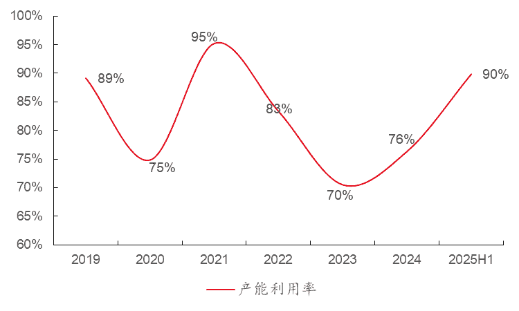

### 1.2 宁德时代资本开支进入上升周期

**从宁德时代的财报数据来看，资本开支从2024Q4起明显恢复，2025H1进一步强化趋势：**

- "购建固定资产、无形资产和其他长期资产支付的现金"科目，2022年达到巅峰482亿元，随即下滑至2023-2024年每年300多亿的水平。**2025H1，该金额为202亿元，同比+46%，如果年化来看，2025年极大概率重回400亿元以上。** 从季度数据来看，经历了2022Q4以来的持续下滑，**从2024Q4开启迎来明显修复，并已持续三个季度保持在较高资本开支水平**。

- "在建工程"科目，趋势也非常类似，2022年达到巅峰354亿元，然后收缩，从2024Q4开始明显修复（2024年三季报为252亿元，2024年报为298亿元）。**截至2025半年报数据，在建工程351亿元，已几乎接近2022年的峰值数据。**

图表2：宁德时代资本开支情况

资料来源：Wind，中邮证券研究所

图表3：宁德时代购建固定资产、无形资产和其他长期资产支付的现金（亿元）季度数据

资料来源：Wind，中邮证券研究所

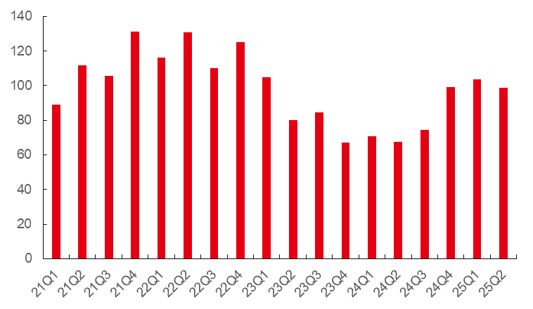

### 1.3 2025H1主要电池厂资本开支均明显加强

**从几家主要的电池上市公司的资本开支情况来看，这一趋势同样得到印证。**2021-2024年样本数据的"购建固定资产、无形资产和其他长期资产支付的现金"合计额分别为650/909/635/571亿元。2025H1为351亿元，同比+36%。2021-2024年"在建工程"合计额分别为425/713/691/676亿元。截至2025半年报为815亿元，在建工程科目显著增加。

**此外，从结构上来看，头部电池厂宁德时代相比于二三梯队电池厂的资本开支投入体量具有较大的领先优势。**

图表4：主要几家电池厂的购建固定资产、无形资产和其他长期资产支付的现金（亿元）

资料来源：Wind，中邮证券研究所

图表5：主要几家电池厂的在建工程（亿元）

资料来源：Wind，中邮证券研究所

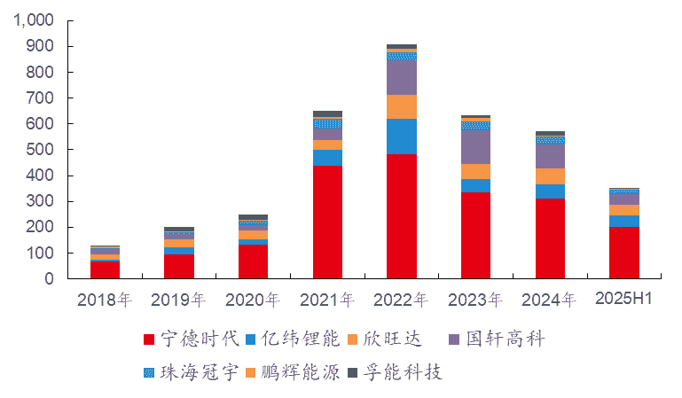 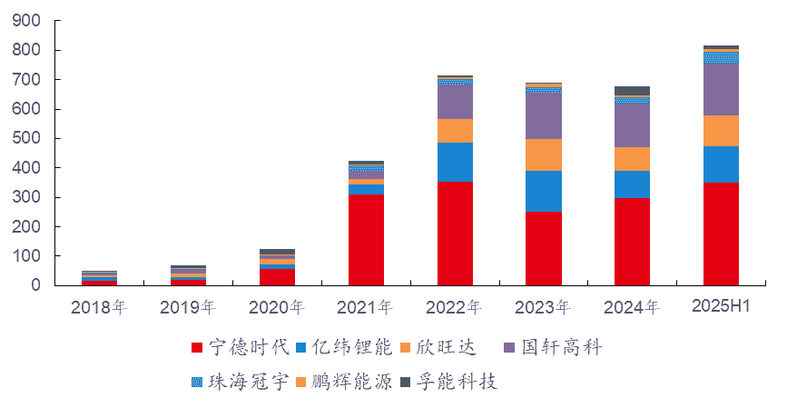

### 1.4 需求端：2024-2030年全球动力电池CAGR约25%

全球新能源汽车市场需求持续增长，销量自2020年320万辆增长至2024年的1770万辆。**预计到2030年，全球新能源车销量达到5560万辆，2024-2030年复合年增长率为21.0%。**

渗透率方面，全球新能源车销量渗透率从2020年的4.1%，提升至2024年的19.8%，预计至2030年达到55.7%。**截至2024年，中国/欧洲/美国地区的渗透率分别为45.0%/17.2%/9.7%，欧美市场渗透率还有很大的提升空间。**

新能源车销量增长带动全球动力电池出货量持续增长。全球动力电池出货量自2020年182GWh增长至2024年969GWh，复合年增长率为51.8%。**预计至2030年，全球动力电池出货将达到3754GWh，2024-2030年复合年增长率为25.3%。** 其中，中国2024年到2030年动力电池出货量有望从551Gwh提升至2014Gwh，欧洲有望从190Gwh提升至918Gwh，美国有望从143Gwh提升至608Gwh。

图表6：2020-2030E 全球新能源车销量（万辆）

资料来源：宁德时代港股IPO资料，国际汽车制造商协会、中国汽车工业协会、欧洲汽车制造商协会、高工产研行业报告，中邮证券研究所

图表7：2020-2030E 全球动力电池出货量（GWh）

资料来源：宁德时代港股IPO资料，高工产研行业报告，中邮证券研究所

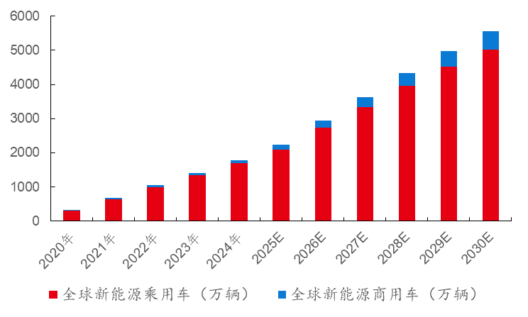 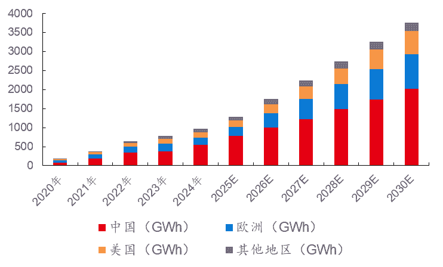

### 1.4 需求端：2024-2030年全球储能电池CAGR约29%

全球风电与光伏累计装机容量持续攀升，凸显出表前储能在电力调节中的关键作用。与此同时，工商业表后储能及数据中心储能等应用场景不断扩展，共同推动全球储能电池出货量迅猛增长。全球储能电池出货量以82.7%的复合年增长率从2020年的27GWh大幅提升至2024年的301GWh，并预计在2030年达到1400GWh。**2024-2030年间，复合年增长率将保持在29.2%的高位。**

**全球动力+储能电池的需求量从2020年的209Gwh提升至2024年的1270Gwh，并预计在2030年达到5154Gwh，2024-2030年的复合年增长率为26.5%。**

图表8：2020-2030E 全球储能电池出货量（GWh）

资料来源：宁德时代港股IPO资料，高工产研行业报告，中邮证券研究所

图表9：2020-2030E 全球动力和储能电池需求量（GWh）

资料来源：宁德时代港股IPO资料，高工产研行业报告，中邮证券研究所

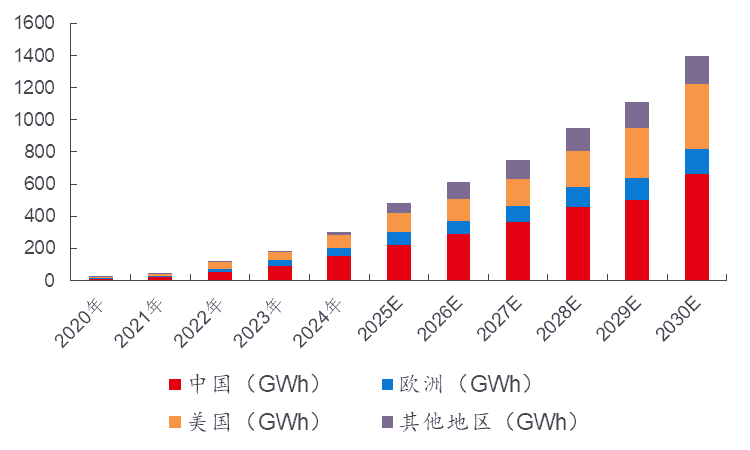 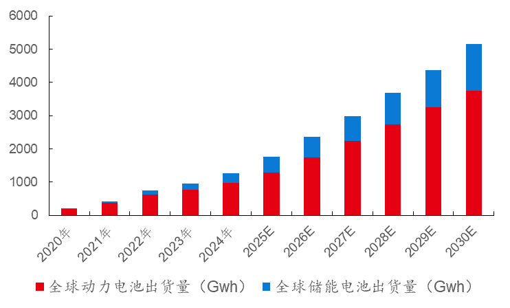

### 1.5 宁德时代未来三年扩产所需要的设备空间有望在400-700亿元

图表10：宁德时代产能缺口测算和锂电设备空间测算

资料来源：宁德时代港股IPO资料，高工产研行业报告，SNE Research，公司财报，中邮证券研究所

|  | 2022年 | 2023年 | 2024年 | `2025E` | `2026E` | `2027E` | `2028E` | `2029E` | `2030E` |
|---|---|---|---|---|---|---|---|---|---|
| 全球动储电池出货量（Gwh） | `757` | `966` | `1270` | `1766` | `2365` | `2980` | `3685` | `4370` | `5154` |
| 动力 | `636` | `781` | `969` | `1285` | `1753` | `2232` | `2739` | `3260` | `3754` |
| 储能 | `121` | `185` | `301` | `481` | `612` | `748` | `946` | `1110` | `1400` |
| 宁德时代的份额 |  |  |  |  |  |  |  |  |  |
| 动力 | `36.20%` | `36.60%` | `37.90%` | `38.10%` | `38.30%` | `38.50%` | `38.50%` | `38.50%` | `38.50%` |
| 储能 | `43%` | `40%` | `37%` | `37.30%` | `38.00%` | `38.10%` | `38.10%` | `38.10%` | `38.10%` |
| 宁德时代的出货量（Gwh） |  |  |  | `1144` | `1415` | `1678` | `1979` |  |  |
| 动力 |  |  |  | `859` | `1055` | `1255` | `1445` |  |  |
| 储能 |  |  |  | `285` | `360` | `423` | `533` |  |  |
| 不同产能利用率下需要的产能（Gwh） |  |  |  |  |  |  |  |  |  |
| 95% |  |  |  | `1205` | `1489` | `1766` | `2083` |  |  |
| 90% |  |  |  | `1271` | `1572` | `1864` | `2199` |  |  |
| 80% |  |  |  | `1430` | `1769` | `2098` | `2473` |  |  |
| 75% |  |  | `490` | `1526` | `1887` | `2237` | `2638` |  |  |
| 宁德时代产能（Gwh） |  | `390` | `552` | `676` |  |  |  |  |  |
| 不同产能利用率下的产能缺口（Gwh） |  |  |  |  |  |  |  |  |  |
| 95% |  |  |  | `280` | `564` | `841` | `1158` |  |  |
| 90% |  |  |  | `346` | `647` | `939` | `1274` |  |  |
| 80% |  |  |  | `505` | `844` | `1173` | `1548` |  |  |
| 75% |  |  |  | `601` | `962` | `1312` | `1713` |  |  |
| 单GWh投资额（亿元） |  |  |  | `1.20` | `1.15` | `1.00` | `1.00` |  |  |
| 不同产能利用率下宁德时代扩产的设备空间（亿元） |  |  |  |  |  |  |  |  |  |
| 95% |  |  |  | `321` | `564` | `841` | `1158` |  |  |
| 90% |  |  |  | `398` | `647` | `939` | `1274` |  |  |
| 80% |  |  |  | `581` | `844` | `1173` | `1548` |  |  |
| 75% |  |  |  | `691` | `962` | `1312` | `1713` |  |  |

备注：假设值、计算值；截至2025中报，已有产能345Gwh（年化690Gwh），在建产能235GWh，加总得925Gwh，我们以此为基数做未来几年产能缺口测算

- **我们测算，到2027年底，宁德时代的待建设产能缺口约为300-600Gwh，对应设备环节的价值量空间约为400-700亿元。**

核心假设：

1. 2025-2027年，宁德时代在全球市场的动力电池份额分别为38.10%/38.30%/38.50%，储能电池份额分别为37.30%/38.00%、38.10%。
2. 2026-2027年单Gwh对应的锂电设备投资额分别为1.20/1.15亿元。
3. 我们测算在95%/90%/80%/75%四种不同的产能利用率下的产能待建需求。

### 1.6 设备公司合同负债已超过前几年高点

**从主要锂电设备上市公司合同负债的情况来看，在经历2024年的下滑后，2025H1的合同负债恢复明显，并已超过了前几年的高点。**

**截至2025年中报，样本公司的合计合同负债为230亿元。**

图表11：主要锂电设备上市公司合同负债（亿元）

资料来源：Wind，中邮证券研究所

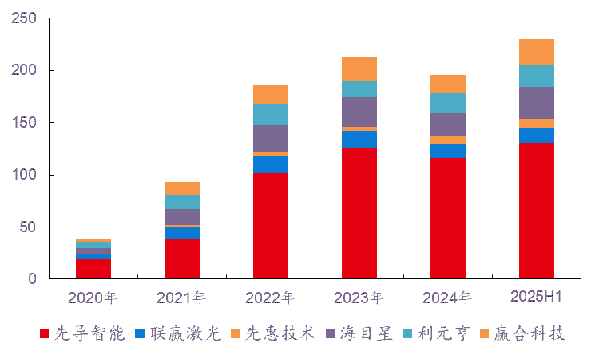

### 1.7 设备公司盈利水平处于修复期

从主要锂电设备上市公司的扣非归母净利润来看，25Q1和25Q2已呈现出底部反转、向上改善的趋势。

毛利率和净利率方面，整体上相比底部有恢复，但由于产品降价、行业竞争等压力，盈利能力仍处于盘整修复期。

图表13：主要锂电设备上市公司季度毛利率

资料来源：Wind，中邮证券研究所

注：剔除了利元亨24Q4的异常偏离值

图表14：主要锂电设备上市公司季度净利率

资料来源：Wind，中邮证券研究所

注：剔除了利元亨24Q4的异常偏离值

图表12：主要锂电设备上市公司季度扣非归母净利（亿元）

资料来源：Wind，中邮证券研究所

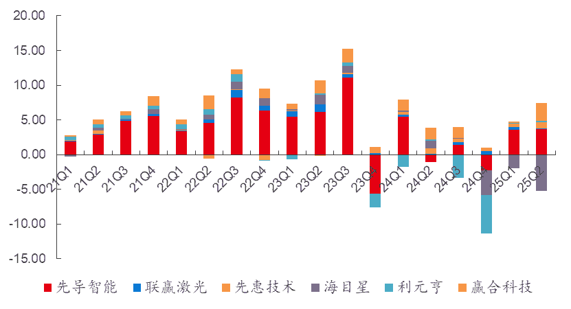 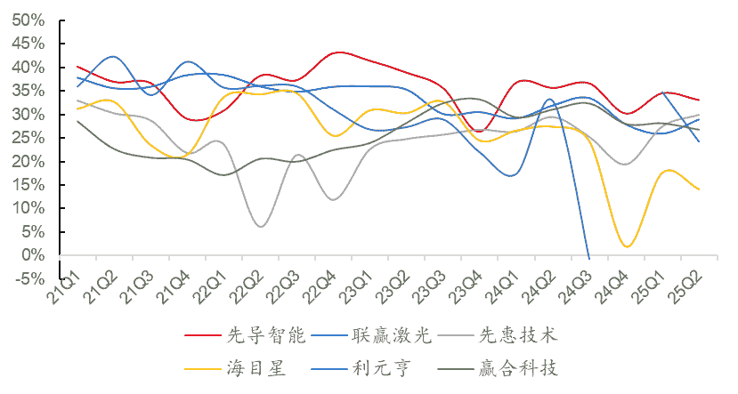 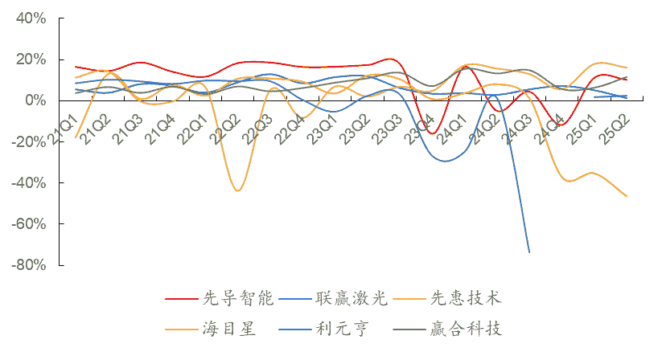

## 1.8 投资建议与估值

从上述电池上市公司的资本开支情况和设备厂的合同负债情况来看，锂电新一轮扩产的趋势得到印证。同时，叠加固态电池产业化在即，2026-2027年将是首代产线突破的关键时点，新技术带来的设备环节创新机遇同样值得重视。

建议关注：联赢激光、赢合科技、先导智能、海目星、先惠技术、宏工科技、曼恩斯特等。

图表15：主要锂电设备上市公司2025-2027年PE倍数

资料来源：Wind，中邮证券研究所

注：PE采用Wind一致预期，数据日期2025年9月18日

请参阅附注免责声明

| 代码 | 公司 | PE（2025E） | PE（2026E） | PE（2027E） |
| --- | --- | --- | --- | --- |
| 300450.SZ | 先导智能 | 54.87 | 40.89 | 33.33 |
| 688518.SH | 联赢激光 | 31.25 | 21.67 | 16.28 |
| 688155.SH | 先惠技术 | 28.03 | 21.04 | 16.90 |
| 688559.SH | 海目星 | / | 24.50 | 19.97 |
| 688499.SH | 利元亨 | 166.48 | 79.65 | 60.60 |
| 300457.SZ | 赢合科技 | 30.86 | 23.78 | 19.06 |
| 301325.SZ | 曼恩斯特 | 71.98 | 44.22 | 32.85 |
| 301662.SZ | 宏工科技 | 62.29 | 46.34 | 29.27 |
| 300648.SZ | 星云股份 | 145.08 | 73.22 | 41.06 |

## 1.9 风险提示

- 下游需求不及预期；
- 行业竞争加剧；
- 新技术进展不及预期；
- 全球政策变化。

请参阅附注免责声明

## 感谢您的信任与支持！

THANK YOU

**刘卓（首席分析师）**
SAC编号：S1340522110001
邮箱：liuzhuo@cnpsec.com

**虞洁攀（分析师）**
SAC编号：S1340523050002
邮箱：yujiepan@cnpsec.com

## 免责声明

### 分析师声明

撰写此报告的分析师（一人或多人）承诺本机构、本人以及财产利害关系人与所评价或推荐的证券无利害关系。

本报告所采用的数据均来自我们认为可靠的目前已公开的信息，并通过独立判断并得出结论，力求独立、客观、公平，报告结论不受本公司其他部门和人员以及证券发行人、上市公司、基金公司、证券资产管理公司、特定客户等利益相关方的干涉和影响，特此声明。

## 免责声明

中邮证券有限责任公司（以下简称"中邮证券"）具备经中国证监会批准的开展证券投资咨询业务的资格。

本报告信息均来源于公开资料或者我们认为可靠的资料，我们力求但不保证这些信息的准确性和完整性。报告内容仅供参考，报告中的信息或所表达观点不构成所涉证券买卖的出价或询价，中邮证券不对因使用本报告的内容而导致的损失承担任何责任。客户不应以本报告取代其独立判断或仅根据本报告做出决策。

本报告所载的意见、评估及预测仅为本报告出具日的观点和判断。该等意见、评估及预测无需通知即可随时更改。过往的表现亦不应作为日后表现的预示和担保。在不同时期，中邮证券可能会发出与本报告所载意见、评估及预测不一致的研究报告。

中邮证券及其所属关联机构可能会持有报告中提到的公司所发行的证券头寸并进行交易，也可能为这些公司提供或者计划提供投资银行、财务顾问或者其他金融产品等相关服务。

《证券期货投资者适当性管理办法》于2017年7月1日起正式实施，本报告仅供中邮证券签约客户使用，若您非中邮证券签约客户，为控制投资风险，请取消接收、订阅或使用本报告中的任何信息。本公司不会因接收人收到、阅读或关注本报告中的内容而视其为签约客户。

本报告版权归中邮证券所有，未经书面许可，任何机构或个人不得存在对本报告以任何形式进行翻版、修改、节选、复制、发布，或对本报告进行改编、汇编等侵犯知识产权的行为，亦不得存在其他有损中邮证券商业性权益的任何情形。如经中邮证券授权后引用发布，需注明出处为中邮证券研究所，且不得对本报告进行有悖原意的引用、删节或修改。

中邮证券对于本申明具有最终解释权。

## 免责声明

中邮证券有限责任公司，2002年9月经中国证券监督管理委员会批准设立，是中国邮政集团有限公司绝对控股的证券类金融子公司。

公司经营范围包括:证券经纪，证券自营，证券投资咨询，证券资产管理，融资融券，证券投资基金销售，证券承销与保荐，代理销售金融产品，与证券交易、证券投资活动有关的财务顾问等。

公司目前已经在北京、陕西、深圳、山东、江苏、四川、江西、湖北、湖南、福建、辽宁、吉林、黑龙江、广东、浙江、贵州、新疆、河南、山西、上海、云南、内蒙古、重庆、天津、河北等地设有分支机构，全国多家分支机构正在建设中。

中邮证券紧紧依托中国邮政集团有限公司雄厚的实力，坚持诚信经营，践行普惠服务，为社会大众提供全方位专业化的证券投、融资服务，帮助客户实现价值增长，努力成为客户认同、社会尊重、股东满意、员工自豪的优秀企业。

### 公司简介

### 投资评级说明

### 中邮证券研究所

**北京**
邮箱：yanjiusuo@cnpsec.com
地址：北京市东城区前门街道珠市口东大街17号
邮编：100050

**深圳**
邮箱：yanjiusuo@cnpsec.com
地址：深圳市福田区滨河大道9023号国通大厦二楼
邮编：518048

**上海**
邮箱：yanjiusuo@cnpsec.com
地址：上海市虹口区东大名路1080号大厦3楼
邮编：200000
