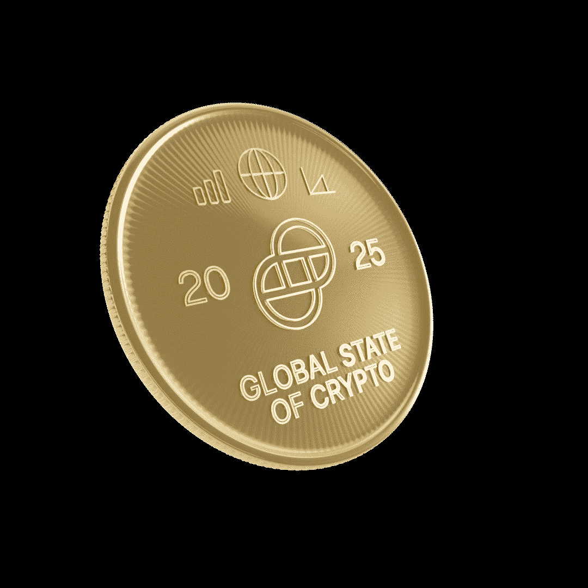

# Global State of Crypto

## 2025 Trends: Data-Driven Insights Into the Crypto Market

02 Global State of Crypto 2025

## INTRODUCTION

In 2025, the crypto ecosystem has multiple greenshoots ready to propel it forward. Bitcoin's recent price movement has shown it's become a reliable store of value even amid an uncertain macro outlook.

With the election of President Donald J. Trump, the United States has gone all in on crypto. In March, President Trump launched a Strategic Bitcoin Reserve that will look at tax-neutral ways to acquire more bitcoin and ensure the US will not sell the approximately 198,000 bitcoin in the US Treasury.

Meanwhile, publicly-traded companies have turned to bitcoin as a viable reserve asset, betting it will generate better yield than treasury bonds. The US has also reversed its regulation by enforcement policy imposed on crypto companies, spurring innovation. And more crypto ETFs are poised to go live by the end of 2025, further integrating the asset class with the traditional financial system.

03 Global State of Crypto 2025

### Methodology

- The results presented here are based on a survey of 7,205 consumers in the US, UK, France, Italy, Singapore, and Australia (approximately 1,200 consumers per country).
- The survey explored awareness of cryptocurrencies and exchanges, motivations for owning and trading cryptocurrencies, general attitudes, recent crypto ETF adoption, the impact of the Trump administration's policies on crypto, memecoin adoption, and remaining barriers to ownership.
- The survey respondents were a random sample representative of the consumer population across each of the mentioned countries, organized by age, geography, gender, and income.
- The survey was conducted on behalf of Gemini by Data Driven Consulting Group from March 18 to April 10, 2025.
- Unless otherwise noted, statistics cited as "global" in the report refer to average 2025 data across the US, UK, France, Italy, Australia, and Singapore.

04 Global State of Crypto 2025

## TOP FINDINGS

- **Crypto ownership increases globally, with Europe leading the way:** Cryptocurrency ownership in the UK hit 24% in 2025, up from 18% in 2024. Crypto ownership in the US also ticked higher at 22%, up from 21% the year prior. France recorded a slightly more significant gain at 21%, up from 18% in 2024, while Singapore posted a 28% ownership rate, up from 26% in 2024.

- **Trump administration's pro-crypto stance sparks confidence:** Nearly a quarter (23%) of non-owners in the US said President Trump launching a Strategic Bitcoin Reserve increased their confidence in the value of cryptocurrency. This sentiment was echoed globally by non-owner respondents in the UK and Singapore, where about one in five (21% and 19%, respectively) non-owners said the same.

- **Memecoins are driving broader crypto adoption:** In the US, 31% of investors who own both memecoins and traditional cryptocurrencies report they purchased their memecoins first, followed by 30% in Australia, 28% in the UK, 23% in Singapore, 22% in Italy, and 19% in France. Globally, 94% of memecoin owners also own other types of crypto, suggesting memecoins are an onramp to broader crypto ownership.

- **Spot crypto ETFs continue to gain market share:** In the US, 39% of crypto owners said they are invested in a cryptocurrency ETF, up from 37% in 2024. These products have also become more popular in Italy (47%), the UK (41%), Singapore (40%), Australia (38%), and France (32%).

05 Global State of Crypto 2025

### Europe Leads the Way in Crypto Ownership Growth

After a period of modest growth following the crypto market downturn of 2022, crypto ownership rose in all geographies surveyed over the past year. In particular, crypto ownership in France and the UK increased, reflecting a warming regulatory environment for digital assets in Europe with the rollout of the EU's Markets in Crypto-Assets (MiCA) over the last two years.

In 2025, 24% of respondents in the UK said they were invested in cryptocurrency, up from 18% in 2024. In France, 21% of respondents reported owning crypto, up from 18% in 2024. And Singapore led the way with the highest ownership rate, at 28%.

| Country | 2024 | 2025 |
|---------|------|------|
| USA     | 21%  | 22%  |
| AUS     | 18%  | 22%  |
| UK      | 18%  | 24%  |
| IT      | 18%  | 21%  |
| SG      | 26%  | 28%  |
| FR      | 19%  | 21%  |

*YoY ownership percentage in crypto*

06 Global State of Crypto 2025

### Non-Owners Report an Increase in Crypto Confidence as a Result of Trump Policies

After pledging to support digital assets during his campaign, President Trump has established a Strategic Bitcoin Reserve, reshaped the SEC with a pro-innovation approach to crypto regulation, and expressed support for bills working through Congress that will provide stablecoin legislation and a regulatory framework for digital assets. He's also launched a Trump memecoin that had reached almost $3 billion in market cap in May.

President Trump's policies are making an impact. Nearly a quarter (23%) of non-crypto owners in the US said the launch of Strategic Bitcoin Reserve makes them more confident in the value of cryptocurrency. This sentiment was echoed by respondents in the UK and Singapore, where about one in five (21% and 19%, respectively) non-owners said they were more confident due to President Trump's Strategic Bitcoin Reserve.

| Country | Percentage |
|---------|------------|
| USA     | 23%        |
| AUS     | 21%        |
| UK      | 15%        |
| IT      | 19%        |
| SG      | 16%        |
| FR      | 17%        |

*Percentage of non-owners who said the Strategic Bitcoin Reserve make them more confident in the value of crypto*

07 Global State of Crypto 2025

## MEMECOINS

### Memecoin Frenzy Has Sparked Broader Crypto Adoption

Over the past year, memecoins have drawn significant attention and trading volume within the crypto community, with some tokens soaring by thousands of percentage points in a matter of hours. Memecoins serve as a significant onramp for new investors to digital assets, sparking broader adoption that leads to investing in more established cryptocurrencies. The vast majority (94%) of memecoin owners also own other crypto.

- **Memecoins draw investors:** In the US, 31% of investors who own both memecoins and traditional cryptocurrencies report that they purchased their memecoins first, followed by 28% in Australia and the UK, 23% in Singapore, 22% in Italy, and 19% in France. However, globally, 94% of memecoin owners also own other types of crypto, suggesting memecoins are an onramp to crypto ownership.
- **France leads the way in memecoin adoption:** In France, 67% of crypto investors own memecoins, followed by 59% in Singapore, 58% in Italy, 57% in the UK, 55% in the US, and 45% in Australia.

| Country | Percentage |
|---------|------------|
| USA     | 21%        |
| AUS     | 17%        |
| UK      | 16%        |
| IT      | 16%        |
| SG      | 12%        |
| FR      | 11%        |

*Percentage of crypto owners who allocate at least half of their assets to memecoins*

08 Global State of Crypto 2025

## ETFs

### Two in Five US Crypto Owners Invest in Crypto ETFs

Spot crypto ETFs quickly became the fastest growing ETFs in history after their launch in early 2024, recording hundreds of billions in inflows and helping drive the price of bitcoin higher. In the US, 39% of crypto owners said they are invested in a cryptocurrency ETF, up from 37% in 2024.

These products have also become popular in Italy (47%), the UK (41%), Singapore (40%), Australia (38%), and France (32%) as well.

| Method | Percentage |
|--------|------------|
| Crypto bought and held via exchange wallet | 61% |
| Crypto bought and held solely through an ETF | 14% |
| Both | 25% |

*Percentage of people who bought crypto in an ETF in the US vs. a wallet vs. both.*

09

## Global State of Crypto

### 2025

**VALUE**

## As Crypto Is Perceived as a Store of Value, Selling Slows

The crypto market has been resilient in 2025, holding steady on days when tech stocks dropped. A growing number of investors and corporations no longer view bitcoin as a "risk-on" asset that's suitable to invest in only when interest rates are low and the central government is pumping liquidity into the economy. Instead, many investors view crypto as a reliable store of value in any market environment.

Crypto selling has slowed significantly from 2024. On a global level, roughly one in 10 past owners said they had sold in the past six months. Here's how it broke down:

Percentage of past owners who sold in the past six months

| Country | 2024 | 2025 |
|---------|------|------|
| USA | 17% | 15% |
| AUS | 15% | 12% |
| UK | 15% | 12% |
| IT | 10% | 11% |
| SG | — | 9% |
| FR | — | 8% |

10

## Global State of Crypto

### 2025

**INFLATION**

## More in US View Crypto As Hedge Against Inflation

After surging in 2022 and 2023, inflationary pressures in the US dissipated in 2024 and throughout the first quarter of 2025. Core CPI, a closely watched inflationary measure that excludes food and energy prices, ticked up 2.4% year-over-year in March, roughly in line with the Federal Reserve's 2% annual inflation target.

But inflation is still very much on the mind of crypto investors in the US. In 2025, 39% of US respondents said they buy and hold crypto as a way to hedge against inflation, up from 32% last year.

Inflationary pressures weren't as much of a worry in other countries. Here's how it broke down:

Percentage of crypto investors who buy and hold crypto to hedge against inflation

| Country | 2024 | 2025 |
|---------|------|------|
| USA | 32% | 39% |
| AUS | 35% | 35% |
| UK | 42% | 34% |
| IT | 41% | 41% |
| SG | — | 29% |
| FR | — | 28% |

本报告来源于三个皮匠报告站（www.sgpjbg.com）,由用户Id:349461下载,文档Id:924472,下载日期:2025-09-29

11

## Global State of Crypto

### 2025

**GENDER**

## The Gender Gap for Crypto Investments Is Closing

Similar to traditional finance, the crypto ecosystem has long been a male-dominated space. But women across the globe have increasingly opted to invest in crypto, narrowing the gap in ownership in the majority of countries surveyed.

YoY female crypto owners

| Country | 2024 | 2025 |
|---------|------|------|
| USA | 28% | 30% |
| UK | 30% | 33% |
| FR | 35% | 30% |
| SG | 31% | 34% |

12

## Global State of Crypto

### 2025

**AGE**

## Half of Gen Z and Millennials Invest in Crypto

The common narrative is that cryptocurrency ownership skews young. And that's largely true. About half of Millennials and Gen Z respondents (between ages 18 and 28) globally said they either currently own crypto or have in the past, at 52% and 48%, respectively. That's significantly higher than the general global population, at 35%. Gen X and Boomers also had significantly lower rates of owning or previously owning crypto, at 26% and 11%, respectively.

Percentage of owners vs. past owners vs non-owners by generation

| Generation | Owners | Past owners | Non-owners |
|------------|--------|-------------|------------|
| Gen Z | 29% | 19% | 52% |
| Millennials | 16% | 36% | 48% |
| Gen X | 8% | 18% | 74% |
| Boomers | 5% | 6% | 90% |

# GEMINI

Disclaimer:

This material is for general informational purposes only and is not (i) an offer, or solicitation of an offer, to invest in, or to buy or sell, any interests or shares, or to participate in any investment or trading strategy, (ii) intended to provide accounting, legal, or tax advice, or investment recommendations or other investment advice, or (iii) an official statement of Gemini. Gemini, its affiliates and its employees do not make any representation or warranties, expressed or implied, as to accuracy or completeness of the information or any other information transmitted or made available. Buying, selling, and trading cryptocurrency involves risks, including the risk of losing all of the invested amount. Recipients should consult their advisors before making any investment decision. Any use, review, retransmission, distribution, or reproduction of these materials, in whole or in part, is strictly prohibited in any form without the express written approval of Gemini. Past performance is no guarantee of future results.
