本报告由中信建投证券股份有限公司在中华人民共和国（仅为本报告目的，不包括香港、澳门、台湾）提供。在遵守适用的法律法规情况下，本报告亦可能由中信建投（国际）证券有限公司在香港提供。同时请务必阅读正文之后的免责条款和声明。

# 证券研究报告·行业动态

## 降息落地符合预期，节前补库支撑金属及煤炭价格

**核心观点**

1）降息落地符合预期，节前补库支撑黑色金属价格。18 日凌晨，美联储降息落地，25 个BP 的降息幅度符合市场预期，虽然没有超预期的"刺激"导致短期内宏观因素的支撑力度有所减弱，但降息终归是对商品的利好因素，同时考虑到临近双节，市场对补库的需求仍有预期，黑色链依然有较强的底部支撑。

2）国内市场炼焦煤市场价格均偏强运行。供应方面，本周煤矿产量小幅增加，但内蒙查超产文件再度引发市场对于煤矿减产担忧，短期内煤矿复产速度偏慢。需求方面，15 日焦炭第二轮提降全面落地，但煤价迅速拉涨带动个别焦企对捣固干熄焦提涨。

**动态信息**

行业综述：从交运各子板块相对沪深300 的表现来看，本周（9 月15 日-9 月19 日）交运板块整体上涨。本周物流综合板块上涨0.42%，其中原材料供应链服务板块下跌0.23%。

**物流供应链：降息落地符合预期，节前补库支撑金属及煤炭价格**

降息落地符合预期，节前补库支撑黑色金属价格。18 日凌晨，美联储降息落地，25 个BP 的降息幅度符合市场预期，虽然没有超预期的"刺激"导致短期内宏观因素的支撑力度有所减弱，但降息终归是对商品的利好因素，同时考虑到临近双节，市场对补库的需求仍有预期，黑色链依然有较强的底部支撑。

国内市场炼焦煤市场价格均偏强运行。供应方面，本周煤矿产量小幅增加，但内蒙查超产文件再度引发市场对于煤矿减产担忧，短期内煤矿复产速度偏慢。本周市场交投氛围明显回暖，节日补库需求叠加焦煤期货盘面拉涨，进一步提振了市场预期，煤矿出货明显好转。需求方面，15 日焦炭第二轮提降全面落地，但煤价迅速拉涨带动鄂尔多斯市场个别焦企对捣固干熄焦提涨。

动力煤市场偏强运行，产地延续涨势。产地方面，鄂尔多斯动力煤市场主产区多数煤矿保持正常生产，近期下游终端企业补库需求采购积极，叠加主力煤企站台外购价格连续上调，市场情绪进一步升温，矿区整体出货较好，煤矿报价延续涨势。陕西地区大部分煤矿正常生产销售，整体市场煤供应较为充足当前港口整体库存水平偏低，预计国庆节前煤价仍有一定的上涨空间。

**维持 强于大市**

**梁骁**
liangxiaobj@csc.com.cn
010-56135284
SAC 编号:S1440524050005

**韩军**
hanjunbj@csc.com.cn
SAC 编号:S1440519110001
SFC 编号:BRP908

发布日期： 2025 年09 月21 日

市场表现

**相关研究报告**

---

## 物流 行业动态报告

请务必阅读正文之后的免责条款和声明。

## 目录

一、行情综述：原材料供应链服务板块下跌 ............................................................................................................................... 1

1.1 A 股市场：物流综合板块上涨，其中原材料供应链服务板块下跌 ....................................................................... 1

1.2 全球市场：海外大宗商品贸易商上涨 ........................................................................................................................... 1

二、行业动态：全球主要大宗商品金属上涨 ............................................................................................................................... 3

2.1 国际市场：全球主要大宗商品金属上涨 ....................................................................................................................... 3

2.2 国内市场：8 中国大宗商品价格指数（CBPI）环比上涨 0.3% ............................................................................ 5

2.3 动力煤和炼焦煤市场均偏强运行 .................................................................................................................................... 7

2.4 8 月份物流业景气指数：供需联动指数回升，预期继续保持高位 ..................................................................... 8

风险分析.................................................................................................................................................................................................. 9

## 图目录

- 图1: 交通运输行业各子板块与沪深300 的超额收益 ....................................................................... 1
- 图2: 交通运输行业涨跌幅股票排名前十（单位：%） ............................................................................ 1
- 图3: 物流综合板块涨跌幅表现（单位：%） .......................................................................................... 1
- 图4: 大宗商品供应链服务板块主要标的股价表现及估值 ........................................................................ 2
- 图5: 全球主要大宗商品期货价格走势 .................................................................................................... 3
- 图6: 布伦特原油期货价格（美元/桶） ................................................................................................... 3
- 图7: WTI 原油期货价格（美元/桶） ....................................................................................................... 3
- 图8: NYMEX 天然气期货价格（美元/百万英热单位） ........................................................................... 4
- 图9: NEWC 动力煤现货价格（美元/吨） ............................................................................................... 4
- 图10: RJ/CRB 商品期货价格指数 ................................................................................................................ 4
- 图11: CRB 商品现货价格指数 ................................................................................................................ 4
- 图12: CRB 商品金属现货价格指数 ......................................................................................................... 4
- 图13: CRB 商品工业原料现货价格指数 .................................................................................................. 4
- 图14: CRB 商品食品现货价格指数 ......................................................................................................... 5
- 图15: CRB 商品油脂现货价格指数 ......................................................................................................... 5
- 图16: 中国大宗商品价格总指数走势 ...................................................................................................... 5
- 图17: 中国能源类大宗商品价格指数走势 .............................................................................................. 5
- 图18: 中国钢铁类大宗商品价格指数走势 .............................................................................................. 5
- 图19: 中国矿产类大宗商品价格指数走势 .............................................................................................. 5
- 图20: 中国有色类大宗商品价格指数走势 .............................................................................................. 6
- 图21: 中国橡胶类大宗商品价格指数走势 .............................................................................................. 6
- 图22: 中国农产品类大宗商品价格指数走势 ........................................................................................... 6
- 图23: 中国油料油脂类大宗商品价格指数走势 ....................................................................................... 6
- 图24: 动力煤期货收盘价（元/吨） ........................................................................................................ 6
- 图25: 国内主焦煤市场价（元/吨） ........................................................................................................ 6
- 图26: 中国铁矿石价格指数 .................................................................................................................... 7
- 图27: LME 铜铝锌现货价格（美元/吨） ................................................................................................. 7
- 图28: 中国原油进口量（万吨） ............................................................................................................. 7
- 图29: 中国动力煤进口量（万吨） ......................................................................................................... 7
- 图30: 中国炼焦煤进口量（万吨） ......................................................................................................... 7
- 图31: 中国铁矿石进口量（万吨） ......................................................................................................... 7
- 图32: 主流港口煤炭库存（万吨） ......................................................................................................... 8
- 图33: 主流港口铁矿石库存（万吨） ...................................................................................................... 8
- 图34: 中国物流业景气指数（LPI） ....................................................................................................... 8
- 图35: 中国公路物流运价指数同比变化 .................................................................................................. 8

---

### 一、行情综述：原材料供应链服务板块下跌

### 1.1 A 股市场：物流综合板块上涨，其中原材料供应链服务板块下跌

从交运各子板块相对沪深300 的表现来看，本周（9 月15 日-9 月19 日）交运板块整体上涨。本周物流综合板块上涨0.42%，其中原材料供应链服务板块下跌0.23%。

图1: 交通运输行业各子板块与沪深300 的超额收益

数据来源：Wind，中信建投

图2: 交通运输行业涨跌幅股票排名前十（单位：%）

图3: 物流综合板块涨跌幅表现（单位：%）

数据来源：Wind，中信建投

数据来源：Wind，中信建投

### 1.2 全球市场：海外大宗商品贸易商上涨

| 排名 | 证券简称 | 涨幅 | 证券简称 | 跌幅 |
|------|----------|------|----------|------|
| 1 | 新宁物流 | 22.0 | 建发股份 | -10.7 |
| 2 | 海峡股份 | 9.9 | 申通快递 | -8.4 |
| 3 | 嘉友国际 | 9.3 | 长江投资 | -7.7 |
| 4 | 中国外运 | 8.8 | 天津港 | -7.4 |
| 5 | 怡亚通 | 8.0 | 炬申股份 | -5.5 |
| 6 | *ST原尚 | 7.6 | 重庆路桥 | -5.5 |
| 7 | 南京港 | 7.6 | 德新科技 | -5.4 |
| 8 | 申通快递 | 7.1 | 中信海直 | -5.4 |
| 9 | 圆通速递 | 6.6 | 山东高速 | -4.9 |
| 10 | 华鹏飞 | 6.2 | 粤高速A | -4.8 |

| 排名 | 证券简称 | 涨幅 | 证券简称 | 跌幅 |
|------|----------|------|----------|------|
| 1 | 新宁物流 | 22.0 | 长久物流 | -3.5 |
| 2 | 飞马国际 | 16.1 | 宏川智慧 | -3.4 |
| 3 | 传化智联 | 11.5 | 密尔克卫 | -3.4 |
| 4 | 嘉友国际 | 9.3 | 普路通 | -2.9 |
| 5 | 怡亚通 | 8.0 | 西部创业 | -2.8 |
| 6 | 原尚股份 | 7.6 | ST万林 | -1.8 |
| 7 | 华鹏飞 | 6.2 | 中谷物流 | -1.5 |
| 8 | 安通控股 | 5.7 | 天顺股份 | -1.5 |
| 9 | 恒通股份 | 3.6 | 中创物流 | -1.2 |
| 10 | 海晨股份 | 3.4 | 厦门象屿 | -1.1 |

图4: 大宗商品供应链服务板块主要标的股价表现及估值

| 细分行业 | 上市公司 | 股票代码 | 市值（亿美元） | 周涨跌幅 | 年初至今涨幅 | PE（TTM） | EV/EBITDA |
|---|---|---|---|---|---|---|---|
| 商品贸易 | 嘉能可 | GLEN.L | 496.89 | 1.27 | -13.03 | -24.35 | 10.33 |
| 粮食贸易 | ADM | ADM.N | 292.27 | -1.20 | 24.06 | 26.59 | 10.56 |
| 粮食贸易 | 邦吉(BUNGE) | BG.N | 159.85 | -2.11 | 5.57 | 8.14 | 7.29 |
| 日本商社 | 伊藤忠商事 | 8001.T | 931.98 | 1.40 | 12.64 | 14.40 | 10.97 |
| 日本商社 | 三菱商事 | 8058.T | 972.45 | 3.78 | 39.63 | 18.00 | 8.68 |
| 日本商社 | 三井物产 | 8031.T | 731.40 | 2.20 | 14.36 | 13.26 | 9.43 |
| 日本商社 | 住友商事 | 8053.T | 357.33 | 0.95 | 29.61 | 8.72 | 8.52 |
| 日本商社 | 丸红 | 8002.T | 405.90 | 2.90 | 54.15 | 11.67 | 9.15 |
| 原材料供应链服务 | 建发股份 | 600153.SH | 43.70 | 1.23 | 9.35 | 12.01 | 5.32 |
| 原材料供应链服务 | 物产中大 | 600704.SH | 43.55 | 0.84 | 22.83 | 8.74 | 6.13 |
| 原材料供应链服务 | 厦门象屿 | 600057.SH | 28.17 | -1.11 | 14.07 | 11.99 | 6.35 |
| 原材料供应链服务 | 厦门国贸 | 600755.SH | 18.39 | -0.16 | -2.86 | 42.18 | 13.01 |
| 原材料供应链服务 | 远大控股 | 000626.SZ | 4.72 | -3.63 | 15.30 | -14.46 | -116.93 |
| 原材料供应链服务 | 飞马国际 | 002210.SZ | 15.08 | 16.14 | 51.50 | -4,749.74 | 85.77 |
| 原材料供应链服务 | 浙商中拓 | 000906.SZ | 6.13 | -0.65 | -4.05 | 17.62 | 9.14 |
| 原材料供应链服务 | 瑞茂通 | 600180.SH | 7.24 | 2.60 | 10.73 | -136.41 | 14.84 |
| 原材料供应链服务 | 福然德 | 605050.SH | 13.95 | 0.00 | 113.69 | 28.15 | 19.55 |
| 中间产品及消费品供应链 | 怡亚通 | 002183.SZ | 19.68 | 8.02 | 20.31 | 143.90 | 20.25 |
| 中间产品及消费品供应链 | 海晨股份 | 300873.SZ | 8.17 | 3.40 | 51.56 | 21.26 | 9.53 |
| 中间产品及消费品供应链 | 华鹏飞 | 300350.SZ | 5.25 | 6.23 | 23.15 | -878.76 | 85.57 |
| 中间产品及消费品供应链 | 东方嘉盛 | 002889.SZ | 8.45 | 1.34 | 11.35 | 42.35 | 20.30 |
| 中间产品及消费品供应链 | 畅联股份 | 603648.SH | 5.62 | -0.90 | 10.30 | 33.54 | 11.20 |
| 中间产品及消费品供应链 | 飞力达 | 300240.SZ | 4.42 | 1.68 | 28.92 | -966.66 | 13.64 |
| 中间产品及消费品供应链 | 普路通 | 002769.SZ | 4.76 | -2.89 | 30.13 | -11,700.08 | -49.03 |

数据来源：Wind，中信建投

注：数据均来源于Wind，PE 为截至本周末股价/年报或季报披露的最近12 个月每股收益，PB 为股价/最近一期年报或季报净资产，EV/EBITDA 为股价/年报或季报披露的最近12 个月EBITDA

### 二、行业动态：全球主要大宗商品金属上涨

### 2.1 国际市场：全球主要大宗商品金属上涨

图5: 全球主要大宗商品期货价格走势

数据来源：Wind，中信建投；注：周涨幅-100%是因为国庆期间数据缺省

图6: 布伦特原油期货价格（美元/桶）

图7: WTI 原油期货价格（美元/桶）

数据来源：Wind，中信建投

| 品种 | 单位 | 最新期货结算价 | 周涨跌幅 | 年初至今涨幅 | 年涨跌幅 | 数据来源 |
|---|---|---|---|---|---|---|
| COMEX黄金 | 美元/盎司 | 3705.80 | 0.5% | 38.85% | 42.6% | COMEX |
| COMEX银 | 美元/盎司 | 42.95 | 0.3% | 43.65% | 40.0% | COMEX |
| COMEX铜 | 美元/盎司 | 4.63 | -0.4% | 14.73% | 8.4% | COMEX |
| IPE布油 | 美元/桶 | 66.04 | -1.4% | -13.03% | -0.4% | IPE |
| IPE轻质原油 | 美元/桶 | 61.98 | -0.3% | -14.51% | 4.5% | IPE |
| IPE英国天然气 | 便士/色姆 | 80.05 | -0.1% | -36.05% | -3.5% | IPE |
| CBOT大豆 | 美分/蒲式耳 | 1025.50 | -2.0% | 1.33% | 1.1% | CBOT |
| CBOT小麦 | 美分/蒲式耳 | 522.50 | -0.2% | -4.26% | -9.2% | CBOT |
| CBOT玉米 | 美分/蒲式耳 | 424.00 | -1.4% | -7.73% | 2.7% | CBOT |
| 铁矿石 | 元/吨 | 805.50 | 0.9% | 3.14% | -9.4% | DCE |
| 动力煤 | 元/吨 | 801.40 | 0.0% | 0.00% | -10.3% | ZCE |
| 螺纹钢 | 元/吨 | 3158.00 | 1.6% | -4.62% | -5.0% | SHFE |
| 热轧卷板 | 元/吨 | 3362.00 | 0.6% | -1.75% | 0.0% | SHFE |
| 不锈钢 | 元/吨 | 12870.00 | -0.3% | 0.55% | 18.2% | SHFE |

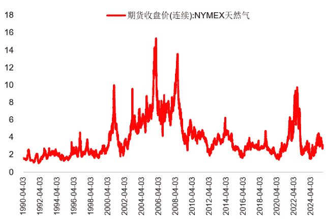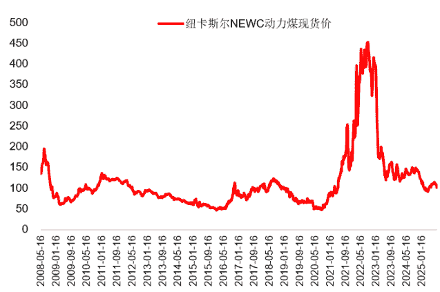

图8: NYMEX 天然气期货价格（美元/百万英热单位）

图9: NEWC 动力煤现货价格（美元/吨）

数据来源：Wind，中信建投

图10: RJ/CRB 商品期货价格指数

图11: CRB 商品现货价格指数

数据来源：Wind，中信建投

图12: CRB 商品金属现货价格指数

图13: CRB 商品工业原料现货价格指数

数据来源：Wind，中信建投

图14: CRB 商品食品现货价格指数

图15: CRB 商品油脂现货价格指数

数据来源：Wind，中信建投

### 2.2 国内市场：8 中国大宗商品价格指数（CBPI）环比上涨 0.3%

图16: 中国大宗商品价格总指数走势

图17: 中国能源类大宗商品价格指数走势

数据来源：Wind，中信建投；注：包括煤炭、原油、天然气

图18: 中国钢铁类大宗商品价格指数走势

图19: 中国矿产类大宗商品价格指数走势

数据来源：Wind，中信建投；注：包括铁矿石、铜精矿、铝土矿、铅矿、锌矿

**图20：中国有色类大宗商品价格指数走势**

**图21：中国橡胶类大宗商品价格指数走势**

数据来源：Wind，中信建投；注：包括铜、铝、铅、锌

数据来源：Wind，中信建投

**图22：中国农产品类大宗商品价格指数走势**

**图23：中国油料油脂类大宗商品价格指数走势**

数据来源：Wind，中信建投

注：包括玉米、稻谷、小麦、大豆（非榨油用）和棉花

资料来源：Wind，中信建投；注：包括大豆（榨油用）、棕榈油

**图24：动力煤期货收盘价（元/吨）**

**图25：国内主焦煤市场价（元/吨）**

数据来源：Wind，中信建投

数据来源：Wind，中信建投

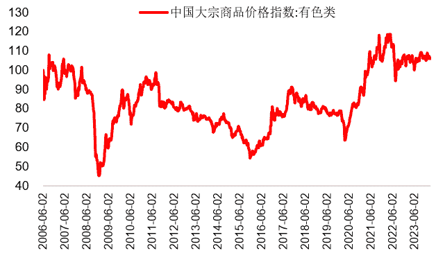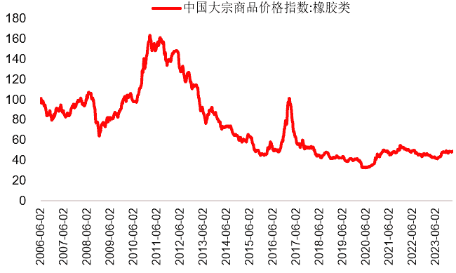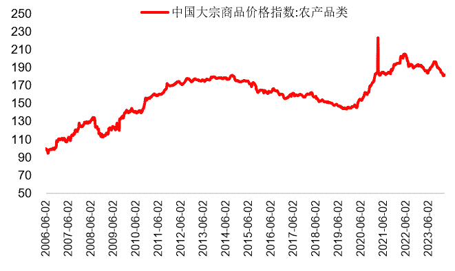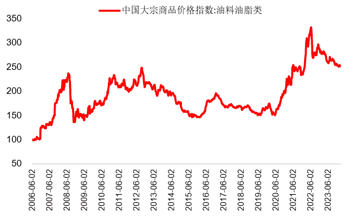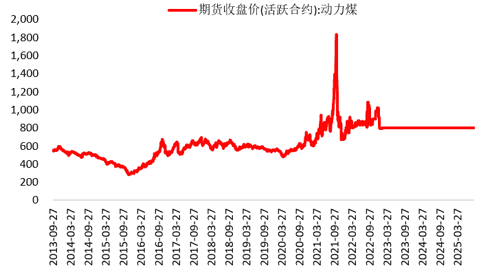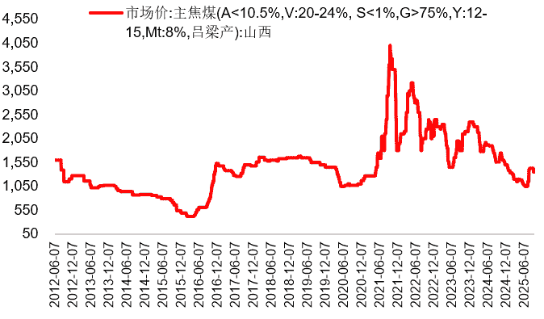

**图26：中国铁矿石价格指数**

**图27：LME铜铝锌现货价格（美元/吨）**

数据来源：Wind，中信建投；注：1994年4月=100

数据来源：Wind，中信建投

### 2.3 动力煤和炼焦煤市场均偏强运行

**图28：中国原油进口量（万吨）**

**图29：中国动力煤进口量（万吨）**

数据来源：Wind，中信建投

数据来源：Wind，中信建投

**图30：中国炼焦煤进口量（万吨）**

**图31：中国铁矿石进口量（万吨）**

数据来源：Wind，中信建投

数据来源：Wind，中信建投

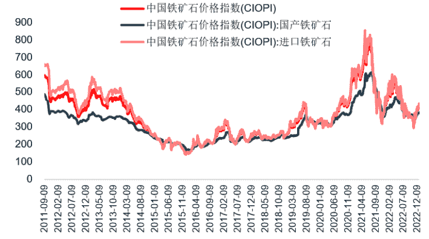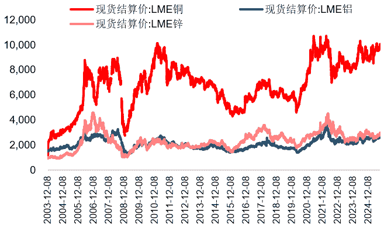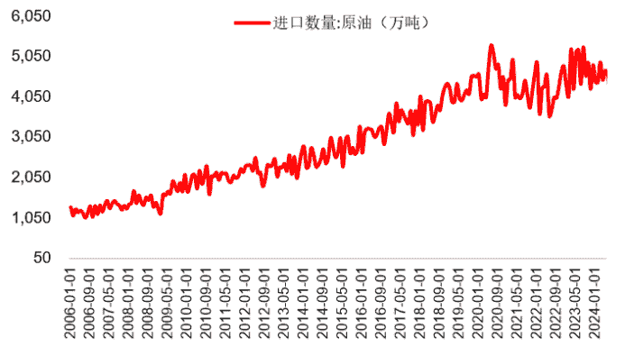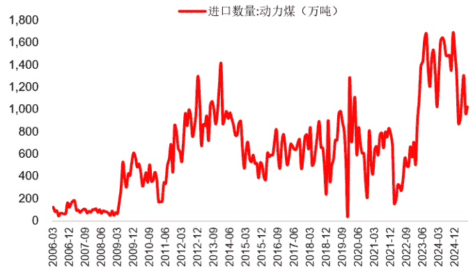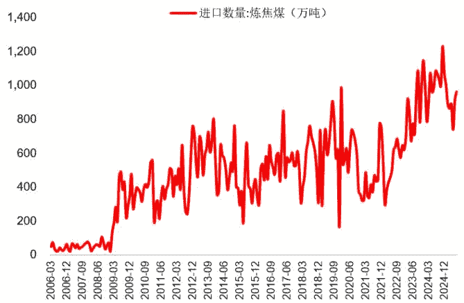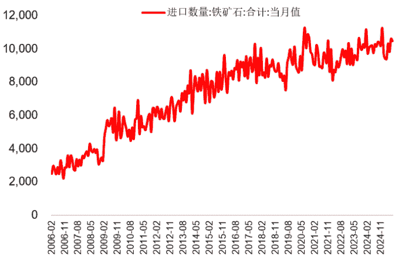

**图32：主流港口煤炭库存（万吨）**

**图33：主流港口铁矿石库存（万吨）**

数据来源：Wind，中信建投

数据来源：Wind，中信建投

### 2.4 8月份物流业景气指数：供需联动指数回升，预期继续保持高位

**图34：中国物流业景气指数（LPI）**

**图35：中国公路物流运价指数同比变化**

数据来源：Wind，中信建投

数据来源：Wind，中信建投

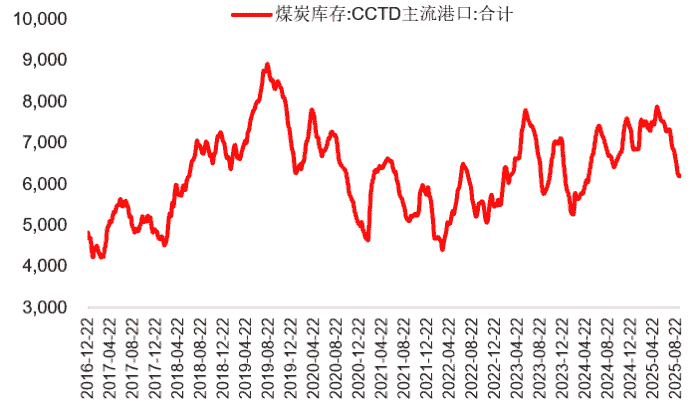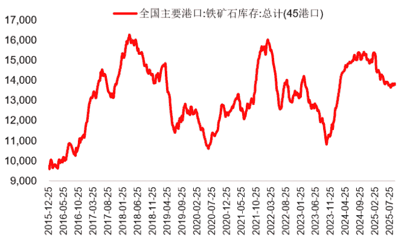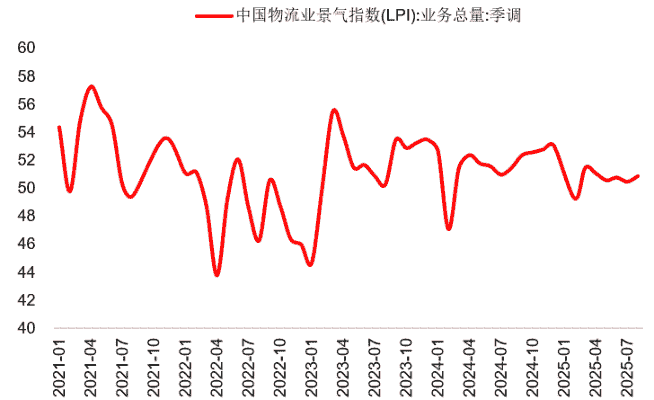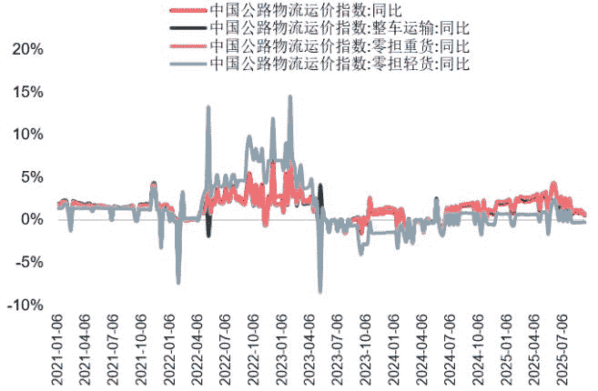

## 风险分析

**俄乌冲突持续升级下的全球贸易风险**

当前俄乌冲突持续胶着，将严重影响欧洲、俄罗斯相关航线贸易，带来全球航运体系崩溃，全球化进程甚至存在倒退风险。建议投资者密切关注战局演变、能源政策及制裁动态。

**全球宏观经济复苏不及预期**

地缘政治冲突升级、供应链挑战加剧、通胀压力持续攀升等多重因素下，全球经济复苏不确定性依然存在，复苏依旧困难重重，若全球宏观经济复苏严重不及预期，届时全球物流运输需求或大幅下降。

**物流价格受政策监管变化**

2022年9月国务院办公厅印发《关于进一步优化营商环境降低市场主体制度性交易成本的意见》，其中提出，推动降低物流服务收费；强化口岸、货场、专用线等货运领域收费监管，依法规范船公司、船代公司、货代公司等收费行为。物流价格或受政策监管变化超出预期，带来物流企业业绩波动。

**燃油成本大幅度上涨**

受国际原油价格波动影响，物流公司燃料成本存在大幅度上涨的风险。其次，俄乌冲突带来国际能源市场不稳定性增加，导致国内能源安全保障面临一定压力，能源价格存在大幅提升风险，带来物流企业成本大幅上涨。

## 分析师介绍

**梁骁**

交通运输行业分析师，南开大学硕士，先后供职于中集集团物流板块、顺丰控股、京东物流，曾参与撰写《国家多式联运标准修订建议报告》并为交通物流相关十四五规划建言献策，2022年加入中信建投证券研究发展部，覆盖快递快运/仓储运输/供应链物流/跨境物流/铁路货运/航空物流，具有丰富的交运物流行业研究经验以及资源，擅于把握和挖掘公司长期价值，工作地北京。

**韩军**

交通运输行业首席分析师，曾供职于上海国际航运研究中心，3年政府规划与市场咨询经验，曾负责或参与为交通运输部、上海市交通委、港航企业等提供决策咨询服务二十余项。7年交通运输行业证券研究经验，深入覆盖航运、港口、高铁、快递、物流板块，擅长把握周期性和政策性投资机会。2021第十九届新财富最佳分析师交通运输行业第五名。

## 评级说明

### 投资评级标准

报告中投资建议涉及的评级标准为报告发布日后6个月内的相对市场表现，也即报告发布日后的6个月内公司股价（或行业指数）相对同期相关证券市场代表性指数的涨跌幅作为基准。A股市场以沪深300指数作为基准；新三板市场以三板成指为基准；香港市场以恒生指数为基准；美国市场以标普500指数为基准。

| 评级 | 说明 |
| --- | --- |
| **股票评级** | |
| 买入 | 相对涨幅15％以上 |
| 增持 | 相对涨幅5%—15％ |
| 中性 | 相对涨幅-5%—5％之间 |
| 减持 | 相对跌幅5%—15％ |
| 卖出 | 相对跌幅15％以上 |
| **行业评级** | |
| 强于大市 | 相对涨幅10%以上 |
| 中性 | 相对涨幅-10%-10%之间 |
| 弱于大市 | 相对跌幅10%以上 |

### 分析师声明

本报告署名分析师在此声明：（i）以勤勉的职业态度、专业审慎的研究方法，使用合法合规的信息，独立、客观地出具本报告，结论不受任何第三方的授意或影响。（ii）本人不曾因，不因，也将不会因本报告中的具体推荐意见或观点而直接或间接收到任何形式的补偿。

### 法律主体说明

本报告由中信建投证券股份有限公司及/或其附属机构（以下合称"中信建投"）制作，由中信建投证券股份有限公司在中华人民共和国（仅为本报告目的，不包括香港、澳门、台湾）提供。中信建投证券股份有限公司具有中国证监会许可的投资咨询业务资格，本报告署名分析师所持中国证券业协会授予的证券投资咨询执业资格证书编号已披露在报告首页。

在遵守适用的法律法规情况下，本报告亦可能由中信建投（国际）证券有限公司在香港提供。本报告作者所持香港证监会牌照的中央编号已披露在报告首页。

### 一般性声明

本报告由中信建投制作。发送本报告不构成任何合同或承诺的基础，不因接收者收到本报告而视其为中信建投客户。

本报告的信息均来源于中信建投认为可靠的公开资料，但中信建投对这些信息的准确性及完整性不作任何保证。本报告所载观点、评估和预测仅反映本报告出具日该分析师的判断，该等观点、评估和预测可能在不发出通知的情况下有所变更，亦有可能因使用不同假设和标准或者采用不同分析方法而与中信建投其他部门、人员口头或书面表达的意见不同或相反。本报告所引证券或其他金融工具的过往业绩不代表其未来表现。报告中所含任何具有预测性质的内容皆基于相应的假设条件，而任何假设条件都可能随时发生变化并影响实际投资收益。中信建投不承诺、不保证本报告所含具有预测性质的内容必然得以实现。

本报告内容的全部或部分均不构成投资建议。本报告所包含的观点、建议并未考虑报告接收人在财务状况、投资目的、风险偏好等方面的具体情况，报告接收者应当独立评估本报告所含信息，基于自身投资目标、需求、市场机会、风险及其他因素自主做出决策并自行承担投资风险。中信建投建议所有投资者应就任何潜在投资向其税务、会计或法律顾问咨询。不论报告接收者是否根据本报告做出投资决策，中信建投都不对该等投资决策提供任何形式的担保，亦不以任何形式分享投资收益或者分担投资损失。中信建投不对使用本报告所产生的任何直接或间接损失承担责任。

在法律法规及监管规定允许的范围内，中信建投可能持有并交易本报告中所提公司的股份或其他财产权益，也可能在过去12个月、目前或者将来为本报告中所提公司提供或者争取为其提供投资银行、做市交易、财务顾问或其他金融服务。本报告内容真实、准确、完整地反映了署名分析师的观点，分析师的薪酬无论过去、现在或未来都不会直接或间接与其所撰写报告中的具体观点相联系，分析师亦不会因撰写本报告而获取不当利益。

本报告为中信建投所有。未经中信建投事先书面许可，任何机构和/或个人不得以任何形式转发、翻版、复制、发布或引用本报告全部或部分内容，亦不得从未经中信建投书面授权的任何机构、个人或其运营的媒体平台接收、翻版、复制或引用本报告全部或部分内容。版权所有，违者必究。

---

中信建投证券研究发展部

中信建投（国际）

| 北京 | 上海 | 深圳 | 香港 |
| --- | --- | --- | --- |
| 朝阳区景辉街16号院1号楼18层 | 上海浦东新区浦东南路528号南塔2103室 | 福田区福中三路与鹏程一路交汇处广电金融中心35楼 | 中环交易广场2期18楼 |
| 电话：（8610）56135088 | 电话：（8621）6882-1600 | 电话：（86755）8252-1369 | 电话：（852）3465-5600 |
| 联系人：李祉瑶 | 联系人：翁起帆 | 联系人：曹莹 | 联系人：刘泓麟 |
| 邮箱：lizhiyao@csc.com.cn | 邮箱：wengqifan@csc.com.cn | 邮箱：caoying@csc.com.cn | 邮箱：charleneliu@csci.hk |
