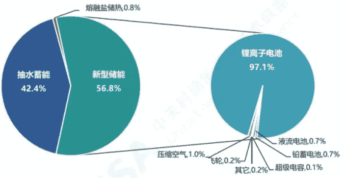
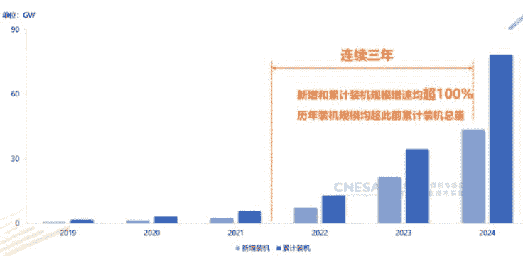
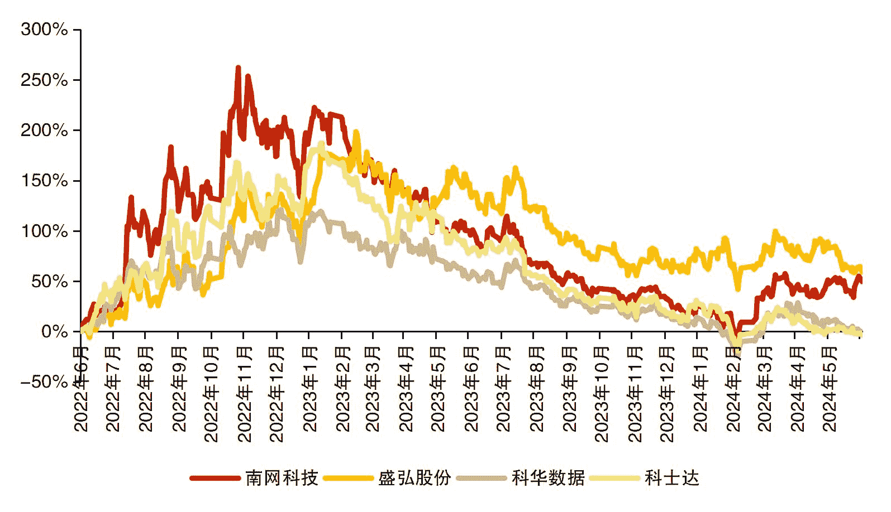
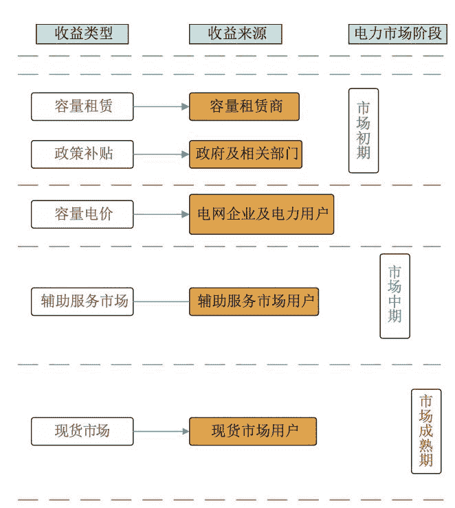
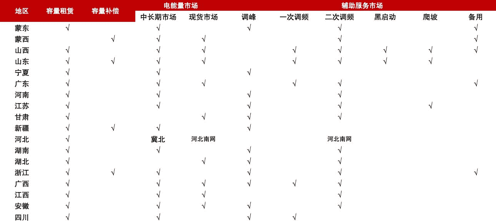
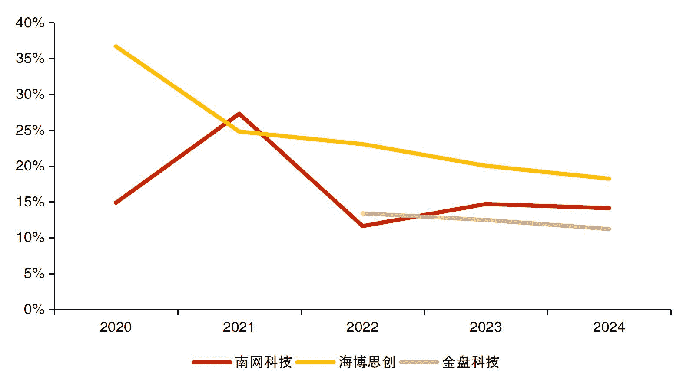
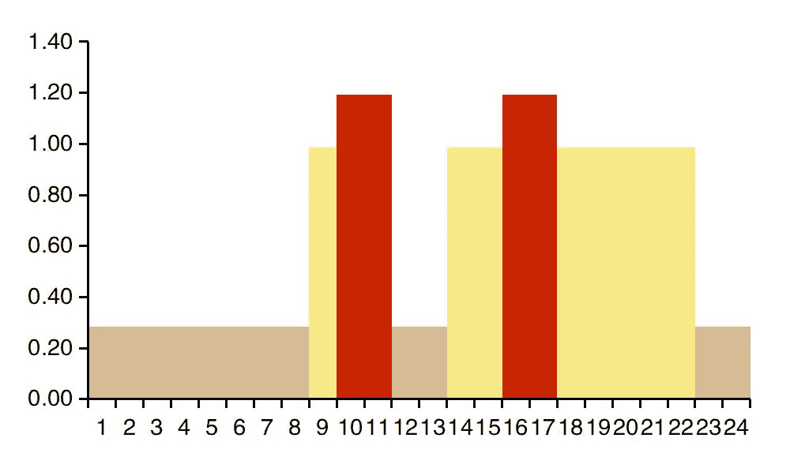
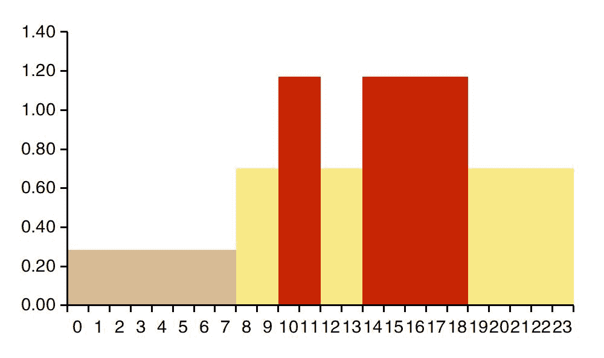
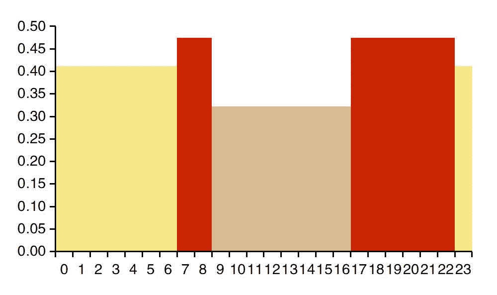
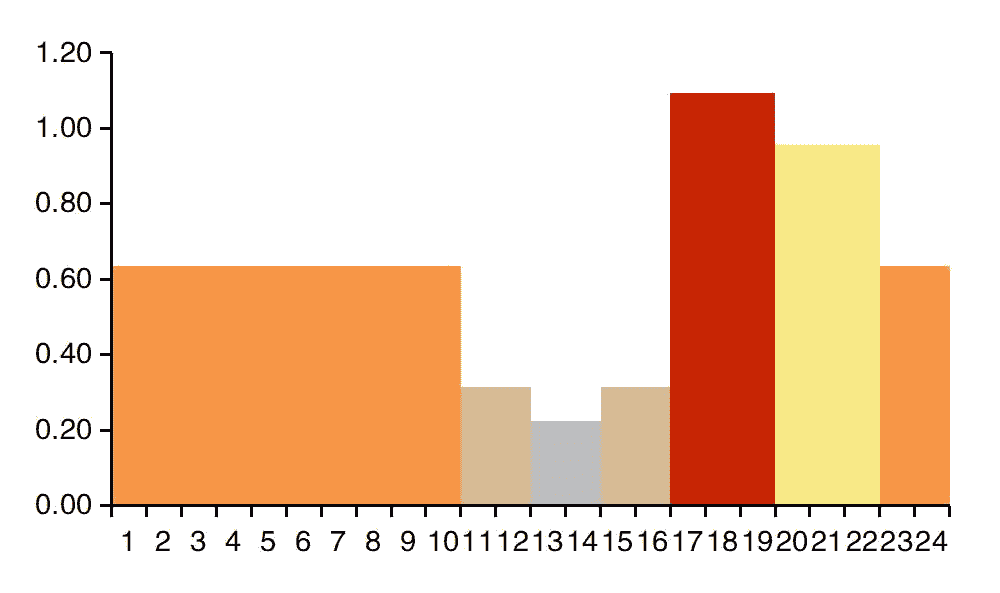

请务必仔细阅读正文之后的评级说明和重要声明

证券研究报告

电力设备

行业专题报告

投资评级：看好（维持）

证券分析师

查浩

SAC：S1350524060004

zhahao@huayuanstock.com

刘晓宁

SAC：S1350523120003

liuxiaoning@huayuanstock.com

戴映炘

SAC：S1350524080002

daiyingxin@huayuanstock.com

联系人

豆鹏超

doupengchao@huayuanstock.com

板块表现：

抽水蓄能进入高峰期 电力市场成储能发展决定因素

——新型电力系统报告之六：储能发展回顾及展望

投资要点：

由于新能源发电曲线取决于风、光资源的实际情况，造成发电曲线与用电曲线无法匹配（新能源出力较大时可能需求偏少、需求增加时新能源供给不足），这是新能源相比于火电、水电等传统电源最大的劣势之一，就需要储能技术来解决这一问题。因此双碳战略提出后，储能也随着光伏、风电行情表现突出，产业内配储战略也使得储能的需求相对明确。然而与电源不同，储能本身并不生产电能，其价值通过何种方式体现一直是过去几年困扰行业的核心问题之一。此外，储能技术路线多种多样，各自优势、劣势、降本曲线也大不相同，这也让储能的发展路径更加复杂。

抽水蓄能是一种成熟的储能技术，在双碳战略提出之前便已有一定程度的发展。但抽水蓄能本身并不直接生产电能，甚至还会产生一定程度的损耗，在电力市场并未充分建立的年代，其成本分摊机制一直是制约其发展的主要因素。2021年，国家发改委印发《关于进一步完善抽水蓄能价格形成机制的意见》，明确了对抽水蓄能电站实行"容量电价+电量电价"的两部制电价机制，抽蓄得到大规模发展。据我们不完全统计，2022、2023、2024年我国核准抽水蓄能装机分别达到70、65、35GW，总计170GW。但容量电价也让抽蓄超前发展，展望十五五，容量电价向容量市场过渡可能成为抽蓄的变化方向之一。

电化学储能在双碳提出伊始便被寄予厚望，被认为是解决新能源波动性的终极解决方案。但电化学储能的政策也频繁更迭，从最初的强制配储到鼓励独立储能建设并租赁可用容量，都没有逃脱强制配储的范畴，这也造成了储能无序发展、低质低价产品占据市场等问题。随后，我国先是明确了调峰辅助服务费用不得高于平价新能源上网电价，随后又取消了强制配储，使得储能收益明显下滑。展望十五五，随着电能量市场全面铺开，储能预计将主要依赖电能量市场套利获取收益。此外电化学储能在调频方面具有天然优势，随着调频市场逐渐与现货市场衔接，调频有望成为电化学储能另一个重要的收益来源。

投资分析意见：136号文出台后，伴随着新能源全面入市，经济效益预计将成为配置储能的重要考虑因素，我们预计后续低质低价的尾部储能厂家可能出局，头部企业的盈利能力有望修复。建议关注：海博思创、南网科技、阳光电源、中天科技等。随着抽水蓄能建设进入高峰期，抽蓄主机厂业绩有望持续释放，建议关注东方电气、哈尔滨电气。

风险提示：电力市场建设不及预期、抽水蓄能发展不及预期、竞争格局恶化风险

2025年07月30日

源引金融活水润泽中华大地

请务必仔细阅读正文之后的评级说明和重要声明

第2页/ 共18页

## 内容目录

前言：................................................................................................................................ 4

1. 物理储能仍是主流 容量电价促进抽蓄建设.................................................................. 4

2. 电化学储能商业模式仍未完全跑通 电力市场是核心推手............................................ 6

2.1. 大型储能电站：配储向独储转型 强制配储终被取消................................................7

2.2. 工商业储能：分时电价确保利用率 最终仍向电力市场对齐...................................13

3. 投资分析意见......................................................................16

4. 风险提示...........................................................................16

源引金融活水润泽中华大地

请务必仔细阅读正文之后的评级说明和重要声明

第3页/ 共18页

## 图表目录

图表1：2014—2024年抽水蓄能新增装机容量（万千瓦）............................................ 4

图表2：抽水蓄能价格形成机制....................................................................................... 5

图表3：2022—2025年各月抽水蓄能核准装机（GW，不完全统计）........................... 5

图表4：容量市场拍卖机制.............................................................................................. 6

图表5：双碳战略初期我国电化学储能相关政策..............................................................6

图表6：已公布的省级"十四五"新能源装机规划一览表（单位：万千瓦）..................8

图表7：中国电力储能市场装机结构（截至2024年底，MW，%）...............................8

图表8：中国新型储能新增及累计装机规模（截至2024年底，GW）........................... 8

图表9：大储标的2022年6月—2024年5月涨跌幅（前复权）.................................... 9

图表10：2022—2024年我国投运累计电化学储能装机及各侧占比................................9

图表11：独立储能项目收益类型................................................................................... 10

图表12：2024部分地区独立储能盈利模式...................................................................10

图表13：部分省份储能收益机制政策汇总.....................................................................11

图表14：2020—2024部分公司储能业务毛利率走势..................................................... 12

图表15：浙江省2023年分时电价（元/kWh）............................................................. 13

图表16：广东省2023年分时电价（元/kWh）............................................................. 13

图表17：甘肃省2023年分时电价（元/kWh）............................................................. 14

图表18：山东省2023年分时电价（元/kWh）............................................................. 14

图表19：第三监管周期各省1~10（20）kV需（容）量电价及电量电价变动表（元/千瓦时·月、元/千瓦时）....................................................................................................... 14

图表20：德国2020—2024新能源渗透率及现货价格水平........................................... 16

源引金融活水润泽中华大地

请务必仔细阅读正文之后的评级说明和重要声明

第4页/ 共18页

## 前言：

由于新能源发电曲线取决于风、光资源的实际情况，造成发电曲线与用电曲线无法匹配（新能源出力较大时可能需求偏少、需求增加时新能源供给不足），这是新能源相比于火电、水电等传统电源最大的劣势之一。在新能源比例较低时，可以利用火电可控的特性，在新能源多发时降低出力、少发时提高出力来解决这一问题。但随着风光比例继续提高，火电调节能力被挖掘完后，就需要储能技术来解决这一问题。

因此双碳战略提出后，储能也随着光伏、风电行情表现突出，产业内配储战略也使得储能的需求相对明确。

然而与电源不同，储能本身并不生产电能，其价值通过何种方式体现一直是过去几年困扰行业的核心问题之一。此外，储能技术路线多种多样，各自优势、劣势、降本曲线也大不相同，这也让储能的发展路径更加复杂。

## 1. 物理储能仍是主流 容量电价促进抽蓄建设

抽水蓄能是一种成熟的储能技术，在双碳战略提出之前便已有一定程度的发展。新能源靠天吃饭、波动性大的特点在行业内早已被广泛认知，而抽水蓄能是公认的解决这一问题的重要手段。抽水蓄能电站在用电富裕时利用电能将水抽至高处，在用电紧张时放水发电，从而起到储能的作用。但抽水蓄能本身并不直接生产电能，甚至还会产生一定程度的损耗，在电力市场并未充分建立的年代，其成本分摊机制一直是制约其发展的主要因素。

因此我国抽水蓄能建设长期处于较低水平。2014—2020年，我国7年累计新增996万千瓦装机，年均仅142万千瓦。

图表1：2014—2024年抽水蓄能新增装机容量（万千瓦）

资料来源：中国电力统计年鉴，华源证券研究所

源引金融活水润泽中华大地

请务必仔细阅读正文之后的评级说明和重要声明

第5页/ 共18页

因此在2021年，国家发改委印发《关于进一步完善抽水蓄能价格形成机制的意见》，明确了对抽水蓄能电站实行"容量电价+电量电价"的两部制电价机制。

简单来说，抽水蓄能固定成本部分根据给定收益率核算为容量电价，并进入输配电价回收，而抽水->发电形成的收益部分的20%由抽水蓄能企业留存，80%在下一监管周期扣减（相当于返还至用户）。这样便在保证了抽水蓄能合理收益率的基础上，留有一定程度的灵活性。

图表2：抽水蓄能价格形成机制

| 电价类型 | 主要指标 | 主要指标制定原则 |
| --- | --- | --- |
| 容量电价 | 核定原则 | 按照资本金内部收益率，实现整个经营期现金流收支平衡 |
| | 经营期限 | 40年 |
| | 资本金内部收益率 | 6.50% |
| | 运行维护费率 | 按在运电站费率从低到高前50%的平均水平核定 |
| 电量电价 | 电价形成方式 | 1）有现货的地区按现货价格，不承担输配电价、政府性基金及附加 2）无现货的地区，抽水电价按燃煤发电基准价75%执行 |
| | 电量电价及辅助服务收益 | 20%由抽水蓄能电站分享，80%在下一监管周期核定电站容量电价时相应扣减，形成的亏损由抽水蓄能电站承担 |

资料来源：《关于进一步完善抽水蓄能价格形成机制的意见》（发改价格[2021]633号），华源证券研究所

2021年9月，国家能源局发布《抽水蓄能中长期发展规划（2021—2035年）》，提出到2025年，抽水蓄能投产总规模6200万千瓦以上，到2030年投产1.2亿千瓦左右。中长期规划布局重点实施项目340个（4.21亿千瓦）、储备项目247个（3.05亿千瓦），抽水蓄能发展上限充分打开。

在两部制电价加持下，抽水蓄能建设加速。据我们不完全统计，2022、2023、2024年我国核准抽水蓄能装机分别达到70、65、35GW，总计170GW。按照7—8年的建设周期，即使不考虑目前在建的项目，到2030年抽蓄投产装机也将大幅超过1.2亿千瓦的规划。

图表3：2022—2025年各月抽水蓄能核准装机（GW，不完全统计）

| 月份 | 2022年 | 2023年 | 2024年 | 2025年 |
| --- | --- | --- | --- | --- |
| 1月 | 1.2 | 3.0 | 6.8 | 6.0 |
| 2月 | 0.0 | 6.5 | 1.2 | 5.8 |
| 3月 | 1.2 | 8.0 | 0.0 | 2.4 |
| 4月 | 0.0 | 1.5 | 5.6 | 0.0 |
| 5月 | 0.0 | 0.0 | 0.0 | 2.1 |
| 6月 | 5.7 | 6.5 | 1.2 | 2.6 |
| 7月 | 6.2 | 1.2 | 1.2 | |
| 8月 | 3.6 | 2.6 | 0.0 | |
| 9月 | 10.5 | 8.0 | 1.4 | |
| 10月 | 14.0 | 0.0 | 4.7 | |
| 11月 | 8.8 | 5.7 | 2.2 | |
| 12月 | 18.9 | 21.9 | 10.8 | |
| 总计 | 70.1 | 64.8 | 35.1 | 18.9 |

资料来源：北极星电力网，华源证券研究所

源引金融活水润泽中华大地

请务必仔细阅读正文之后的评级说明和重要声明

第6页/ 共18页

通常意义上的容量电价，实际上是用户为了保证电力供给充足而支付给冗余电源的一笔保险。在成熟市场，通常由政府或电网来预测未来需要配置的冗余机组容量，然后由发电公司竞标获取相应的容量电价。但我国抽水蓄能的容量电价，事实上相当于一种辅助服务。且我国抽水蓄能的容量电价由地方核准、并按各个项目实际发生成本核定，从而导致"旱涝保收"发生，因此这种模式一定程度上导致我国抽水蓄能建设加速、核准和开工量远超国家规划。如果抽水蓄能大幅超预期建设，可能导致电站利用率下降、投资浪费、用户承担的成本增加。

图表4：容量市场拍卖机制

资料来源：EnergyCentral，华源证券研究所

2025年1月，国家发改委、能源局印发《抽水蓄能电站开发建设管理暂行办法》，要求各省结合本身电力系统发展实际、在国家下达的总量规模基础上，确定建设项目。后续抽蓄的建设可能会更加趋于理性。

## 2. 电化学储能商业模式仍未完全跑通 电力市场是核心推手

抽水蓄能资源有限、建设受地理因素限制较多、降本空间有限，因此电化学储能在双碳提出伊始便被寄予厚望，被认为是新能源波动性的终极解决方案。在双碳战略提出初期，电化学储能政策频出，同时刺激了产业和资本市场，导致电化学储能在2021年以及2022年两波行情中表现较为优秀。

图表5：双碳战略初期我国电化学储能相关政策

| 时间 | 文件名 | 细则 |
| --- | --- | --- |
| 2021年7月 | 《关于加快推动新型储能发展的指导意见》 | 到2025年，实现新型储能从商业化初期向规模化发展转变。新型储能技术创新能力显著提高，核心技术装备自主可控水平大幅提升，在高安全、低成本、高可靠、长寿命等方面取得长足进步，标准体系基本完善，产业体系日趋完备，市场环境和商业模式基本成熟，装机规模达3000万千瓦以上。坚持储能技术多元化，推动锂离子电池等相对成熟新型储能技术成本持续下降和商业化规模应用，实现压缩空气、液流电池等长时储能技术进入商业化发展初期，加快飞轮储能、钠离子电池等技术开展规模化试验示范，以需求为导向，探索开展储氢、储热及其他创新储能技术的研究和示范应用。 |
| 2022年1月 | 《"十四五"新型储能发展实施方案》 | 推动多元化技术开发。开展钠离子电池、新型锂离子电池、铅炭电池、液流电池、压缩空气、氢（氨）储能、热（冷）储能等关键核心技术、装备和集成优化设计研究，集中攻关超导、超级电容等储能技术，研发储备液态金属电池、固态锂离子电池、金属空气电池等新一代高能量密度储能技术。 |
| 2022年2月 | 《关于完善能源绿色低碳转型体制机制和政策措施的意见》 | 拓宽电力需求响应实施范围，通过多种方式挖掘各类需求侧资源并组织其参与需求响应，支持用户侧储能、电动汽车充电设施、分布式发电等用户侧可调节资源，以及负荷聚合商、虚拟电厂运营商、综合能源服务商等参与电力市场交易和系统运行调节。支持储能和负荷聚合商等新兴市场主体独立参与电力交易。完善支持储能应用的电价政策。发挥太阳能热发电的调节作用，开展废弃矿井改造储能等新型储能项目研究示范，逐步扩大新型储能应用。 |
| 2022年3月 | 《"十四五"现代能源体系规划》 | 加快新型储能技术规模化应用。大力推进电源侧储能发展，合理配置储能规模，改善新能源场站出力特性，支持分布式新能源合理配置储能系统。 |
| 2022年4月 | 《完善储能成本补偿机制 助力构建以新能源为主体的新型电力系统》 | 聚焦储能行业面临的成本疏导不畅等共性问题，综合考虑各类储能技术应用特点、在新型电力系统中的功能作用和提供的服务是否具有公共品属性等因素，研究提出与各类储能技术相适应，且能够体现其价值和经济学属性的成本疏导机制，为促进储能行业发展创造良好的政策环境，从而引导提升社会主动投资意愿。 |
| 2022年6月 | 《关于进一步推动新型储能参与电力市场和调度运用的通知》 | 鼓励配建新型储能与所属电源联合参与电力市场。加快推动独立储能参与电力市场配合电网调峰。充分发挥独立储能技术优势提供辅助服务。根据各地实际情况，鼓励进一步拉大电力中长期市场、现货市场上下限价格，引导用户侧主动配置新型储能，增加用户侧储能获取收益渠道。 |
| 2022年6月 | 《可再生能源"十四五"发展规划》 | 推动其他新型储能规模化应用。明确新型储能独立市场主体地位，完善储能参与各类电力市场的交易机制和技术标准，发挥储能调峰调频、应急备用、容量支撑等多元功能，促进储能在电源侧、电网侧和用户侧多场景应用。创新储能发展商业模式，明确储能价格形成机制，鼓励储能为可再生能源发电和电力用户提供各类调节服务。创新协同运行模式，有序推动储能与可再生能源协同发展，提升可再生能源消纳利用水平。 |

资料来源：各地政府官网，华源证券研究所

但新型储能最终也和光伏一样没有逃离大幅回调的结局，然而二者面临的问题却完全不同。我们将新型储能分为大储和工商业储能两种模式来分别分析（本章所说"储能"如无特别说明，均指电化学储能）。

### 2.1. 大型储能电站：配储向独储转型 强制配储终被取消

大型储能即与集中式电站配套建设的储能设施，建设的初衷是在新能源发电较为富裕的时刻将多余电能量存储起来，在电力紧缺时刻放出，以减少新能源的弃电问题。

但与抽水蓄能一样，储能本身也不生产电能却要付出额外成本。如果电化学储能的成本高于电价，那么对于电站来说，弃电是经济上更优的选择。

但对于全社会来说，弃电相当于要增加煤电供给、增加碳排放，因此国家对于新能源的弃电率一直有着非常严格的考核。故在十四五初期，各地多采用了新能源强制配储的政策，

强制要求新能源电站配置10%~30%、2h~4h 不等的储能设施。而仅考虑已公布十四五新能源规划以及明确配储要求的省份，到2025 年需要建设的储能规模就将达到62GW 以上。而实际由于光伏建设大幅超出规划，根据中电联数据，到2024 年底我国新型储能装机达到62GW/141GWh。

图表7：中国电力储能市场装机结构（截至2024 年底，MW，%）

图表8：中国新型储能新增及累计装机规模（截至2024 年底，GW）

资料来源：CNESA，华源证券研究所

资料来源：CNESA，华源证券研究所

然而强制配储从根本上就存在逻辑问题：

（1）储能配置在新能源电站，意味着如果储能由电站自行调用，则只能存储本站发出的电量，而在彼时电力现货市场尚未开放的情况下，储能只能减少少量的弃电电量，而无法从电力市场中获得差价收益；

图表6：已公布的省级"十四五"新能源装机规划一览表（单位：万千瓦）

| 省/市/自治区 | 2021 年累计 | 2025 年目标 | 21-25 新增 | 配储比例 | 配储规模 |
|---|---|---|---|---|---|
| 北京 | 104 | 282 | 178 | —— | |
| 天津 | 308 | 760 | 452 | 13% | 57 |
| 河北 | 5467 | 9700 | 4233 | 13% | 529 |
| 冀北 | 3581 | 8000 | 4419 | 10% | 442 |
| 山西 | 3581 | 8000 | 4419 | 10% | 442 |
| 内蒙古 | 5408 | 13400 | 7992 | 15% | 1199 |
| 辽宁 | 1565 | 3000 | 1435 | 10% | 144 |
| 吉林 | 1011 | 3000 | 1989 | 0 | |
| 黑龙江 | 1255 | 2554 | 1299 | 0 | |
| 上海 | 275 | 669 | 394 | —— | |
| 江苏 | 4150 | 5200 | 1050 | 6% | 63 |
| 浙江 | 2206 | 3390 | 1184 | —— | |
| 安徽 | 2218 | 3600 | 1382 | 5% | 69 |
| 福建 | 1012 | 1400 | 388 | 10% | 39 |
| 江西 | 1458 | 1900 | 442 | 10% | 44 |
| 山东 | 5285 | 8200 | 2915 | 10% | 292 |
| 河南 | 3406 | 4693 | 1287 | 15% | 193 |
| 湖北 | 1673 | 3200 | 1527 | 10% | 153 |
| 湖南 | 1254 | 3560 | 2306 | 10% | 231 |
| 广东 | 2215 | 5361 | 3146 | 0 | |
| 广西 | 1053 | 3950 | 2897 | 15% | 435 |
| 海南 | 176 | 669 | 493 | 10% | 49 |
| 重庆 | 228 | 440 | 212 | 0 | |
| 四川 | 723 | 2217 | 1494 | 10% | 149 |
| 贵州 | 1717 | 4180 | 2463 | 10% | 246 |
| 云南 | 1278 | 3864 | 2586 | 0 | |
| 西藏 | 142 | 1000 | 858 | 0 | |
| 陕西 | 2335 | 6500 | 4165 | 15% | 625 |
| 甘肃 | 2871 | 8022 | 5151 | 10% | 515 |
| 青海 | 2528 | 6230 | 3702 | 15% | 555 |
| 宁夏 | 2839 | 5000 | 2161 | 10% | 216 |
| 新疆 | 3762 | 8240 | 4478 | —— | |
| 总计 | 63503 | 132181 | 68678 | | 6244 |

资料来源：各地政府官网，华源证券研究所整理。注：1）部分省份不区分可再生能源和新能源，因此会有一定偏差；2）部分省份针对风光配储比例不同，或规定为一个范围，取中间值

（2）如果从整个电力系统配置最优的角度来说，储能应该由电网调用（实际上配储比例也多由电网制定），但由于储能容量小、数量多、安全性差等问题，电网并未大规模调用新能源配储。这导致早期大量的储能电站都作为满足并网条件的"纯成本项"，为了减少成本多采用价格低、质量差（甚至早期大量采用梯次利用电芯）的设备，整个行业发展较为畸形。

为了解决储能电站调用不足问题，2022 年6 月国家发改委、国家能源局发布《关于进一步推动新型储能参与电力市场和调度运用的通知》，通知明确：

（1）明确新型储能独立参与电力市场的地位；（2）独立储能电站向电网送电的，其相应充电电量不承担输配电价和政府性基金及附加。

此政策的目的是将储能电站的使用权交还给建设方，让其直接通过电力市场进行套利，无需电网实际调用。而且多地在实际执行中，允许新能源电站租用独立储能电站的容量作为满足强制配储的一部分，从逻辑上来说，即使现货套利和辅助服务无法满足投资收益，也可以通过容量租赁的方式将收益率补足至合理收益率。因此从2022 年6 月起，大型储能又迎来一波大行情，包括南网科技、盛弘股份、科华数据、科士达等公司股价迎来较好表现，四家公司最大涨幅均超过100%，其中南网科技达到262%的最大涨幅。

图表9：大储标的2022 年6 月—2024 年5 月涨跌幅（前复权）

资料来源：Wind，华源证券研究所

事后来看，政策确实推动了储能向电网侧独立储能集中。2022 年电网侧储能占比为39%，到2024 年已提升至57%，但电源侧储能占比下滑幅度也相对有限。

图表10：2022—2024 年我国投运累计电化学储能装机及各侧占比

| 年份 | 总功率（GW） | 总容量（GWh） | 电网侧 | 电源侧 | 用户侧 | 备注 |
|---|---|---|---|---|---|---|
| 2022 | 6.89 | 14.05 | 39% | 48% | 13% | 总能量 |
| 2023 | 25 | 50.86 | 48% | 49% | 3% | 总功率 |
| 2024 | 62.13 | 141.37 | 57% | 41% | 2% | 总功率 |

资料来源：中电联，华源证券研究所

从2022 年独立储能政策推出并得到大力发展至今虽然仅短短3 年，独立储能的收益模式却发生了很大的变化，我国独立储能收益模式在探索中逐渐改进。

图表11：独立储能项目收益类型

资料来源：陈威君等《市场环境下电网侧储能电站的容量电价核定优化》，华源证券研究所

独立储能的收益类型包括容量租赁、政策补贴、容量电价、辅助服务市场、现货市场等。但是在不同阶段，独立储能收益模式受政策影响较大，且各地情况各有不同。整体来看，到2024 年底容量租赁、参与中长期市场、调峰市场、二次调频等是主要收益手段。

图表12：2024 部分地区独立储能盈利模式

资料来源：EESA，华源证券研究所

我国独立储能收益模式变迁大体上分为以下几个阶段：

第一阶段：调峰辅助服务+容量租赁为主

2022 年时，我国大多数省份尚未开展电力现货市场，因此无法在电力现货市场套利，此时独立储能主要通过调峰辅助服务获益。部分省份给予储能固定的调峰补偿，部分省份则与火电等调节性电源一起参与调峰市场。

此外，由于强制配储政策依旧存在，储能电站可以出租可用容量获取一定的收益。理论上来说，即使调峰辅助服务无法保证独立储能电站盈利，但容量租赁的刚性需求也会将独储收益率补充至合理水平。但实际上由于独储建设超出实际需求，大部分电站租赁费用偏低。

图表13：部分省份储能收益机制政策汇总

| 地区 | 容量租赁 | 调峰补偿 | 电费收益 | 费用分摊机制 |
|---|---|---|---|---|
| 河南 | 租赁费用标准为260 元/kWh 每年 | 电网调峰报价上限0.3 元/kWh。 | | |
| 湖南 | | 深度调峰上限500 元/MWh；紧急短时调峰上限600 元/MWh。 | 充电按照煤电标杆电价0.45 元/kWh 的75%计；放电按照煤电标杆电价计。 | 深度调峰服务费由深度调峰交易时段有上网电量的买方按其上网电量占比予以分摊。 |
| 青海 | 储能与风电场、太阳能电站双边协商议价； | 储能参与电网调峰0.7 元/kWh。 | | 实时深度调峰有偿服务补偿费由省内负荷率大于等于深度调峰基准的火电厂、风电、太阳能电站按照调用时段共同分摊。 |
| 东北 | 用户侧储能可与风电、光伏企业协商开展双边交易，市场初期交易价格上下限为0.2、0.1 元/kWh。 | | | 在风电场光伏电站计量出口建设的储能设施，由电储能设施投资运营方和风电光伏场站协商。 |
| 江苏 | | 深度调峰上限600 元/MWh；市场需求时段未报价机组的临时调用价格暂按150 元/MWh 执行。 | | |
| 山西 | | 独立储能市场主体调峰750 元-950 元/MWh。 | | 总调峰收入由新能源企业、火电企业、批发侧用户按比例分摊。 |
| 新疆 | | 发电侧储能：0.55 元/kWh。 | | |
| 山东 | 可按月度可用容量获得容量补偿 | 储能调峰上限150 元/MWh，停机调峰上限400 元/MWh。 | | 由火电厂、风电场、光伏电站、核电站、送入山东的跨省区联络线等共同分摊。 |
| 华北 | | 最高上限600 元/MWh。 | | |
| 贵州 | | 储能调峰上限0.2 元/kWh。 | | |
| 甘肃 | | 储能调峰上限0.5 元/kWh。 | | |
| 河南 | 在发电企业建设的电储能设施，与发电机组联合参与调峰，报价最高为0.5-0.7 元/kWh。 | | | 由市场内深度调峰交易时段负荷率大于等于调峰基准的火电厂、风电场、光伏电站按照调用时段共同分摊。 |
| 宁夏 | | 调峰补偿标准为0.8 元/千瓦时。 | | |
| 浙江 | 对于实际投运的分布式储能项目，按照实际放电量给予储能运营主体0.8 元/千瓦时的补贴。 | | | |
| 陕西 | | | 充电电价以当年新能源市场交易电价，给予100 元/兆瓦时充电补偿；放电电价按照燃煤火电基准电价，给予100 元/兆瓦时放电补偿。 | |

资料来源：各地政府官网，华源证券研究所

第二阶段：调峰辅助费用受限

为了促进调峰电源发展，部分地区给予了较高的调峰补偿标准，甚至远超当地燃煤标杆电价（如浙江补偿标准0.8 元/千瓦时，而燃煤标杆电价为0.4155 元/千瓦时）。较高的调峰辅助服务补偿实际上加大了新能源或用户（通常是主要分摊方）的成本压力。因此，2024 年2 月8 日，国家发改委、国家能源局发布《关于建立健全电力辅助服务市场价格机制的通知》，合理确定调峰服务价格上限。调峰服务价格上限原则上不高于当地平价新能源项目的上网电价，此规定也是基于新能源项目消纳成本不高于发电价值的原则而确定。

在该规定出台后，各地辅助服务规则便随之修改，下调至不高于燃煤标杆电价水平，这可能对独储的收益产生了较大影响。

但在政策不断探索过程中，储能利用率逐渐上升。2024 年新能源配储年均利用小时数766h，比2023 年提升383h，等效充放电次数177 次（相当于每2.1 天完成一次完整充放电），比2023 年提升约73 次。电网侧储能年均利用小时数995h，比2023 年提升315h，等效充放电次数248 次（相当于每1.5 天完成一次完整充放电），比2023 年提升约76 次。

电网侧储能的利用小时数和等效充放电次数都更高，证明政策调整有效果。虽然目前并未有比较明确的储能电站收益率的官方数据，但南网储能的投资者交流公告显示，公司已投运的9 座电化学储能站资本金内部收益率为5%，而南网储能作为南方电网的子公司，其独立储能具备区位优势，且广东燃煤标杆电价为全国最高、价差更加显著，因此可以推断全国电化学储能的实际收益率并不理想。

通过行业储能业务的整体利润率走势也能进行推断，国内储能公司储能业务毛利率近年来呈下滑趋势，南网科技、金盘科技2024 年储能业务毛利率降至10%出头，基本处于不盈利状态。

图表14：2020—2024 部分公司储能业务毛利率走势

资料来源：Wind，华源证券研究所

### 2.2.工商业储能：分时电价确保利用率最终仍向电力市场对齐

大型储能平均来说目前只能做到1.5~2 天1 次的完整充放电，而相比之下，2024 年我国工商业储能平均可以做到每天一次充放电。主要原因在于，我国用电侧以往均采用目录电价，在电力市场化改革后，用户侧的交易活跃度不高，因此用户侧仍采用电网代购电的形式，虽然电价随市场电价浮动，但仍然保持峰-平-谷的价格模式。2021 年7 月26 日，国家发改委发布《关于进一步完善分时电价机制的通知》，各省响应出台措施拉大峰谷价差，工商业储能套利空间被打开。发电侧现货电价每日受供需变化影响，无法保证每天都有套利空间，但用户侧电网代购电的分时电价上下浮动比例基本固定，因此有固定套利空间，利用率较高。

受到各地电力结构差异影响，我国各省分时电价存在3 种基本的模式：

（1）以三北地区（如甘肃）为代表的省份，由于集中式光伏、风电比例较高，白天为谷时段，夜间为峰时段，凌晨为平时段。

（2）以东部沿海部分省份（如浙江）为代表，由于分布式光伏比例高、风电比例低，通常在凌晨以及午间设置谷时段，在早间、傍晚设置峰时段，其余时间为平时段；部分省份会在个别时段设置尖峰时段，相比峰时段上浮更高比例。

（3）以山东为代表，由于光伏比例更高、风电比例低，导致午间出现深谷而晚间出现尖峰。

图表15：浙江省2023 年分时电价（元/kWh）

图表16：广东省2023 年分时电价（元/kWh）

资料来源：国家电网，华源证券研究所

资料来源：国家电网，华源证券研究所

图表17：甘肃省2023 年分时电价（元/kWh）

图表18：山东省2023 年分时电价（元/kWh）

资料来源：国家电网，华源证券研究所

资料来源：国家电网，华源证券研究所

显然，浙江的套利模式更优，可以做到"凌晨低谷充电——上午高峰放电——午间低谷充电——下午高峰放电"的"2 充2 放"，且充放电时间可以达到2h，充分利用了工商业储能的容量，且这些省份电价水平相对较高、价差更大，套利效果更为显著。

而对于山东，则仅能做到"午间低谷充电——晚上尖峰放电"的"1 充1 放"模式，对储能设备的利用率不够，但好在价差够大。

而对于三北地区来说，由于电价水平较低，因此套利空间有限。

输配电价改革鼓励用户进行需量管理，对工商业储能有一定促进作用。2023 年5 月15 日，国家发改委印发《关于第三监管周期省级电网输配电价及有关事项的通知》，这预示着第三监管周期输配电价改革终于落地。

此次输配电价改革力度较大，其中比较关键的点有：

1）提高容（需）量电价，降低电量电价

本轮输配电价改革的一大亮点是普遍提高了容（需）量电价，而降低了电量电价。其中除了容（需）量和电量电价同时降低的省份外，只有广东、北京、山西、四川等省份是降低了容（需）量电价而提高了电量电价，剩余省份均不同程度提高了需量电价。

这一改革的目的，实际上是推动工商业企业更多的对其用电负荷进行管理。

2）给予优惠条款：每月每千伏安用电量达到260 千瓦时及以上的，当月需量电价按本通知核定标准90%执行

这条政策主要目的是推动工商业企业进行最高负荷管理，在保持总用电规模的前提下，尽量降低最高用电负荷即可享受相应的优惠，从而提高工商业储能的收益率。

图表19：第三监管周期各省1~10（20）kV 需（容）量电价及电量电价变动表（元/千瓦时·月、元/千瓦时）

| 省/市/自治区 | 需量电价变动幅度 | 容量电价变动幅度 | 省/市/自治区 | 需量电价变动幅度 | 容量电价变动幅度 |
|---|---|---|---|---|---|
| 北京 | 3 | 0 | 河南 | 12 | 5 |
| 天津 | 16.1 | 9 | 湖北 | 4 | 1.3 |
| 河北 | 0 | -1.4 | 湖南 | 3.8 | 1.1 |
| 冀北 | 2.3 | 0 | 广东 | 4.1 | -0.4 |
| 山西 | 0 | -1.5 | 广西 | 4.7 | -3.3 |
| 蒙东 | 4.8 | 1.5 | 海南 | -2.8 | -4 |
| 蒙西 | 4.8 | 1.5 | 重庆 | -0.8 | -2 |
| 辽宁 | 3.8 | 1 | 四川 | 2 | 0 |
| 吉林 | 3.8 | 1 | 贵州 | 3 | -1 |
| 黑龙江 | 3.8 | 1 | 云南 | 1.4 | -3 |
| 江苏 | 11.2 | 2 | 陕西 | 4.2 | 0 |
| 浙江 | 8 | 0 | 甘肃 | 9.9 | 5 |
| 安徽 | 8 | 0 | 青海 | 5.1 | 2 |
| 福建 | 5.8 | 2.2 | 宁夏 | -1.2 | -2 |
| 江西 | 3.3 | 0.4 | 新疆 | -1 | -6 |
| 山东 | 0.4 | -4 | | | |

资料来源：国家发改委，华源证券研究所

展望2030 年，强制配储、独立储能租用容量等政策推动后，业界意识到，政策强制规定配储比例无法充分发挥储能的实际作用。储能本质上是电能量时间的转移，要解决的是不同时刻电力供需不匹配的问题，不匹配由电力市场价格体现，因此储能发展最终还是要回归电力市场。2025 年1 月，国家发改委、能源局印发《关于深化新能源上网电价市场化改革促进新能源高质量发展的通知》（简称136 号文），文件规定：坚决纠正不当干预电力市场行为，不得向新能源不合理分摊费用，不得将配置储能作为新建新能源项目核准、并网、上网等的前置条件。

这一规定基本终结了强制配储的历史，储能的发展还是要依靠电力市场的价格体现。虽然短期内可能导致储能装机的需求下滑，但长期来看只有这样才能充分发挥储能的功能、并促进储能技术进步。从储能优势功能角度，我们认为后续以下方向是储能能否进入正轨的关键：

（一）电力现货市场的健全和完善

电力现货市场在日前和日内进行全电量交易，是电力市场价格最真实的实时反映。且通常来说，电力现货市场设置的电价上下限幅度更大，加上储能控制灵活，可以充分利用电力现货市场进行套利。

当下我国电力市场化进度明显加快：（1）按照计划，到2025 年年底，我国绝大多数省份电力现货市场将进入连续结算试运行，距离正式运行仅差临门一脚；（2）根据136 号文要求，我国新能源将全面入市。现货市场全面建立+新能源全面入市，电能量市场基本完善，将使得电力的时间价值充分体现，预计将对储能收益率产生积极影响。

从发达国家经验来看，新能源渗透率对电力现货价差有直接影响。以德国为例，从2020 年到2024 年，其新能源装机渗透率从50%提升至61%，提升约11pct，同时电力现货市场价差也不断拉大。2020 年现货市场平均价差为32 欧元/MWh，价差比例（=现货平均价差/现货平均电价）为107%，到2024 年拉大到147%。

## 图表20：德国2020—2024 新能源渗透率及现货价格水平

| 年份 | 2020 | 2021 | 2022 | 2023 | 2024 |
|------|------|------|------|------|------|
| 新能源渗透率 | 50.30% | 54.08% | 55.19% | 59.09% | 60.75% |
| 现货平均电价（欧元/MWh） | 30 | 97 | 235 | 95 | 80 |
| 现货平均价差（欧元/MWh） | 32 | 80 | 187 | 98 | 118 |
| 平均价差比例 | 107% | 83% | 79% | 103% | 147% |

资料来源：Energy-charts，华源证券研究所。注：价差比例=现货平均价差/现货平均电差

### （二）电力辅助服务市场有望成为储能主战场

新能源短时间内出力波动较大，需要更快更精确调节。传统机组中，水电、燃气机组的爬坡能力可以达到30%/min、20%/min，远高于煤电的2%/min，是效果最好的调频机组。但我国受制于水电可开发资源、天然气储量，这两种机组的比例以及将来可实现的比例都不会很高，仅靠煤电机组难以满足调节需求。且传统机组都是机械结构且存在转动惯量，其调节的准确度也存在问题。电化学储能在调节速度（K1）、调节准确度（K2）、响应时间（K3）等方面相比于传统机组（特别是煤电）有明显优势，当前越来越多地区将上述3个指标作为重要的考核指标。

此外，储能相比于传统机组一大劣势便是，其储能时长与成本呈正比关系，即长时调节下与传统机组相比成本劣势明显。而调频需要频繁充放电，对时长没有特别高的要求（1h以内基本可满足要求），因此我们认为相比于现货市场套利，调频等辅助服务是储能更大的发挥舞台。

### 3.投资分析意见

136号文出台后，伴随着新能源全面入市，经济效益预计将成为配置储能的重要考虑因素，我们预计后续低质低价的尾部储能厂家可能出局，头部企业的盈利能力有望修复。建议关注：海博思创、南网科技、阳光电源、中天科技等。随着抽水蓄能建设进入高峰期，抽蓄主机厂业绩有望持续释放，建议关注东方电气、哈尔滨电气。

### 4.风险提示

1）电力市场建设不及预期：取消强制配储后，储能收益很大程度上来自于电力现货市场、调频辅助服务市场等，一旦电力市场建设不及预期可能影响储能的收益率。

2）抽水蓄能发展不及预期：抽水蓄能发展受政策影响较大，一旦政策发生变化导致抽水蓄能发展不及预期，可能导致设备交付低于预期。

3）竞争格局恶化风险：竞争格局恶化可能导致部分公司份额及盈利能力下滑。

## 证券分析师声明

本报告署名分析师在此声明，本人具有中国证券业协会授予的证券投资咨询执业资格并注册为证券分析师，本报告表述的所有观点均准确反映了本人对标的证券和发行人的个人看法。本人以勤勉的职业态度，专业审慎的研究方法，使用合法合规的信息，独立、客观的出具此报告，本人所得报酬的任何部分不曾与、不与，也不将会与本报告中的具体投资意见或观点有直接或间接联系。

## 一般声明

华源证券股份有限公司（以下简称"本公司"）具有中国证监会许可的证券投资咨询业务资格。

本报告是机密文件，仅供本公司的客户使用。本公司不会因接收人收到本报告而视其为本公司客户。本报告是基于本公司认为可靠的已公开信息撰写，但本公司不保证该等信息的准确性或完整性。本报告所载的资料、工具、意见及推测等只提供给客户作参考之用，并非作为或被视为出售或购买证券或其他投资标的的邀请或向人作出邀请。该等信息、意见并未考虑到获取本报告人员的具体投资目的、财务状况以及特定需求，在任何时候均不构成对任何人的个人推荐。客户应对本报告中的信息和意见进行独立评估，并应同时考量各自的投资目的、财务状况和特殊需求，必要时就法律、商业、财务、税收等方面咨询专家的意见。对依据或使用本报告所造成的一切后果，本公司及/或其关联人员均不承担任何法律责任。任何形式的分享证券投资收益或者分担证券投资损失的书面或口头承诺均为无效。

本报告所载的意见、评估及推测仅反映本公司于发布本报告当日的观点和判断，在不同时期，本公司可发出与本报告所载意见、评估及推测不一致的报告。本报告所指的证券或投资标的的价格、价值及投资收入可能会波动。除非另行说明，本报告中所引用的关于业绩的数据代表过往表现，过往的业绩表现不应作为日后回报的预示。本公司不承诺也不保证任何预示的回报会得以实现，分析中所做的预测可能是基于相应的假设，任何假设的变化可能会显著影响所预测的回报。本公司不保证本报告所含信息保持在最新状态。本公司对本报告所含信息可在不发出通知的情形下做出修改，投资者应当自行关注相应的更新或修改。

本报告的版权归本公司所有，属于非公开资料。本公司对本报告保留一切权利。未经本公司事先书面授权，本报告的任何部分均不得以任何方式修改、复制或再次分发给任何其他人，或以任何侵犯本公司版权的其他方式使用。如征得本公司许可进行引用、刊发的，需在允许的范围内使用，并注明出处为"华源证券研究所"，且不得对本报告进行任何有悖原意的引用、删节和修改。本公司保留追究相关责任的权利。所有本报告中使用的商标、服务标记及标记均为本公司的商标、服务标记及标记。

本公司销售人员、交易人员以及其他专业人员可能会依据不同的假设和标准，采用不同的分析方法而口头或书面发表与本报告意见及建议不一致的市场评论或交易观点，本公司没有就此意见及建议向报告所有接收者进行更新的义务。本公司的资产管理部门、自营部门以及其他投资业务部门可能独立做出与本报告中的意见或建议不一致的投资决策。

## 信息披露声明

在法律许可的情况下，本公司可能会持有本报告中提及公司所发行的证券并进行交易，也可能为这些公司提供或争取提供投资银行、财务顾问和金融产品等各种金融服务。本公司将会在知晓范围内依法合规的履行信息披露义务。因此，投资者应当考虑到本公司及/或其相关人员可能存在影响本报告观点客观性的潜在利益冲突，投资者请勿将本报告视为投资或其他决定的唯一参考依据。

## 投资评级说明

证券的投资评级：以报告日后的6个月内，证券相对于同期市场基准指数的涨跌幅为标准，定义如下：

- 买入：相对同期市场基准指数涨跌幅在20％以上；
- 增持：相对同期市场基准指数涨跌幅在5％～20％之间；
- 中性：相对同期市场基准指数涨跌幅在－5％～＋5％之间；
- 减持：相对同期市场基准指数涨跌幅低于-5％及以下。
- 无：由于我们无法获取必要的资料，或者公司面临无法预见结果的重大不确定性事件，或者其他原因，致使我们无法给出明确的投资评级。

行业的投资评级：以报告日后的6个月内，行业股票指数相对于同期市场基准指数的涨跌幅为标准，定义如下：

- 看好：行业股票指数超越同期市场基准指数；
- 中性：行业股票指数与同期市场基准指数基本持平；
- 看淡：行业股票指数弱于同期市场基准指数。

我们在此提醒您，不同证券研究机构采用不同的评级术语及评级标准。我们采用的是相对评级体系，表示投资的相对比重建议；投资者买入或者卖出证券的决定取决于个人的实际情况，比如当前的持仓结构以及其他需要考虑的因素。投资者应阅读整篇报告，以获取比较完整的观点与信息，不应仅仅依靠投资评级来推断结论。

本报告采用的基准指数：A股市场基准为沪深300指数，香港市场基准为恒生中国企业指数（HSCEI），美国市场基准为标普500指数或者纳斯达克指数。
