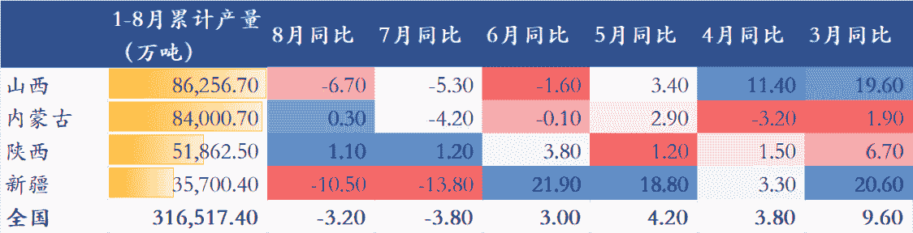
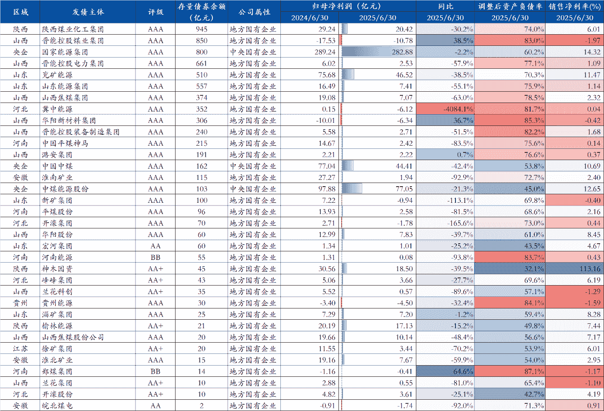
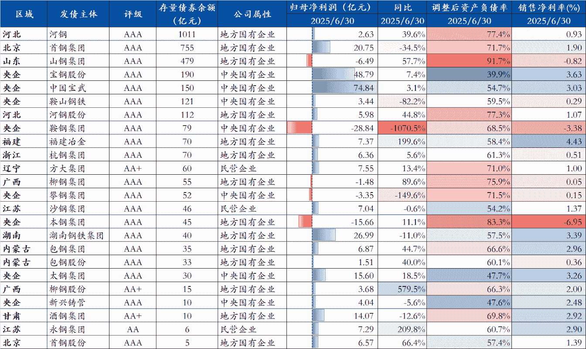
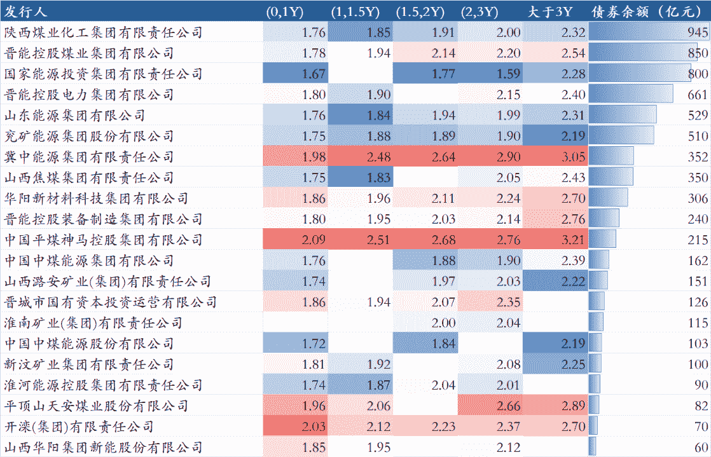
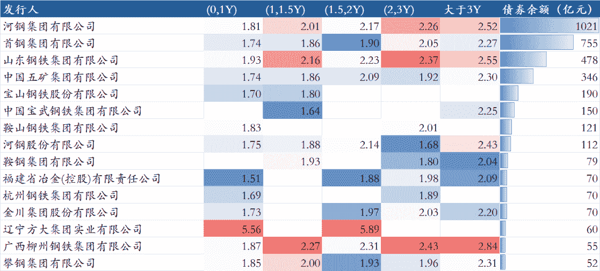

# 信用 | 反内卷后怎么看煤炭和钢铁债？

**固收专题报告 / 2025.09.25**

---

**分析师**

孙彬彬
SAC 证书编号：S0160525020001
sunbb@ctsec.com

**分析师**

孟万林
SAC 证书编号：S0160525030002
mengwl@ctsec.com

**分析师**

涂靖靖

SAC 证书编号：S0160525030001

tujj@ctsec.com

**相关报告**

1. 《期货｜如何参与曲线形态套利？》 2025-09-23
2. 《信用 | 加税后如何观察信用利差？》 2025-09-22
3. 《信用 | 机构行为与点位观察》 2025-09-22

---

## 核心观点

近期煤价触底反弹、钢铁行业利润缓慢修复，是否为"反内卷"驱动？

- 煤炭从供给端看，7 月煤炭产量近一年来首次出现同比下降，当月产量同比下降3.8%至3.8 亿吨。主要原因晋陕蒙煤炭主产区受极端降雨影响，煤矿被迫减产；此外进口煤量仍处在收缩通道。7-8 月电厂日耗持续攀升、钢厂保持高盈利水平。多重因素叠加下，后续随着超产核查逐步落实，预计今年全年原煤产量同比微减，煤价维持震荡行情。

- 钢铁行业利润在缓慢修复。今年粗钢产量同比增速持续下降，8月产量为7737万吨，同比下降0.7%，为年内最低。需求端，目前来看房地产仍然是主要的拖累项，但基建与制造业、外需出口共同对钢铁需求形成了一定支撑。钢铁行业截至7 月利润总额643.6 亿元，创近三年新高。反内卷对后续利润修复可能有所帮助，但长期供需压力依然不小。

近期二级市场有哪些变化？

- 煤炭债现券成交活跃，周度成交只数创今年新高，二季度以来中长期限成交开始变得活跃。钢铁债则在超短期限的成交占比明显增加。

- 从低估值成交角度，近期低估值成交的钢铁债较多分布在1Y 以内。7 月"反内卷"政策出台后，近期中长期限的煤炭债低估值成交笔数明显增多，显示出交易和配置需求有所抬升。

投资策略怎么看？

- 四季度煤价进一步下降的空间有限，煤价中枢较上半年小幅抬升后或维持震荡格局，我们认为煤企盈利迅速恶化的可能性不大。煤企主体层面，对收益要求较高可关注2Y 以内的冀中能源、平煤集团和开滦集团，但进一步信用下沉的性价比有限。对高等级煤炭债可适当拉长久期，主体范围建议围绕大型优质煤企。

- 目前钢铁行业由于成本端下降导致利润被动修复，应避开盈利能力仍在恶化、短期流动性压力较大的钢铁企业。钢企主体层面，宝钢股份、首钢集团等资质较好可适当拉长久期；1.5Y 以内可关注河钢集团、山钢集团，进一步拉久期的性价比不高；柳钢集团在区域内产品竞争力相对较强，对收益率要求高的投资人亦可关注。

- 风险提示：数据统计或有遗漏，宏观经济表现超预期，信用风险事件发展超预期

---

## 内容目录

1. 反内卷影响几何？ .................................................................................................. 4
   - 1.1 煤炭：煤价触底反弹？ ................................................................................ 4
   - 1.2 钢铁：利润缓慢修复 .................................................................................... 8
2. 煤炭钢铁债二级市场观察 ........................................................................................ 10
   - 2.1 存续债概况 ................................................................................................... 10
   - 2.2 煤炭债怎么看？ ............................................................................................. 12
   - 2.3 钢铁债怎么看 ................................................................................................ 14
   - 2.4 近期二级成交有什么特点 ............................................................................. 16
3. 小结 ................................................................................................................... 19
4. 风险提示 ............................................................................................................. 21

## 图表目录

| 图号 | 图表名称 | 页码 |
|------|----------|------|
| 图1 | 炼焦煤港口价格走势 | 4 |
| 图2 | 动力煤价格走势 | 4 |
| 图3 | 清洁能源替代加速 | 5 |
| 图4 | 发电量分结构情况 | 5 |
| 图5 | 火电发电量增速低迷 | 5 |
| 图6 | 重点电厂日耗情况 | 6 |
| 图7 | 钢厂高盈利率支撑焦煤需求 | 6 |
| 图8 | 7 月原煤产量出现近一年来首次同比下滑 | 6 |
| 图9 | 进口煤数量月度变化 | 7 |
| 图10 | 内贸煤价相对进口煤价差情况 | 7 |
| 图11 | 北方港口煤炭库存量 | 7 |
| 图12 | 全国原煤主要产区1-8 月累计产量与当月同比 | 8 |
| 图13 | 主要钢材现价 | 8 |
| 图14 | 今年钢铁行业利润有所改善 | 8 |
| 图15 | 地产外的需求端对钢铁仍有支撑 | 9 |
| 图16 | 钢材出口数量维持高位 | 9 |
| 图17 | 近两个月粗钢产量下滑 | 10 |
| 图18 | 钢材社会库存走势 | 10 |
| 图19 | 存量煤炭和钢铁债估值分布 | 10 |
| 图20 | 存量煤炭和钢铁债剩余期限分布 | 10 |
| 图21 | 主要煤企发行人 | 11 |
| 图22 | 主要钢企发行人 | 12 |
| 图23 | 1Y 煤炭债不同隐含评级收益率中位数走势 | 12 |
| 图24 | AAA 煤炭债不同期限收益率中位数走势 | 12 |
| 图25 | 煤炭债信用利差与超额利差走势 | 13 |
| 图26 | 1Y 煤炭债等级利差中位数走势 | 13 |
| 图27 | AAA 煤炭债期限利差中位数走势 | 13 |
| 图28 | 存量债规模大于60 亿元的煤企发行人分期限估值情况 | 14 |
| 图29 | 1Y 钢铁债不同隐含评级收益率中位数走势 | 15 |
| 图30 | AAA 钢铁债不同期限收益率中位数走势 | 15 |
| 图31 | 钢铁债信用利差与超额利差走势 | 15 |
| 图32 | 1Y 钢铁债等级利差中位数走势 | 16 |
| 图33 | AAA 钢铁债期限利差中位数走势 | 16 |
| 图34 | 存量债规模大于50 亿元的钢企发行人分期限估值情况 | 16 |
| 图35 | 煤炭债和钢铁债周度成交只数走势 | 17 |
| 图36 | 煤炭债不同剩余期限成交占比 | 17 |
| 图37 | 钢铁债不同剩余期限成交占比 | 17 |
| 图38 | 煤炭债不同隐含评级成交占比 | 18 |
| 图39 | 钢铁债不同隐含评级成交占比 | 18 |
| 图40 | 煤炭债和钢铁债周度低估值成交笔数 | 18 |
| 图41 | 分不同剩余期限低估值成交的煤炭债笔数 | 19 |
| 图42 | 分不同剩余期限低估值成交的钢铁债笔数 | 19 |

---

## 1 反内卷影响几何？

### 1.1 煤炭：煤价触底反弹？

2024 年以来，煤炭价格进入下跌区间。秦皇岛动力煤现货(Q5500)2024 年均价854 元/吨，同比下降11.3%；2025 年一季度720 元/吨，环比下降12.4%。京唐港主焦煤价格2024 年均价2022 元/吨，同比下降11.4%；2025 年一季度1442 元/吨，环比下降15.4%。

煤价在7 月迎来触底反弹，京唐港主焦煤库提价近期反弹至1700 元/吨附近，秦皇岛港动力煤（Q5500）反弹至700 元/吨附近。

煤价为何迎来阶段性反弹？从供给和需求看有哪些变化？

**图1：炼焦煤港口价格走势**

**图2：动力煤价格走势**

数据来源：Wind，财通证券研究所

需求端，火电需求持续萎靡。风电、太阳能装机量快速上升，火电装机量占比从2021 年初的56.6%降至2024 年末的43.1%。截至2025 年2 月末，风电和太阳能装机总量突破14.5 亿kW，首次超过火电装机规模。

**图3：清洁能源替代加速**

数据来源：Wind，财通证券研究所

水电、风电、光伏等清洁能源装机量快速上升后，挤压火电用煤空间，火电发电量占比从2023 年初的72.3%降至2024 年末的67.4%；2024 年以来火电发电量增速低迷，累计同比增速持续波动下降，截至今年7 月，火电发电量累计同比下降1.3%。

**图4：发电量分结构情况**

**图5：火电发电量增速低迷**

数据来源：Wind，财通证券研究所

下半年来，受高温天气影响，电厂日耗随高温大幅增长，重点电厂对煤炭日耗量8 月持续攀升，对动力煤价格形成了一定支撑。

焦炭涨价进一步推高钢厂生产成本，但近期247家钢厂的盈利率稳定在较高水平，高于过去三年同期水平。高盈利率或直接驱动下游的补库行为，对焦煤的需求支撑较强。

图6：重点电厂日耗情况

图7：钢厂高盈利率支撑焦煤需求

数据来源：Wind，财通证券研究所

数据来源：Wind，财通证券研究所 注：盈利率

从供给端看，煤炭长时间处于产能过剩。2024年全国原煤产量达47.6亿吨，创历史新高，进一步加剧供需失衡。

近三个月受恶劣降雨影响和反内卷政策影响，原煤产量近一年来首次出现同比下降，8月产量同比下降3.2%至3.9亿吨。

图8：7月原煤产量出现近一年来首次同比下滑

数据来源：Wind，财通证券研究所

进口煤方面，2024年煤炭进口量创新高，全年进口5.4亿吨，同比增加14.4%，而进口煤华南到岸价的价格倒挂进一步压制了国内价格。

今年来进口煤市场出现降温，煤炭进口量下滑。8月进口量4274万吨，同比下降6.7%。1-8月累计进口煤炭29994万吨，同比下降12.2%，煤进口数量或进入收缩通道。

图9：进口煤数量月度变化

图10：内贸煤价相对进口煤价差情况

数据来源：Wind，财通证券研究所

数据来源：Wind，财通证券研究所

反内卷限产叠加天气影响，今年5月后煤炭库存快速消耗。2024年四季度到今年一季度，北方港口库存连续创近年新高，反映供需宽松，压制煤价反弹。今年5-8月，北方港口煤炭库存量持续回落，从5月中旬的4200万吨附近降至3000万吨以下，库存去化较去年同期有所加快，主要原因是夏季高温导致下游对煤炭需求提升，电厂不断加大补库力度，导致港口库存快速去化。

图11：北方港口煤炭库存量

数据来源：Wind，财通证券研究所

上半年全国原煤产量较往年同期偏高，整体供给偏宽松，增量主要来自山西和内蒙古。7月22日，国家能源局综合司发布了《关于组织开展煤矿生产情况核查促进煤炭供应平稳有序的通知》，对山西、内蒙古等8省(区)的生产煤矿进行超产核查。1-6月单月原煤产量超过公告产能10%的煤矿一律停产整改。

8月当月山西和新疆产量继续大幅下降，分别下降6.7%和10.5%，大于全国同比水平。随着超产核查逐步落实，预计山西和新疆后续增产空间将受到限制，全国产量或能处于相对平衡的阶段，综合来看，今年全年原煤产量可能不会高于2024年水平。

图12：全国原煤主要产区1-8月累计产量与当月同比

数据来源：Wind，财通证券研究所 单位：%

现阶段煤价上涨由减产预期驱动，叠加非电需求催化，后续需观察政策执行力度和非电需求持续性，我们认为今年四季度在政策托底下，煤价或维持震荡行情。

### 1.2 钢铁：利润缓慢修复

今年钢材价格先抑后扬，今年初至6月价格低位震荡下行，上海20mm螺纹钢在6月底一度跌至3050元/吨。7月初受反内卷政策驱动出现反弹，螺纹钢大幅反弹，7月30日达到3450元/吨，当前在3200元/吨左右波动。

行业利润得到了一定修复，今年1-7月钢铁行业利润总额643.6亿元，创近三年新高。

图13：主要钢材现价

图14：今年钢铁行业利润有所改善

数据来源：Wind，财通证券研究所

数据来源：Wind，财通证券研究所

需求端，地产疲软，但结构性分化对钢铁需求形成一定支撑。钢铁行业主要下游表现中，房地产仍然是主要的拖累因素，1-8月房地产开发投资完成额累计同比下降12.9%。基建投资和制造业投资则保持良好增长，1-8月基建固定资产投资和制造业固定资产投资累计同比增速分别达2.0%和5.1%；下游主要工业品中，汽车和挖掘机产量实现较快增长，累计同比增速分别达17.6%和10.5%。

海外市场需求较稳定，减轻国内供应过剩压力。今年1-8月钢材出口7,751万吨，仍然处于高位，目前来看，特朗普对等关税政策对钢材出口的直接影响相对有限。

图15：地产外的需求端对钢铁仍有支撑

图16：钢材出口数量维持高位

数据来源：Wind，财通证券研究所 单位：%

数据来源：Wind，财通证券研究所

供给端方面，政策持续引导控制产能。

今年年初工信部发布《钢铁行业规范条件》，强化分级管理，推动行业向高端化、智能化转型。中央财经委员会7月1日召开第六次会议，强调要依法依规治理企业低价无序竞争、引导企业提升产品品质、推动落后产能有序退出。

近日，工信部等五部门联合印发《钢铁行业稳增长工作方案（2025-2026年）》。针对"行业供给总量较大，有效需求不足"的核心矛盾，提出了"以严禁新增产能和实施产量压减控总量"的要求。

综合来看，预计将会通过限产减少同质化供给以及高端转型，比如降低粗钢产量和减少低端供给，来减少恶性降价，进而改善行业盈利。

2025年1-8月，全国粗钢产量累计67181万吨，同比下降2.8%。其中8月产量为7737万吨，当月同比下降0.7%，为年内最低。

截至8月底钢材社会库存为883万吨，年初以来库存较前两年有明显下降，显示供需矛盾突出情况有一定缓解。

图17：近两个月粗钢产量下滑

图18：钢材社会库存走势

数据来源：Wind，财通证券研究所

数据来源：Wind，财通证券研究所

整体来看，反内卷对利润修复可能有所帮助，但供需压力依然存在。供给端在政策调控和企业自发调节的影响下，粗钢产量可能延续小幅下降态势。需求端，房地产市场或将持续制约钢铁需求，基建和制造业能提供一定支撑，但无法完全抵消。

## 2 煤炭钢铁债二级市场观察

### 2.1 存续债概况

截至9月23日，存量煤炭债规模7278亿元，存量钢铁债规模4406亿元。

煤炭债和钢铁债多分布在1.75-2.25%的估值区间，区间内余额占比分别为61.5%和61.2%，估值分布较陡峭。

存续煤炭债和钢铁债均以中短久期为主，剩余期限在3年以内的占比分别达73.2%和81.9%，未来或将进一步向短久期集中。

图19：存量煤炭和钢铁债估值分布

图20：存量煤炭和钢铁债剩余期限分布

数据来源：Wind，财通证券研究所 单位：亿元

数据来源：Wind，财通证券研究所 单位：亿元

煤炭债存量前五名的煤企（陕煤集团、晋能控股煤业集团、国家能源集团、晋能控股电力集团、兖矿能源）合计存续信用债3766亿元，约占总额的51.7%。煤企发行人分布在山西、陕西等主要产煤省份，均为地方或中央国有企业。

图21：主要煤企发行人

数据来源：Wind，财通证券研究所

钢铁债的集中度较高，体现了行业整合趋势。债券存量前五名的钢企（河钢、首钢、山钢、宝武集团、宝武股份）合计存续信用债2585亿元，约占总额的58.7%。

图22：主要钢企发行人

数据来源：Wind，财通证券研究所

### 2.2 煤炭债怎么看？

整体看煤炭债估值，今年先上后下，近期短端煤炭债均触及2024年以来的历史极低水平，AAA和AA+ 1Y到期收益率分别为1.75%和1.85%。长端收益率近期上行较多，当前AAA 3Y和5Y的到期收益率分别为1.94%和2.21%。

图23：1Y煤炭债不同隐含评级收益率中位数走势

图24：AAA煤炭债不同期限收益率中位数走势

数据来源：DM，财通证券研究所 单位：%

数据来源：DM，财通证券研究所 单位：%

1-3Y中高等级煤炭债信用利差已收窄至历史较低水平，低于去年8月末，当前在20bp以下波动。今年以来煤炭债相较同期限同评级中票的超额利差转负，且在不断减小，近期在-4bp附近震荡。

图25：煤炭债信用利差与超额利差走势

数据来源：企业预警通，财通证券研究所 单位：bp

注：公募债、非永续，超额利差为相较同期限同隐含评级中票收益率的差值

等级利差方面，当前煤炭债1Y AAA/AA+的等级利差为10.7bp，2024年以来分位数92.6%，高于1Y AAA/AA 84.8%的分位数水平，隐含评级AA+是相对合适的下沉选择。

期限利差方面，煤炭债AAA 3Y-1Y和5Y-3Y的期限利差分别为19.3bp和26.8bp，分位数分别为87.1%和73.4%。3Y-1Y的期限利差和分位数均处于2024年以来的较高位置，交易型账户适当拉长久期至3Y以内是一个不错的选择。

图26：1Y煤炭债等级利差中位数走势

图27：AAA煤炭债期限利差中位数走势

数据来源：DM，财通证券研究所 单位：bp

数据来源：DM，财通证券研究所 单位：bp

四季度煤价进一步下降的空间有限，煤价中枢较上半年小幅抬升后或维持震荡格局，我们认为煤企盈利迅速恶化的可能性不大，但需关注在本轮弱周期中持续扩张债务规模导致流动性紧张的煤企。

主体层面，对收益要求较高可关注2Y以内的冀中能源、平煤集团和开滦集团，进一步信用下沉的性价比有限。对高等级煤炭债可适当拉长久期，主体范围建议围绕大型优质煤企。

图28：存量债规模大于60亿元的煤企发行人分期限估值情况

数据来源：Wind，财通证券研究所

### 2.3 钢铁债怎么看

整体看钢铁债估值，不同隐含评级、不同期限钢铁债收益率已下行至2024年以来的低位。其中中低等级今年来表现更优，1Y AA+收益率较年初下行6.7bp，而1Y AAA收益率上行15.0bp。

7月初反内卷政策出台后，叠加权益市场风险偏好抬升的双重影响下，短期限低等级钢铁债收益率表现仍然更优，1Y AAA较月初上行8.14，AA+上行13.01bp，AA收益率较7月初上行6.24bp。

图29：1Y钢铁债不同隐含评级收益率中位数走势

图30：AAA钢铁债不同期限收益率中位数走势

数据来源：DM，财通证券研究所 单位：%

数据来源：DM，财通证券研究所 单位：%

近一年来，1-3Y中高等级钢铁债信用利差持续波动压降，当前已接近去年8月的历史极低水平，在30bp附近，但相较同期限同评级中票仍有较高的超额利差，今年维持在10bp附近。

图31：钢铁债信用利差与超额利差走势

数据来源：企业预警通，财通证券研究所 单位：bp

注：公募债、非永续，超额利差为相较同期限同隐含评级中票收益率的差值

等级利差方面，当前钢铁债1Y AAA/AA的等级利差收窄至6.2bp，2024年以来分位数34.7%，仍处于历史较低水平，进一步下沉的性价比不高。

期限利差方面，钢铁债AAA 3Y-1Y和5Y-3Y的期限利差在14bp和18bp左右，分位数分别为60.4%和93.8%，可适当在高等级拉长久期至3Y左右。

图32：1Y钢铁债等级利差中位数走势

图33：AAA钢铁债期限利差中位数走势

数据来源：DM，财通证券研究所 单位：bp

数据来源：DM，财通证券研究所 单位：bp

2024年以来，钢铁行业成本端的焦炭价格持续下降，使钢铁行业利润在去年实现扭亏，预计在反内卷政策的"限产量、提质量和促整合"影响下，行业的盈利状态有望持续，在供需双弱的格局下，利润持续修复仍有挑战。目前钢铁行业由于成本端下降导致利润被动修复，应避开盈利能力仍在恶化、短期流动性压力较大的钢铁企业。

主体层面，宝钢股份、首钢集团资质较好可适当拉长久期；1.5Y以内可关注河钢集团、山钢集团，进一步拉久期的性价比不高；柳钢集团在区域内产品竞争力相对较强，对收益率要求高的投资人亦可关注。

图34：存量债规模大于50亿元的钢企发行人分期限估值情况

数据来源：Wind，财通证券研究所

### 2.4 近期二级成交有什么特点

近期煤炭债现券成交活跃，周度成交只数创今年新高。从4月底开始，煤炭债周度成交只数迅速上升，从150只附近升至8月第一周的407只；钢铁债现券成交相对稳定，周度成交只数在150只附近上下波动。

图35：煤炭债和钢铁债周度成交只数走势

数据来源：Wind，财通证券研究所 单位：只

从期限角度，煤炭债成交多分布在1-5Y区间，二季度以来中长期限成交开始变得活跃。钢铁债成交多分布在3Y内，二季度以来超短期限成交占比明显增加。

图36：煤炭债不同剩余期限成交占比

图37：钢铁债不同剩余期限成交占比

数据来源：Wind，财通证券研究所

数据来源：Wind，财通证券研究所

从隐含评级角度，市场对煤炭债的成交偏好相较钢铁债更下沉。隐含评级AA及以下煤炭债成交占比多在50%以上，而钢铁债的成交占比更多分布在AA+及以上。

图38：煤炭债不同隐含评级成交占比

图39：钢铁债不同隐含评级成交占比

数据来源：Wind，财通证券研究所

数据来源：Wind，财通证券研究所

低估值成交方面，今年一季度以来，钢铁债的周度低估值成交笔数明显增加。7月"反内卷"政策出台后，煤炭债的低估值成交笔数也呈现上升趋势，显示出交易和配置需求有所抬升。

图40：煤炭债和钢铁债周度低估值成交笔数

数据来源：企业预警通，财通证券研究所 单位：笔

分剩余期限看，近期中长期限的煤炭债低估值成交笔数明显增多，周度低估值成交笔数已攀升至200笔以上；而近期低估值成交的钢铁债则较多分布在1Y以内。

图41：分不同剩余期限低估值成交的煤炭债笔数

图42：分不同剩余期限低估值成交的钢铁债笔数

数据来源：企业预警通，财通证券研究所 单位：次

数据来源：企业预警通，财通证券研究所 单位：次

## 3 小结

近期煤价触底反弹、钢铁行业利润缓慢修复，是否为"反内卷"驱动？

煤炭从供给端看，7月煤炭产量近一年来首次出现同比下降，当月产量同比下降3.8%至3.8亿吨。主要原因晋陕蒙煤炭主产区受极端降雨影响，煤矿被迫减产；此外进口煤量仍处在收缩通道。7-8月电厂日耗持续攀升、钢厂保持高盈利水平。多重因素叠加下，后续随着超产核查逐步落实，预计今年全年原煤产量同比微减，煤价维持震荡行情。

钢铁行业利润在缓慢修复。今年粗钢产量同比增速持续下降，8月产量为7737万吨，同比下降0.7%，为年内最低。需求端，目前来看房地产仍然是主要的拖累项，但基建与制造业、外需出口共同对钢铁需求形成了一定支撑。钢铁行业截至7月利润总额643.6亿元，创近三年新高。反内卷对后续利润修复可能有所帮助，但长期供需压力依然不小。

近期二级市场有哪些变化？

煤炭债现券成交活跃，周度成交只数创今年新高，二季度以来中长期限成交开始变得活跃。钢铁债则在超短期限的成交占比明显增加。

从低估值成交角度，近期低估值成交的钢铁债较多分布在1Y以内。7月"反内卷"政策出台后，近期中长期限的煤炭债低估值成交笔数明显增多，显示出交易和配置需求有所抬升。

投资策略怎么看？

四季度煤价进一步下降的空间有限，煤价中枢较上半年小幅抬升后或维持震荡格局，我们认为煤企盈利迅速恶化的可能性不大。煤企主体层面，对收益要求较高

可关注2Y 以内的冀中能源、平煤集团和开滦集团，但进一步信用下沉的性价比有限。对高等级煤炭债可适当拉长久期，主体范围建议围绕大型优质煤企。

目前钢铁行业由于成本端下降导致利润被动修复，应避开盈利能力仍在恶化、短期流动性压力较大的钢铁企业。钢企主体层面，宝钢股份、首钢集团等资质较好可适当拉长久期；1.5Y 以内可关注河钢集团、山钢集团，进一步拉久期的性价比不高；柳钢集团在区域内产品竞争力相对较强，对收益率要求高的投资人亦可关注。

## 4 风险提示

- 数据统计或有遗漏：由于数据收集的局限性、统计方法的差异、信息披露的不完整性或更新延迟，可能导致部分分析结果存在偏差。
- 宏观经济表现超预期：宏观经济环境和财政政策是影响债券市场的关键因素。如果宏观环境出现超预期的变化，如经济增长放缓、通货膨胀率波动或外部经济冲击等，可能会对信用债市场表现形成冲击。
- 信用风险事件发展超预期：若出现信用舆情事件，可能会对信用债市场形成短期冲击。

## 信息披露

### ⚫ 分析师承诺

作者具有中国证券业协会授予的证券投资咨询执业资格，并注册为证券分析师，具备专业胜任能力，保证报告所采用的数据均来自合规渠道，分析逻辑基于作者的职业理解。本报告清晰地反映了作者的研究观点，力求独立、客观和公正，结论不受任何第三方的授意或影响，作者也不会因本报告中的具体推荐意见或观点而直接或间接收到任何形式的补偿。

### ⚫ 资质声明

财通证券股份有限公司具备中国证券监督管理委员会许可的证券投资咨询业务资格。

### ⚫ 公司评级

以报告发布日后6 个月内，证券相对于市场基准指数的涨跌幅为标准：

- 买入：相对同期相关证券市场代表性指数涨幅大于 10%；
- 增持：相对同期相关证券市场代表性指数涨幅在 5%～10%之间；
- 中性：相对同期相关证券市场代表性指数涨幅在 -5%～5%之间；
- 减持：相对同期相关证券市场代表性指数涨幅小于 -5%；
- 无评级：由于我们无法获取必要的资料，或者公司面临无法预见结果的重大不确定性事件，或者其他原因，致使我们无法给出明确的投资评级。

A 股市场代表性指数以沪深300 指数为基准；中国香港市场代表性指数以恒生指数为基准；美国市场代表性指数以标普500 指数为基准。

### ⚫ 行业评级

以报告发布日后6 个月内，行业相对于市场基准指数的涨跌幅为标准：

- 看好：相对表现优于同期相关证券市场代表性指数；
- 中性：相对表现与同期相关证券市场代表性指数持平；
- 看淡：相对表现弱于同期相关证券市场代表性指数。

A 股市场代表性指数以沪深300 指数为基准；中国香港市场代表性指数以恒生指数为基准；美国市场代表性指数以标普500 指数为基准。

### ⚫ 免责声明

本报告仅供财通证券股份有限公司的客户使用。本公司不会因接收人收到本报告而视其为本公司的当然客户。

本报告的信息来源于已公开的资料，本公司不保证该等信息的准确性、完整性。本报告所载的资料、工具、意见及推测只提供给客户作参考之用，并非作为或被视为出售或购买证券或其他投资标的邀请或向他人作出邀请。

本报告所载的资料、意见及推测仅反映本公司于发布本报告当日的判断，本报告所指的证券或投资标的价格、价值及投资收入可能会波动。在不同时期，本公司可发出与本报告所载资料、意见及推测不一致的报告。

本公司通过信息隔离墙对可能存在利益冲突的业务部门或关联机构之间的信息流动进行控制。因此，客户应注意，在法律许可的情况下，本公司及其所属关联机构可能会持有报告中提到的公司所发行的证券或期权并进行证券或期权交易，也可能为这些公司提供或者争取提供投资银行、财务顾问或者金融产品等相关服务。在法律许可的情况下，本公司的员工可能担任本报告所提到的公司的董事。

本报告中所指的投资及服务可能不适合个别客户，不构成客户私人咨询建议。在任何情况下，本报告中的信息或所表述的意见均不构成对任何人的投资建议。在任何情况下，本公司不对任何人使用本报告中的任何内容所引致的任何损失负任何责任。

本报告仅作为客户作出投资决策和公司投资顾问为客户提供投资建议的参考。客户应当独立作出投资决策，而基于本报告作出任何投资决定或就本报告要求任何解释前应咨询所在证券机构投资顾问和服务人员的意见；

本报告的版权归本公司所有，未经书面许可，任何机构和个人不得以任何形式翻版、复制、发表或引用，或再次分发给任何其他人，或以任何侵犯本公司版权的其他方式使用。
