# 智启边缘

# 英特尔软硬件一体化赋能产业 AI 应用实践

白皮书

---

# 前言

当前，人工智能 (AI) 正以前所未有的速度重塑着各行各业的发展格局。从智能制造到智慧零售，从智慧交通到智慧城市，AI 技术的广泛应用正在推动产业数字化转型进入新的发展阶段。然而，随着数据量的爆发式增长和实时性要求的不断提升，传统的云端集中式 AI 计算模式面临着网络延迟、带宽限制、数据隐私等诸多挑战。边缘 AI 作为解决这些痛点的关键技术路径，正成为产业智能化升级的重要驱动力。

英特尔作为全球领先的计算技术创新者，始终致力于为边缘 AI 的产业化落地提供强有力的技术支撑。我们深刻理解，真正的边缘 AI 不仅需要强大的硬件算力支持，更需要完整的软件生态和端到端的解决方案。基于这一理念，英特尔构建了从硬件平台到软件工具链的全栈式边缘 AI 技术体系，为各行业的智能化转型提供了坚实的技术底座。

本白皮书汇集了英特尔在边缘 AI 领域的最新技术成果和丰富的产业实践经验，不仅详细介绍了英特尔® 酷睿™ Ultra 系列处理器、英特尔® 锐炫™ 系列显卡等硬件平台的技术优势，还深入阐述了 OpenVINO™ 工具套件、PyTorch XPU、Edge AI Suites 等软件解决方案的创新特性。更重要的是，白皮书通过智慧工厂、智慧社区、智慧交通等多个垂直领域的成功案例，展示了英特尔边缘 AI 技术在实际应用中的卓越表现和商业价值。

我们相信，边缘 AI 的未来在于开放合作与生态共建。英特尔将继续秉承开放创新的理念，与产业伙伴携手推动边缘 AI 技术的持续演进和规模化应用，共同开启智能边缘的新纪元，为数字经济的高质量发展贡献更大力量。

**—— 王景佳**

**英特尔中国区行业及解决方案销售部总经理**

---

# 目录

- **01** 产业背景、趋势与挑战
- **02** 英特尔解决方案
  - 2.1 硬件专区
    - 2.1.1 英特尔® 酷睿™ Ultra 200/200U 系列处理器
    - 2.1.2 英特尔锐炫™ 系列显卡
  - 2.2 软件专区
    - 2.2.1 OpenVINO™ 工具套件：英特尔硬件 AI 推理性能优化方案
    - 2.2.2 PyTorch XPU：无缝迁移的英特尔 GPU 深度学习解决方案
    - 2.2.3 EC-RAG/RAG Pilot/XTune：生成式 AI 边缘化部署的完整工具链
    - 2.2.4 Edge AI Suites：边缘 AI 应用开发与部署一体化平台
    - 2.2.5 Open Edge Platform：加速边缘 AI 方案开发的开放边缘平台
  - 2.3 项目推广
    - 2.3.1 英特尔® 工业电脑优选项目 (PIPC)
- **03** 成功案例
  - 3.1 智慧工业
    - 3.1.1 英特尔：基于 RAG 的智能诊断系统
    - 3.1.2 利珀科技：固晶自动光学检测系统
    - 3.1.3 诺达佳：新一代视觉控制器
    - 3.1.4 诺达佳、圆木智能：DeepSeek 工业一体机
    - 3.1.5 英特尔：缺陷样本生成解决方案
    - 3.1.6 华泰软件：MES 问数系统
    - 3.1.7 富临精工、智元机器人和安努智能：具身智能解决方案
  - 3.2 智慧城市
    - 3.2.1 中科创达：全息路口融合感知方案
    - 3.2.2 中维世纪：高空抛物智能治理方案
    - 3.2.3 震有智联：智慧工地 AI 超融合解决方案
    - 3.2.4 特斯联：3D 数字人解决方案
    - 3.2.5 华铭："轨道通" 智慧服务数字人
- **04** 总结与展望

---

# 01 产业背景、趋势与挑战

大模型（Large Model，也称基座模型，即 Foundation Model），是指具有大量参数和复杂结构的机器学习模型，能够处理海量数据、完成各种复杂的任务，如自然语言处理、计算机视觉、语音识别等。大模型通常包括大语言模型 (LLM)、视觉大模型 (CV)、多模态大模型等各种类型。大模型通过训练海量数据来学习复杂的模式和特征，具有更强大的泛化能力，可以对未见过的数据做出准确的预测，能够处理更加复杂的任务和数据。

随着人工智能 (AI) 技术的迅猛发展，全球各行业正在经历一场深刻的变革。在国家政策层面，科技部等六部门发布《关于加快场景创新以人工智能高水平应用促进经济高质量发展的指导意见》，推动人工智能发展的决策部署，统筹推进人工智能场景创新，全面提升人工智能发展质量和水平，以更好支撑高质量发展。人工智能场景创新对于促进人工智能更高水平应用和支撑高质量发展具有重要意义。同时，边缘 AI 正成为企业创新的关键驱动力。根据 Gartner 预测，到 2025 年底，50% 的企业管理数据将在传统数据中心或云之外的地方（例如，零售店、制造工厂和医疗机构）进行处理¹。到 2026 年，至少有一半的边缘计算部署将涉及到机器学习领域。在多重因素的推动下，边缘 AI 为智慧城市、工业智能制造等领域带来了新的市场机遇。

在智慧城市的建设中，AI 技术的应用已经渗透多个领域，包括智慧社区、智慧园区、智慧交通等。一些典型场景已经在城市生活中应用开来，例如：

- **交通违法事件的智能排查与定位系统**：通过实时监控道路状况，系统可自动识别违规行为并进行精准定位，提高城市交通管理效率。
- **社区老人摔倒预警系统**：系统通过摄像头和传感器实时检测老人的活动状态，及时发出警报来防止意外发生，或在意外发生第一时间发送警报以确保老人快速得到救治。
- **火灾隐患智能判断系统**：利用 AI 算法分析建筑物内的环境数据，提前识别潜在的火灾风险以保障居民安全。

而伴随着 AI 技术在这些边缘产业的快速扩张与发展，近年来，"AI CITY" 的发展模式逐渐兴起，通过 "大模型 + 知识库" 改造信息化系统，利用大模型的能力训练城市大模型，打造具备自感知、自适应等能力的城市智能体也逐步深化。一系列政策举措为智慧城市建设指明方向、保驾护航。2024 年 5 月，国家数据局联合国家发改委、财政部、自然资源部印发《关于深化智慧城市发展 推进城市全域数字化转型的指导意见》，明确利用人工智能贯穿城市规划设计、建设、管理等各个环节，驱动城市智能化进阶，有效提升城市精细精准治理能力和公共服务效能。

在工业智能制造领域，人工智能和大模型的应用正在推动行业的数字化转型和智能化发展。AI 将成为未来影响工业企业发展的重要因素，IDC 预测中国工业企业 AI 支出将大幅增加。预计到 2028 年，中国工业企业 AI 支出将达到 900 亿人民币，CAGR 为 37.7%²。通过利用先进的算法和强大的计算能力，AI 和大模型能够优化生产流程、提高产品质量、降低成本，并增强供应链管理。

尽管 AI 技术应用前景广阔，但边缘产业的落地与部署仍面临诸多挑战。例如：

- 在城市交通场景中，AI 算法在识别和预测交通状况时可能出现误判，导致潜在的安全隐患。此外，网络攻击与数据隐私和安全问题也是智慧交通领域中 AI 技术落地应用时亟待解决的关键问题。
- 在智慧社区与城市建设中，AI 技术的落地应用需要具备快速响应的能力，以满足城市居民的即时需求。然而，复杂的城市环境和多样化的需求可能导致系统响应迟缓，影响决策速度和用户体验。
- 在工业智能制造板块，AI 技术则对算法运行的稳定性与精度提出挑战，以确保生产过程的顺利进行。工业环境相较城市通常更为复杂，设备和系统需要长时间稳定运行，而 AI 算法的任何失误都可能导致生产流程中断或质量问题。此外，AI 算法需要处理大量复杂数据以提供准确的预测与决策支持，这也离不开工业计算与控制平台的可靠性与稳定性。

工业智能制造领域中 AI 的典型应用包括：

- **预测性维护：** 通过分析设备传感器数据，预测潜在的故障和维护需求，从而减少设备停机时间和维护成本，提高生产线的可靠性和效率。
- **质量控制与缺陷检测：** 深度学习模型能够处理复杂的图像数据，提供高精度的检测结果。大模型具有更强的泛化性。生成式 AI 通过少量样本，生成更多缺陷样本，混合数据训练提升训练精度。质量检测方案能够提高产品质量，减少返工和废品损失，增强客户满意度。
- **生产流程优化：** 分析生产数据，优化生产流程和资源配置。大模型可以模拟不同的生产场景，帮助企业制定最佳生产策略，提高生产效率，降低生产成本，增强市场竞争力。
- **产品设计与创新：** 生成式 AI 可以帮助企业设计新产品和优化现有产品特性，加速产品开发周期，提高产品创新能力，满足市场需求。

---

> ¹ 数据来源：https://www.gartner.com/cn/information-technology/articles/12-data-and-analytics-trends-to-keep-on-your-radar-cn ，2025 年 8 月访问。
>
> ² 数据来源：IDC。

---

# 02 英特尔解决方案

## 2.1 硬件专区

### 2.1.1 英特尔® 酷睿™ Ultra 200/200U 系列处理器

英特尔® 酷睿™ Ultra 200/200U 系列产品是英特尔最新推出的高性能移动处理器，专为满足现代计算需求而设计。它采用了先进的制程技术，结合多核架构和增强的 AI 加速单元，提供卓越的计算能力和智能处理性能，适用于广泛的工业智能制造及智慧交通、智慧社区等多种应用场景。

**技术优势：**

1. **先进制程技术：** 面向 AI 时代，英特尔® 酷睿™ Ultra 200H/200U 系列处理器采用更新的制程工艺，提升了晶体管密度和能效比。这不仅提高了处理器的性能，还降低了功耗，使其在高负载情况下依然保持出色的表现，适用于多种需要长时间保持稳定运行的应用场景。

2. **多核架构：** 英特尔® 酷睿™ Ultra 200H 系列处理器配备多个高效能核心（至高六个性能核加八个能效核），支持多线程处理，显著提高了数据处理速度和系统响应能力。无论是复杂计算任务还是多任务处理环境，都能提供流畅的用户体验，满足工业客户的多种需求。

3. **AI 加速单元：** 英特尔® 酷睿™ Ultra 200H 系列处理器以其卓越的 AI 性能著称，专为满足现代计算需求设计。在无需额外配置独显的情况下，英特尔® 酷睿™ Ultra 200H 系列处理器可出色适配于多种高强度 AI 算力需求的工业控制器产品中，其中集成显卡能够提供高达 77 TOPS 的计算能力，使其在处理复杂 AI 任务时表现出色。内置最高八个 Xe 核及增强 AI 加速单元，NPU 可提供最高 13 TOPS 算力，专为深度学习和机器学习任务优化，提供强大的 AI 算力支持。它能够加速 AI 模型的训练和推理过程，适用于视觉检测中实时数据分析以及自动化决策系统，帮助企业和开发者实现更高效的智能化解决方案。此外，英特尔® 酷睿™ Ultra 200H 系列处理器同样支持大语言模型等各种 AI 工作负载，更可用于在具身智能解决方案中处理环境感知、任务识别、任务规划以及端到端等大模型的推理，通过其强大的 AI 性能推动更多 AI 应用领域的创新发展。

4. **扩展性与兼容性：** 英特尔® 酷睿™ Ultra 200H 系列处理器在设计时充分考虑了未来的扩展需求，支持最新的内存和接口标准。其支持 DDR5 内存，提供高达 6400 MT/s 的速率以确保快速数据访问和处理能力。此外，处理器支持 PCIe 5.0 标准，提供高达 32 GT/s 的速率，并配备多达 28 条 PCIe 通道，允许用户灵活连接各种高性能外设和扩展卡。这些规格不仅为用户提供了灵活的升级路径，还确保处理器能够适应不断变化的技术趋势，满足现代计算环境的需求。

5. **低功耗与高能效：** 相较于 200H 系列的高性能与高功耗，英特尔® 酷睿™ Ultra 200U 系列处理器更加强调低功耗与高能效，适合需要长续航时间的移动设备。同时，200U 系列处理器具有相对较低的热设计功耗 (TDP)，更适用于设备内部空间有限的环境，确保设备在长时间使用时保持较低的温度。

### 2.1.2 英特尔锐炫™ 系列显卡

英特尔锐炫™ 系列显卡是专为满足现代计算需求而设计的高性能图形处理器。基于英特尔 Xe 架构，英特尔锐炫™ 系列显卡具备卓越的图形处理能力和 AI 加速功能。得益于丰富的性能和显存的配置选项，以及多显卡协同支持能力，英特尔锐炫™ 系列显卡为广泛应用场景提供了超高性价比方案。同时，英特尔统一的软件工具链和生态体系，为边缘产业多场景提升生产效率与实现 AI 技术的逐步融合奠定坚实基础，助力 AI 赋能边缘多产业的全面落地。

**英特尔锐炫™ Pro B60 显卡：**

英特尔锐炫™ Pro B60 基于 Xe2 架构，搭载英特尔 XMX AI 核心和先进的光线追踪单元，支持复杂的视觉计算任务与实时数据分析。英特尔锐炫™ Pro B60 专为大语言模型推理应用而设计，AI 算力高峰可达 197 TOPS（INT8 精度）。其配备 24 GB 显存，并支持多显卡扩展，可有效支持更大参数量的大语言模型的高效运行，可广泛应用于预测性维护和生产流程优化等多种工业应用场景，为大语言模型的部署提供了更具性价比的解决方案。

## 2.2 软件专区

### 2.2.1 OpenVINO™ 工具套件：英特尔硬件 AI 推理性能优化方案

英特尔® 发行版 OpenVINO™ 工具套件是英特尔推出的一款用于加速 AI 模型推理的开发平台，专为部署与优化深度学习模型推理而设计。开发者能够在英特尔® 硬件平台上充分利用英特尔的硬件优势，实现更高效的 AI 推理与训练，显著提升 AI 模型的推理性能，实现更低的延迟和更高的吞吐量。其能够适用于计算机视觉、自然语言处理和语音识别等多种应用场景。

OpenVINO™ 工具套件支持从边缘设备到云端的多种硬件架构，包括 CPU、GPU、NPU 等，并可支持多种深度学习框架，如 TensorFlow、PyTorch 和 ONNX 等，能够无缝集成到现有的 AI 工作流中。其异构执行功能允许开发者在不同的硬件加速器上运行推理任务。通过异构计算，使用模型可以充分利用系统资源，实现更高的吞吐量和更低延迟。此外，OpenVINO™ 工具套件还提供了一系列预训练模型和示例代码，帮助开发者快速构建和部署 AI 应用。


08

### 2.2.2 PyTorch XPU**：无缝迁移的英特尔** GPU **深度学习**

**解决方案**

PyTorch 是当前广泛使用的深度学习框架之一，以其灵活易用、动态计算图和强大的社区支持而闻名。开发者能够在 PyTorch 中高效构建、训练和测试各类深度学习模型，涵盖计算机视觉、生成式 AI 等多个领域。PyTorch 提供了丰富的 API 和模块化设计，使研究人员和工程师能够快速验证新算法并将其应用到实际生产环境中。

**PyTorch **代码** 

- 极少代码即可实现迁移
- 集成英特尔 oneAPI 优化

```
to("cuda")          to("xpu")
torch.compile(model)
model = ResNet50().to("xpu"); torch.compile(model)
```

**PyTorch **编译器** 

TorchDynamo / AOTAutograd / TorchInductor / PrimTorch

**Intel® **优化后端** 

Intel® OneAPI Runtime

**Intel® XPU **硬件** 

SYCL / DPC++ / Level Zero / oneDNN Graph / Auto Mixed Precision / Triton on XPU

                 

**图：**PyTorch **框架**

英特尔推出了 PyTorch XPU 后端，为 GPU（如英特尔® 锐炫™ 系列独立显卡和搭载集成显卡的英特尔® 酷睿™ Ultra 系列处理器）提供了 PyTorch 原生支持。开发者只需将代码中原本的 CUDA 设备切换为 XPU 设备，并结合 PyTorch 2.x 的编译加速功能，即可在英特尔 GPU 上高效运行 PyTorch 代码。PyTorch XPU 在算子执行、内存调度和精度管理等方面进行了深度优化，并依托 Intel® oneAPI Runtime 与硬件无缝衔接，充分释放英特尔 GPU 的并行计算性能和能效优势，同时保持代码的高度可移植性和易维护性。

结合 OpenVINO™ 工具套件，开发者能够在英特尔 GPU 上构建边缘训推一体的工作流。在训练阶段，PyTorch XPU 充分发挥英特尔 GPU 的并行计算能力，在多种深度学习任务中提供出色的训练性能，并保持与主流 PyTorch 开发体验的一致性；在推理阶段，OpenVINO™ 工具套件可将训练完成的模型进行优化和部署，实现高性能的模型推理。针对 PyTorch 模型，OpenVINO™ 工具套件支持多种部署方式，包括直接转换为 OpenVINO™ IR 格式，或通过与 PyTorch torch.compile 的集成，在保持原有编程接口的同时显著提升推理速度。

以工业机器视觉为例，开发者可以基于以上软件框架，在英特尔 GPU 上构建完整的训推一体化方案。在边缘端直接采集并标注现场图像，对预训练的目标检测模型进行持续训练与优化，从而提升在实际生产环境下的检测精度。训练完成后，模型可通过 OpenVINO™ 工具套件优化并部署到现场设备，实现高效、低延迟的推理，满足工业检测任务对实时性与准确性的双重要求。

09

### 2.2.3 EC-RAG/RAG Pilot/XTune**：生成式** AI **边缘化部署的完整工具链**

基于边缘生成式 AI 的落地实践，英特尔提供了一套软件优化方案。该方案专注于快速发展的 Agentic Edge AI 和生成式 AI 的全行业应用，内含最佳实践和工具，以支持垂直 RAG 应用的高精度调优。EC-RAG 组件（包括索引、检索、重排序和生成）在英特尔集成显卡和独立显卡上进行了全面优化，支持英特尔边缘 AI 一体机产品系列。

**图：英特尔软件优化方案**

**图：**XTune **框架**

| Hardware | Platform | Model | Deployment & Acceleration |

| --- | --- | --- | --- |

| Intel® LLM Deployment and Optimization Frameworks | | | |

| Project Battlematrix  | Edge Craft RAG Service  | Model Management  | Pipeline Management  |

| Knowledge Base Management  | Agentic Workflow  | Indexer  | Retriever  |

| Node Parser  | Reranker  | Generator  | Powered by Key Horizontal Components   |

| EC-RAG UI   | EC-RAG Gateway   | Data Preparation   | RAG Pilot   |

| Xtune                                       | | | |

RAG Pilot 支持端到端的 RAG 管道应用调优，以满足精度要求。通过持续的人为反馈，精度不断提高，确保输出的准确性。与逐步调优相比，该方案显著提高了效率，节省了数小时到数天的时间。用户可以通过单一界面轻松调优 RAG 管道，简化了使用过程。

此外，XTune 支持在英特尔 GPU 上进行 AI 模型微调，训练速度达到市场入门级主流显卡的一半，而成本仅为其十分之一，且精度结果相当。支持的模型包括 CLIP、AdaCLIP 和 Qwen2-VL。这些特性使得该方案在性能和成本上都具有显著优势，为行业用户提供了高效、经济的解决方案。

 

| UI/Command Line   | LLama Factory UI   | Optuna      | Finetune Tool   |

| CLIP Tool   | Finetune Algorithms    | Full Finetune   | Partially   |

| Prompt   | Adapter   | IBS   | Training Free   |

| Tip Adapter   | AdaCLIP   | Finetune Algorithms    | Full Finetune   |

| BitFit   | IBS   | Multi-Modal   | Finetune Algorithms    |

| Full Finetune   | Finetune Method   | Intel® Extension for PyTorch (IPEX)   | PyTorch    |

| XTune                 | | | |


### 2.2.4 Edge AI Suites：边缘 AI 应用开发与部署一体化平台

Edge AI Suites 是面向独立软件供应商 (ISV)、系统集成商和解决方案构建商的开放、行业特定的 AI 软件开发工具包 (SDK)。这些套件通过提供精心策划的参考应用、示例代码和性能基准测试，简化了针对各行业的定制 AI 解决方案的创建过程，从而加速应用开发。套件包含针对不同行业优化的边缘组件和工具集，简化开发流程并提升部署效率，并围绕零售、制造、智慧城市以及媒体和娱乐四大类打造了边缘生态系统，汇集了经过市场验证的边缘组件，针对多样化 AI 应用场景进行优化。系统提供可即刻部署、灵活扩展的参考蓝图，支持快速构建符合行业需求的生产级边缘 AI 解决方案。

**制造业 AI 套件：** 借助响应迅速的可扩展边缘 AI 为智能工厂赋能。借助开放式生态系统、与新旧系统的无缝集成以及对数据隐私的把控，制造业 AI 套件可加速 AI 在工厂车间的部署。该套件针对英特尔产品进行优化，可提供实时洞察，帮助提升运营效率和工厂敏捷度。借力英特尔制造业 AI 套件，您可便捷开发以下解决方案：

1. **生产工作流程：** 效率优化、产品质量（检测异常、缺陷或差异）。
2. **工作场所安全：** 基于 AI 的安全洞察帮助降低风险。
3. **实时洞察：** 改善生产流程（本地数据处理、集成现有制造执行系统、跟踪缺陷率、识别趋势）。
4. **自动化：** 立即纠正问题（即时警报、实施纠正措施）。

**城域网 AI 套件：** 准确计数对于各种应用均至关重要，包括活动场地和车流分析、建筑物占用率管理和公共安全解决方案。英特尔城域网 AI 套件可帮助组织构建应用程序，满足此类复杂的安全、安保和智慧城市用例需求，从而提供：

1. **快速开发解决方案：** 适用于生成式 AI 和视觉 AI 用例的参考软件（高级视频搜索、视频摘要、自然语言搜索、实时视频分析、实时虚拟人物互动、交叉路口管理、智能停车和智能收费）。
2. **轻松调整平台规模和评估硬件：** 基准测试和灵活的 AI 边缘系统选项可满足各种性能、功耗和外形需求。
3. **经济高效的 AI 性能：** 模块化的开放式免费库、工具和微服务可最大限度地提升英特尔® AI 边缘系统上的 AI 和视频性能（视觉和深度学习优化、媒体处理加速、边缘服务器视频分析、ARM 到英特尔转换、支持传感器融合的流量管理）。

**机器人 AI 套件：** 结合高性能 x86 架构 CPU 以及高性价比集成显卡 iGPU，通过软硬件协同优化能力，为机器人赋能 AI+ 控制的综合解决方案。机器人 AI 套件提供全面的软件框架、预构建库、工具，以及 AI 与实时控制性能优化的最佳实践，从而帮助客户：

1. **加速计算和 AI 推理性能：** 英特尔® 酷睿™ Ultra 处理器凭借异构计算架构，在为运动控制提供确定性实时性能的同时，为 AI 推理提供强大算力支持，高效运行全身运动控制算法、自主导航避障、手臂作业规划以及感知分析和 AI 算法。
2. **降低复杂性并改善总体拥有成本 TCO：** 提供灵活的异构计算配置方案，集成 CPU、GPU、NPU 多元算力资源，针对不同机器人应用需求，可灵活提供运动控制"小脑"方案、AI 推理"大脑"方案，以及大小脑融合的一体化解决方案，有效简化系统架构并提升成本效益。
3. **基于 x86 架构实现快速创新：** 通过经过验证的底层系统和完整的软件框架，包括感知 AI 与规划控制之间的实时通信机制、控制总线实现以及丰富的参考案例代码，为开发者提供开箱即用的 SDK，加速价值实现。


### 2.2.5 Open Edge Platform：加速边缘 AI 方案开发的开放边缘平台

Open Edge Platform（开放边缘平台）是一个基于英特尔技术，依托于合作伙伴支持，安全可靠并不断迭代优化的边缘开放平台，用于加速边缘 AI 解决方案的开发。该模块化的开源平台简化了边缘和 AI 应用的大规模开发、部署和管理。平台提供类似于云的简便性，使独立软件供应商 (ISV)、解决方案构建商和操作系统供应商能够高效地集成软件组件，并利用英特尔最新软件的迭代带来的性能优化。合作伙伴无需现场访问即可轻松在远程边缘设备上部署容器化工作负载，并使用英特尔® vPro®/英特尔® 主动管理技术等工具管理这些部署，从而实现软件生态系统中的协作和创新。

**图：Open Edge Platform 架构**

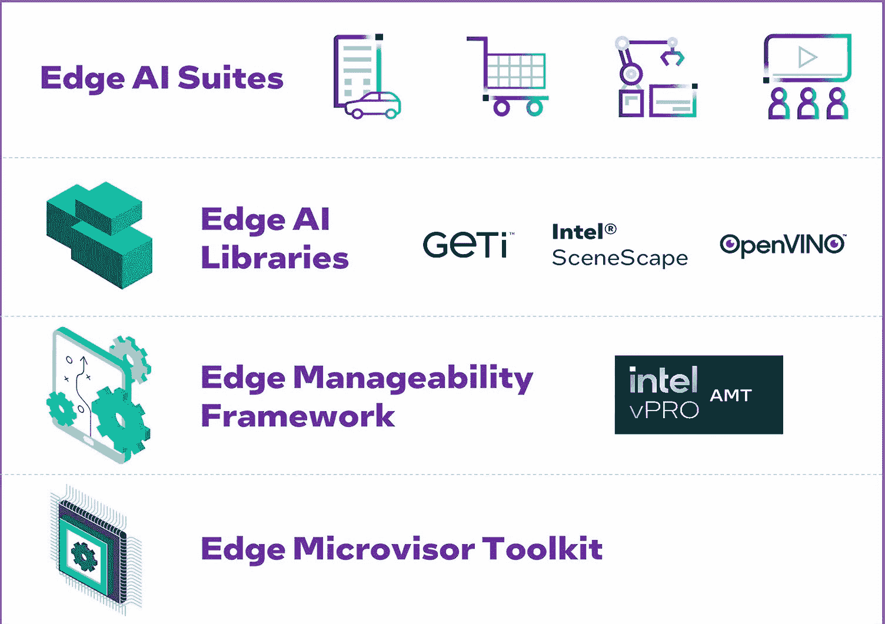

## 2.3 项目推广

### 2.3.1 英特尔® 工业电脑优选项目 (PIPC)

英特尔® 工业电脑优选项目 PIPC Selection 是英特尔针对中国工业用户的本地开发习惯，利用英特尔在工业级芯片、工业边缘软件平台的多年积累，挑选适合不同应用的工业电脑产品进行测试及验证的项目。该项目针对机器视觉、工业控制、工业显控一体机 (Panel IPC)、AI 算力一体机等业界主流应用需求，分别设立硬件规格标准、软件调优等级（优选级/甄选级）、可靠性与安全性验证等，辅以 PIPC 产品激励计划，能够帮助 OxM 产品更好、更快地与下游客户进行产品对接，解决 OxM 客户的产品推广问题，同时也解决终端用户选型的难题，帮助客户成功与生态伙伴共同创造工业新未来。

同时，英特尔 2025 年 PIPC 项目边缘 AI 的客户合作产品均已通过英特尔® AI 边缘系统 (Intel® AI Edge System) 认证。英特尔® AI 边缘系统致力于利用针对边缘产业优化过的开放式互联生态系统，以及与合作伙伴共同开发的易于部署的蓝图，帮助边缘产业将 AI 引入多样环境中的独特边缘用例。借助经优化的解决方案，英特尔® AI 边缘系统提供了经过配置、调优和基准测试的开箱即用的 AI 方案，以满足更多边缘企业客户需求。

英特尔® 工业电脑优选项目使用工业级芯片及模块化设计，且满足以下要求：

| Model | AI Edge BOX | | | AI All-in One (AIO) | |
|---|---|---|---|---|---|
| **Required Items** | **Platform** | **Mainstream** | **Advanced** | **AI+MV** | **AI+Control** |
| Tops | 80Tops (INT8) | | > 200 Tops (INT8) | V | V |
| CPU* | ARL-H (255H) | | MTL / ARL / RPL-S | V | V |
| dGPU* | / | | B580/B60, etc. | V | V |
| TDP | 45W-65W | | TDP:> 65W | V | V |
| MEMORY | >=32 GB | | >=32 GB | V | V |
| STORAGE | SATA, M.2 SSD | | SATA, M.2 SSD | V | V |
| **I/O Ports** | **Mainstream** | **Advanced** | | **AI+MV** | **AI+Control** |
| DISPLAY | >=1*VGA, HDMI or DP | | >=1*VGA, HDMI or DP | V | V |
| ETHERNET | >=4*RJ45 (GBE) | | >=4*RJ45 (GBE) | V | V |
| ETHERNET NIC : Control only | NIC: i210/i225/i226 | | NIC: i210/i225/i226 | / | V |
| USB | >=2*USB 3.0 | | >=4*USB 3.0 | V | V |
| M.2 for WIFI/WWAN | >=1*E KEY/B KEY or mini PCIe FOR WIFI/WWAN | | >=1*E KEY/B KEY or mini PCIe FOR WIFI/WWAN | V | V |
| EXPENSION | / | | >=1*PCIE/MXM x8/x16 to support Discrete GPU or miniPCIe, PCIe, MXM or customized interface extension | V | V |
| COM | >=2*COM: RS232/422/485 COM | | >=2*COM: RS232/422/485 COM | V | V |
| ISOLATED DI/DO | >=4*DI/DO | | >=4*DI/DO | V | V |

同时，针对工业现场工况和环境，PIPC 项目还提高了可靠性要求并进行严格审核：

| 项目 | 要求 |
|---|---|
| 基于标准（如 IEC 等）的可靠性测试报告与 RoHS | |
| MTBF (mean-time before failure) | 30000hrs@25°C |
| Temperature | Operating: 0-40°C, Non-operating: -20-60°C |
| Humidity | Operating: 40°C@95%, non-condensing |
| Vibration | IEC 60068-2-64: 1Grms, random, 5~500Hz, 1 hr/axis |
| Shock | IEC 60068-2-27, 10G, half sine wave, 11 ms duration |
| RoHS | DoC |

2025 年版 PIPC 增订版手册包含最新项目介绍、工业应用落地案例以及通过 PIPC 验证的合作伙伴产品简介，欢迎进行下载。

本文节选工业电脑优选产品推荐 — 2025 年增订内容边缘 AI 工控机与 AI 算力一体机篇

### 边缘 AI 工控机

**Automation PC NP-6113-MVS**

**产品特性：**

1. Intel® Core i3-N305/N97
2. 1 x mSATA bay
3. 1 x SO-DIMM DDR5-4800MHz (up to 16 GB)
4. 2 x USB3.0, 2 x USB 2.0, 1 x USB 2.0 Type A
5. 2 x Intel® i210-AT GbE POE LAN controller
6. Windows 10 IoT, Ubuntu

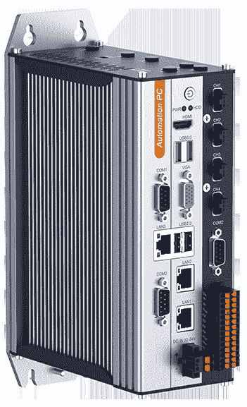

**E223 系列**

**产品特性：**

1. Intel® Alder Lake-N series N50/N97/N200/i3-N305
2. 单通道 DDR5-4800，最高 16 GB 内存
3. 2 USB 3.0
4. 3 LAN (2 x Intel® i210, 1 x Realtek RTL8111H)
5. Windows 10/11, centos 8, ubuntu 20.04/22.04

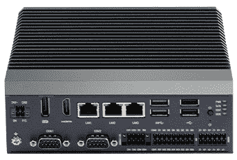

**HPM131-AC156 系列**

**产品特性：**

1. Intel® Elkhart Lake platform J6412
2. 1 x M.2 B/M-Key 2280, SATA3.0
3. 2 x DDR4 SO-DIMM sockets support up to 32 GB memory
4. 2 x USB3.0; 2 x USB2.0
5. 3 x Gigabit LAN (2 x Intel® i210-AT, 1 x Intel® i226-V)
6. Windows 10 IoT LTSC, Linux

**CIP-W21R-RPL1**

**产品特性：**

1. Intel® Core™ 13th i3/i5/i7 Raptor Lake
2. 1 x 2.5" Drive Bay for SATA HDD/SSD
3. 1 x DDR4 SO-DIMM 3200MHz, Up to 32 GB
4. 2 x USB 3.0 (Gen1); 2 x USB 3.0 (Gen2)
5. 1 x Intel® I219-V GbE (10/100/1000 Mbps), 1 x Intel® I210-AT GbE (10/100/1000 Mbps)
6. Windows 10-64bit, Linux

**KMDA-3306**

**产品特性：**

1. Intel® Arrow lake 系列处理器
2. 1 x M.2 2280 M-Key，支持 NVME 存储；1 x Full Size mSATA，用于存储
3. 1 x DDR5 5600MHz SODIMM，最大 128 GB
4. 2 x USB 3.2, 4 x USB 2.0
5. 3 x LAN 千兆网口

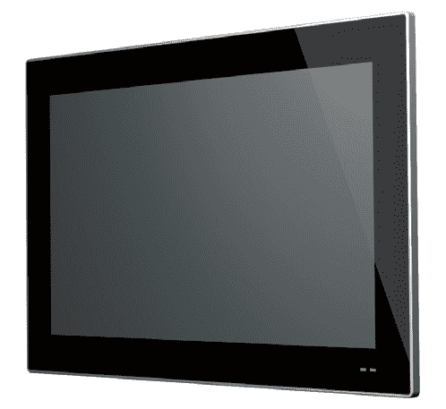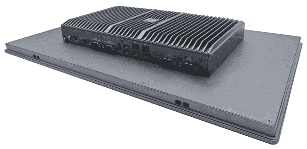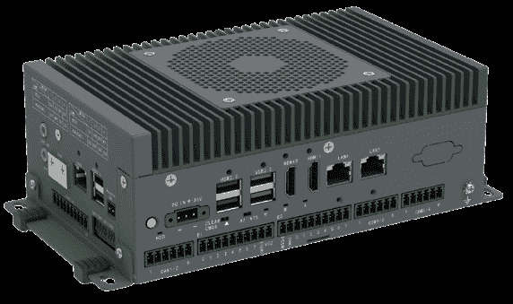

**高性能电脑 AIPC-3000-AQ6-7L**

**产品特性：**

1. Intel® 12/13/14th Gen Celeron/Pentium/Core-l series processor
2. 1 x M.2-2242/2280 Key M slot NVME；2 x SATA（3.5 寸 + 2.5 寸）
3. 2 x SO-DIMM Slot, Up to 64 GB
4. 4 x USB3.0
5. 2 x Intel® GbE LAN
6. Windows 10/11, Linux

**Deepseek 本地部署服务器 IPC-610JE**

**产品特性：**

1. Intel® Raptor Lake 处理器
2. 1T SSD + 4T HHD 硬盘
3. 4 条 DDR4 UDIMM 插槽，支持双通道 DDR4 3200MHz，容量最高可达 128 GB
4. 6 个 USB3.2 接口，7 个 USB2.0 接口
5. 4 个标准 RJ45 网络接口，支持 10/100/1000Mbps
6. 支持 Ubuntu 操作系统

### AI 算力一体机（AI 算力 > 200 Tops）

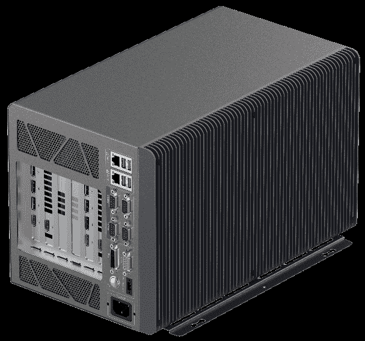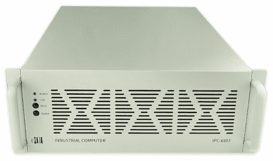

## 03 成功案例

针对不同场景的 AI 算力需求，英特尔与伙伴合作，提供了广泛而灵活的硬件选项（如下图所示）。这些硬件通过搭载不同的英特尔® 处理器与显卡组合，可在特定的成本要求下，满足用户在传感器数据收集、视频流处理、图像识别、缺陷检测、实时大数据分析、大型数据中心 AI 推理等方面的算力要求。

| 配置 | 10 TOPS 凌动/酷睿 ￥ | 100TOPS 酷睿 Ultra ￥￥ | 250 TOPS 酷睿 + 1 x 独立显卡 ￥￥￥ | 500 TOPS 12/13 代酷睿 ￥￥￥￥ | 1000 TOPS 酷睿/至强 + 多张独立显卡 ￥￥￥￥￥+ |
|---|---|---|---|---|---|
| 算力需求 | 边缘本地训练 (Qwen 2.5 2B INT4…) | 视频流处理器、实时大数据分析、复杂图像识别、缺陷检测、语音识别、视频分析 (Qwen 2.5 7B INT4…) | 小型边缘设备，传感器数据收集与基础处理与分析，温度检测、空气质量检测等 | 大型数据中心AI推理 (DS Distill 32B INT4…) | 大型数据中心AI推理 (DS R1 70B FP8…) |
| 计算成本 | ￥ | ￥￥ | ￥￥￥ | ￥￥￥￥ | ￥￥￥￥￥+ |

产品矩阵包含：

- NODKA Edge AI Box (8ch. CNN)
- NODKA Edge Controller
- Konghui AI AIO
- Konghui Vision Controller
- Yuankong Edge Controller
- Yuankong Edge AI Box
- Seavo Robotic Controller
- NODKA AI AIO
- JHC AI AIO
- NODKA Vision Controller
- Future Robot Vision Controller
- E85 (Easybase)
- B31 (Easybase)
- BRAV-7722 (JHC)
- MXM 770
- T211/T210 (Easybase)
- GS-T1009 (Easybase)
- BRAV-7721 (JHC)
- 7466 X6 (Cloudnine)
- GS-R414I (Easybase)
- 6430, 4U
- BRAV-7820 (JHC)

**图：英特尔智慧工业/智慧交通/智慧社区产品矩阵**


### 3.1.1 英特尔：基于 RAG 的智能诊断系统

在半导体制造等高度自动化的精密工业领域，热压键合机 (TCB Bonder) 等核心设备是保障产能与良率的关键。任何非计划性的设备停机都将直接导致巨大的经济损失。然而，保障这类复杂设备的持续稳定运行，面临着严峻的知识管理与传递挑战，具体痛点如下：

- **知识孤岛化与异构性：** 解决一个设备故障所需的信息，往往散落在不同形式的载体中。例如，设备商提供的上千页 PDF 操作手册、数据库中存储的历史维修记录、内部 Wiki 上的最佳实践以及设备生成的实时报警代码。这些数据源互相独立，格式不一，工程师无法高效地进行统一查询。

- **隐性知识流失与传承断层：** 大量关键的故障诊断"诀窍"，以隐性知识的形式存在于资深工程师的头脑中。随着资深员工的退休或调动，这些宝贵的实践经验面临着流失的风险，造成了知识传承的断层，也使得新员工的培训周期长、成本高。

- **诊断效率低下且不稳定：** 当故障发生时（如 TCB Bonder 报告"E-4103: Z-轴压力异常"），工程师需要手动在多个系统中搜索，逐一翻阅冗长文档，或中断工作去咨询专家。这个过程耗时费力，且诊断的效率和准确性高度依赖当班工程师的个人能力，导致平均故障诊断时间 (MTTD) 被无效拉长。

为应对上述挑战，工厂设计并构建了一套专为 TCB Bonder 故障排除设计的、基于检索增强生成 (RAG) 的智能诊断系统。该系统旨在将当前分散、低效的人工查询流程，转变为一个统一、高效的智能交互入口，将海量、零散的设备知识转化为一个随叫随应的"AI 专家"。

工程师不再需要适应不同的数据系统和文档格式，而是可以直接通过自然语言提问（如："TCB Bonder 报 E-4103 错误，Z 轴压力异常，应该如何排查？"）。系统通过在后台整合所有相关的知识源 — 设备手册、历史维修日志、SOP 文档、专家知识库等，能够理解用户意图，并从海量信息中检索、整合、提炼出最直接、最相关的答案。

##### 背景与挑战

##### 解决方案

该系统的核心技术架构如下：

01 **数据提取与智能预处理流水线：** 建立自动化数据处理流水线，采用混合解析策略（OCR + 原生解析）深度解析 PDF/Word 等异构文档。流水线能够智能抽取复杂表格、建立图文关联，并利用 LayoutLM 等模型还原文档的原始章节层级，将非结构化知识转化为机器可理解的结构化数据。

02 **知识表示与多维索引引擎：** 摒弃生硬的文本切割，采用层级分块 (Hierarchical Chunking) 策略，创建不同粒度的知识块。此策略允许系统在检索时实现"小块精搜，大块补全"，解决信息碎片化问题，同时构建包含向量索引（用于语义搜索）和关键词索引（用于精确术语匹配）的多维索引体系。

03 **高级查询理解与检索引擎：** 系统首先利用 LLM 对用户的口语化提问进行意图分析和结构化重写，随后并行发起协同混合检索，并采用重排序模型 (Re-ranking) 过滤噪音，确保召回的上下文信息质量最高。针对复杂问题，系统还支持迭代式检索，逐步拼凑出完整的证据链。

04 **上下文增强与答案生成：** 根据问题类型动态构建提示 (Prompt)，引导大语言模型 (LLM) 进行逻辑推理。LLM 生成的答案会经过后处理，严格标注出每一条关键信息的来源（如"根据《TCB-9000 维修手册》第 4.2.1 节…"），确保答案的准确性与可信度，并支持多轮追问。

##### 方案优势

该智能诊断系统将资深专家的隐性知识转化为可被随时调用的显性知识，实现了专家知识的规模化复制，赋能每一位一线工程师。它不仅可以提供标准操作步骤，还能结合历史记录，提示故障最常见的根本原因，并生成按优先级排序的诊断修复指南，从而将静态的知识库转变为一个持续学习、动态优化的知识服务平台。

#### 工厂收益

- **显著缩短故障诊断时间 (MTTD)：** 将以往数小时的人工查找与问询，缩短为几分钟的机器问答，直接降低设备停机时间，提升产线 OEE。
- **提升诊断的准确性与标准化：** 避免因个人经验差异导致的误判和操作遗漏，确保每一次故障处理都遵循可追溯的最佳实践。
- **赋能团队并降低培训成本：** 让新晋工程师也能快速上手处理复杂问题，缩短培训周期，同时解放资深专家，使其专注于更高价值的工艺优化与创新工作。
- **构建持续学习的知识体系：** 新的故障和解决方案可以被轻松地纳入知识库，通过用户反馈形成自优化的学习闭环，使系统"越用越聪明"，构筑企业核心的动态知识资产。

### 3.1.2 利珀科技：固晶自动光学检测系统

作为现代科技发展的基石，半导体制造产品广泛应用于各类电子设备中，从日常使用的智能手机、平板电脑，到高性能计算机或数据中心再到边缘服务器，半导体芯片无处不在。而半导体从制造到封装测试都非易事。其中，Die Bonding（固晶，又称芯片键合）是将芯片与载片通过材料和技术紧密结合的过程。这一步骤是半导体封装工艺中的核心环节，通过粘合剂将芯片接合至导线架形成热/电通路。固晶的精准与否，是半导体封装产线中产品良率的成败关键。

然而，由于制程影像的复杂纹理，传统光学检测无法利用编写逻辑的方式侦测角度、位移偏差及缺漏等瑕疵，时常造成漏检、误判、错误定位等问题，很大程度上影响封装产线的生产效率。因此，Die Bonding AOI（Automated Optical Inspection，自动光学检测）这种用于半导体制造过程中芯片键合环节的检测技术显得尤为重要。通过高分辨率摄像头和先进的图像处理算法，AOI 设备能够对芯片粘接过程进行实时监测，以确保粘接的精度和质量。固晶自动光学检测系统可自动识别和分类粘接过程中的缺陷，如芯片位置偏移、粘接不良、异物污染等。通过实时检测和反馈，生产线可以迅速调整工艺参数，减少废品率，提高生产效率。

##### 背景与挑战

##### 解决方案

利珀科技的固晶自动光学检测系统搭载第 12 代英特尔® 酷睿™ 处理器与英特尔锐炫™ B580 独立显卡，结合利珀自研灵闪 (IntelliBlink™) AI 软件，避免用户了在硬件上的过度投资，有助于降低总体拥有成本 (TCO)，为 Flip Chip 封装提供了全面的质量控制解决方案。系统的内置工控机采用工业级设计，具备宽温范围和多重保护机制，确保在恶劣环境下持续稳定运行。工控机通过严格认证和无风扇散热设计，可实现高可靠性和长寿命，降低维护成本。此外，模块化设计支持丰富接口及多种工业协议，具备灵活的存储和通信扩展能力，满足多样化工业应用需求。

英特尔锐炫™ B580 显卡面向高端用户，采用增强版 Xe 架构，集成更多计算单元和先进图形技术。其卓越性能适合高负载应用，如视频编辑和工业视觉检测等，同时支持光线追踪和 AI 加速，能够进一步提升视觉检测速度与精度。

**工控机配置（可根据需求客制化）**

| 组件 | 规格 |
|------|------|
| CPU | i7-12700 |
| 电源 | 850W |
| GPU | A380 |
| 内存 | 16 GB*2 |
| 固态硬盘 | 2T |
| 机械硬盘 | 4T |
| 网口数 | 4 个 |
| HDMI | 2 个 |
| 串口 | 2 个 |
| VGA 口 | 1 个 |
| Camlink 口 | 2 个 |
| USB 口 | 6 个 |
| 系统 | Windows 10 |
| 机箱大小 | 47.2×43×17.5cm |

#### 关键优势

卓越计算性能、专业级图形支持、广泛应用于工业自动化和边缘计算，提供强大的图形处理能力和灵活扩展选项。

##### 方案优势

利珀科技的固晶自动光学检测系统，以多模态光学检测矩阵和智能算法为核心，从表面到内部全方位守护 Flip Chip 封装质量。系统可实现亚微米级定位，捕捉微米级缺陷，支持超高速 15K + 在线检测及多流道串并联检测。创新的红外在线检测技术结合传统算法与 AI，助力工业客户构建智能闭环工艺质量体系，提供完备可靠的深度学习体系，整合高效快速的样本生成能力，着眼工业客户复杂紧迫的应用场景，快速提供缺陷检测方案，为封装良率提供坚实保障。

### 3.1.3 诺达佳：新一代视觉控制器

近年来，在全球制造业向智能化和自动化转型的浪潮中，机器视觉 + AI 算法作为现代工业与技术的新兴驱动力，在提升产线生产效率、保障作业安全、推动智能制造及产业升级方面不断展现出非凡的重要性与无限潜力。基于此，视觉工控机对于复杂 AI 算法的支持与实时数据分析的能力日益成为提升检测精度与速度的核心。而随着生产线对高精度、高效率的需求不断增长，传统的 4U 工控机为满足更多的 AI 负载，往往需要搭配额外独立显卡，但这种控制系统不仅功耗高、硬件形态固定，需要风扇散热设计，更重要的是价格高昂，性价比低，可靠性不强。

##### 背景与挑战

##### 解决方案

针对于此，诺达佳隆重推出新一代视觉控制器，搭载强大的英特尔® 酷睿™ Ultra 200H 系列处理器，旨在为制造业提供更强大的视觉处理能力与 AI 性能。这款产品不仅集成了最新的图像处理技术和人工智能算法，还具备卓越的扩展性和兼容性，能够轻松适应各种工业环境和应用场景。

诺达佳基于英特尔® 酷睿™ Ultra 200H 系列处理器的新一代视觉控制器将 AI 与传统视觉算法系统相结合，开创视觉处理的新范式，以实现更高效的生产流程和更精准的质量检测。通过采用高性能英特尔® 酷睿™ Ultra 200H 系列处理器，这款视觉控制器能够在更低的功耗下提供卓越的计算能力，支持复杂的 AI 模型和实时数据分析。其灵活的硬件设计与小体积和丰富接口，辅以突出的性价比优势，使得企业能够在不增加成本的情况下，显著提升生产线的智能化水平和检测精度。新范式的视觉处理不仅优化了资源利用，还为工业自动化和智能制造提供了强大的技术支持，推动行业向更智能、更高效的未来发展。

- **CPU：** 英特尔® 酷睿™ 200H 系列处理器，16 核心/16 线程，基本频率 2.4GHz，最高睿频可达 5.4GHz
- **核显：** Intel® Arc™ 140T GPU，集成 8 个 Xe 核心
- **AI 算力：** Max.99 TOPS (NPU + CPU + GPU)
- **内存：** 支持双通道 DDR5 内存，Max.128G
- **硬盘：** 支持双硬盘，mSATA + M.2 SATA 2280

接口说明：开机按键、天线安装孔、4 x 千兆 PoE 网口、16 x DI 16 x DO、状态灯、VGA、HDMI、2 x 千兆网口、4 x USB3.0、2 x RS232/RS485、DC IN 12V~24V

##### 方案优势

### 3.1.4 诺达佳、圆木智能：DeepSeek 工业一体机

随着 AI 从训练为重走向推理为主，边缘的部署需求迎来爆发式增长。DeepSeek 的影响力持续攀升，通过边缘的 AI 一体机来加速推理应用的落地，展现出更接地气，更具实操价值的灵活性与成本优势。广义来说，AI 一体机是专为 AI 大模型应用与部署服务构建的集成计算设备，主打"开箱即用"，设备通常已包含 CPU、GPU、存储器、操作系统、AI 软件以及各类模型算法等软硬件，可为多行业企业提供本地化、专有化的大模型 AI 能力。然而，AI 一体机要助力推理应用的普及，还需满足以下前置条件：

- 领先的 AI 模型实现开源，在算法层面奠定 AI 普惠的基础，DeepSeek 的到来无疑为 AI 普惠提供了更充足的"软实力"支撑。
- 更具性价比的硬件或算力平台实现充足供应，解决 AI 时代企业"贫富分化"的状况。
- 硬件方案或算力平台需做到真正的多样化，支持基于用户细分需求进行定制化，而非一个标准通吃。

综上所述，集成了 DeepSeek 大模型的软硬件一体机在市场中逐步推广开来。硬件平台如何能更好地平衡性能、成本、多样化程度，以及获取、部署和应用的便捷性便成为更多行业客户考虑的重点。

##### 背景与挑战

##### 解决方案

针对工业行业，DeepSeek 工业一体机提供了广泛的应用场景，助力 AI 在智能制造中的全面落地。依托一体机的算力，工业企业能够实现广泛的 AI 部署，推动智能化转型。目前，圆木智能等 ISV 已经通过该一体机，实现了智能体在多个关键场景中的应用落地。

01 **智能客服/产品手册问答：** DeepSeek 工业一体机通过集成的大语言模型，能够快速处理和分析大量产品信息与客户查询。企业智能客服系统可借力于此，快速回答客户有关产品使用、故障排除和维护等常见问题，减少人工客服的负担，提高响应速度与客户满意度。

02 **工业代码生成：** 通过集成 AI agent，DeepSeek 工业一体机可自动生成工业代码并一定程度上实现性能优化。例如，系统可根据工程师的需求与手册指导，生成高效的工业代码，或者快速识别输入代码中的潜在问题，提供 debug 建议，帮助开发者提高开发效率和代码质量。

03 **文档校核：** 文档校核智能体可以智能分析并解读技术文档，提取关键信息，自动识别制造工艺关键点，同时基于对需求文档和方案文档的深度解读，按需求文档的要求，审核方案文档的内容。智能体还能够在审核之后自动生产审核报告，并根据需求内容，自动生成检查清单。

04 **设备维护：** 可以提供设备的智能问答，根据故障现象给出排查方案，并根据排查结果推断故障原因，最终生成维修方案。智能体可以协助工程师提前识别系统潜在故障判断，减少非计划停机与维护成本，使得整体维护过程更加高效、精准、便捷，帮助企业延长设备使用寿命，优化资源分配问题。

05 **生产排程：** 智能体可以充分理解用户上传的各种类型的订单、工序和设备的表格，并将数据识别、转化为系统可以接受的数据格式，排产结果以甘特图的方式进行直观的展现，同时支持用户进行灵活调整。智能体还可以对生成的生产计划提供优化建议，帮助企业不断改善生产效率。

基于此，英特尔联合诺达佳合作构建 DeepSeek 工业一体机设备，搭载强大英特尔® 酷睿™ 处理器与英特尔锐炫™ 系列显卡，确保卓越的计算性能和数据处理能力。这一合作不仅提升了设备的整体性能，还为企业在智能制造领域的创新应用提供了坚实的技术支持。通过持续的技术创新和协作，DeepSeek AIO 设备正在引领行业迈向智能化的未来。

**图：诺达佳 DeepSeek 工业一体机**

诺达佳一体机具有以下四大核心亮点：

#### 硬件配置

**核心组件**

- CPU：第 12 代及以上英特尔® 酷睿™ 桌面处理器
- GPU：可灵活选择英特尔锐炫™ 系列显卡
- 内存：64 GB
- 硬盘：SSD + HDD
- 主板：NK7306

##### 方案优势

- **本地化部署：** 数据不出内网，算力自建，实现完全安全可靠与合规性要求。
- **高性能计算优化：** 支持 1.5B-32B DeepSeek 参数模型，提供量化、蒸馏技术，适配不同规模需求，为行业企业降本增效。
- **开箱即用，降低技术门槛：** 诺达佳工业一体机设备基于 Ubuntu 操作系统，预装主流运行框架、各类大语言模型及部署加速库，并支持一系列大语言模型部署与调优工具链（如模型微调、本地知识库、本地智能体工作流等），降低企业应用技术门槛。
- **成本效益高：** 相较于企业客户自建服务器集群，一体机的采购与维护成本更低，适合中小企业部署。


### 3.1.5 英特尔：缺陷样本生成解决方案

##### 背景与挑战

在工业制造领域，基于计算机视觉的缺陷检测是保障产品质量的关键环节。为了让卷积神经网络 (CNN) 等 AI 模型在实际生产中具备高精度的缺陷识别能力，模型训练阶段需要大量高质量且多样化的缺陷样本（NG 样本）。然而在许多真实生产环境中，缺陷样本的采集存在天然困难：

- 缺陷发生概率低，导致难以收集到足够的 NG 样本。
- 传统的人工采集方法不仅耗时耗力，而且在缺陷类型分布不均时，很难覆盖所有可能的缺陷模式。

这些挑战直接影响 AI 模型的泛化能力与检测精度，使得缺陷检测系统在实际生产中的表现受限。

##### 解决方案

英特尔缺陷样本生成解决方案基于开源模型进行改进，并在英特尔硬件平台上完成部署与优化，旨在通过生成式 AI 自动合成高质量的缺陷样本，以支持工业缺陷检测模型的训练。方案整体实现基于 PyTorch XPU 与 OpenVINO™ 工具套件，可在英特尔锐炫™ 系列独立显卡及英特尔® 酷睿™ Ultra 系列处理器的集成显卡上高效运行。


**图：英特尔缺陷样本生成解决方案架构**

**真实缺陷样本** → **缺陷标注** → **微调** → **推理**

**正样本 + 缺陷掩码** → **生成的缺陷样本**

- 在真实缺陷样本上标注缺陷区域 — 训练
- 使用标注后的真实缺陷样本微调训练 Diffusion 模型
- 使用训练好的 Diffusion 模型，基于正样本 + 指定区域和形状的缺陷掩码生成新的缺陷样本

通过在英特尔 GPU 硬件平台上的加速优化，该方案能够在保证生成质量的同时，实现快速的样本合成和高效的模型推理，适用于工业场景中的缺陷检测数据增强任务。

在英特尔成都工厂的 CPU Tray 盘缺陷检测项目中，该缺陷样本生成方法得到了实际应用。项目中仅收集到少量 Tray 盘边缘缺陷样本，通过该方法生成了约 100 张不同类型的缺陷样本图像，用于扩充训练数据集。经过增强后的数据集显著提升了缺陷检测模型在边缘缺陷识别方面的检测精度。

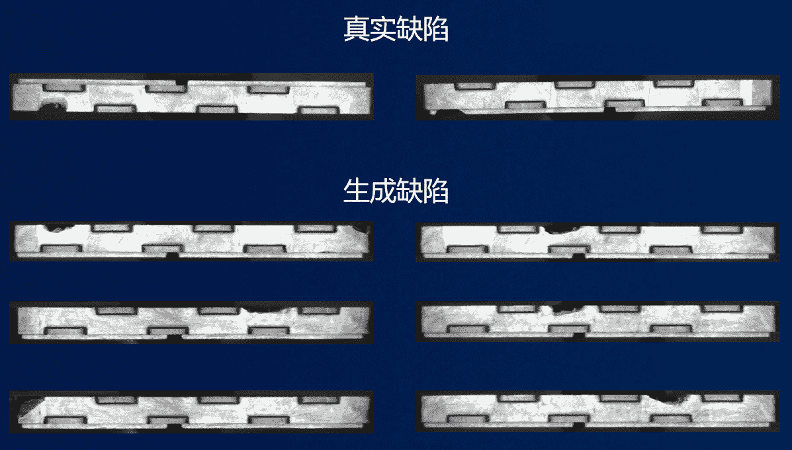

**图：缺陷生成示意**

整个流程如下：

- **数据准备：** 收集少量真实的良品样本和缺陷样本，并生成对应的缺陷掩码 (Defect Mask) 以标注缺陷区域。
- **模型微调：** 利用准备好的数据对生成模型进行微调，生成控制信息和结构化的区域分割图 (Trimap)，以便在后续生成中精确定位缺陷位置。
- **样本生成：** 将良品样本、Trimap 和文本提示输入到模型中，生成带有缺陷的合成图像样本，用于补充训练数据集。

### 3.1.6 华泰软件：MES 问数系统

##### 背景与挑战

ChatBI 是一种结合了自然语言处理 (NLP)、机器学习 (ML) 和商业智能 (BI) 技术的智能对话系统，旨在通过自然语言交互的方式帮助用户进行数据分析和决策支持。目前 ChatBI 的技术路线大多是采用 LLM+SQL 的模式，也就是基于大模型的能力，生成 SQL，然后借助 python 或者其他手段，执行 SQL，并配合图表进行呈现。

ChatBI 能够通过自然语言处理技术，让业务人员无需复杂操作即可快速获取数据洞察，大大降低了数据分析的门槛。对于一些数据基础较好、业务场景相对简单的企业，或者对数据分析的实时性和灵活性要求比较高的企业，ChatBI 提供了高效、快速、简便、准确的数据挖掘与呈现方式。

华泰软件 MES 问数工具是 ChatBI 在制造系统中的一个典型应用。MES 系统是一套面向制造企业车间执行层的生产信息化管理系统。MES 可以为企业提供包括制造数据管理、计划排程管理、生产调度管理、库存管理、质量管理、人力资源管理、工作中心/设备管理、工具工装管理、采购管理、成本管理、项目看板管理、生产过程控制、底层数据集成分析、上层数据集成分解等管理模块，为企业打造一个扎实、可靠、全面、可行的制造协同管理平台。

制造执行系统协会 (Manufacturing Execution System Association，MESA) 对 MES 所下的定义："MES 能通过信息传递对从订单下达到产品完成的整个生产过程进行优化管理。当工厂发生实时事件时，MES 能对此及时做出反应、报告，并使用当前的准确数据对它们进行指导和处理。这种对状态变化的迅速响应使 MES 能够减少企业内部没有附加值的活动，有效地指导工厂的生产运作过程，从而使其既能提高工厂及时交货能力，改善物料的流通性能，又能提高生产回报率。MES 还通过双向的直接通讯在企业内部和整个产品供应链中提供有关产品行为的关键任务信息。"

MES 系统收集了大量生产运营相关的实时数据，如何利用这些数据，挖掘其中有价值的信息，并给企业管理层快速准确的呈现，针对实际状况及时响应并做出决策，是生产部门负责人重点关心的问题。ChatBI 借助 LLM 强大的推理能力，通过自然对话的形式进行清晰的意图识别和判断，在数据库中寻找正确的数据进行处理和呈现，省去了繁琐的人员沟通过程，自动进行数据获取、整理和呈现，大大提升工作效率。

##### 解决方案

华泰软件 "MES 问数" 应用，通过边缘工作站搭载第 13 代英特尔® 酷睿™ 处理器与 2 张英特尔锐炫™ Pro B60 24G 独立显卡，本地化部署 DeepSeek-R1-Distill-Qwen-32B 模型、NL2SQL 等工具以及专业 BI 组件，对接企业数据库，确保生产数据不出厂，本地快速实现意图识别、数据获取、BI 呈现、报告总结的功能。同时，用户可以根据实际需要选择不同的开源模型进行集成，灵活搭配；将传统的 MES 系统升级成为更智能、交互更便利的 AI MES 系统。

##### 方案优势


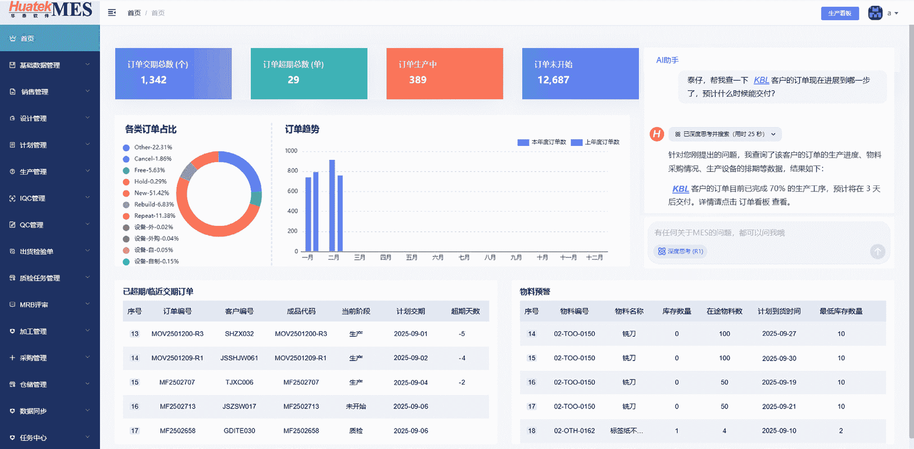

**图：华泰软件 MES 问数工具软件界面**


### 3.1.7 富临精工、智元机器人和安努智能：具身智能解决方案

##### 背景与挑战

具身智能技术正以前所未有的速度发展，其在制造业的广泛应用正在加速全球产业的柔性智能化进程。然而，将具身智能真正落地工业场景面临诸多挑战：

- **算力瓶颈：** 复杂的感知、决策和控制任务需要强大且高效的边缘计算能力，传统方案难以平衡性能与成本。
- **系统集成难题：** 视觉感知、运动控制、环境建模等多个 AI 模块的协同运行要求极高的系统整合能力。
- **工程化壁垒：** 从实验室到生产线的 "最后一百米" 充满不确定性，需要可靠的软硬件一体化解决方案。
- **长时稳定性：** 工业环境下的连续作业对机器人系统的鲁棒性和稳定性提出了严苛要求。

富临精工作为具身智能工业落地的先行者，携手英特尔、智元机器人和安努智能，成功突破上述挑战。智元机器人 A2-W 在富临精工智能制造基地完成了全球首次长达 3 小时的人形机器人连续工作实况直播。该机器人搭载英特尔® 酷睿™ Ultra 处理器和英特尔具身智能软件开发工具包，通过其高性价比算力包解决了感知模块的负载问题，实现了具身智能的突破性应用。A2-W 展现出卓越的自主作业能力：主动任务识别、动作策略规划、导航避障、拆垛搬运、精准货架归类等。在三小时内完成 800 余个周转箱的搬运任务，全程零失误。

##### 解决方案

 

**图：英特尔具身智能软件开发套件架构**


#### 英特尔具身智能软件开发套件 — 软件架构

| 模块层级 | 内容 |
|---|---|
| 算法和示例 | 视觉模组、操作类、参考演示及代码 |
| 大模型 | LLM、VLM、VLA |
| 加速软件库和框架 | 英特尔® oneAPI 编译器和函数库 |
| 操作系统、驱动和外设 SDK | Linux LTS BSP（英特尔最佳配置 Preempt-RT）、实时性能调优工具、IgH EtherCAT 主栈 |

视觉模组包含：SLAM、GPU ORB 特征提取、BEV 模型、优化的 ADBSCAN

操作类包含：模仿学习 VA 模块、传统运动规划库、视觉伺服、LLM 任务规划、基于 ACT 的模仿学习操作、优化的运动控制

运动类包含：强化学习模块、传统动态控制/MPC 库

机器人 AI 模型包含：基于 CNN 的视觉模型、优化的 CV 模型、优化的 PCL 模型

硬件支持：dGPU、iGPU、CPU、NPU

中间件：ROS2 中间件

加速软件库和框架：英特尔® IPP、oneTBB、oneMKL、oneDAL、oneVPL、oneDPL、oneDNN、oneCCL、英特尔® oneAPI DPC++/C++ 编译器

协议栈示例：英特尔实时优化、优化的 EtherCAT 驱动、优化的相机驱动、确保实时性的固件

固件技术：Speed Shift 技术、CAT 缓存分配技术

##### 方案优势

- **英特尔高性价比算力包**

  英特尔® 酷睿™ Ultra 处理器提供了强大的边缘计算支持。其异构计算设计在边缘端提供充沛的 AI 推理能力，相比传统 GPU 方案大幅降低了部署成本和功耗，同时低延迟的本地计算确保机器人在动态环境中的快速反应和精准控制。

- **系统集成创新**

  英特尔具身智能软件开发工具包将计算机视觉、AI 驱动的操控、运动控制、SLAM 和大模型集成到统一框架中，为长时间、高强度、动态干扰环境下的稳定运行提供了坚实保障。


未来，英特尔将继续携手生态伙伴，探索包括 "人在环路" (Human-in-the-loop) 和 VLA (Vision-Language-Action) 技术在内的突破性方案，并进一步优化大小脑融合架构，整合认知智能与运动能力，实现高效能、低成本、强泛化的机器人系统，加速智能实体设备的产业化落地。通过持续的技术创新与深度合作，充分释放具身智能的潜力，共同开创智能制造新篇章。

### 3.2 智慧城市

#### 3.2.1 中科创达：全息路口融合感知方案

##### 背景与挑战

车路云一体化系统是一种综合性的智能交通系统，能够通过创新的通信技术将人、车、路、云的物理空间、信息空间融合为一体，提高整个交通系统的感知、决策和执行能力。与仅依靠视觉数据的感知系统相比，融合了视觉数据、雷达数据的全息感知系统能够从更多维度、全方位地反馈当前的交通状态，也更有利于支撑智能网联汽车等高阶应用。但同时，全息感知系统也会带来以下挑战：

- **在性能层面，** 为了实现多方位监测，路口感知系统通常需要对多个视频流、雷达流进行处理与分析，解码+感知识别+融合的整体流程通常要控制在 40-50ms 之间。
- **在灵活性层面，** 迥异的应用环境意味着，不同的路口需处理的视频/雷达路数有所区别。此外，在视频和雷达路数更高的路口中，则应支持灵活地采用独立的 AI 加速器，以提供更加强大的性能表现。
- **在稳定性层面，** 路口环境多变，温度、湿度大幅波动，日晒雨淋、外物冲击等司空见惯，对于 MEC 设备的稳定性、可维护性等都带来了巨大的挑战。

##### 解决方案

中科创达推出基于英特尔® 架构的全息路口融合感知方案，该方案可根据不同场景的负载需求，在路侧边缘计算设备 (MEC) 中搭载英特尔® 酷睿™ Ultra 处理器、第 13 代英特尔® 酷睿™ 处理器和英特尔锐炫™ 显卡，构建了车路云一体化控制体系，能够在路侧对雷达流与视频流进行融合、实时处理，并通过深度学习算法实现交通参与者目标感知与跟踪，为交通执法、交通管理等应用提供了强大的数据能力支撑。

按照不同场景对于性能的需求，中科创达与集和诚合作，在 MEC 设备提供了两种不同的性能配置选项。其中，基础性能版本搭载英特尔® 酷睿™ Ultra 处理器，可支持 4 路视频 + 4 路雷达数据处理；高阶性能版本搭载第 13 代英特尔® 酷睿™ 处理器和集和诚 Type B 显卡模块，可支持 12/16 路视频 + 4 路雷达数据处理。

##### 方案优势

- 构建了高性能的 MEC 基础设施平台，支持多路视频流、雷达流等数据的高效处理与处理。同时，借助于软件优化等方式，用户能够更进一步提升性能表现。
- 实现了面向车路云一体化应用的软硬件协同，有效地实现了路口的全息感知，支撑基于 AI 的交通目标识别、交通流检测、交通事件检测，从而提升了交通洞察、规划、治理的智能化程度。
- 符合严格的工业标准与应用规范，具备宽温、防尘、防腐蚀、防震动冲击、抗电磁干扰等出色的可靠性，有助于交通行业用户搭建高可靠、高可用的车路云一体化平台。
- 依托于庞大的英特尔产品家族，提供了广泛的产品配置组合，用户可以根据算力、视频处理路数、成本控制等方面的不同需求，灵活选择契合自身需求的方案。

**图：中科创达全息路口融合感知方案核心构成**

**路端感知** — **方案核心构成**

- 路侧低时延感知设备（工业相机、毫米波雷达、激光雷达）
- 路侧通信设备 (RSU)
- 边缘计算设备
- 感知融合算法

**云控平台** — 包含数据协同平台、设备管理与网络诊断、算法管理平台

**路口应用** — 包含数字孪生路口、融合感知评测系统

MEC 设备搭载英特尔® 酷睿™ Ultra 处理器，通过 Uu 接口和 PC-5 接口连接 RSU，支持毫米波雷达、摄像头、激光雷达等多种传感器，通过光纤传输数据。

 

**图：支持 4 路视频 + 4 路雷达数据处理器的集和诚路侧 MEC 设备**

**图：支持 12/16 路视频 + 4 路雷达数据处理器的集和诚路侧 MEC 设备**


#### 3.2.2 中维世纪：高空抛物智能治理方案

近年来，高空抛物、坠物事件不断发生，严重危害社区的生活环境。为了增强对于高空抛物的治理，物业被要求全面规范住宅小区公共区域防护、人防、物防和技防要求，特别是规定了高空抛物和实体防护装置安装、物业日常定期巡查等 "硬标准"。

高空抛物行为具有隐蔽性、随机性、瞬间性等特点。为更好地发现高空抛物行为，物业服务提供商正在强化高空抛物摄像头的部署。

为满足高空抛物治理的需求，中维世纪推出了 JVS-B700-T 产品。其搭载的英特尔® 酷睿™ 处理器针对要求高速处理、计算机视觉、低时延计算等关键物联网和边缘计算应用需求进行优化，提供了优异的每瓦性能、丰富的图形效果以及 I/O 集成功能。在英特尔® 时序协调计算技术和时间敏感网络技术的支持下，这款处理器能够提供满足多种应用场景需求的实时计算性能。该处理器还集成英特尔® 核芯显卡，支持将 AI 推理负载转移到英特尔® 核芯显卡中完成，实现更高的推理效率。通过搭载英特尔® 酷睿™ 处理器，能够接入并分析最多 12 路高空抛物实时视频流。

JVS-B700-T 搭载了高空抛物识别算法，该算法可通过视觉识别分析、深度学习等技术，从实时视频流中精准定位高空抛物。为了增强该算法的推理性能，中维世纪还采用了 OpenVINO™ 工具套件优化模型。OpenVINO™ 工具套件是用于快速开发应用程序和解决方案，以解决各种任务（包括人类视觉模拟、自动语音识别、自然语言处理和推荐系统等）的综合工具套件。该工具套件基于最新一代的人工神经网络，包括卷积神经网络 (CNN)、递归网络和基于注意力的网络，可跨英特尔® 硬件扩展计算机视觉和非视觉工作负载，从而大幅提高性能。它通过从边缘到云部署的高性能、人工智能和深度学习推理来为应用程序加速。

**解决方案**

**背景与挑战**

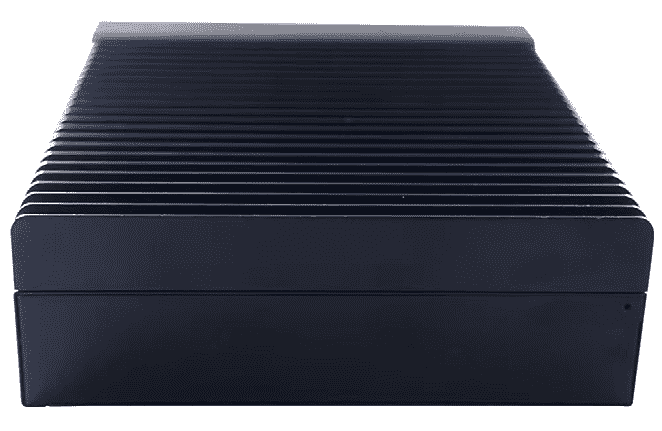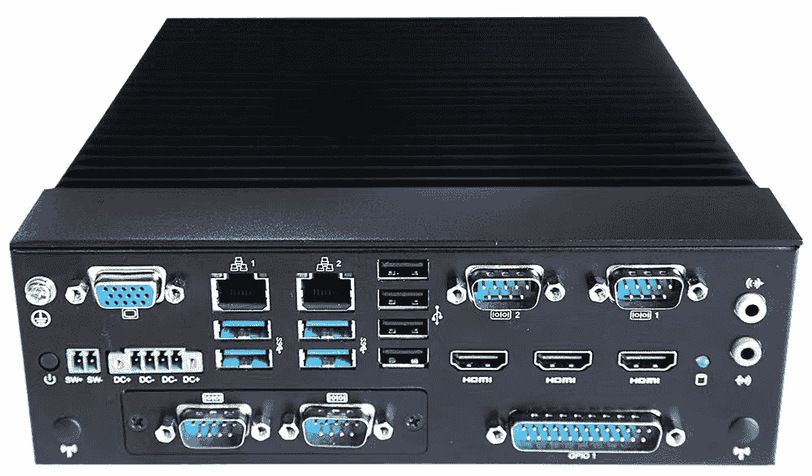

**图：中维世纪 JVS-B700-T**

- 精确识别监测高空抛物，大大地减少了高空抛物事件的发生，减少相关争议，使环境变得更加安全舒适。
- 基于边缘端的推理方案有助于降低云资源成本，提升稳定性，并实现端到端的快速处理与响应。
- 部署便捷灵活，只需接入摄像机，即可实现高空抛物全方位实时监控。

**方案优势**


表：中维世纪 JVS-B700-T 硬件配置

| System | 规格 |
| --- | --- |
| CPU | 11th Gen Intel® Core™ Tiger Lake IoT Processor |
|  | I3-1115G4 3.0GHz-4.1GHz 2Core 28W |
|  | I5-1135G7 2.4GHz-4.2GHz 4Core 28W |
|  | I7-1165G7 2.8GHz-4.7GHz 4Core 28W |
| Memory | Onboard SDRAM LPDDR4 8 ~ 24 GB |
| Storage | 1x 2.5-inch shock-absorption hard disk installation position, Standard configuration |
|  | 2x M.2 2280 NVMe port, 1x mSATA port |
| Extension | 1x Mini-PCIe expansion slot (with 1x SIM card slot), Standard configuration (optional 2x Mini-PCIe, Co-Lay) |
| System support | Windows 10 64bit, Ubuntu, Red Hat |
| Display | 3x HDMI + VGA (Internal reserved eDP port, either VGA or eDP) |
| Wireless | Wi-Fi |
| Network port | 2x 10/100/1000Mbps RJ45 Ethernet Ports |


#### 3.2.3 震有智联：智慧工地 AI 超融合解决方案

随着工程施工对建设效率、资源利用率的要求不断攀升，以及安全规范日益严苛，大模型等 AI 技术正成为驱动工地管理智慧化转型的核心力量。AI 技术的深度赋能不仅针对性地解决了工地施工中安全、环保、质量、耗能等传统难题，更从根本上推动着工地施工向高度自动化与智慧化升级，重塑着现代工程管理的全新模式。

大模型凭借其对复杂数据的深度解析、跨模态信息整合及动态推理能力，正在智慧工地的安全管理等核心场景中发挥关键作用，其通过对 "数据 - 场景 - 决策" 的深度融合，正在从安全、进度、设备、质量等维度重构智慧工地的管理模式。其核心价值在于将传统依赖经验的 "被动应对"，升级为基于数据的 "主动预判与优化"，精准识别安全隐患并自动预警，从源头降低事故风险，在保证工人人身安全的同时降低工地的安全成本。

震有智联推出了基于英特尔® 架构的智慧工地 AI 超融合解决方案。该方案可释放源自英特尔® 处理器、英特尔锐炫™ 显卡的澎湃算力，以智慧工地中的空间多维数据为基础，整合项目基本信息、设备监测信息等数据，为政府行业监管、企业项目管理打造多端运行、协同共享的可视化智慧工地平台。

**解决方案**

**背景与挑战**


**图：震有智联智慧工地 AI 超融合解决方案的系统架构**

**震有智联建筑施工安全垂直行业应用大模型及 AI 系统**

震有智联打造了面向建筑施工安全的垂直行业大模型与 AI 系统，通过 "超融合大模型一体机 + 边缘融合一体机" 的软硬一体方案，构建出具备多模态理解能力、知识推理能力、自然语言交互能力的 AI 智能体 (Agent) "智联建安"，赋能施工现场的各类角色实现智能安全管理。

**图：震有智联的 "智联建安" 大模型智能体方案架构**

**图：震有智联智慧工地 AI 超融合解决方案的大模型底座 + 边缘接入计算**

| 层次 | 内容 |
| --- | --- |
| 终端层 | 高清摄像头、气象传感器、巡检无人机、巡检机器人、光储能移动哨兵、有毒气体传感器、定位标识卡、倾斜传感器、位移传感器、水位传感器、可视安全帽、用电监测 |
| 边缘层 | 边缘融合一体机、大模型一体机 |
| 功能层 | 安全帽识别、安全绳识别、反光衣识别、人员入侵识别、人数统计、目标统计 |
| 平台层 | 图文理解、私有知识库问答、结构化数据查询、指挥调度、安全监测、视频监控、智能巡检、应急广播、精确定位、视频会商 |

**感知类终端**：高清摄像头、环境传感器、巡检无人机、巡检机器人、有毒气体传感器、定位标识卡、倾斜传感器、水位传感器、用电监测、可视安全帽、手机 APP、对讲机、执法仪

**超融合大模型一体机**：MEC400、EP50、RockOS、定制算法库、协议解析库、设备参数配置、算法应用绑定、上云配置管理、数据安全管理、网络安全管理、设备联动管理

**大模型底座**：

- 语言大模型：> 70 亿参数
- 多模态大模型：> 320 亿参数
- 视觉大模型：> 30 亿参数
- 设备库、告警库、知识库、样本库、模型库、算法库
- 流程：数据采集 → 数据清洗 → 智能标注 → 模型训练 → 模型部署 → 推理应用 → 在线推理评估

**接入与计算层**：设备接入、实时分析、智能巡视、业务编排、异常告警、流程监测、多模态分析

**协同能力**：模型协同、数据协同、业务协同

**智能体应用层**：

- 知识库对话
- 数据库对话
- 多模态视频理解
- 语义理解
- 流程优化
- 多模态零幻觉响应
- 规范智能引用
- 报表｜统计｜历史趋势
- 查询意图识别与执行
- 自然语言对话
- 施工流程分析
- 图文语义联动
- 复杂隐患识别
- 上下文联想
- 术语解析
- 意图精准识别
- 任务辅助规划
- 资源动态调度
- 流程智能拆解
- 智能语义解析
- 流程智能编排
- 精准图例匹配

**应用平台**：

- 多模态知识问询平台
- 作业全过程安全督导
- 专题数据库与行业知识图谱
- 巡检数据统计与数据分析

**AI 能力**：

- 一次/少样本学习
- 模型推理加速
- AI 算法应用库
- 模型在线评估与微调
- 智能预警告警与可视化
- 模型协作推理

**英特尔多卡推理服务**

**超融合大模型一体机**

- 面向批量数据处理，处理频率较低
- 模型规模较大，高性能算力资源
- 支持模型性能评估与精细化微调
- 复杂任务的智能体协同调度与链式思维推理

**边缘融合一体机**

- 实时处理边缘侧数据流，响应低延迟需求
- 通过模型压缩、剪枝与软硬件协同加速提升推理效率
- 应用知识迁移与结构优化技术，提升轻量模型效果

**协作推理优势**：

- **响应更快**：在现场快速处理数据，满足高频实时应用需求
- **误报更少**：结合大模型智能验证机制，显著降低误报率
- **模型持续优化**：支持模型性能监测与按需微调，持续迭代升级
- **AI 定制更高效**：具备一次/少样本学习能力，快速适配新场景
- **智能体更协同**：具备任务拆解、多模型调度与自动闭环执行能力

**模型协作推理**：目标识别类、行为分析类、隐患分析类、OCR 分析类、目标分类统计

**60+ RockOS 定制 AI 算法库**

震有智联智慧工地 AI 超融合解决方案核心产品为：基于英特尔® 至强® 可扩展处理器、英特尔锐炫™ 显卡的大模型一体机，以及基于英特尔® 酷睿™ 处理器的边缘融合一体机，这两类产品不仅提供了强大的边缘算力，还能够协同运行以实现端云协同、算力分布、响应最优。

智联建安平台：告警图片、告警视频、告警规则、视频回放、告警内容、结构化数据、应用绑定、批量发布

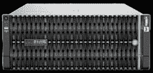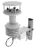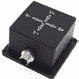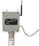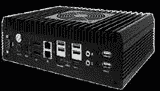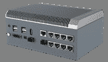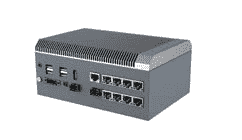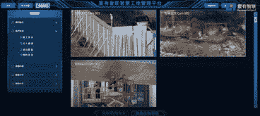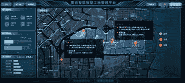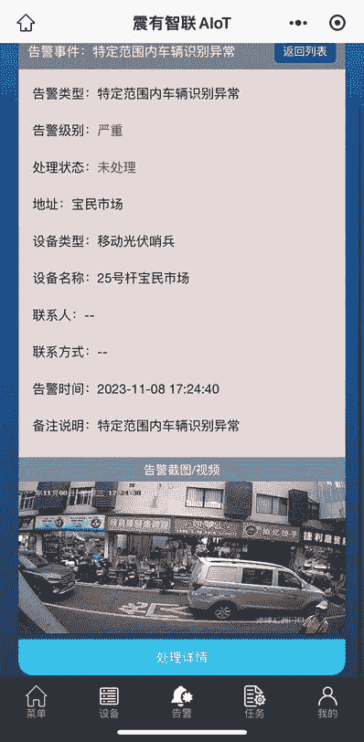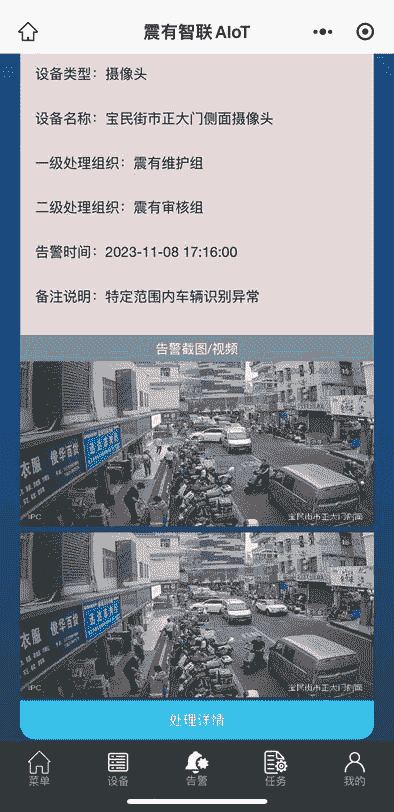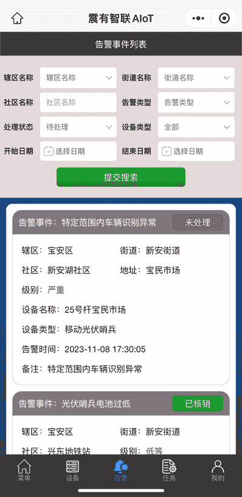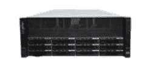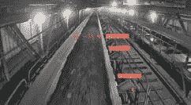

通过英特尔平台的高性能计算能力，震有智联智慧工地 AI 超融合解决方案实现了从数据感知、智能识别、知识问答到自动报告的全流程 AI 闭环服务，为建筑施工安全管理提供了从一线到总部的完整智能支撑体系。震有智联致力于将 AI Agent 技术深入应用于建筑施工领域，推动行业迈入智能安全新时代。


- 在边缘端提供了强大的算力，能够满足大模型的边缘推理需求，兼具性能、安全性与灵活性。
- 具备算力可扩展性，以及丰富的数据接口，能够灵活满足智慧工地建设与运营的各种设备需求。
- 基于英特尔® 架构的网络与边缘端产品满足工业级标准，提供可靠的宽温支持，以及克服恶劣环境影响的坚固耐用性，提升平台的稳定性与可用性。
- 能够有效提升智慧工地的管理和行业监管能力，消除安全隐患。
- 端到端的架构支持用户一站式地快速构建智慧工地应用，并将负载整合至统一的平台，避免在平台交付与运营等方面的风险。
- 与其它方案相比，本方案具有更高的性价比与效能比。

**方案优势**


## 3.2.4 特斯联：3D 数字人解决方案

近年来，伴随着大模型技术的快速发展，数字人得到了显著的升级提能。在展示端，LLM 让数字人能够真正理解语义，根据对话内容生成相应的动作、表情、语音，使数字人在与用户交互时更加自然流畅，极大提升了交互体验；在生产端，大模型使数字人的制作门槛和成本迅速降低，仅凭一张照片、一句话录音等素材就能生成个性化的数字人，极大简化了数字人定制对于预设素材的要求，优化了用户的操作路径。检索增强生成 (RAG) 技术通过 LLM 与外部知识库，显著提升了数字人的专业能力与交互深度，构建了"数据-交互-迭代"的闭环生态。

数字人依赖 3D 建模、骨骼绑定、纹理贴图等技术构建立体模型，结合物理引擎模拟光影和碰撞效果，具备立体形象和复杂动作表现力。由于数字人需要模拟人类的形象、姿态与互动，因此用户对于数字人的质量要求要显著高于其它虚拟数字化形象。数字人需要在皮肤材质渲染质量、姿态互动精度、口型同步误差等方面实现进一步的提升，才能保障较高的交互沉浸感。

数字人对于渲染性能有着极高要求，渲染性能不足会直接导致数字人展示、互动出现"卡顿"问题；另一方面，当数字人接入云端大模型时，较慢的网络延时会导致对话响应缓慢，影响用户体验。

特斯联与英特尔合作，打造出搭载英特尔锐炫™ 显卡、第五代英特尔® 至强® 处理器的新一代数字人解决方案。该方案通过云端渲染与 WebRTC 实时推流模式，打破终端算力壁垒，可轻松部署于各类设备，让高性能虚拟助手服务触手可及。

在医保场景中，特斯联"智慧医保数字人"通过语音识别、大语言模型和 RAG 增强技术，为用户提供 7×24 小时政策解读与业务指引。为了使数字人能够高效与用户互动，该系统采用英特尔锐炫™ 显卡加速 3D 渲染与 LLM 推理，采用英特尔® 至强® 处理器负责语音处理，从而实现更通俗易懂、准确权威的智能问答服务。无论是医院、社区还是线上入口，用户都能即时获取可信答复，全面提升医保服务的触达率与满意度。

在展厅导览中，特斯联"零号员工 Hali"作为全天候数字讲解员亮相。依托云端英特尔® OpenVINO™ 工具套件加速的 LLM 能力，Hali 实现了超清画质、嘴型对齐与自然语言交互的完美融合。访客无需本地算力设备，仅凭普通终端即可与数字人实时互动。这一方案不仅带来更沉浸的参观体验，更以标准化形象、高可扩展性和低维护成本，助力品牌传播与数字化运营升级。

**解决方案**

**背景与挑战**


**图：特斯联"零号员工 Hali"数字人**


- 实现云端算力与终端算力协同，打破终端算力壁垒，轻松部署于各个场景。
- CPU 结合独立显卡可高效运行，不仅简化了系统设计，而且有助于节约总体拥有成本 (TCO)，同时降低运维等方面的门槛。
- 凭借本地部署的英特尔锐炫™ 显卡与 OpenVINO™ 工具套件的优化，加速大模型推理，可实现毫秒级响应，提供流畅的问答体验。

**方案优势**

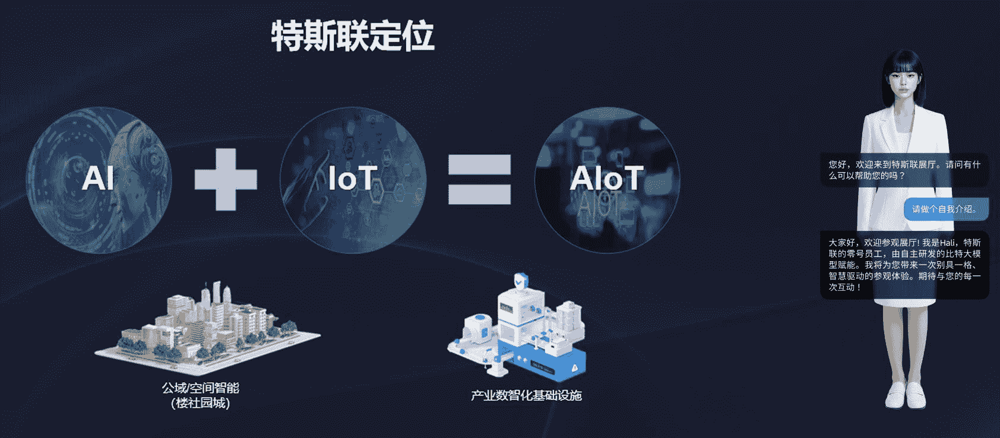

## 3.2.5 华铭："轨道通"智慧服务数字人

人工智能、大数据、物联网等技术在城轨交通体系中的加速应用将驱动城轨的智慧化变革，重塑城轨的运行、调度、控制、检票售票、服务等流程，在加速城轨运营效率，缓解交通拥堵等问题的同时，提升乘客的乘坐体验。在智慧服务方面，通过数字人技术的应用，将有助于打造虚实融合的沉浸式体验、降低服务成本、开展个性化交互与精准营销，为乘客提供全天候服务与规模化覆盖。

在模型与算法方面，数字人在面部表情、肢体动作的细腻度和自然度上仍难以完全模拟人类，可能导致情感传递失真。在语音语义理解方面，虽然语音合成技术已较为成熟，但对多轮对话、复杂语义（如双关语、方言、文化隐喻）的理解仍可能出现偏差。同时，多模态交互的协同性（如口型与语音匹配、手势与语义同步）也有待提升，这影响了用户体验的沉浸感。

在算力方面，高质量数字人的实时渲染需要消耗大量计算资源，在多用户并发场景（如虚拟直播、元宇宙社交）中可能导致延迟、卡顿或画质下降。同时，轨道交通属于关键基础设施，对于网络安全有着极高要求，需要尽可能避免数据泄露风险。

华铭创新引入"轨道通"智慧服务数字人，借助前沿人工智能技术，为乘客提供全天候、无障碍的便捷体验，重点覆盖语音购票、智能问询、失物招领三大核心场景。

**解决方案**

**背景与挑战**


**01 语音购票：**告别排队，动口即通行。乘客只需面对站内屏幕或自助终端，清晰说出目的地，"轨道通"智慧服务数字人将利用先进的语音识别技术瞬间理解需求，并能做到智能确认，快速出票。

**02 智能问询：**7x24 小时，权威解答随行相伴。无论是首末班车时间、换乘路线、票价政策、特殊票种（如老人票、学生票）规定，还是地铁内设施（如洗手间、电梯）位置，"轨道通"智慧服务数字人均能提供准确、权威的实时解答。

**03 失物招领：**高效匹配，寻回无忧。乘客发现或遗失物品，均可通过"轨道通"智慧服务数字人进行登记或查询。乘客只需要清晰描述物品特征（如"蓝色背包"），系统将利用 LLM 与 RAG 技术，在海量失物信息库中进行智能匹配。乘客无需特殊设备，仅通过地铁站内的普通屏幕或自助终端，即可享受高清画质、自然语言交互的完美融合服务。数字人不仅能告知匹配结果，更能清晰指引乘客完成后续的认领或登记流程，说明需要前往的站点或联系窗口，实现跨站点的高效协同，大幅提升失物寻回效率，减轻人工服务台压力。

**图：华铭"轨道通"智慧服务数字人**

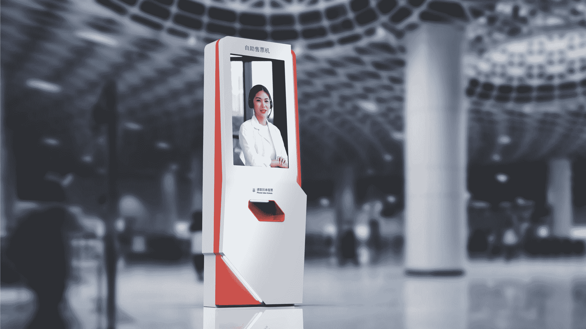

- 为数字人渲染、数字人动作表情生成、LLM 推理、RAG 等负载提供充足的算力支持，结合高性能软件栈的优化，能够满足用户数字人生成、数字人交互所带来的苛刻性能要求。
- 关键应用负载在本地运行，降低对于网络的依赖，有助于提升数字人系统服务的稳定性，并降低网络传输所带来的延迟，同时降低数据泄露隐患。
- "轨道通"智慧服务数字人实现 7x24 小时不间断服务，显著提升服务触达率与乘客满意度。其标准化形象、高可扩展性和低维护成本，为地铁运营方有效降低人力成本，提升数字化管理效能，为城市智慧交通树立新标杆。

**方案优势**


"轨道通"智慧服务数字人核心的 RAG 和 LLM 能力可部署于轨交站机房，通过英特尔® OpenVINO™ 工具套件进行深度优化加速。OpenVINO™ 工具套件主要包括模型优化器和推理引擎，提供了高度优化的神经网络计算能力，并能够在基于英特尔 CPU 和 GPU 的英特尔硬件平台上，加速深度学习模型推理过程。


# 04 总结与展望

在 AI 技术深度渗透千行百业的浪潮中，边缘 AI 平台正成为驱动数字化转型的核心引擎。受益于政策层面的持续加码，以及市场需求的爆发式增长，边缘 AI 正在智慧城市的交通治理、社区服务到工业制造的预测性维护、质量检测等多个领域实现规模化落地，赋能千行百业的数智化变革。英特尔已经以"硬件 + 软件 + 生态"三位一体策略，构建了边缘 AI 发展的坚实底座。

展望未来，随着轻量化大模型能力的不断提升，大模型将在边缘端实现广为广泛的落地，赋能缺陷样本生成、数字人交互等场景，并推动具身智能等前沿领域突破工程化壁垒。此外，随着 AI 软硬件成本持续优化与 AI 解决方案标准化，边缘 AI 将下沉到更多的细分化场景，释放更多的价值。在此背景下，英特尔将持续完善"芯片-工具-认证-伙伴"生态体系，推动更多 ISV、系统集成商参与边缘 AI 创新，形成技术共建、价值共享的产业生态，助力各行业突破数字化转型瓶颈，实现"算力无处不在、智能触手可及"，为经济高质量发展注入持续动能。

英特尔致力于尊重人权，坚决不参与谋划践踏人权的行为。参见英特尔的《全球人权原则》。英特尔的产品和软件仅限用于不会导致或有助于违反国际公认人权的应用。

实际性能受使用情况、配置和其他因素的差异影响。更多信息请见 www.Intel.com/PerformanceIndex

性能测试结果基于配置信息中显示的日期进行测试，且可能并未反映所有公开可用的安全更新。详情请参阅配置信息披露。没有任何产品或组件是绝对安全的。

具体成本和结果可能不同。

英特尔技术可能需要启用硬件、软件或激活服务。

英特尔未做出任何明示和默示的保证，包括但不限于，关于适销性、适合特定目的及不侵权的默示保证，以及在履约过程、交易过程或贸易惯例中引起的任何保证。

英特尔并不控制或审计第三方数据。请您审查该内容，咨询其他来源，并确认提及数据是否准确。

© 英特尔公司版权所有。英特尔、英特尔标识以及其他英特尔商标是英特尔公司或其子公司在美国和/或其他国家的商标。其他的名称和品牌可能是其他所有者的资产。
