**中国电池储能盈利模式探索：**

**加州经验的启示**

加利福尼亚大学伯克利分校

加州—中国气候研究院

**2025 年 8 月**

---

**作者**

Anni Dai, Xueqin Cui, Jessica Gordon

### 加州—中国气候研究院简介

加州中国气候研究院于 2019 年 9 月成立，是由加州大学伯克利分校法学院法律、能源和环境中心和劳瑟自然资源学院联合设立的加州大学项目。它由加利福尼亚州前州长杰里·布朗担任主席，加利福尼亚州空气资源委员会前主席玛丽·尼科尔斯担任副主席。该研究所与加州大学的其他校区、部门密切合作。通过加州和中国之间的联合研究、能力建设和政策对话，该研究所旨在为决策者提供参考，促进中国与加州的气候变化合作与伙伴关系，并在各个层面推动气候解决方案。

### 致谢

这份报告由加利福尼亚大学伯克利分校的加州—中国气候研究院撰写。我们衷心感谢以下对本报告提出有益意见的审阅人员：Fredrich Kahrl、Max Dupuy (Regulatory Assistance Project) 和刘坚（中国宏观经济研究院能源研究所）。

---

## 摘要

中国的电池储能发展迅猛，这一进展得益于雄心勃勃的脱碳目标与强有力的政策推动。2021 年，中国设定到 2025 年新增 30 吉瓦新型储能装机容量的国家目标，该目标已于 2024 年底提前实现，累积装机总容量达 73.76 吉瓦。尽管在装机规模上取得显著成果，中国在推动电池储能项目实现可持续、市场化收入方面仍面临诸多挑战。

本报告探讨了加州在电池储能发展方面的经验，以及其对中国储能市场机制设计的借鉴意义。2020 至 2023 年间，得益于完善的政策框架、多市场参与机制以及稳健的容量补偿安排，加州储能装机容量增长了十倍。通过中美对比分析，报告总结出有助于中国构建更有效、更稳定的电池储能融资模式的关键经验。

主要结论：

- **加州的多市场参与策略提供了战略灵活性：** 资源充足性（Resource Adequacy）机制通过长期双边合同为储能项目提供稳定的容量支付保障；同时，允许电池储能灵活参与电能量市场和辅助服务市场，从价格波动中获利。因此，多数大型储能项目通过多市场参与实现收入来源多元化，显示灵活参与市场的重要性，其中容量市场为最常见的参与渠道。

- **容量支付保障基础收益，电能量与辅助服务市场带来附加利润：** 以世界最大储能项目之一的 Moss Landing 储能项目为例，其 50% 至 60% 的收入来自长期双边容量合同，其余收益来自电能量和辅助服务市场。

- **储能项目能够在电力平衡紧张时段发挥重要作用，并获得可观收益：** 电池储能在高温等电网负荷高峰期能够发挥调节能力，既增强了电网可靠性，也通过价格套利创造了可观收益。Moss Landing 储能项目 75% 的市场收入集中于仅 15% 的交易时段，凸显储能资源的灵活性和价格响应能力所蕴含的经济价值。

- **储能可行的收入模式：** 项目展示了一种将稳定的容量支付与市场套利相结合的收入模式。实现该模式的关键在于双重政策支持框架：(1) 建立能准确反映储能灵活性资源价值的电力现货市场；(2) 构建支持长期容量支付的稳健监管体系。

### 政策建议

- **深化现货市场建设**，释放电池储能的市场潜力，更准确反映其作为灵活调节资源的系统价值。目前中国各省的储能收入模式尚难充分体现其系统灵活性与调节价值。

- **拓展辅助服务市场**，准许储能项目参与更多服务类型，推动更加市场化的定价机制。

- **优化并扩展容量补偿机制**，鼓励各省推动长期容量合同，提供稳定、可预期的收益保障。

- **建立配套政策框架**，包括更加成熟的资源充足性规划，为电池储能项目的长期容量支付提供制度支撑。

---

## 目录

**1. 引言** · · · · · · · · · · · · · · · · · · · · · · · · · · · · · · · · · · · · · · · · · · · · · · · · · · · · · · · · · · · · · · · · · · · · · · · **6**

**2. 中国储能扩张与收入模型** · · · · · · · · · · · · · · · · · · · · · · · · · · · · · · · · · · · · · · · · · · · · · · · · · · · · **7**

&nbsp;&nbsp;&nbsp;&nbsp;2.1. 各省补偿机制与市场模式 · · · · · · · · · · · · · · · · · · · · · · · · · · · · · · · · · · · · · · · · · · · · · · · · **8**

&nbsp;&nbsp;&nbsp;&nbsp;2.2. 收益不足的困境：参与电能量市场与辅助服务市场的收入模式 · · · · · · · · · · · · · · · · · · · · **10**

&nbsp;&nbsp;&nbsp;&nbsp;2.3. 容量补偿机制不确定性：短期固定补贴与容量租赁 · · · · · · · · · · · · · · · · · · · · · · · · · · · · **11**

**3. 加州储能——监管框架与收入机制** · · · · · · · · · · · · · · · · · · · · · · · · · · · · · · · · · · · · · · · · · · · · · **12**

**4. 案例研究——加州 Moss Landing 储能项目** · · · · · · · · · · · · · · · · · · · · · · · · · · · · · · · · · · · · · · **15**

&nbsp;&nbsp;&nbsp;&nbsp;4.1. 收入结构 · · · · · · · · · · · · · · · · · · · · · · · · · · · · · · · · · · · · · · · · · · · · · · · · · · · · · · · · · · · · **15**

&nbsp;&nbsp;&nbsp;&nbsp;4.2. 运行模式与套利策略 · · · · · · · · · · · · · · · · · · · · · · · · · · · · · · · · · · · · · · · · · · · · · · · · · · · · **17**

**5. 结论与政策建议** · · · · · · · · · · · · · · · · · · · · · · · · · · · · · · · · · · · · · · · · · · · · · · · · · · · · · · · · · · · **20**

**REFERENCES** · · · · · · · · · · · · · · · · · · · · · · · · · · · · · · · · · · · · · · · · · · · · · · · · · · · · · · · · · · · · · · · · **21**

---

## 1 引言

中国电池储能产业正快速增长，其背后是雄心勃勃的碳中和目标与强有力的政策推动。2021 年，中国设定了到 2025 年新增 30 吉瓦新型储能装机容量的目标，¹ 而这一目标已于 2024 年底提前实现，全国电池储能装机容量达到 73.76 吉瓦，远超原定目标的两倍 ²。然而，尽管装机容量迅速增长，建立可持续的补偿机制仍是一项重大挑战。目前，尽管各地储能项目正探索不同的市场机制与补偿方式，普遍仍难以提供稳定且充足的收入来源。

在此背景下，加州的实践经验具有重要借鉴意义。作为美国电池储能发展最为活跃的地区之一，加州的储能装机容量已从 2020 年的 500 兆瓦迅速增长至 2023 年 5 月的 5,000 兆瓦。³ 这一增长得益于健全的监管框架与完善的补偿机制，为储能项目提供了合理的收益保障，不仅推动了产业的快速扩张，也为投资者建立了可行的商业逻辑。

本报告旨在探讨加州在监管与市场设计方面的经验，如何为中国构建可持续、市场导向的储能补偿机制提供启示。通过梳理中国各省的储能收入模型，并与加州的多市场参与和多元收入结构进行比较分析，报告提出提升储能盈利能力、推动其更好融入中国电力市场的策略建议。

本报告结构如下：

- 第 2 章：回顾中国储能发展及主要收入模型；
- 第 3 章：分析加州的监管框架及储能项目的主要收入渠道；
- 第 4 章：以 Moss Landing 储能项目为案例，探讨其市场参与策略以及盈利模式；
- 第 5 章：提出中国电池储能可持续融资机制的政策建议。

---

¹ "新型"储能是指除常规抽水蓄能以外的储能技术，包括先进锂离子电池、液流电池、飞轮储能、压缩空气储能、氢能（或氨）储能以及热能储能等。然而，目前尚未明确熔盐储能是否应被纳入"新型"电化学储能的范畴。参见新华社（2025a）；国家发展改革委、国家能源局（2021a）

² 科技日报（2025）

³ 加州独立系统运营商（2023a）

---

## 2 中国储能发展与收入模型

截至 2024 年底，中国新型储能装机容量已较 2020 年增长了近 20 倍（见图 1），其中锂离子电池技术占据主导地位（见图 2）。推动这一快速扩张的关键力量之一是"新能源+储能"的发展模式。自 2021 年起，国家发展改革委与国家能源局出台相关政策，明确要求并鼓励新能源发电项目配套建设储能设施，尤其是电池储能。⁴ 这一政策极大地加快了储能在全国范围内的部署进程。

**图 1 中国新型储能新增及累计装机容量**⁵

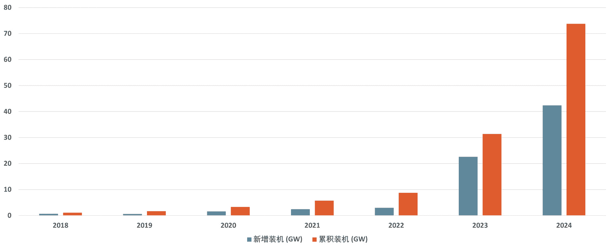

⁴ 国家发展改革委、国家能源局（2021b）

⁵ 国家能源局（2025）；国家能源局（2024）；普华永道中国（2023）；北极星电力网（2019）；北极星电力网（2020）

**图 2 截至 2024 年底按技术类型划分的储能装机容量占比**⁶

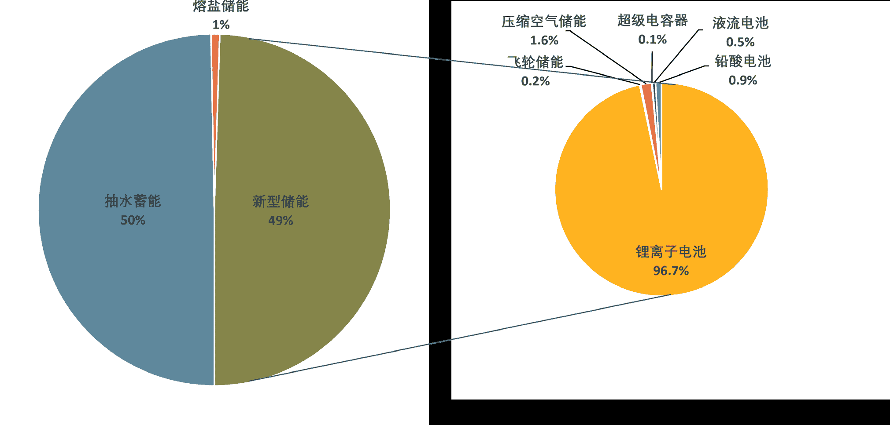

⁶ 新浪财经（2025）

### 2.1 各省补偿机制与市场模式

中国多个省份正在积极推进电池储能发展。截至 2024 年底，全国已有 17 个省份储能装机容量超过 1 吉瓦。⁷ 在国家政策推动下，多个省份试点储能参与电力市场交易，探索多样化的收入机制。⁸ 下表汇总了 12 个储能装机容量超过 2 吉瓦的省份所采用的商业模式，这些省份合计装机容量达 46.94 吉瓦，占全国总量的 60%。⁹

**表 1 装机容量超过 2 吉瓦的省份的电网侧储能商业模式**

| 省份 | 能源市场参与 | 辅助服务 | 容量补偿 |
|------|------------|----------|----------|
| 蒙西 | 参与现货市场 | 提供辅助服务 | 试点项目：10 年 0.35 元/kWh 补偿 ^(10) |
| 蒙东 | 无现货市场 | 峰谷电价或中长期协议参与 | — |

⁷ 北极星电力网（2025）

⁸ 国家发展改革委、国家能源局（2023）

⁹ 中国 12 个储能装机超过 2 吉瓦的省份包括新疆，内蒙古，山东，江苏，宁夏，甘肃，湖南，湖北，安徽，广西，浙江，广东。见中国电力企业联合会（2025）和北极星电力网（2025）

¹⁰ 国家能源局东北监管局，内蒙古自治区工业和信息化厅，内蒙古自治区发展和改革委员会（2018）

| 省份 | 能源市场参与 | 辅助服务 | 容量补偿 |
|------|------------|----------|----------|
| 新疆 | 无现货市场；峰谷+基础电价浮动 75% ^(11) | 消纳时段充电补偿 0.55 元/kWh，放电 0.25 元/kWh ^(12) | 0.2 元/kWh，自 2024 年起逐年下降 20% ^(13) |
| 山东 | 满足 >5 MW 且 2 小时以上电池储能可参与日前和实时市场 ^(14) | 可提供削峰、黑启动、爬坡服务 ^(15) | 支持容量租赁；按高峰交易电量平均值补偿 ^(16) |
| 江苏 | 满足 >5 MW 且 2 小时以上电池储能，可签中长期协议 ^(17) | >10 MW 可提供削峰、调频服务 ^(18) | 支持容量租赁；1、7、8、12 月补偿 0.391 元/kWh，逐年递减 ^(19) |
| 宁夏 | 可参与中长期交易 ^(20) | >10 MW 且 2 小时以上电池储能可削峰 ^(21) | 支持四小时储能容量租赁 ^(22) |
| 河北 | 可参与现货市场 ^(23) | >10 MW 项目可削峰（南网）满足 >10 kW 且 2 小时以上电池储能 | 年补偿 100 元/kW，南网限 7.7 MW，北网限 8.3 MW ^(24) |
| 浙江 | 参与日前、实时及中长期市场 | 满足 >5 kW 且 2 小时以上电池储能，可削峰 | 使用小时数 >600 的项目年补偿 200/180/170 元/MW（第 1-3 年）^(25) |
| 甘肃 | 参与日前与实时市场（15 分钟结算） ^(26) | 可提供调频与削峰服务 ^(27) | 补偿 300 元/MW·天；支持容量租赁 ^(28) |

¹¹ 新疆维吾尔自治区发展和改革委员会（2023）

¹² 新疆维吾尔自治区发展和改革委员会（2024）

¹³ 新华网（2025b）

¹⁴ 山东省能源局（2023）

¹⁵ 山东省能源局（2023）

¹⁶ 山东省能源局（2023）

¹⁷ 江苏省发展和改革委员会（2023）

¹⁸ 国家能源局江苏监管办公室（2024）

¹⁹ 江苏省发展和改革委员会（2023）

²⁰ 宁夏回族自治区发展和改革委员会（2024a）

²¹ 宁夏回族自治区发展和改革委员会（2024b）

²² 宁夏回族自治区发展和改革委员会（2024b）

²³ 河北电力交易中心（2024）

²⁴ 河北省发展和改革委员会（2025）

²⁵ 浙江省发展和改革委员会、浙江省能源局（2021）

²⁶ 甘肃省工业和信息化厅（2024）

²⁷ 国家能源局甘肃监管办公室（2022）

²⁸ 国家能源局甘肃监管办公室（2022）

| 省份 | 能源市场参与 | 辅助服务 | 容量补偿 |
|------|------------|----------|----------|
| 广东 | 参与日前、实时、现货市场 ^(29) | 参与南方辅助服务市场 ^(30) | 补偿 100 元/MWh·年；^(31) 支持容量租赁 ^(32) |
| 湖南 | >5 MW 可参与现货；^(33) 中长期协议 ^(34) | 提供削峰与调频服务 ^(35) | 储能容量交易试点中 |
| 安徽 | 参与日前与实时市场（5 分钟结算）^(36) | 东部区域市场：调频补偿 400 元/MWh，削峰 160 元/MWh ^(37) | 1、7、8、12 月免费充电，放电按煤电价 60%+0.2 元/kWh 补偿 ^(38) |
| 广西 | 无现货市场；充电按谷段电价，放电按煤电上网电价 0.4207 元/kWh ^(39) | 南方区域市场削峰补偿 396 元/MWh ^(40) | 支持容量租赁 ^(41) |

²⁹ 广东省能源局、国家能源局南方监管局（2023）

³⁰ 广东省能源局、国家能源局南方监管局（2023）

³¹ 广东省发展和改革委员会（2024）

³² 广东省发展和改革委员会、广东省能源局（2023）

³³ 湖南省发展和改革委员会（2024）

³⁴ 国家能源局湖南监管办公室（2025）

³⁵ 国家能源局湖南监管办公室（2023）

³⁶ 安徽电力交易中心（2024）

³⁷ 国家能源局华东监管局（2024）

³⁸ 安徽省经济和信息化厅（2024）

³⁹ 广西壮族自治区发展和改革委员会（2023）

⁴⁰ 国家能源局华南监管局（2025）

⁴¹ 广西壮族自治区发展和改革委员会（2023）

### 2.2 收益不足的困境：参与电能量市场与辅助服务市场的收入模式

根据地方电力市场改革进展不同，基于表 1 信息，省级电网侧储能商业模式主要可分为三类：

| 模式 | 电能量市场收入 | 辅助服务收入 |
|------|--------------|-------------|
| 模式一 | 基于现货市场价格 | 提供多种辅助服务 |
| 模式二 | 基于中长期合约定价 | 提供调频与削峰服务 |
| 模式三 | 固定峰谷电价 | 提供少量辅助服务，按固定价格补偿 |

模式一的主要代表为山东、广东、江苏、浙江和安徽，强调通过现货市场和辅助服务获取收益，项目可广泛参与日前与实时市场交易，可提供多样辅助服务。模式二以中长期合同为主，储能项目需满足一定规模门槛（大于 5 MW 或 10 MW）方可提供调频与削峰服务。模式三多见于电力市场化程度较低的地区，如新疆、蒙东、广西，采用固定电价机制（如峰谷价、煤电基准价）整合储能资源，辅助服务补偿普遍为 0.25–0.55 元/kWh。

尽管各地政策积极探索多元收入机制，储能项目仍普遍面临收益不足的困境。例如，广东省 2024 年现货市场数据显示，储能项目平均充电价格为 31.91 元/MWh，放电价格为 31.37 元/MWh，全年净亏损达 2138 万元人民币。⁴² 即便具备价格套利空间，因市场波动性有限，项目利润空间依然受限——当年平均价差仅为 167 元/MWh。⁴³

⁴² 广东电力交易中心（2024）

⁴³ 广东电力交易中心（2024）

### 2.3 容量补偿机制不确定性：短期固定补贴与容量租赁

目前，上述 12 省中有 8 个省份提供了固定容量补偿，补偿标准一般为每千瓦时 0.2–0.4 元，或每千瓦每年 100–300 元，期限为 1–3 年，且大多呈逐年递减趋势。其中一个例外是蒙西，实施为期 10 年的固定补偿机制（每千瓦时 0.35 元）。

近年来，一种替代性收入模式——"容量租赁"逐渐兴起，即储能项目将储能容量出租给新能源开发商。该模式源自 2021 年"新能源+储能"政策背景，当时政策要求新能源发电项目配套建设储能设施，部分省份如山东、广东、河南甚至将储能作为项目并网与参与电力市场竞价的前置条件。⁴⁴

然而，自 2025 年起，国家开始推进储能与新能源项目"解绑"，鼓励其作为独立主体参与市场交易。⁴⁵ 这一转变可能削弱容量租赁模式的持续性。同时，由于中国尚未建立统一的容量市场，未来容量补偿的定价机制、合同期限及其稳定性尚不明确，给储能投资者带来较大的收益不确定性。

综上所述，当前中国电池储能在能量与辅助服务市场中的盈利能力仍较有限，而容量补偿机制也存在补贴期限短、缺乏长期稳定预期等问题。在推动储能独立参与市场的背景下，有必要借鉴加州经验，进一步完善储能的市场参与机制，建立可持续、市场化的收入体系，从而增强储能投资的可预期性与商业可行性。

⁴⁴ 中国能源报（2023）；北极星电力网（2023）；河南省人民政府办公厅（2023）；广东省发展和改革委员会（2023）

⁴⁵ 国家发展和改革委员会、国家能源局（2023）

---

本报告来源于三个皮匠报告站（www.sgpjbg.com），由用户 Id:881574 下载，文档 Id:929863，下载日期:2025-10-11

## 加州储能——监管框架与收入机制

加州的电力市场主要由两个机构监管：加州独立系统运营商（California Independent System Operator, CAISO）和加州公共事业委员会（California Public Utilities Commission, CPUC）。在联邦能源监管委员会（Federal Energy Regulatory Commission, FERC）的监管下，加州独立系统运营商负责加州的批发电力市场运营，而加州公共事业委员会则监管投资者所有的公用事业公司（Investor-Owned Utilities），46 以保障用户获得可靠且可负担的电力服务。

2010 年，加州通过了第 2514 号议会法案（AB 2514），成为美国首个设立储能强制采购目标的州。该法案授权加州公共事业委员会制定电力公司储能容量目标，最终确立到 2020 年部署 1,325 兆瓦储能的目标，并将该目标分配给三大公用事业公司：太平洋煤电公司（PG&E）580 兆瓦、南加州爱迪生（SCE）580 兆瓦、圣地亚哥煤电公司（SDG&E）165 兆瓦。47

此后，加州不断将储能纳入其可再生能源战略。例如，2015 年通过的第 350 号参议院法案（SB 350）提出，到 2030 年可再生能源占比达到 50%，并授权加州公共事业委员会与加州独立系统运营商推进储能在应对可再生能源间歇性方面的应用。48 2018 年出台的第 100 号法案（SB 100）更进一步，提出到 2045 年实现 100% 零碳电力供应，极大地推动了储能作为灵活资源的需求。49

除了立法推动外，加州还建立了储能参与市场的制度框架。加州独立系统运营商为储能系统设计了市场参与模型，允许其参与日前市场和实时市场。与此同时，储能也已成为关键的辅助服务提供者，参与调频、旋转备用和非旋转备用等服务。截至目前，电池储能已满足加州独立系统运营商超过一半的调频服务需求。50

加州并未设立统一的容量市场，而是通过资源充足性（Resource Adequacy）机制来保障电网备用容量，并推动新资源投资。51 在该机制下，用电负荷服务实体（Load-Serving Entities）52 需通过与储能开发商签订双边合同，以满足其容量目标。自 2020 年以来，加州进一步优化资源充足性机制，指定三家主要电力公司——太平洋煤电公司（PG&E）、南加州爱迪生公司（SCE）和圣地亚哥煤电公司（SDG&E）——作为集中采购公司，代表各负荷服务商统一采购地方容量资源。53

---

46 投资者所有的公共事业公司是指由私人投资者或股东拥有和运营的公用事业公司，主要负责电力、天然气或自来水等基础服务的生产、输送与销售。加州共有六家投资者所有制公用事业能源公司，分别是：太平洋天然气与电力公司（PG&E），南加州爱迪生公司（SCE），圣地亚哥天然气与电力公司（SDG&E），熊谷电力服务公司（Bear Valley Electric Service），自由公用事业公司（Liberty Utilities），太平洋电力公司（PacifiCorp）。见 Electric Investor Owned Utility Areas. (n.d.)

47 Utility Dive (n.d.).

48 加州能源委员会 (n.d.-a)

49 加州能源委员会 (n.d.-b)

50 加州独立系统运营商（2023a）

51 资源充足性（Resource Adequacy）包括三个维度：(a) 系统资源充足性（System Resource Adequacy）：负荷服务实体（LSEs）购买足够的容量，以满足预测的峰值负荷，并在此基础上留有一定的规划储备容量（Planning Reserve Margin）；(b) 灵活性资源充足性（Flexible Resource Adequacy）：要求负荷服务实体采购足够的灵活性资源，以应对每月可能出现的最高三小时净负荷爬升（net load ramp）；(c) 本地资源充足性（Local Resource Adequacy）：要求 LSEs 采购足够的本地容量，以在局部电网发生紧急情况时保障供电可靠性。见加州独立系统运营商（2023b）

52 负荷服务实体是指负责向终端用户（如居民、企业、工厂等）供应电力的市场参与方，主要承担保障电力供应的责任，并根据电力负荷需求，采购或者安排相应的发电资源。在加州的资源充足性机制的要求下，负荷服务实体有义务证明其具备足够资源以满足未来一段时间的用电负荷。见 McNamara, W. (n.d.).

53 加州独立系统运营商（2023b）

---

在这一监管体系下，加州的电池储能项目可获得多元化收入来源。图 3 展示了装机容量超过 100 兆瓦的储能项目的市场参与模式，这类大型项目合计约占全州储能总容量的 60%。54 绝大多数项目同时参与多个市场：近一半的储能同时参与电能量市场、辅助服务市场与容量市场，显示出对多元收入结构的依赖和灵活的市场参与策略。其中，容量市场是最普遍的参与形式，超过 80% 的储能容量通过双边合同获得容量收入，近四分之一的项目专注于此一来源；相比之下，仅参与电能量市场的项目较为少见，经济性也相对较差。

### 电能量与辅助服务市场收益

如图 4 所示，在电能量与辅助服务市场中，日前市场调度是最主要的收入来源。2021 至 2022 年间，实时市场收入显著增长，这主要得益于储能系统灵活响应价格波动的能力。尤其值得关注的是，2022 年夏季极端热浪导致电价大幅上涨。在 2022 年 8 月 31 日至 9 月 9 日的十天高温期间，储能项目在短时间内实现了近 7,800 万美元的收入，占全年市场总收入的 20%。55

54 Electric Quarterly Reports (n.d.)

55 加州独立系统运营商（2023a）

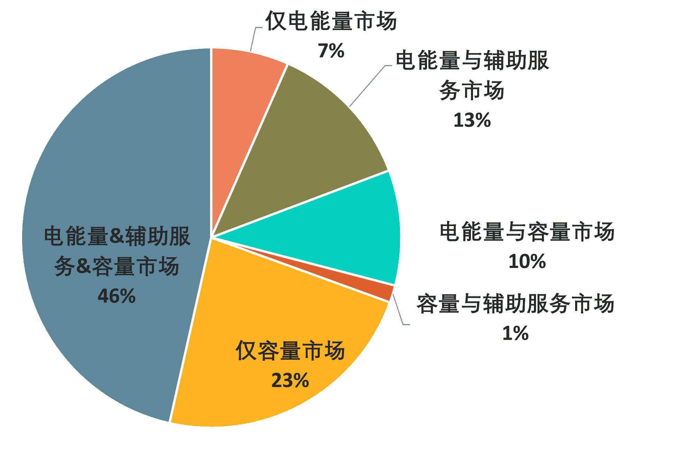

**图 3 加州大型储能项目（>100 MW）市场参与分布**

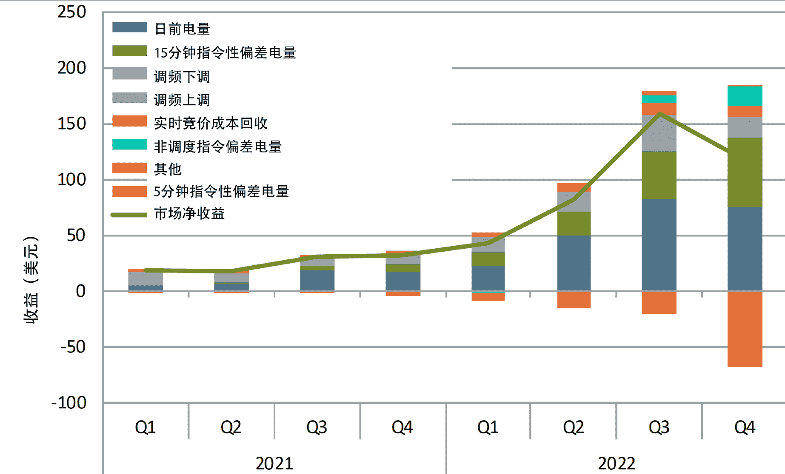

**图 4 2021–2022 年储能季度市场收入（摘自加州独立系统运营商 2023 年储能系统特别报告）**56

56 加州独立系统运营商（2023a）

在加州，容量市场是电池储能最主要收入来源，主要依托资源充足性机制提供长期合同保障，并通过成本分摊机制，由电网用户共同承担费用，从而提高项目的可融资性。同时，由于大多数储能项目参与多个市场，其灵活性对于电力系统的价值在电能量与辅助服务市场中也得以体现。在电力批发市场中，极端天气（如热浪）引发的电价波动，为储能带来高价值的套利机会，使其成为提升电网可靠性的重要调节资源。

## 案例研究——加州 MOSS LANDING 储能项目

Moss Landing 储能设施位于加州，是全球最大的四小时锂离子电池储能系统之一，由独立电力生产商 Vistra 公司投资并运营。该项目分三期建设：

- **第一期：** 于 2020 年投运，装机容量为 300 MW / 1200 MWh
- **第二期：** 于 2021 年建成，新增 100 MW / 400 MWh
- **第三期：** 于 2023 年中期完成，新增 350 MW / 1400 MWh

目前，该项目总容量已达 750 MW / 3000 MWh，成为全球最具代表性的电池储能项目之一。

### 4.1. 收入结构

对于 Moss Landing 项目而言，容量市场是最稳定且占比最大的收入来源（见图 5）。在资源充足性机制的要求下，PG&E 与该项目开发商签订了一份为期 20 年的容量采购合同，价格为每月每兆瓦 7,600 美元。因此，容量收入合计占该项目总收入的 50%–61%。

这一长期合同支持 PG&E 履行其在 CPUC 分配下的 580 MW 储能采购目标，尤其用于弥补 Moss Landing 地区（南湾）调度性电源退役所造成的容量缺口，确保本地电网的可靠性。57 相关成本通过"成本分摊机制"（CAM）进行回收，即由服务区域内所有电力用户共同承担，无论其电力供应商为何。58

除容量收入外，Moss Landing 还参与能量市场与辅助服务市场的投标。但这部分收入波动较大。例如，第一单元在 2021 年第四季度净亏损 107,762 美元，2022 年第一季度净亏损 16,194 美元；但在 2022 年第三季度，由于夏季热浪导致市场价格飙升，第一与第二单元实现了可观收益。

57 加利福尼亚州公用事业委员会（2018）

58 加利福尼亚州公用事业委员会（2018）

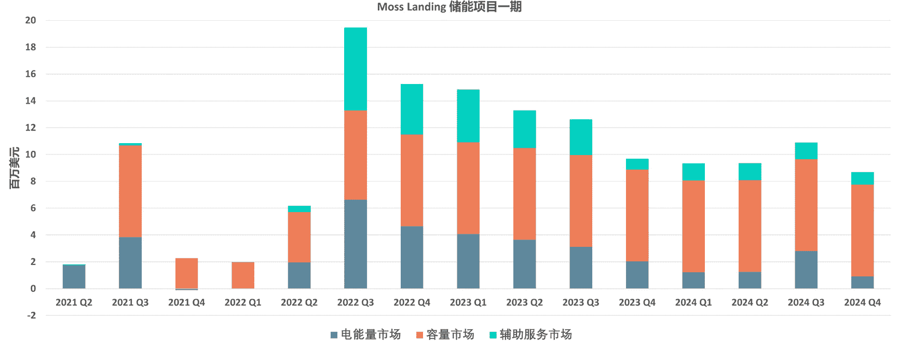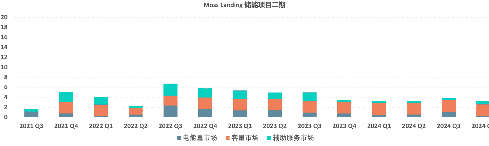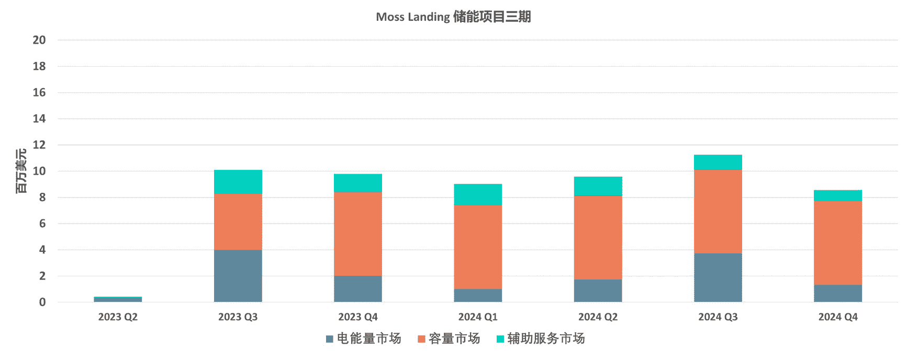

**图 5 Moss Landing 储能项目季度收入结构**

### 4.2. 运行模式与套利策略

作为高度灵活的资源，Moss Landing 项目在缓解太阳能发电间歇性问题、响应实时电价变化方面发挥了重要作用。图 6(a) 展示了 2024 年各月平均小时的充放电情况（负值为充电，正值为放电）；图 6(b) 展示了相应的交易收入或成本。图 6 表明 Moss Landing 储能项目充电时段主要集中在白天太阳能发电高峰时段，而放电时段集中在傍晚与夜间电价较高时段。

此外，Moss Landing 项目会根据月度市场波动调整套利策略。例如，在 7 月，该项目在白天大幅充电（负荷达 -200 MWh），并在晚间高电价时段放电，单小时收益超过 3 万美元；图 7 显示了 2024 年四个季度的平均小时电价与套利价差，其中第三季度套利价差达每兆瓦时 75 美元，远高于广东省同期的每兆瓦时 23 美元。

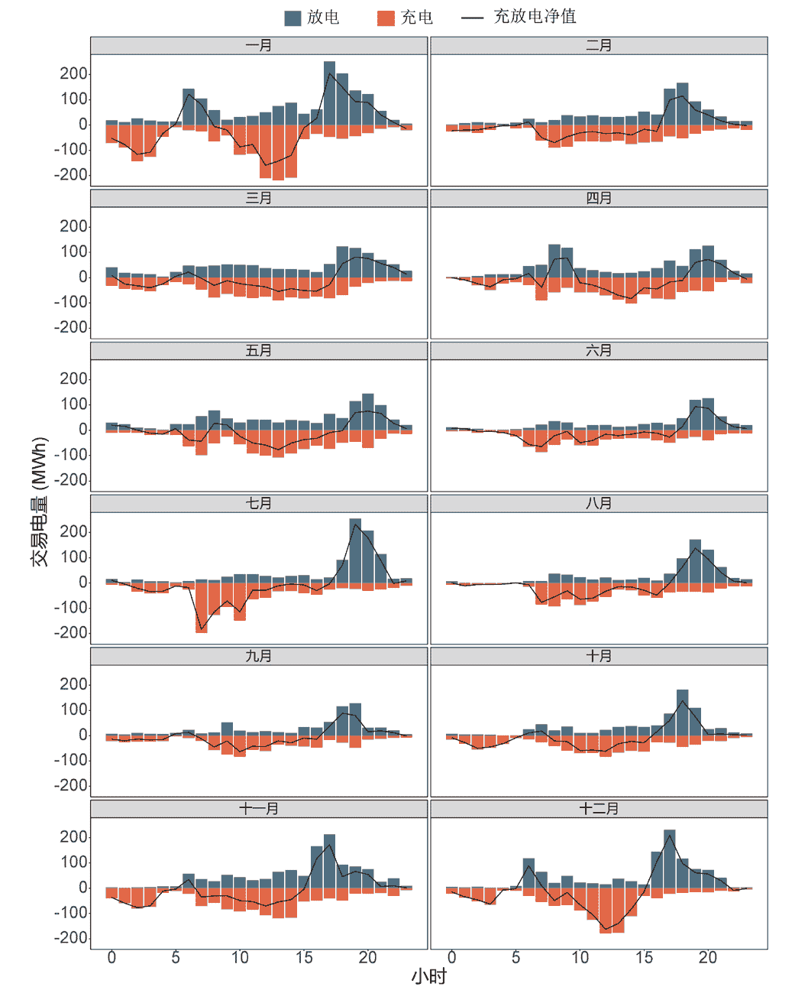

**图 6 (a) 2024 年月度平均小时交易电量**

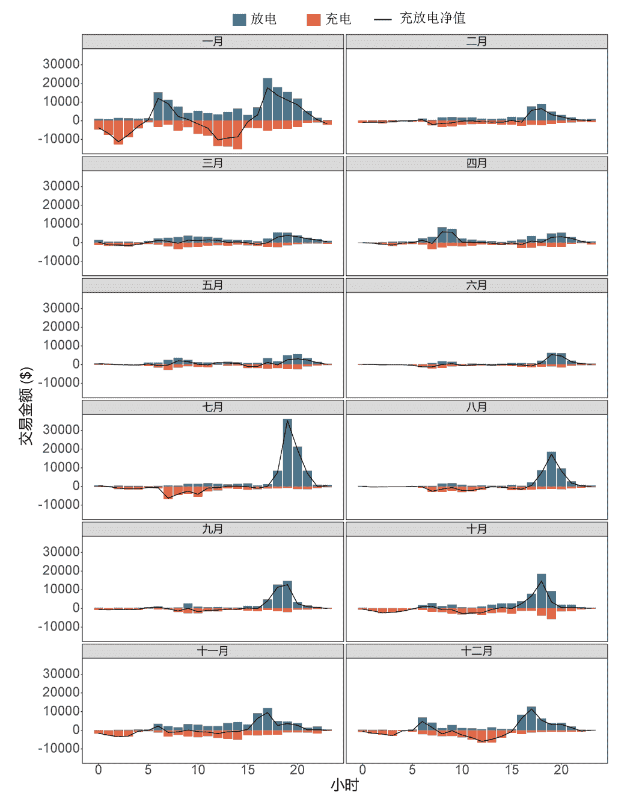

**图 6 (b) 2024 年月度平均小时交易收入**

由于其套利策略，Moss Landing 项目的大部分电能量与辅助服务市场的收入集中在少数高价值交易时段。2024 年，其 75% 的收入来自仅 15% 的交易小时，主要集中在 1 月、7 月、8 月和 9 月的 17:00–20:00 高峰时段。这种集中度反映了储能项目高度响应市场信号并精准锁定高收益时段的能力。

因此，Moss Landing 项目的运行策略紧密跟随电网负荷变化，其核心逻辑简单而有效：在电价低、太阳能富集的低谷时段充电，在电价高、需求集中的高峰时段放电。该策略不仅有效提升了系统削峰填谷能力，也充分利用加州现货市场的价格波动，实现收益最大化。

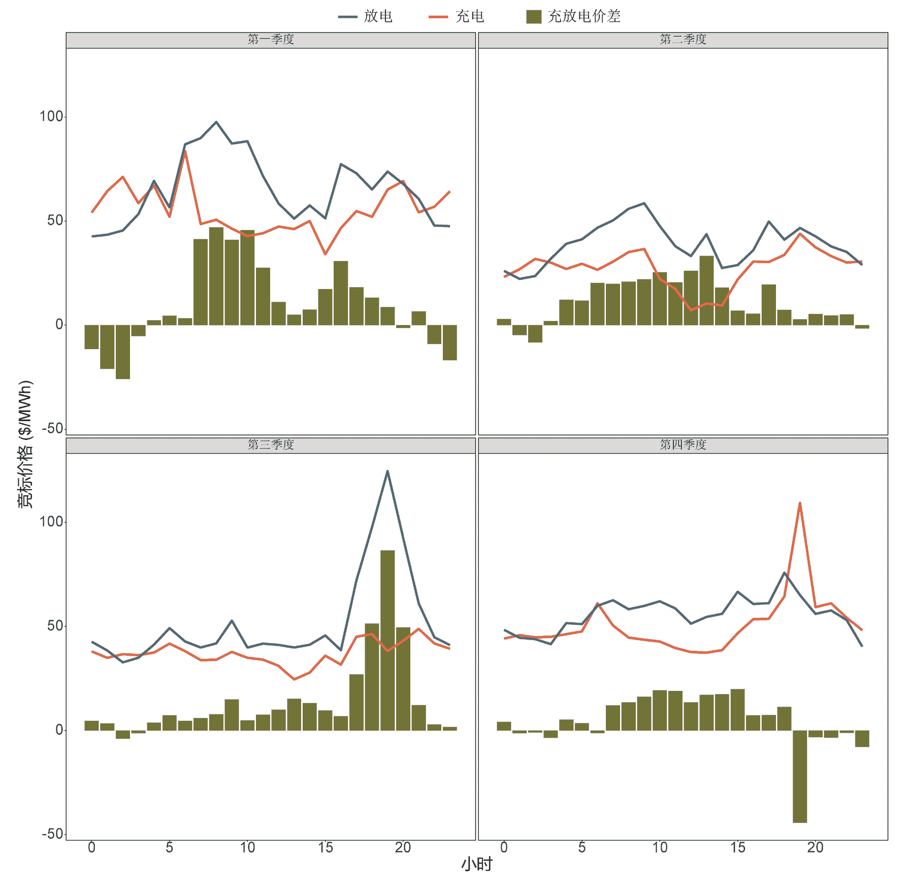

**图 7 2024 年各季度平均小时竞价与套利价差**

容量支付构成 Moss Landing 项目的核心收入支柱，依赖于加州资源充足性机制及成本分摊机制提供的长期合同保障。电能量与辅助服务市场的电价虽然具有较大波动性，但也提供了显著的套利机会，尤其在极端天气或负荷高峰期间，可带来可观收益。该案例展现了一种具有可复制性的储能盈利模型：通过容量支付确保基础收入，通过市场套利捕捉高价值时段的附加收益。实现该模型依赖于两个关键前提：一个能够真实反映灵活资源价值的批发市场和一个完善的监管框架，支持长期容量支付安排。

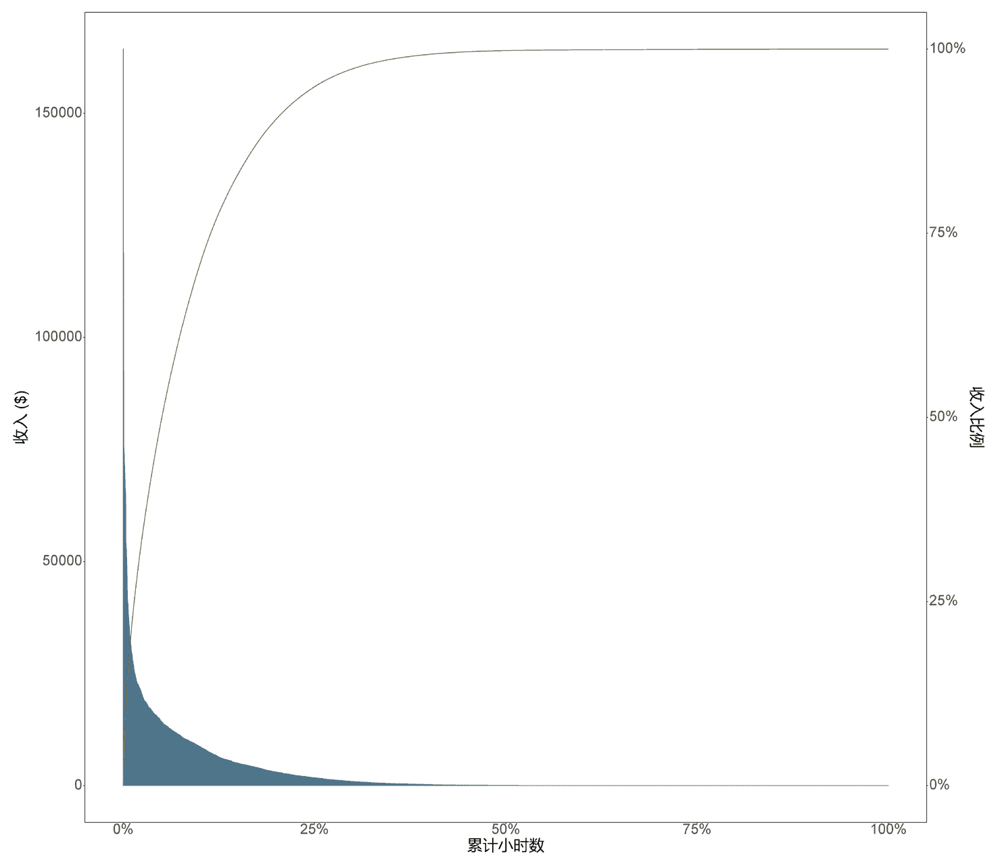

**图 8 全年小时级能量市场收入分布**

## 结论与政策建议

加州的实践经验表明，在高负荷和电力紧张时段，储能系统能够发挥重要的调节作用，其灵活性也可以通过市场机制获得可观价值。通过优化现货市场规则（包括放宽价格上限等），电价可以更真实反应实时电力供需状况，尤其在高需求日的尖峰时段，增强价格波动性能够提升储能项目盈利能力，从而有效激励储能参与电能量与辅助服务市场。

从政策制定的角度看，进一步发展电力现货市场是释放储能市场潜力、体现其系统价值的关键路径。如第二章所述，中国当前三类主流储能收入模式均未充分体现储能的灵活性与系统贡献。这些模型多基于固定电价或低波动性的市场价格，套利空间受限、收入缺乏稳定。在大多数试点市场中，价格上限偏低，导致在电力紧张或可再生能源出力不足的情况下，储能等灵活资源无法获得其应有的市场补偿。

此外，在收入模式二与模式三下，辅助服务市场的服务类型相对单一，补偿机制往往以固定定价为主，进一步压缩储能项目的盈利空间。为提高储能项目的经济可行性，亟需拓展辅助服务品类，推动形成基于供需关系的市场化定价机制，并改革电能量价格结构，使其更精准地反映电力系统的实时运行状态。

另一方面，容量支付是储能项目最为关键的收入支柱之一。相比"补充性收入"的定位，容量支付应被视为保障投资回报的核心机制。目前，多数省份仅提供 1 至 3 年期限的短期容量补偿，难以满足投资者对长期现金流和财务可预测性的基本需求。应鼓励各省进一步完善并扩大容量补偿机制，推动储能从"新能源配建"向"独立容量资源"转型。

值得注意的是，国家发展改革委于 2024 年发布的电力市场运行新规，提出推动形成基于市场竞争的容量支付机制，在煤电、储能等各类调节资源之间引入竞争机制。59 这标志着中国容量机制正迈向更加市场化的制度转型。60 为确保储能投资的可持续性，有必要加快建立长期容量合同机制，向投资者提供稳定、可预测的收益保障，并进一步强化储能作为关键系统资源的战略定位。

最终，实现上述目标的核心在于建立有力的监管制度基础，包括建立更加正式和系统化的资源充足性机制，为储能项目提供制度性、长期性的容量支付保障。这不仅有助于释放电池储能的系统价值，也将推动中国加快构建更加清洁低碳、安全高效的现代电力系统。

59 国家发展和改革委员会（2024）

60 Williams, S. (2024)

## REFERENCES

1. 安徽省工业和信息化厅 (2024)。安徽：持续推动优化新型储能参与电力辅助、现货市场等交易规则。https://m.bjx.com.cn/mnews/20240627/1385663.shtml
2. 安徽电力交易中心 (2024)。安徽电力现货市场运营基本规则（结算试运行 第 5 版）征求意见稿：独立储能及虚拟电厂"报量报价"或"自调度"模式参与现货市场。https://m.bjx.com.cn/mnews/20241203/1414477.shtml
3. 北极星电力网 (2019)。2019 储能白皮书发布：年底前我国电化学储能累计投运规模将达 1.9 GW。https://m.bjx.com.cn/mnews/20190521/981719.shtml
4. 北极星电力网 (2020)。储能产业研究白皮书 2020。https://mguangfu.bjx.com.cn/mnews/20200520/1074202.shtml
5. 北极星电力网 (2023)。山东"两个细则"修订：未完成配储的新能源将按对应容量 2 倍停运。https://guangfu.bjx.com.cn/news/20230310/1293944.shtml
6. 北极星电力网 (2025)。国家能源局：2024 年新型储能装机规模突破 7000 万千瓦。https://m.bjx.com.cn/mnews/20250123/1424444.shtml
7. 加州能源委员会。(n.d.-a). Clean Energy and Pollution Reduction Act—SB 350. https://www.energy.ca.gov/rules-and-regulations/energy-suppliers-reporting/clean-energy-and-pollution-reduction-act-sb-350
8. 加州能源委员会。(n.d.-b). SB 100 Joint Agency Report. https://www.energy.ca.gov/sb100
9. 加州独立系统运营商 (2023a)。Special Report on Battery Storage. https://www.caiso.com/Documents/2022-Special-Report-on-Battery-Storage-Jul-7-2023.pdf
10. 加州独立系统运营商 (2023b)。Resource Adequacy: The need for sufficient energy supplies. https://www.caiso.com/documents/resource-adequacy-fact-sheet.pdf
11. 加州公共事业委员会 (2018)。Resolution E-4949. https://docs.cpuc.ca.gov/publisheddocs/published/g000/m240/k050/240050937.pdf
12. CESA (2024, June 18). California state assembly passes energy storage bill AB 2514—Landmark energy storage legislation now heads to Senate. https://storagealliance.org/news/state-assembly-passes-energy-storage-bill

**22**

13. 中国电力企业联合会 (2025)。2024 年度电化学储能电站行业统计数据。 https://www.sohu.com/a/877032049_289755

14. 中国能源报 (2023)。从鼓励引导到不建受罚，配储比例、时长呈现不断走高趋势 新能源强制配储愈演愈烈。https://paper.people.com.cn/zgnyb/html/2023-07/03/content_26004692.htm

15. 国家能源局华东监管局 (2024, September 3)。华东区域电力市场辅助服务管理实施细则。 https://m.bjx.com.cn/mnews/20240903/1398476.shtml

16. Electric Investor Owned Utility Areas. (n.d.). Retrieved August 3, 2025, from https://gis.data.ca.gov/documents/CAEnergy::electric-investor-owned-utility-areas/about

17. Electric Quarterly Reports. (n.d.). EQR Online—Home Page. https://www.ferc.gov/power-sales-and-markets/electric-quarterly-reports-eqr

18. 联邦能源管理委员会 (2020)。Understanding and Participating in California ISO (CAISO) Processes. https://www.ferc.gov/understanding-and-participating-california-iso-caiso-processes

19. 联邦能源管理委员会 (2018)。Order No. 841. https://www.ferc.gov/media/order-no-841

20. 甘肃省工信厅 (2024)。甘肃电力现货市场管理实施细则（结算试运行暂行V3.1）：10 kV 及以上用电侧经营主体应全部参与现货市场。https://news.bjx.com.cn/html/20240701/1386260.shtml

21. 国家能源局甘肃监管办公室。甘肃省电力辅助服务市场运营暂行规则（征求意见稿）。https://gsb.nea.gov.cn/Upload/2022921174615.pdf

22. 河南省人民政府办公厅 (2023)。关于加快新型储能发展的实施意见。https://fgw.henan.gov.cn/2023/06-30/2770724.html

23. 广东省发展改革委和广东省能源局 (2023)。关于印发广东省促进新型储能电站发展若干措施的通知。https://drc.gd.gov.cn/ywtz/content/post_4192578.html

24. 广东省发展改革委 (2023)。关于新能源发电项目配置储能有关事项的通知。https://drc.gd.gov.cn/ywtz/content/post_4194913.html

25. 广东省发展改革委 (2024)。广东省发展改革委关于我省独立储能电站试行电费补偿机制等有关事项的通知（征求意见稿）。https://drc.gd.gov.cn/hdjlpt/yjzj/answer/39497

**23**

26. 广东省能源局 国家能源局南方监管局 (2023)。关于印发广东省新型储能参与电力市场交易实施方案的通知。https://drc.gd.gov.cn/snyj/tzgg/content/post_4148213.html

27. 广东电力交易中心（2025）。2024 年广东电力市场年度报告。https://m.bjx.com.cn/mnews/20250303/1429714.shtml

28. 广西壮族自治区发展和改革委员会 (2023)。加快推动广西新型储能示范项目建设的若干措施（试行）。https://www.escn.com.cn/news/show-1571746.html

29. 河北省发改委 (2025)。河北完善独立储能先行先试电价政策：送电时需承担上网环节线损费用。https://m.bjx.com.cn/mnews/20250327/1434273.shtml

30. 河北省电力交易中心 (2024)。河北南网电力现货市场系列规则 V3.0 版。https://news.bjx.com.cn/html/20250226/1429034.shtml

31. 湖南省发展和改革委员会 (2024)。湖南省电力现货市场交易实施细则（试运行 3.0 版）（征求意见稿）。https://m.bjx.com.cn/mnews/20241008/1403682.shtml

32. 国家能源局湖南监管办公室、湖南省发展和改革委员会、湖南省能源局 (2023)。湖南省电力辅助服务市场交易规则（2023 版）。https://hunb.nea.gov.cn/xxgk/zcjd/202309/t20230913_65789.html

33. 国家能源局湖南监管办公室 (2025)。湖南省电力中长期交易规则补充规定。https://hunb.nea.gov.cn/dtyw/tzgg/tz/202502/t20250225_277121.html

34. 江苏省发展改革委 (2023)。关于加快推动我省新型储能项目高质量发展的若干措施。https://fzggw.jiangsu.gov.cn/art/2023/8/3/art_51012_11064875.html

35. 江苏能源监管办 (2024, January 3)。江苏电力辅助服务（调频）市场交易规则（征求意见稿）。https://www.escn.com.cn/news/show-1640981.html

36. McNamara, W. (n.d.). Issue Brief—Energy Storage & Resource Adequacy. https://www.sandia.gov/app/uploads/sites/163/2022/04/Issue-Brief-2020-09-Resource-Adequacy.pdf

37. 国家发展改革委 国家能源局 (2021)。关于鼓励可再生能源发电企业自建或购买调峰能力增加并网规模的通知。https://www.ndrc.gov.cn/xxgk/zcfb/tz/202108/t20210810_1293396.html

38. 国家发展改革委 国家能源局 (2023)。关于进一步加快电力现货市场建设工作的通知。https://www.gov.cn/zhengce/zhengceku/202311/content_6913560.htm

**24**

39. 国家发展改革委 国家能源局 (2025)。关于深化新能源上网电价市场化改革 促进新能源高质量发展的通知。https://www.ndrc.gov.cn/xxgk/zcfb/tz/202502/t20250209_1396066.html

40. 国家发展改革委 (2021)。加快推动新型储能发展的指导意见。https://www.ndrc.gov.cn/xxgk/zcfb/ghxwj/202107/t20210723_1291321.html

41. 国家发展改革委 (2024)。电力市场运行基本规则。https://zfxxgk.ndrc.gov.cn/web/iteminfo.jsp?id=20379

42. 国家能源局 (2023)。截至 2022 年底，全国已投运新型储能项目装机规模达 870 万千瓦。https://www.nea.gov.cn/2023-02/13/c_1310697043.htm

43. 国家能源局 (2024)。截至 2023 年底，全国已建成投运新型储能项目累计装机规模达 3139 万千瓦/6687 万千瓦时。https://www.nea.gov.cn/2024-01/25/c_1310761952.htm

44. 国家能源局 (2025)。国家能源局举行新闻发布会介绍新型储能发展相关情况。https://www.nea.gov.cn/20250123/3e5379eb74b94d94bcdaf556268ad466/c.html

45. 宁夏自治区发展改革委 (2024a)。宁夏独立储能参与中长期市场交易方案：配储通过技术改造可转为独立储能参与电力市场。https://m.bjx.com.cn/mnews/20241220/1418273.shtml

46. 宁夏自治区发展改革委 (2024b)。自治区发展改革委关于促进储能健康发展的通知。https://fzggw.nx.gov.cn/tzgg/202411/t20241105_4717794.html

47. 国家能源局东北监管局，内蒙古自治区经济和信息化委员会，内蒙古自治区发展和改革委员会 (2018)。内蒙古东部地区电力中长期交易规则(暂行)。https://img.in-en.com/upload/201801/19/17552083231446.pdf

48. NREL. (2018). Providing Ramping Service with Wind to Enhance Power System Operational Flexibility. https://docs.nrel.gov/docs/fy20osti/73643.pdf

49. NREL. (n.d.). Black Start - Grid Modernization. Retrieved May 21, 2025, from https://www.nrel.gov/grid/black-start

50. 普华永道中国, 2023 China New Energy Storage Industry Development White Paper. https://www.pwccn.com/zh/deals/publications/2023-china-new-energy-storage-development-white-paper-jun2023.pdf

51. RMI. (2024, May 9). 2024 Insights on Power Market Reform and Electricity Pricing System: Ten Key Trends for Market Participants. https://rmi.org.cn/insights/2024powermarketreviewandoutlook/

**25**

52. 科技日报 (2025)。China's new energy storage capacity has exceeded 70 million kilowatts (70 GW). https://www.stdaily.com/web/gdxw/2025-01/23/content_290060.html

53. 山东省能源局。山东省电力辅助服务管理实施细则。https://sdb.nea.gov.cn/main/ContentManage/Article/File/2023/07/24/202307241702345061.pdf

54. 新浪财经 (2025)。白皮书显示：中国新型储能市场累计装机规模将超过 200 GW。https://finance.sina.com.cn/chanjing/2025-04-10/doc-inesspws5742102.shtml

55. 南方监管局 (2025, February 19)。南方区域新型储能并网运行及辅助服务管理实施细则。https://m.bjx.com.cn/mnews/20250219/1427811.shtml

56. Utility Dive. (2018). California looks to next steps as utilities near energy storage targets. https://www.utilitydive.com/news/california-looks-to-next-steps-as-utilities-near-energy-storage-targets/525441/

57. Williams, S. (2024). Changing how coal power plants get paid: What's next for policy in China. Regulatory Assistance Project. https://www.raponline.org/blog/changing-how-coal-power-plants-get-paid/

58. 新华网 (2025a)。China's new energy storage capacity exceeds 70 million KW. https://english.www.gov.cn/archive/statistics/202501/24/content_WS6793830cc6d0868f4e8ef23f.html

59. 新华网 (2025b)。Inner Mongolia Issues Notice to Accelerate the Development of New Energy Storage. http://nmg.news.cn/20250327/45bc70e1dd66430aa00136eff9a26a85/c.html

60. 新疆维吾尔自治区发展和改革委员会 (2023)。自治区发展改革委有关负责同志就《关于进一步完善分时电价有关事宜的通知》答记者问。https://xjdrc.xinjiang.gov.cn/xjfgw/c108363/202312/f1dd8b30722e4bec9e66dba5e86e48aa.shtml

61. 新疆维吾尔自治区发展和改革委员会 (2024)。自治区发展改革委关于建立健全支持新型储能健康有序发展配套政策的通知。https://xjdrc.xinjiang.gov.cn/xjfgw/c108361/202309/02a98beb179645fb924a1a52a798bc11.shtml

62. 浙江省发展改革委和浙江省能源局 (2021)。浙江省加快新型储能示范应用的实施意见。https://fzggw.zj.gov.cn/art/2021/11/9/art_1229123351_2372518.html
