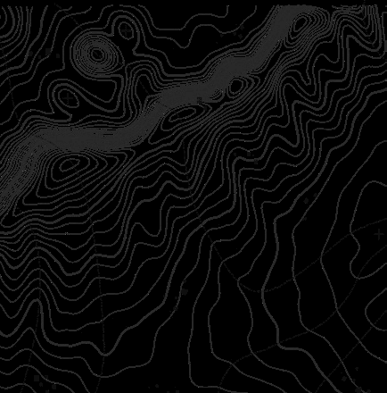
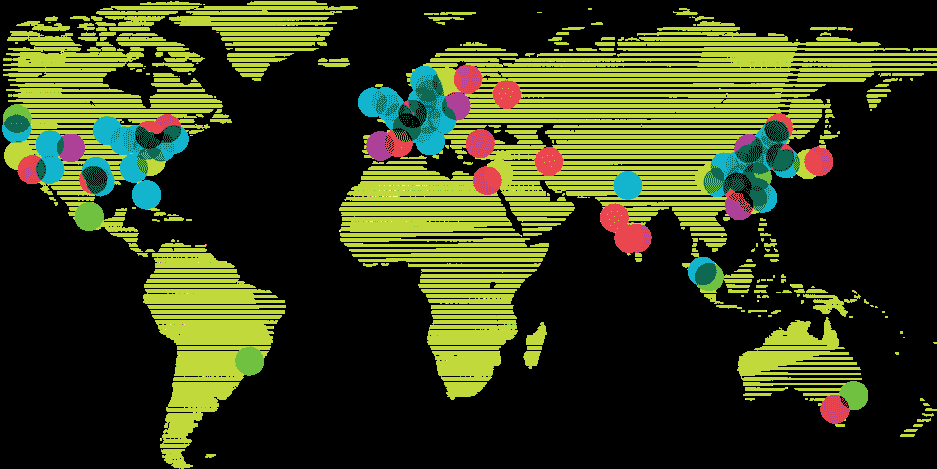
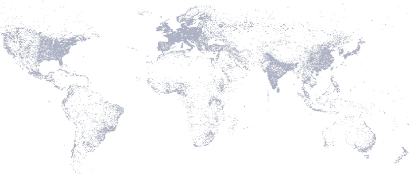

# 2025年索引

## 世界百强创新集群排名

GII揭示了全球范围内按规模和强度排列的创新集群。

### 聚类排序新方法融入风险投资数据

**图1 全球Top 100创新集群，2025 – 风险投资（VC）交易地点。**

- 2025全球顶尖100家创新集群排名
- 创新集群：前100名
- 噪声非簇点

从班加罗尔到柏林，从波士顿到圣保罗，从深圳或首尔来看，全球城市将研究、初创企业和研发公司融合在一起，以推动创新。

注意：灰色点（噪声）指未归类为集群中的所有发明人/作者位置。来源：世界知识产权组织统计数据数据库，2025年5月。

> ¹ 世界知识产权组织专利合作条约（PCT）帮助申请人寻求其发明的国际专利保护，协助专利局做出专利授权决定，并促进公众获取与这些发明相关的丰富技术信息。通过根据PCT系统提交一项国际专利申请，申请人可以同时在大量国家寻求对其发明的保护（www.wipo.int/pct/en）。

创新集群——无论是创新驱动型城市还是地区——构成国家创新系统的核心动力。这些枢纽将顶尖大学、研究人员、发明家、风险投资家和研发公司团结在一起，共同推动突破性想法的前进。

每年，全球创新指数（GII）对全球前100家创新集群进行排名（图1）。GII采用自下而上、数据驱动的指标方法，忽略行政或政治边界，而是精准识别那些发明家和科学作者高度集中的地理区域。通过这种方式确定的集群通常跨越数个市辖区、次联邦州，有时甚至跨越两个或多个国家。

2025年，三个指标定义全球排名前100的集群（有关详细信息以及与早期方法的比较，特别是附录IV-表2，该表根据去年的方法对集群进行排名）。

这两个指标一直作为以往GII版本中聚类识别的基础。然而今年，GII能够引入第三个指标，即：

- 首个指标关注的是依据《专利合作条约》（PCT）在公开的专利申请中列出的发明人的所在地。
- 第二个指标考虑已发表科学文章中列出的作者。

### 深圳—香港—广州，东京—横滨，以及圣何塞—旧金山引领全球创新集群排名

**图1 2025年创新集群前十名及其足迹**

**来源：世界知识产权组织统计数据数据库，2025年5月。**

| 排名 | 集群名称 | PCT全球份额 | 科学出版物全球份额 | 全球风险投资交易占比 |
|---|---|---|---|---|
| 1 | 深圳—香港—广州 | 2.4% | 9.0% | 2.9% |
| 2 | 东京-横滨 | 1.4% | 10.3% | 2.2% |
| 3 | 圣何塞—旧金山 | 0.7% | 3.9% | 6.9% |
| 4 | 北京 | 4.0% | 3.8% | 2.9% |
| 5 | 首尔 | 1.7% | 5.4% | 3.1% |
| 6 | 上海-苏州 | 2.5% | 3.3% | 3.7% |
| 7 | 纽约市 | 0.9% | 1.0% | 4.8% |
| 8 | 伦敦 | 0.7% | 0.5% | 4.4% |
| 9 | 波士顿—剑桥 | 0.9% | 1.5% | 2.0% |
| 10 | 洛杉矶 | 0.5% | 0.9% | 2.5% |

深圳—香港—广州（中国和中国香港）位居全球排名榜首，其次是东京—横滨（日本）（见图1）。方法论的变更促成了2025年新的顶级集群排名，反映出深圳—香港—广州在风险投资交易方面表现优于东京—横滨。然而，这两个集群继续对全球科学出版物和专利产出做出巨大贡献，合计占全球PCT申请量的近五分之一。

在美国，旧金山-圣何塞位列第三，中国北京和韩国首尔分别位居第四和第五。

在美国（美国），纽约市（7th）和洛杉矶（10th），以及英国伦敦（8th），如今已跻身前10名，与去年未包含VC数据的方法相比。反过来，大阪-神户-京都（11th，日本），圣地亚哥（14th，美国）和南京（15th，中国）退出前10名。案例1考察了三个指标上排名前10的全球集群，亚洲在科学出版物上领先，美洲和美国集群在PCT申请上领先，美、英和亚洲集群在风险投资中领先。

这项2025年新方法允许全球创新指数（GII）捕捉创业活动和创新金融，强调初创企业和衍生公司。这三个指标共同揭示了发明人、科学作者和/或风险投资（VC）活动高度集中的领域。

这种方式确定的创新生态系统经常跨越行政边界，涵盖都市区、多区域网络和跨境走廊。由此产生的全球前100家创新集群显示出显著的集中度，合计占全球PCT申请和风险投资交易活动的约70%，以及所有科学出版物的约一半。这种集中度在最高层级更为显著，仅前10个集群就产生了约40%的PCT申请、35%的风险投资交易活动，并为全球科学出版物贡献了超过15%。

GII 2025还可以识别排名前100之外，具有显著高水平科技金融的创新集群。此外，GII还发布了一系列集群简报（可在网上获取），其中提供了对排名前100的创新热点的进一步详细信息。

### 方框1 按出版物、专利或风险投资交易排名的前十大创新集群

**图2 按指标排名的前十大创新集群，占全球总量的比例，2025**

**来源：世界知识产权组织统计数据数据库，2025年5月。**

| 科学出版物 | PCT申请 | 风险投资交易 |
|---|---|---|
| 深圳—香港—广州 | 深圳—香港—广州 | 圣何塞—旧金山 |
| 东京-横滨 | 东京-横滨 | 纽约市 |
| 首尔 | 北京 | 伦敦 |
| 上海-苏州 | 上海-苏州 | 波士顿—剑桥 |
| 武汉 | 圣何塞—旧金山 | 洛杉矶 |
| 西安 | 首尔 | 北京 |
| 波士顿—剑桥 | 大阪-神户-京都 | 上海-苏州 |
| 北京 | 圣地亚哥 | 东京-横滨 |
| 成都 | 成都 | 首尔 |
| 杭州 | 杭州 | 西雅图 |
| 南京 | 名古屋 | — |
| — | 南京 | — |

按专利、出版物或风投交易排名的前10个集群揭示了不同的模式（见图2）。发表出版物最多的那些集群完全位于亚洲，其中大部分在中国——以北京和上海-苏州领先——但首尔（韩国）和东京-横滨（日本）也榜上有名。PCT申请则显示出更为混合的格局。三个美国集群入围，但许多日本和中国集群也名列前茅。在风投交易方面，美国在排名前10的集群数量最多（四个），以圣何塞-旧金山和纽约市领先。英国在风投交易中位列前10，伦敦排名第三——但其他欧洲集群在按变量排名的任何前十名中都未出现。

与去年相比，新加坡（16th，新加坡—马来西亚），特拉维夫—耶路撒冷（19th，以色列），西雅图（20th，美国）将于2025年进入前20名。印度有两个集群进入全球前30：班加罗尔（21st）和德里（26th），以及费城（23rd，美国）和柏林（30th，德国）。新进入前40名的是多伦多（33rd，加拿大），两个集群在美国，丹佛（35th）和奥斯汀（37th），并且苏黎世（瑞士）排名第40th。新进入前50的有哥本哈根（42nd，丹麦），孟买（46th，印度），而圣保罗（巴西）排名49th。

今年，有10个集群首次进入前100名：其中美国的三个集群，即迈阿密（67th），凤凰城（78th）和盐湖城（92nd）；中国有两个集群，即宁波（93rd）和宁德（99th）；都柏林（71st，爱尔兰）；墨西哥城（79th，墨西哥）；奥斯陆（85th，使挪威进入前100名）；汉堡（91st，德国）；以及曼彻斯特（94th，英国）。墨西哥城（79th）在拉丁美洲增加了一个第二集群——位于巴西的圣保罗（49th）也排名进入前100。

性能变化组合以及今年新方法的实施导致前100名中排除了10个集群：纽伦堡-埃尔兰根（德国）、兰州（中国）、福州（中国）、安卡拉（土耳其）、辛辛那提（美国）、大邱（大韩民国）、南昌（中国）、巴塞尔（瑞士-德国-法国）、布里斯班（澳大利亚）以及中国昆明。

### 表1 2025年按经济体或跨境区域排名前100的顶尖创新集群

**来源：世界知识产权组织统计数据数据库，2025年5月。**

| 排名 | 集群名称 | 经济体 | 顶尖申请人 | 顶级组织 |
|---|---|---|---|---|
| 1 | 深圳—香港—广州 | CN / HK | 华为 | 中山大学 |
| 2 | 东京-横滨 | JP | 三菱电机 | 东京大学 |
| 3 | 圣何塞—旧金山 | 美国 | 谷歌 | 斯坦福大学 |
| 4 | 北京 | CN | 博恩科技 | 清华大学 |
| 5 | 首尔 | KR | 三星电子 | 首尔国立大学 |
| 6 | 上海-苏州 | CN / HK | 华为 | 中山大学 |
| 8 | 伦敦 | GB | 尼科风险投资 | 伦敦大学学院 |
| 12 | 巴黎 | FR | 萨fran飞机制造商 | 索邦大学 |
| 16 | 新加坡 | SG / MY | 国立新加坡大学 | 国立新加坡大学 |
| 19 | 特拉维夫—耶路撒冷 | IL | 特拉维夫大学 | 耶路撒冷希伯来大学 |
| 21 | 班加罗尔 | IN | 三星电子 | IISC - Bangalore |
| 27 | 慕尼黑 | DE | BMW | 慕尼黑工业大学 |
| 33 | 多伦多 | 加拿大 | DH 技术开发 | 多伦多大学 |
| 36 | 悉尼 | AU | 耳蜗 | 悉尼大学 |
| — | 台北–新竹 | TW* | 联发科 | 台湾大学 |
| — | 哥本哈根 | DK | 诺维茨 | 哥本哈根大学 |
| — | 巴塞罗那 | ES | 惠普 | 巴塞罗那大学 |
| — | 莫斯科 | RU | 三星电子 | 罗蒙诺索夫莫斯科国立大学 |
| — | 圣保罗 | BR | 巴西化工 | 圣保罗大学 |
| — | 布鲁塞尔—安特卫普 | 北欧 | 阿格发 | 鲁汶天主教大学 |
| — | 米兰 | IT | 皮瑞利轮胎 | 米兰大学 |
| — | 伊斯坦布尔 | TR | 阿齐尔克 | 伊斯坦布尔技术大学 |
| — | 赫尔辛基 | FI | 诺基亚 | 赫尔辛基大学 |
| — | 德黑兰 | IR | 阿博拉扎德·穆罕默德 | 德黑兰大学 |
| — | 都柏林 | IE | 伊顿智能电源 | 都柏林大学学院 |
| — | 维也纳 | AT | JT国际 | 维也纳医科大学 |
| — | 墨西哥城 | MX | 高露洁-棕榄 | 国立自治大学墨西哥 |
| — | 开罗 | EG | 思威尔系统 | 埃及大学 |
| — | 奥斯陆 | NO | 奥斯陆大学医院 | 奥斯陆大学 |
| — | 吉隆坡 | MY | MIMOS Berhad | 马来亚大学 |
| — | 华沙 | PL | 三星电子 | 华沙工业大学 |

**注意：** 经济体指ISO alpha-2国家代码。TW* = 中国台湾省。当一个经济体的至少1%的产出发生在特定经济体时，经济体标签会被分配给一个集群。缩写为IISC – Bangalore = 印度科学理工学院 – Bangalore，BOE Technology = 北京东方电子集团。资料来源：世界知识产权组织统计数据数据库，2025年5月。

每个国家或跨境地区的顶级创新集群如表1所示。各国的领先集群与去年保持不变，巴塞罗那超越了马德里，成为领先的西班牙集群。此外，前100名排名现在包括来自以前未代表国家的新晋者：都柏林成为爱尔兰的首要创新集群，墨西哥城成为墨西哥的，奥斯陆成为挪威的。

> ² 也有值得注意的一点是，萨fran飞机制造公司成为巴黎（法国）集群的顶级PCT申请人，而不是欧莱雅集团；同时，台积电超越惠普公司在台北—新竹（中国台湾省）集群，而JT国际则在维也纳（奥地利）集群超过了维也纳工业大学。

### 中美在顶尖创新集群数量上领先

**图3 2025年拥有两个或更多个前100名创新集群的经济体**

| 经济体 | 集群数量 |
|---|---|
| 美国 | 22 |
| 中国 | 24 |
| 联合王国 | 4 |
| 韩国 | 3 |
| 共和国 | 3 |
| 法国 | 2 |
| 意大利 | 2 |
| 澳大利亚 | 2 |
| 印度 | 4 |
| 荷兰 | 2 |
| 西班牙 | 2 |
| 瑞典 | 2 |
| 德国 | 7 |
| 加拿大 | 3 |
| 日本 | 3 |
| 马来西亚 | 2 |

**来源：世界知识产权组织统计数据数据库，2025年5月。**

中国连续第三年以最多集群（24个，比去年少两个）领先于前100名（见图3和地图2a-e）。美国紧随其后，有22个集群（比去年增加2个）。今年方法中加入VC交易数量这一变量，从而缩小了中国与美国之间的差距。

印度仍有四个集群位于前100名：班加罗尔（21st），德里（26th），孟买（46th）和钦奈（84th），大多数集群因包含VC交易数量而显著提升。日本在顶级100中保持三个集群：东京—横滨（2nd），大阪—神户—京都（11th）和名古屋（28th），而韩国的数量从四降至三——首尔（5th），大田（25th）和釜山（95th），大邱则跌出前100名。

加拿大仍有三个集群，包括多伦多（33rd）仍然位居该国领先创新集群，其次是蒙特利尔（62nd）和温哥华（66th）。澳大利亚现在有2个集群进入前100名，从2024年的3个下降，悉尼（36th）和墨尔本（52nd）。

德国继续以七个集群位列前100名，排名第三（比去年少一个），其中慕尼黑（27th），柏林（30th）和科隆（43rd）处于领先地位。英国现在在排名前100名中拥有四个集群（去年没有VC时为三个），其中伦敦（8th），剑桥（69th），牛津（77th）和新的进入者曼彻斯特（94th）。法国目前在百强中拥有两个集群（从三个减少到两个），巴黎仍然位居第12位，其次是里昂（第90位）。

### 区域分布

关于那些尚未被前100名覆盖的非洲创新集群，去年进行了一项单独分析（参见"GII 2024：维持顶尖非洲创新集群的崛起"，GII创新洞察，2024年11月20日 www.wipo.int/en/web/global-innovation-index/w/blogs/2024/gii-2024-african-innovation-clusters）。

除了中国和印度——墨西哥将于2025年加入——还有六个中低收入经济体位于前100名。它们如下：

- 巴西（1个集群），包括圣保罗（49th）
- 埃及（1），开罗（83rd），非洲唯一排名前100的创新集群
- 伊斯兰共和国伊朗（1），以及德黑兰（63rd）
- 马来西亚（2），吉隆坡（86th），和其集群与新加坡共享（16th）
- 墨西哥（1）进入前100名，墨西哥城（79th），现在是拉丁美洲内的第二个集群
- 土耳其（1），以伊斯坦布尔在58th

注意俄罗斯联邦，在2025年有一个集群（莫斯科，排名48th），不再在此列出，因为它现在被归类为高收入经济体。

欧盟的产业集群——在那里风险投资市场有时不如美国或其他金融中心如伦敦或新加坡活跃——与风险投资资本活动被排除在外时相比，也倾向于看到一个排名下降。

通常情况下，在新旧方法之间的前100个集群的最新结果进行比较时，亚洲集群的排名呈现轻微下降趋势，而美国许多集群则有所提升（参见附录IV - 表2）。平均而言——尽管深圳-香港-广州等显著例外（现全球排名第一）——中国集群的排名有所下降。日本和韩国的集群也呈现出类似模式，部分反映了风险投资的较小但日益增长的作用，但也反映了这两个经济体中创新金融的类型和结构——大型产业集团更青睐内部创新。

然而，在亚洲，印度的产业集群情况并非如此。在考虑风险投资交易时，四分之三的印度产业集群排名大幅上升。班加罗尔上升到第21位（与52nd相比当使用旧方法时），德里到26th（与63rd相比）和孟买至46th（与88th相比）；例外是钦奈，现在排名84th（与77th相比当使用旧方法时）。在100名之外，印度的集群同样获益：海得拉巴是102nd和普纳112th，两个集群现在敲响了进入前100名的门，而加尔各答排名158th。

9

### 图2 2025年顶尖创新集群

北美洲

- 西雅图
- 芝加哥
- 多伦多
- 波士顿-剑桥
- 纽约市
- 丹佛
- 圣何塞-圣弗朗西斯科
- 费城
- 华盛顿-巴尔的摩
- 洛杉矶
- 圣地亚哥
- 奥斯汀
- 休斯顿

东亚

- 北京
- 首尔
- 东京-横滨
- 大田
- 大阪-科比-京都
- 南京
- 成都
- 武汉
- 上海-苏州
- 杭州
- 深圳-HongKong-广州

聚类排名：前 100 名

来源：世界知识产权组织统计数据库，2025年5月

10

## 全球创新指数2025

印度

- 新德里
- 孟买
- 班加罗尔
- 钦奈

中东

- 伊斯坦布尔
- 德黑兰
- 特拉维夫-耶路撒冷
- 开罗

聚类排名：前 100 名

来源：世界知识产权组织统计数据库，2025年5月

11

### 欧洲

- 斯德哥尔摩
- 哥本哈根
- 阿姆斯特丹-鹿特丹
- 柏林
- 科隆
- 伦敦
- 慕尼黑
- 巴黎
- 苏黎世
- 巴塞罗那
- 马德里

聚类排名：前 100 名

来源：世界知识产权组织统计数据数据库，2025年5月。

GII 2025 还展示了排名前100名之外的创新集群，以突出世界各地其他在科学、技术和创新金融方面具有显著高水平的地区。基于产生前100家创新集群排名所应用的相同参数，因此包括风险投资机构数量，额外识别了137个集群，其中以下三个接近进入：利雅得（101st, 沙特阿拉伯王国), 海得拉巴 (102nd, 印度) 和 洛桑 (103rd, 瑞士).

表2确定了以前未进入前100名的经济体中的顶级创新集群，包括巴基斯坦、葡萄牙和沙特阿拉伯。此外，巴基斯坦正有效地增加一个集群，拉合尔加入了伊斯兰堡。曼谷、安卡拉、里约热内卢和布宜诺斯艾利斯是收入中等水平经济创新集群中的佼佼者。

12

### 表2 扩展排名中选定的创新集群：2025年排名前100位以外的经济体

| 经济 | 经济体名称 | 超出顶级集群群组名称 |
|------|-----------|---------------------|
| SA | 沙特阿拉伯 | 利雅得和达曼 |
| BR | 巴西 | 里约热内卢和波尔图 |
| PT | 葡萄牙 | 里斯本和波尔图 |
| PK | 巴基斯坦 | 伊斯兰堡和拉合尔 |
| TH | 泰国 | 曼谷 |
| TR | 土耳其 | 安卡拉 |
| CZ | 捷克共和国 | 布拉格 |
| CL | 智利 | 圣地亚哥 |
| HU | 匈牙利 | 布达佩斯 |
| NZ | 新西兰 | 奥克兰 |
| PL | 波兰 | 克拉科夫 |
| GR | 希腊 | 雅典 |
| AR | 阿根廷 | 布宜诺斯艾利斯 |
| RO | 罗马尼亚 | 布加勒斯特 |
| RS | 塞尔维亚 | 贝尔格莱德 |

来源：世界知识产权组织统计数据数据库，2025年5月。

GII 2025 在前100名的创新集群名单之外增加了七个新的集群，与去年相比，去年排除了VC：

- 加拿大（1个集群）：魁北克市（228th）
- 中国 (2): 乌鲁木齐 (218th) 和 桂林 (229th)
- 芬兰 (1): 奥卢 (218th)
- 大韩民国 (1): 釜山 (209th)
- 巴基斯坦 (1): 伊斯兰堡 (191st)
- 斯洛文尼亚 (1): 卢布尔雅那 (225th)

中低收入经济体阿根廷、塞尔维亚和泰国各自在扩展名单中拥有一個顶级创新集群，分别为布宜诺斯艾利斯、贝尔格莱德和曼谷。

### 最创新密集的产业集群：剑桥和圣何塞-旧金山领先；宁德（中国）因一家公司位列全球第五

自2020年以来，全球创新指数（GII）还按创新强度对前100个产业集群进行了排名——创新强度以专利、科学出版物以及（现在包括）风险投资交易的全球综合份额，经人口标准化衡量（方法参见附录IV）。

宁德进入全球前五是一个引人注目的进展，这主要是由全球领先的新能源技术和电池创新企业宁德时代有限（CATL）专利活动的激增所推动的——（表3）

在最新排名中，圣何塞-旧金山（美国）、剑桥（英国）、波士顿-剑桥（美国）、宁德（中国）和牛津（英国）成为全球最具创新密集型集群（附录IV - 表2）。美国以5个顶级集群领先，紧随其后的是英国（2个），中国（宁德）和芬兰（赫尔辛基）各有1个，荷兰王国（埃因霍温）也有1个。

13

### 表3 按强度排名的前十大创新集群，2025年

| 聚类排序 | 集群名称 | 经济 | 最佳申请人 | 顶尖科学组织 |
|----------|----------|------|------------|--------------|
| 1 | 圣何塞—圣弗朗西斯科 | 美國 | 谷歌 | 斯坦福大学 |
| 2 | 剑桥 | GB | ARM | 剑桥大学 |
| 3 | 波士顿–剑桥 | 美國 | 麻省理工学院 | 哈佛医学院 |
| 4 | 宁德 | CN | 宁德时代 | 宁德师范大学 |
| 5 | 牛津 | GB | 牛津大学 | 牛津大学 |
| 6 | 西雅图 | 美國 | 微软 | 华盛顿大学西雅图 |
| 7 | 圣地亚哥 | 美國 | 高通 | 加利福尼亚大学圣地亚哥 |
| 8 | 安阿伯勒 | 美國 | 密歇根大学 | 密歇根大学 |
| 9 | 赫尔辛基 | FI | 诺基亚 | 赫尔辛基大学 |
| 10 | 埃因霍温 | NL | 飞利浦电子 | 埃因霍芬科技大学 |

注意：MIT，麻省理工学院；CATL，宁德时代股份有限公司。资料来源：世界知识产权组织统计数据库，2025年5月。

### 不同产业集群的创新强度差异

虽然前25个集群在整体创新强度方面排名都很靠前，但它们的优势有所不同。宁德（中国）、圣何塞-旧金山（美国）和埃因霍温（荷兰王国）在人均PCT专利申请量方面领先（见图4）。剑桥（英国）、牛津（英国）和阿默斯特（美国）——这些是传统的大学城——在人均科学出版物方面排名第一，而圣何塞-旧金山（美国）、剑桥（英国）和奥斯汀（美国）则在人均风险投资交易量方面排名第一。

顶部25个簇中的许多簇在所有三个指标上表现均衡。其他簇则表现出明显的偏斜，例如：

- 宁德（中国）人均PCT申请量领先（超过13,000），但科研产出和风险投资活动极少。类似模式也体现在爱知（日本）、埃因霍温（荷兰王国）、东京-横滨（日本）、大阪-神户-京都（日本）和斯图加特（德国）
- 奥斯汀（美国）、伦敦（英国）和纽约市（美国）在风险投资交易活动方面表现出色，但全球出版物较少；
- 反之，中国产业集群西安、长沙、长春、哈尔滨、成都和济南在科研出版活动方面表现稳健，但在专利和风险投资交易活动方面相对较低

这些变化反映了一个创新模式的多样性——从科学驱动的生态系统到风险投资密集型初创中心，并强调了通往创新的不同路径。

领先集群通常承载世界一流研究机构，如斯坦福大学、剑桥大学和哈佛大学。顶尖创新参与者包括谷歌、ARM和英伟达等科技巨头，以及麻省理工学院（MIT）和密歇根大学等领先大学。

14

### 赫尔辛基和埃因霍温在创新集群强度方面引领欧盟

### 图4 前15个创新密集集群，按人均指标（单位：千）计算，2025年

人均PCT申请量：

- 剑桥
- 牛津
- 安阿伯勒
- 波士顿—剑桥
- 北京
- 乐陵
- 西安
- 长沙
- 南京
- 哥本哈根
- 武汉
- 苏黎世
- 奥斯陆
- 哥德堡
- 长春

人均科学出版物数量：

- 宁德
- 圣何塞—旧金山
- 埃因霍温
- 圣地亚哥
- 剑桥
- 大田
- 波士顿—剑桥
- 西雅图
- 慕尼黑
- 东京-横滨
- 斯图加特
- 牛津
- 斯德哥尔摩
- 首尔
- 北京

人均风险投资交易额：

- 圣何塞—旧金山
- 剑桥
- 奥斯汀
- 波士顿—剑桥
- 伦敦
- 赫尔辛基
- 牛津
- 斯德哥尔摩
- 西雅图
- 哥本哈根
- 苏黎世
- 都柏林
- 纽约市
- 奥斯陆
- 丹佛

注意：深蓝色代表前10名集群。来源：世界知识产权组织统计数据数据库，2025年5月。

当关注创新强度——即相对于人口而言的专利申请、科学出版物和风险投资交易——北美集群往往优于其亚洲和欧盟的同行，尤其是在风险投资活动方面更为突出。然而，英国在欧洲表现突出，剑桥（2nd), 牛津 (5th), 和伦敦（19th)始终排名全球最具创新活力的中心。

在2025年世界知识产权组织GII全球创新集群强度排名中，赫尔辛基（9th, 芬兰) 和埃因霍温 (10th, 荷兰王国) 成为欧盟 (EU) 中排名最高的集群 (附录IV - 表3)。它们之后是欧盟集群斯德哥尔摩 (11th,瑞典), 哥本哈根 (12th, 丹麦), 慕尼黑 (16th, 德国），哥德堡（20th, 瑞典）和都柏林（23rd, 爱尔兰).

这种对比突显了创新生态系统中的区域差异，北美在商业化和投资方面表现出色，而欧洲产业集群则依靠强大的研究和技术基础。

仅有两个产业集群同时位居全球创新产业集群排名前10位以及强度排名前10位：圣何塞-旧金山和波士顿-剑桥，均位于美国。

扩展到前25名，有九个集群同时出现在全球前25名和强度前25名中。除了圣何塞-旧金山和波士顿-剑桥之外，还包括西雅图（美国）、圣地亚哥（美国）、纽约市（美国）、伦敦（英国）、北京（中国）、杭州（中国）和大田（大韩民国）。

这一重叠突显了美国在集群规模和强度方面的持续主导地位，同时也强调了亚洲和欧洲部分高性能集群的全球存在。

15

### 地图3 2025年按强度排名的前100个创新集群

北美洲

- 西雅图
- 安阿伯勒
- 波士顿-剑桥
- 纽约市
- 丹佛
- 圣何塞-圣弗朗西斯科
- 乐陵
- 圣地亚哥
- 奥斯汀

东亚

- 北京
- 首尔
- 青岛
- 东京-横滨
- 大田
- 南京
- 武汉
- 杭州
- 长沙
- 宁德
- 深圳-HongKong-广州

聚类强度排名

来源：世界知识产权组织统计数据库，2025年5月

16 欧洲

- 奥斯陆
- 赫尔辛基
- 斯德哥尔摩
- 哥德堡
- 哥本哈根
- 都柏林
- 柏林
- 阿姆斯特丹-鹿特丹
- 埃因霍温
- 剑桥
- 牛津
- 伦敦
- 慕尼黑
- 斯图加特
- 巴黎
- 苏黎世

聚类强度排名

来源：世界知识产权组织统计数据数据库，2025年5月。

## 参考文献

世界知识产权组织（2025）。2024年，世界知识产权组织的全球专利、商标和外观设计注册使用量有所增长。日内瓦，2025年3月17日 PR/2025/934。可在以下网址获取：www.wipo.int/pressroom/en/articles/2025/article_0003.html。

德·拉斯森福斯，G. 和 S. 恩施尔-维克森特（2024）。在国家层面以下实现创新测量：一项世界知识产权组织工具包。洛桑和日内瓦：洛桑联邦理工学院和世界知识产权组织。可在以下网址获取：www.wipo.int/edocs/pubdocs/en/wipo-pub-rn2023-27-en-enabling-innovation-measurement-at-the-sub-national-level.pdf。

伯格奎斯特，K.和C.芬克（2020年）。前100个科技产业集群。在德塔，S.、B.兰文和S.万施-维纳（编）的书中2020年全球创新指数：谁将资助创新？伊萨卡，纽约，丰坦布勒和日内瓦：康奈尔大学，INSEAD和世界知识产权组织（WIPO）。

CATL已成为第5th 2024年全球最大PCT申请者，在华为、三星、高通和LG电子之后，参见(附件2)：<www.wipo.int/export/sites/www/pressroom/en/documents/pr-services2025-annexes.pdf#page=2>

### 附录IV——全球创新指数创新集群方法

在2025年GII中，采用了三个创新指标来识别世界知识产权组织的前100个全球创新集群：

- 发明人在已发表专利申请中的所在地；
- 已发表科学论文中列出的作者所在地；
- 以及 – 新增在本版中，获得风险资本（VC）投资的公司所在地。

自2016年以来，全球创新指数（GII）采用自下而上的方法识别创新集群。这种方法不考虑行政或政治边界，而是精确指出那些发明家和科学作者高度集中的地理区域。由此产生的集群通常涵盖几个市辖区、次联邦州，有时甚至是两个或多个国家。

对于专利而言，该方法依赖于世界知识产权组织（PCT）专利合作条约（PCT）下的已发表申请。PCT专利为全球专利分析提供了一个有用的基础。PCT系统采用一套统一程序规则，并根据统一提交标准收集信息。这减少了可能因使用来自多个国家来源的数据而产生的任何潜在偏差。所选专利是在可供的最新五年期间发布的——即2020年至2024年之间——以最小化可能发生在年份之间的任何波动。

作为第二步，从Web of Science的科学引文索引扩展版（SCIE）中纳入了科学出版物。SCIE提供了对世界上最具影响力的学术期刊的详细覆盖。分析的重点是科学技术领域，而社会科学和人文学科领域的文章则被忽略。此外，科学出版物仅限于原创研究文章。这排除了其他已发表项目，例如会议摘要、会议总结或论文简要介绍。与PCT申请类似，SCIE也使用了最新五年可获得数据的时间段——即2019年至2023年的出版年份。

为了进一步丰富对集群层面创新活动的理解，本期引入了VC交易数量数据。通过整合获得VC资金支持的初创企业、独角兽或其他商业企业的信息，并按地理位置统计VC交易数量，今年我们能够将视野扩展到包括创业和早期创新活动。这使得集群排名不仅能够反映科学和创新产出，还能体现创新金融和初创企业成果。

对于VC数据，我们使用了PitchBook的数据风险投资数据库¹，该数据库提供详细的交易级别风险投资计数信息，并用于识别获得风险投资的公司的精确地理位置。该数据反映了基于公司总部的风险投资交易总数。投资者可能来自任何全球地区。投资者包括个人天使、天使团体、种子和风险基金、企业风险投资 (CVC) 分支以及其他企业实体。除非加速器参与后续轮次，否则与加速器项目相关的交易被排除在外。在这种情况下，仅包括后续融资轮次。所有股权交易和混合债务-股权交易都被计入。纯粹的债务交易被排除在外，因为它们属于风险债务数据集，而不是风险投资活动数据集。

这种相同的城市匹配方法被应用于SCIE作者地址和VC交易地点。在这两个数据集中，地址已经被以预解析的格式提供，这显著提高了我们使用GeoNames数据库匹配它们的能力。对于无法使用GeoNames匹配的SCIE和VC城市名称，我们再次尝试使用ESRI的世界地理编码器对城市名称进行地理编码。

本报告所用地址的地理编码过程如下：PCT发明人地址使用环境系统研究所（ESRI）的ArcGIS世界地理编码器服务进行地理编码。如果ESRI结果模糊或不准确，则从地址字符串中提取城市名称，并与GeoNames公报数据库中的条目进行匹配——这是一个包含约48000个已地理编码城市的全球数据集。如果提取的城市名称与GeoNames中的任何记录不匹配，我们将尝试使用世界地理编码器服务直接对城市名称进行地理编码。总体而言，98.4%的发明人地址在城市级别或更精确的级别进行了地理编码，而99.7%的科学作者地址在城市级别进行了地理编码。对于VC数据，97.1%的VC交易在城市级别或更高级别进行了地理编码。附录IV - 表1总结了前20个国家的地理编码结果，这些国家共同占有了大部分发明人、科学作者和VC交易地址。如表所示，在所有20个国家中，地理编码的PCT发明人地址覆盖率均超过99%。同样，科学作者地址和VC交易地址的覆盖率也很高，均超过99%。

世界知识产权组织（WIPO）PCT专利数据集包含2020年至2024年间发布的约130万份专利申请，其中包含420万项发明人地址。对于科学引文索引（SCIE），该数据集包含2019年至2023年间发布的820万篇文章，其中包含2850万项已列出的作者地址。对于PitchBook风险投资资本数据库，该数据集包含2019年至2023年间的66,755个地点，其中包含236,046项交易。

通过应用带有噪声的空间聚类应用密度算法 (DBSCAN)，地址被聚类。该算法需要预定义的半径和密度参数。与往年一样，应用了15公里的半径和4,500名已列出发明人/作者的密度。发明人和作者被赋予同等权重，通过将数据点分别表示为发明人和作者地址总数的份额来实现。鉴于科学文章的数量远超专利数量，基于原始数据点的聚类识别将导致主要由科学作者景观形成的聚类。

这个聚类步骤产生了一个包含246个聚类的初始列表。在审查后，如果其中一个聚类的边缘与另一个聚类在3-5公里的范围内，并且其合著者/共同发明者关系高于与其他任何聚类或非聚类点的任何其他关系，则相邻的聚类将被合并。总共有18个聚类符合这些标准，合并减少了确定的聚类总数至237个。

VC交易数量的地理位置因其相对较高的地理隔离而被排除在初始聚类形成过程之外，也就是说，与PCT发明人和科学文章作者相比，数据点之间的平均距离更大。在聚类过程中包含VC数据有引入噪声和扭曲最终聚类结果的风险。为解决这个问题，我们转而将VC数据分配到聚类中，事后通过将最终确定的聚类边界叠加到风险投资公司位置上，并将每个风险投资交易分配到其地理所属的聚类中。

剩余的237个聚类随后通过首先计算每个聚类内部的专利数量、科学论文和风险投资交易数量来进行排序。这些数量采用分数计数方法计算，然后为每个创新指标推导出全球份额。随后，在这些全球份额在每个聚类内使用等权重进行聚合，并用于整体排序（附录IV - 表2）。

为生成强度排序，欧洲委员会的全球人类聚居层（GHSL）人口分布数据与地理上排名前100的聚集群匹配。

---

1 https://pitchbook.com/venture-capital-database

## 附件IV - 表1：地理编码结果摘要，2025

| 国家 | 科学出版物 | | | PCT申请 | | | 风险投资交易 | | |
|------|-----------|---|---|-----------|---|---|------------|---|---|
| | 城市级发布数量 | 城市级应用数量 | 城市级交易数量 | 地址 | 地址 | 覆盖率地址 | 地址 | 覆盖率地址 | 覆盖率地址 |
| | | | | 数字 | 地址 | 数字 | 地址 | 数字 | 地址 |
| | 准确性城市-等级 | 准确性城市-等级 | 准确性城市-等级 | | | | 精度应用 | 精度应用 | 覆盖精度 |
| | | | | | | | (%) | (%) | 地址 |
| | | | | | | | | | 覆盖了 (%) 地址 (%) |
| 日本 | 1,399,434 | 99.4% | 99.8% | 532,296 | 99.8% | 99.9% | 1,970 | 97.5% | 99.8% |
| 美国 | 7,835,799 | 100.0% | 100.0% | 1,151,574 | 99.9% | 99.9% | 2,555 | 96.9% | 99.9% |
| 中国 | 7,517,582 | 100.0% | 100.0% | 974,714 | 99.9% | 99.9% | 20,460 | 99.4% | 100.0% |
| 德国 | 1,671,970 | 99.9% | 99.9% | 266,615 | 99.7% | 99.7% | 3,025 | 98.3% | 99.8% |
| 联合王国 | 956,778 | 99.2% | 99.6% | 335,207 | 100.0% | 100.0% | 1,015 | 92.1% | 99.8% |
| 韩国 | 1,668,211 | 99.5% | 99.7% | 90,148 | 99.8% | 99.9% | 4,840 | 94.3% | 99.0% |
| 法国 | 1,199,360 | 99.3% | 99.6% | 108,885 | 98.8% | 99.2% | 5,170 | 98.6% | 99.8% |
| 意大利 | 1,500,143 | 99.9% | 100.0% | 48,023 | 99.4% | 99.5% | 1,295 | 99.2% | 99.9% |
| 加拿大 | 1,173,303 | 99.3% | 99.5% | 53,820 | 99.7% | 99.8% | 1,570 | 98.7% | 100.0% |
| 西班牙 | 1,066,440 | 100.0% | 100.0% | 51,086 | 100.0% | 99.9% | 1,575 | 96.2% | 99.7% |
| 印度 | 1,118,462 | 99.6% | 99.8% | 28,643 | 99.2% | 99.6% | 1,180 | 94.1% | 99.4% |
| 荷兰 | 602,719 | 99.8% | 99.9% | 46,296 | 99.8% | 99.8% | 1,270 | 97.6% | 99.8% |
| 澳大利亚 | 1,031,680 | 99.9% | 99.9% | 21,617 | 99.9% | 99.9% | 2,330 | 97.4% | 99.4% |
| 巴西 | 804,344 | 99.9% | 99.9% | 10,478 | 99.8% | 99.8% | 850 | 97.6% | 99.8% |
| 瑞士 | 410,344 | 99.9% | 99.9% | 44,394 | 99.8% | 99.9% | 1,285 | 98.4% | 99.6% |
| 瑞典 | 351,437 | 99.9% | 99.9% | 45,241 | 99.8% | 99.9% | 960 | 97.4% | 99.8% |
| 俄语联盟 | 463,678 | 99.8% | 99.9% | 15,206 | 99.7% | 99.8% | 255 | 98.0% | 100.0% |
| 土耳其 | 511,696 | 98.8% | 98.6% | 18,082 | 98.9% | 99.3% | 255 | 100.0% | 100.0% |
| 以色列 | 199,623 | 98.6% | 99.5% | 28,896 | 98.8% | 99.1% | 1,105 | 92.8% | 98.7% |
| 波兰 | 400,142 | 99.9% | 100.0% | 7,567 | 99.9% | 99.9% | 570 | 96.5% | 97.7% |
| **世界总计** | **28,625,102** | **99.7%** | **99.9%** | **4,271,953** | **98.4%** | **98.5%** | **66,755** | **97.1%** | **99.7%** |
| **全球总计** | **28,625,102** | | | | | | | | |

注意：此表列出了按专利和科学文章的合计份额排名前20的国家。PCT发明人地址已地理编码至最高详细级别。由于科学作者地址数量大得多，仅地理编码至城市级别。由于数据可用性原因，仅能将VC数据地理编码到城市级别。

来源：世界知识产权组织统计数据数据库，2025年5月。

### 附录IV——全球创新指数创新集群方法

为确保在今年的集群排名中包含VC数据后的结果一致性，我们将相同的方法变更追溯应用于去年的排名。具体而言，2018年至2022年的VC交易数量被按地理位置分配到GII前一版本中使用的集群边界，并据此重新计算排名。这些更新后的排名构成了主部分中"排名变化"指标的基础。为参考，附录IV - 表2提供了使用先前方法（即排除VC数据）计算的100个顶级集群排名，允许用户比较仅使用PCT专利和科学文章作为输入变量时各个集群的排名情况。

在整体排名中识别出来（附录IV - 表3）。与发明人/作者地理编码的位置一样，这些人口数据使我们能够使用自下而上的方法定义一个集群的总人口。我们选择将集群的面积定义为其内每个发明人/作者位置0.05度范围内的空间。将生成的集群多边形叠加在人口数据上，并将所有位于每个多边形内的点汇总，即可得到每个集群的总人口估计。然后，通过将总创新份额除以人口对集群进行排名。

## 附录IV - 表2：2025年创新集群前100名

| 集群名称 | 排名 | 经济 | PCT申请 | 科学出版物 | 风险投资交易 | 占全球总股份的比例 | 占全球PCT申请的比例 | 占全球科学出版物的比例 | 占全球创业资本交易的比例 | 上一次排名（更改方法） | 旧排名 |
|---------|------|------|---------|-----------|------------|------------------|------------------|--------------------|----------------------|---------------------|--------|
| | 排名（a） | | | | | | | | | | (a) | (b) |
| 深圳—香港—广州 | 1 | CN / HK | 117,542.00 | 193,635.00 | 6,916.00 | 8.97 | 2.36 | 2.94 | 14.28 | 1.00 | 0.00 | 2.00 |
| 东京-横滨 | 2 | JP | 135,129.00 | 115,773.00 | 5,154.00 | 10.32 | 1.41 | 2.19 | 13.92 | 2.00 | 0.00 | 1.00 |
| 圣何塞—旧金山 | 3 | 美国 | 50,812.60 | 56,510.30 | 16,296.00 | 3.88 | 0.69 | 6.93 | 11.50 | 3.00 | 0.00 | 6.00 |
| 北京 | 4 | CN | 49,792.30 | 331,874.00 | 6,727.00 | 3.80 | 4.05 | 2.86 | 10.71 | 4.00 | 0.00 | 3.00 |
| 首尔 | 5 | KR | 71,318.00 | 142,509.00 | 7,376.00 | 5.45 | 1.74 | 3.14 | 10.32 | 5.00 | 0.00 | 4.00 |
| 上海-苏州 | 6 | CN | 42,818.90 | 206,292.00 | 8,705.00 | 3.27 | 2.52 | 3.70 | 9.49 | 6.00 | 0.00 | 5.00 |
| 纽约市 | 7 | US | 13,705.10 | 74,832.80 | 11,283.00 | 1.05 | 0.91 | 4.80 | 6.76 | 7.00 | 0.00 | 12.00 |
| 伦敦 | 8 | GB | 6,981.28 | 57,151.70 | 10,411.00 | 0.53 | 0.70 | 4.43 | 5.66 | 8.00 | 0.00 | 22.00 |
| 波士顿—剑桥 | 9 | US | 19,332.60 | 75,168.10 | 4,592.00 | 1.48 | 0.92 | 1.95 | 4.35 | 9.00 | 0.00 | 8.00 |
| 洛杉矶 | 10 | 美国 | 11,832.10 | 42,946.10 | 5,891.00 | 0.90 | 0.52 | 2.50 | 3.93 | 10.00 | 0.00 | 18.00 |
| 大阪-神户-京都 | 11 | JP | 38,306.50 | 52,226.80 | 546.00 | 2.92 | 0.64 | 0.23 | 3.79 | 11.00 | 0.00 | 7.00 |
| 巴黎 | 12 | FR | 16,328.10 | 60,680.00 | 4,085.00 | 1.25 | 0.74 | 1.74 | 3.72 | 12.00 | 0.00 | 11.00 |
| 杭州 | 13 | CN | 11,128.00 | 81,181.10 | 2,804.00 | 0.85 | 0.99 | 1.19 | 3.03 | 13.00 | 0.00 | 14.00 |
| 圣地亚哥 | 14 | US | 26,713.20 | 19,862.50 | 1,705.00 | 2.04 | 0.24 | 0.72 | 3.01 | 14.00 | 0.00 | 10.00 |
| 南京 | 15 | CN | 8,241.81 | 136,094.00 | 1,266.00 | 0.63 | 1.66 | 0.54 | 2.83 | 15.00 | 0.00 | 9.00 |
| 新加坡 | 16 | SG / MY | 5,410.18 | 34,675.50 | 4,033.00 | 0.41 | 0.42 | 1.71 | 2.55 | 16.00 | 0.00 | 35.00 |
| 华盛顿–巴尔的摩 | 17 | US | 6,263.57 | 71,366.70 | 2,152.00 | 0.48 | 0.87 | 0.91 | 2.26 | 17.00 | 0.00 | 19.00 |
| 武汉 | 18 | CN | 7,526.27 | 111,269.00 | 681.00 | 0.57 | 1.36 | 0.29 | 2.22 | 19.00 | 1.00 | 13.00 |
| 特拉维夫—耶路撒冷 | 19 | IL | 7,160.04 | 25,232.50 | 2,974.00 | 0.55 | 0.31 | 1.26 | 2.12 | 18.00 | -1.00 | 34.00 |
| 西雅图 | 20 | US | 10,883.70 | 19,386.10 | 2,084.00 | 0.83 | 0.24 | 0.89 | 1.95 | 20.00 | 0.00 | 24.00 |
| 班加罗尔 | 21 | IN | 4,983.22 | 16,384.70 | 2,868.00 | 0.38 | 0.20 | 1.22 | 1.80 | 21.00 | 0.00 | 52.00 |
| 阿姆斯特丹–鹿特丹 | 22 | NL | 4,362.61 | 51,649.00 | 1,965.00 | 0.33 | 0.63 | 0.84 | 1.80 | 22.00 | 0.00 | 26.00 |
| 费城 | 23 | 美国 | 5,752.12 | 32,432.20 | 2,135.00 | 0.44 | 0.40 | 0.91 | 1.74 | 23.00 | 0.00 | 36.00 |
| 成都 | 24 | CN | 2,651.69 | 86,766.30 | 1,097.00 | 0.20 | 1.06 | 0.47 | 1.73 | 29.00 | 5.00 | 21.00 |
| 大田 | 25 | KR | 14,927.20 | 26,169.20 | 570.00 | 1.14 | 0.32 | 0.24 | 1.70 | 27.00 | 2.00 | 17.00 |
| 新德里 | 26 | IN | 1,139.54 | 33,681.00 | 2,736.00 | 0.09 | 0.41 | 1.16 | 1.66 | 24.00 | -2.00 | 63.00 |
| 慕尼黑 | 27 | DE | 10,925.20 | 26,986.60 | 988.00 | 0.83 | 0.33 | 0.42 | 1.58 | 30.00 | 3.00 | 23.00 |
| 名古屋 | 28 | JP | 16,724.40 | 20,922.80 | 117.00 | 1.28 | 0.26 | 0.05 | 1.58 | 25.00 | -3.00 | 15.00 |
| 西安 | 29 | CN | 2,278.93 | 108,896.00 | 22.00 | 0.17 | 1.33 | 0.01 | 1.51 | 33.00 | 4.00 | 16.00 |
| 柏林 | 30 | DE | 3,188.21 | 24,527.60 | 2,267.00 | 0.24 | 0.30 | 0.96 | 1.51 | 28.00 | -2.00 | 57.00 |
| 芝加哥 | 31 | US | 4,205.14 | 29,337.10 | 1,827.00 | 0.32 | 0.36 | 0.78 | 1.46 | 26.00 | -5.00 | 41.00 |
| 斯德哥尔摩 | 32 | SE | 5,932.94 | 19,300.60 | 1,794.00 | 0.45 | 0.24 | 0.76 | 1.45 | 31.00 | -1.00 | 39.00 |
| 多伦多 | 33 | CA | 2,763.33 | 28,192.60 | 2,023.00 | 0.21 | 0.34 | 0.86 | 1.41 | 32.00 | -1.00 | 55.00 |
| 青岛 | 34 | CN | 8,334.34 | 53,059.10 | 267.00 | 0.64 | 0.65 | 0.11 | 1.40 | 35.00 | 1.00 | 20.00 |
| 丹佛 | 35 | 美国 | 3,473.46 | 21,275.20 | 1,983.00 | 0.27 | 0.26 | 0.84 | 1.37 | 34.00 | -1.00 | 61.00 |
| 悉尼 | 36 | AU | 2,771.26 | 34,550.60 | 1,527.00 | 0.21 | 0.42 | 0.65 | 1.28 | 37.00 | 1.00 | 46.00 |
| 奥斯汀 | 37 | 美国 | 2,615.40 | 9,466.09 | 2,222.00 | 0.20 | 0.12 | 0.94 | 1.26 | 38.00 | 1.00 | 92.00 |
| 休斯顿 | 38 | 美国 | 7,795.56 | 23,270.10 | 886.00 | 0.60 | 0.28 | 0.38 | 1.26 | 36.00 | -2.00 | 31.00 |
| 合肥 | 39 | CN | 4,723.10 | 48,836.80 | 686.00 | 0.36 | 0.60 | 0.29 | 1.25 | 44.00 | 5.00 | 27.00 |
| 苏黎世 | 40 | CH | 3,994.10 | 23,855.00 | 1,426.00 | 0.30 | 0.29 | 0.61 | 1.20 | 40.00 | 0.00 | 50.00 |
| 台北–新竹 | 41 | TW* | 3,803.40 | 55,821.50 | 430.00 | 0.29 | 0.68 | 0.18 | 1.15 | 39.00 | -2.00 | 25.00 |
| 哥本哈根 | 42 | DK | 3,112.37 | 24,603.50 | 1,344.00 | 0.24 | 0.30 | 0.57 | 1.11 | 42.00 | 0.00 | 59.00 |
| 科隆 | 43 | DE | 6,609.38 | 33,031.40 | 456.00 | 0.50 | 0.40 | 0.19 | 1.10 | 41.00 | -2.00 | 29.00 |
| 长沙 | 44 | CN | 1,519.91 | 67,213.20 | 387.00 | 0.12 | 0.82 | 0.16 | 1.10 | 50.00 | 6.00 | 28.00 |
| 巴塞罗那 | 45 | ES | 2,195.49 | 30,359.30 | 1,306.00 | 0.17 | 0.37 | 0.56 | 1.09 | 43.00 | -2.00 | 58.00 |
| 孟买 | 46 | IN | 1,647.81 | 16,290.20 | 1,696.00 | 0.13 | 0.20 | 0.72 | 1.05 | 45.00 | -1.00 | 88.00 |
| 马德里 | 47 | ES | 1,645.46 | 39,451.70 | 1,011.00 | 0.13 | 0.48 | 0.43 | 1.04 | 47.00 | 0.00 | 49.00 |
| 莫斯科 | 48 | RU | 1,865.61 | 59,753.60 | 363.00 | 0.14 | 0.73 | 0.15 | 1.03 | 46.00 | -2.00 | 33.00 |
| 圣保罗 | 49 | BR | 684.00 | 24,349.10 | 1,587.00 | 0.05 | 0.30 | 0.67 | 1.02 | 49.00 | 0.00 | 79.00 |
| 天津 | 50 | CN | 1,406.52 | 64,029.70 | 299.00 | 0.11 | 0.78 | 0.13 | 1.02 | 52.00 | 2.00 | 30.00 |
| | 51 | | | | | 0.51 | 0.17 | 0.32 | 1.00 | 48.00 | -3.00 | 40.00 |
| | 52 | | | | | 0.15 | 0.46 | 0.36 | 0.97 | 51.00 | -1.00 | 48.00 |
| | 53 | | | | | 0.23 | 0.35 | 0.37 | 0.95 | 54.00 | 1.00 | 53.00 |
| | 54 | | | | | 9,176.98 | 14,264.30 | 138.00 | 0.70 | 0.17 | 0.06 | 0.93 | 55.00 | 1.00 | 32.00 |
| | 55 | | | | | 0.22 | 0.33 | 0.37 | 0.92 | 53.00 | -2.00 | 56.00 |
| | 56 | | | | | 0.20 | 0.39 | 0.31 | 0.90 | 57.00 | 1.00 | 51.00 |
| | 57 | | | | | 0.12 | 0.65 | 0.12 | 0.88 | 60.00 | 3.00 | 37.00 |
| | 58 | | | | | 0.19 | 0.36 | 0.32 | 0.87 | 62.00 | 4.00 | 54.00 |
| | 59 | | | | | 0.14 | 0.27 | 0.46 | 0.87 | 56.00 | -3.00 | 70.00 |
| | 60 | | | | | 0.23 | 0.16 | 0.47 | 0.86 | 58.00 | -2.00 | 73.00 |
| | 61 | | | | | 0.25 | 0.12 | 0.44 | 0.81 | 61.00 | 0.00 | 75.00 |
| | 62 | | | | | 0.20 | 0.30 | 0.31 | 0.81 | 63.00 | 1.00 | 62.00 |
| | 63 | | | | | 357.02 | 60,217.00 | 85.00 | 0.03 | 0.73 | 0.04 | 0.80 | 59.00 | -4.00 | 38.00 |
| | 64 | | | | | | | 45.00 | | | | | | 65.00 | | 42.00 |
| | 66 | | | | | | | 90.00 | | | | | | | | | |
| | 67 | | | | | 902.65 | 8,339.20 | 1,375.00 | 0.07 | 0.10 | 0.58 | 0.76 | 68.00 | 1.00 | 164.00 |
| | 68 | | | | | | | | 0.14 | 0.51 | 0.08 | 0.73 | 69.00 | 1.00 | 44.00 |
| | 69 | | | | | | | | 0.24 | 0.20 | 0.27 | 0.71 | 67.00 | -2.00 | 68.00 |
| | 70 | | | | | 331.10 | 51,167.10 | 29.00 | 0.03 | 0.62 | 0.01 | 0.66 | 72.00 | 2.00 | 43.00 |
| | 71 | | | | | 915.88 | 10,440.00 | 1,077.00 | 0.07 | 0.13 | 0.46 | 0.66 | 70.00 | -1.00 | 153.00 |
| | 72 | | | | | | | | 0.11 | 0.52 | 0.02 | 0.65 | 77.00 | 5.00 | 47.00 |
| | 73 | | | | | | | | 0.23 | 0.08 | 0.29 | 0.60 | 71.00 | -2.00 | 94.00 |
| | 74 | | | | | | | | 0.12 | 0.24 | 0.22 | 0.58 | 73.00 | -1.00 | 76.00 |
| | 75 | | | | | 691.35 | 39,719.40 | 70.00 | 0.05 | 0.48 | 0.03 | 0.57 | 80.00 | 5.00 | 60.00 |
| | 76 | | | | | | | | 0.15 | 0.20 | 0.22 | 0.56 | 76.00 | 0.00 | 82.00 |
| | 77 | | | | | | | | 0.12 | 0.22 | 0.22 | 0.56 | 74.00 | -3.00 | 83.00 |
| | 78 | | | | | | | | 0.15 | 0.11 | 0.30 | 0.56 | 75.00 | -3.00 | 112.00 |
| | 79 | | | | | 251.53 | 20,262.70 | 672.00 | 0.02 | 0.25 | 0.29 | 0.55 | 78.00 | -1.00 | 111.00 |
| | 80 | | | | | 690.75 | 36,234.40 | 125.00 | 0.05 | 0.44 | 0.05 | 0.55 | 87.00 | 7.00 | 64.00 |
| | 81 | | | | | | | | 0.17 | 0.24 | 0.13 | 0.54 | 79.00 | -2.00 | 71.00 |
| | 82 | | | | | 938.63 | 31,120.90 | 174.00 | 0.07 | 0.38 | 0.07 | 0.53 | 82.00 | 0.00 | 67.00 |
| | 83 | | | | | 163.61 | 24,877.30 | 479.00 | 0.01 | 0.30 | 0.20 | 0.52 | 84.00 | 1.00 | 91.00 |
| | 84 | | | | | | | | 0.10 | 0.26 | 0.15 | 0.52 | 86.00 | 2.00 | 77.00 |
| | 85 | | | | | 834.14 | 12,663.40 | 703.00 | 0.06 | 0.15 | 0.30 | 0.52 | 83.00 | -2.00 | 135.00 |
| | 86 | | | | | 605.58 | 20,560.10 | 508.00 | 0.05 | 0.25 | 0.22 | 0.51 | 81.00 | -5.00 | 97.00 |
| | 87 | | | | | | | | 0.30 | 0.16 | 0.04 | 0.50 | 85.00 | -2.00 | 66.00 |
| | 88 | | | | | 883.01 | 33,200.90 | 68.00 | 0.07 | 0.40 | 0.03 | 0.50 | 88.00 | 0.00 | 65.00 |
| | 89 | | | | | 488.61 | 22,606.20 | 434.00 | 0.04 | 0.28 | 0.18 | 0.50 | 89.00 | 0.00 | 93.00 |
| | 90 | | | | | | | | 0.15 | 0.14 | 0.18 | 0.47 | 91.00 | 1.00 | 98.00 |
| | 91 | | | | | | | | 0.13 | 0.14 | 0.20 | 0.47 | 94.00 | 3.00 | 110.00 |
| | 92 | | | | | | | | | | | | | | | |
| | 93 | | | | | | | | 0.10 | 0.18 | 0.18 | 0.46 | 99.00 | 6.00 | 102.00 |
| | 94 | | | | | | | | | | | | | | | |
| | 95 | | | | | | | | 0.17 | 0.17 | 0.11 | 0.45 | 95.00 | 0.00 | 81.00 |
| | 96 | | | | | | | | 0.09 | 0.23 | 0.13 | 0.45 | 93.00 | -3.00 | 89.00 |
| | 97 | | | | | | | | 0.16 | 0.12 | 0.15 | 0.43 | 96.00 | -1.00 | 101.00 |
| | 98 | | | | | 3,122.49 | 5,233.36 | 311.00 | 0.24 | 0.06 | 0.13 | 0.43 | 103.00 | 5.00 | 95.00 |
| | 99 | | | | | 311.87 | | 4.00 | 0.42 | 0.00 | 0.00 | 0.43 | 146.00 | 47.00 | 69.00 |
| | 100 | | | | | | | 72.00 | | | | | | | | |

注意：(a) 前一排名代表使用当前方法重新计算的去年位置，其中包括风险投资交易数量以进行一致比较。(b) 排名旧方法仅使用PCT申请和科学出版物对所有237个集群进行排名。表格中给出的代码为国家ISO alpha-2代码，新增如下：TW* = 中国台湾省。

来源：世界知识产权组织统计数据库，2025年5月。

| 集群名称 | PCT申请全球排名 | 科学出版物全球排名 | 风险投资全球排名 | 国家 | PCT申请 | 科学出版物 | 风险投资交易 |
|---------|----------------|------------------|----------------|------|---------|-----------|------------|
| 法兰克福 | 64 | 0.2% | 0.1% | DE | 5,484.96 | 17,952.80 | 318.00 |
| 墨尔本 | 65 | 0.1% | 0.5% | AU | 1,902.85 | 38,040.10 | 852.00 |
| 埃因霍温 | | | | NL | 7,982 | 5,223 | |
| 布鲁塞尔—安特卫普 | | | | BE | 2,889.51 | 27,235.30 | 875.00 |
| 米兰 | | | | IT | 2,621.50 | 32,144.60 | 720.00 |
| 迈阿密 | | | | US | | 8,339 | |
| 重庆 | | | | CN | 1,545.33 | 53,070.30 | 276.00 |
| 济南 | | | | CN | 1,815 | 41,797 | |
| 伊斯坦布尔 | | | | TR | 2,533.18 | 29,908.10 | 743.00 |
| 剑桥 | | | | GB | | | |
| 亚特兰大 | | | | 美国 | 1,855.70 | 22,199.10 | 1,081.00 |
| 赫尔辛基 | | | | FI | 3,012.05 | 13,017.20 | 1,108.00 |
| 哈尔滨 | | | | CN | | | |
| 达拉斯 | | | | 美国 | 3,288.52 | 9,828.64 | 1,032.00 |
| 都柏林 | | | | IE | 916 | 10,440 | |
| 蒙特利尔 | | | | CA | 2,643.86 | 24,450.10 | 724.00 |
| 长春 | | | | CN | | | |
| 德黑兰 | | | | IR | | | |
| 波特兰 | | | | US | | | |
| 埃因霍温 | | | | NL | | | |
| 维也纳 | | | | AT | 7,981.93 | 5,223.16 | 206.00 |
| 温哥华 | | | | CA | 1,685.39 | 15,478.70 | 1,041.00 |
| 沈阳 | | | | CN | | | |
| 迈阿密 | | | | 美国 | 2,980 | 6,394 | 689.00 |
| 匹兹堡 | | | | 美国 | | | |
| 济南 | | | | CN | 1,815.32 | 41,797.10 | 185.00 |
| 剑桥 | | | | GB | 3,141.69 | 16,442.90 | 636.00 |
| 牛津 | | | | GB | 1,588 | 17,916 | |
| 凤凰 | | | | 美国 | 2,980.06 | 6,394.24 | 689.00 |
| 都柏林 | | | | IE | 1,587.88 | 17,915.70 | 513.00 |
| 墨西哥城 | | | | MX | | | |
| 长春 | | | | CN | 1,474.75 | 42,241.60 | 49.00 |
| 波特兰 | | | | US | | | |
| 郑州 | | | | CN | | | |
| 厦门 | | | | CN | 1,619.64 | 19,944.80 | 509.00 |
| 沈阳 | | | | CN | 2,177 | 19,412 | |
| 罗马 | | | | IT | | | |
| 匹兹堡 | | | | 美 | 1,901.65 | 16,064.70 | 511.00 |
| 牛津 | | | | GB | | | |
| 开罗 | | | | EG | 164 | 24,877 | |
| 凤凰 | | | | 美国 | | | |
| 钦奈 | | | | IN | 2,000.21 | 8,884.86 | 695.00 |
| 墨西哥城 | | | | MX | 1,304 | 21,636 | |
| 奥斯陆 | | | | NO | | | |
| 郑州 | | | | CN | | | |
| 古拉 | | | | 我的 | | | |
| 厦门 | | | | CN | 2,177.02 | 19,412.10 | 315.00 |
| 泥浆 | | | | MY | 606 | 20,560 | |
| 罗马 | | | | IT | | | |
| 开罗 | | | | EG | | | |
| 海德堡—曼海姆 | | | | DE | 3,936.72 | 13,149.50 | 103.00 |
| 钦奈 | | | | IN | 1,304.14 | 21,635.60 | 362.00 |
| 奥斯陆 | | | | NO | | | |
| 大连 | | | | 无 | | | |
| 华沙 | | | | CN | 331 | 51,167 | |
| 华沙 | | | | PL | | | |
| 里昂 | | | | FR | 1,979.95 | 11,793.00 | 416.00 |
| 盐湖城 | | | | US | 1,605 | 8,401 | |
| 汉堡 | | | | DE | 1,666.87 | 11,428.20 | 476.00 |
| 宁波 | | | | CN | 1,276 | 14,775 | 431.00 |
| 曼城 | | | | GB | 909.48 | 11,629.80 | 576.00 |
| 釜山 | | | | KR | 2,232.37 | 14,206.60 | 248.00 |
| 安阿伯勒 | | | | 美国 | 1,205.87 | 18,947.20 | 295.00 |
| 哥德堡 | | | | SE | 2,088.11 | 9,978.90 | 361.00 |
| 澳门—珠海 | | | | CN | 3,122.49 | | |
| 宁德 | | | | CN | 5,546.54 | | |
| 镇江 | | | | CN | | | |
| 镇江 | 100 | | | CN | 1,151 | 24,785 | 85.00 |

| 排名 | 集群名称 | 经济 | 估计人均人口 (a) | PCT申请人均 (a) | 科学出版物人均 (a) | 风险投资资本人均 (a) | 风险投资交易数量 (b) | 总创新排名变化 |
|------|---------|------|------------------|-----------------|---------------------|----------------------|---------------------|----------------|
| 1 | 圣何塞—旧金山 | US | 6,248,247.83 | 8,132.30 | 9,044.18 | 2,608.09 | 1.84 | 0 |
| 2 | 剑桥 | GB | 496,263.81 | 6,330.69 | 33,133.39 | 1,281.58 | 1.43 | 0 |
| 3 | 波士顿—剑桥 | US | 4,256,509.66 | 4,541.89 | 17,659.56 | 1,078.82 | 1.02 | 0 |
| 4 | 宁德 | CN | 425,620.67 | 13,031.65 | 732.74 | 9.40 | n.a. | n.a. |
| 5 | 牛津 | GB | 571,650.30 | 2,777.71 | 31,340.31 | 897.40 | 0.98 | -1 |
| 6 | 西雅图 | US | 2,511,877.85 | 4,332.89 | 7,717.77 | 829.66 | 0.78 | -1 |
| 7 | 圣地亚哥 | US | 3,919,023.10 | 6,816.29 | 5,068.23 | 435.06 | 0.77 | -1 |
| 8 | 安阿伯勒 | US | 635,676.64 | 1,896.99 | 29,806.35 | 464.07 | 0.71 | 1 |
| 9 | 赫尔辛基 | FI | 1,232,383.09 | 2,444.09 | 10,562.62 | 899.07 | 0.70 | -2 |
| 10 | 埃因霍温 | NL | 1,111,011.48 | 7,184.38 | 4,701.27 | 185.42 | 0.68 | -2 |
| 11 | 斯德哥尔摩 | SE | 2,160,556.25 | 2,746.02 | 8,933.16 | 830.34 | 0.67 | -1 |
| 12 | 哥本哈根 | DK | 1,692,957.72 | 1,838.42 | 14,532.85 | 793.88 | 0.66 | -1 |
| 13 | 奥斯汀 | US | 1,955,797.52 | 1,337.25 | 4,840.02 | 1,136.11 | 0.64 | 0 |
| 14 | 苏黎世 | CH | 1,953,492.70 | 2,044.59 | 12,211.46 | 729.97 | 0.62 | 0 |
| 15 | 大田 | KR | 2,773,465.80 | 5,382.15 | 9,435.56 | 205.52 | 0.61 | 0 |
| 16 | 慕尼黑 | DE | 2,800,189.73 | 3,901.59 | 9,637.42 | 352.83 | 0.57 | 0 |
| 17 | 乐陵 | CN | 1,709,143.68 | 1,780.03 | 16,613.52 | 512.54 | 0.56 | 0 |
| 18 | 北京 | CN | 19,486,947.46 | 2,555.16 | 17,030.58 | 345.21 | 0.55 | 1 |
| 19 | 伦敦 | GB | 10,396,705.70 | 671.49 | 5,497.10 | 1,001.37 | 0.54 | -1 |
| 20 | 哥德堡 | SE | 838,021.98 | 2,491.71 | 11,907.68 | 430.78 | 0.52 | 0 |
| 21 | 奥斯陆 | NO | 1,056,409.41 | 789.60 | 11,987.21 | 665.46 | 0.49 | 0 |
| 22 | 丹佛 | US | 3,075,670.63 | 1,129.33 | 6,917.26 | 644.74 | 0.44 | 0 |
| 23 | 都柏林 | IE | 1,495,531.30 | 612.41 | 6,980.80 | 720.15 | 0.44 | 0 |
| 24 | 纽约市 | US | 16,074,273.77 | 852.61 | 4,655.44 | 701.93 | 0.42 | 1 |
| 25 | 杭州 | CN | 7,456,224.75 | 1,492.44 | 10,887.69 | 376.06 | 0.41 | -1 |
| 26 | 匹兹堡 | US | 1,384,918.85 | 1,373.11 | 11,599.74 | 368.97 | 0.40 | 0 |
| 27 | 温哥华 | CA | 1,944,373.36 | 866.80 | 7,960.77 | 535.39 | 0.39 | 0 |
| 28 | 首尔 | KR | 26,424,210.11 | 2,698.96 | 5,393.12 | 279.14 | 0.39 | 1 |
| 29 | 东京-横滨 | JP | 36,451,951.57 | 3,707.04 | 3,176.04 | 141.39 | 0.38 | -1 |
| 30 | 明尼阿波利斯-圣保罗 | US | 2,752,769.79 | 2,417.58 | 5,204.61 | 274.63 | 0.36 | 0 |
| 31 | 柏林 | DE | 4,229,668.35 | 753.77 | 5,798.94 | 535.98 | 0.36 | 0 |
| 32 | 费城 | US | 5,109,494.71 | 1,125.77 | 6,347.44 | 417.85 | 0.34 | 5 |
| 33 | 新加坡 | SG | 7,650,616.35 | 707.16 | 4,532.38 | 527.15 | 0.33 | 0 |
| 34 | 巴黎 | FR | 11,225,080.70 | 1,454.61 | 5,405.75 | 363.92 | 0.33 | -2 |
| 35 | 盐湖城 | US | 1,414,163.14 | 1,135.29 | 5,940.31 | 403.77 | 0.33 | -1 |
| 36 | 南京 | CN | 8,690,287.55 | 948.39 | 15,660.47 | 145.68 | 0.33 | 5 |
| 37 | 洛杉矶 | US | 12,247,130.21 | 966.11 | 3,506.63 | 481.01 | 0.32 | -1 |
| 38 | 悉尼 | AU | 4,048,792.71 | 684.47 | 8,533.56 | 377.15 | 0.32 | 2 |
| 39 | 华盛顿特区-巴尔的摩 | US | 7,212,369.87 | 868.45 | 9,895.04 | 298.38 | 0.31 | -1 |
| 39 | 多伦多 | CA | 4,512,246.49 | 612.41 | 6,248.02 | 448.34 | 0.31 | -1 |
| 41 | 亚特兰大 | US | 2,863,866.25 | 647.97 | 7,751.44 | 377.46 | 0.30 | -6 |
| 42 | 特拉维夫—耶路撒冷 | IL | 7,240,817.35 | 988.84 | 3,484.76 | 410.73 | 0.29 | 0 |
| 43 | 斯图加特 | DE | 3,214,479.86 | 2,854.89 | 4,437.51 | 42.93 | 0.29 | 0 |
| 44 | 青岛 | CN | 4,871,537.33 | 1,710.82 | 10,891.65 | 54.81 | 0.29 | 2 |
| 45 | 深圳—香港—广州 | CN | 51,288,932.65 | 2,291.76 | 3,775.38 | 134.84 | 0.28 | 0 |
| 46 | 芝加哥 | US | 5,332,435.38 | 788.60 | 5,501.63 | 342.62 | 0.27 | 7 |
| 47 | 波特兰 | US | 2,233,662.13 | 1,334.16 | 2,862.67 | 308.46 | 0.27 | -3 |
| 48 | 长沙 | CN | 4,118,018.85 | 369.09 | 16,321.73 | 93.98 | 0.27 | 3 |
| 49 | 武汉 | CN | 8,684,892.70 | 866.59 | 12,811.79 | 78.41 | 0.26 | 1 |
| 50 | 阿姆斯特丹-鹿特丹 | NL | 7,044,257.27 | 619.31 | 7,332.07 | 278.95 | 0.26 | -1 |
| 51 | 法兰克福 | DE | 2,451,331.75 | 679.99 | 4,662.04 | 194.18 | 0.25 | -4 |
| 52 | 米兰 | IT | 1,065.13 | 6,344.16 | 223.79 | 0.25 | -4 | |
| 53 | 达拉斯 | US | 672.72 | 8,284.10 | 211.41 | 0.24 | 1 | |
| 54 | 华沙 | PL | 2,414.97 | 3,292.55 | 34.42 | 0.24 | -2 | |
| 55 | 圣何塞—旧金山 | US | 571,650 | 2,778 | 31,340 | 897 | 0.24 | 3 |
| 56 | 剑桥 | GB | 750.78 | 6,943.11 | 205.59 | 0.23 | 1 | |
| 57 | 波士顿—剑桥 | US | 345.08 | 16,489.22 | 3.33 | 0.23 | 5 | |
| 58 | 宁德 | CN | 835.51 | 8,639.15 | 121.35 | 0.22 | 10 | |
| 59 | 牛津 | GB | 333.96 | 10,927.54 | 138.16 | 0.22 | 6 | |
| 60 | 西雅图 | US | 679.45 | 6,404.19 | 205.75 | 0.22 | -4 | |
| 61 | 圣地亚哥 | US | 424.70 | 8,490.27 | 190.16 | 0.22 | -1 | |
| 62 | 安阿伯勒 | US | 435.02 | 6,015.52 | 258.78 | 0.22 | -3 | |
| 63 | 赫尔辛基 | FI | 976.92 | 4,706.58 | 198.61 | 0.22 | 0 | |
| 64 | 埃因霍温 | NL | 1,270.75 | 3,793.24 | 144.43 | 0.20 | -3 | |
| 65 | 斯德哥尔摩 | SE | 1,437.64 | 4,705.52 | 83.35 | 0.20 | -1 | |
| 66 | 哥本哈根 | DK | 579.94 | 7,111.22 | 159.28 | 0.20 | 0 | |
| 67 | 奥斯汀 | US | 796.09 | 2,379.32 | 249.83 | 0.20 | 0 | |
| 68 | 苏黎世 | CH | 189.92 | 8,786.91 | 168.69 | 0.19 | 1 | |
| 69 | 大田 | KR | 2,451,331.75 | 679.99 | 4,662.04 | 194.18 | 0.19 | 1 |
| 70 | 慕尼黑 | DE | 645.27 | 2,866.27 | 224.21 | 0.18 | 1 | |
| 71 | 乐陵 | CN | 406.71 | 11,649.53 | 13.51 | 0.18 | 5 | |
| 72 | 北京 | CN | 1,815.53 | 2,271.29 | 12.70 | 0.17 | 0 | |
| 73 | 伦敦 | GB | 422.88 | 9,736.60 | 43.10 | 0.17 | 2 | |
| 74 | 哥德堡 | SE | 6,449,334.88 | 255.14 | 6,117.17 | 156.76 | 0.16 | 4 |
| 75 | 奥斯陆 | NO | 313.03 | 4,002.80 | 198.25 | 0.16 | -2 | |
| 76 | 丹佛 | US | 269.83 | 8,946.23 | 50.02 | 0.15 | 2 | |
| 77 | 都柏林 | IE | 599.97 | 5,349.83 | 86.81 | 0.15 | 0 | |
| 78 | 纽约市 | US | 4,552,654.94 | 72.73 | 11,238.96 | 6.37 | 0.15 | 2 |
| 79 | 杭州 | CN | 377.68 | 8,133.18 | 27.89 | 0.14 | n.a. | |
| 80 | 匹兹堡 | US | 246.40 | 9,264.77 | 18.98 | 0.14 | -1 | |
| 81 | 温哥华 | CA | 3,366,722.88 | 927.46 | 1,554.44 | 92.37 | 0.13 | 未知 |
| 82 | 首尔 | KR | 170.02 | 7,739.82 | 36.14 | 0.12 | 0 | |
| 83 | 东京-横滨 | JP | 335.94 | 1,104.58 | 193.35 | 0.12 | -2 | |
| 84 | 明尼阿波利斯-圣保罗 | US | 688.77 | 3,442.21 | 47.52 | 0.11 | -1 | |
| 85 | 柏林 | DE | 7,282,051.37 | 49.03 | 8,269.24 | 11.67 | 0.11 | -1 |
| 86 | 费城 | US | 534.07 | 3,398.79 | 59.33 | 0.11 | -1 | |
| 87 | 新加坡 | SG | 292.68 | 3,388.22 | 98.84 | 0.11 | 1 | |
| 88 | 巴黎 | FR | 179.86 | 6,176.79 | 32.12 | 0.10 | -1 | |
| 89 | 盐湖城 | US | 335.36 | 4,922.03 | 37.92 | 0.10 | -3 | |
| 90 | 南京 | CN | 127.94 | 6,711.41 | 23.15 | 0.10 | -1 | |
| 91 | 洛杉矶 | US | 6,239,081.75 | 110.81 | 6,366.23 | 11.22 | 0.09 | -1 |
| 92 | 悉尼 | AU | 132.57 | 4,246.03 | 25.79 | 0.07 | -1 | |
| 93 | 华盛顿特区-巴尔的摩 | US | 12,723,342.63 | 199.10 | 2,350.65 | 58.40 | 0.07 | -1 |
| 94 | 多伦多 | CA | 8,548,180.04 | 70.84 | 2,405.20 | 59.43 | 0.06 | -1 |
| 95 | 亚特兰大 | US | 28,813,871.96 | 39.55 | 1,168.92 | 94.95 | 0.06 | -1 |
| 96 | 特拉维夫—耶路撒冷 | IL | 18,665,880.25 | 36.64 | 1,304.47 | 85.02 | 0.05 | -1 |
| 97 | 斯图加特 | DE | 21,212,338.78 | 77.68 | 767.96 | 79.95 | 0.05 | -1 |
| 98 | 青岛 | CN | 10,989,169.91 | 118.68 | 1,968.81 | 32.94 | 0.05 | -1 |
| 99 | 深圳—香港—广州 | CN | 17,022,358.82 | 14.78 | 1,190.36 | 39.48 | 0.03 | 0 |
| 100 | 芝加哥 | US | 22,307,142.06 | 7.33 | 1,115.22 | 21.47 | 0.02 | 0 |

## 全球创新指数2025

## 附录IV - 表3：创新强度排名，2025

### 附录IV——全球创新指数创新集群方法

### 表头说明

- 集群名称
- 经济
- 估计人均人口 (a)
- PCT申请人均 (a)
- 科学出版物人均 (a)
- 风险投资资本人均 (a)
- 风险投资交易数量 (b)
- 总创新排名变化

### 额外集群（部分）

| 集群名称 | 经济 | 估计人均人口 (a) |
|---------|------|------------------|
| 里昂 | FR | 1,858,873.50 |
| 海德堡-曼海姆 | DE | 1,992,753.58 |
| 维也纳 | AT | 2,407,600.96 |
| 大阪-神户-京都 | JP | 15,862,110.81 |
| 迈阿密 | US | 3,171,993.11 |
| 蒙特利尔 | CA | 3,521,489.37 |
| 西安 | CN | 6,604,074.03 |
| 合肥 | CN | 5,652,964.67 |
| 成都 | CN | 7,940,147.05 |
| 布鲁塞尔—安特卫普 | BE | 4,252,729.62 |
| 墨尔本 | AU | 4,480,432.08 |
| 巴塞罗那 | ES | 5,046,828.55 |
| 上海-苏州 | CN | 43,830,568.78 |
| 休斯顿 | US | 6,134,627.65 |
| 法兰克福 | DE | 3,815,260.56 |
| 米兰 | IT | 4,520,264.34 |
| 达拉斯 | US | 4,130,858.76 |
| 华沙 | PL | 2,572,714.59 |
| 汉堡 | DE | 3,099,793.73 |
| 凤凰 | US | 3,626,034.80 |
| 长春 | CN | 3,626,034.80 |
| 名古屋 | JP | 9,211,842.03 |
| 济南 | CN | 4,292,780.29 |
| 马德里 | ES | 2,905,416.09 |
| 曼城 | GB | 2,905,416.09 |
| 罗马 | IT | 3,478,659.59 |
| 厦门 | CN | 3,628,548.05 |
| 哈尔滨 | CN | 3,047,417.01 |
| 镇江 | CN | 3,047,417.01 |
| 大连 | CN | 3,583,566.25 |
| 澳门—珠海 | CN | 3,583,566.25 |
| 天津 | CN | 8,272,762.68 |
| 班加罗尔 | IN | 14,833,479.23 |
| 科隆 | DE | 9,595,974.92 |
| 德黑兰 | IR | 7,282,051.37 |
| 釜山 | KR | 4,179,895.22 |
| 宁波 | CN | 4,360,726.21 |
| 重庆 | CN | 8,591,895.68 |
| 台北–新竹 | TW\* | 11,341,154.02 |
| 郑州 | CN | 5,398,921.38 |
| 沈阳 | CN | 5,398,921.38 |
| 莫斯科 | RU | 14,072,800.44 |
| 伊斯坦布尔 | TR | 12,723,342.63 |
| 吉隆坡 | MY | 8,548,180.04 |
| 德里 | IN | 28,813,871.96 |
| 圣保罗 | BR | 18,665,880.25 |
| 孟买 | IN | 21,212,338.78 |
| 金奈 | IN | 10,989,169.91 |
| 墨西哥城 | MX | 17,022,358.82 |
| 开罗 | EG | 22,307,142.06 |

注意：(a) 人均数据指100万人。(b) 排名变化基于新方法（即 incorporates VC交易数量 into 前一年的排名）。n.a.表示不适用。本附录表格中给出的代码是 ISO alpha-2 国家代码，如下补充：TW\* = 中国台湾省。资料来源：世界知识产权组织统计数据数据库，2025年5月。

*额外 75 行未显示。*

## 全球创新指数2025

## 参考文献

- 伯格奎斯特，K.和C.芬克（2020年）。前100个科技产业集群。在德塔，S.、B.兰文和S.万施-维纳（编）的书中 *2020年全球创新指数：谁将资助创新？* ITHACA, NY, FONTAINEBLEAU 和日内瓦：康奈尔大学，INSEAD 和世界知识产权组织。可在：www.wipo.int/edocs/pubdocs/en/wipo_pub_gii_2020.pdf。

- PitchBook (2024)。*全球风险投资生态系统排名：关于我们基于地理位置的风险投资生态系统排名的更新。* 2024年9月23日。可在以下网址获取：https://pitchbook.com/news/reports/q3-2024-pitchbook-analyst-note-global-vc-ecosystem-rankings。

- Schiavina，M.，S. Freire，A. Carioli和K. MacManus（2023）。*GHS-POP R2023A——GHS人口网格多时相（1975-2030）。* 布鲁塞尔：欧洲委员会，联合研究中心（JRC）。可在http://data.europa.eu/89h/2ff68a52-5b5b-4a22-8f40-c41da8332cfe获取。

© 世界知识产权组织，2025 / 封面：盖蒂影像；Unsplash/精选生活方式，加布里埃莱·马尔萨皮纳，马雷克·帕夫利克，拉杰·迪曼 / 世界知识产权组织参考资料RN2000–2025EN署名4.0国际（CC BY 4.0）/ 本出版物中的非世界知识产权组织内容不适用CC许可协议。 /

wipo.int
