**英特尔工业控制白皮书**

**2026 版**

**负载整合特刊**

软件定义自动化 驱动产业数智转型

## 前言

智能制造正步入一个全新的发展阶段。传统工业自动化以提升生产效率和质量控制为核心目标，而今天的制造业正面临着更加复杂和动态的挑战。市场个性化需求的激增、供应链的不确定性，以及劳动力结构的深刻变化，都在推动制造企业寻求更加智能和自适应的解决方案。

具身智能技术的突破性进展为这一转型提供了新的可能性。通过将感知、认知和执行能力有机结合，现代制造系统正在从被动响应向主动适应转变。AI 与控制系统的深度融合不再是概念验证，而是成为了提升竞争力的关键技术路径。在这一融合过程中，负载整合技术发挥着至关重要的作用，它打破了传统系统中 AI 处理和实时控制相互独立的架构壁垒，实现了多种计算任务在统一平台上的协同优化。

新一代计算平台的异构架构优势在此背景下显得尤为重要。通过整合高性能 CPU、GPU 和专用 AI 加速器，结合先进的负载整合技术，单一平台即可同时处理实时控制任务和复杂 AI 推理，实现了前所未有的计算效率和系统简化。这种技术创新不仅消除了传统多系统架构的延迟和同步问题，更通过智能负载调度和资源动态分配，显著提升了系统的整体性能和可靠性。从智能质检到自适应加工，从协作机器人到柔性产线，负载整合技术正在成为 AI 与控制融合的核心使能技术。

本白皮书将深入探讨这些技术趋势如何重塑制造业格局，特别是负载整合技术在推动 AI 与控制系统融合中的关键价值，以及英特尔如何携手产业伙伴，通过创新的计算解决方案加速智能制造的普及和深化，共同开启制造业的智能化新纪元。

**— 李岩**

**英特尔公司边缘计算事业部**

**行业解决方案中国区高级总监**

## 目录

- 软件定义自动化发展趋势与挑战 .............................................................................. 01
- 英特尔助力软件定义自动化 — 芯片平台硬件赋能 ............................................. 03
  - 高性能算力支撑 ..................................................................................................... 04
  - 确定性实时保障 ..................................................................................................... 05
  - 混合负载整合优化 ............................................................................................... 06
  - AI 智能加速 ............................................................................................................. 07
- 英特尔助力软件定义自动化 — 负载整合软件赋能 ............................................. 08
  - 架构及方案概览 ..................................................................................................... 09
  - 商用软件方案概览 ................................................................................................. 13
  - 开源方案概览 ......................................................................................................... 17
- 负载整合控制器的应用类型探索 .............................................................................. 18
  - PAC 控制系统 .......................................................................................................... 19
  - 云边协同控制系统 ............................................................................................... 20
  - AI 大模型赋能控制系统 ......................................................................................... 21
- 英特尔助力软件定义自动化 — 实战篇 ................................................................... 24
  - 鸿道 Intewell：半导体装备智能控制解决方案 ..................................................... 25
  - 菲尼克斯电气 vPLCnext：基于 ACRN 负载整合的电力行业 AI 环保解决方案 ............. 28
  - 简探国际 x 诺达佳：人-机-AI 协同工业控制代码自动生成系统 ......................................... 30
  - 易码智能：基于 Kithara 负载整合的实时数据采集处理解决方案 ................................. 34
  - 关维技术 U2：基于 ACRN 的液压机械加工专机 ................................................. 37
  - 优易控 x 卓信创驰：基于 INtime® 的高精度柔性运动控制解决方案 ................................. 39

# 01 软件定义自动化发展趋势与挑战

随着软件定义自动化技术在工业领域的深入应用，以及基于 PC 架构的运动控制器广泛部署，特定的技术需求和行业趋势逐渐显现：

- **多轴协同控制需求激增：** 生产流程的复杂化和精细化推动了对更多电机和执行器同步控制的需求增长，以实现精确的多点协调和同步。传统的单一控制解决方案，如独立的 PLC 或微控制器，在处理大规模轴控任务时面临性能瓶颈，难以满足现代工业对高度集成和协调性能的要求。

- **超短控制周期追求：** 追求更短的控制周期以提高控制精度已成为行业发展的核心趋势。在高速自动化生产线、精密加工以及高精度定位系统中，缩短控制周期能够显著提升系统响应速度和加工精度，同时减小系统抖动和网络传输延时，这些都是实现高效、高质量生产的关键因素。

- **智能化控制算法演进：** 随着生产环境向智能化发展，控制算法正从传统的开环或闭环控制向具备自适应、预测和学习能力的智能算法演进。现代控制系统必须能够管理复杂的动态系统，通过集成机器学习技术实现参数自调优、故障预测和性能优化。

- **多元化负载整合与资源优化：** 随着自动化控制与信息化、智能化的深度融合，多任务负载整合成为核心发展方向。现代工业系统需要在单一平台上同时运行实时控制、AI 推理、数据分析、视觉处理、通信管理等多种工作负载，通过统一的计算平台实现硬件资源的高效利用和系统成本的显著优化。在这一整合过程中，确保实时控制任务的确定性性能、保障系统安全性、实现不同优先级任务间的有效隔离，成为了技术实现的关键挑战。

- **AI 驱动的控制系统变革：** 在智能算法基础上，AI 技术正在重新定义自动化控制架构，推动从"传统控制 + AI 辅助"向"AI 原生控制系统"的根本性转变。通过将机器视觉、自然语言处理、大模型推理等 AI 能力深度嵌入控制回路，系统实现从被动响应到主动感知、从规则驱动到数据驱动、从固定逻辑到自主学习的全面升级，构建具备自主决策、持续优化和协同智能的新一代控制系统。

# 02 英特尔助力软件定义自动化

## 芯片平台硬件赋能

英特尔为软件定义自动化提供了全方位的硬件平台支撑，涵盖英特尔凌动®、酷睿™、至强® 等多层次处理器产品线，以及丰富的可扩展高速 IO 和外围接口电路。这些硬件平台不仅能够满足从基础到高级的不同控制系统需求，更重要的是，它们在软件定义自动化的核心技术挑战方面提供了关键的硬件能力支撑。

面对现代工业自动化对**高性能计算**、**确定性实时响应**、**多元化负载整合**以及 **AI 智能化**的迫切需求，英特尔® 芯片平台通过先进的架构设计和技术创新，为软件定义自动化的成功实施提供了坚实的硬件基础。从强劲的算力引擎到精准的实时控制能力，从智能的负载调度到原生的 AI 加速支持，英特尔平台全面赋能软件定义自动化技术的深度应用和持续演进。

### 高性能算力支撑

- Intel® Speed Shift 技术通过将处理器性能状态控制权从操作系统转移到处理器硬件层面，实现了更快速的 P-state 切换响应。相比传统的 OS 管理模式，这种硬件级控制能够在微秒级时间内完成性能调整，大幅提升系统实时响应能力。

  技术发展历程中，早期平台为确保实时性能通常需要禁用电源管理功能。Intel® Speed Shift 的技术改进改变了这一局面，使得英特尔 P-state 电源管理可以在保持启用状态下实现最小化的实时性能影响。

  在边缘计算场景下，Intel® Speed Shift 结合 P-State 优化技术，可以智能提升指定核心频率来增强实时处理能力。通过将特定边缘应用绑定到专用处理器核心，系统能够以更高频率运行关键任务，并通过优先级调度和频率锁定机制，保证核心处理能力的稳定性和一致性。

- **英特尔® 睿频加速 Max 技术 3.0** 是英特尔在某些高端处理器中引入的技术，旨在进一步提高单线程性能。与传统的睿频加速技术不同，英特尔® 睿频加速 Max 技术 3.0 能够识别处理器中性能最好的核心，并通过优先将关键任务分配给这些核心，实现更高的性能。

英特尔 x86 CPU 的强大算力性能，能够帮助自动化客户通过软 PLC 实现更多轴的精确控制，支持更复杂的算法和更短的控制周期。配合 Intel® Speed Shift 和 Turbo Boost Max 等智能调频技术，处理器能够根据负载需求定制性能优化，进一步提升系统响应速度和运行效率。

#### 英特尔如何帮助解决强大的 x86 计算性能

| 行业挑战 | 硬件优势 | 软件方案 |
| --- | --- | --- |
| 更复杂的系统需要超过 100 个轴，传统的 PLC/微控制器无法满足这一需求。 | 新一代 CPU 采用先进的 Intel 7 和 Intel 4 工艺技术，CPU 性能提速达到 1.35 倍。 | Linux 实时操作系统 (RTOS)，用于支持在 IA 平台上运行控制程序。 |
| 更复杂和精确的控制要求更短的周期时间，降至 62.5 微秒。 | 提升了 Intel® Smart Cache 的容量，是之前平台的两倍多，通过避免不必要的内存访问实现更快的处理速度。 | 提供 Rtmotion 与软 PLC 集成的示例代码，便于控制概念验证 (PoC) 的简易设置。 |
| 希望降低复杂自动化系统中昂贵 PLC 的物料清 (BOM) 成本和总体拥有成本 (TCO)。 | 英特尔® 睿频加速 Max 技术 3.0 版，支持更高且稳定的 CPU 频率，以满足高计算需求。 | Core Boost 指南，介绍如何稳定提高单个 CPU 核心的性能。 |

**英特尔® 边缘控制软件平台 (ECI) 最佳参考配置**

参考代码

### 确定性实时保障

- 使用 Intel® Speed Shift 技术，可以通过提高并固定实时核工作在比基频更高的频率，优化实时性能。它不影响其它核的依据负载和 TDP 的条件浮动变化频率。
- 英特尔® 酷睿™ Ultra 系列处理器采用先进的异构架构设计，GPU 独立 die 与 CPU 物理分离且不共享三级高速缓存，从架构层面消除了缓存争用对实时性能的影响。Per-Core C-state 技术实现了颗粒度更细的电源管理：实时核心保持稳定的 C-state 配置以确保确定性性能输出，非实时核心则根据工作负载智能调整电源状态，有效降低系统整体功耗。在固定 TDP 约束条件下，这种优化的功耗分配机制带来更佳的热管理效果，在确保实时控制核心稳定运行的同时，为 GPU AI 加速提供更充裕的性能预算，实现 AI 智能与精密控制的真正融合。

确定性实时性能是控制应用的核心要求。针对基于 PC 架构的控制系统，英特尔提供了全方位的性能优化解决方案，不仅能够保障运动控制的确定性实时响应，更能在混合负载环境中确保关键任务的实时性能表现。该优化方案支持实时控制任务与非实时应用程序在同一平台上并发运行，有效利用共享的计算和网络资源，提升了系统整体效率和资源利用率。

#### 英特尔如何帮助解决基于 PC 控制的实时性能

| 行业挑战 | 硬件优势 | 软件方案 |
| --- | --- | --- |
| 更小的抖动（例如 <10 微秒），对于确定性实时性能是必需的，以应对更短的控制周期（例如 125 微秒或更短）。 | 支持 DDR5 内存，内存带宽提升 50%，以最小化由大量数据处理引起的抖动影响。 | Linux 实时操作系统 |
| 需要更低的网络延迟以支持更短的周期时间（例如 125 微秒或更短），以及更多轴的控制（例如超过 100 个轴）。 | 在选定的 SKU 上应用 Intel® TCC 技术，以获得更好的实时性能。 | 优化的 EtherCAT 主站 |
| | 支持具备时间敏感网络 (TSN) 功能的网卡，以实现网络间的实时通信。 | Intel TSN 软件开发工具 |

**英特尔® 边缘控制软件平台 (ECI) 最佳参考配置**

工具

- Intel® RDT 技术用于资源分配，例如缓存分配技术 (CAT)。
- Intel® RPTM 用于实时配置检查和性能测试。

参考代码

- 针对每一代处理器的实时调优指南。

# 06

## Intel® VMX 技术

英特尔的 VMX 技术通过硬件辅助虚拟化的方式为在英特尔平台上构建一个高效可靠的虚拟机监视器提供了关键的硬件支撑。在引入 VMX 技术之前，在 x86 平台上实现虚拟化需要借助软件虚拟化的方式通过复杂的二进制翻译和陷阱技巧来模拟硬件，性能开销很大。VMX 通过在硬件层面提供新的指令和运行模式，将虚拟化的核心功能交由硬件实现，显著提升了虚拟化的效率。

同时，英特尔也提供了 EPT (Extended Page Tables) 技术，通过硬件来管理客户机物理地址到主机物理地址的映射。EPT 页表将客户机物理地址 (GPA) 转换为主机物理地址 (HPA)，这一步由 CPU 硬件自动完成，对客户机操作系统完全透明，可大幅提升地址转换的效率，减少虚拟机退出 (VM Exit)，降低内存开销，提升虚拟机性能。

## Intel® VT-d 技术

VMX 技术解决了 CPU 的虚拟化和内存的虚拟化，而 VT-d 技术则解决了设备（如网卡、硬盘控制器、GPU）的虚拟化问题。VT-d 通过两个核心的硬件机制来实现对设备的虚拟化，一是 DMA 重映射，VT-d 允许虚拟机监视器为每个虚拟机设置一个 IOMMU，当设备发起 DMA 请求时，硬件会截获来自设备的 DMA 请求，并根据设备 ID 和请求的地址，查询虚拟监视器为该设备配置的 I/O 页表，对 DMA 请求地址进行转换，完成 I/O 请求的虚拟化；二是中断重映射，为了防止多虚拟机环境下一个设备的中断错误地传递给另一个虚拟机，虚拟机监视器通过硬件设置了一张中断重映射表，当 CPU 接收到中断时，硬件会截获所有来自设备的中断，查询重映射表，将中断重新定向到正确的目标，完成中断重映射。

## 混合负载整合优化

软 PLC 技术的广泛应用加速了 IT 与 OT 系统的融合进程，为 AI 算法与传统闭环控制的深度集成构建了理想的技术平台。英特尔基于深厚的平台技术积累，提供涵盖硬件架构优化、实时调度算法、负载隔离机制等在内的综合技术解决方案，帮助客户在实现多元化负载整合的同时，确保关键控制任务在复杂运行环境中的性能稳定性和确定性响应能力，最大化发挥 AI 算法的智能决策能力。

## 英特尔如何帮助解决混合关键性工作的负载整合

### 行业挑战

- 系统集成的复杂性以及维护的困难。
- 希望通过将不同的硬件系统整合为一个来降低物料清单 (BOM) 成本。
- 从运营技术 (OT) 到信息技术 (IT) 的集成更加简便。

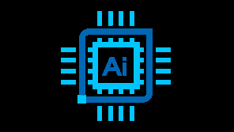

### 工具

- 新一代 CPU 采用先进的 Intel 7 和 Intel 4 工艺技术，具有异构架构，支持不同工作负载运行，并提供更好的隔离性。
- 硬件虚拟化技术加持：VMX、VT-D 和 SR-IOV。
- 在选定的 SKU 上应用 Intel® TCC 和 TSN 技术，以确保实时性能。
- 支持 PCIE 5.0 以及多达 16 通道，以满足原本多个系统所需的丰富接口需求。
- Intel® RDT 技术用于资源分配，例如缓存分配技术 (CAT)。

## ACRN

- ACRN 作为一种类型 1 的虚拟机监控程序，支持基于虚拟化的工作负载整合。
- 在虚拟 PLC (vPLC) 场景中，exCAT 用于为与 K8S 集群协同工作的负载启用缓存分配技术 (CAT)。

## 英特尔® 边缘控制软件平台 (ECI) 最佳参考配置

### 参考代码

- 在 ACRN 上的工作负载分配指南。

### 软件方案

### 硬件优势

# 07

## SR-IOV 技术

SR-IOV 也是设备虚拟化技术的一种，支持 SR-IOV 技术的 I/O 设备可以允许在一个物理设备的硬件层面上虚拟出多个独立的虚拟功能 (Virtual Function, VF)。这些虚拟功能可以直接分配给多个虚拟机使用，从而在硬件层面上解决 I/O 设备的虚拟化。英特尔的多款 I/O 设备，包括 CPU 内部的集成 GPU，独立 GPU 以及多数的网卡都能够支持 SR-IOV 技术，通过硬件虚拟化的方式分割硬件的资源给到不同的虚拟机，支持 I/O 设备的虚拟化。

## Intel® RDT 技术

- **英特尔® 资源调配技术** (Resource Director Technology, RDT)：提供对共享资源（如缓存、内存带宽）的监控与分配能力，确保关键实时应用的 QoS（Quality of Service，服务质量）。
- **高速缓存分配技术** (Cache Allocation Technology, CAT)：RDT 的子技术之一，可以通过 CAT 优化缓存分配策略，隔离实时应用与非实时应用的缓存争用，显著提升运行时确定性。
- **内存带宽监控** (Memory Bandwidth Allocation, MBA)：RDT 的子技术之一，可以使用 MBA 限制非实时系统的内存带宽占用，降低实时任务的性能抖动，保障执行稳定性。

VT-d 技术为虚拟机的 I/O 设备提供了接近物理硬件的性能，延迟极低。同时，VT-d 技术通过硬件的强制隔离增强了系统的安全性，防止恶意设备通过 DMA 攻击破坏整个系统或其他虚拟机。

随着 AI 与机器视觉技术在控制领域的深度融合，智能化控制已成为推动产业数字化转型的核心引擎。英特尔基于异构计算优势，为不同应用场景构建了分层化的 AI 赋能体系，提供从轻量级到高性能的全谱系解决方案。

依托英特尔统一的软件工具链和完整生态体系，这一技术架构为边缘产业的多场景应用提供了坚实的技术基础，加速 AI 技术在各行业的深度融合与规模化落地，全面赋能智能制造和工业 4.0 转型。

- **集成显卡方案** iGPU：例如，英特尔® 酷睿™ Ultra 200H 系列处理器集成的高性能 GPU 可提供高达 77 TOPS 的 AI 计算能力，配合内置的 8 个 Xe 核心和增强型 NPU（最高 13 TOPS 算力），专为深度学习和机器学习任务优化，能够高效处理实时视觉推理、点云数据分析等边缘智能应用。
- **独立显卡方案** dGPU：例如，基于先进 Xe 架构的英特尔锐炫™ 系列显卡具备卓越的图形处理和 AI 加速能力。凭借丰富的性能配置选项、大容量显存支持以及多卡协同能力，为复杂 AI 算法和大规模数据处理提供强大算力支撑，实现高性价比的智能控制解决方案。

## AI 智能加速

# 08

## 英特尔助力 软件定义自动化

# 03

## 负载整合

## 软件赋能

# 09

软件定义自动化的核心优势在于通过软件层面的创新实现多元化负载的统一管理和优化调度。在软件系统的不同层级，从底层架构设计到上层应用实现，均有丰富的开源和商用解决方案可供选择，为控制器厂商提供了灵活的技术路径。

厂商可以根据自身的研发能力、产品定位和市场策略，在**架构设计**、**商用软件集成**、**开源方案定制**等不同层级进行差异化选择：选择成熟的商用方案可以获得专业的技术支持和更快的产品上市速度；采用开源方案则能够实现更深度的自主化控制和更优的开发成本。无论选择哪种路径，关键在于构建能够有效整合实时控制、AI 推理、数据处理等多种负载的统一软件平台，实现硬件资源的最大化利用和系统性能的全面优化。

为了充分发挥英特尔® 处理器在计算与 I/O 资源方面的性能优势，基于 PC 架构的工业设备普遍采用负载整合技术方案，通过将异构工作负载整合至单一硬件平台实现资源优化配置。随着软件定义自动化技术的深入发展，实时任务与非实时任务的协同部署已成为行业趋势，这使得现代工业设备需要在确保实时任务严格时序要求的同时，高效调度剩余硬件资源处理非实时计算任务。这种多模态负载的并行处理需求，对系统资源调度算法和架构设计提出了新的技术挑战。

## 架构及方案概览

## 负载整合方案类型介绍

负载整合解决方案有多种实现形式，主要分为以下几类：

### 单系统方案

#### Linux

作为全球最通用的操作系统之一，Linux 在工业自动化领域占据着举足轻重的地位，承载着各类关键工作负载的运行。然而，Linux 系统在设计初期并未针对实时性进行优化，导致其早期版本难以胜任实时任务处理。随着 Preempt RT 实时补丁的问世，这一局面得到了根本性改变，使 Linux 系统具备了处理实时任务的能力。

基于 Preempt RT 技术，我们得以实现 Linux 环境下实时任务与非实时任务的整合部署方案。该方案通过 Linux 系统的核隔离技术、中断亲和性设置以及 RCU 回调亲和性配置等手段，将实时任务部署在隔离的物理核上运行，同时将非实时任务调度至非隔离核执行，从而实现两类任务的高效负载整合。

#### Windows

作为工业自动化领域的主流操作系统之一，Windows 系统凭借其广泛的软件生态和友好的交互界面，在工业控制领域占据着重要地位。目前市场上绝大多数视觉处理软件、算法库以及人机交互界面 (HMI) 都基于 Windows 平台开发，这使得 Windows 系统在工业现场仍保持着不可替代的地位。

该整合方案具有以下显著优势：

1. 架构简洁统一，仅需系统配置即可实现实时域与非实时域的隔离
2. 全方案运行于 Linux 环境，具有出色的开放性和平台通用性
3. 资源利用率高，系统管理维护简便

然而，该方案也存在若干局限性：

1. 实时域与非实时域的隔离机制尚不完善，任一域的任务异常都可能导致系统级故障
2. 部分专为 Windows 平台开发的应用程序无法直接在 Linux 环境中运行
3. 实时性能仍弱于专用实时操作系统

# 10

**物理核隔离：**

将指定数量的处理器核从 Windows 调度系统中隔离出来

01

02

03

**实时任务管理：**

提供专用 API 供用户开发和管理运行在隔离核上的实时任务

**混合关键性支持：**

实现实时域与非实时域的物理级隔离

这种架构的优势在于：

- **开发环境统一：**实时任务和非实时任务均可基于 Windows 平台开发
- **资源利用率高：**共享同一硬件平台，降低系统复杂度
- **兼容性好：**保留 Windows 丰富的软件生态支持

- 实时核隔离技术高度依赖 Windows 提供接口，若 Windows 系统在实时核隔离等技术上迭代更新，基于 Windows 的负载整合解决方案也需要同步迭代更新。
- 目前绝大多数基于 Windows 的提供实时能力的负载整合解决方案均为商用方案，可供选择的开源方案较少。

该方案为需要在 Windows 环境下实现实时控制的工业应用提供了一种可行的技术路径，既延续了 Windows 系统的易用性优势，又通过核隔离技术满足了基本的实时性需求。

采用基于 Windows 的负载整合解决方案主要有以下局限性：

然而，Windows 系统在设计上并非为实时应用而优化，其默认的任务调度机制无法满足工业控制中对实时性的严苛要求。值得注意的是，Windows 系统提供了处理器核管理接口，允许用户灵活配置系统可用的物理核数量，这为构建混合关键性系统提供了可能。

针对这一特性，部分工业软件厂商开发了创新的实时化解决方案。以 Kithara 为代表的实时扩展软件，通过调用 Windows 底层接口实现：

# 11

## 多系统方案

英特尔芯片采用对称多处理器 (SMP) 架构设计，通常单台物理设备仅运行单一操作系统，由该操作系统统一管控芯片资源。然而，通过部署 Hypervisor 虚拟化层，可在同一英特尔芯片硬件平台上实现多操作系统并行运行，从而构建近似非对称多处理器 (AMP) 的架构环境。

当前主流的 Hypervisor 实现方案根据其与硬件及操作系统的交互模式，可分为两类典型架构：

在实际应用场景中，Type 1 与 Type 2 虚拟化技术各具优势。用户可从硬件平台，功能特性，维护需求等多个方面来评估不同的选择。

1. Type 1 Hypervisor（裸机虚拟化）

   - 直接部署于硬件平台之上（bare metal 架构）
   - 不依赖宿主机操作系统
   - 所有客户机操作系统均以虚拟机形式运行于 Hypervisor 层

核心优势

核心优势

2. Type 2 Hypervisor（托管式虚拟化）

   - 运行于宿主操作系统之上
   - 通过主机 OS 进行硬件资源抽象

- 直接硬件访问带来更高运行效率
- 部署便捷性
- 严格的虚拟机隔离机制
- 配置灵活性
- 资源调度粒度更精细
- 硬件兼容性广

硬件平台

Hypervisor

VM 1

VM 2

VM 3

...

硬件平台

Hypervisor

VM 1

VM 2

VM 3

...

宿主机 OS

Type I hypervisor

Type II hypervisor

**图：**Type 1 和 Type 2 Hypervisor 架构示意图

# 12

## 负载整合方案选型推荐

工业用户在选择负载整合方案时，可从以下几个方面考虑哪种方案适合自己的需求，从而在众多的单系统及多系统负载整合方案中选择自己需要的方案：

- **硬件平台：**针对不同工业场景的需求工控机的配置非常多样，既有核数和 I/O 资源比较丰富的平台，也有追求低功耗从而硬件资源有限的平台。针对不同平台的硬件特点，负载整合方案的选择也应不同。对于低功耗平台，往往硬件资源有限，从 CPU 核数、内存、I/O 资源的角度考虑都比较适合采用单系统方案或者没有额外 Host 系统的多系统方案，可以有效节约额外的系统开销；对于硬件资源比较丰富，需要集成较多功能的平台，多系统负载整合方案可以为用户提供更多样化的资源分配（包括 CPU、内存、I/O 资源的分配）以及应用部署方案，并且在系统之间的隔离性上往往具有更好的表现。
- **功能特性：**针对每个用户对方案功能特性需求的不同，各种类型的负载整合方案往往也具有不同的实现方式，用户可根据自身需求采用不同的方案，典型的功能特性需求包括：

  **虚拟化功能需求**

  采用或不采用硬件虚拟化辅助支持的负载整合方案兼有；虚拟化的优势包括便于上层应用的部署、便于底层权限的控制、以及更好的安全性支持等，但同样具有效率不及本地部署等问题。用户需要根据自身功能以及性能特性的需求选择是否需要虚拟化的加持。

  **I/O 设备资源分配需求**

  不同负载整合方案对 I/O 设备的处理各不相同，一般分为直通、半虚拟化和全虚拟化几种。针对 I/O 设备资源较充足，用户想要直接全部占据 I/O 设备进行使用的场景，可以使用不带虚拟化或者支持直通设备的虚拟化解决方案；如果用户需要在多系统之间共享 I/O 设备或者使用虚拟化 I/O 设备，则需要选择对设备虚拟化功能较全的解决方案。

  **芯片功能支持需求**

  不同的负载整合方案对芯片功能的支持程度也不尽相同，对用户在使用芯片功能时可能产生影响。与工业相关的典型芯片功能比如 RDT 技术、HwP 功能以及是否能够按照需求设置隔离核等功能都会成为负载整合解决方案是否满足用户需求的考量因素。

- **二次开发及技术支持需求：**用户根据已有负载整合解决方案是否满足需求以及自身是否具备二次开发能力对市面上的产品进行选择。若目前市面上产品没有完全符合需求且具备二次开发能力的用户，可尝试选择开源方案；若不具备二次开发能力，则要考虑具有本地技术支持的商用方案，可快速响应用户的需求。

## Kithara RealTime Suite

Kithara 实时工具套件是德国 Kithara 公司开发的一套高性能实时系统解决方案，专为工业自动化、机器控制、数据采集和高精度测试测量等应用设计。它基于 Windows 实时扩展，可在标准 PC 硬件上实现微秒级 (μs) 的硬实时性能，适用于需要严格时序控制的工业场景。通过 Kithara 实时工具套件，用户可在一套硬件平台上基于 Windows 环境同时部署视觉应用和实时控制，实现关键任务的负载整合，充分利用 x86 平台强大的硬件性能。

在架构上，Kithara 实时工具套件通过隔离 CPU，并将实时任务部署到隔离 CPU 上的方式从硬件上实现了 Windows 和实时任务之间的资源隔离。在实时任务运行在隔离核上的同时，Windows 可以在剩余核心上保持全面的操作能力。Kithara 的架构示意图如下图所示。

在软件层面，Kithara 保持了 Windows 编程框架，并提供了自己的 API，用户可直接在 Visual Studio 中开发实时任务，这一点确保了应用的开发便利性和系统兼容性。Kithara 将实时系统以设备驱动的形式实现，并将用户的 Windows 应用程序中的具有实时性要求的代码段导出到一个动态链接库 (DLL) 中。随后，这个 DLL 将在 RTOS 的实时环境中加载运行，完成实时任务的部署。

同时，为了用户能够直接在 Windows 上开发针对实时核的运动控制程序，Kithara 提供了 KRmotion 运动控制系统开发平台，包含了可视化工程配置，设备调试，变量监控，模拟仿真等功能，并集成了 I/O 控制、通用运动控制、机器人控制、CNC、实时视觉等功能模块，为用户提供了一套基于 Windows 的纯软件解决方案，无需运动控制卡，PLC 等专用硬件即可实现高速高精度运动。

**图：Kithara 实时工具套件架构**

## RTX64

RTX64 是英特蒙 (IntervalZero) 实时操作系统 RTOS 平台里的主要产品，与 Windows 操作系统并存的同时还可以在多核心处理器上支持确定性与硬实时。这一完整的解决方案提供了世界级的使用者体验，优于诸如 DSP、FPGA 和 MCU 等实时硬件，并且大幅减少了需要确定性或硬实时性的系统开发成本。对称多处理架构的 RTX64 充分利用了 64 位内存和效能的优势。独特的是 RTX64 RTOS 排程器能够让嵌入式实时应用程序直接存取 512 GB 在 64 位 Windows 上的可寻址物理内存。这对现在的实时系统而言至关重要，对比传统 32 位 Windows 系统限制物理内存只能有 4 GB，也是一个很大的进步。在工业制造业中，RTX64 特别适用于需要高精度定时和快速响应的应用，如机器人控制、视觉检测系统和复杂的自动化流程。

**图：RTX64 架构**

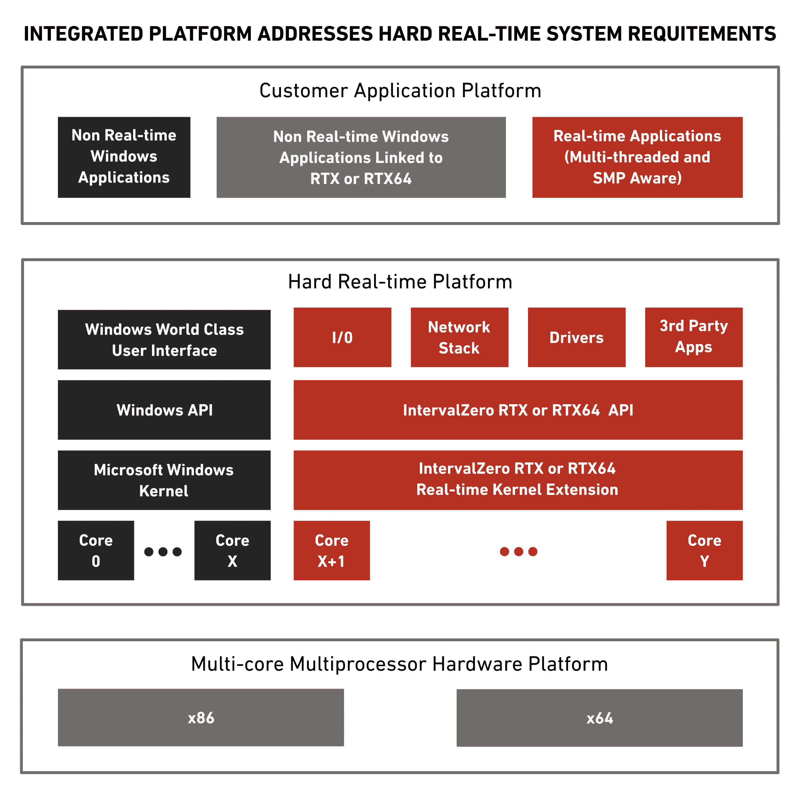

## The INtime® RTOS

Tenasys INtime® 是一款实时操作系统 (RTOS)，它与 Microsoft Windows 操作系统紧密集成，为需要高度实时性能的应用提供了解决方案。INtime® RTOS 在 Windows 环境中运行，允许开发者在同一台机器上同时运行实时和非实时任务，而无需双重引导或添加额外的硬件。这种集成为工业制造业中的应用，如数控加工、运动控制、数据采集和过程监控等，提供了无缝的实时功能。INtime® 通过确保关键任务能够在确定的时间内得到响应和处理，提高了系统的可预测性和可靠性。它支持多处理器系统，允许实时任务在专用的 CPU 核心上运行，而不会受到 Windows 操作系统活动的干扰，这样可以保证实时任务的最高优先级和响应速度。INtime® 的这些特点使得它成为在 Windows 平台上实现高性能实时应用的理想选择，同时也保留了 Windows 操作系统的用户友好性和广泛的应用生态。

**图：Tenasys INtime 架构**

## RTS Hypervisor

RTS Hypervisor 是一款实时操作系统 (RTOS) 虚拟化解决方案，它允许在同一硬件平台上同时运行实时操作系统和通用操作系统，如 Windows 或 Linux。在工业制造业中，RTS Hypervisor 的特点是它能够确保关键的实时应用与其他非实时任务的隔离，这对于需要精确控制和高可靠性的自动化和控制系统至关重要。它支持多核处理器，可以将实时和非实时工作负载分配到不同的核心，从而提高性能和效率。此外，RTS Hypervisor 的紧凑设计最小化了系统的开销，保证了实时任务的快速响应时间，这对于机器人控制、运动控制和复杂的工业过程自动化尤为重要。通过使用 RTS Hypervisor，制造企业可以在单一物理机上整合多个系统，降低硬件成本，简化系统架构，并提高整体的系统稳定性和可维护性。

**图：RTS Hypervisor 架构**

## Intewell-H

**图：Intewell-H 架构**

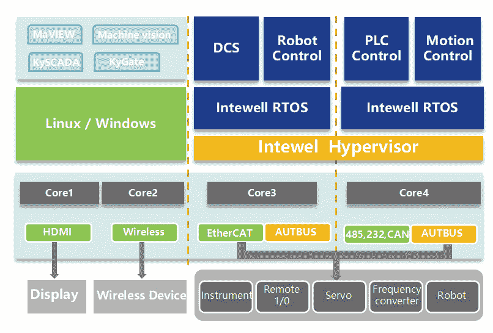

Intewell-H 工业互联网边缘操作系统是一个集成在 Windows/Linux 中的实时扩展及虚拟化解决方案。操作系统实现了 Windows/Linux 环境与实时环境并行运行，实时环境通过 Hypervisor 技术运行多个虚拟机，各个程序并行运行在自己的虚拟机 (VM) 中，相互隔离，互不影响，安全可靠。

Intewell-H 工业互联网边缘操作系统可以安装在用户自行开发的硬件上，也可以预装在东土的边缘侧工业服务器上，实现数据采集、工业控制、边缘计算、机器视觉等多种不同业务应用一体化。

**关键特性：**

- 提供虚拟化环境下的强实时保障，实时虚拟机中断响应时间达到微秒级、实时虚拟机切换时间小于 5us、实时虚拟机定时器周期达到 50us。
- 开放的生态，良好兼容 Windows/Linux 应用。
- 预装东土工业控制编程平台 MaVIEW，人机监控平台 KySCADA 及 KyGate 协议网关应用。
- 支持多个实时操作系统，主流桌面系统（非实时）同时运行。
- 支持通过内部虚拟数据总线实现不同操作系统间的高速数据交换。
- 集成多种协议，如 Modbus、CANopen、EtherCAT、西门子 S7、Profinet 等。

## ACRN

**图：ACRN 架构**

ACRN™ 是一个灵活、轻量级的参考虚拟机 (hypervisor)，在设计时考虑了实时性和安全关键性，并优化了通过开源平台简化嵌入式开发的过程。ACRN 定义了一种设备虚拟机参考堆栈和架构，用于通过虚拟机管理器 (VMM) 在一个整合的系统上安全管理运行多个软件子系统。它还定义了一个用于虚拟设备仿真的参考框架实现，称为 "ACRN 设备模型"。

ACRN 虚拟机是一个 Type 1 的参考虚拟机，直接运行在裸机硬件上，适用于各种物联网和嵌入式设备解决方案。ACRN 虚拟机解决了当前存在于数据中心虚拟机和硬分区虚拟机之间的差距。ACRN 虚拟机架构将系统划分为不同的功能域，针对物联网和嵌入式设备精心选择了用户 VM 共享优化。

## KVM

基于内核的虚拟机 (KVM) 是一种开源虚拟化技术，适用于带有虚拟化扩展的 x86 硬件上的 Linux（例如，英特尔® 虚拟化技术 (Intel® VT)）。

KVM 由可加载的内核模块组成，例如 kvm.ko，它提供了核心虚拟化基础设施。KVM 将 Linux 转变为一个 Type 2 的虚拟机，允许宿主机运行多个隔离的虚拟环境，运行未修改的 Linux 或 Microsoft Windows 镜像。

每个虚拟机都可以拥有私有的虚拟 BIOS（基本输入/输出系统）和私有的虚拟化硬件：处理器、内存、网络卡、磁盘、图形适配器等。

**图：KVM 架构**

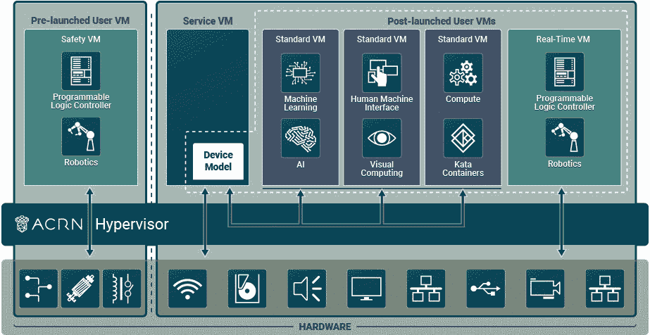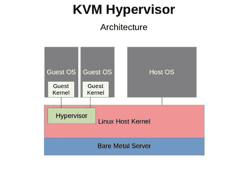

# 04 负载整合控制器的应用类型探索

## PAC 控制系统

PAC（Programmable Automation Controller，可编程自动化控制器）融合了传统 PLC（Programmable Logic Controller，可编程逻辑控制器）的高可靠性和实时性，以及 PC（Personal Computer，个人计算机）的灵活性和强大计算能力，形成了一种综合工业 PC、PLC、视觉系统和 HMI（Human-Machine Interface，人机界面）的高性能控制平台。PAC 广泛应用于各类复杂自动化场景，包括过程控制、数据采集、机器控制以及运动控制等。

PAC 的主要特点包括：

- **优化成本和空间效率：**PAC 整合了多个系统，包括运动控制系统、视觉控制器和人机交互 PC 等。这种一体化减少了对多个独立设备的需求，从而降低了整体方案成本。并且由于减少了硬件数量，系统的物理体积也得以显著缩减，这对于空间受限的工业环境尤为有利。
- **促进 IT 与 OT 融合：**PAC 不仅支持传统的自动化控制协议，还能够无缝接入企业级的 IT 系统，如 ERP 和 MES。这种融合使得数据和信息流在生产层面与企业决策层面之间得以自由流通，加速了决策过程，提高了生产效率。
- **缩短开发周期：**PAC 提供了强大的软件工具和开发环境，使得程序员能够快速开发和部署自动化应用程序。这些工具通常包括丰富的库函数、直观的图形编程界面以及仿真和调试功能，大大提高了开发效率，加速产品从概念到市场的转化过程。
- **简化维护工作：**由于其硬件和软件的高度集成，故障诊断和维修工作变得更加直观和快捷，减少了系统停机时间。此外，PAC 通常采用开放式的软件架构，使得系统升级和功能扩展更为便捷，从而延长了设备的使用寿命并降低了长期运营成本。

PAC 实现方法多种多样，下图展示了一种基于 ACRN 虚拟机构建的 PAC 架构。该架构利用了 Type 1 虚拟化技术，因此具备卓越的实时性和隔离性，为多任务和多系统的 PAC 应用开发提供了坚实的基础。此外，借助内存共享机制，该方案实现了虚拟机间的高速数据交换，不仅在空间上实现了优化，同时也提升了系统间的通信效率，为负载整合带来了全面的性能提升。

**图：基于 ACRN 虚拟机的 PAC 架构**

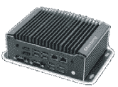

## 云边协同控制系统

云边协同通过将云的集中式处理能力与边缘计算的本地化实时功能相结合，可以优化运营，提高性能，并创建响应更快、更智能的系统。

云边协同工作原理：

工业控制系统向云边协同架构的趋势是工业系统设计、部署和管理方式的重大转变。这一趋势是由对更灵活、可扩展和智能的自动化解决方案的需求推动的，这些解决方案可以处理日益复杂的工业过程和数据。

工业控制系统向云边协同架构迁移可以借助云计算和边缘计算的优势，例如

**云端：**

- **集中式数据管理：**云计算允许集中式数据存储和管理，这对于产生大量数据的大规模工业运营至关重要。
- **高级分析和人工智能：**云提供了高级分析、机器学习和人工智能所需的计算能力，可用于优化流程、预测维护和改进决策。
- **可扩展性和灵活性：**云平台提供可扩展性，使行业能够根据需要扩展其自动化能力，而无需在硬件上进行大量前期投资。
- **远程监控：**通过云连接，操作员可以远程监控工业过程，缩短响应时间，方便远程工作。

**边缘端：**

- **实时处理：**边缘计算允许在数据生成源附近（即网络的"边缘"）进行数据处理，这对于需要立即分析和响应的时间敏感型工业应用至关重要。
- **减少延迟：**通过在本地处理数据，边缘计算减少了数据发送到云端和从云端发送时可能出现的延迟，确保了更快的决策和行动。
- **带宽优化：**边缘计算最大限度地减少了需要传输到云端的数据量，这可以减少网络拥塞并节省带宽。
- **增强的安全性：**在本地处理数据可以通过减少敏感信息的暴露和在边缘提供额外的安全层来增强安全性。

大模型，即大规模机器学习模型，尤其是在深度学习中，以其庞大的参数量和数据处理能力著称。在工业和制造领域，它们正带动一系列变革：

下图为基于英特尔® 工业边缘控制 (ECI) 搭建的云边协同控制系统示意图。

## AI 大模型赋能控制系统

 

- **生产优化：** 通过分析生产数据，大模型能够优化流程、提升效率、减少浪费，并通过预测性维护减少设备故障和维护成本。
- **质量控制：** 利用实时监控和图像识别技术，自动检测缺陷，确保产品质量。
- **供应链管理：** 处理大量数据，预测市场需求，优化库存，提升供应链效率。
- **个性化定制：** 分析客户数据，精准满足需求，提供定制化产品和服务。

**云边协同控制系统示意图组件说明：**

现场总线 / 虚机或容器 / 虚拟化架构 & 控制平台 / 编排 / 存储 / 网络 / Edge Servers

   

**边缘服务器相关：** 管理 / 遥测 / WFM / MES / 历史数据 / HMI / AI / Edge Servers

### 边缘服务器

 

确定性实时控制 / 工厂 OT/IT 网络

**边缘工作节点 [n]：** mgmt / Real Time HW/SW / General Purpose Compute / AI / Control / HMI

**边缘工作节点 [1]：** mgmt / Real Time HW/SW / General Purpose Compute / AI / Control / HMI

**节点说明：** 实时硬件/软件 / 通用计算平台 / AI / 控制 / HMI / 管理

- **机器人与自动化：** 为高级机器人和自动化系统提供智能化支持，增强灵活性和智能操作。
- **产品设计与开发：** 通过模拟和预测分析，评估设计方案，优化性能，缩短研发周期。
- **能源管理：** 优化能源使用，预测需求，实现高效能源管理，降低成本。
- **AI 辅助决策：** 分析市场趋势和内部数据，为管理层提供战略建议。

大模型正成为推动工业数字化转型和智能制造的关键力量。随着技术进步，其在各行业的应用将更加广泛。在这一趋势中，英特尔对于大语言模型赋能机械臂的技术解决方案进行了初步研究，并构建了如下图所示的概念验证参考架构：

整体架构从任务的角度整个任务可以分解成三个阶段：

  

- **第一阶段 — 外部数据收集：** 这一阶段主要依赖两个外部输入，分别是人类的语音输入和摄像头的图像/视频信息输入，语音输入通过 Audio Speech Recognition (ASR)，基于 FunASR 运算框架，运行中文分析模型分解匹配预先设置的提示词 (prompt)，视频和图像信息则是直接给到后一阶段。
- **第二阶段 — 任务理解和分解：** 有了上一阶段的提示词输入，大模型（目前在 Qwen 和 Phi3 上验证）会将其拆解为一连串的子任务序列，子任务序列和图像视觉信息结合就构成了更加准确的执行目标，例如一个子任务，移动到红色盘子上方，结合视觉信息找到的红色盘子，计算得出上方的坐标信息，经过 interpreter 时也会做代码级别的验证，之后就可以给到 MoveIt2 路径规划，来规划出中间的一个一个路点。
- **第三阶段 — 执行：** 有了路点的信息后，通过共享内存机制，实时系统将会得到路点数据，通过 RTMotion 运动控制功能块，驱动机械臂上电机执行对应的加减速控制，来完成最终机械臂的整体运动，从而整体实现使用自然语言对机械臂的操控。

**LLM + Robotic Reference Pipeline 架构组件：**

LLM / RTmotion / EtherCAT/CANopen / ASR / Code Generator

Real-Time / Non-Real-Time / CPU P & E Cores / iGPU / CPU E Cores / NPU / Intel® Core™ Ultra ARL-H / Audio / Prompts

  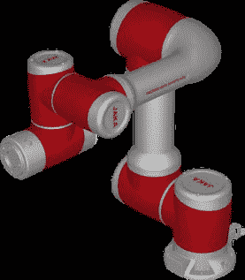

PLCopen-databus / Sub-task 1 / Sub-task 2 / Sub-task n / Motion Control Gateway / Shared Memory / MoveIt2 / Vision (VLM, CV, 3D) / Interpreter / GigE, USB / NIC / I210/225/226 / Mini-PCIE M.2

1. Qwen1.5-7B, Intel Arc, Ipex-LLM/OV
2. Phi4-mini, iGPU, Ipex-LLM/OV
3. SAM (ViT-B/91M, iGPU)
4. CLIP (ViT-B/149M, iGPU)

1. Whisper (NPU)
2. FunASR (CPU)

  

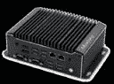   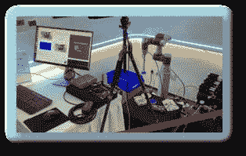 

从系统的角度，这个架构中英特尔的软硬件扮演着非常重要的角色：

目前大模型的方案相对于传统机械臂编程方案有以下两点：

 

### 硬件层面

基于英特尔® 酷睿™ Ultra 200H/第 14 代英特尔® 酷睿™ H 系列处理器的算力，其 NPU 和 iGPU 在语言的解析和图像/视频的处理上起到了关键作用。CPU 中性能核和部分能效核用于计算非实时域内的部分负载，而少部分能效核被单独隔离出来执行实时任务，配合专属的英特尔® 网卡运行 EtherCAT 或 CANopen 的总线协议，来达到机械臂运动确定性的要求。

### 软件层面

英特尔® 工业边缘软件平台 (ECI) 毫无疑问充当了整个系统的底座，实时运动控制部分运行在 PreeemptRT/Xenomai 环境下，而非实时部分通过叠加 OpenVINO™ 对大语言模型的推理提供了加速，其中 FastSAM 起到分割图像作用，而 CLIP 满足识别的功能，同时系统也对视频和图像处理提供了效率上的提升。在有限的热设计功耗 (TDP) 和散热条件下，为满足实时性和计算能力要求，将 AI 与控制集成到单一平台上，需要进行更优的平衡优化。

基于英特尔 p-state/c-state 技术，面向 AI 与控制一体化平台，Per-core state 和 DVFS 能够更好地平衡 AI 算力和实时性能需求，全面支撑英特尔对于新型态产品的适配。

### 方案优点

- 任务拆解规划能力，子任务分解体现出相对于传统机械臂靠人来分析拆解运动步骤的优势
- 视觉模型均为零样本学习，不需要巨大的标准数据集支持，模型的泛化能力更强

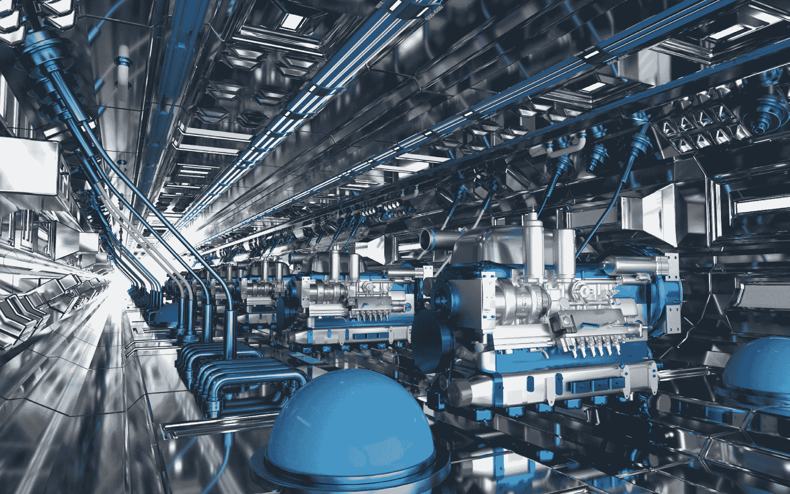

       

# 英特尔助力软件定义自动化

# 05 实战篇

    

## 背景与挑战

随着半导体制造工艺的不断精进，对生产设备的控制精度和实时性要求愈发严苛。在半导体生产过程中，关键工艺步骤如光刻、蚀刻、薄膜沉积等，均需极高实时性保障，以确保工艺稳定性和产品质量。

半导体生产设备的稳定运行至关重要。传统 "工控机 + PLC" 架构控制节点多，系统复杂度高，而复杂架构增加了故障点，一旦出现故障，排查和修复难度大，将影响生产的连续性和稳定性。同时，工控机搭载的操作系统通常采用 "Linux+RT 补丁" 方案，在处理高并发、高精度实时任务时，难以保障半导体设备的高精度控制需求。

半导体生产设备通常由多个子系统组成。传统控制系统在实现设备间互联互通时，需要大量定制化开发和接口适配工作，开发成本高，为了保障系统兼容性和稳定性往往付出较高代价。

基于高实时、高可靠、高算力、高智能的一体化平台，实现软件定义控制，将为行业带来全新的机遇。

# 鸿道 Intewell：半导体装备智能控制解决方案

## 解决方案

光亚鸿道是东土科技的全资子公司，经过在半导体行业长期的探索和积累，已经在半导体设备核心控制系统中取得了突破和应用，可基于英特尔高性能计算平台提供高实时性的 Intewell 新型工业操作系统、高速总线 I/O 系统、自适应控制工具软件 MaVIEW®，形成针对半导体行业的高实时软件定义控制解决方案。

**图：鸿道 Intewell® 高实时软件定义控制解决方案架构**

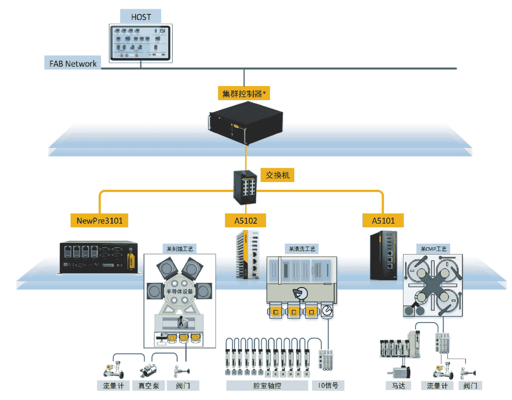

## 新型工业操作系统 - 鸿道 Intewell®

鸿道 Intewell® 操作系统对英特尔等主流工控平台提供完善适配。Intewell RTOS 采用微内核设计，具备高实时、高安全特性，微秒级调度精度，适合各类高速高精度控制场景。基于 Intewell Hypervisor 可配置混合异构系统架构，将多个软实时系统与硬实时系统同时部署在一个 SoC 上运行，实现多系统多重业务融合，既保证各系统应用的独立性，又实现高集成度，充分发挥硬件性能，Intewell Hypervisor 支持 Windows，Linux，OpenEuler 等主流软实时系统生态。

## 自适应智能控制工具软件 - MaVIEW®

东土科技自主研发 MaVIEW® 智能化控制工具软件，可同时提供基于 IEC61131-3 / IEC61499 标准编程平台和高级语言编程环境，多 TASK 调度管理，帮助客户快速、高效开发半导体设备的核心控制系统。

## IEC 国际标准工业总线 - AUTBUS

AUTBUS 总线已成为国际标准 (IEC 61158 Type 28 & IEC 61784 CPF 22) 和国家标准 (GB/T 42019-2022)，是全球首个基于时间敏感网络技术 (TSN) 和 IPv6 技术的两线制宽带总线，通过 AUTBUS 总线，可以更容易地实现设备间的互联互通，降低系统集成的成本和复杂性。

## 方案优势

### 高性能高可扩展的一体化平台

基于 Intewell Hypervisor 虚拟化技术，可同时运行 Linux 与 Intewell RTOS，且实时系统与非实时系统时安全隔离。提供多种桌面系统的适配，可开放实时内核的数据接口，完全兼容客户原有应用，实现了硬件升级的平滑过渡，替代了传统的 "工控机 + PLC" 组合方案，显著降低了设备机电的硬件成本和系统复杂度，提高了系统稳定性与人工维护效率。

**图：隔离的运行环境**

**图：工信部电子五所 Cyclitest 抖动延迟测试**

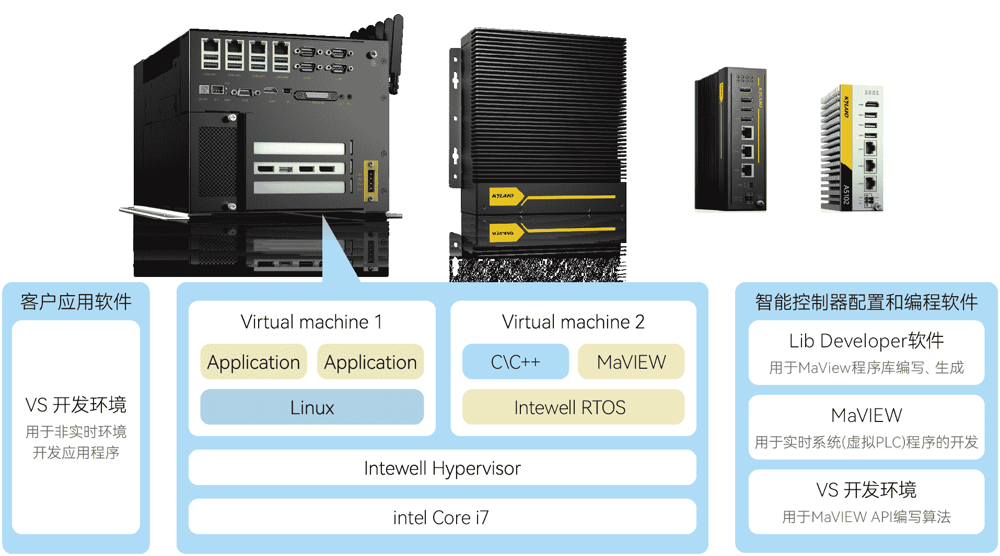

### 高实时高精度控制

Intewell RTOS 实时性抖动可低至 5 μs，支持多任务间信号量同步技术，实现 IEC61131-3 与 C\C++ 多任务间的时序同步控制，周期精度可达 1ms 以内。支持高级语言 C\C++ 在实时环境中的交叉编译，充分满足半导体生产实时性业务的需求。

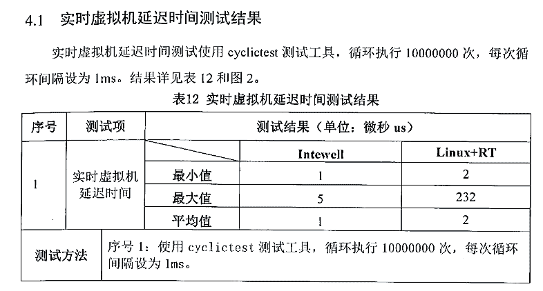

### 高速高确定性数据交互

支持 SHM 高效数据交换技术，桌面系统、非实时应用，实时 VPLC、总线数据可高效交互，通讯周期可低至 1ms。支持预先配置热连接，从站移动，不影响通信，单设备最快恢复时间。支持 AUTBUS 总线技术，实现 100 Mbps 高带宽和 500 米长距离的多节点、低时延、高确定性通信。

### 从工业互联到工业 AI

提供自适应控制工具软件 MaVIEW® 实现软 PLC，提供针对半导体设备系统的定制化功能包，实现软件定义控制。得益于 Intewell Hypervisor 的多系统融合能力，控制系统可嵌入行业 AI 算法库，使用大模型辅助生成逻辑和运动控制。

**图：数据交互架构**

**图：大模型辅助生成逻辑和运动控制**

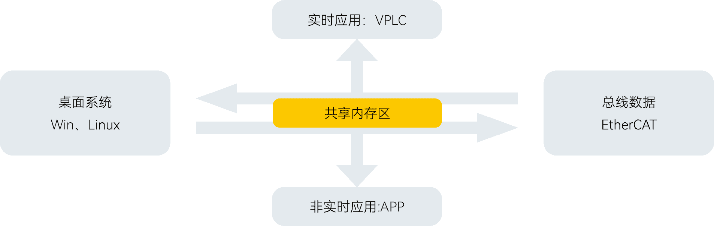 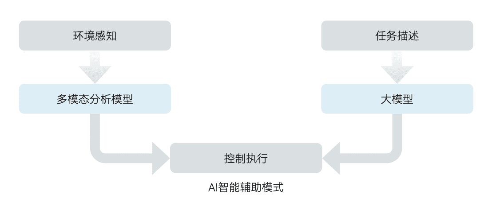

 

## 背景与挑战

随着 "双碳" 目标深入推进，电力行业环保要求日益严格。燃煤电厂的燃烧优化是通过调整燃料与风量的配比、炉膛温度等关键参数，使煤粉在炉内实现充分、稳定燃烧。其核心目标是在保证安全运行的前提下，最大限度地提高锅炉效率，并有效降低氮氧化物等污染物的生成与排放。其工艺流程复杂，涉及大量风机、泵、搅拌器等设备，是一个多变量、强耦合、大滞后的复杂控制系统。

传统 PLC 控制基于固定逻辑和阈值，面临严峻挑战：

- **控制优化挑战：** 难以应对煤质变化、机组负荷波动等复杂工况，无法实现最佳经济运行点 (Econ-Optimal)，导致石灰石浆液、氨水等物料过量投加，能耗居高不下。
- **预测维护挑战：** 关键设备（如浆液循环泵、氧化风机）的故障预警依赖定期检修，缺乏基于实时状态的预测能力，意外停机风险高，维护成本大。
- **系统融合挑战：** OT 层（PLC 控制）与 IT 层（AI 算法服务器）物理分离。AI 模型训练、部署与实时控制形成闭环周期长，数据价值难以转化为即时控制策略。

# 菲尼克斯电气 vPLCnext：基于 ACRN 负载整合的电力行业 AI 环保解决方案

## 解决方案

为解决上述挑战，菲尼克斯电气基于英特尔® x86 架构，并通过 ACRN Hypervisor 部署 Linux 和 Windows 双系统，实现了 vPLCnext 虚拟化控制与 AI 融合平台解决方案。该方案在一个强大的硬件平台上，同时运行实时控制与高算力 AI 任务，打破了 OT 与 IT 的壁垒。

解决方案核心架构：

**图：基于英特尔® 架构的 vPLCnext 虚拟化控制与 AI 融合平台解决方案**

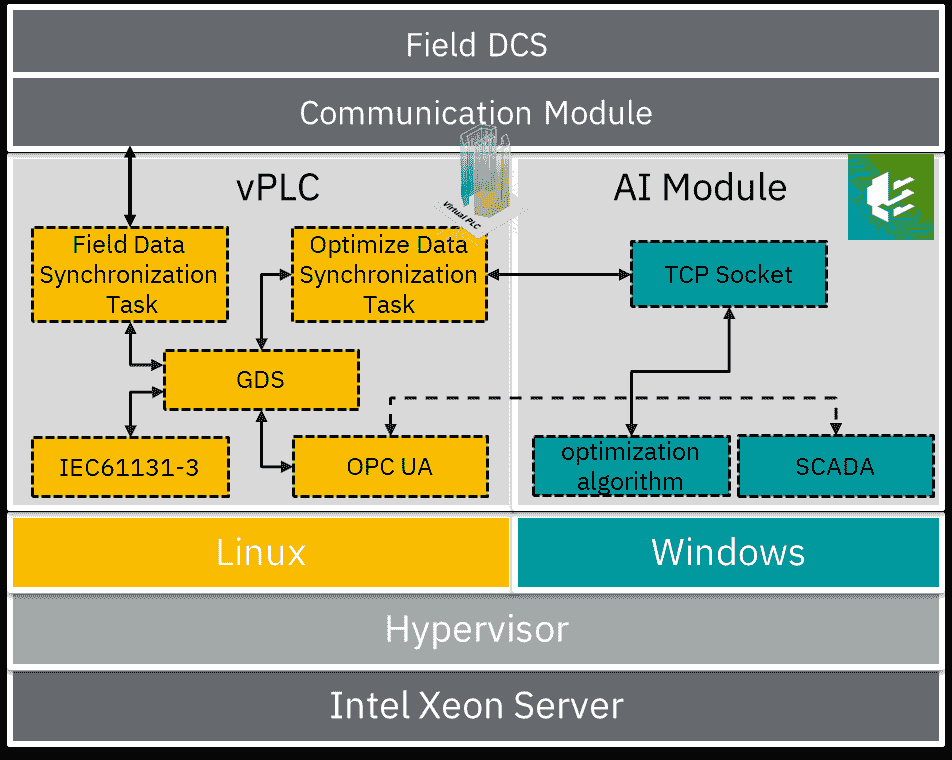

## 应用实现

- **实时侧：** 专为苛刻的工业控制场景打造。PLCnext 实时核心独占专用的 CPU 计算资源，确保对 I/O 信号处理、实时控制等任务的响应精确到毫秒级，其稳定性和确定性与传统高端 PLC 完全一致，保障燃烧优化工艺的硬实时控制和可靠性。
- **AI 侧：** 运行 Microsoft Windows 系统，部署 MLnext 框架及 Python、PyTorch/TensorFlow 等工具，供 AI 工程师进行数据分析和模型训练。
- **参数优化：** 在 Windows 侧，基于工艺理论，采用模型预测模式，能够实现燃煤火电机组燃烧优化的寻优自动控制，有效降低煤电调峰机组的物料与能源消耗。vPLCnext 实时读取生产数据（如烟气流量、SO₂/NOx 浓度、pH 值），AI 模型动态计算出石灰石浆液投加量、氨喷射量等的最佳设定值，通过共享内存机制极低延迟地下发至 vPLCnext 实时侧执行，实现 "节能降耗" 与 "达标排放" 的双重优化。

## 方案优势

## 总结

本方案充分发挥了英特尔® x86 架构和 ACRN Hypervisor 的天然优势，以及 vPLCnext 开放式虚拟控制平台的特性，为电力客户带来显著价值：

- **强大算力，一机多能：**搭载英特尔® 至强® 处理器，其多核高性能架构提供充沛算力。实测在稳定执行复杂控制逻辑（1ms 周期）的同时，可并行完成多个 AI 模型的实时推理任务，CPU 负载仍保持充裕，单台设备即可替代传统 "PLC + 工控机 + 服务器" 的多机方案。
- **安全隔离，稳定可靠：**ACRN Hypervisor 是英特尔开源的 Type 1 型操作系统管理程序，专为嵌入式/IoT 设计，具备轻量级、高实时性（周期抖动 <50μs¹）、高安全隔离性特点。它确保了 Windows 侧 AI 应用的开发、调试甚至崩溃绝不会干扰前方实时控制系统的确定性运行，满足工业现场最高的安全性与可靠性要求。
- **降本增效，快速响应：**硬件成本显著降低，机房空间和能耗同步减少。AI 工程师可在熟悉的 Windows 环境下利用丰富的工具链（Python，PyTorch，Tensorflow 等）进行开发，同时 MLnext 框架极大降低了 AI 应用开发门槛，让自动化工程师能通过配置化方式快速部署 AI 应用，使控制策略的优化迭代从 "月" 级别缩短到 "天" 级别，帮助企业快速响应工艺变化。

基于英特尔® 架构的 vPLCnext 方案成功地将实时控制、虚拟化和人工智能融合在一个坚固的工业平台上，为电力行业燃烧优化和预测性维护系统的智能化升级提供了理想的 "边缘融合计算" 底座。它不仅解决了当前的优化和维护痛点，更以其开放、高性能和可扩展的特性，助力客户从容应对未来的挑战。

**图：基于 vPLCnext 和 MLnext 的预测性维护 AI 应用框架**

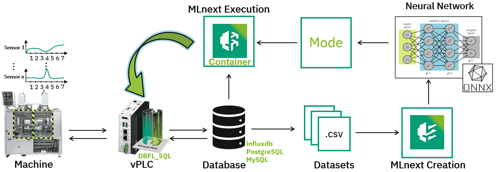

- **预测性维护：**利用 MLnext 构建时序预测模型（如 LSTM），分析浆液循环泵的振动、温度、电流等多维时序数据，提前预测轴承磨损、叶轮腐蚀等故障，在 Windows 界面生成预警。

---

¹ 数据援引自菲尼克斯电气的内部测试结果。英特尔并不控制或审计第三方数据。请您审查该内容，咨询其他来源，并确认提及数据是否准确。

## 背景与挑战

### 控制系统复杂度急剧增长

随着现代工业自动化技术的快速发展，控制系统的复杂度呈现指数级增长态势。当前主流控制系统往往包含多达 1000 多个函数，涵盖了从基础逻辑控制到高级算法优化的各个层面。这种复杂度的急剧增加给控制工程师带来了前所未有的挑战：工程师不仅需要快速掌握庞大的函数库体系，还要在有限的时间内编写出高效、可靠的控制程序。传统的学习和开发模式已经难以应对如此复杂的技术要求，工程师的工作负担和技术门槛显著提升。

传统的无代码开发方式虽然在一定程度上降低了编程门槛，但其本质上依赖于预设的功能模块和模板，存在明显的局限性。在面对复杂的工程应用场景时，预设模块往往无法覆盖所有需求，特别是在处理复杂控制器逻辑和不断更新迭代的功能需求时，传统无代码方式显得力不从心。

### GenAI 在工业应用的机遇与挑战

通用 GenAI 技术的突破为自动控制代码生成提供了全新的解决思路。GenAI 在消费级应用中已经展现出强大的代码生成和问题解决能力，为工业控制领域的应用创新奠定了技术基础。这种基于自然语言理解和代码生成的新模式，有望显著降低控制程序开发的技术门槛，提升开发效率。

然而，将 GenAI 技术应用于专业的工业控制领域仍面临严峻挑战：

- **安全性与可信度问题：**工业控制系统直接关系到生产安全和设备稳定运行，对代码的安全性和可靠性要求极高。AI 生成的代码是否能够满足工业级的安全标准，如何确保生成代码的逻辑正确性和运行稳定性，成为技术应用的关键挑战。
- **专业领域适应性：**工业控制涉及大量专业知识、行业标准和安全规范，通用 AI 模型在理解和应用这些专业知识方面存在局限性，需要针对工业控制领域进行深度优化和定制化开发。

这些挑战促使业界寻求既能发挥 AI 技术优势，又能满足工业控制严格要求的创新解决方案。

# 简探国际 × 诺达佳：人-机-AI 协同工业控制代码自动生成系统

## 解决方案

简探国际与诺达佳联合推出的 MCCoder 是一款专为工业控制领域设计的本地化 AI 辅助代码生成解决方案。该方案基于英特尔® 架构和 IntervalZero RTX，将先进的生成式 AI 技术与工业控制系统深度融合，为控制工程师提供了一个安全、高效、可信赖的智能编程助手。

## 核心技术架构

- **本地化工业级大模型：**MCCoder 采用专门针对工业控制领域优化的中小模型 (SLMs)，结合丰富的自动化代码生成示例与训练数据，能够通过用户的自然语言指令实现高效的控制代码自动生成。系统完成了代码生成-验证-解读的完整闭环流程，确保生成代码的质量和可靠性。
- **RTX 负载整合技术：**基于英特尔酷睿 Ultra 系列处理器和 RTX 负载整合方案，MCCoder 实现了运动控制和 AI 推理在同一处理器上的协同运行。通过先进的负载隔离技术，系统确保了运动控制任务的实时性和确定性，同时为 AI 代码生成提供充足的计算资源，实现了控制与 AI 的完美融合。

## 智能化代码生成-验证-解读全流程

- **自然语言交互：**工程师可直接使用自然语言描述控制需求。MCCoder 能够深度理解用户意图，通过检索高质量代码库，自动生成匹配的控制代码，从而极大降低编程的复杂度和学习成本。
- **智能验证机制：**依托 ASC 实时虚拟引擎与数字孪生技术，MCCoder 构建了全面的安全验证机制。该机制不仅包含 AI 自身的代码纠错与检查功能，还能在虚拟引擎中进行自动化测试，通过数字孪生进行可视化验证，并对执行结果与轨迹数据进行分析。这种人-机-AI 协同的多重验证能确保 AI 生成代码的安全与可信，有效规避对设备和人员的潜在风险。
- **智能代码与文档解读：**为确保代码的可用性与可信度，系统还能为代码及其背后的控制逻辑，生成图文并茂的多模态解读。这种方式还原了专业文档的上下文逻辑，能有效帮助开发者深入理解和掌握代码，为后续的交互与改进提供清晰指引。
- **个性化定制能力：**用户可以将自身的代码模板与功能函数接入系统，使 MCCoder 具备更强的智能性、更高的生成质量与更优的适应性，真正成为个性化的工业编程伙伴。

**图：ASC - AI 增强型软件控制系统架构**

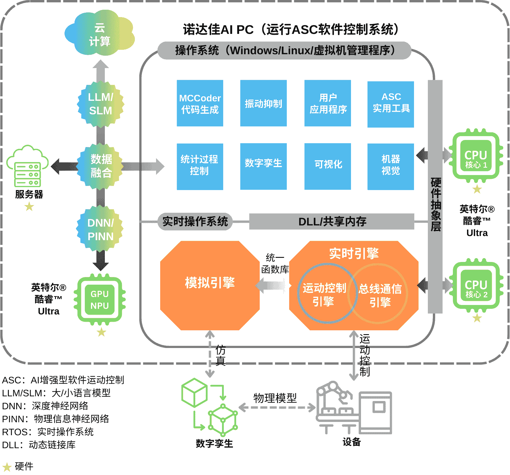

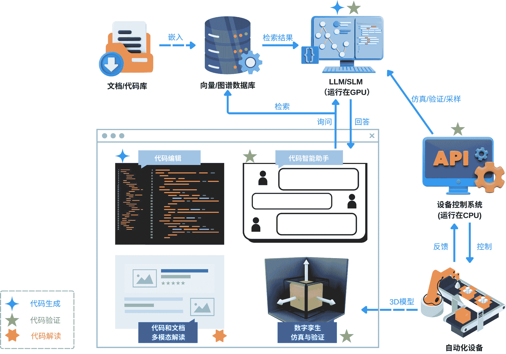

**图：MCCoder：人-机-AI 协同的工业控制代码自动生成系统**

## 方案优势

简探国际与诺达佳的 MCCoder 解决方案，为工业自动化领域提供了一个安全、高效、智能的代码生成平台，真正实现了 AI 技术与工业控制的深度融合，为智能制造的发展提供了强有力的技术支撑。

### 卓越的性能提升

- **编程效率显著提升：**与传统人工编程相比，MCCoder 可实现 3 倍以上的编程效率提升²，大幅缩短项目开发周期，提高工程师工作效率。
- **技术支持时间大幅缩短：**系统将技术支持时间缩短 60%³，通过智能化的代码生成和自动验证，减少了调试和维护工作量。
- **复杂场景适应性强：**在复杂编程场景中，MCCoder 能够显著提升代码质量与交付效率，帮助工程师应对日益复杂的控制系统开发需求。

### 安全可信的本地化部署

- **数据安全保障：**基于本地化部署的中小模型架构，系统在隐私保护方面具备独特优势，确保企业核心代码和工艺数据的安全性。
- **离线运行能力：**系统可完全脱离互联网运行，适应工业环境的网络安全要求和离线作业需求。

### 技术架构优势

- **负载整合优化：**RTX 负载整合技术实现了运动控制和 AI 推理的高效协同，确保了优秀的隔离性、稳定性和 AI 性能表现。
- **硬件平台优势：**基于英特尔酷睿 Ultra 系列处理器的强大计算能力，为复杂的 AI 推理和实时控制提供了充足的算力支撑。
- **系统集成简化：**一体化控制器部署大幅简化了系统集成复杂度，降低了部署成本和维护难度。

---

²,³ 数据援引自简探国际和诺达佳的内部测试结果。英特尔并不控制或审计第三方数据。请您审查该内容，咨询其他来源，并确认提及数据是否准确。

## 背景与挑战

在现代工厂的自动化体系中，为了确保实时系统中 PLC 的稳定运行，传统的数据采集处理系统采用了分层架构设计。MES（制造执行系统）及其他非实时系统通过连接中控系统的 OPC Server 进行数据采集，这种设计在保障 PLC 系统稳定性的同时，实现了生产数据的有效收集和管理。

在这一架构中，系统通过精心配置的采集点和规则进行数据采集，将获取的实时数据存储到专用的实时数据库中。SPC（统计过程控制）系统配备了完整的数据清洗程序，能够基于用户定义的规则和生产工单执行智能化的数据处理。数据清洗流程分为两个关键环节：实时清洗主要用于 SPC 监视和预警，确保生产过程的质量控制；事后清洗则专注于生产完成后的 KPI 统计与分析，为管理决策提供数据支撑。

# 易码智能：基于 Kithara 负载整合的实时数据采集处理解决方案

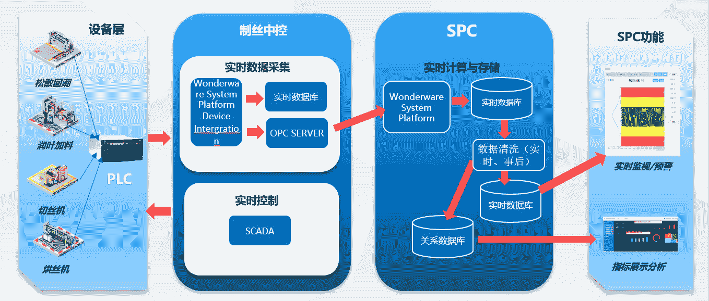

**图：传统数据采集处理系统分层架构**

然而，随着工厂智能化程度的不断加深，传统架构开始暴露出明显的局限性：

- **实时性瓶颈：**智能化控制系统通过集控系统向 PLC 下达指令时，多层级的数据传输架构无法满足工业控制对低延时的严格要求。在精密制造和高速生产线等对响应时间极为敏感的场景中，传统架构的延迟问题成为制约智能化升级的关键瓶颈。
- **可靠性挑战：**数据需要在多个系统间流转，从数据采集、SPC 分析到智能决策再到控制指令执行，复杂的链路增加了系统故障风险，每个环节都可能影响整体系统的稳定性和可靠性。
- **可扩展性限制：**随着传感器数量激增、AI 功能增加和边缘智能需求增长，传统集中式架构难以灵活扩展，系统集成复杂度高，维护成本不断上升，无法适应快速变化的智能制造需求。

**图：易码智能实时数据采集处理解决方案架构**

## 解决方案

易码智能基于英特尔平台和 Kithara 实时工具套件，构建了一套完整的实时数据采集处理解决方案，实现了从数据采集到 AI 决策的全链条边缘部署。

- **统一边缘部署平台：**通过 Kithara 实时工具套件，易码智能将原本分散在不同系统中的数据采集和处理功能统一部署在边缘计算平台上，彻底消除了传统多层架构中数据在 OPC Server、中控系统、MES 等多个环节间传输造成的延迟瓶颈。这种架构创新使得数据从采集到处理的全过程都在边缘端完成，实现了毫秒级的响应速度。
- **AI 驱动的智能控制闭环：**系统能够在边缘端直接部署和运行 AI 控制模型，基于实时采集的生产数据进行智能仿真决策。AI 模型通过分析设备状态、工艺参数和历史数据，快速生成优化的控制策略并输出精确的控制指令。这些指令通过 SCADA 系统直接对 PLC 执行写操作，实现对生产设备的智能化反向控制，形成了从数据感知到智能决策再到精确执行的完整闭环。
- **实时 SPC 质量监控体系：**系统充分利用采集的高频时序数据，构建了完整的 SPC 监视与预警体系。通过对生产过程数据的实时统计分析，系统能够：实时监控关键工艺参数的统计特性和变化趋势；基于控制图和统计规则进行过程能力评估；及时识别异常模式并触发预警机制；为质量改进提供数据驱动的决策支持。

整个架构实现了数据采集、AI 分析、质量监控和智能控制的无缝集成，如架构图所示，形成了高效协同的边缘智能制造系统。

| 设备层 | 边缘计算 | 管控平台 |
| --- | --- | --- |
| 松散回溯、润叶加料、切丝机、烘丝机、PLC | 边缘采集系统、边缘计算系统、时序数据库/本地存储、SCADA 或其他、AI 控制模型 | 时序数据库、云端管理系统、人工智能（数据预处理、特征工程、模型训练、API 发布）、SPC 功能（实时监视/预警、指标展示分析） |

## 方案优势

### 核心技术特性

- **全方位实时处理能力：**除了传统的实时视觉和实时控制功能，Kithara 实时工具套件还提供了卓越的实时存储能力。通过挂载 Kithara 指定型号的专用硬盘，系统可以在实时核中独立处理数据读写操作，实现高达 2GB/s 的读写速度，并支持 RAID0 配置，确保海量生产数据的实时存储和高可靠性访问。
- **丰富 AI 算法生态：**为全面支持 AI 控制模型的部署，Kithara 集成了完整的算法库生态系统，包括：
  - **机器学习支持：**集成 dlib 开源机器学习库，支持各种 AI 算法的边缘部署
  - **视觉处理能力：**支持 Halcon 和 OpenCV 视觉算法库，满足工业视觉检测和分析需求

  所有算法可通过 Kithara 专用接口在隔离核上运行，确保实时性能和系统稳定性。
- **端到端边缘部署：**从数据采集、实时处理、AI 分析到控制输出的全链条功能均部署在边缘端，实现了真正的边缘智能化，大幅提升了系统响应速度和可靠性。

### 英特尔平台强力支撑

- **硬件实时保障：**英特尔平台提供工控设备所需的专业硬件实时能力，确保系统满足工业控制的严格实时性要求，为关键控制任务提供确定性执行环境。
- **强劲计算性能：**高性能 CPU 为复杂的数据处理、SPC 分析和实时控制提供充足的计算资源，确保多任务并行处理的流畅运行。
- **异构计算优势：**英特尔平台的异构计算能力为 AI 应用提供了多样化的算力选择：
  - **GPU 加速：**为复杂的 AI 模型推理和图像处理提供并行计算加速
  - **NPU 专用处理：**最新英特尔® 酷睿™ Ultra 平台的 NPU 为神经网络推理提供专门优化的算力支撑

  用户可根据具体 AI 模型的特点和性能需求，灵活选择最适合的计算资源。

在英特尔® 酷睿™ Ultra 165H 平台上对 Kithara 实时工具套件的实时任务抖动性能进行了 24 小时连续测试，结果如下：

| 测试平台 | 最大抖动 (us) |
| --- | --- |
| 英特尔® 酷睿™ Ultra 165H | 15.3 |

注：实时任务测试过程中，Windows 持续运行加压负载程序 Burn-In Test，包括 CPU 测试，内存测试，磁盘测试，2D 和 3D 图形负载测试。

易码智能的实时数据采集处理解决方案应用范围广泛，除了工厂环境外，还适用于各种需要在边缘端同时实现数据采集和处理的工业场景。例如汽车测试流程中的 HIL (Hardware-in-the-Loop) 系统，是用于汽车电子控制单元 (ECU) 测试的一种方法。它通过在实时环境中模拟实际的物理系统，对 ECU 进行全面的功能、性能和故障测试，从而提高测试效率和可靠性，并降低开发成本。HIL 系统需要具备实时高速数据采集能力，实时数据存储以及仿真模型的运算执行能力。采用 Kithara 实时工具套件配合英特尔平台可以完全满足 HIL 系统所需的软件架构以及硬件运算需求。

## 背景与挑战

在传统的液压机械领域，液压系统作为关键的动力与控制核心，长期依赖于分散式的控制架构：工控机、运动控制卡、专用液压控制器、视觉系统及机器人等独立组件通过复杂的接口与协议进行耦合。这种模式不仅带来了高昂的集成成本与漫长的调试周期，更在柔性生产、精准控制和系统维护方面面临严峻挑战。

当前系统下，液压回路的控制精度与响应速度受制于多组件协同的延迟性。运动控制卡与液压伺服控制器之间的数据交换往往存在实时性瓶颈，导致高速高精作业时动态性能难以进一步提升。同时，由于各子系统间数据孤立，液压系统状态、工艺参数与生产质量数据无法有效融合，不仅故障诊断困难，也难以实现基于数据的工艺优化与预测性维护。更重要的是，面对小批量、多品种的市场趋势，传统液压控制系统缺乏快速工艺切换与灵活调整的能力。每一次生产任务的变更都可能涉及底层控制的重新配置与调试，严重制约了生产灵活性与市场响应速度。

**软件定义一体化控制正是破解这一困局的关键路径。**通过将液压控制、运动逻辑、视觉处理与机器人调度等功能整合于统一的软件化控制平台，可实现：

- **集成简化与性能提升：**消除多设备间通信延迟，提升液压伺服控制的闭环响应与同步精度。
- **数据统一与智能赋能：**打通液压系统数据流，结合算法实现工艺自优化、故障自诊断与能效管理。
- **柔性生产与快速部署：**通过软件定义工艺逻辑，一键切换生产配方，大幅缩短产线重构与调试时间。

# 关维技术 U2：基于 ACRN 的液压机械加工专机

## 解决方案

整个控制系统应用了英特尔® 资源调配技术 (RDT) 提升实时处理能力，采用英特尔® Virtualization Technology for Directed I/O (VT-d)、英特尔® Virtualization Technology for x86 (VT-x) 等虚拟化技术实现硬件虚拟化。

**图：混合设备部署方案架构**

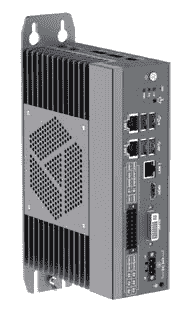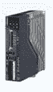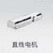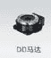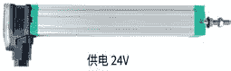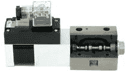

模拟&脉冲

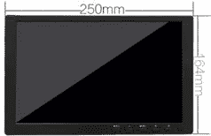

ECAT

ECAT

RS232/RS485

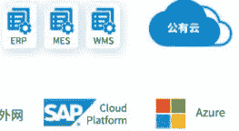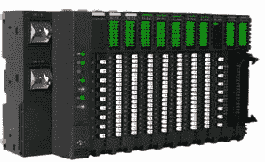

供电 24V

- **Windows**
  - 人机界面、数据处理、行业工艺库 (C++, C#)
- **Linux**
  - 运动控制库。
  - DC 周期：1 毫秒⁴。
  - 调度抖动低于 30 微秒⁵。

---

⁴,⁵ 数据援引自关维技术内部测试结果。英特尔并不控制或审计第三方数据。请您审查该内容，咨询其他来源，并确认提及数据是否准确。

## 方案优势

在工业自动化迈向智能化与柔性化的今天，传统分散式控制架构的局限性日益凸显 — 多设备集成复杂、实时性难以保障、空间占用大、成本高企，接线复杂，整机稳定性差。针对这一痛点，U2 边缘计算推出创新的 UMIF 混合系列运动 "PC" 一体化集成解决方案，以软硬协同的深度集成设计，为运动控制领域带来突破性变革。

### 强大内核：性能与实时性的完美平衡

该产品搭载高性能英特尔® 四核处理器。创新性地采用**非对称计算架构**：三个内核专用于 Windows 系统，流畅运行人机界面 (HMI)、视觉处理及上层应用；另一个内核则独立运行 Linux 实时系统，独享计算资源，确保运动控制任务不受 Windows 非实时环境的干扰，实现微秒级的高确定性响应。

### 极致集成：简化系统，强化性能

- **高度集成化：** 将运动控制器与工控机无缝融合于无风扇紧凑机身中，大幅减少控制柜内设备数量与接线复杂度，提升系统可靠性的同时显著节约空间。
- **共享内存交互：** 运动数据与业务数据在内部通过共享内存实现高速交换，彻底摆脱传统外部通信的延迟与瓶颈，为高精度多轴同步控制奠定基础。
- **高端运动性能：** 支持最小 250μs 的伺服周期，可同时运行多达 32 个 Motion 运动程序，轻松应对复杂轨迹规划、多轴插补等高端应用场景。

### 开放连接：无缝融合生产现场

产品内置千兆网口，可直连视觉相机、I/O 模块及现场总线设备，有效打通与视觉引导、机器人协同等环节的数据流，为构建集成化、信息化的智能控制单元提供基础设施。

### 为客户创造核心价值

- **降本增效：** 单台设备替代 "工控机 + 运动控制卡" 方案，降低硬件成本与维护成本，缩短系统集成周期。
- **提升可靠性：** 减少外部连线和接口设备，降低连接故障率，增强系统整体稳定性。
- **赋能未来升级：** 基于 PC 的开放架构，支持通过软件更新持续提升功能，适应未来工艺扩展和智能化需求。

U2 边缘计算 UMIF 混合系统解决方案不仅是一款产品，更是面向工业 4.0 的底层控制架构革新。它为实现设备智能化、生产柔性化提供了高性能、高性价比的一体化控制底座，助力设备制造商和系统集成商从容应对高质量、多品种、快响应的制造新时代。

---

# 优易控 x 卓信创驰：基于 INtime® 的高精度柔性运动控制解决方案

## 背景与挑战

传统的运动控制方案通常通过 PC（视觉/数据处理）+ 运动控制卡的方式来进行交互，但却存在以下问题：

1. 由于运动控制卡/器通常基于低功耗的算力平台构建，算力方面不够强大，难以实现复杂控制算法。
2. 传统运动控制卡/器的所有或部分机器程序运行在 Windows 上，会受到 Windows 系统抖动问题，影响程序执行的稳定性。
3. 传统硬件控制器/控制卡/PLC 与 PC 上的视觉程序交互以及函数调用，一般都是通过网口或 PCI 接口与 PC 进行通讯，存在较为显著的延迟。

新一代运动控制器需要向着更高的信息处理能力、开放程度、运动轨迹控制准确性、通用性等方向不断迭代进化，采用多轴协调运动控制和复杂运动轨迹规划实时调整来实现闭环控制。

## 解决方案

优易控与卓信创驰联合推出的基于英特尔® 架构的 ProU NoTime 控制器，基于 Tenasys INtime® 创新地将运动控制的功能与视觉/数据处理的功能融合到搭载英特尔® 处理器的工业控制计算机上，并绑定不同的 CPU 核心进行处理，双方之间通过高速共享内存来连接，大幅提高了运动控制与一般 PC 应用的数据交互效率以及函数的执行速度。该方案集成了基于实时系统的用户程序执行环境和运动函数库 NoTime，实现了更稳定和敏捷的机器控制，能够满足芯片键合 (Die-Bonding)、镜头组装、点胶等场景对于精细、低延迟、高稳定的运动控制需求。

基于英特尔® 架构的 ProU NoTime 控制器支持包括第 11 代/第 12 代英特尔® 酷睿™ 处理器、英特尔凌动® x7000E 系列处理器、英特尔® 处理器 N 系列处理器在内的处理器选项，不仅能够满足复杂的机器控制算法的高效运行，还具备宽温支持、高稳定性、远程维护等能力，为运动控制奠定了坚实的硬件基础。

基于 INtime® 实时操作系统，该控制器还应用了英特尔® 资源调配技术 (RDT) 提升实时处理能力，采用英特尔® Virtualization Technology for Directed I/O (VT-d)、英特尔® Virtualization Technology for x86 (VT-x) 等虚拟化技术实现硬件虚拟化。上述软硬件技术能够满足 ProU NoTime 控制器在算力、延迟控制、稳定性等方面的需求。

在测试中，ProU 运动控制器通过循环调用读写轴位置信息的指令 20000 次，记录每次周期时间。测试数据表示，PCI 通讯的控制卡平均读写时间为 71.74 微秒，而 ProU 使用共享内存交互方式平均仅需 0.06 微秒，速度可达 PCI 接口控制卡的一千倍。

## 方案优势

ProU NoTime 控制器能够提供如下功能优势。

### 显著降低运动控制器交互的延迟

ProU NoTime 控制器将运动控制程序和机器视觉等软件放在同一台工业计算机上，得益于 x86 系统提供的高性能算力，通过高速共享内存的方式，大幅度提高了运动控制与一般 PC 应用的数据交互效率以及函数的执行速度。

### 提升机器程序执行效率与稳定性

ProU NoTime 控制器的机器程序运行在 NoTime 上，成功摆脱 Windows 抖动的影响。NoTime 采用了英特尔® RDT 的 CAT 与 MBA 技术，对其它进程内用到的 CPU 线程以及缓存进行服务等级设置，从而限制内存带宽使用上限及 CPU 缓存，避免对关键的机器控制程序带来影响以保证程序运行的实时性。

ProU 在相同伺服系统下，相同硬件条件下进行循环运动实验，结果显示 NoTime 方案比 Windows 方案速度提升约 20%，稳定性提升约 99.83%。

ProU NoTime 控制器还提供了实时视觉功能，减少 Windows 波动对图像传输和处理的影响，视觉与运动和交互速率和稳定性大幅提升。

### 提供强大的前馈控制功能

ProU NoTime 控制器的前馈控制功能基于 CNC 算法库。通过设定轴的动力学参数、用户选择的运动学模型以及英特尔® 处理器的强大算力，获得精确的运动预测模型补偿扰动对轴的影响，通过 EtherCAT 总线将计算结果传递给伺服的电流环和速度环偏移接口，达到最佳的运动控制效果。

测试数据显示，在打开前馈控制功能之后，平均路径偏差从 0.033mm 下降到 0.013mm，0.01mm 定位精度的整定时间从 13.2ms 下降到 10.6ms。

### 通过先进的平滑工具进行轨迹控制

ProU NoTime 控制器集成了 Hyperspace computing 与 ABS 样条路径等先进的平滑工具。其中，Hyperspace computing 借助英特尔® 处理器强大的算力，可进行最多 10,000 条曲线的前瞻速度和路径规划，并能够基于用户设定的允许误差进行路径规划，设定较柔软的动力学参数以减少机械振动。

ABS 样条路径是特殊的平滑工具，借助英特尔® 处理器强大的算力，通过控制点直接生成 Akima 样条或 B 样条运动路径和相应的路径/速度规划；对于大量使用 CAD 中样条工具的图形，ABS 样条路径工具可以实现高精度的轨迹平滑，同时降低机械系统的刚性需求。

---

# 结语

随着自动化行业向软件定义的未来迈进，负载整合与 AI 融合正在重塑基于 PC 的控制系统创新格局。通过将实时控制、AI 推理、数据处理等多元负载统一整合，我们正在构建更加智能高效的自动化平台。展望未来，我们期待与更多合作伙伴携手合作，共同推进 AI 驱动的负载整合技术发展，加速行业向智能化运营模式转变。我们坚信，通过持续的技术革新与深度合作，负载整合与 AI 技术的深度融合将为客户创造更大价值，提供更先进的智能自动化解决方案。英特尔期待与众多合作伙伴一道，共创负载整合与 AI 协同发展的智能自动化未来。

---

实际性能受使用情况、配置和其他因素的差异影响。更多信息请见 www.Intel.com/PerformanceIndex

性能测试结果基于配置信息中显示的日期进行测试，且可能并未反映所有公开可用的安全更新。详情请参阅配置信息披露。没有任何产品或组件是绝对安全的。

具体成本和结果可能不同。

英特尔技术可能需要启用硬件、软件或激活服务。

英特尔未做出任何明示和默示的保证，包括但不限于，关于适销性、适合特定目的及不侵权的默示保证，以及在履约过程、交易过程或贸易惯例中引起的任何保证。

英特尔并不控制或审计第三方数据。请您审查该内容，咨询其他来源，并确认提及数据是否准确。

© 英特尔公司版权所有。英特尔、英特尔标识以及其他英特尔商标是英特尔公司或其子公司在美国和/或其他国家的商标。其他的名称和品牌可能是其他所有者的资产。
