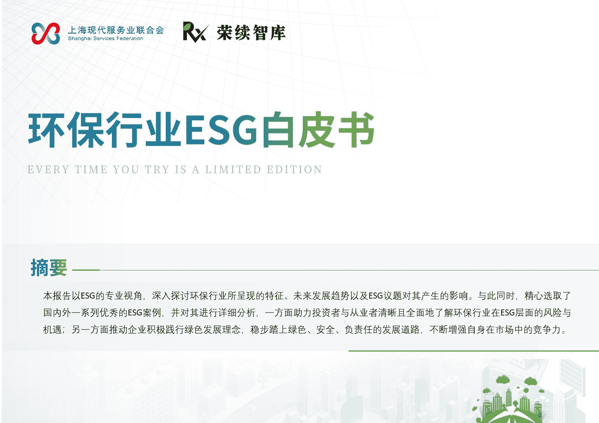

# 环保行业ESG白皮书

## 摘要

本报告以ESG的专业视角，深入探讨环保行业所呈现的特征、未来发展趋势以及ESG议题对其产生的影响。与此同时，精心选取了国内外一系列优秀的ESG案例，并对其进行详细分析，一方面助力投资者与从业者清晰且全面地了解环保行业在ESG层面的风险与机遇；另一方面推动企业积极践行绿色发展理念，稳步踏上绿色、安全、负责任的发展道路，不断增强自身在市场中的竞争力。

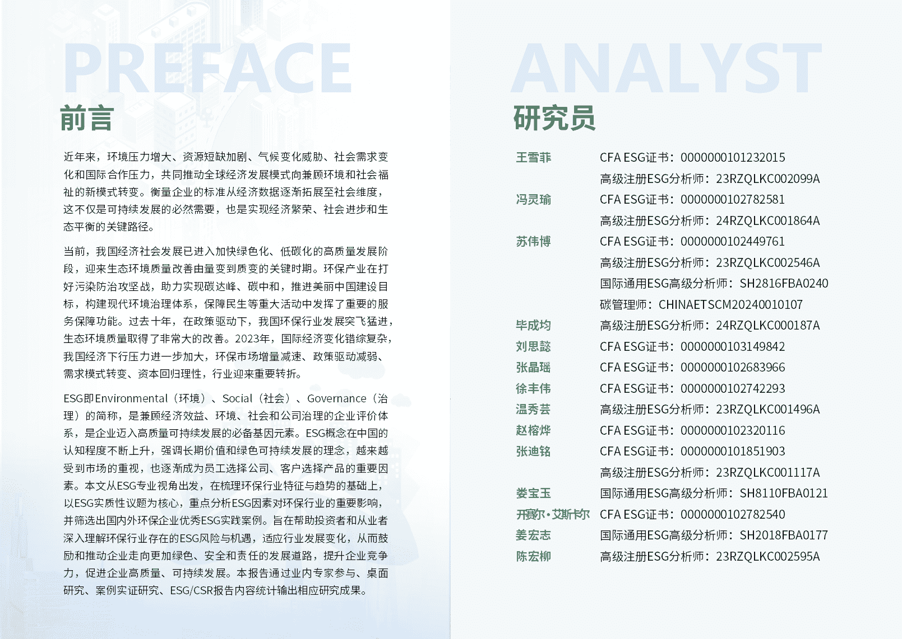

## 前言

近年来，环境压力增大、资源短缺加剧、气候变化威胁、社会需求变化和国际合作压力，共同推动全球经济发展模式向兼顾环境和社会福祉的新模式转变。衡量企业的标准从经济数据逐渐拓展至社会维度，这不仅是可持续发展的必然需要，也是实现经济繁荣、社会进步和生态平衡的关键路径。

当前，我国经济社会发展已进入加快绿色化、低碳化的高质量发展阶段，迎来生态环境质量改善由量变到质变的关键时期。环保产业在打好污染防治攻坚战，助力实现碳达峰、碳中和，推进美丽中国建设目标，构建现代环境治理体系，保障民生等重大活动中发挥了重要的服务保障功能。过去十年，在政策驱动下，我国环保行业发展突飞猛进，生态环境质量取得了非常大的改善。2023年，国际经济变化错综复杂，我国经济下行压力进一步加大，环保市场增量减速、政策驱动减弱、需求模式转变、资本回归理性，行业迎来重要转折。

ESG即Environmental（环境）、Social（社会）、Governance（治理）的简称，是兼顾经济效益、环境、社会和公司治理的企业评价体系，是企业迈入高质量可持续发展的必备基因元素。ESG概念在中国的认知程度不断上升，强调长期价值和绿色可持续发展的理念，越来越受到市场的重视，也逐渐成为员工选择公司、客户选择产品的重要因素。本文从ESG专业视角出发，在梳理环保行业特征与趋势的基础上，以ESG实质性议题为核心，重点分析ESG因素对环保行业的重要影响，并筛选出国内外环保企业优秀ESG实践案例。旨在帮助投资者和从业者深入理解环保行业存在的ESG风险与机遇，适应行业发展变化，从而鼓励和推动企业走向更加绿色、安全和责任的发展道路，提升企业竞争力，促进企业高质量、可持续发展。本报告通过业内专家参与、桌面研究、案例实证研究、ESG/CSR报告内容统计输出相应研究成果。

### 研究员

- 王雪菲
  - CFA ESG证书：0000000101232015
  - 高级注册ESG分析师：23RZQLKC002099A
- 冯灵瑜
  - CFA ESG证书：0000000102782581
  - 高级注册ESG分析师：24RZQLKC001864A
- 苏伟博
  - CFA ESG证书：0000000102449761
  - 高级注册ESG分析师：23RZQLKC002546A
  - 国际通用ESG高级分析师：SH2816FBA0240
  - 碳管理师：CHINAETSCM20240010107
- 毕成均
  - 高级注册ESG分析师：24RZQLKC000187A
- 刘思懿
  - CFA ESG证书：0000000103149842
- 张晶瑶
  - CFA ESG证书：0000000102683966
- 徐丰伟
  - CFA ESG证书：0000000102742293
- 温秀芸
  - 高级注册ESG分析师：23RZQLKC001496A
- 赵榕烨
  - CFA ESG证书：0000000102320116
- 张迪铭
  - CFA ESG证书：0000000101851903
  - 高级注册ESG分析师：23RZQLKC001117A
- 娄宝玉
  - 国际通用ESG高级分析师：SH8110FBA0121
- 开赛尔·艾斯卡尔
  - CFA ESG证书：0000000102782540
- 姜宏志
  - 国际通用ESG高级分析师：SH2018FBA0177
- 陈宏柳
  - 高级注册ESG分析师：23RZQLKC002595A

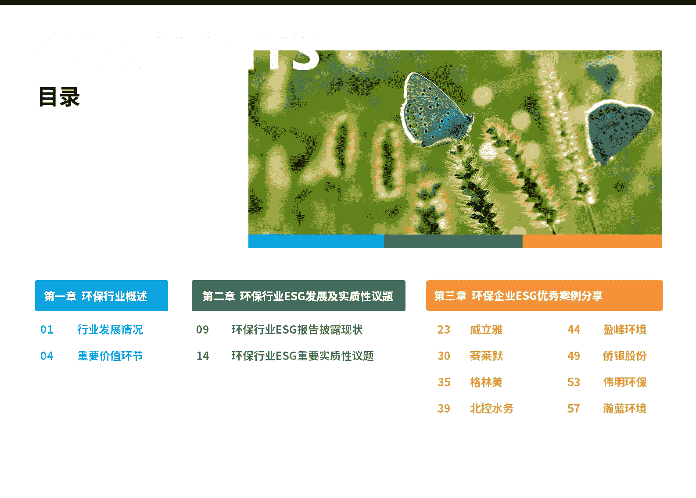

## 目录

# 第一章 环保行业概述

- **01 行业发展情况**
- **04 重要价值环节**

### 第二章 环保行业ESG发展及实质性议题

- **14 环保行业ESG重要实质性议题**
- **23 环保行业ESG报告披露现状**
- **60 环保行业ESG报告披露现状**

# 第三章 环保企业ESG优秀案例分享

- **30 威立雅**
- **35 格林美**
- **39 北控水务**
- **44 盈峰环境**
- **49 侨银股份**
- **53 伟明环保**
- **57 瀚蓝环境**

---

# 第一章 环保行业概况

环保行业是一个兼具工程性、工业性、政策性、公益性、专业性的传统复杂行业。进入21世纪以后，随着全球环境问题的日益严重和人们环保意识的不断提高，环保技术不断创新和进步，环保产品和服务更加多样化和专业化。在大多数人眼里，环保行业对于ESG而言，就像含着金汤匙从ESG里出生的，天然带着"绿色"的属性，那么在ESG中就具备天然优势了吗？事实并非如此。

## 01 行业发展情况

环保产业作为我国绿色转型发展的重要支撑，涵盖了众多领域和技术方向，包括环保设备制造、环保服务、生态保护和修复主要领域和其他细分领域，其中生态保护和修复包括大气治理、水务及水治理、固废治理、土壤与地下水修复、噪声与振动控制等业务方向。2022年我国环保产业营业收入达2.49万亿元，预计2025年将突破3万亿元。作为典型的政策导向型行业，过去十年，中国的环保工作是暴风骤雨式的，就好像是一个得了重病的病人，被送进了ICU抢救；然后，经历了"黄金十年"的突飞猛进，生态环境质量取得了非常大的改善。

### 表1：国家"十四五"规划对环保行业的要求

| 主要目标 | 具体内容 |
|---------|---------|
| 大气环境治理 | 继续推动空气质量改善，接续"十三五"规划的势头；加强大气环境管理体系建设，促进政府、企业和社会的合作；推动产业、能源、交通和土地利用结构调整，实现空气质量改善和温室气体减排的协同推进。 |
| 水环境保护 | "十四五"规划进一步朝着水生态系统功能恢复、实现良性循环的方向发展。立足于我国水生态环境保护的长期进程，既要巩固碧水保卫战成果，又要服务于实现美丽中国的目标。努力实现水环境质量持续改善、水生态系统功能初步恢复，推动水环境、水生态和水资源综合治理格局基本形成。 |
| 固体废物防治 | 在"十四五"时期，将实施工业绿色生产，推动工业固体废物减量和循环利用，全面建立废弃产品逆向回收体系，同时，推行农业绿色生产，促进主要农业废弃物综合利用，倡导绿色生活方式，推动生活垃圾源头减量和资源化利用。加强风险防控能力，强化危险废物全百安全管理。加快推违"无废城市"建设，充分发挥引导和带动作用，激发市场主体活力，培育固废产业发展新模式。 |
| 土壤生态环境保护 | 在"十四五"期间，将持续推动土壤生态环境保护，加强土壤污染防治工作，打基础，开展创新，将土壤污染防治和土壤生态保护纳入污染防治和绿色发展的主要任务中。持续推进土壤调查，建设土壤环境大数据平台，加强责任落实和监管。在试点地区探索可持续土壤污染风险管控体系。创新修复产业模式，推动环境修复产业发展。推动土壤健康评估，构建适合中国国情的土壤健康评估体系。 |

现阶段，我国生态文明建设进入了以降碳为重点战略方向、推动减污降碳协同增效、促进经济社会发展全面绿色转型、实现生态环境质量改善由量变到质变的关键时期。由于污染物和温室气体之间呈现出同根同源同过程的特性，所以政府部门不断完善环境治理政策体系，持续推动减污降碳协同增效，这对环保行业统筹发展的精准性和协同性提出了更高的要求。

2021年，我国绿色低碳循环发展经济体系顶层设计出炉，碳达峰碳中和"1+N"政策体系逐步建立。在此背景下，经济转型加速，巨大的绿色市场形成。《中共中央 国务院关于深入打好污染防治攻坚战的意见》从总体层面统筹污染治理、生态保护、应对气候变化，以更高标准打好蓝天、碧水、净土保卫战，引导环保产业发展的规范政策体系不断完善。2023年，《关于从事污染防治的第三方企业所得税政策问题的公告》提出对符合条件的第三方污染防治企业减按15%的税率征收企业所得税，旨在进一步降低环保企业经营成本，支持其发展；《中共中央 国务院关于全面推进美丽中国建设的意见》发布，再次强调生态环境保护的重要性。作为改善生态环境质量、加强生态文明建设的重要基础，同时作为实现"双碳"目标的重要支撑，随着环保制度框架的进一步稳固，环保行业将开启新的征程。

### 图1：环保行业产业链

- **行业上游**
  - 原材料供应：钢铁、化工、电子、有色金属等
- **行业中游**
  - 环保工程建设：环境工程设计及施工
  - 环境技术服务：环评、环境规划、环境检测等
  - 环保设备制造：环保设备及其他
  - 环保产品制造
  - 其他环保业务
- **行业下游**
  - 主要客户：市政、矿产、电力、冶金、水泥等行业
  - 业务主要应用领域

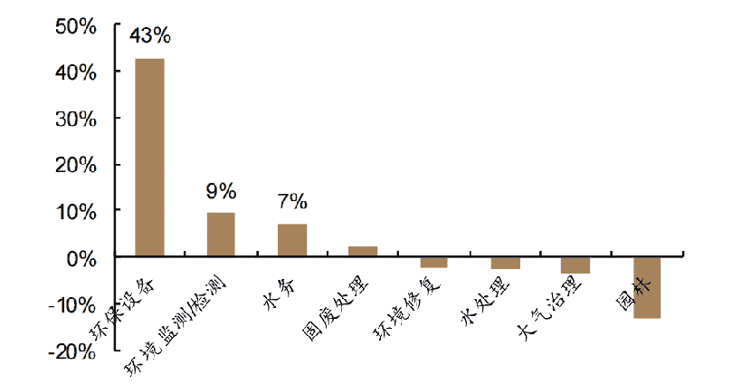

RK荣续智库

上海现代服务业联合会

环保行业ESG白皮书

# 第一章 环保行业概述

03 / 04

与其他行业相比，环保行业自身具有市场化水平较低、商业化运作模式不健全、产业结构不均等特征，在经济转型的现阶段环保企业又面临新的问题：

一方面，市场需求规模急剧下降，水处理、固废处理和大气污染治理等领域不再需要大量同质化企业，产能过剩问题日益严重。

另一方面，在经济放缓的背景下，环保行业也不能独善其身，虽然是受政策导向影响明显的行业，但长期来看，受到经济形势波动的影响愈来愈大。加上环保监管的加强，环保需求在朝着节能低碳方向上快速迈进，企业面临转型风险。

环保行业过去几十年的快速发展，已形成覆盖水、大气、土壤、固废、环境监测等重点领域的污染防治技术装备体系。国家强劲的科研投入和日益严格的环境管理要求，也大幅提升了产学研用各方的技术研发热情。2023年，A股环保行业各细分板块表现中，环保设备实现业绩大幅增长；工业和信息化部、科学技术部、生态环境联合印发的《环保装备制造业高质量发展行动计划（2022—2025年）》提出，到2025年中国环保装备制造业产值力争达到1.3万亿元。在环保技术装备水平方面，我国在起步较早的大气治理、垃圾焚烧发电等领域达到国际先进水平，土壤与地下水修复等起步较晚的领域和环境监测仪器等对材料依赖较强的领域与国际先进水平仍存在差距。

## 第二节 重要价值环节

环保行业产业链与其他行业相比较简单，我们筛选了其中三个主要业务环节，分别是环保设备、污水处理、固废治理与资源化；发现这些重要环节现阶段发展核心共同聚焦在绿色低碳发展、循环经济和资源化利用，技术升级和创新方面：

### 环保设备

### 污水处理

### 大气治理

FUTURE

PAST

图2：2023Q1-Q3环保细分板块收入增速

| 板块 | 收入增速 |
|------|---------|
| 污水处理 | 20% |
| 固废环境 | 9% / 10% / 7% |
| 大气治理 | 43% |

资料来源：wind，德邦研究所

[PAGE 6]

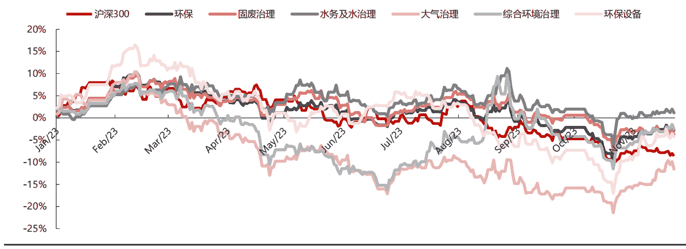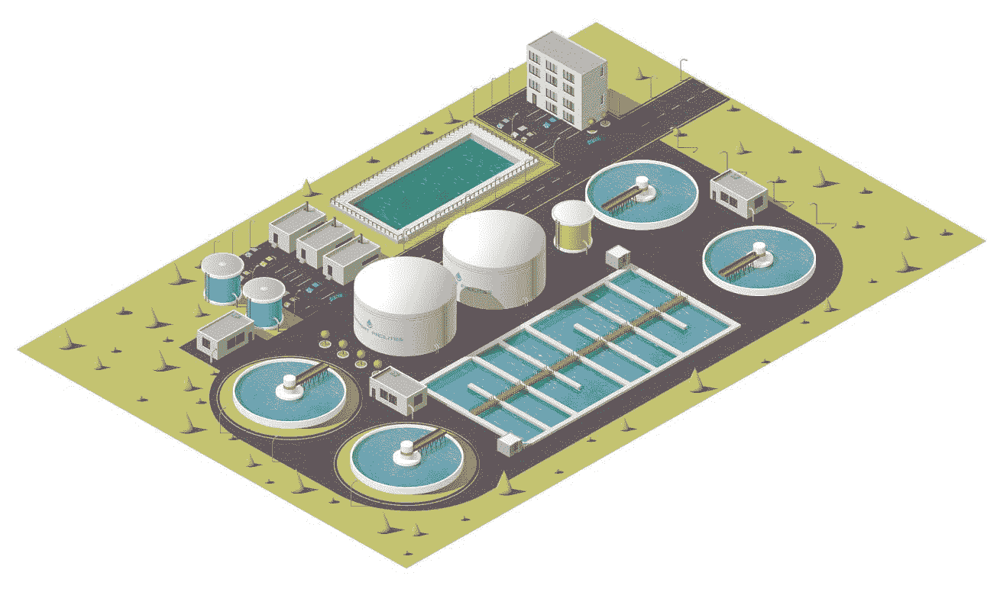

RK荣续智库

上海现代服务业联合会

环保行业ESG白皮书

# 第一章 环保行业概述

05 / 06

在减污降碳总目标的指引下，生态环保所技术开发应用呈现三个显著的特征：一是注重减污降碳协同增效，在实现污染治理基础上，充分考虑节能、降耗、资源化和协同化，为生态环保产业绿色低碳发展提供技术支撑；三是坚持需求和问题导向，聚焦解决生态环境质量改善和污染治理中的新需求和痛点难点问题；三是加速与三动、新材料、信息化等高新技术融合，提升生态环境污染防治和监管效率。

中国从事环保类装备制造的企业数量超过1200家，近两年由于市场步入存量和经济整体放缓的大背景下，环保装备制造行业又呈现大规模交付等特点，这对企业自身能力提出更高的要求。另一方面，环保装备制造本质上是属于工业制造业领域，设备制造和运输过程中，包括钢铁、铝、塑料等材料的生产和加工等，通常伴随着大量能源消耗和温室气体排放。如何降低能源消耗，采用更环保的生产技术和利用更清洁的能源，提升企业运营效率，也是重点思考的方向。

### 污水处理

水务运营包括自来水供应、污水处理、水环境治理、水资源保护等业务，这一环节与我们每个人的生活息息相关，本质上也属于公共事业。2023年，多项水务及水治理政策发布，旨在补齐城市和县城污水处理能力缺口，提升水资源化利用水平，建立合理回报机制等。A股市场的水务及水治理板块也表现较好。

图3：2023年环保（申万）水务及水治理指数跑赢沪深300指数

目前水资源压力是全球性问题，据2021年《世界水发展报告》显示，全球近40人在一年中至少有一人月面临严重缺水。所以即使是使用后的污水，也是一种宝贵的资源，尤其是在干旱缺水的地区。然而污水中含有许多有害物质必须经过处理才能循环利用或释放到环境中，污水处理的重要性可见一斑，这也是水务企业盈利部分的重要组成。污水处理行业的碳排放量约占我国全社会总排放量的1%，污水处理行业的能耗占比约为1%—3%，且呈逐年上升趋势，属于能源密集型的高耗能行业，因此是节能减排的重点发展对象。

随着污水排放量的增加以及污水处理能力的不断提升，中国污水处理量也在不断提升，2022年中国城市和乡镇污水处理量分别增长至672.47亿立方米和112.39亿立方米，分别同比增长9.90%和6.97%。在国家政策以及政府环保投资的加持下我国污水处理厂数量快速增长，其中城市污水处理厂数量依旧是最多的且增速是最快的。2022年城市污水处理厂数量达3057座，同比增长8.12%；乡镇污水处理厂数量从2016年的441座增长至2022年的2251座，县域污水处理厂2022年数量为1833座，同比增长3.87%。

### 大气治理

资料来源：wind，民生证券研究院
80/20

土地资源紧缺的城市会建设全地下/半地下式污水处理厂，但权威专家在荣全地下式污水处理厂违行研究发现，其全三命同期总碳抖放量约87.1万tCO2-eq，较地上污水处理厂高36.5%。地下式污水处理厂在建设与拆除阶段，需要额外的施工量与建材消耗，所以，土地资源紧缺的城市如果实需要建设地下式污水处理厂，需要尽量"趋利避害"，减少其建设、运营管理成本及对环境的负面影叫此外，污水处理厂"过度提标"，一是行业内比较有争议的一个话题。近年来，国内一些学者的研究结果表明，污水处理厂运度提标改造，不仅投入产出比很差，而且会显著却大碳排放。厉于当前污水收集处理领域最为显著的"减污和降碳不协同"的问题。

水务领域经历二十年市场化快速发展，已从规摸扩张进入存量提质时代，存量资产的高盾量运营成为行业的重点关注方向。一方面，在提质挡效、原位扩容等需求下，工艺路线升带来的技术产品需求已在快速释放；另一方面，在低化下，节能设备的改造、智能系的赋能、再生资源的利用受到行业的高虑关注，此外，伴随差水务设施的同期性发展，未来污水处理厂会迎来"6-10"年一轮的设施改造浪潮，监测类设备、通月类设告，以及音分工艺类设备均会出现设备更新的需求。

## 固废治理与资源化

固废按具米源、成分和潜在影响主要分为城市生活固体废弃物、工业固体废弃物以及农业固体废弃物。固废治理是由源义减至、垃圾分类、分类收集和运输、分类资源化利用和无言化处理四个环节构成的完整的工作运系。源头减至作为董费的前直措施，日的是通过减少物质的使用、延长产品寿命、提高资源使用效率等方式，从根本上减少固废的产生。舌废的资源化利用是通过取精华，去譜拍的形式，提取升进行再生利用，通过资源化利用，不仅可以少对原始资源的依赖，也能减少环境污梁，实现经济和环境的双重效益。处置是固废管理的品后环书，日的是安全、有效地处理挪些无法被再利用的估废，减少其对环竞和人类健康的危害。所以在些个固废处理流程中，减量化、资源化、无害化是整个固废处理环节的重要原则，是推进固废处理向可持续发展方向转变的关键因素。

资源化是实现环保产业价值升级的关键一环，固废是臣离资源化最近，也是率先向资源化发起冲修的环保细分领域。经过近二十年的制度建设和行业发展，固废领域的资源化发展已经有良好的开局。在双碳目际一，循环经济在节能降耗上的优势凸显，固废姿源化的趋势变得更加应景。这也是很多企业布局乃至跨界固废板块的原因，打温了资源化的关节，环保就能从入端治理是自更高的台阶。固废后端应用包含了垃圾块埋、烧、物理化学方泌、生物处理技术这四芙技术手段。目前我国固废处理技术和管理水平已经取得显著达步。截至2022年底，我国城市生活垃圾樊烧处理能力已达到80.4万吨/日，提前完成"十四五"目标。

垃圾楚烧发电是固废资源化重要的价值环节。首先，垃圾梵烧技术可以有效地将垃圾转化为能源，降低对传统能源的依赖程度，减少碳排放。其次，泣圾处烧发电行业已步入存量阶段，资云开支有所减少，财务压力有所缓解。厂自用电率下降，吨垃圾发电量有所提升，盐加热已联产项目的逐少推行，项目运营能力持续提升，盈利安全垫序。最石，亡CER重启和"一揽子化债方实的制定实施，有望保障处烧发电项日的盈利及回款能力，进一步提升现金流，从双亘实质性角度着，这为推动行业可持续发展提供了重要保障。

随若行业变兰的不断深化，固废领域的内必然会加剧。行业竞争必将围绕资源化展开，继续加写循环利用等关键技术创新及转化、探索可持软的商业模式也成为企业发展关链，固废全业需要不断完菩自身综合能力，提高行业集中度，优化资源配置，增强竞争力，促进行业的健康可持续发展。

# 第二章 环保行业ESG发展及重要实质性议题

ESG，作为一种投资理念和衡量企业可持续发展能力的评价标准，若重于企业在环境、社会和公司治理方面的表现，而不仅仅是财务成绩。近年来，随着国际和国内社会对ESG法律法规、政策标准、评价体系的持续完善，ESG已经开始在全社会范围内得到广泛应用。重要的实质性议题的筛选，目标是明确哪些因素对行业和企业的可持续性发展至关重要。环保行业虽然致力于改善环境和解决社会问题，但仍需面对自身的不可忽视的环境风险、社会风险和公司治理风险。

### 第一节 环保行业ESG报告披露现状

我国对于上市企业的E5G信息披露要求正在由自函转向强制。经过对2018—2022年A股上市公司ESG/CSR报告按露情况进行统计，结果显示各行业E5G信息报露情况均呈现稳定增长趋势。这也标志若在国内监管政策的引号下，各行各业都逐步于始对ESG管理引起三视。A股100家环保上市企业2022年报告披露率仅33%，在ESG报告披露率上相对于其他行业处于藩后水平，这与环保行业自身对ESG信息报露监管要或有直接关系。在主板及中小板上市企业共计42家，2022年ESG报告披露率达到50%，相对较高。环保上方企业中被纳入国际ESG评级体系的企业数主甚少，如被纳入MSCIESG评级的仅有5家。可见，民营企业还需提升ESG意识，加强ESG信息按露。

在已按恶E5G按告的企业中，从业务类型上来看，以公共事业为主的综合环境治理类企业整体披露率较高，此类企业多为主板二市，兵有市值高、经营范围广、营业收入绝对值高、国吴企背景占比高等特点。这与我国政策自上而下推动的特点一致，可见国资委ESG相关制度要求对目企发展存在有效推进作用。技术及不保设备制造类企业整云披露率较低，此类企业的主营业务多聚焦于空气净化、膜技术、噪声污染防治等某一单一领域，民营企业较多。

**图4:2018年-2022年环保行业ESG/CSR报告披露率**

| 年份 | 披露率 |
|------|--------|
| 2018年 | 21% |
| 2019年 | 27% |
| 2020年 | 25% |
| 2021年 | 29% |
| 2022年 | 33% |

**图5:2018年-2022年环保行业细分领域ESG/CSR报告披露率**

| 年份 | 公共事业 | 环保服务 | 技术及设备制造 |
|------|---------|---------|--------------|
| 2018年 | 15% | 9% | 11% |
| 2019年 | 21% | 16% | 9% |
| 2020年 | 30% | 20% | 15% |
| 2021年 | 40% | 30% | 20% |
| 2022年 | 50% | 40% | 20% |

上海现代服务业联合会 荣续智库

环保行业ESG白皮书

# 第二章 环保行业ESG发展及重要实质性议题

11/12

表2：2018至2022年间股上市公司30个行业ESG报告披露率

| 行业 | 2018 | 2019 | 2020 | 2021 | 2022 | 行业 | 2018 | 2019 | 2020 | 2021 | 2022 |
|------|------|------|------|------|------|------|------|------|------|------|------|
| 家电 | 23% | 24% | 29% | 33% | 36% | 银行 | 94% | 100% | 100% | 100% | 100% |
| 轻工制造 | 24% | 26% | 32% | 35% | 36% | 非银金融 | 80% | 83% | 86% | 92% | 94% |
| 电力及新能源 | 21% | 20% | 22% | 28% | 35% | 钢铁 | 51% | 51% | 5% | 57% | 71% |
| 建筑 | 25% | 25% | 23% | 23% | 34% | 交通运输 | 46% | 48% | 49% | 53% | 60% |
| 商贸零售 | 20% | 20% | 20% | 25% | 33% | 石油石化 | 33% | 39% | 35% | 48% | 57% |
| 医药 | 24% | 24% | 26% | 30% | 32% | 煤炭 | 42% | 42% | 42% | 50% | 55% |
| 消费者服务 | 17% | 20% | 19% | 27% | 31% | 传媒 | 34% | 39% | 38% | 45% | 53% |
| 基础化工 | 21% | 20% | 20% | 24% | 31% | 综合金融 | 40% | 46% | 46% | 46% | 53% |
| 国防军工 | 29% | 29% | 26% | 29% | 30% | 电力及公用事业 | 39% | 39% | 41% | 45% | 51% |
| 通信 | 16% | 18% | 18% | 20% | 29% | 房地产 | 45% | 44% | 44% | 46% | 51% |
| 汽车 | 17% | 16% | 14% | 23% | 28% | 食品饮料 | 30% | 30% | 35% | 41% | 47% |
| 综合 | 17% | 17% | 17% | 19% | 27% | 有色金属 | 36% | 39% | 34% | 39% | 46% |
| 计算机 | 17% | 17% | 16% | 22% | 26% | 建材 | 26% | 40% | 31% | 31% | 43% |
| 电子 | 22% | 21% | 19% | 23% | 25% | 纺织服装 | 25% | 24% | 25% | 34% | 38% |
| 机械 | 17% | 16% | 16% | 18% | 22% | 农林牧渔 | 30% | 28% | 38% | | |

RX荣续智库

上海现代服务业联合会

环保行业ESG白皮书

第二章环保行业ESG发展及重要实质性议题

13/14

环保龙头企业在ESG管理和信息披露上起到了引领作用，根据2023年全国工商联环境商会CECC发布的环保行业50强榜单，我们对前10强企业的报告披露情况进行梳理，发现有8家企业ESG/CSR报告连续披露时间都在5年以上，特别是光大环境、瀚蓝环境、碧水源几家企业已经达到10年以上；宝武环科作为唯一未上市的国企，也自2021年开始主动进行社会责任报告的披露。

各家企业均在报告中对企业的ESG治理架构及ESG战略实施情况进行了不同程度的披露和说明。但对实质性议题的识别过程、重要程度分析上都有不同程度的缺失，在双重实质性的体现上，披露强度不够。所以，头部环保企业的ESG报告质量还存在提升空间。

## 第二节 环保行业ESG重要实质性议题

ESG实质性议题识别在践行可持续发展中至关重要，能帮助公司确定对其业务和利益相关者最具影响力的问题，从而引导其发展可持续性战略和实践。通过认识到这些实质性议题，公司可以更好地管理风险、发现商机、提升品牌声誉，并与利益相关者建立更加紧密的关系。

本报告参考了国际ESG准则权威组织和评级机构所关注的环保行业领域的核心议题，包括但不限于MSCI、SASB、Sustainalytics、Refinitiv、ISS、FTSE Russell等，结合国际环保企业10强所披露的实质性议题，并考虑中国环保行业发展现状和双重实质性原则的基础上，筛选出8个环保行业重要性较高的实质性议题：分别是应对气候变化、排放与废弃物管理、水资源管理、产品质量与服务、智慧环保、科技创新、商业模式弹性、职业健康与安全。

### 表3：2023年环保企业十强

| 排名 | 公司名称 | 报告发布年份 |
|------|----------|--------------|
| 1 | 光大环境 | 2012-2022 |
| 2 | 格林美 | 2015-2022 |
| 3 | 北控水务 | 2015-2022 |
| 4 | 首创环保 | 2017-2022 |
| 5 | 瀚蓝环境 | 2008-2022 |
| 6 | 竺峰环境 | 2021-2022 |
| 7 | 福建龙净 | 2010-2022 |
| 8 | 宝武环科（未上市） | 2021-2022 |
| 9 | 高能时代 | 2015-2022 |
| 10 | 碧水源 | 2012-2022 |

## 应对气候变化

全球气温正在不断上升，全球变暖的速度也在不断加快。我国提出的"双碳"重要战略目标，不只是积极应对气候变化做出的对策，也是高瞻远瞩的长期发展战略。做好生态保护、环境治理、资源能源安全、应对气候变化的协同控制、协同保护、协同治理；是我国应对气候变化的主要目标和重点任务。环保行业在减污降碳中承担着重要责任和义务，也面临着气候变化带来的风险和机遇。

应对气候变化包括两种方式，气候减缓和气候适应。气候减缓方面，社会对环保行业的诉求不断增加：政府和企业在减排、节能、资源循环利用等方面的要求越来越高，需要环保行业提供更多解决方案和服务。环保行业除了要完成自身降碳目标，还要担负对重点控排行业的咨询、降碳措施的落地、碳中和等方面的重要使命。气候适应方面，气候变化带来的物理风险可能对环保行业自身业务造成重大影响。比如，暴雨可能导致污水处理设施溢流，导致污

染环境和承受负荷上升；干旱可能影响水资源供应稳定性；朗风可能破还环保设砸，影运排放与废弃物管生产线或供应链，因此，环保行业需要加强风验管理，采取多种策略适应气候变化，提高应对气候变化的能力，企立的人力资本也将受到气候的影向和约束，这种约克可能涉及多随着与废水废气废弃物相关人方面，包括对员工工作环境的影响（如极端天气条件下的工作条件）、对员工健表的影响（如的环保法律法规逐步严格化，气候变化导致的窄康问题增加，以及对员工能力需求的变化如求更多的技能来应对气候变化带来的排战：比如环卫领域作为环保行业方动密集型的细分领域，员工的工作环境环保企业面临的挑战与机遇和职业缝康与安全将面临更大的气候风险，因此，企业需要考点和应对气保变化对员工和人并存。环境合规是企业运营力资源管理的影响，以确保员工的康、安全和适应能力，同时保障企业的可持续发展的限本要求，对环保企业来。

气候变化也为环保行业带来新机遇。一方面，环保行业示然具音绿色写性，符合绿色产业目说更是安身立命的基石，它录或绿债目录的项目可通过绿色金融工具获得较低的融资成本，另一方面国家核证自愿碳减不仅关乎企业的日常运营，排放量（CCER）重启，为环保企业的减碳业务提供了市场激动。可以道过研发低碳绿色材料、也直接影叫若企立的社会形环保装备制造、能源利用升级等方式寻找碳资产相关机遇。象和市汤定位：当前，环保企业频案因违反水污染防治、大气污染防治及环保设施运营规定等而受到处罚的情况时有发生：这些事件带来的不仅是直接的经济损失，更有可能导致企业声誉受损，影响企业长期的市场竞争力：企业必须通过引进先进支术、优化管理流程、加强员工培训等多种措施，确保排放和废弃物处理达到甚三超越现行的环保标准：在此过程中，能够深入挖捉节能减排、资源回收利用等领域的潜力，实现经济效益与环境保扩的双赢：所以，高度更视废水废气和废弃物管理，对环保企业灾说不仅足应对监管压力的需要，豆是促违企业长期发展的机造。

对于固废企业来说，废弃物管理是企业的重要使命，尤其是危废处否一直存在高风险。危废处坦的技术门尴高，对达标排放、安全生产、事故防范的要求相对要更高，每个收运、处理处置环书都可能存在问题和风险，企业击要相当的安全管理能和对应的处直技术能方。如2017年12月，已经在新股中购中的某环保公司，因出现灾发事件，造成生产人员伤亡，技终止上市。事青原委是公司危险废物处理中心的工人在卸料取样过程中，被出气体蔗倒；造成5人死亡。

对于环保行业来说，各省市危废市场的供需出现区域性、结构性产能错配严重现象。有些划区危处理企业"吃不范"，处能力过剩：而有些地区工业企业危险废物又大量堆积，没有要营处直。瓷质有效利用不足、产能错配严重，也是业内关注的点：如何实现资源的有效配置，优化宏观层面的废弃物管理策略，成为行业发展须解决的关键问题。

表4：目前与环保行业有关的CCER方法学

| CCER方法学编号 | CCER方法学名称 | 适用项目 |
|---|---|---|
| CM-072-V01 | 《多选垃极处理方式》 | 垃圾费绕发电 |
| CM-092-V01 | 工业废水处理过程中温室气体减排） | 工业废水处理 |
| CMS-018-V01 | 《低温室气体排放的水净化系统》 | 水净化系统 |
| CMS-021-V01 | 《动物类便管理系统甲统回收》 | 粪便处理 |
| CM-077-V01 | （垃圾填理气项目》 | 垃圾填理气发电 |
| | 《生物质废异物热电联产项目》 | 生物质能发电 |
| CM-086-V01 | （通过将多个地点的骨便收集后进行集中处理减排温室气体） | 供便处理 |
| L0A-890-WO | (通过在有氧污水处理厂处理污水减少温室气体排放》 | 康水污泥处理 |
| CM-091-V01 | （通过现场通风避免控圾填理气排放》 | 垃圾填理 |
| CMS-061-V01 | （国体度物的材料回收及猫环利用》 | 国应处置 |
| CMS-071-V01 | | 固度处置 |
| | 《在圈体度弃物处置场建设甲烷氧化层》 | |
| CMS-073-V01 | 《电子垃极国收与再利用》 | 金属资源化 |
| CMS-074-V01 | （从污水或费便处理系统中分析固体避免甲院排放》 | 污水或染便处理 |
| CMS-075-V01 | 《通过堆肥避免甲烷排放》 | 污水与固处置 |
| CMS-076-V01 | 《污水处理中的甲烷国收》 | 污水处理 |
| CMS-077-V01 | 《度水处理过程通过使用有氧系统替代厌氧系线避免甲烷的产生》 | 污水处理 |
| CMS-084-V01 | 《生活垃圾辐射热解处理技术温室气体排放方法学》 | 垃圾热解处理 |
| | 《利用费便管理系统产生的沼气制取并利用生物天然气温室气体减排方法学》 | 费便处理 |

资料求源：中国清洁发展机制网

## 水资源管理

振据2020三联合国界水发展报告》，全球过去一百年的用水量增长了六倍，每年以约1%的逆度稳定增长，这主要是由于人口培如、经济发展和消责方式转变等因表导致的：然而，令人担忧的是，按照当前的运营模式，到2030年，全球可能面临40%的水资源短缺，水资源管理成为环保行业核心议题之一，特别对于污水处理企业而言更是更要，这一议题涉及环境可持续性、生态保扩，直接关系到人类健康、经济发展和社会福社：水资源的释缺性不仅代表若风险，更足发展机遇，因为更产格的水资源管理标准将推动企业创新和发展。

目前整体水资源利用能力仍偏低，在环保行业产业链中，各类型污类物治理企业的运营环节，如垃圾发电项目、生物质综合利用项目的机组冷却，以及污水处理项目等都需要大量水资源：尤其足水务企业，与水资源管理密不可分，因此，加强水资源管理不仪是义务，也是提高效率、降低成本的必要三段作为缺水型国家，我国水资源的合理利用对整个社会至关重要。通运推动水资源的得环利用和创新技术应月，环保企业不仅可以缓解水资源短缺压力，还能为企业带米新的发展机逻。

正确看待水资源管理既是挑战，也是潜在的利润增长点。例如，首创环保积指导项目公司进行用水呈分析和管控，将用水量年度名核与绩效挂钩，降低公司整体自用水率。同时，集团积极探索创新节水技术，通运循环水、再生水等非常规水源的资源化利用，实现废水等排放的同时，进一步降忙自来水消耗，为公司降本增效提供有力手段。

## 产品质量与服务

在环保企业的成长轨迹中，提升产品质量与服务质量显得尤为关键。随差环境治理政策的升级和城方运营管理的加快，当前环保产品型公司普遍面临一个核心问题：同质化竞争：这不仅导致了产能过剩的问领，也迫复企业寻求新的发展道路.环保行业是toG利toB的市场，随若政府和商业客户从过云主要依赖资源关系自豆视产品和服务质量的转变，环保企业垂须从传统的装各导向和交易导向尽维，向以产品质和用广本验为中心的新思维模式转变。这涉及深入控掘并真实理解客广需求，以便提供更精注、更具创新性的产品和服务方案：医此，深拼细分方场、发展差异化的产品和服务成为打破同质化困竞、实观可持续发展的重要策略。

关注产品质量和服务可以带来哪些机遇？在技术日新月异的今天，环保产品的快述选代和优化，往往需要借助于非传统领域的先边技术：如，云用人工智能和大效据分析优化废物处理流理，不仅能提高处理效率，还能实观资源的最优配置。新能源的兴起与绿色低碳的发展理念客不可分，在减污降孩协同增效的大背景一，新能源技术及产业日益成热，为环保企业提出"新能源+"战略创造了条件，环保服务与新能源存在若技术交义的关系，且环保企业大多具有建设运营大型工程项目的经验，因此环保企业在进入新能源领域的垒望通学较小。

举例而言，固废治理企业所经营的垃圾樊烧发电业务云就后于广义上的新能源发电，转型发展其他形式的生物质发三有一定优势，在储能方百也有市场经验；污水处理企业开展利用光伏发电减轻中力负担的相关实践，并开始依托水源热泵技术布局余热回收项目：谢蓝环境是一家从事固废、能源和水务等业务的环保企业：公司发军其区位优势，道过供热管道将生活垃圾楚烧发电项日的余热供应至同边工业匠区，提供绿色热源，助力企业节能降磁。还利用瓷扇垃圾，产生的沼气作为原料违行制氢，生产过程口无增加碳排放，称为"绿氢"。

## 智慧环保

在环境治理政策升级和城市运行管理建设加快的双轮驱动下，装备制造及新一代信息技术加速融合，驱动环保行业发展，机械化和数字化两大趋势孕育"智慧环保"理念和实践。智慧环保起源于工业互联网的发展，但真正的发展是满足环保用户提升效率的需求。政府对环境监测的要求越来越高，要求覆盖面更广、数据更精确、监管效率更高。企业也在竞争加剧的情况下迫切需要降本增效，实现更精细化管理。2023年，国家发布"数字中国建设整体布局规划"，在政策中着重提出了对生态环境相关领域的数字化建设要求，顶层规划要求下环保行业数字化建设有望提升至前所未有的高度，推动智慧环保发展机遇到来。

虽然环保行业数字化路径的探索尚处于发展初期，但环保企业在这个方向的升级有很大机会，具备场景优势。国内外产生了一批智慧环保的先导者。国内的很多环保运营头部企业也开始部署运营模式的智慧化升级，同时以华为、腾讯、百度、阿里等为代表的互联网巨头纷纷布局智慧环保领域，拓展互联网技术应用场景。智慧环保正在内外因素的推动下快速发展，这将有力推动环保运营的效率升级。

联运环境作为国内环境数智双碳开拓者，不仅创立了垃圾分类数字化全链条管理体系，还应用人工智能、物联网、大数据、云计算等技术打造了垃圾分类"AI+"分类回收模式，在全国多地建设了数智化再生资源分拣中心，极大地提升了分拣效率和准确率，并保障了生产安全，根除了"粗放拆解""二次污染"等现象，助力了再生资源体系建设的快速推进。数字化转型给金风环保带来了许多益处。首先，通过引入智能化设备和控制系统，企业的生产效率提高了30%，质量合格率提高了20%。其次，通过引入ERP系统和CRM系统，企业的管理成本降低了20%，服务成本降低了15%。最后，通过引入移动互联网技术和大数据技术，企业实现了服务过程的数字化和智能化，带来了新的产业模式和盈利点。

## 科技创新

科技创新不仅是环保行业发展的动力源泉，也是实现可持续发展目标的重要途径。首先，科技创新能够带来更高效、更节能、更环保的解决方案：通过引入新技术、新材料和新工艺，可以改善污染治理效率，减少对环境的损害，并降低能源消耗和排放。其次，科技创新能够推动环保行业的可持续发展：新技术的引入可以促进产业转型升级，减少对外的技术依赖，提高企业竞争力，同时创造新的就业机会和经济增长点。如环保行业与新能源存在着技术交叉的关系，可凭借技术积累、运营经验等多方面优势，探索将传统业务与新能源业务有机结合的新业态，加快推进减污降碳协同增效。此外，科技创新还可以提升环保监测和管理水平，加大环境保护的实施和执行力度，确保环境质量的持续改善。

比如在水处理这一大赛道，华骐环保作为持续创新者独具实力，成为国内曝气生物滤池工艺技术的领先者。他们花费近三年时间成功打破了国外公司对生物滤料的垄断，通过研发出了球形轻质多孔生物滤料，并推出了相关产品。秉持技术驱动和创新开路的理念，他们不断推出新的工艺技术和智能化环保装备产品，赢得了行业的先机。碧水源作为以膜科技研发著称的水务科技企业，每年投入销售收入近3%的资金用于技术创新和研发，并保公司处于行业领军地位，膜技术已经成为处理工业废水、饮用水、海水淡化等的重要手段。

在过去三年的逆境中，清环智慧仍然坚持在研发上投入。面对鱼龙混杂的竞争格局，清环智慧创始人赵冬泉认为，"技术之间的差异是存在临界点的，只有我们突破了临界点，显著优于竞争对手，全方位碾压，才能让客户看到显著的差异，才能被市场广泛认可"。

## 商业模式弹性

大力投入建设污染治理设施的时代已经一去不返，传统的商业模式和组织架构已经不适应新的发展，环保企业的重心已逐渐从规模扩张转向降本增效。环境和社会的不断变化对环保企业的管理能力提出了挑战，同时也带来了新的机遇，这些挑战和机遇需要纳入长期商业模式规划中，包括快速调整运营战略、向低碳和节约型人力资源经济转型等。在曾经粗放的发展机制下，很多环保企业的战略、管理等维度存在升级增效空间，因此，优化自身组织结构和运营效率，减少不必要的成本和浪费，提高资源利用率和生产力，增强企业的灵活性，将成为企业核心竞争力所在。

战略调整。环保行业多涉及民生工程，因此更多依靠政府和国有企业承担该部分社会责任和义务，在企业盈利端需要依靠相关政策扶持。但随着行业发展进入稳定期，企业的核心竞争力和自身盈利能力得到改善后，应该更多依靠企业自身造血实现长期稳定可持续发展，进而实现良性循环，降低对政策性扶持的依赖。企业需要重视自身状况，找到适合自己的发展道路，以应对未来的市场挑战。许多企业正在砍掉低效累赘、非主业和不良资产部分，让自己轻装前行。北控水务集团总裁周敏在2024年年度工作会中表示："今年是北控水务正式开启轻资产转型'元年'，联合专业公司推动技术产品化和产品市场化，构建行业生态体系，迭代提升核心竞争力，实现企业可持续发展。"

组织变革。环保行业曾流行顺势而为、机住风口，但这种做法已经不再适用。未来的竞争将全靠老板一人全线作战的组织模式将会越来越难，90%的环保公司都止步于由"老板能力"到"公司能力"的跨越。因此，稳固的团队是企业转型升级的关键，环保企业需要重视团队建设，提高管理水平和服务质量，建立科学、高效的组织管理方法。团队的组建离不开人才的支持，随着产业的转型升级，对专业人才的需求将越来越高。

## 职业健康与安全

传统环卫领域作为环保产业链中一个关键的分支，它在城市运转中扮演着无可替代的角色。这一领域通常被视为劳动密集型行业，很大程度上依赖于从业人员的体力劳动。目前，环卫行业的从业人员年龄普遍偏大，这种老龄化的人力资源结构，不仅对职业培训和技能传承构成挑战，还可能增加安全风险。

在任何劳动密集型的产业里，职业健康与安全永远是企业和社会共同关注的重点，工作环境的安全性直接关系到从业人员的身体健康和生命安全，也影响着企业的发展和社会形象。因此，环卫企业必须重视安全生产措施的落实，加强从业人员的安全意识和操作技能培训。倘若不幸发生事故，不仅是对个人和家庭的巨大损失，对企业来说，也可能造成严重的声誉损害。

虽然随着机械化和数字化两大趋势推动智慧环保体系发展，促进环卫作业从劳动密集型向机械作业型转变，提高了环卫劳动者的安全防护水平。但是在这过程中，仍存在不可忽视的问题。比如我们在应对气候变化议题中也谈到，在气候风险日益严重的当下，劳动密集型企业更需要关注气候转型人力资源，气候变化使员工职业安全和健康管理面临新的挑战。

因此，环卫企业和相关管理方需共同努力，不负提升行业的技术装备水平，减少对人力的依赖，更要建立完善的职业健康安全管理体系，确保每一个环卫工人的安全与健康，从而保障这一基础但至关重要的行业能够持续、稳定地为城市清洁和环境保护贡献力量。

# 第三章

环保企业ESG优秀案例分享

案例分享旨在展示企业的ESG理念与战略，以及其在环保和可持续发展方面的先进实践，为行业内外提供参考与启示。本文所有分享的案例企业均采用正向筛选方法。

国外ESG优秀环保企业案例，是通过综合国际ESG评级机构、国际知名环保企业排名及国际ESG荣誉来筛选目标企业。重点参考了国际ESG评级机构对本行业关注的重点议题，对企业的ESG实践进行深入探究，得出最终案例。国内ESG优秀环保企业案例，是通过参考2023年CECC环保行业50强企业榜单，筛选了ESG信息披露情况较好的上市企业，同时参考国内外ESG评级机构的评价和ESG获奖情况，并考虑了重点细分领域均衡性展示原则，各板块选择多家代表性企业进行深度研究后，得出最终案例。

## 案例一

**威立雅（Veolia）：170岁的环保大户，向世界递交的ESG优秀答卷**

威立雅实现ESG目标的五大优先项：

- 应对气候变化及其对人类活动的影响
- 消除污染，保护环境和生物多样性
- 支持地方发展，提供基本保障服务
- 为员工的工作赋予意义，帮助他们在安全健康的工作场所实现职业发展
- 循环各类资源、减少污染，同时致力于推动所在地区的经济发展、提高居民福祉；帮助人类不断拓展生态疆域

威立雅（Veolia），作为法国最大历史最悠久的水务处理公司，也是最早进入中国市场的国际环保企业之一，从成立伊始便创造了一种全新的业务模式——环境服务。多年来，威立雅一直秉持“一个企业之所以繁荣，是因为它能为社会和人类带来益处”的观点，持续重塑商业模式，致力于推动所在地区的经济发展、提高居民福祉；帮助人类不断拓展生态疆域。

经过不断探索和努力，威立雅在ESG领域取得了令人瞩目的成就：截至2022年，集团高分入选道琼斯可持续发展指数（DJSI）全球和欧洲指数，在穆迪ESG评级的废弃物和水公用事业领域位列第一，在EcoVadis认证评估的企业中排名前3%，并因其对气候变化CDP和水安全CDP的成就而获得双A评级；2023年10月30日，威立雅华菲联合项目“蓝色循环”获得联合国最高环境荣誉——“地球卫士奖”，彰显出威立雅作为环保行业领导者的担当与使命。

随着ESG理念在全球兴起，威立雅认识到评价企业的优劣不再仅仅依靠企业的财务表现，更重要的是企业对社会环境的影响。2020年威立雅制定了Impact2023战略计划，将原有的商业与财务绩效拓展为五大绩效，并以强有力的治理和对风险的管控为基础，平衡五大维度绩效目标，旨在满足所有利益相关者的诉求，助力实现企业生态转型。

威立雅以积极主动的治理手段，作为Impact2023战略计划的灵感源和管理工具，在公司治理上采取内外部治理相结合的方法，有效监督并控制了企业的运营效率、创新进程和道德合规性。在2023年MSCI ESG评级中，威立雅的公司治理议题表现被评为行业领先，体现了威立雅在确保企业透明度、问责性和可持续性方面的卓越承诺和领先实践。

### 公司内部治理

宗旨委员会，以便统筹企业五大维度的目标绩效。

目标指导委员会

目标监督委员会

员工代表机构

关键之友委员会

#### 公司外部治理

威立雅在外部治理上也采取了更加积极的方法。面对当前企业遭遇的生态挑战，威立雅积极开虑与各方利益相关者对话，借助集体智慧获取宝贵的信息和建议，提升企业治理能力；除了依托其前瞻性委员会，还创立了“关键之友委员会”和“+1生态转化为行动”计划，为内外部利益相关者提供分享见解和经验的新渠道，强化企业的内外部治理和生态转型。截至2023年，关键之友委员会由12名人力资源、社会和环境问题方面的独立专家组成；"+1"方法已经被超过250名威立雅的利益相关者所尝试，目前还有更多外部利益相关者正在参与进来。

为确保企业目标的实施和全面绩效管理，威立雅每年委托第三方机构对目标相关的指标进行量化和审计。这不仅有助于监控和评估企业战略目标的实现，还为高管和员工的绩效可变薪酬制定提供了客观依据。此举适用于集团所有项目流程，以确保企业各方绩效目标能够指导项目管理。截至2023年，威立雅已将部分多方面绩效指标纳入全球范围内超过16,000名员工的年度可变薪酬结构中，显著提升了绩效管理的透明度和激励效果。

威立雅秉承生态转型的企业愿景，面对气候变化、污染、资源节约与再生的挑战，创新提出了专门的废弃物处理流程，支持企业碳减排、循环经济和消除污染。同时，威立雅编写了《塑料生态转型伙伴》《固体废物循环再造》《液体和危险废物的处理和回收》等指南，引领行业向可持续发展迈进。

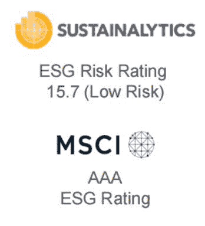

上海现代服务业联合会

RX荣续智库

环保行业ESG白皮书

# 第三章 环保企业ESG优秀案例分享

27/28

## 脱碳

威立雅致力于应对气候变化与全球变暖，坚持消减煤炭能源使用，降低范围1、2、3温室气体排放，通过节能增效、废能回收、本地化生产低碳能源、废料回收循环再造，以及从供水卫生系统回收能等策略，推进其全业务的碳中和进程。

采取可再生与可回收能源，实施废能回收，促废水回用，提升建筑及工业设施的能效，并通过与多人客户的协作，包括本地工业生态和生物质能网络等，构筑独具特色的循环经济模式：从这些合作伙伴处回收的塑料废弃物加以技术处理，使其变成再生塑料粒子或者纺线，再次回到产品生命周期中，并利用阿里巴巴的电商平台将再生塑料收纳盒进行销售，形成了一条完整的循环经济链条。在为广大消费者提供优质产品的同时，也践行了企业环境保护的宗旨与目标。

后为当地航空工业生产可持续燃料。通过这种碳捕捉模式可以有效改善城市垃圾回收的环境和能源平衡，在当地受到了利益相关方的高度评价。在国内，威立雅负责克东县近300万平方米的集中供暖，在发电上网的同时，实现热电联产。项目主要以充分利用农林废弃物的剩余价值的生物质锅炉作为供热保障，供热量可达120万GJ/年，年发电量可达185,412兆瓦时。截至2022年，项目减排量已达120万吨/年，既解决了当地社区废弃物处理难的问题，为当地居民提供了更好的生活环境。

为了更加准确地评估企业的气候行动并支持脱碳解决方案，威立雅建议改变ESG评估标准，并纳入目前环境评级的盲点——范围4：与其他现有解决方案相比避免的排放，以更全面认可各组织在促进经济脱碳中的贡献。

截至2022年，威立雅循环经济业务已实现营收84亿欧元，处理废弃物6130公吨，材料回收率17%，回收塑料19万吨，焚烧灰的回收率为93.1%。

自2018年以来，威立雅的碳强度降低30%；2019年到2022年避免排放温室气体总量相当于减少巴黎与纽约之间1,100万次的航班往返；生产可再生能源与回收能源总量达到110万兆瓦时，较2019年增长13.4%。

BREAKDOWN OF SCOPE 1
BREAKDOWN OF SCOPE

28.6 Mt CO₂e

Mt CO₂e

威立雅循环经济与废物回收绩效（资料来源：威立雅ESG报告）

威立雅2022年范围1、2排放总量与细分（资料来源：威立雅ESG报告）

### 消除污染

威立雅专注于保护自然环境，致力于减轻气候变化、污染及自然资源（包括水资源）过度利用对生物多样性的影响。通过一系列解决方案，包括城市污水处理、生态恢复、土壤修复、水资源保护、减少环境足迹以及废弃物和危险废弃物处理，威立雅努力消除污染，推动环境的可持续发展。

### 循环经济

威立雅致力于通过创新技术，将废物转化为"二次原料"，涵盖再生塑料、电子废物中的稀有金属、再生溶剂及堆肥等。此外，推出全球塑料回收方案PlastiLoop；从废物和废水中提取可再生与可回收能源，实施废能回收，促废水回用，提升建筑及工业设施的能效，并通过与多元客户的协作，包括本地工业生态和生物质能网络等，构筑独具特色的循环经济模式：从这些合作伙伴处回收的塑料废弃物加以技术处理，使其变成再生塑料粒子或者纺线，再次回到产品生命周期中，并利用阿里巴巴的电商平台将再生塑料收纳盒进行销售，形成了一条完整的循环经济链条。在为广大消费者提供优质产品的同时，也践行了企业环境保护的宗旨与目标。

截至2022年4月底，威立雅山东东营危废处置项目顺利点火进料投运，该项目是威立雅在中国与苏伊士完成合并后首个成功投运的危废项目，是威立雅中国危废业务强劲发展的又一个重要里程碑，区域内危废处置能力增至100,000吨/年。该项目推进威立雅在山东省危废市场多点全方位战略布局，继而助力齐台区域内应对环境挑战，提升居民生活水平，实现生态转型。

截至2022年，威立雅已为全球近9,700万人提供卫生服务，3,506个城市的污水处理计划正在进行；生物质可追溯性达到99.5%，生态管理区域的累计面积达到27,550公顷。

### 水技术平台强化，助力可持续水资源管理

水务作为威立雅的三大核心业务之一，对公司整体战略发展具有至关重要的影响。威立雅致力于通过分析并减少水足迹，保护现有资源，优化资源利用管理，促进负责任的使用和数字化，开发替代资源，废水和淡化水的再利用技术，积极参与可持续水资源管理的国际项目，全面推进水资源的可持续管理策略。

纳米比亚是非洲最干旱的国家之一：这里的居民长期无法使用干净的淡水。为了改善严重缺水的局面，1968年纳米比亚政府决定回收再利用市政污水以供居民使用。2001年起，威立雅帮助当地Goreangab水厂进行了一系列现代化改造，旨在保证饮水安全的前提下进一步提升污水处理能力。通过生物过滤和活性炭颗粒过滤，以及一项"多重屏障"工艺的创新改造后，这座都市的水源已经从原先的4,300立方米/日增加到了20,000立方米/日，相当于7个奥运会标准游泳池，满足10万居民每日的用水需求。

威立雅借助在纳米比亚的成功经验，在中国顺利开展污水再利用工程。目前在乌鲁木齐、青岛和北京房山均已受益于污水再利用工程，尤其是北京房山牛口峪遗址公园，由原先古老的污水氧化塘变成如今人们休闲放松的公园，更是50多种珍稀鸟类栖息天堂。与此同时，威立雅也在数字化水务领域持续深耕，通过进行优化管网效率，开发集中管理供水服务的数字化工具——ServO，助力SEDIF成为世界上第一家实现碳中和的水厂，并与之一道呼吁对已产生的二氧化碳通过更新造林来"回收"。每年，经由植树造林计划被抵消的二氧化碳达到3万吨左右。

相较于2019年，威立雅在2022年节约水资源3.2亿立方米，相当于新加坡全年用水量，并回收利用10亿立方米废水。

29/30

## 案例二

### 赛莱默（Xylem）：深植可持续发展，创建和谐"水世界"

赛莱默（Xylem）是一家享誉全球的水技术领先企业，专注于应对全球范围内的水资源挑战。公司汇聚了约17,000名具备多元背景和专业知识的团队成员，他们遍布全球各地，致力于为客户、公司和社区创造实实在在的价值。赛莱默在可持续发展和社会责任方面成就显著，将可持续发展理念深植于企业的每一项行动中。作为行业的佼佼者，赛莱默积极协助全球150多个国家的社区解决关键的水资源和基础设施问题，从而推动实现更为可持续的未来发展。

赛莱默的卓越表现获得了广泛认可，荣获了多项权威奖项。公司获得的奖项包括被列入世界基准联盟的SDG2000最具影响力公司、全球水奖中获得零碳排放冠军奖、巴伦周刊最可持续公司和新闻周刊最负责任公司等等。MSCI ESG评级AAA，Sustainalytics ESG风险评级为最低风险，全球供应商的39.7%已完成EcoVadis评估，32.4%供应商已经完成了CDP披露，等等。

| SUSTAINALYTICS ESG Risk Rating | ecovadis Silver Rating | Newsweek #17 Most Responsible Companies | BARRON'S #10 Most Sustainable Companies |
|---|---|---|---|---|
| 15.7 (Low Risk) | CSR Rating | | | |
| CDP Water Scarcity A- | MSCI AAA ESG Rating | Climate Change B | Net Zero Carbon Champion Award | 100% HRC Corporate Equality Index |

# 第三章 环保企业ESG优秀案例分享

### 赛莱默（Xylem）

### ESG治理

赛莱默ESG治理架构是由董事会监督公司可持续性及社会影响；领导力发展及薪酬委员会监督在公司持续改善多元化、公平及包容性以及人才发展的方法；内部委员会、工作组和嵌入式主题专家（SMEs）负责日常目标和报告控制的执行。企业季度业务审查以及财务和运营审查中增加可持续发展目标以进一步推动管理层对可持续发展表现的监督。多数高管还获得与2025年五个关键可持续发展目标一致的ESG PSUs，以进一步加强问责制，若干可持续发展目标已纳入高级领导层薪酬及与绿色金融结构挂钩；进一步与业务策略保持一致，公司对关键的环境、社会及管治披露和可持续发展管理系统文件的开启内部审计，赛莱默的可持续发展战略聚焦于三大核心支柱：服务客户、赋能社区和公司运营。

赛莱默致力于通过有效管理内部运营与供应链、推进企业社会责任计划、落实多样性、包容性实践，并专注于为客户提供优质的产品、解决方案和服务，积极贡献于实现17项可持续发展目标。公司设置了2025年可持续发展目标：脱碳方面，承诺到2050年实现净零排放（范围1、2和3）、水和废水设施约占全球温室气体排放的2%；流域恢复能力和管理方面，要领导公司的水资源管理实践通过部署技术来提高弹性；公平实践方面，要创建一个以多样性和包容性为中心的组织。

赛莱默遵循可持续发展会计准则委员会（SASB）的行业标准，根据该标准的实质性地图指导自身可持续性战略和优先事项的发展。在重要性评估中确定了43个ESG问题被分为六个不同的类别，分别是董事会监督与管理、环保行动、全球社区影响力和思想领导力、产品和服务、社会运作以及供应链。赛莱默在过去一年针对可能对公司产生重大影响的可持续发展相关问题进行持续监管，对可持续性重要性矩阵进行了重新评估并做相应调整，该矩阵体现了企业在过去四年中获得的成长和见解，展示了企业正在进行的可持续发展之旅及其在业务战略中的重要地位。

#### ESG实践及成效

赛莱默专注于应对全球水资源的挑战，致力于为客户打造既环保又有社会价值的解决方案，并推进企业的可持续发展，同时赋予全球社区居民更好的生活和工作条件。公司通过深入理解水资源稀缺、基础设施的韧性及其经济可负担性等关键的长期趋势，利用数字化解决方案在水处理领域创新，以促进公司与社会共同前进。

赛莱默将可持续性融入产品的开发与规划中，致力于通过独特的创新产品和服务组合及成熟的专业知识。2022年，赛莱默成功实现了"将产品碳足迹（二氧化碳当量）减少超过280万吨"的目标，通过使用新工具提升了产品生命周期评估能力，并增加了50%能帮助客户减少内部温室气体排放指标，围绕"产品碳足迹"和"产品手印"构建产品可持续发展计划。在注重打造可持续产品的同时，赛莱默还与供应商紧密合作，以建立一个负责任、有韧性、透明、多元化的供应链，赛莱默要求供应商承诺以可持续的方式行事，并能够与赛莱默的行为和价值观保持一致。

截至2023年5月，赛莱默在中国的供应商中有169家做出了为有需要的社区提供清洁饮水和卫生设施解决方案的WASH承诺，占供应商总支出的72%。

#### 节能降碳

2022年，赛莱默完成了使客户减少超过280万公吨的二氧化碳排放量的目标，实现88%的电力来自可再生能源、80%的欧洲汽车订单是全电动汽车或电动混合动力汽车、75%的包装是可重复使用的、可回收的或使用可堆肥的材料。这对于企业帮助客户减少温室气体排放的使命具有战略意义，反映了客户使用企业的产品所实现的范围1和范围2排放的减少。因此，企业将继续跟踪和报告这一目标到2030年，并将发展与更新的信贷转轮挂钩。

截至2022年底，赛莱默南京工厂已提前实现"2025年可持续发展环境目标"（100%工艺水回收和循环利用、零废弃物填埋和100%可再生能源使用）。

##### 责任产品构建绿色安全水环境（"手印"和"足迹"）

能水泵更换，安装Flygt以来至2022年2月，Anglian Water公司减少了污水池清洗频率，这样每年节省592英镑成本；且减少对公众的干扰。通过减少现场考察和人工清理汇池、节省电力以及与运输相关的燃料消耗：分别减少了90%的场地成本、29%的电力消耗以及84%的运营二氧化碳；Flygt飞力潜水泵产品在中国获得泵行业首次碳足迹认证。

在沈阳将处理水循环连接到扩建的车间，实现100%绿色电力使用，水资源管理方面，同比减少了约36万加仑的淡水使用量；在苏格兰水务公司，智能污水泵送系统可以减少高达40%的能源消耗，并将服务出勤率降低近99%；在印度总统官邸，紫外线消毒解决方案可以使80%的水重新用于绿地和湿地，同时减少高达50%的能源消耗。在美国华盛顿州沃拉沃拉市通过先进的计量基础设施，将非收入用水减少了50%。

制定了其他具有成本效益的管道更新策略。一旦在整个配水系统中实施，该模型可帮助该公司将年管道更换成本从9000万美元降至仅2000万美元，降幅高达了了%，同时将故障发生次数大幅减少四分之三。

#### 技术创新赋能

作为全球水技术提供商，赛莱默致力于利用技术创新解决关键水资源问题以及全球基础设施挑战，2022年，赛莱默中国获得授权专利19项，2023年，赛莱默在中国启动全新的研发中心，专注于智慧水务以及整体水务解决方案的开发，以及通过产学研协同创新持续攻克水科技领域的技术难题，赛莱默在中国通过技术革新、风险管理等多种方式积极践行绿色生产。

##### 多元、平等与包容的企业文化

赛莱默持续推进多元、平等与包容的企业文化，通过DE&I数据可视化提升信息透明度，帮助员工实现人人成长与发展。其中，尤其重视女性领导力的发展：目前，赛莱默全球女性管理层比例已达到25%，在中国的女性员工比例已提升至25.7%。针对水务行业人才短缺的问题，赛莱默开展人才发展项目，启动青年人才轮岗计划，帮助员工成为未来的领导者或业务领域的专家；2022年，赛莱默全球87%的员工参与志愿服务，为全球社区贡献了超过156,000小时的志愿服务。

---

*上海现代服务业联合会*

*荣续智库*

*环保行业ESG白皮书*

33/34

**案例三**

**格林美：**
**变废为宝，循环利用，化腐朽为神奇**

RX荣续智库
上海现代服务业联合会
环保行业ESG白皮书
第三章环保企业ESG优秀案例分享
35/36

**格林美：**
**变废为宝，循环利用，化腐朽为神奇**

"变废为宝、循环利用是朝阳产业。垃圾是放错位置的资源，把垃圾资源化，化腐朽为神奇既是科学，也是艺术，你们要再接再厉！"——2013年7月22日：习总书记视察格林美武汉园区时题词

**公司资质荣誉**

格林美通过不断耕耘，可持续发展能力得到国际肯定：2022年荣获达沃斯世界经济论坛全球循环经济奖、戴尔森可持续发展奖，同时入选恒生A股可持续发展企业基准指数、胡润中国民营企业可持续发展百强榜、福布斯中国可持续发展工业企业TOP50，并在MSCI ESG评级中，清洁技术机遇领域得分位居同行业全球一：格林美将继续秉承其绿色、低碳理念，致力于推动全球碳减排与碳中和，努力成为绿色发展的示范、低碳时代的引领者和新能源产业的核心力量，展现中国企业在世界绿色发展舞台的重要贡献。

资料来源：格林美ESG报告

格林美，作为国内技术创新与环保低碳双优的上市企业，自2001年成立以来，便在国内引领"资源有限，循环无限"的绿色低碳产业新风尚。格林美通过"开采城市矿山"商业模式，致力于"消除污染，再造资源，推动环境与资源的可持续发展"。二十余年磨一剑，格林美以"新能源材料制造+城市矿山开采"的双轨战略，构筑资源循环与清洁能源材料的发展架构，全力以赴达成碳中和与碳达峰的宏伟目标。经过二十余年的不懈努力，格林美在绿色循环领域构建了五大产业链，形成了一个紧密相连、相辅相成的资源循环体系，从废弃物回收到资源再生，这五大产业链条共同打造了一个完整的资源循环商业闭环，标志着格林美在可持续发展道路上的坚定步伐。

### ·聚焦新能源材料，打造循环"心脏"

格林美革新了传统能源材料的采集与制造流程，通过回收方式收集新能源材料，特别是从废旧电池中提取镍、钴、锰、铝等重要元素。格林美不仅将这一回收利用过程产业化，还建立了锂离子电池正极材料前驱体的生产基地，标志着其在新能源材料循环利用领域的领先地位和创新能力。

目前，格林美的生产基地年计划产出5,000吨镍钴锰、镍钴铝三元动力电池原料及2,000吨电池级球形氧化钴，通过高效回收废电池中的镍、钴、锰、铝，格林美实现了从废电池到新电池材料的产业闭环，展示其在新能源材料循环领域的卓越成效与环境责任。

资料来源：格林美ESG报告
格林美主导的产品新能源材料（资料来源：格林美官网）

### ·打造"城市矿山"，构建循环产业

格林美专注于发展"城市矿山"和新能源材料制造，旨在构筑可持续的循环产业链。"城市矿山"作为其循环产业的核心环节，涵盖废弃物回收、动力电池全生命周期价值链及环境治理。

**废弃物回收业务**

废弃物回收作为城市矿山开采的主要主题之一，包含了电子废弃物回收处理业务、报废汽车回收业务以及镍钴钨稀缺资源回收业务。

首先，格林美精心打造了一条涵盖"电子废弃物回收拆解—废塑料再生—稀贵金属再生"的综合循环再生价值链，设立了6个电子废弃物绿色处理中心和3个废塑料再造中心，全面服务覆盖全国600万平方公里范围。公司已实现的年电子废弃物处理量占中国报废总量的10%，能够年处理2万吨以上报废线路板，金、银等贵金属的回收处理能力超过10万吨，废塑料循环再生产能也超过10万吨/年。格林美不仅实现了电子废弃物的高效循环利用，还显著减少了废弃元器件对环境的污染。

资料来源：格林美ESG报告

其次，格林美创立了一条完整的报废汽车资源化产业链，即"汽车报废—资源回收—原材料再生—机动车制造—零部件再造—再利用"，并配备了5个专业的报废汽车回收处理中心及5个钢铁加工配送中心。企业的年报废汽车回收处理量约占中国总量的5%，计划每年处理超过50万辆报废汽车。格林美为城市报废车辆提供了一条将废旧资源转化为宝贵原材料的新途径。

格林美汽车回收中心
（资料来源：格林美ESG报告）

最后，格林美独具匠心打造了镍钴钨资源的再生价值链，从资源回收、再生、材料和产品再制造到产品再利用。2022年格林美的镍资源回收量达15,000吨，占中国总开采量的13%；钴资源回收量达1,500吨，是中国原钴开采量的三倍；钨资源回收量近4,300吨，超过原钨开采量的6%。格林美还在全球超细钴粉市场占据超过一半的产量份额。这不仅实现了稀有金属资源的有效回收利用，还避免了原矿资源的过度开采。

资料来源：格林美ESG报告

**动力电池全生命周期价值链**

格林美还打造了一条新能源生命周期价值链："废旧电池回收→原材料再制造→材料再制造→电池组再制造→再使用→梯级利用"，体现了将"城市矿山"开采与新能源材料制造相结合的循环经济理念。在中国设立了5个动力电池回收中心，覆盖国内主要经济区；并在韩国及印尼建有2个合资工厂。格林美的六家子公司领先全国，入选工信部新能源汽车废旧动力蓄电池综合利用行业规范条件公告企业名录，并与全球了30余家汽车及电池生产商建立了废旧电池回收合作，占同废旧动力电池（除铅酸电池外）回收量超10%。年拆解能力达21.5万吨，梯次利用产品年产4.1GWh，电池黑粉再生利用能力达20万吨气。格林美展现了其在动力电池循环利用领域的深厚实力及对高效价值链运营的承诺。

新能源全生命周期价值链
资料来源：格林美ESG报告

**- 环境治理**

动生态治理，为环境污染的整治做出贡献。格林美在废物循环利用过程中，能够有效转化危险废弃物为环境友好的次生产品，实现从源头到终端的外-境治理，彰显其在生态保护与可持续发展方面的行业领导力。

格林美，凭借新能源材料制造和城市矿山开采的双轮驱动，不仅推动了行业创新，还显著促进了地方经济发展。比如其全球战略为印尼创造2,000余个就业机会，有效激活当地经济。

2022年，格林美在环保领域的投入高达5.78亿元人民币，年增20.42%，实现碳减排88万吨，避免二氧化碳排放约22万吨。二十多年的持续奋斗，格林美通过不断优化其可持续发展战略，凭借技术创新稳固了可持续发展的实力。在激烈的市场竞争中，格林美不仅保持了经济增长，还巩固了自身的市场地位，也展现出中国企业在全球绿色发展贡献的力量。

## 案例四

### 北控水务：“水世界”里稳中求进，生生不息

北控水务，作为国内领先的专业化水务环境综合服务领军企业，坚持以“客户为左、创新为驱动”的经营理念，发挥天然的环保业务属性，全力支持联合国17项可持续发展目标，保证稳定的水资源供应，提高污水处理效率，加大科技创新力度。北控水务在这17个目标中根据自身业务特性识别出相关性最高的8个目标，并将这些目标融入公司的发展战略和业务运营过程。

全同期卓越运营管理

北控水务坚持以质量为基础，以客户需求为导向，以创新为驱动，落实全周期客户服务与品质体系，提升服务效率，夯实产品品质。

产品设计方面，基于核心产品模块的标准化开发和智能设计策略。在水厂设计中，完成了水厂产品15个单元16个通用标准模块、11个专有工艺包和产品开发。这些工作支撑全场的模块组合设计方式，实现了从技术到产品开发转化。目前，已经形成近百个标准产品模块，产品的设计水平持续提升。标准化技术产品在创新项目中的总体应用率超过90%，设计效率显著提升。北控水务是业内首次开发完成水务行业、设计行业独一无二的全息设计平台，实现在线可视化自动设计。

北控水务在ESG方面的出色表现，2021年入选可持续发展企业基准指数，成为87家ESG表现优异的上市公司中的一员。2022年，在MSCI ESG评级中提升至A级，其中产品质量和安全议题中收获行业内最高得分8.0分，成为水务行业里唯一一家获此评级的亚洲企业；被纳入道琼斯可持续发展指数（DJSI），并成为道琼斯可持续发展指数新兴市场成分股；入选“2022年度全球可持续发展企业”榜单，也是唯一一家上榜的中国环保公司；2023年在标普全球可持续发展年鉴中被评为行业最进步企业。在全球可持续发展趋势日益显著的情况下，北控水务更显创新引领、步伐稳健。

品质交付方面，北控水务落实高品质交付战略，持续推进以标准体系、控制体系及保障体系为核心的产品品控体系建设，发布《北控水务集团污水处理厂交付品质标准手册》，给出可视化的定性、定量指标，促进品质精益管理。

资源、数据中台建设等数字化项目，有序推动数字化战略落地。成立国内环保行业首家财务共享服务中心，为企业数字化战略转型升级提供了有力支持，北控水务执行总裁李力表示，当前我国水务行业轻资产转型最根本的是需要真正提高服务的能力、水平和技术含量，需要改变过去的水污染治理常见的“碎片化”方式，才能整体提高服务质量。

减污降碳协同，守护绿水青山

在全球气候变化和国家“双碳”政策的大背景下，北控水务积极践行碳减排与低碳转型。秉承“绿色优先、减碳增效”的发展理念，全力以赴实现碳达峰和碳中和目标。

网-河联动达标的河网水环境治理理念新实践；交付的北京市大兴区·凤河流域综合治理工程BOT项目，开启了“流域尺度”“育上水下同治”“蓝、绿、灰、黑”交织的综合治理模式，是目前国内最为全面、系统的水环境项目典型代表。

绿色技术

优质运营方面，北控水务建立业内首创星级运营企业评价体系，坚持以星级评价体系为核心抓手，从过程管理、运营质量、经营结果、人员能力和数字化运营能力五个维度综合评定。2022年北控水务下属水厂全部完成星级运营评价考核和验收工作，超过97%的水厂达到一星级以上标准，超过35%的水厂达到三星或更高标准。

此外，2022年北控水务确定了新的业务组合，其中环卫技确定为以北控城市资源为发展主体的赛道业务，在全国多城市提供水务、环卫、危废的区域一体化服务，努力探索协同发展之道，共建美好人间环境。未来，北控水务计划逐步拓展至河湖湿地草、水土气固废。

轻资产转型稳步发展

北控水务一直跟随外部环境和自身条件不断调整公司战略，从发布资产管理平台+运营管理平台的“双平台战略”，开启轻资产转型，再到发布并实施全面“创新战略”，为资本、技术、人才、数据四核驱动提供创新动力，每一步战略演化生动地再现了一个水务龙头企业的稳步前进历程。

2020年开始全面加速数字化转型，制定数字化转型蓝图与实施方案，2021年发布“数字化战略”，持续加强数字化能力建设，以业务能力为纲，启动投资、人力、财务、数据中台建设，稳步推进数字化战略落地。

在推动碳减排的道路上，北控水务不断攻克软硬件技术难题，推动技术产品化转型，形成多项自主知识产权的技术与产品，增强了自身竞争力。积累了污泥双回流-AOA深度脱氮除磷技术、好氧颗粒污泥等一系列低碳工艺技术，形成了污泥、湿地、村镇污水等多领域低碳产品。同时，在多个项目中应用水源热泵、光伏发电技术，结合不同区域特点采用污泥协同焚烧模式，并通过BE-EMR智能控制、“1+N”组团智慧管理模式等精细化管理手段开展减碳实践行动。2023年北控水务向行业提出“未来新水务”概念，启动未来新水务开发计划，为行业探索发展新路径。

稳定处理的污泥中含有大量难以降解的有毒成分，可能对环境造成严重的二次污染。北控水务以污泥“减量化、稳定化、无害化、资源化”为基本原则，积极探索污泥处理处置系统解决方案：打通污水处理“最后一公里”，并实现全流程低碳处理。如在青岛即墨区污泥处理项目中，实现了污泥的“减量化、无害化、稳定化和资源化”；处理后的炭渣含水率低于5%，可用作建材、土壤改良和绿化等资源化再利用，实现了生态效率、经济效益和社会效益的多赢。该项目自运行以来，日处理污泥量超过20万吨，是目前国内在污泥炭化处理工艺中实际处理规模最大、连续运行时间最长、直接运行成本最低的项目。

**案例五**

盈峰环境：

创新驱动"碳"路，智慧赋能发展

上海现代服务业联合会

RK荣续智库

环保行业ESG白皮书

第三章环保企业ESG优秀案例分享

43/44

如洛阳市涧东污水处理项目成功入选首批城镇污水处理低碳运行案例；秦皇岛海港区西部污水处理厂利用污水处理后的中水作为水源热泵热源，为厂区办公楼和生产生活区域提供采暖和制冷保障；银川市第一再生水厂项目作为西北地区规模最大的半埋式再生水厂，投运后：项目出水水质将达到地表水准四类标准，将为银川市工业循环、园林绿化、道路冲洗等提供再生水，对于推进水资源节约集约利用、改善黄河流域水质、增强城市综合服务切能等具有重要意义。

# 盈峰环境

创新驱动"碳"路，智慧赋能发展

盈峰环境，作为我国环卫装备领域的引领者：坚持"科技创新是我们发展的根本"的核心价值观，聚焦以"智能装备、智云平台、智多服务"为核心的智慧环卫战略，构筑"智能装备+智慧服务"双轮驱动的产业模式。推进环卫行业机械化、新能源化、小型化、智能化、云联化发展，坚定地定向高质量发展道路。

盈峰环境具备行业领先的科研实力和全球领先的环境装备生产制造能力。在全国建有3大产业基地，15个研发创新平台，主导和参与行业80%以上技术标准制定：累计获得专利超过1000项，专利里居于行业首位；同时：打造"数字工厂"、国家级"绿色工厂"，实现卫装备的"研、产、供、销"一体化运作，精细化运营与治理，全方位提升产品与服务质里，利用数字化赋能绿色发展，加速行业绿色转型升级：盈峰环境凭借自身在绿色发展、社会责任和公司治理方面的卓越表现，荣获"2023上市公司E5G先锋践行者案例"：

- **创新环保装备，夯实环保基础设施**

盈峰环境拥有行业内最前沿的核心技术和最完善的环卫装备产品线，满足全国各地主要应用场景的环卫装备需求，销售规模及核产品市场占有率已连续22年处于国内行业第一：作为环保装备领域的开拓者，盈峰环境持续引领产品技术变革，将人工智能技术赋能环卫，创新推出一系列新能源环保装备、5G无人驾驶环卫机器人等行业领先产品，助力实现环卫作业的高效节能、安全灵活：

- **新能源环卫装备，引领"专精特新"蓝图**

盈峰环境深入践行绿色低碳发展理念，推出5.DE全系新能源环卫装备，产品覆盖道路清扫清洗、垃圾转运、市政园林、光伏清洗、移动充电等上百个品种，形成国内品类、型号最全

        

RX荣续智库
上海现代服务业联合会
环保行业ESG白皮书
第三章 环保企业ESG优秀案例分享
45/46

的新能源环卫车组合，新能源环保装备驶入发展"快车道"，位居行业一：传统环卫装备在新能源等创新技术的加持下，具有低能耗、降噪、提质增效等特点。

小型环卫机器人产品群

盈峰环境新能源环卫设备（资料来源：盈峰环境官网）

盈峰环境小型环卫机器人产品群（资料来源：盈峰环境官网）

低能耗。盈峰环境全国在运营新能源环保装备数量超过5200台；产生的环境效益相当于植树造林2400亩。依托自主开发的INFOREDEMS能量管理系统，实现三电系统设计、整车控制、上装控制系统、驱动系统等12个关键领域的能耗优化，整车同等作业条件下能耗降低20%，系统效率提升21%。

减少噪音污染。例如，纯电动扫洗车应用"高速静音双风机+电机直驱"技术，实现作业降噪6-8分贝，洗净率高达97%以上，实现清洁目标的同时，改善环卫工作者的工作环境及周边居民的生活环境。

提升人员保障：应用机器人执行清洁作业，减少人员暴露在高温、台区暴雨等恶劣环境的时间，降低环卫工作者的劳动强度；减少人员接触有害物质的机率，降低人工作业安全隐患，保障其健康和安全。

降低运营成本。机器人替代人工作业，减少人员投入，降低用工成本；设备应用避障控制技术，及时识别和避开障碍物，提高机械作业安全性，降低意外事故发生率，减少设备维护成本和人员伤害。

提质增效。通过智慧云控平台的智能调度，可实现环保装备的精细化管理，综合运营及维护成本仅为同类型燃油车的1/3，降低运营成本。例如，纯电动压缩式垃圾车应用"触感式无人自动上料、双向压缩"技术，实现垃圾压缩循环时间小于13秒，压缩能力与收运效率方面行业第一，提高垃圾运转作业效率。

### 智慧环卫云平台，构建城市管理大脑

### 智慧环卫机器人：清洁城市毛细血管

盈峰环境自主研发智慧环卫机器人，通过融合"绿色新能源动力、5G+AIOT集群控制技术、机器视觉技术、全场景图像识别"等关键技术，搭载"激光雷达、超声波雷达、高精度差分GPS、全场景摄像头"等多重传感器，实现环卫机器人智慧作业与智能移动；拓展多种场景、多种作业能力。在环卫项目中，"小型化、无人化、智能化"的智慧环卫机器人展现出多种优势：

主完成清洁任务，提高作业机械化水平；另外，智能化机作业的工作模式将吸引更多年轻人加入环卫行业，有助于缓解人口老龄化带来的用工难题。

盈峰环境还积极布局研究氢能源技术产品，至今已拥有燃料电池扫洗车、洗扫车、清洗车、压缩车等多系列产品。目前，盈峰环境燃料电池产品市占率超过60%，位居行业一。

#### 智慧环卫云平台

"大云物移智"技术，实时互联城市服务中的人、车、物、事，实现环卫服务运营管理的标准化、数字化和智慧化，目前平台已在全国254个城市落地环卫数字化运营项目，为全国超10万台产品的客户提供智慧服务，为智慧城市建设实现高效的生产空间、宜居的生活空间、和谐的生态空间赋能助力。

[PAGE 29]

上海现代服务业联合会
RX荣续智库
环保行业ESG白皮书
第三章 环保企业ESG优秀案例分享
47/48

自2021年起至2024年2月中旬，在38个月时间内，盈峰环境凭借卓越的智慧化管理水平与综合实力，中标各类城乡服务项目262个，中标项目年化总额接近50亿元，合同总额高达270亿元，中标项目总数、年化总额及合同总额均遥遥领先，以压倒式优势排名第一。

### 产品为王，服务致胜

盈峰环境围绕研发、制造、管理三大品质环节发展"品质引领，客户至上"战略，重新定义品质管理体系。同时，引领行业最高节能标准，体现了盈峰环境在节能降耗、清洁生产、资源综合利用等方面的综合实力。

盈峰环境智慧环卫平台（资料来源：盈峰环境官网）

研发环节，构建以市场需求为导向的IPD集成产品开发模式，实现新产品开发过程的质量控制，提升产品研发效率、成功率；对产品进行轻量化设计、减少使用材料的种类、延长产品寿命、减少有害物质的使用等，使产品满足节能产品认证标准，能耗低于行业平均值。

制造环节，拥有数字化智能工厂及智能化绿色工厂，关键工序合格率达到100%；产品生产周期缩短40%。

管理环节，以全行业最先进、最全面的数字化管理系统，提升生产管理与客户服务效率；创建"峰速关爱"服务品牌，围绕产品设备生命周期管理，打造"1314"客户服务标准；推行"直修+"智慧管家服务模式，全面提升服务效率与质量，减少客户维修成本。

### 智慧环境管理平台

为助力城市环境治理，盈峰环境推出智慧环境管理平台，充分利用物联网、移动互联、云计算、大数据等信息技术，采用感知为先、传输为基、计算为要、管理为本的理念，实现海量环境监测数据的安全存储和智能分析，打造涵盖智慧环保、智慧园区、智慧流域和智慧水务等在内的管理业务集群，实现环境治理的综合办公自动化、业务管理一体化、环境管理可视化、环境决策科学化。

#### 数字化薪酬核算平台

盈峰环境首创"数字化薪酬核算平台"，依托智慧环卫云平台强大的数据整合能力，重塑薪酬核算底层架构，打造透明、智联、受控的线上薪酬核算体系，使环卫项目薪酬核算全流程由7天缩短至3天，信息传递准确性100%，项目全员算薪率100%，帮助企业优化管理流程，提高运营效率，实现环卫运营管理一体化、算薪自动化、管控精细化。

### 智慧化城市服务

盈峰环境依托在环保装备领域的强大优势和自主研发的智慧环卫云平台，首创"作业机械化+运营智能化+服务标准化"的运营模式，以数字化手段，打通"前端分类、中端转运、末端处理"的环卫全产业链，实现对环卫运营服务所涉及的"人、车、物、事"构建"全时段、全方位、前后台无缝连接、精准高效"的运维服务和远程监控管理模式，开启城市服务"智慧监管、智慧运营、智慧服务"全智方案，协同构建政府主导、企业运作、社会广泛参与的新型城市治理生态圈。

盈峰环境试验室现场（资料来源：盈峰环境官网）

为了全面提升环保装备的可靠性和适用性，盈峰环境启用了中国环卫行业首个全场景试验基地，该试验基地集城市道路、市政管网、园林绿化等全场景试验场所于一体，分设8大产品试验区、近30个模拟与测试场景，以严格、科学、客观的试验手段，深度还原实际作业场景，为客户提供安全可靠、品质最佳、环境友好的环保装备产品及服务。

**案例六**

**侨银股份：**

**经济效益与社会效益携手共进的城市大管家**

侨银股份水陆一体化项目（资料来源：侨银股份官网）

### 城市大管家升级"@城市"，激活城市"造血功能"

侨银股份，是中国第一家A股上市的城乡公用事业服务企业，享有"环卫第一股"之称，已在社会转型期口，过去的城市管理模式粗放、体系不完善，管理效率较低；随着市场经济发展，社会生活形式和内容发生变化原有社会制度在管主体和管理方面均出现不适应；除此之外，老旧小区、无主小区的基础设施陈旧、绿化缺失，难以满足新时代人民生活需求和持续发展的活力业态，但服务成本高使得物业入驻管理较难：小型的企业更难以一次性满足多项需求。

侨银股份为积极落实国家"双碳"战略新要求，提出现代化城市全域综合服务方案——"@城市"，加快构建现代城市全域综合服务新体系。

侨银股份凭借在ESG信息披露、ESG体系建设、企业综合实力及影响力、社会责任等方面的卓越表现，和在设备智能化使用、员工福利保障、企业可持续发展上取得的突出成效，侨银股份深刻地洞察到当前基层社会治理的痛点难点，2022年推动"城市大管家"战略升级，将"城市服务"的核心概念进一步延伸至"全区域""全周期"和"全要素"，"@城市"全域综合治理模式由此诞生。六大核心功能模块包括"基层红色阵地""柔性治理""公共服务""微改造""特色终经营"以及"无废低碳"，融合政府、社会、市民力量形成合力，切实推进基层社会治理共建共治共享：

- 机构奖、时代金融金桔奖中荣获"ESG时代先锋上市公司奖"等。

### 智慧环卫，助力绿色生态城市

过去三年，侨银股份新签订单均为行业第一，2019年到2022年，侨银股份营收复合增速22%，归母净利复合增速34%，车人比率不断提高，机械化程度提升超3倍，科学化、精细化、智能化、全减化驱动公司毛利率稳步提升。

是侨银股份成功运营的广州市重点项目——广州市本级水陆一体化PPP项目，是全国最大的全机械化单体水陆保洁项目，是推动广州市环卫市场化改革的绿色样板项目，服务领域示范案例，该项目与国企、政府三位一体战略合作，以社区共物业、环卫服务为基础，延伸探索家政、房屋租赁、社区养老等服务：通过精细化管理模式扩大物管综合平台在发挥自身优势的同时：全面整合社区微改造、智慧社区管理等多方面管理服务事项，形成全域治理服务式。当前，马岗联社辖内已建立起信息化指挥调度中心，侨银股份已经投入试点运营，让马岗社区初步实现了智慧管理。

该项目水域方面承担了超158.53公里的珠江航道保洁，附域方面承担了124公里的主干道机械清扫和39条立面隧道保洁；水域方面近300艘左右保洁船只，每年清捞垃圾过万吨，陆域方面实现了100%的机械化率，以及零污染、零排放，有效降低空气中PM2.5浓度。

上海现代服务业联合会

RX荣续智库

环保行业ESG白皮书

第三章环保企业ESG优秀案例分享

49/50

 

⚫ 

⚫ 

◼ 

◼ 

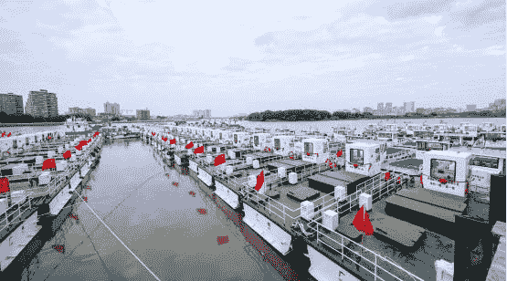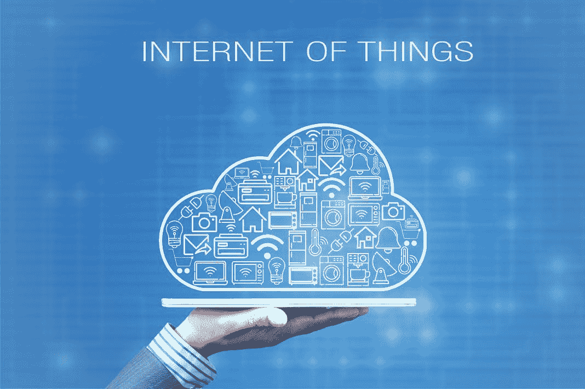

上海现代服务业联合会

RX荣续智库

环保行业ESG白皮书

第三章 环保企业ESG优秀案例分享

51/52

项全面实施以大数据为支撑、以现代智能机械为主体、以智慧环卫云服务为手段、以超洁净为目的的4.0服务模式，真正实现智慧环卫：

源经营管理有限公司，主营业务为再生资源回收、城乡市容管理、城市生活垃圾经营性服务等，积极探索垃圾分类+再生资源回收体系的"两网融合"模式。目前，公司已在运营项目有江西省宜春、江西靖安、广东湛江、福建漳清等垃圾分类标杆项目，在市场上形成了示范效应。

- **聚焦数智化战略，向智能物联转型**

为了更好、更快、更优地服务智能网联产业国家战略，侨银股份精心打造出独具特色的"1+1+3+N"智慧城市管理服务亿系，助力公司在垃圾分类、固废处理等多种业务场景中实现

侨银股份"城市"代表项目（资料来源：侨银股份官网）

2.5倍，在2023年前三季度，研发投入更是达到了惊人的2400万元，同比增长了30.85%。

INTERNET OF THINGS

### 员工关爱深入一线，护航企业可持续发展

环卫行业属于劳动密集型行业，人力成本在环卫服务的营业成本中占据主要地位。2022年我国环卫行业主要上市公司人力成本占比处于65%—70%的水平，庞大的劳动者数量叠加劳动力结构老龄化，使得环卫行业需要更加聚焦于社会相关重要性议题。

侨银股份在员工职业健康安全和薪酬福利方面下足了功夫。一方面，为解法一线环卫员工的后顾之忧，推行细致的员工管理，在薪酬福利方面，侨银积极响应国家生育政策，2023年5月，正式发布鼓励优育方案，下发"关于提高员工生育福利的通知"：政策福利覆盖全部一线环卫员工，成为全主首家实现一线环卫工人生育福利全覆盖的城市管理服务企业。侨银从成立之初便设立关爱基金帮扶困难员工家庭，为符合条件的一线管理人员设"孝顺金"，直接发到其父母账户；举办员工入职周年纪念颁奖典礼，将员工全周期的关爱环环相扣；另一方面，推动智慧环卫业务，通过智能设备和数字化管理，降本增效。在设备革新上线的过程中，为了保证人员迅速适应新的工作模式和方法，侨银股份建立了侨银大学堂，以"通识教育、专业教学、结合实践"为培训理念，为员工提供了全方位的培训体系。

侨银股份的数智化战略目标明确，旨在构建新型域中大脑：打通智慧政务平台的城市管理环节，这一战略充分利用人工智能、数据大模型、数字孪生、卫星监测及数据管理平台等尖端技术，为城市的细致化管理注入了新的活力。该举措不仅实现了政府、企业和公共服务机构之间的跨部门协同作业，更为城市管理带来前所未有的高效率和精准决策。侨银股份还与多家科研机构签署了与人工智能相关的战略合作协议，启动了侨银数智城市研究院，以加速数字化战略布局，旨在引领城市综合管理行业向数字化升级；专注于智能城市服务装备和智能服务机器人等多场景的"数智"装备开发和应用。

- **抢抓机遇积极布局，助力国家战略实现**

### 布局新航道，助力循环经济

2021年10月，国务院关于印发《2030年前碳达峰行动方案的通天》，计划到2025年，废钢铁、废铝、废纸、废塑料、废玻璃等9种主要再生资源循环利用量达到4.5亿吨，到2030年达到5.1亿吨。侨银股份抢机遇，快人一步，在2021年4月成立子公司广东侨银碳资

 

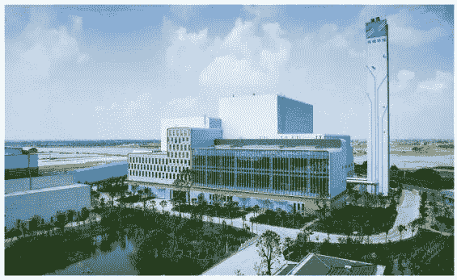

⚫ 

⚫ 

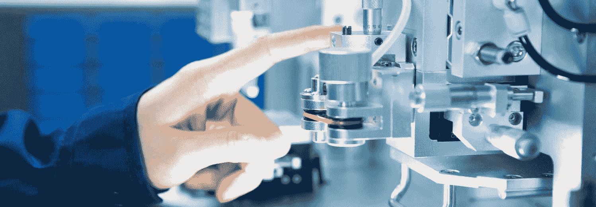

**案例七**

**伟明环保：**

**从冰淇淋设备到固废环保巨头，凭实力穿越长周期**

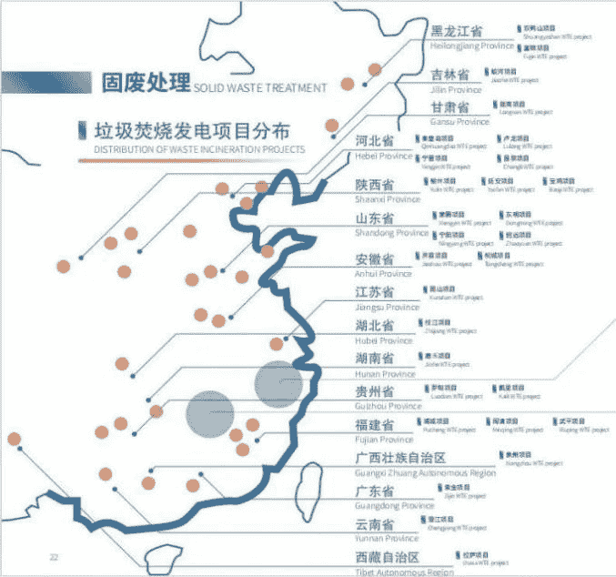

上海现代服务业联合会

RX荣续智库

环保行业ESG白皮书

第三章 环保企业ESG优秀案例分享

53/54

案例七

伟明环保

**从冰淇淋设备到固废环保巨头，凭实力穿越长周期**

伟明环保，作为国内规模最大的低碳环保服务商之一，将"为人类创造洁净、健康、可持续发展的生活环境"作为发展使命，持续不断向社会提供一流低碳环保技术、产品及服务，业务主要涉及环境治理、装备制造、新能源开发制造三大板块。环保板块是伟明发展的基石，全国近百个环保项目，始终保持安全稳定运行。在前几年因疫情而低迷时所开展的大修技改，在2023年发挥出强大效能，科学的指挥模式和先进的工艺设备，使以识板块的盈利能力再度提升。装备制造为伟明的发展筑起坚固的护城河，掌握核心技术，具备研发制造能力，使伟明在前行的道路上优势显著。伟明装备在新材料装备领域取得突破：2023年强势进军海外市场，新能源业务则是伟明后续发展的生力军，经过一年的准备和布局，在电池领域的布局已经初具规模，将成为企业新的增长引擎。

### 科技创新，核心设备自研自产

深耕环保事业二十余载，伟明环保能在竞争激烈的市场中脱颖而出，关键在于其坚持自主创新，强化核心竞争力：作为国内首批掌握垃圾焚烧处理技术自主知识产权的企业之一，伟明环保有专利技术、软件著作权百余项。公司始终坚持焚烧装备的自产自给，这一战略不仅保障了利润空间，也使伟明环保在技术上始终保持领先。

伟明环保以机制创新转化为奋斗的内驱力，推行"合伙人制"，开展股权激励；以技术创新转化为生产的推动力，持续研发投入，2022年研发投入8451.33万元。伟明环保配备了一支技术精湛的研发团队，以及多个专业实验室，其技术研究范围广泛覆盖废气、废水、固废等多个方面，能够提供全方位的环保解决方案，从污染治理到资源综合利用等一系列服务。此外，公司还积极参与重大科技项目，包括承担了"城市生活垃圾焚烧处置技术与设备"和"城市生活垃圾焚烧二次污染控制技术与系统集成"两项国家863计划课题研究，以及一项国家火炬计划项目，进一步加强了其在环保科技领域的领导地位。这些成就不仅是伟明环保自主创新能力的体现，也为公司在未来环保行业的发展奠定了坚实的基础。

### 聚焦主业，汇聚绿色发展合力

伟明环保始终聚焦于主业以垃圾焚烧发电业务为核心的同时，通过拓展关联业务如餐厨垃圾处理、渗滤液、污泥处理、农林废弃物处理和危废处理等，实现业务的纵向延伸和横向拓展。这种多元化发展战略，不仅丰富了公司的业务版图，也进一步提升了伟明环保在固废环保行业的整体竞争力。

截至2022年末，伟明环保在全国范围已相继投资、建设、运营环保治理项目近百个，业务遍及18个省份和自治区，其中已有4个垃圾焚烧投运项目在联合国注册成为清洁发展机制（CDM）项目，成为国内为数不多的在联合国注册多个清洁发展机制项目的垃圾焚烧处理企业；同时，公司还有多个国家核证自愿减排（CCER）项目在国家发改委申请备案流程中。2022年公司通过垃圾焚烧发电替代火力发电实现二氧化碳减排当量约319.69万吨。

从1985年以机械制造起家，1998年进入垃圾处理行业，到如今成为全国领先上绿色环保企业之一，对时代机遇的敏锐把握和跨界创新的决心是伟明环保能够持续发展的关键。伟明环保同样收获许多认可，荣获"中国上市公司ESG百强奖""2023年上市公司治理最佳实践案例""年度最具社会责任上市公司奖"等奖项，在中诚信ESG评级中排名行业第一；2022年实现营收44.46亿元，利润16.53亿元，市值超过300亿。自上市以来，伟明环保保持了连续十多年的业绩增长状态。

伟明环保垃圾焚烧发电项目分布
（资料来源：伟明环保官网）

伟明环保公司
（资料来源：伟明环保官网）

## 智能环卫，提高公司信息化管理水平

目前，伟明环保在新能源产业链条逐渐成型，在印尼的镍资源端，在国内的锂电池新材料制造端，下游拟布局的报废汽车和电池回收，让产业链逐渐延伸。

伟明环保为下属负责环卫业务的垃圾清运的车辆安装了GPS定位系统，通过大屏幕实时监控可知悉车辆具体方位及工作状态，同时公司会对收运端垃圾清运需求信息进行及时采集，从而为垃圾清运车辆匹配最合理的收运线路，提高收运效率，降低收运油耗、人工等成本支出。同时，公司坚持自主研发、自主创新，并与国际知名的自动化公司ABB、GE建立合作关系。目前，公司自控产品线已覆盖垃圾焚烧发电项目自动化控制全方位领域，包括全厂DCS控制系统、ACCs炉排控制系统、烟气处理系统、水处理系统、厂级信息监控系统等。公司各工程随时通过显示牌实时向公众展示，二一氧化碳、颗粒物、二氧化硫、氮氧化物、氯化氢等烟气相关数据，监测数据还实时传递到当地环保监管部门，接受社会公众的监督，提升了品牌形象。

## 新能源赛道开启第二增长曲线

垃圾焚烧的"黄金十年"后迎来重要转折。一方面是大中城市的垃圾焚烧市场已经趋于饱和，甚至局部已经出现过制，焚烧项目增速放缓，市场空间开始逐步减少。另一方面是优质项目数量减少，加上国补退坡等政策出台，使得竞争态势进一步加剧。伟明环保居安思危：2022年，从自身的资本优势、装备制造优势、人才积累优势、品牌声誉优势，以及自身在固废领域20年的经验积累，在新能源领域寻找切入点与突破口，开启了自己新的第二增长曲线——电动汽车电池：

伟明环保指出，"高冰镍火法冶炼工艺与垃圾焚烧发电工艺有相似之处，公司装置制造等的各类专业人员，可以全面介入冶炼设备的研制工作"。这是伟明环保的又一次战略转型，目前，伟明环保在新能源产业链条逐渐成型，在印尼的镍资源端，在国内的锂电池新材料制造端，下游拟布局的报废汽车和电池回收，让产业链逐渐延伸。综金属13万吨。同时，公司还在国内投资年产20万吨动力电池正极材料、动力电池回收等项目，与印尼高冰镍项目形成上下游产业链，实现从原料端到销售端全产业链，如在温州布局锂电池新材料产业本地项目，分为三个环节：湿法冶炼硫酸镍、生产三元前驱体、生产三元正极材料；在温州布局锂电池及废旧汽车回收利用项目。

伟明环保的经历证明了，面对全球环境挑战，企业通过转型升级、技术创新和策略多元化，不仅能够实现自身的可持续发展，也能为社会和环境带来积极影响。伟明环保正是这样一个借助自身实力，穿越长周期、贡献环保力量的典范。

---

# 案例八

### 瀚蓝环境：共建人与自然和谐生活

**瀚蓝社会责任管理"三个融合"**——"与公司战略高度融合，打造公司核心竞争力"、"与日常经营工作高度融合，促进企业经营与创新"、"与企业文化高度融合，提升内部员工责任意识"。

瀚蓝环境，是以固废处理为主业，辅以能源、供水、排水业务的综合性环保企业，位列中国环境企业十强、中国垃圾焚烧发电企业十强，连续多年被评为全国固废处理十大影响力企业。瀚蓝环境以"共建人与自然和谐生活"为使命，秉持"城市好管家、行业好典范、社区好邻居"的社会责任理念，致力于实现"十年百城，最受信赖的生态环境服务企业"的愿景。到2030年，瀚蓝环境期望将业务范围拓展至100座城市，为100座城市提供优质的综合环境服务。

瀚蓝环境社会责任管理模型（资料来源：瀚蓝环境官网）

瀚蓝环境在2011年成立社会责任部，自上而下并始逐步完善社会责任组织工作。社会责任管理委员会总裁担任委员会主任，高管、高级顾问及各板块主要负责人为委员会成员，下设社会责任推进办公室，负责社会责任专题规划工作。总部和四个业务板块分别设置社会责任工作小组，负责社会责任工作的落地执行，形成"1+4+N"社会责任组织体系，推动社会责任工作融入公司战略、业务运营、企业文化，提升综合能力，打造行业领先、国内一流的瀚蓝社会责任实践模式。

**瀚蓝"使命驱动型"社会责任管理模型**

- 瀚蓝环境股份有限公司
- 社会责任管理委员会
- 社会责任推进办公室
- 推进工作小组（总部）
- 推进工作小组（业务板块）

### 以使命驱动社会责任管理

瀚蓝环境早在十年前就确立了以社会责任为核心的品牌战略，在环保行业内首倡社会责任并矢志不渝地践行，2021年，发布公司"十四五"社会责任战略规划（2021-2025），明确了2022年瀚蓝环境荣获中国环卫行业最具社会责任企业，新财富"最佳ESG 50先锋60"，连续十年蝉联中国水业最具社会责任投资运营企业，获得保尔森可持续发展绿色创新类别十大提名等，瀚蓝的ESG指数在华证指数以及Wind ESG评级均为A级，无废城市案例入选《2022企业气候行动案例集》、入选上市公司ESG优秀实践案例集。

（资料来源：瀚蓝环境官网）

瀚蓝环境制氢项目采用技术成熟可靠的蒸汽转化法工艺，是目前国内外公认的最佳工艺方案，利用餐厨垃圾产生的沼气作为原料，不仅有效降低了制氢成本，且生产过程中无增加碳排放，制成的氢气为"绿氢"。制氢项目结合氢能工业、交通等领域的应用场景，项目达产后预计可以减少二氧化碳排放近100万吨。

与传统燃油环卫车、纯电动环卫车相比，氢能环卫车具备续航能力长、补能时间短、能量转换效率高、作业过程实现零碳排放及环境适应性强等三大优势。

瀚蓝环境2023年8月，全国首个大规模沼气制氢加氢一体化项目——瀚蓝环境可再生能源（沼气）制氢项目在广东省佛山市南海区正式投产，该项目年产约2200吨氢气，标志着瀚蓝环境的氢能业务"制、加、输、用"一体化实现全面贯通。

此外，在碳管理相关信息的披露上，瀚蓝也是将数据做到了应披尽披，对温室气体范围三的排放总量进行了统计披露，这在国内同类型企业中绝对领先。

### 瀚蓝环境2022年减碳绩效

| 关键绩效（2022年） | 数值 |
|---|---|
| 年度总碳排放量 | 312.87万吨 |
| 年度总碳减排量 | 231.21万吨CO₂当量 |
| 直接温室气体排放总量（范围一） | 13.53万吨CO₂当量 |
| 间接温室气体排放总量（范围二） | 25.23万吨CO₂当量 |
| 其他间接温室气体排放总量（范围三） | - |

资料来源：瀚蓝环境官网

附注：生活垃圾焚烧引起的温室气体排量以生活垃圾中化石碳占地球的比例为计算基础，因此，生活垃圾中的成分含量会对温室气体排放量造成较大影响。

### 瀚蓝低碳文化生活，将碳管理植入日常生活

瀚蓝用文化引领的方式，将碳管理目标、碳交易能力建设等纳入企业管理的每环节，将低碳文化通过员工活动送入千家万户。

**开展瀚蓝闲鱼，让闲置循环起来。** 在2022年"六五"世界环境日，瀚蓝举办第一届低碳环保文化节系列活动之闲鱼集市，倡导简约适度、低碳环保的生活方式和消费模式，合计开展4场闲鱼集市专场活动，现场交易物品近300件。通过二手交易模式的闲鱼活动，瀚蓝让闲置资源流转到有需要的人手中继续发挥价值，促进社会资源的循环再利用，同时也减少地球资源的消耗，以实际行动践行企业社会责任。

**开发"瀚蓝减碳号"企业微信小程序，打造瀚蓝人自己的碳生活平台。** "瀚蓝减碳号"小程序为全体员工构建了一个记录日常低碳生活、学习低碳知识、交流低碳心得的良好平台。截至2022年底，小程序有效注册人数已达2300余人。

资料来源：瀚蓝环境官网

## 关于上海现代服务业联合会

上海现代服务业联合会，是由本市主要从事服务业的行业协会、学会、商会等社会组织及企事业单位自愿组成的跨行业、跨领域的综合性枢纽型非营利社团组织。拥有会员单位1500余家，其中200余家为行业协会、学会、商会等社会组织，覆盖了金融、信息、科技、商务、生产、公共、专业服务等多个领域，基本囊括上海市服务业的所有行业。

以联合会为主发起设立了上海现代服务业企业促进中心、上海经贸商事调解中心、上海现代服务业发展研究院、上海现代服务业发展基金会、上海现代服务业标准创新发展中心等五个民非实体机构，并牵头成立长三角现代服务业联盟，具有全面服务社会、助推经济发展的综合实力和核心竞争力。

2024年3月，上海市商务委关于印发《加快提升本市涉外企业环境、社会和治理（ESG）能力三年行动方案（2024-2026年）》，明确上海现代服务业联合会承担着"加大对ESG理念的宣传力度"的主要任务。

## 关于荣续ESG智库研究中心

荣续ESG智库研究中心，致力于推动"绿色共赢"的可持续发展理念，成为企业ESG发展的长期伙伴。我们通过ESG行业研究、优秀案例研究、政策和标准研究、热点和趋势分析等，解决气候变化、环境、社会、公司治理等领域的信息缺乏或信息不对称的问题，为企业提供可落地、可复制、可持续的ESG解决方案，帮助企业践行ESG理念，创造长期价值。

荣续智库研究中心汇聚了各行业的ESG专家和研究员，他们在各自领域拥有丰富经验和卓越能力。这些专家大部分是来自品职教育的ESG持证学员。品职教育拥有超过百万的活跃ESG学习社群，以及超过3万名ESG人才组成的人才库，是荣续智库坚实的人才资源。

荣续智库将继续发挥行业经验，秉持深刻洞察力和强大执行力，帮助企业将ESG有效整合到核心战略中，助力企业在ESG领域实现突破，创造社会和经济双重价值。

## ESG白皮书系列

- 01 纺织服装行业ESG白皮书
- 02 食品饮料行业ESG白皮书
- 03 汽车行业ESG白皮书
- 04 化工行业ESG白皮书
- 05 环保行业ESG白皮书
- 06 新能源行业ESG白皮书
- 07 半导体行业ESG白皮书
- 08 医药行业ESG白皮书
- 09 财会行业ESG白皮书
- 10 金融"一带一路"ESG白皮书
- 11 包装行业ESG白皮书
- 12 印刷行业ESG白皮书
- 13 包装印刷行业ESG案例白皮书
- 14 家电行业ESG白皮书
- 15 美妆行业ESG白皮书
- 16 钢铁行业ESG白皮书
- 17 物流及航运物流行业ESG白皮书
- 18 航空物流行业ESG白皮书
- 19 建筑行业ESG白皮书
- 20 储能行业ESG白皮书
- 21 机械储能行业ESG白皮书
- 22 电化学储能行业ESG白皮书
- 23 化学储能行业ESG白皮书
- 24 出海欧盟行业ESG白皮书
- 25 银行绿色金融行业ESG白皮书
- 26 跨境电商行业ESG白皮书
- 27 光储充行业ESG白皮书
- 28 电子元器件分销行业ESG白皮书
- 29 建筑材料行业ESG白皮书
- 30 通信服务行业ESG白皮书
- 31 通信设备行业ESG白皮书
- 32 家居装饰行业ESG白皮书
- 33 互联网教育行业ESG白皮书
- 34 医疗器械行业ESG白皮书
- 35 医疗卫生行业ESG白皮书
- 36 康复辅具行业ESG白皮书
- 37 酒旅行业ESG白皮书
- 38 零碳产城融合项目发展白皮书
- 39 零碳产城融合项目案例白皮书
- 40 白酒行业ESG白皮书
- 41 电力行业ESG白皮书
- 42 物业行业ESG白皮书
- 43 有色金属行业ESG白皮书
- 44 零碳物流园区发展白皮书
- 45 零碳园区发展白皮书
- 46 传媒行业ESG白皮书
- 47 造纸行业ESG白皮书
- 48 煤炭行业ESG白皮书
- 49 基建行业ESG白皮书
- 50 气候金融ESG白皮书

欢迎关注荣续ESG智库研究中心，为您提供最新的ESG资讯，共同探索可持续发展的未来。

合作咨询请联系（扫码添加联系人）。
