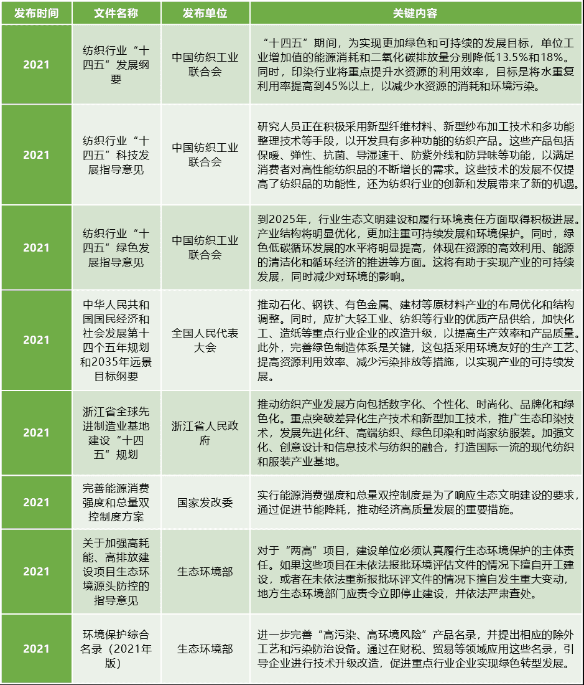
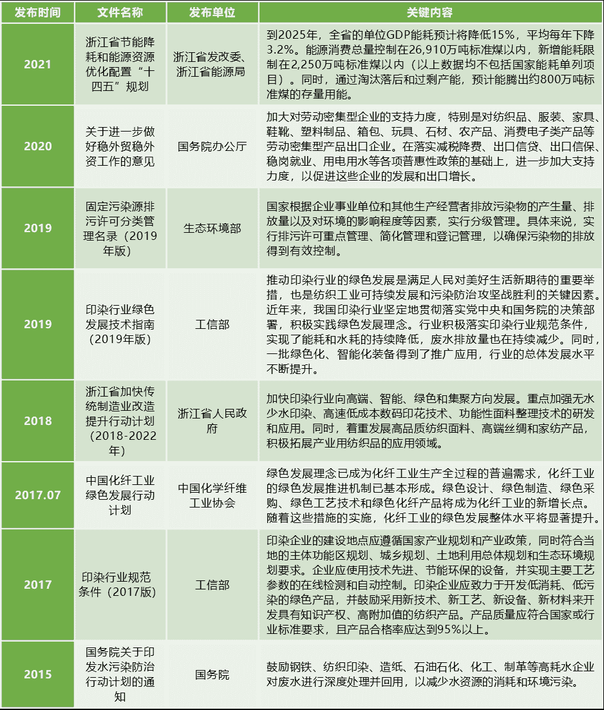
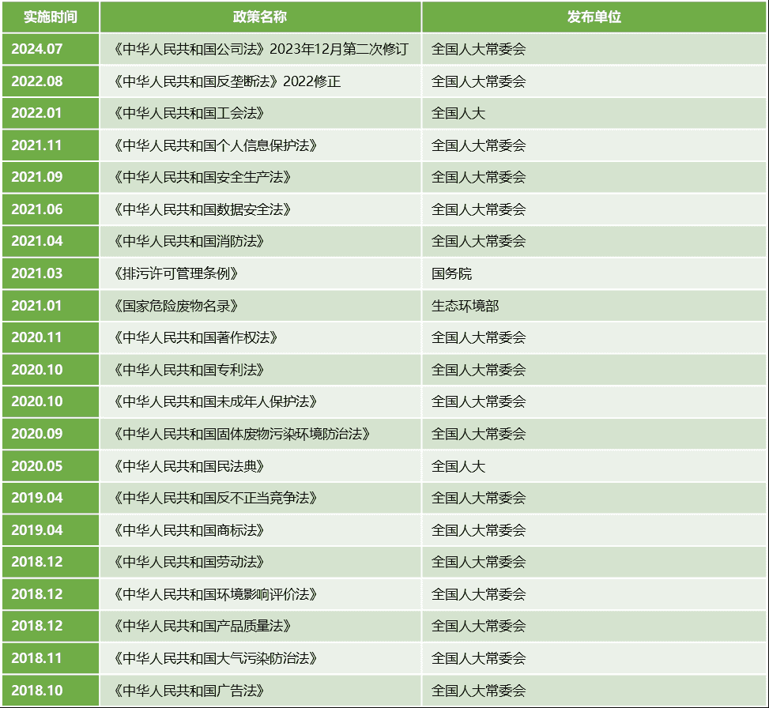
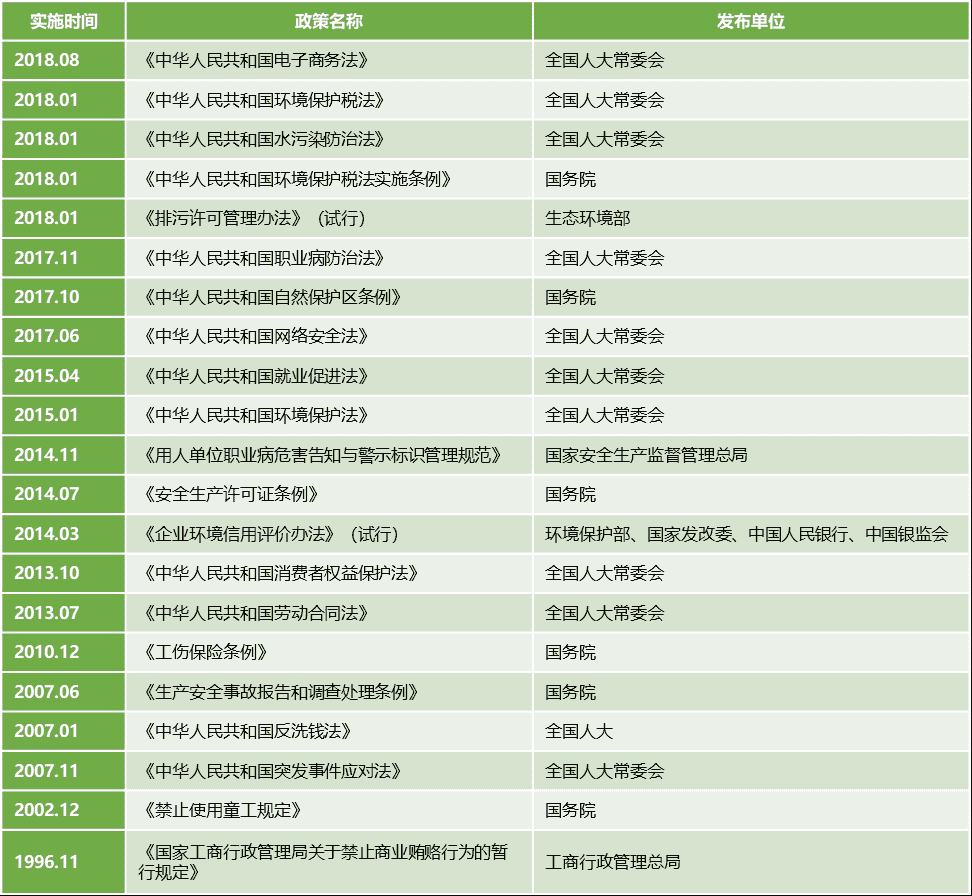
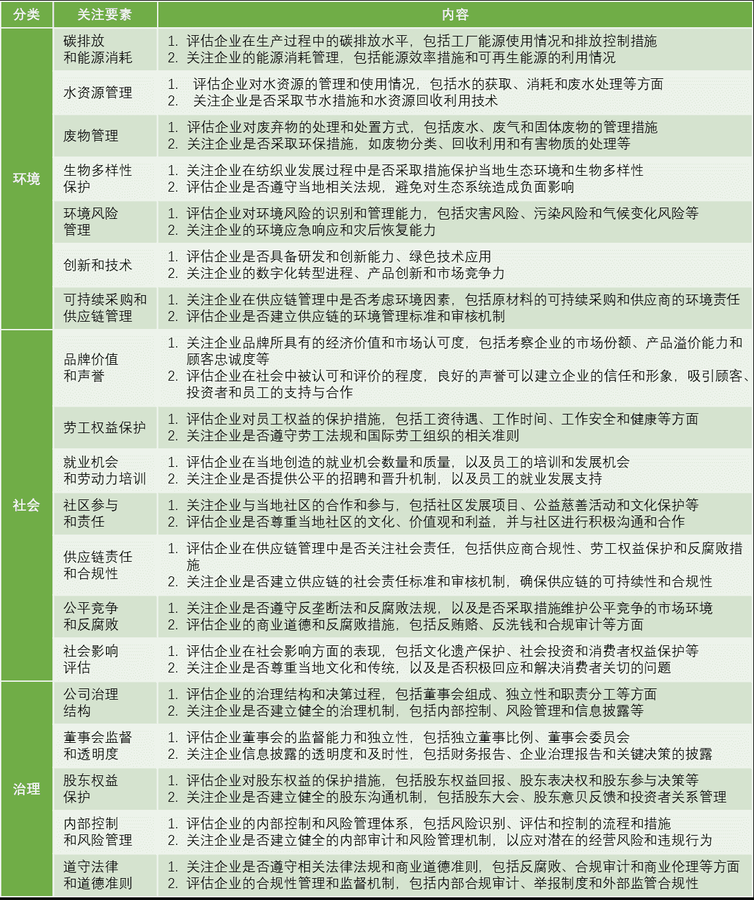
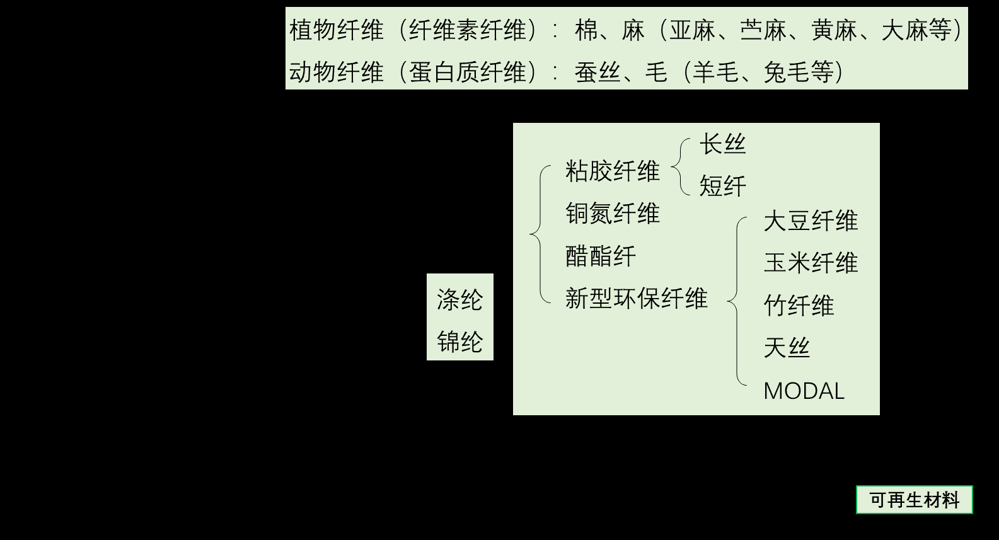
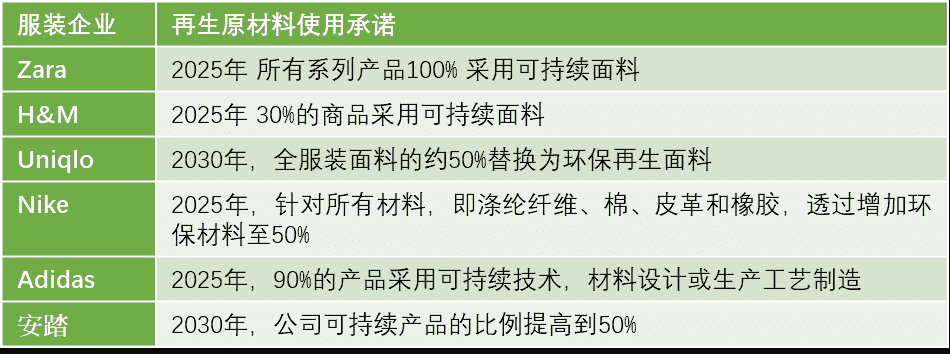
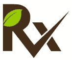
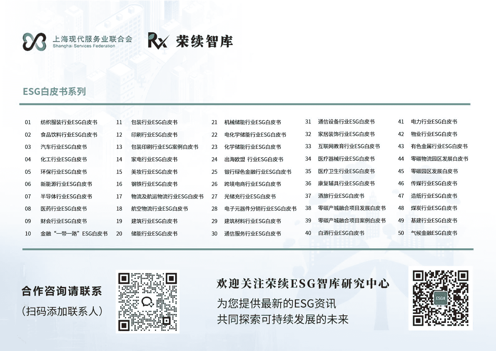

上海现代服务业联合会
荣续智库
ShanghaiServices Federation

## 纺织服装行业ESG白皮书

EVERYTIMEYOUTRYISALIMITEDEDITION

## 摘要

在全球倡导绿色发展的浪潮中，纺织服装行业的环保转型至关重要。本报告聚焦纺织服装领域，精要呈现其中的ESG机遇以及实践亮点，从采用环保原材料，到优化生产工艺减少污染排放，再到完善企业治理保障可持续运营，通过深入浅出的方式，介绍如何构建绿色环保的纺织服装未来。让这个行业既能满足大众时尚需求，又能守护好我们的生态家园，走上高质量发展之路。

## 前言

在人们的传统认知中，纺织服装行业往往被视作一个传统有余、创新不足的领域，脑海中浮现的是嘈杂车间、忙碌工人以及相对微薄的收益，它就像隐匿在时代浪潮背后的"配角"，鲜少成为关注焦点。

然而，时移世易，随着ESG（环境、社会和治理）理念如春风般吹入各行各业，纺织服装行业也迎来了属于自己的"高光时刻"，开启了一场蜕变之旅。

纺织服装行业产业链条长，从棉花种植到成衣销售，各环节都凝聚着人力与商机。如今，在ESG的引领下，工厂环境焕然一新，告别了脏乱与污染；工人的权益得到充分保障，工作条件和待遇显著改善；管理模式也愈发科学规范。同时，消费者环保意识觉醒，更偏爱环保衣物，促使行业积极变革。

曾背负环境污染"原罪"的纺织服装行业，近年来因政府政策引导、企业责任强化，在可再生原材料应用、水资源保护、循环利用技术等关键环节都取得长足进步，显现出商业与环保并重的发展态势。在此背景下，让我们一同深入探寻该行业在ESG驱动下的精彩实践与发展成果。

### 研究员

- **蔡颖** 高级注册ESG分析师：OLKC2023001534A
- **范晓舟** 高级注册ESG分析师：23RZQLKC001132A
- **王佳韵** CFAESG证书：0000000101920316
- **付文娟** CFAESG证书：0000000102665369
- **杨阳** 高级注册ESG分析师：23RZOLKC0O0472A
- **叶晓** 高级注册ESG分析师：23RZQLKC003123A
- **徐鑫峰** CFAESG证书：0000000102919431

## 目录

# 第一章 纺织服装行业概览

- 行业价值链 07
- 行业发展ESG的潜力 15
- 行业的ESG议题 28
- 行业的ESG核心议题 33
- 行业的ESG发展趋势 35
- 行业ESG龙头 39

# 第二章 纺织服装行业的ESG发展

- 行业ESG报告披露情况 23
- 行业的ESG政策 46

# 第三章 纺织服装行业的ESG实践

- 可再生原材料 51
- 无水染色 67
- 循环利用 76

---

# 第一章 纺织服装行业概览

当提及"纺织服装"这个行业，许多人可能脑海中浮现的是嘈杂的车间、忙碌的工人以及微薄的收益，劳动密集，所得却不尽人意，这总让纺织服装行业成为很多人眼中的"配角"，不太受到重视。

这个行业涵盖从棉花种植、制作布料、成衣生产、最终销售的整个过程，每个环节都涉及大量的劳动力和赚钱的机会。在ESG的引领下，工厂不再满是污染，工人得到了善待，待遇和工作条件也随之提高，管理也更加规范有序。与此同时，消费者越来越偏爱环保衣物，促使纺织服装行业积极变革。

然而，随着ESG（环境、社会和治理）理念的席卷而来，纺织服装行业好似找到了"一根救命稻草"，不仅洗去旧污，更踏上新的征程。为什么会这样呢？

## 第一节 行业的价值链

纺织服装行业是个涵盖从原材料获取、纺织制造到成衣生产与销售的完整产业链。这个行业不仅包括了麻、棉、毛等天然纤维和化学纤维的生产，还涉及至纱线纺制、布料的织造、染色加工以及服装的设计和制作，最终这些产品通过各种渠道销售给消费者。纺织服装行业是全球经济中一个重要的部分，它不仅关系到数百万人的就业，还与人们的日常生活密切相关。这个产业链横跨了从原料供应到最终消费的多个环节，每一步都包含了大量的信息和价值，形成了一个复杂且多元的产业体系。

纺织服装行业可以进一步分为纺织和服装两个细分领域：

**纺织业**：

- 设计
- 面料织造
- 印绣花
- 渠道
- 品牌运营
- 面料染整
- 纺纱
- 纱线、纤维
- 纺织纤维

**服装业**：

- 成衣裁剪
- 缝制
- 厂长丝
- 棉花等
- 原料

### 图1：纺织服装行业产业价值链

### 图2：纺织服装行业的原材料

纺织服装的原料，主要分类如下图所示，总体上由天然纤维和化学纤维组成：化学纤维又分为人造纤维和合成纤维，天然纤维和人造纤维，主要用来做衣服；合成纤维是许多塑料的来源，其中涤纶又称聚酯纤维，锦纶又称聚酰胺或尼龙，这些专有名词会在后文提到。

| 分类 | 细类 | 具体纤维 |
|------|------|----------|
| 天然纤维 | 植物纤维（纤维素纤维） | 棉、麻（亚麻、苎麻、黄麻、大麻等） |
| 天然纤维 | 动物纤维（蛋白质纤维） | 蚕丝、毛（羊毛、兔毛等） |
| 天然纤维 | — | 棉花等 |
| 天然、化学纤维 | 人造纤维（再生纤维） | 长丝、短纤、粘胶纤维、铜氨纤维、大豆纤维、醋酯纤维、玉米纤维 |
| 化学纤维 | 合成纤维 | 涤纶、锦纶、腈纶、丙纶、氨纶、芳纶 |
| 新型环保纤维 | — | 竹纤维、天丝、MODAL |

# 第一章 纺织服装行业概览

2022年全球纤维市场的数据显示，纤维总产量达到了1.16亿吨，在这庞大的数字中，天然纤维占29%，其中以棉花为主，独占纤维总量的22%，化学纤维占据了市场的大部分，达到了71%，合成纤维更是以65%的纤维总量占比额饱。

在这些纤维材料中，有57%来自石油基原材料，这些通常是不可再生资源，而剩余的43%则为可再生材料，但在这部分，只有不到1%的材料是通过消费后的回收利用得来的。

## 2. 纺纱

纺纱环节是将纤维原料加工成纱线的过程，通过不同的纺纱技术和纺纱线细度的专业方法，使得纺织行业能够根据不同的应用需求生产出不同规格的线，满足市场的多样化需求。

纺纱技术主要包括环锭纺、气流纺、紧密纺等几种技术，每种技术都独具独特的特点和应用领域。

图3：2022年全球纤维市场分布

环锭纺：一种传统的纺纱方法，利用环锭机的旋转将纤维牵伸成线，并通过纺纱锭上的环锭（导线环）将纱线绕在锭子上。这种方法可以生产多种类型的纱线，包括精梳纱、粗梳纱等。

气流纺：一种较新的纺纱技术，通过高速气流将纤维牵伸并捻成纱，气流纺纱线常具有较高的生产效率和较好的纱线均匀性，适用于生产化纤无混纺纱线。

紧密纺：一种通过特殊装置增加纺纱线密度的技术，使纱线更加紧密、平滑和强度高，紧密纺纱线适用于高质量的织物生产，如高档服装和床上用品。

同时，传统的纱线细度的方法也各有不同，主要有定长制和定重制。

定长制：用旦尼尔（Denier）表示合成纤维和丝的细度，旦尼尔是指9000米长的纱在公定回潮率下的质量（以克为单位）。例如，150D表示9000米长的纱线重150克。

定重制（不如定长制用得广泛）：

- A. 公支（毛纺）：是毛纺行业中衡量纺纱线细度的方法，表示1克纱线拉伸的长度（以米为单位）。数字越大，纱线越细。

源：Textile Exchange Materials market report 2023

- B. 英支（棉纺）：是棉纺行业中常用的纺纱线细度衡量方法，表示1磅纱线拉伸后具有的840码（约为768.1米）长度的数量。英支数越大，纱线越细。

## 3. 织造

在纺织行业中，根据纺织品的结构和制造工艺，可大致分为针织、梭织和无纺布三大类，每种类别下又有不同的生产技术，适用于不同的用途和产品特性，以满足不同的使用要求和消费者需求。

- **针织（弹性织物）**：针织是通过线圈相互串套连结而成的织物，具有良好的弹性伸缩性，适用于20.0%的产品。
- **梭织（经纬交织）**：梭织是由经纱和纬纱交织而成的织物，结构稳定，制作出的布料平整、耐用，但弹性较差。
  - 有梭机：使用梭子来携带纬线越经线，适用于多种材质的纱线织造。
  - 无梭织机：不使用梭子，而是采用其他装置（如喷气、剑杆等）将纬线引入经线中，生产效率avg.30x更快。
- **无纺布（产业用纺织品）**：无纺布不经过传统的纺纱织造过程，通过物理或化学方法直接使纤维固结成布，生产过程简便，成本低，但耐性和耐久性通常低于传统织物。
  - 针刺：通过数千根细针的反复刺入，使纤维相互纠结，形成强度较高的布料。
  - 水刺：利用高压水流穿透纤维束，使纤维纠结在一起，生产出具有特定纹理的布料。
  - 纺剂：将聚合物溶液直接喷成纤丝，然后通过黏合或热处理形成布料，适用于生产卫生材料、过滤材料等。

## 4. 印染后整理

印染后整理是纺织品生产过程中的重要环节，涉及到对布料进行印花、染色以及赋予其特殊功能的处理。

- **印花**：印花是在布料上添加图案的过程。
  - 圆网印花：利用旋转的圆网进行印花，适用于大批量生产，能够快速连续印制图案。
  - 平网印花：使用平面网版进行印花，适合精细图案印制，灵活性高，但速度较慢。
  - 电脑喷墨印花：通过计算机控制的喷墨技术直接在布料上打印图案，适用于小批量、多样化的定制生产，可以实现复杂高精度的图案。

- **染色**：染色是将颜色均匀地施加到纺织品上的过程。
  - 宽幅染色：适用于宽幅布料的染色处理，能够处理大面积的纺织。
  - 窄幅染色：适用于窄幅或小批量的纺织品染色，适合特殊材质或要求的布料。

- **后整理**：后整理是指在印染过程之后，对纺织品进行的一系列物理或化学处理，以改善其性能或赋予其特殊功能。
  - 预缩：通过控制近热条件使纺织卫缩率，达到期尺寸稳定，防止或卫洗涤后缩水变。
  - 抗皱免烫：通过化学处理提升纺织品的抗皱性，减少或免去过烫过程，使布料持久如新。
  - 阻燃：给纺织品添加阻燃剂，使其具有阻燃性能，减少火灾风险，适用于对安全要求高的环境。
  - 特殊功能处理：包括抗菌防臭、防紫外线、防水防油等功能性处理，根据不同的应用需求赋予纺织品更多的特殊性能。

印染后整理技术不仅关系到纺织品的外观和风格，还直接影响到使用性能和安全性能，是提升纺织品附加值的关键步骤。

# 第一章 纺织服装行业概览

13/14

### 图4 服装行业各环节的商业价值

服装环节

纺织环节之后便是服装行的各环节，这些面料在服装业的环节中得至进一步加工，通过设计、裁剪、

- **品牌运作、创意设计**：欧洲、美国（40-50%价值）
- **创新模式**：欧洲、日本
- **设计研发**：欧洲、美国、日本
- **贸易及流通**：香港、日本

在纺织行业中，产品可以大致分为三大类：服装、家用纺织品及产业用纺织品，它们各自占据市场的一定

- **高端生产**：欧洲、美国（30-40%价值）
- **加工生产**：中国、东南亚（10-20%价值）

**终端产品**

- **服装（占比45%）**
  - 针织产品：内衣、运动服、毛衫
  - 梭织产品：正装、休闲装
- **家用纺织品（占比30%）**
- **产业用纺织品（占比25%）**

来源：东吴证券研究所

纺织服装行业是一个完全竞争的行业，价值链较低端加工生产环节，其特点是低利润积累、低进入和退出壁垒，以及技术垄断时间短等，这导致行业内企业众多，市场集中度低，竞争激烈。由于客户对生产过程和成本有较深了解，企业很难通过提高产品价格来获得额外利润。因此，企业会通过技术创新和效率提高来降低生产成本，并通过品质建设、产品差异化等策略来增加客户的认可度和支付意愿，以此来获得市场竞争优势。

服装是服装业最直观和常见的用途之一，约占45%。服装按加工之道常分为针织产品和梭织产品。针织产品包括内衣、运动服、毛衫等。针织服装以其舒适性、弹性和透气性被广泛应用于日常生活和运动领域。梭织产品包括正装、休闲装等。梭织服装以其结构稳定、形状保持以及风格多样上满足了正式场合或日常休闲的穿着需求。

家用纺织品的比例约30%：涵盖了与家庭日常生活中的各种纺织品，如床上用品（床单、被套、枕套等）、窗帘、桌布、浴巾等。

产业用纺织品的比例约25%：称为工业用纺织品，是指用于各种工业领域的纺织品，包括但不限于汽车内饰、医疗卫生材料、建筑用纺织品、农业用纺织品等。

在加工生产环节，设备和技术的更新换代是纺织服装行业提升竞争力的关键途径之一。尽管该行业被视为劳动密集型，但随着技术进步，引入自动化和智能化设备变得尤为重要。这样的更新换代不仅能提高生产效率，减少人为错误，还能显著提升产品质量，从而满足市场对高品质产品的需求。例如：自动化缝纫机、智能化布料切割系统和高效的物流处理系统等，都能帮助企业在激烈的市场竞争中占据有利地位。

15/16

## 第二节 行业发展ESG的潜力

### 1. 民生行业，将长期存在

纺织服装行业，作为民生的基础行业，具有极其重要的地位，它的稳定和发展对于经济社会的持续进步和发展率关重要。这个行业不仅为人们提供了基本的衣着需求，而且是就业创造、技术创新和国际贸易的重要领域。

从经济贡献的角度分析，纺织服装行业的产值对国家经济贡献不容小觑。据统计，该行业的总产值约占国内生产总值（GDP）的7%，预算近年来大约3万亿人民币，可见其在国民经济中的重要地位。中国是世界上最大的纺织品和服装生产和出口国。中国为化纤、纱线、布料等主要纺织产品的产能和产量长期居世界首位。

尽管面临全球经济波动、原材料扩张变化等冲击，纺织服装行业凭借其在民生中的根本地位和对国家经济的重要贡献，展现出了强大的韧性和生命力，确保了行业的长期稳定发展。

### 2. 能赚钱，有开展ESG的实践的实力

随着我国纺织服装行业从初级阶段向终端的产品销售发展，行业利润率有了显著变化：纺织织布环节的毛利率大约为5%-15%，服装加工生产环节的毛利率大约为20%，服装销售环节的毛利率可以达到30%-50%。随着产业链的推进，该行业在发展过程中积累了丰富的资金，有更多的资金可以用于环境、社会和治理（ESG）的实践活动，推动整个行业的可持续发展。

### 图5：纺织服装行业ESG发展的潜力

纺织业：劳动密集、赚钱潜力、出口

服装业：劳动密集、赚钱潜力、出口

ESG：污染、劳动密集

价值链传递过程中与ESG密切关联的领域：

- **棉花等**（天然、化学纤维）
- **纱线**
- **面料**
- **成衣**
- **零售**

主要ESG关联领域：

- **污染**：15%
- **出口**
- **劳动密集**
- **民生行业**：毛利率升高 20% 30%-50%

3. 是环境问题的原罪，也是环境问题的救赎者

4. 重要的出口行业，要满足国际标准

纺织服装业是众所周知的高污染行业，其面临的环境问题主要有两个方面。一是面料织造和染整过程中造成的污染；二是快速发展的时尚消费凸显的大量废弃衣物问题。增长ESG先机的企业已经在这两个问题上发力，从环境问题的原罪向环境问题的救赎者迈进。

我国为纺织服装业在全球市场奠定极其重要的地位，其出口额占全国对外出口总额10%，达到了3200亿美元的惊人数字。特别值得关注的是，纺织品和服装的出口额各占半壁江山，分别为1500亿和1700亿美元，主要目的地包括美国、欧盟、日本、东南亚等国家和地区。这一显著的出口成绩不仅展示了纺织服装业的经济重要性，也反映了其在国际贸易中的关键地位。

面对织造和染整过程中产生的污染问题，纺织行业正积极采取措施以减少对环境的影响。业界已经开始推广节水染色和无水染色技术，这些创新的生产方法能够显著降低在染色过程中的水消耗，同时减少污染物的排放。

面对欧美等发达国家对环境保护的严格要求和标准，纺织服装行业不得不采取相应措施以符合这些要求，确保其产品能够进入这些高要求的市场。这些发达国家的环保标准促使纺织服装企业不仅要关注产品的质量和设计，同时也必须将环保作为生产和出口的一个重要考量。

为应对快时尚消费导致的大量废弃衣物问题，纺织行业正通过两个主要途径采取行动：优化原材料的选择和推动循环再利用。在原材料端，行业正越来越多地选择可持续生产的原料，例如有机棉和再生纤维。这些材料的使用降低了对环境的负面影响，同时有助于提升最终产品的环保属性，满足消费者对可持续时尚的要求。同时，推动循环经济的发展已成为行业内部的一项重要任务，通过建立废旧衣物回收体系和鼓励消费者参与回收活动，纺织行业正努力减少废物的产生和资源浪费。利用先进的再生利用技术，废弃的衣物可以被转化为新的纤维或纺织品，实现资源的有效回收和再生利用。这种双管齐下的策略不仅有助于减轻行业对环境的影响，还为纺织品提供了一条可持续的生命周期路径，促进行业经济与环境的协调发展。

纺织服装行业以下是一主要的主要的国际标准和认证，以及它们在不同地区的应用及影响。

欧盟

全球有机纺织品标准（GOTS）：虽然GOTS是一项国际标准，但他在欧盟特别受关注和广泛认可。GOTS认证确保纺织品从原料采集、生产加工、包装、标签、贸易和分销的每一个环节都达到了有机标准。

欧盟REACH法规：REACH是一项强制性法规，旨在保护人类健康和环境免受有害化学物质的影响。它限制了所有纺织品中可能使用的特定有害化学物质的种类和数量。

美国

FairTrade Certified：这是一个旨在提供更公平交易条件，确保农民和工人的权益的国际认证。尽管这是一个国际范围的认证，但在美国，它具有很强的影响力。

WRAP认证（Worldwide Responsible Accredited Production）：WRAP是一个总部位于美国的全球性认证组织，专注于制造行业的法律遵从、人权和环境标准。

其他

Oeko-Tex标准：这是一个起源于德国的标准化测试与认证系统，它为纺织品和纺织品原料提供环保认证，确保产品不含有害物质。

Higg Index：由全球性的可持续服装联盟（Sustainable Apparel Coalition, SAC）开发，这是一个评估产品和公司供应链中可持续性实践的工具，它提供了一套通用的标准来衡量可持续性绩效。

5. 作为一个劳动密集型行业，社会影响重大

纺织服装业作为劳动密集型产业，其劳动条件和工人权益的保障是评价企业社会责任实践的重要指标。目前，纺织服装行业的生产和出口涉及到众多国家和地区，随着全球对社会责任和可持续发展的重视，尊重人权、改善劳动条件不仅是道德义务，也成为企业获得国际市场认可的关键因素。

纺织企业主要从以下几方面改善劳动条件和保障工人权益。

作为生产的安全。通过提供安全培训和必要的个人防护装备，减少职业安全事故发生。

公平薪酬与工时：确保员工获得公正的薪酬，不低于当地最低工资标准；工资须发放及时、透明。合理安排工作时间，遵守加班规定，为员工提供足够的休息时间和带薪假期。

员工培训与发展：投资员工培训，提高工人技能和效率，促进员工职业发展。通过技能提升，员工可以获得更好的工作机会和更高的薪酬，从而提升整个行业的竞争力。

禁止童工和强迫劳动：严格执行国际劳动法规，禁止使用童工和强迫劳动。通过供应链管理和审计，确保所有合作伙伴遵守这一原则。

倡导多元化和包容：建立无歧视的工作环境，尊重员工的不同文化背景、性别、宗教和信仰。通过多元化和包容性政策，营造积极、平等的工作氛围。

实施EPR计划，要求生产者承担产品全生命周期结束时的回收和处理责任。

# 第二章 纺织服装行业的ESG发展

纺织服装行业，长期背负环境污染的"原罪"，近年来终于受到广泛关注。其采取的进展包括通过节水或废水净化技术，减少水资源的消耗，并降低了污染物的排放，这对生态环境保护具有重要意义，出台了一系列相关政策，从源头到终端严格规范产业链。另外，循环利用技术的发展，比如将废旧服装再加工成新的纤维再生产，保障材料的最大化利用，并推动了产业向循环经济模式转变。

与此同时，企业层面对ESG的重视程度也在提高，披露环境信息比例在过去五年中急剧上升，表明透明度和责任感增强，特别是以纺织服装行业为主的关键市场，可持续实践的步伐尤为显著。首先是对可再生原材料的应用，如可回收聚酯纤维，这些材料可以实现100%回收利用，显著减少了对新资源的依赖和对生态的破坏。其次，水资源的节约和保护方面也取得了实效。

这些创新和实践不仅仅减少了对环境的影响，更是纺织服装行业在全球ESG发展潮流中寻求产业可持续性与道德责任并重，在这个过程中，跨国公司、本土企业乃至消费者本身都起到了推动作用，共同为实现一个环境更加友好、社会更加公正、治理更加透明的未来贡献力量。

此外，行业整体正在通过节水或废水净化技术，减少水资源的消耗，并降低了污染物的排放，这对水资源匮乏和生态脆弱的地区尤为关键，推动了友好型生产。与此同时，企业层面对ESG的重视程度也在提高，披露环境信息比例在过去五年中急剧上升，表明透明度和责任感增强，特别是以纺织服装行业为代表的关键市场，可持续实践的步伐尤为显著。首先是对可再生原材料的运用，如可回收聚酯纤维，这些材料可以实现100%回收利用，显著减少了对新资源的依赖和对生态的破坏。其次，水资源的节约和保护方面也取得了实效。

---

## 第一节 行业ESG报告披露情况

表1: 2018至2022年间上市公司30个行业ESG报告披露率及其增幅情况

| 行业 | 2018披露率 | 2019披露率 | 2020披露率 | 2021披露率 | 2022披露率 | 在2018至2022年间增幅 |
|------|------------|------------|------------|------------|------------|----------------------|
| 消费者服务 | 17% | 20% | 19% | 27% | 31% | 84% |
| 通信 | 16% | 18% | 18% | 20% | 29% | 78% |
| 石油石化 | 33% | 36% | 35% | 48% | 57% | 73% |
| 电力设备及新能源 | 21% | 20% | 22% | 28% | 35% | 68% |
| 商贸零售 | 20% | 20% | 20% | 25% | 33% | 65% |
| 建材 | 26% | 30% | 31% | 31% | 43% | 65% |
| 汽车 | 17% | 16% | 14% | 23% | 28% | 65% |
| 食品饮料 | 30% | 30% | 35% | 41% | 47% | 55% |
| 综合 | 17% | 17% | 17% | 19% | 27% | 55% |
| 传媒 | 34% | 36% | 38% | 45% | 53% | 54% |
| 纺织服装 | 25% | 24% | 25% | 34% | 38% | 53% |
| 家电 | 23% | 24% | 29% | 35% | 36% | 53% |
| 计算机 | 17% | 17% | 16% | 22% | 26% | 53% |
| 轻工制造 | 24% | 26% | 32% | 35% | 36% | 50% |
| 基础化工 | 21% | 20% | 20% | 24% | 31% | 49% |
| 钢铁 | 51% | 51% | 57% | 57% | 71% | 39% |
| 医药 | 24% | 24% | 26% | 30% | 32% | 38% |
| 煤炭 | 42% | 42% | 42% | 50% | 57% | 36% |
| 综合金融 | 40% | 46% | 46% | 46% | 53% | 33% |
| 建筑 | 25% | 25% | 23% | 23% | 34% | 33% |
| 电力及公用事业 | 39% | 39% | 41% | 45% | 51% | 31% |
| 交通运输 | 46% | 48% | 49% | 53% | 60% | 30% |
| 农林牧渔 | 30% | 28% | 33% | 33% | 38% | 28% |
| 有色金属 | 36% | 36% | 34% | 38% | 46% | 27% |
| 机械 | 17% | 16% | 16% | 18% | 22% | 24% |
| 非银金融 | 80% | 88% | 88% | 92% | 96% | 18% |
| 电子 | 22% | 21% | 19% | 23% | 25% | 17% |
| 房地产 | 45% | 44% | 44% | 46% | 51% | 14% |
| 银行 | 94% | 100% | 100% | 100% | 100% | 6% |
| 国防军工 | 29% | 29% | 26% | 29% | 30% | 5% |

对上市公司30个行业分类进行的统计显示，各行业的ESG报告披露率及其增幅情况呈现出多样化的趋势。在这一背景下，纺织服装行业的表现尤为引人注目。这一行业的ESG披露率增幅在30个行业中位于前三分之一，这一显著的增长展示了纺织服装行业在ESG方面的积极进步。具体来说，5年的增幅达到了53%，这不仅反映了行业对可持续发展日益增加的重视，也显示了在提升透明度和责任感方面所做的努力。

目前，纺织服装行业的ESG披露率为38%，虽然相比于某些行业可能仍有提升空间，但这一数字无疑表明该行业正在经历一个蓬勃发展、大步向前的阶段。随着全球对可持续发展的重视不断增加，以及消费者对企业社会责任的期望日益提高，纺织服装行业的企业更加积极采取措施，以提高其ESG表现。这不仅有助于改善企业的品牌形象和市场竞争力，也为整个行业的可持续发展贡献力量。

这一趋势亦提示着行业内外的相关方，包括投资者、监管机构、消费者以及供应链合作伙伴，对企业的ESG表现有更高的期望和要求。纺织服装行业的企业需要继续加强ESG实践，不仅仅是为了满足利益相关者的要求，更是为了在全球范围内推动可持续发展的重要使命。通过进一步加强环境保护、社会责任和良好治理的实践，纺织服装行业可以为实现更加绿色、公平和可持续的未来做出显著贡献。

来源：证交所

## 第二节 行业 ESG政策

纺织服装行业的ESG相关政策反映了全球对于可持续发展的日益关注，从2015年开始，绿色和可持续的议题逐渐成为该行业关注的焦点，到了2021—2022年，相关的可持续发展政策开始密集出台，这些政策的目标是引导纺织服装行业在环境保护、社会责任和良好治理方面取得实质性进展。

**九牧王**

九牧王的ESG报告提到了对生产过程中产生的边角料的处理或回收措施：公司在厂内设立了专门的边角料存储仓库，并定期将这些边角料外售给回收商以便再利用，实现废物的综合利用，披露了具体的回收数量或者再利用的成效数据。

**七匹狼**

七匹狼作为国内纺织服装、服饰行业探索ESG实践的先锋之一，自2007年以来，已经连续发布了16份社会责任报告。这一连续性的披露展示了其对社会责任和可持续发展的长期承诺。根据2021年度的社会责任报告，内容相较于往年有所缩减，总长度6页，以文字介绍为主，未设计任何图表或图片等直观信息呈现方式，以及关于环境保护的核心数据，如能源消耗、废弃物处理及减排情况等关键指标，从而更全面、透明地展示其在可持续发展方面的成就和实践。

**贵人鸟**

贵人鸟的2022年社会责任报告展示了一种简洁的呈现方式：总长度仅为5页：涵盖了公司基本情况、股东与债权人权益保护、员工权益保护、供应商及客户权益保护、环境保护和可持续发展等。个关键举措在环境保护以及可持续发展方面：例如减少碳排放、节水节能、废弃物管理等方面的具体措施、成效以及未来计划。

未单独披露ESG报告的企业

对于那些没有单独披露ESG报告或社会责任报告，而是将相关内容纳入年报是一种常见的做法。这种方法确实可以在一定程度上提供关于企业在环境、社会和治理方面实践的信息，但往往存在报告篇幅有限、内容质量参差不齐、呈现形式不够多样化、数据不够完整等问题，这些问题可能会影响利益相关者（包括投资者、消费者、与企业社会大众等）对企业可持续发展实践的持续关注度。

表2：纺织服装行业的ESG相关政策

| 发布时间 | 文件名称 | 发布单位 | 关键内容 |
|---------|---------|---------|---------|
| 2024.02 | 产业结构调整指导目录（2024年本） | 国家发改委 | 根据相关规定，对鼓励类项目，需要按照规定进行审批、核准或备案。对限制类项目，禁止新建，但允许现有的生产设施在一定时间内进行改造和升级。对于淘汰类项目，则禁止投资，并要求在规定的时间内完成淘汰。 |
| | 印染行业规范条件(2023版) | 工信部 | 对印染企业而言，要求产品的耗和新鲜水用水量达到规定标准，同时企业的水重复利用率应达到45%以上，为此，印染项目的环保设施需要按照《纺织工业环境保护设施设计标准》(GB50475)进行设计和建设。企业应建立健全的环境管理机构，并制定有效的环境管理制度，以获得ISO14001环境管理体系认证。此外，企业废水排放应符合《纺织染整工业水污染物排放标准》(GB4287)或地方规定的水污染物的排放标准。最后，企业应严格执行新化学物质环境管理登记制度，确保严格落实《重点管控新污染物清单》的相关要求。 |
| 2022.08 | 工业领域碳达峰实施方案 | 工信部、国家发改委、生态环境部 | 鼓励优化产业结构，通过技术改造和升级，提升能效和资源利用效率，推动企业采用高效节能设备和技术，提升能效，倡导绿色生产、绿色设计和绿色产品，并强化资源循环利用，减少废水、废气和固体废物的排放，鼓励使用低碳原料和可再生能源，减少化石能源的依赖，并实施碳排放管理制度，加强碳排放监测和核查，政府将提供政策支持和引导，制定行业标准和规范，推动绿色认证和标识制度的实施，实现纺织行业的碳达峰目标和可持续发展。 |
| 2022.04 | 关于产业用纺织品行业高质量发展的指导意见 | 工信部、国家发改委 | 要求企业科技创新能力显著提升，行业骨干企业的研发经费占主营业务收入的比重应达到3%。同时，循环再利用纤维及生物纤维在纺织材料中的应用比例应达到15%，非织造布企业的关键工序数控化率应达到70%，通过智能制造和绿色制造，行业的提质增效作用将变得更加明显，从而进一步提升行业的综合竞争力。 |
| 2022 | 关于加快废旧纺织品循环利用的实施意见 | 国家发改委、商务部、工信部 | 计划了废旧纺织品循环利用的目标。如2025年，将初步建立废旧纺织品循环利用体系，循环利用能力将大幅提升，废旧纺织品循环利用率达到25%，再生纤维产量达到200万吨。到2030年，将建成较为完善的废旧纺织品循环利用体系，生产者和消费者的循环利用意识将明显提高，高值化利用途径将不断扩展，产业发展水平将显著提升，废旧纺织品循环利用率达到30%，再生纤维产量达到300万吨。 |
| 2021.12 | 印染行业"十四五"发展指导意见 | 中国印染行业协会 | "十四五"时期，我国印染行业的四大方面的发展目标：行业增长、科技创新、结构调整和绿色发展。这些目标旨在促进印染行业的可持续发展，提高产业的科技水平和竞争力，优化产业结构以及推动环境友好型的绿色发展。 |

**续表**

| 发布时间 | 文件名称 | 发布单位 | 关键内容 |
|---|---|---|---|
| 2021 | 浙江省节能降耗和能源资源优化配置"十四五"规划 | 浙江省发展改革委、浙江省能源局 | "十四五"期间，为实现更加绿色和可持续的发展目标，单位工业增加值的能源消耗和二氧化碳排放量分别降低13.5%和18%，到2025年，全省的单位GDP能耗预计将降低15%，年均每年下降3.7%，消费总量控制在76,910万吨标准煤以内，新增的能耗限制在7,250万吨标准煤以内（以上数据均不包括国家能耗单列项目），同时，通过淘汰落后和过剩产能，预计腾出约800万吨标准煤的存量用能。 |
| 2021 | 纺织行业"十四五"发展纲要 | 中国纺织工业联合会 | 研究人员正在探索采用新型纤维材料、新型纱布加工技术和多功能整理技术等手段，以开发具有多种功能的纺织产品。这些产品包括保暖、弹性、抗菌、导湿速干、防紫外线和防异味等功能，以满足消费者对高性能纺织品的不断增长的需求。这些技术的发展不仅提高了纺织品的功能性，还为纺织行业的创新和发展带来了新的机遇。 |
| 2021 | 关于进一步做好稳外贸稳外资工作的意见 | 国务院办公厅 | 加大对劳动密集型企业的支持力度，特别是对纺织品、服装、鞋靴、塑料制品、箱包、玩具、石材、农产品、消费电子类产品等劳动密集型产品出口企业，在落实减税降费、出口信贷、出口信保等各项普惠性政策的基础上，进一步加大支持力度，以促进这些行业的发展和出口增长。 |
| 2019 | 固定污染源排污许可分类管理名录(2019年版) | 生态环境部 | 国家根据企业事业单位和其他生产经营者排放污染物的产生量、排放量以及对环境的影响程度等因素，实行分类管理，且体来说，受到有效控制。 |
| 2021 | 纺织行业"十四五"绿色发展指导意见 | 中国纺织工业联合会 | 到2025年，行业生态文明建设和履行环境责任方面取得积极进展，绿色低碳发展的水平将明显提高。体现在资源的高效利用、能源的清洁化和循环经济的推进等方面。这将有助于实现产业的可持续发展，同时减少对环境的影响。 |
| 2019 | 印染行业绿色发展技术指南(2019年版) | 工信部 | 推动印染行业的绿色发展是满足人民对美好生活新期待的重要举措，也凸显纺织工业可持续发展和污染防治攻坚战胜利的精神面貌，近年来，我国印染行业坚定地贯彻落实党中央和国务院的决策部署，积极实践绿色发展理念，行业积极落实印染行业规范条件，实现了能耗和水耗的持续降低，废水排放量也在持续减少。同时，一批绿色化、智能化装备得到了推广应用，行业的总体发展水平不断提升。 |
| 2021 | 中华人民共和国国民经济和社会发展第十四个五年规划和2035年远景目标纲要 | 全国人民代表大会 | 推动石化、钢铁、有色金属、建材等原材料产业的布局优化和结构调整，同时，应扩大轻工业、纺织等行业的优质产品供给，加快化工、钢铁等重点行业企业的改造升级，以提高生产效率和产品质量，此外，完善绿色制造体系是关键，这包括采用环境友好的生产工艺、提高资源利用效率、减少污染排放等措施，以实现产业的可持续发展。 |
| 2018 | 浙江省加快传统制造业改造提升行动计划(2018-2022年) | 浙江省人民政府 | 加快印染行业向高端、智能、绿色和集聚方向发展，重点加强无水少水印染、高速低成本数码印花技术、舒适性面料整理技术的研发和应用，同时，着重发展高品质纺织面料、高端经编和家纺产品，积极拓展产业用纺织品的应用领域。 |
| 2021 | 浙江省全球先进制造业基地建设"十四五"规划 | 浙江省人民政府 | 推动纺织产业发展方向包括数字化、个性化、时尚化、品牌化和绿色化。重点发展差异化生产技术和新型加工技术。推广生态印染技术，发展先进化纤、高端纺织、绿色印染和时尚家纺服装，加强文化、创意设计和信息技术与纺织的融合，打造国际一流的现代纺织和服装产业基地。 |
| 2021 | 绿色发展行动计划 | 中国化学纤维工业协会 | 绿色发展理念已成为化纤工业生产全过程的普遍需求，化纤工业的绿色发展推进机制已基本形成，绿色设计、绿色制造、绿色采购、绿色工艺技术和绿色化纤产品将成为化纤工业的新增长点。随着这些措施的实施，化纤工业的绿色发展整体水平将显著提升。 |
| 2021 | 关于完善能源消费强度和总量双控制度方案 | 国家发改委 | 实行能源消费强度和总量双控制度是为了响应生态文明建设的要求，通过促进节能降耗，推动经济高质量发展的重要措施。 |
| 2017 | 印染行业规范条件(2017版) | 工信部 | 印染企业的建设地点应遵循国家产业规划和产业政策，同时符合当地规划要求，企业应使用技术先进、节能环保的设备，并实现主要工艺参数的在线检测和自动控制，印染企业致力于开发低消耗、低污染工艺和污染防治设备。通过在财税、贸易等领域应用这些名录，引导企业进行技术升级改造，促进重点行业企业实现绿色转型发展，开发具有自主知识产权、高附加值的纺织产品，产品质量应符合国家或行业标准要求，且产品合格率应达到95%以上。 |
| 2021 | 关于加强高耗能、高排放建设项目生态环境源头防控的指导意见 | 生态环境部 | 对于"两高"项目，建设单位必须认真履行生态环境保护的主体责任，如果这些项目在未依法报批环评文件的情况下擅自开工建设，或未在未依法重新报批环评文件的情况下擅自发生重大变动，地方生态环境部门应责令立即停止建设，并依法严肃查处。 |
| 2021 | 环境保护综合名录（2021年版） | 生态环境部 | 进一步完善"高污染、高环境风险"产品名录，并提出相应的除外工艺和污染防治设备。通过在财税、贸易等领域应用这些名录，引导企业进行技术升级改造，促进重点行业企业实现绿色转型发展。 |
| 2015 | 国务院关于印发水污染防治行动计划的通 | 国务院 | 鼓励钢铁、纺织印染、造纸、石油石化、化工、制革等高耗水企业对废水进行深度处理并回用，以减少水资源的消耗和环境污染。 |

---

[content]

纺织服装行业的可持续发展式ESG实践，也受到国内其他法律法规及规章制度的指导和约束。

**表3：相关的国内法律法规及规章制度**

| 实施时间 | 政策名称 | 发布单位 | 实施时间 | 政策名称 | 发布单位 |
|---|---|---|---|---|---|
| 2024.07 | 《中华人民共和国公司法》2023年12月第二次修订 | 全国人大常委会 | 2018.08 | 中华人民共和国电子商务法》 | 全国人大常委会 |
| 2022.08 | 《中华人民共和国反垄断法》2022修正 | 全国人大常委会 | 2018.01 | 中华人民共和国环境保护税法》 | 全国人大常委会 |
| 2022.10 | 《中华人民共和国工会法》 | 全国人大 | 2018.01 | 中华人民共和国水污染防治法》 | 全国人大常委会 |
| 2021.11 | 《中华人民共和国个人信息保护法》 | 全国人大常委会 | 2018.01 | 《中华人民共和国环境保护税法实施条例》 | 国务院 |
| 2021.09 | 《中华人民共和国安全生产法》 | 全国人大常委会 | 2018.01 | 《排污许可管理办法》（试行） | 生态环境部 |
| 2021.06 | 《中华人民共和国数据安全法》 | 全国人大常委会 | 2017.11 | 《中华人民共和国职业病防治法》 | 全国人大常委会 |
| 2021.04 | 《中华人民共和国消防法》 | 全国人大常委会 | 2017.10 | 《中华人民共和国自然保护区条例》 | 国务院 |
| 2021.03 | 《排污许可管理条例》 | 国务院 | 2017.06 | 《中华人民共和国网络安全法》 | 全国人大常委会 |
| 2021.01 | 《国家危险废物名录》 | 生态环境部 | 2015.04 | 《中华人民共和国就业促进法》 | 全国人大常委会 |
| 2020.11 | 《中华人民共和国著作权法》 | 全国人大常委会 | 2015.01 | 《中华人民共和国环境保护法》 | 全国人大常委会 |
| 2020.10 | 《中华人民共和国专利法》 | 全国人大常委会 | 2014.11 | 《用人单位职业病危害告知与警示标识管理规范》 | 国家安全生产监督管理总局 |
| 2020.10 | 《中华人民共和国未成年人保护法》 | 全国人大常委会 | 2014.07 | 《安全生产许可证条例》 | 国务院 |
| 2020.09 | 《中华人民共和国固体废物污染环境防治法》 | 全国人大常委会 | 2014.03 | 《企业环境信用评价办法（试行）》 | 环境保护部、国家发改委、中国人民银行、中国银监会 |
| 2020.05 | 《中华人民共和国民法典》 | 全国人大 | 2013.10 | 《中华人民共和国消费者权益保护法》 | 全国人大常委会 |
| 2019.04 | 《中华人民共和国反不正当竞争法》 | 全国人大常委会 | 2013.07 | 《中华人民共和国劳动合同法》 | 全国人大常委会 |
| 2010.12 | 《工伤保险条例》 | 国务院 | 2019.04 | 《中华人民共和国商标法》 | 全国人大常委会 |
| 2007.06 | 《生产安全事故报告和处理条例》 | 国务院 | 2018.12 | 《中华人民共和国劳动法》 | 全国人大常委会 |
| 2007.01 | 《中华人民共和国环境影响评价法》 | 全国人大常委会 | 2018.12 | 《中华人民共和国反洗钱法》 | 全国人大 |
| 2007.11 | 《中华人民共和国突发事件应对法》 | 全国人大常委会 | 2018.12 | 《中华人民共和国产品质量法》 | 全国人大常委会 |
| 2002.12 | 《禁止使用童工规定》 | 国务院 | 2018.11 | 《中华人民共和国大气污染防治法》 | 全国人大常委会 |
| 1996.11 | 《国家工商行政管理局关于禁止商业贿赂行为的暂行规定》 | 工商行政管理总局 | 2018.10 | 《中华人民共和国广告法》 | 全国人大常委会 |

---

[content]

◆ 

◆ 

◆ 

**表4：纺织服装行业的ESG议题**

纺织服装行业的ESG议题具有一些鲜明的特点，这些特点反映了这一行业在全球经济中的主要地位，以及对环境和社会的深远影响。这个行业不仅是全球最大的消费品之一，同时也是资源消耗大户、劳动密集型产业；并且在全球供应链中有重要地位。因此，其ESG议题涉及范围广泛，面临的挑战复杂，涉及从原材料采购、生产过程、产品销售，以至最终产品的废弃与回收等多个环节。

纺织服装行业对环境的影响主要体现在水资源的大量消耗、化学染料和整理剂的使用导致的水污染，以及高碳排放。例如，棉花种植需要大量的水资源，并且在染色印花过程中使用的化学物质若未经妥善处理即排放至自然环境中，会对水质造成严重影响。此外，纺织品在生产过程中的能源消耗也对气候变化有直接影响。

- **环境**
  - 评估企业水资源的管理和使用情况，包括各阶段的取水、消耗和废水处理等方面
  - 关注企业在生产过程中是否采取节水措施和水资源回收利用技术
  - 关注企业在纺织品生产过程中是否会采取保护当地生态环境的措施和生物多样性
  - 创新和技术
  - 可持续采购和供应商
  - 评估企业是否遵守供应链的环境管理标准和审核机制

- **社会**
  - 关注企业品牌所体现的经济价值和社会认可度，包括零售企业的市场份额、产品溢价能力和投资者和员工的支持与认可
  - 劳工保护
  - 社会方面的议题主要关注劳工权益、安全与健康、工资水平、薪酬福利，以及供应链的透明度和公平性
  - 就业机会和劳动力培训
  - 评估企业全年所提供的就业机会数量和质量，以及员工的培训和发展机会

- **治理**
  - 关注企业是否落实反腐败法和反垄断法，以及是否采取维护公平竞争的市场环境
  - 关注企业是否尊重当地文化和传统，以及是否积极回应和解决弱势群体的诉求
  - 劳工保护
  - 关注企业在供应链管理中是否关注社会责任，包括供应商合规性、劳工权益保护和反腐败等
  - 关注企业是否建立供应链的社会责任标准和审核机制，确保供应链的可持续性和合规性
  - 治理议题涉及企业的内部管理机制、合规性，以及对外的责任报告和信息披露。对于纺织服装行业来说，如何建立有效的治理结构以确保对环境和社会责任的承诺得到落实，是其面临的主要挑战之一。这包括对供应链的管理、产品质量控制，以及对投资者和消费者的透明度等方面。
  - 关注企业是否建立健全的内部审计和风险管理机制，以应对潜在的经营风险和违规行为
  - 关注企业是否遵守相关法律法规和职业道德准则，包括反腐败、合规审计和商业伦理等方面
  - 评估企业的合规性审查和监督机制，包括内部合规审计、举报机制和外部监督机构

纺织服装行业的生产常在发展中国家进行，这些国家的工人可能面临不公平的工资、长时加班工作、不安全工作环境问题。此外，儿童劳动和强迫劳动的问题也常被提及。因此，如何保护工人权益、健康和安全权益，改善工作条件，确保供应链的公正与透明，成为该行业的主要社会议题。

在开启对纺织服装行业ESG议题的探讨时，主要的是要认识到这些议题不仅关乎企业的责任，也是全球可持续发展目标的主要组成部分。通过对这些议题的深入分析和理解，我们可以更好地推动行业向一个更加可持续负责任的方向发展。

**附注（来自图片边缘的其他文献信息）：**

appropriate, but various regulations may prevent us from doing so. Other than certain industry reports published on a periodic basis, the large majority

https://www.goldmansachs.com/disclosures/australia-new-zealand/index.html. Russia: Research reports distributed in the Russian Federation are not

in Goldman Sachs offices around the world produce research on industries and companies, and research on macroeconomics, currencies, commodities

Investment List with an active rating (i.e., a stock that is not Rating Suspended, Not Rated, Early-Stage Biotech, Coverage Suspended or Not Covered), is

## 纺织服装行业ESG白皮书

# 第二章 纺织服装行业的ESG发展

#### 第四节 行业的ESG核心议题

中国可持续消费研究报告揭示了一个主要趋势：消费者对产品品牌的可持续性越来越关注，尤其是当他们得知产品制造过程中存在能源和资源浪费等负面信息时，可能会选择放弃购买。这一现象表明，环保和可持续性已成为影响消费者购买决策的关键因素，同时也为纺织企业设定了更严的标准。

在纺织服装行业中，环境议题占据了至关重要的位置，尤其是在碳排放和能源消耗、水资源管理、物料的生产和应用、化学品的使用和管理、生物多样性保护、环境风险管理、创新技术应用，以及可持续采购和供应链管理等方面。这些议题不仅关系至企业的可持续发展，也对整个地球环境产生深远影响，例如：

- 原材料环节，主要涉及天然纤维种植过程中，农药和化肥造成的碳排放；以及原料为化学纤维的合成纤维，由化石燃料生产过程中的碳排放；
- 纱线面料织造、染整环节，主要涉及水资源的消耗和废水排放；
- 运输排放；
- 成衣裁剪和缝制环节，主要涉及用电的碳排放；
- 品牌运营渠道环节，主要涉及门店用电、线上平台用电；
- 衣物使用/穿着环节，主要涉及洗涤、烘干、熨烫的用电；
- 废弃环节，主要涉及废旧纺织品的废弃和填埋。

本报告集中讨论最为核心的三个领域：原材料的可持续性、印染环节的能耗和废弃物管理、全生命周期的循环利用，以深入分析和探讨纺织服装行业在环境保护方面的实践和挑战。

图6：纺织服装行业ESG核心议题的聚焦点

在环保材料和新型生产工艺的话题下，纺织行业正面临前所未有的挑战与机遇。全球对环境保护和可持续发展的重视日益增加，这一趋势直接影响至消费者的购买行为，他们对设计新颖、高品质材料以及生产过程中环保可持续的需求更为迫切。这种变化迫使中国纺织业必须持续创新，不仅在产品设计和服务上独一，而且还要在可持续方面进行深度探索和实践。

同时，随着消费者对环保问题的认识不断深化，他们开始从产品的质量转向对其整个生命周期环境影响的关注。在纺织行业，这种关注不仅体现在对资源和能源使用的审视上，还扩展到了以物利用问题。消费者对于使用动物纤维（如羊毛、丝绸和皮革）的产品提出了更高的要求，关注这些材料的生产过程是否涉及对动物的不当对待。

图7：纺织服装价值链各环节的碳排放情况

为了满足市场和消费者对可持续产品的期望，纺织企业正加大对环保材料和新型生产工艺的研发投入。这不仅包括探索使用低环境影响的纺织材料，如天然纤维、有机棉等，还涉及改进生产流程、减少能源消耗，以及降低化学品的使用，从而减轻对环境的负担。通过这些努力，纺织企业不仅能够提供符合消费者期望的可持续产品，还能在日益激烈的市场竞争中占据有利地位。

同时，纺织企业还需不断推陈出新，优化产品质量和生产效率，这要求企业密切关注市场动态，了解消费者偏好的最新变化，及时调整产品结构和创新策略，以满足多元化的市场需求。此外，加强品牌建设以提升消费者对品牌的认同感，从而促进企业的中长期发展。

这涉及的三个核心议题：

**核心议题1：原材料的可持续性**

原材料的可持续性是纺织服装行业主要的环境议题之一。选择可持续生产的原材料不仅可以减少对自然资源的过度开采，还可以降低生产过程中的碳足迹。因此，如何确保原材料来源的环保性和可持续性，成为推动行业向绿色转型的关键步骤。

在这样的背景下，纺织服装行业面临第二个核心议题：

**核心议题2：印染环节的能耗和废弃物管理**

印染环节的能耗和废弃物管理是纺织服装生产过程中环境影响的重要来源。印染过程中的高能耗和化学品的使用不仅消耗大量能源，还会产生大量废水和有害废物。因此，采用更环保的印染技术和废物处理方法，对于减轻环境负担、提升行业的环境可持续性具有重要意义。

**核心议题3：全生命周期的循环利用**

全生命周期的循环利用是纺织服装行业实现环境可持续发展的重要策略之一。通过推广循环利用理念，从设计、生产到消费后废弃物处理的每一个环节都采取可持续措施，可以有效减少废物、节约资源，并减轻对环境的影响。

在循环利用的话题下：

中国作为全球最大的纺织服装生产和消费国，每年纺织品消费量高达约3000万吨。在这个背景下，由于快时尚消费模式的普及和穿衣观念的转变，纺织产品的生命周期已经从原本的3-4年缩短到仅1-2年，这导致废旧纺织品数量的快速增长。

目前，我国每年产生的废旧纺织品总量约为2490多万吨，但得以有效回收利用的却不到百分之三十，凸显出废旧纺织品处理与回收的严重问题。尽管在废弃物管理和回收领域取得了一定进展，废旧纺织品的再生技术仍显不足，迫切需要通过加强回收技术研发与应用来提升回收再利用成效。

同时，回收体系仍需加强整体协调和跨部门合作，以及完善回收渠道和回收系统，确保废旧纺织品得到有效回收与利用。根据国际回收再利用局（BIR）在2008年的研究，每可再利用1千克废旧纺织品，就能减少约3.6千克的二氧化碳排放和节约60升水，同时减少化肥和农药的使用，显著降低环境影响。

因此，加强废旧纺织品的回收利用不仅对于减少纺织品消费的资源消耗和能源使用至关重要，也是纺织服装行业实现节能减排、从而实现可持续的关键路径。

本报告旨在为纺织服装行业环境保护提供深入的分析和实践指导，推动行业朝着更加绿色、可持续的方向发展。

这种技术的用可以实时收生生产数期，及时发现三产线上的可迫：从而迁速调整，确保生产运程的高效流呀。

在纺织股表行业，上SG成为了企业可持续发辰的核心驱动力，额先企业注过一系列创新行践和略音老在这条绿色发展之路上烂在了前列J以下是几种工要的实战方式、

- Adida5的"Speedfactory"：利用物关网技术实现了工厂的自动化牛产：运传感实驾能设备的配：实时整许牛产过，不仅提高了牛产效率，还保证了产品质量，
- LeviStrau5s&Co：说过仁产品上安装射别（RFID）标等，实理了对座存相准追禁文管。这栏不仅提升了库在管理准确性，还优化了客户的购物体验，使消再者能更容易戏到他们于要的产品：

材料的绿色化是统织眼装行业轮型川级的生要一环。注过采用绿自原材炎：从源头的绿色起少，整个产业链的可持续发产得到了有效括推动：以下几种原材料和仓面料的例子，忌示了这一超势的具体买现

- 有机棉的环保特性：不使月化学农药和合或化肥：在和栏过程口能够当高达1%，减少了土交化和侵浊，避免了对人态促康的不衰影向及环境的污樊，提升了可：续生，
- 大麻纤维的可持续性：天然、可持级：无需农药化肥，月水三少，很系深序有助于改普土垃或三和际止水土流失，司时具有忘好的而守性。
- 再生桑酰胺的循环利用：迫运回收和再叫工废弃的尼龙红维面料（如F衣羽、床单、窗市芒）：生产出的再二系跌核既有良好的度和讨用，出促进了资源的有效循环乱用。例：没司登采月这种面料气作30羽绒衣
- 再生禁留纤维的资源节约与环保：将发弃登变-点回及后主新归工成新的乡汇材变，这不仅节约了右姿源：还大唱支减少了空气污染。优夜库等品库已将比类面料应用丁二产速干表、随满衣、理粒绒等多科衣物中：

这些到新的原变面料不设录示了织眼装行业在不境你护和资节药方面拍努力，也为行业的可持纫发良并薛了新造跨：同时满足了消责考对绿色价授产品的市场需求，

数字化转型在纺织和服装行业中的应用是一个突破性进步，它注过引入先注的技术划物联网1o1。利乐大数据分折等，圾人地：是升了二产效率、质量：空以及车存管理的水一：这些技术的应月不仅负行产过程更当动化、老能化，注起助企业实现了资源的优化配宣和管理流程的透明化

数字化转型在纺织和服装行业中的应用是一个突破性进步，它注过引入先注的技术划物联网1o1。利乐大数据分折等，圾人地：是升了二产效率、质量：空以及车存管理的水一：这些技术的应月不仅负行产过程更当动化、老能化，注起助企业实现了资源的优化配宣和管理流程的透明化

### 2.数字化转型

再说说大数据分析正成为统织服表行业，尤其是快当领域中范一项王要克争力：空谨过分矿消要若行为、市场趋势以及其他关键指标，帮站品阵做出更叫和注的兰产和销售决觉。SHEIN的例子充分示了大效提在仅时尚领域应月的强大潜方和显要效果：

### SHEIN的人数据分所的月流栏：

- ◆数据收集：收集广的浏点行为、造索可惯、巧买记录等气息：是大数打分标的等一步。这三效为品问坛头了狗察消费当偏好和市场产求的密口，
- ◆趋势预测：迁过分析收生别的数据：品牌可以识别出吡些款式、款色或尺码坛受消贫者效迎：从而预测未来的市场归势。
- ◆试点生产：苯三数准分折沟结果，品净如SHEIN会升生产少量新款报饰并记速准向古泽，这神牧法允计品炉测试中场对新产品的发应，万大需承担过多存风险，
- ◆动态调整：实监控销告恒况，振据产品范市烫表现快速话整生产计.：这种灵活性是大数据分折芦来的直法好处，它使品牌骼多迈逻-向应方场变化。

SHEIN的成-克不仪在于它能够起速找提和消应消逐当的需求：节巨在于它迪过大数据分析最大化资源的利乐效率：减少浪获。这社以数妃为驱动的生产和肯言卖式，不仪是Ⅱ了早牌的市场效慈度，还提高了运营效率，是快时尚品博在数系，的市场竞争中说频万出的关链风素之一。

## 3.节能减排

能减排非在纺织披法行业中逐渐成为种追势：主案注过技术创新、准广可持续材的使用以及侣导环

- Patagonia可均续性倡设：Patonia注过"不买新"的活动鼓而消表首修复、可利用旧衣物，减少新衣物的严求：降低对还境的影泊，
- Patagonia环材\*：在生产中泛使用有机淀等环保材\*-，减少了表化学品的使月，有利于保护三态环境。
- Patagonia马能技术：道过在工厂口负用卡能设冬和技术：减少能源消耗和破排放
- Mike可持续材来：Nik在产品设计十使用可可收料，采环保的生产工艺，演少资源浪，提升产品的可动续生。
- Mike三产效率：使用失进的与能技术提高生产效率：减少能远消转。
- H&M征环经济读型：户2013牛起，H&M推广码环经济模型，鼓励交均可收和再刘用：减废弃均
- H&M交均同收计划：在全球范十内设立衣物可收笔，收生的衣物经过分美和处理，一邹分生新销售，一邹分用于纤维回收。

境侵护可以与商成刃产行不悸。

## 4.提升劳工条件

在统织求行业巾，范高工人生活历业和劳动条件已经成为国示大厂关注的重点。这不仅年现了企业对刘会云仟的承扫，土是实现可扫续发展的关进一环。以一是一些国际大厂如何迪过各和拍施改善芳工件的例子。

- Gap Inc.供应商审核：GPIrC.注过积极推动供应核：硫保工人享有合理的工作条件，审核区以会定期方问供应尚工厂：捡查工作环境、土资工时等。
- Gap Inc.间题改进与培：口在育接发现可跑，GapInc.会与供心商合作，定改注划，并坛供必要的支！和培训以解法问迫，这不仅玩升了工人的工作条件，也确保了他价能在安全和健的不境中工作。
- Patagonia可扫续性倡设：Patonia注过"不买新"的活动鼓而消表首修复、可利用旧衣物，减少新衣物的严求：降低对还境的影泊。
- Patagonia据利与支：：余了记志保险汇损利计划，Patagoni还提供教育支扫等，以坛高.工的福利水平，这些措施不仅让员工感受到波尊生和关心，也增强了员工的忠诚度和表意度，
- Patagonia这与对于员工平衡工作和家土活：减少工作玉力：

这生品性的做法不义有助于减轻对还顿的负：还能激发更多企兆和消丧者对可：续时尚的关注和恭与。

## 5.树立品牌形象

从这个角度出发，某些品牌的名款几乎成为了ESG实践的代言词，纺织服装业的转变展示了这个行业不仅在追求经济利益，而且越来越多地关注社会和环境责任。通过 ESG实践，服装品牌不仅传达了其对可持续发展的承诺，也在通过品牌精神和文化吸引那些与它们持有相同价值观的消费者。ESG实践在这个过程中扮演着关键角色，以下几点展示了品牌如何在消费者意识和态度方面得以实现。

**Patagonia**

当提到Patagonia时，人们立即联想到环保和可操作性，这个户外服装品牌不仅以使用环保材料和支援环境保护项目而闻名，还因其在保护自然资源及推动公平正义方面的积极行动而受到尊敬。Patagonia的创始人Yvon Chouinard宣布将公司全部股权转让给一家致力于环境保护的信托基金和非营利组织，公司未来的利润将用于保护地球和解决气候危机，进一步巩固了其作为ESG典范的地位。

- **提高消费者意识**：随着社交媒体的兴起和信息获取渠道的增加，消费者变得更加知情和自觉，他们开始更加关注产品的来源、制造过程中的环境影响以及企业的社会责任。品牌通过强调其ESG努力，可以吸引这部分寻求负责任消费的客户群体。
- **增强品牌透明度**：消费者越来越重视品牌的透明度，尤其是在具ESG方面，通过公开分享其可持续发展实践、环境影响减少措施以及社会贡献，品牌能够与消费者建立起信任和忠诚的关系。这种透明度不仅有助于提升品牌形象，还能促进消费者的积极参与。
- **促进消费者参与**：当品牌成功地传达其对可持续和道德实践的承诺时，能够鼓励消费者参与其中，从而形成一种互动式的品牌体验。消费者的参与不仅可以通过社交媒体反馈、客户调研以及参与品牌举办的可持续发展活动体现出来，还可以通过他们的购买决策反映出来。
- **实现共同价值的连接**：品牌通过ESG实践能够吸引那些具有相似价值观的消费者。这种基于共同信念的连接使得消费者更愿意支持和推广这些品牌，因为他们认为这些品牌的行动反映了他们对可持续和社会责任的承诺。

**TOMS Shoes**

TOMS Shoes以其对"One for One"购模式而闻名，即每卖出一双鞋，就会给一双鞋给需要的孩子。这种独特的商业模式让TOMS成为社会责任的象征。随着时间的推移，TOMS扩大了其ESG努力，包括水资源项目、眼健康援助和更广泛的社会企业责任。TOMS Shoes的名字已经成为社会影响力和企业责任的代名词。

**Levi Strauss & Co.**

Levi不仅以其耐用的牛仔裤闻名，还因其在可持续性和社会责任方面的努力而受到赞誉。该公司致力于减少水的使用、推广更可持续的棉花种植方法，并且积极参与工人权益的改善。

- **驱动市场差异化**：在竞争激烈的市场中，ESG实践提供了一种有效的差异化策略。品牌通过强调其在环境保护、社会责任和良好治理方面的成就，可以在消费者心中建立独特的地位，从而在众多品牌中脱颖而出。

## 第六节 行业ESG龙头

中国纺织服装行业的企业在ESG领域的努力与实践，正成为推动行业可持续发展的主要力量。这些企业通过各种方式展示了其对环境保护、社会责任和高标准治理的承诺。以下是一些在ESG方面做出显著贡献的中国纺织服装企业的例子。

这些品牌通过其独特的ESG实践和品牌故事，不仅在各自的行业内树立了典范，也激励了广泛的社会群体加入到更加可持续和责任感驱动的消费行为中来。

纺织服装行业的ESG转型不仅反映了企业责任和可持续发展的重要性，也映射了消费者对于更加道德和可持续购买选择的诉求增长。随着行业对环境影响的重新评估、对社会责任加强承诺以及治理实践的改善，我们正见证一个向着更绿色、更包容、更公平方向迈进的行业转型。

**Adidas**

Adidas通过其可持续发展计划，如使用回收塑料生产鞋和服装，减少碳足迹和水使用，展示了其对环境保护的承诺。Adidas还与Parley for the Oceans合作，致力于防止塑料污染海洋。

**运动品牌如361度、安踏、李宁**：这些品牌通过采用环保材料、改善供应链透明度以及促进公平劳工实践，在环境保护和社会责任方面取得了进步。

- **波司登**：作为生产羽绒服的专家，波司登注重可持续材料的使用和提高产品的环保性能，同时确保其供应链的公正和透明。
- **际华集团**：专注于职业装的际华集团，通过提升生产效率和采用环保技术，减少了对环境的影响，且致力于为员工提供安全健康的工作环境。
- **中利郎、报喜股份**：这些男装和时尚女装品牌通过提高供应链的透明度和推行社会责任项目，提升了形象和市场竞争力。
- **哲泰A（生产棉纺织品）、天虹国际（生产服装）、申洲国际（生产针织品）等**：这些企业在生产过程中采取了一系列节能减排措施，如废水处理、产业循环再利用；同时关注劳工权益，提高工作环境。
- **新澳股份（生产纺织材料）、百隆东方（生产服装）等**：通过投资新技术改进生产流程，这些企业在提高产品质量的同时，也减少了对环境的影响。
- **嘉欣丝绸（生产面料）、晶苑国际（生产成衣）等**：这些企业不仅关注产品的质量和创新，也非常重视环境保护和社会责任，通过各种社会责任活动和环保项目，提升了企业ESG表现。

这些企业的ESG实践不仅有助于提升自身的品牌形象和竞争力，也为整个行业的可持续发展树立了标杆。通过这些努力，他们向消费者传递了一个明确的信息：选择他们的产品，不仅是在追求时尚和品质，而是在支持环境保护和社会责任的实践。随着消费者对可持续发展产品的需求日益增长，这些企业的ESG实践无疑将在未来市场中占据越来越重要的地位。

ESG成为了衡量企业社会责任和可持续发展能力的主要指标。

未来，我们可能会看到更多的产品贴上ESG标签，这不仅是对商家环境友好和社会正义的认可，也是品牌传递给消费者的一种承诺——选择这些产品，即是支持可持续发展的生活方式。这种趋势鼓励消费者在时尚选择上既表达个人风格，也能对社会和环境产生积极影响。

荣续智库

上海现代服务业联合会

纺织服装行业ESG白皮书

第二章 纺织服装行业的ESG发展

在中国纺织工业联合会等权威机构举办的评选中，一些上市公司在ESG方面表现卓越，获得了高分。

这些企业不仅在推动环保、倡导社会责任和强化公司治理方面处在行业前列，为整个纺织服装行业树立了良好的榜样。

以下是评选榜单。

表5：行业ESG综合得分前20名

| 公司 | 上市地点 | 评级结果 |
|------|----------|----------|
| 新澳股份 | 上海 | AAA |
| 安踏体育 | 香港 | AAA |
| 361度 | 香港 | AA |
| 新澳股份 | 上海 | AAA |
| 中国利郎 | 香港 | AAA |
| 豪尚集团 | 香港 | AA |
| 太湖雪 | 北京 | AAA |
| 安踏体育 | 香港 | AAA |
| 鲁泰A | 深圳 | AA |
| 品苑国际 | 香港 | AA |
| 海澜之家 | 上海 | AAA |
| 申洲国际 | 香港 | AAA |
| 申洲国际 | 香港 | AA |
| 维珍妮 | 香港 | AA |
| 九牧王 | 上海 | AAA |
| 江南布衣 | 香港 | AAA |
| 天虹国际集团 | 香港 | AA |
| 新澳股份 | 上海 | AA |
| 雅戈尔 | 上海 | AA |
| 鲁泰A | 深圳 | AAA |

表6：环境维度前20名

| 公司 | 上市地点 | 评级结果 |
|------|----------|----------|
| 开润股份 | 深圳 | AA |
| 思捷环球 | 香港 | A |
| 朗姿股份 | 深圳 | AA |
| 华孚时尚 | 深圳 | AAA |
| 中国利朗 | 香港 | AA |
| 华孚时尚 | 深圳 | A |
| 中洲国际 | 香港 | AA |
| 中国动向 | 香港 | AAA |
| 品苑国际 | 香港 | AA |
| 安踏体育 | 香港 | A |
| 鲁泰A | 深圳 | AA |
| 天虹国际集团 | 香港 | AAA |
| 中国动向 | 香港 | AA |
| 开润股份 | 深圳 | A |
| 际华集团 | 上海 | AA |
| 百隆东方 | 上海 | AAA |
| 李宁 | 香港 | AA |
| 中国动向 | 香港 | A |
| 莱生活 | 深圳 | AA |
| 香港 | AAA |

表7：社会维度前20名

| 公司 | 上市地点 | 评级结果 |
|------|----------|----------|
| 海润之家 | 上海 | AA |
| 嘉麟杰 | 深圳 | BBB |
| 互太纺织 | 香港 | AAA |
| 朗姿股份 | 深圳 | A |
| 鲁泰A | 深圳 | BBB |
| 开润股份 | 深圳 | AA |
| 李宁 | 香港 | AAA |
| 互太纺织 | 香港 | A |
| 朗姿股份 | 深圳 | BBB |
| 深圳 | AA |
| 特步国际 | 香港 | AAA |
| 维珍妮 | 香港 | A |
| 中国利郎 | 香港 | BBB |
| 特步国际 | 香港 | AA |
| 罗菜生活 | 深圳 | AAA |
| 华孚时尚 | 深圳 | A |
| 波司登 | 香港 | BBB |
| 361度 | 香港 | AA |
| 富春染织 | 上海 | AAA |
| 波司登 | 香港 | A |

表8：公司治理维度前20名

| 公司 | 上市地点 | 评级结果 |
|------|----------|----------|
| 佐丹奴 | 香港 | BBB |
| 迎丰股份 | 上海 | AA |
| 361度 | 香港 | AAA |
| 茅尚集团 | 香港 | BBB |
| 中洲国际 | 香港 | A |
| 互太纺织 | 香港 | AAA |
| 江南布衣 | 香港 | A |
| 水星家纺 | 上海 | BBB |
| 中国利郎 | 香港 | AAA |
| 波司登 | 香港 | A |
| 百隆东方 | 上海 | BBB |
| 波司登 | 香港 | A |
| 安正时尚 | 上海 | AAA |

# 第三章 纺织服装行业的ESG实践

在再生原材料的应用上，这些纺织企业广泛采用回收聚酯等材料，有效降低了生产过程对环境的冲击。它们通过闭环循环系统，将废弃的纺织品重新加工，转化为高质量的纤维，重新回到生产链中。这不仅减少了对新原料的需求，同时也显著减轻了废弃物处理的环境负担。

通过创新设计和材料选择，这些企业践行以摇篮到摇篮（cradle-to-cradle）的循环理念，大大延长了纺织品的使用寿命。同时也为消费者提供了更多环保选择。

节水和无水印染技术的采用，是对传统染色流程的颠覆性改良，减少了对水资源的依赖，并大幅降低了废水排放量。一些领军企业开发的无水染色技术，彻底消除了水污染问题，而循环利用技术的推广，更是确保了废旧纺织材料，在其生命周期结束后，仍能作为资源得到再利用。

这些案例不仅展现了纺织行业在环境保护方面的巨大潜力，也证明了通过科技创新和商业模式变革，企业能够实现环境、经济和社会价值的共同增长。

# 第三章 纺织服装行业的ESG实践

## 第一节 可再生原材料

天然的可再生原材料包括植物纤维和动物纤维，这些材料分为天然纤维和化学纤维两大类，天然纤维、人造纤维和部分合成纤维都具备可回收、可自然降解的特性，并在生产过程中力求对环境的污染最小化，同时确保产品的耐用性、循环利用的高效性。

纺织服装行业作为全球主要的工业部门之一，其对环境影响巨大，特别是在碳排放和资源消耗方面，根据本联合工环境的数据显示，该行业的碳排放量约占全球总量的10%。每生产一吨纺织品便会产生约17吨的温室气体。此外，《全球时尚议程》报告指出，2018年，服装和鞋类产品的温室气体排放中有38%来源于原料生产阶段。这一现状强调了为实现可持续发展，采用再生原材料的重要性。

### 1. 什么是可再生原材料

可再生原材料指的是那些能够被回收利用，且在使用后可以自然分解的材料。这些原材料的供应通常是公开透明的，确保从原料采集到成品生产的每一个环节都尽可能减少对环境的污染。因此，这些材料具有以下特性：耐用性——且可以通过循环再利用的方式延长其生命周期；这不仅减少了资源的消耗，也降低了废物的产生，是实现可持续发展目标的重要选择。

| 分类 | 类别 | 具体材料 |
|------|------|----------|
| 天然纤维 | 植物纤维（纤维素纤维） | 棉、麻（亚麻、苎麻、黄麻、大麻等） |
| 天然纤维 | 动物纤维（蛋白质纤维） | 蚕丝、毛（羊毛、兔毛等） |
| 人造纤维（再生纤维） | — | 长丝、铜氨纤维、大豆纤维、醋酯纤维、玉米纤维 |
| 化学纤维 | 合成纤维 | 涤纶、锦纶、腈纶、氨纶、丙纶、芳纶 |
| 化学纤维 | 新型环保纤维 | 竹纤维、天丝、MODAL |
| 可再生材料 | — | 莱塞尔纤维、莫代尔纤维 |

植物纤维：如有机棉、再生棉、有机大麻、有机亚麻、有机竹纤维、软木布、莱赛尔纤维等。

以有机棉为例，有机棉的种植过程严格避免使用化学农药、杀虫剂和化肥，相比传统棉花，能够在种植过程中减少91%的水资源消耗、70%的土壤酸化，以及26%的土壤侵蚀，有机棉适用于生产多种纺织品，如针织布、府绸、斜纹布或绒纱，尤其还保持生态友好等多个品牌青睐，尽管每年有机棉的销量约为200万吨，与传统棉花的1700万吨相比较小，但它的需求正在逐年增长，成本上，有机棉的价格为首道棉花的两至三倍，价格在每公斤20到30元人民币。

以亚麻为例，亚麻是从亚麻植物的纤维中提取的，以其耐用性、保温性和抗过敏性而被广泛应用。在所有天然纤维产量中，棉花占了5%，亚麻的份额虽然只有2.2%，但它的受欢迎程度正在上升，亚麻纤维的市场均价大约每吨2.3万元人民币。

以大麻为例，大麻已知是最古老的服装面料之一，其纤维几乎不可挂，具有防霉和防紫外线的特性，适合人体皮肤。大麻的生长需要的水量仅为棉花的十分之一，且不需要外加化学品可自然生长。延长使用年限增加，大麻纤维会变得更加柔软。它可以用来制作帆布、牛津布、牛仔布、法兰绒以及多种针织布料。作为一种天然的可再生纤维原料，不仅不需要大量农药和化肥，而且能够有效改善土壤质量，防止水土流失，同时具备出色的耐用性。

动物纤维：如羊毛、羊绒、羊驼毛、骆驼毛、牦牛毛绒、丝织、羽绒等。这些面料源自动物，对动物的关注也是选择这些原材料时需要考虑的因素。

以羊毛为例，这种历史悠久的纤维以其光滑的手感和独特的光泽闻名，是奢华高品质的代名词。此外，莱赛尔纤维的产品性能卓越，无论干湿状态，都有高强度：且干湿强比达到85%；具有较高的溶胀性，干湿体积比为1:1；纤维在湿态中易于原纤化，能够通过机械摩擦产生独特的桃皮绒风格。与其他纤维混纺，可制成各类梭织和针织纱线。

莱赛尔纤维集天然纤维的舒适性、涤纶的强度、织物的豪华美感和真丝的柔软垂坠于一身，完全由天然材料制成，并且在生产过程中坚持环保原则，使其成为符合现代消费者追求自然环保生活方式的理想选择，被誉为21世纪绿色纤维。

莫代尔纤维，作为一种高品质的纤维素纤维，自20世纪中后期面市以来，已经在纺织品行业奠定了其独特的地位。它是由欧洲榉木的木质浆液经过特殊纺丝工艺制成，以其卓越的柔软性和吸湿性而成为内衣生产的首选材料。不仅如此，莫代尔纤维还在机织物的织造过程中显示出良好的可织性，能够与其他纤维混纺，制成多种织物，为现代服装服饰提供了广阔的发展前景。

莫代尔纤维的主要特性包括，原料天然可降解——原料来源于自然界的木材，使用后能自然降解，符合环保要求；柔软光洁、色泽艳丽——织物手感特别柔软，布面光泽亮丽，具有天然丝光面料的特性；高强度和光泽——干湿状态下均具有较高的强力，减少了加工中的失败现象；强度高于纯棉、涤棉；优异的吸湿能力比棉纤维高出50%；保持织物的干爽和透气；形态与尺寸稳定性好——具有天然的抗皱性和免烫性，穿着更加方便自然；良好的染色性能——染色后色彩鲜艳且持久。为了改善纯莫代尔产品的缺点和不足之处，可以与其他纤维混纺，以达到更好的效果。例如，J/M/C:(50/50)混纺纱线：不仅使棉纤维更实心，还改善了织物的外观和手感。莫代尔纤维以其独特的优点和环保属性，不仅满足了ECO-TEX标准的要求，还迎合了现代消费者对环保、舒适和时尚性的服饰要求，被广泛用于内衣、家居服、运动服、休闲服和时装等多种服装中，展现了其在纺织行业中的广泛应用前景。

### 2. 人造的可再生原材料

人造的可再生原材料则包括人造纤维（全部）和合成纤维（部分）。

人造纤维：如莱赛尔、莫代尔、新型粘胶纤维Ecovero、Pinatex（由菠萝叶制成的植物皮革）等。这些面料往往源于可再生的植物原料，经过化学处理后成为纤维。

以莱赛尔为例，莱赛尔纤维和莫代尔纤维是它的代表，这是纺织行业中的绿色创新产品。莱赛尔纤维自20世纪90年代中期面市以来，以其环保和可循环的特性，在纤维界占据了主要地位。它不仅继承了天然纤维的舒适性和柔软手感，还具备合成纤维的高强度和耐用性。最为引人注目的是，莱赛尔纤维的生产过程中几乎不产生化学反应，使用的溶剂无毒，大部分可以回收利用，溶剂回收率可以高达99.7%。莱赛尔纤维的原料是自然界中的竹子、木头等，将其加工成浆粕，再利用先进工艺制成纤维。这种生产方式不仅节能环保，而且符合可持续发展的要求。使用莱赛尔纤维制成的衣物，兼具自然的光泽、污的触感、高强度、不易缩水和良好的透湿性和透气性，非常适合与多种其他纤维混纺。

在动物福利方面，华茂股份的蜘蛛蚕丝将"动物福利"与"高性能"两大亮点集于一身。从动物福利的角度来看，桑蚕通常会从破蛹变成蛾并咬破蚕茧而出，这一过程会使蚕丝不完整，影响品质。传统做法为避免这种情况，采用切断的方法，使蚕变成蛾后破茧，虽然这样牺牲了动物福利，但保证了蚕丝。华益股份独辟蹊径，让蚕蛹完整经历吐丝到蛾的生产周期，充分保障了动物福利。面对由此产生的蚕破损问题，华益运用分子修饰技术加以解决，最终打造出的蚕丝产品，既满足了人们对高端纺织品的性能需求，又具备生物相容性、天然可机洗等多重高性能优势，在市场上脱颖而出。
◆台成纤维（部分可再生)：如三涤纶（释酯：、丙三后龙（肇酰胺）等。这些材料连过回.收关而加

天然经维、人追纤维三于生物基权料，天然可生、可穿弹：合成纤维居于石注基材&，多效

二废产的个成经维面料制成：保脂了原有的强度、利用性和制语性生。

是不可生、难以降起的。个成纤维中的涤纶、销纶等，可以过特定的化学或物理过程同收，

年成正生纤维。

例如，波司登侵用同收市生尼龙制成的3D羽统而变：而远表，专5.来用米月爱弃塑料瓶的方生聚配

纤群制作衣物，这些创新做法不仪书约资源，还效降低了土产过程对环境的负担。

以国际纱线厂广商UP做为阅，其对原材料的选用设定了如下自标

权扫：TcxilcExchangc在2023年发布的忆科市场报告，生纤维的使毛在全球统织品行：十呈现

生物基（植物）材料

出明显均长隆势，从2015年到2021年，币三账的渗遂率放1256长计至15%，显示出消者

引追商于可扫续忆料的口益至视。上，按件还扫出可生尼克的渗遂率为2%，用然相对轻低

可持续棉花挑站：目标明确：2025年前要做至。100%采购最可！续棕花，以源头上保拉物基材料

的可续生，

旧也体现了市场对于各美正生树料药密求，

我们也可以从生物基和石油基材料的角度来理解可再生原材料。

签老关国棉花信仟守则：案杰用水二、碳排放、能耗、「授破含量和「地刘用效整等核心指标提升，

全方位优化棉花产业的环境影响和资恶利月情况，

生物基和石油基财料代表了两种不同的资源划用和环境影项路径。随若环保意识的提高和可打续

发展目标的挂注，现代工业和抖研工在探索从石泊基可生物基原来-的转型，尤其是在包表、纺织，

-生物基（动物）材料

盐料等领域，在减少对非了生资源的依赖，低还境污染：实现经济的绿色可持续发展

◆生物基 (Bia-based)

声收养殖：考革牧场管理，要求志足动物握利、土也管理和社会要求：确保并殖环下的可持续与道

生物茎产品是者邓些由生物密源（如植物、动物、微生物号：接提取或迪过化学、生构工程等

德杜

手毁加工而来的料，这些资源是可可生的，工以动续大应：对不境的影泊目对较小。

别工生产：RWS逆行CCS监管原则和要求，实现对羊毛从源头到终端产品的全程限踪追洪：保声

明度。

生腋基产品的优势在于空价米源一育然，可以在指对较短的时间为生，次市减了对化石燃料

的依赖和欧排效，生均基材料道常具与较好的生响将择性，对环流友好，

石油基材料

+石油基（Petro-based)

币生涤纶挑战：承旁2025年前100%采手码环正生原料，言在减少对石油资源依就，挂动石注茎

石油茎产品则云指那些原料主案兴源于石泪或其他非生化不资源的料，这些材*-的生产依赖

料兰语环利用，卒低环境影响。

于有限的北球资源：其开来式划工过栏中带常半陷若较大的环境影响汇拨排放、

注过对比可以右出，不可类生的料在迈为可！续发层的道路上，弱依执自身特点制定了针对性的

石汕圣材料内具成4效益、加工土能和多样性：在许多工额域将到了广泛应用：2022年：全球

竞路和目标，共同为构建绿色产业性云献力量。

维产工1.16忆吨：其口5了%为传统石油基习-，然币，它价的主要缺点在于原料资源的有

生和生过理对环竞的安百影响：尽活碳排放汇难以降解的问想、

2.可再生产品的国际认证标准

3.可再生原材料的技术供应商

任纺综产业谁中，别新产品是否写于再二产品的全球统一认记本系士要有两个：全球回收标准认证

人造纤维一—Pijatex【源于废弃的藏劳叶}

(GlobalRecycledSlandaid，GRS)和气月准(HecycledClaimSlandaid，RCS;：这个认

Pinatex是由英统织公司ArenasAnam在203年研发的一种创新人纤维，这种材料人其独特$米

证标准为纺织行业提供了明硝回收权料使用汇管理指内，帮助企业和消费者识别选择更旧环保的

源和环保特性而获得了广泛的关注。作为种天然目获得专利的新i型材料，Pinatex提供了种可持续

土产早，注过这些标汽的实施，不仪可以促进资源设环利于，还立以是高垫个行对环竞保护和社

的支率替代品，其原料来源二废弃的菠萝叶：这是种典型的食品刷产品。道过利用这些原本会被浪变

会责任的关法

的自然资源，Pinatcx不仅减少了资源的浪表：还在生产过程十帮动减少了254吨的二氧化砍排放，

图9：可再生产品的国际认证标准

PiatexK牛产不仅对环-亮有益，而上双社会产三了积及影。提取纤维的剩会物质被回收作为土寒

中的高养丰富的天然度，不会造成浪些，同时：这一过和为满茂种拍者提供了的收入来源，并在

农村社风创造了就业机会：带来了社会效益，

Global Recycled

Pinatex凹料具有多冲先秀特生，包括柔软性、丽约额色、耐用性和防水性，惊其战为当和家高

Standard

设计领减为但想选择、这些特点，加上其可持续性和不保实，使Pinatex或为了全求超过二000个品

牌的洗择，括HugoBoss、H&NHiltonHotelBankside等知名品牌。通过采用Pinatex，这些品

吴源：认证标汇官网

冲不仅展示了对创新可持续材料的支持：十向消者传达了演个保社会负任信点

GRS（全球回收标准认证）

成纤维类一一ECONYL再生尼龙

GHs晨初由世优认证（canlrolunianCertificalian，简称"cu"！于2o0%年制定：201二年所有权转

EcoNYL再生尼龙是意大人造纟维公司Aquaril于2l1年开发的一种创新再红维，它标志芒纺

移至红织交易组织（TextileFxchangr：简称"TF"）。

织行业在可持续发层和信环经济方面的王变进步：ECONYL再生是龙能够实现1IK的材料回-&利用：

GRS是一项三际自愿斗六只标准，旨在跟踪和验证最终产品中回收材料的含量，造用于些个头应准。

将消前汇消获后的炭弃物归废产渔网、废地越、旧服装及塑料等，注过先注的化学再生工芝提约，

GRS以证的产品中，可收材料-的含需要达到20%以二：商向消获老的标准产只中，可收成分必须至

还原至与原始尼龙中同的纯度，E在此过程口品不受员害：这种纤维可再次加工或纱线：广泛月于对

少包含50%

尚制造、家君装饰及其他领域

GRS认计除了验计回收材料合二外：还严费进行还境及计会责竹的自按：以矿保生产过理的可持续生和

ECONYL可生后龙不仅远少了对新资源的依赖，降低了废弃均和温室气体拍排放，还展现了其卓拍构

行性。一一个以证RCS则不污及对环境及社会责T的自核

理特性，如耐用性、耐音性、可将解性、轻至以及差好的弹性，侵其成为对当汇家忌发计中的理想选择。

?RC5（回收声明标准）

ECONYL品牌经成为再牛品行业的领军品牌，与超达50C家报方品牌及50多家家后等其他品牌建

立了合作关系。其成功吸引了包括GLcci和Prada在内的多个侈品牌为关注与使压，这些品坊通过将

ECONYL纤维应用于其可持续系列产呈中：不仅提升了产品的还保层性：也向巾场传达了弹烈的可持续

RCS的F的迫过供应性限踪可的原材料：确保产品中所声明的回收材料含益的准确性：HCS认证要

发两理念。

求产品中的回收含量只需达至5以二，比RS的要率较

 

◆ 

◆ 

## 纺织服装行业ESG白皮书

# 第三章 纺织服装行业的ESG实践

2016，Gucci成为首个在其产品中使用ECONYL的奢侈品牌，将该材料运用于其首个可持续系列

4．可再生原材料的下游品牌商

Gucci之后，2017年Prada也推出了使用ECONYL纤维的Re-Nylon可持续系列。2019年，法国总统马克龙委托开云集团CEO发起了一项重要倡议，旨在减少时尚纺织品行业对环境的影响，这一倡议成功召集了包括Adidas、Burberry、Capri集团、Chanel、H&M、Hermès、Inditex（Zara母公司）、Kering集团、Nike、Prada、Puma等在内的32家行业领军企业，共同签订了《时尚公约》，这一公约聚焦于防止全球变暖、保护生物多样性和保护海洋三个关键领域，设定了其基本环保目标。

这个公约的成立不仅标志着业内对环保责任的大同认识，推动可持续发展的更进一步，也推动了纺织行业向环保和可持续方向的发展。

2022年12月，该联盟的成员数量已增加至75家，覆盖了超过200个品牌，成员销量占全球时尚行业销量的三分之一。这显示了越来越多的企业新品牌正加入到可持续发展的行动中来，共同努力以减少环境影响，推动行业更以绿色、可持续的方向发展。

全球头部品牌在推动可持续产品发展方面扮演着关键角色，通过其广泛的影响力和市场优势，这些品牌不仅能够引导消费趋势，还能推动供应的可持续变革。

### 天然纤维与合成纤维的混合——S.Cafe咖啡纱

兴采实业SINGTEX是一家创立于1989年的台湾企业，专注于机能性布料的供应，并以其创新能力闻名于世。2008年，这家企业成功研发出了全球首创的环保咖啡纱——S.Cafe，开启了纺织品行业的一次重要创新。

S.Cafe咖啡纱将回收塑料瓶和咖啡渣转化为具有多种优异性能的纺织品原料，包括环保性、除臭功能、快速干燥、紫外线防护等。这种纱线的添加，不仅提升了纺织品的性能，还能保持良好的染色质量。

S.Cafe咖啡纱的生产过程颇具创新：首先，将回收的咖啡渣在低温下烧结形成晶体，随后研磨成10-30纳米的粉体。这些微细粉体随后融入涤纶纤维中，形成具有独特性能的咖啡碳纤维。当这种纤维与涤纶等其他材料相组合时，能够生产出多种不同类型的布料。

SINGTEX在研发S.Cafe上投入了超过三年的时间超过200万美元的研发费用。在生产过程中，免除了传统碳化材料所需的高温处理，不使用任何溶剂，这一过程还可减少大约2.7公斤的二氧化碳排放，进一步彰显了其环保亮点。

该产品荣获了包括德国纽伦堡国际发明展金奖、以及瑞士日内瓦国际发明展金奖及特别奖等三项国际发明大奖的肯定。

兴采实业的产品销售网络覆盖全球，外销占比56%，内销占比44%，其主要客户包括众多著名运动品牌，如Adidas、Nike、Puma、Mizuno、The North Face、Timberland、New Balance等。

### 合成纤维类——再生涤纶纤维

全球运动品牌，如Nike、Adidas、Under Armour及Lululemon，在推动可再生原材料应用方面取得了显著的进展。这些品牌通过在新品设计中逐年增加可再生材料的比例，展示了其对可持续发展的承诺和执行力。

2023年3月，该公司与产业链多方合作，发布"绿色纤维产品可信平台"，建立从纤维到终端产品透明可追溯平台，制定国内绿色纺织品行业标准体系，从而加速纺织产业变革升级

全球首条从瓶片到涤丝的再生纤维生产线，为全球最大的再生纤维生产基地之一。该公司目前已经拥有再生涤纶丝产能31万吨/年，新增25万吨/年再生涤纶丝产能将在2023年三季度投产。

### 表：服装企业的再生原材料使用承诺

| 服装企业 | 再生原材料使用承诺 |
|---------|------------------|
| Zara | 2025年所有系列产品100%采用可持续面料 |
| H&M | 2025年30%的商品采用可持续面料 |
| Uniqlo | 2030年全服装面料的约50%替换为环保再生面料 |
| Nike | 2025年，针对所有材料，即涤纶纤维、棉、皮革和橡胶，透过增加环保材料至50% |
| Adidas | 2025年，90%的产品采用可持续技术，材料设计或生产工艺制造 |
| 安踏 | 2030年，公司可持续产品的比例提高到50% |

# 第三章 纺织服装行业的ESG实践

### 图10：全球服装品牌的可再生材料使用

来自Adidas官网的数据进步证实了这点，可再生纤维的使用已经在其产品系列中得到了广泛应用，特别是在服装产品中，而鞋类产品也有所涉猎。Adidas旗下的Primeblue和Primegreen两大系列产品，都采用了高比例的回收材料。Primeblue系列特别使用了回收的海洋塑料，以此支持减少海洋垃圾环保理念。而Primegreen系列则专注于使用高比例的回收涤纶纤维，以实现产品的可持续发展。这些行动不仅展示了其在环保材料使用上的创新，也体现了其为体育品牌在促进可持续时尚方面的领导力。

### 表10：Adidas产品2022年的材料使用情况

| Selected material types used for adidas products 2022¹ | Share of total materials used in % |
|---|---|
| Polyester | 35 |
| Recycled Polyester | 96.0 |
| Rubber | 17 |
| Natural rubber | 10.8 |
| Cotton | 15 |
| Third party certified cotton | 96.2 |
| Organic cotton | 3.7 |
| Recycled cotton | 0.1 |
| Ethylene-vinyl acetate (EVA) | 12 |
| Biobased EVA | 0.5 |
| Recycled EVA | 0.7 |
| Leather | 2 |
| Third party certified leather | 0.65 |

来源：Adidas网站

1 The share of total material for the Fall/Winter 2022 and Spring/Summer 2022 seasons. The share of material groups for polyester and cotton are based on the Fall/Winter 2022 and Spring/Summer 2022.

#### 经典案例——Adidas

Adidas品牌在使用可再生材料的道路上走在了前列。自2053款一款Adidas性能鞋采用回收材料制成以来，品牌表示一直致力于减少对原生涤纶的依赖。它曾宣布：到2020年，Adidas产品中超过90%的涤纶将被回收。如果是原生涤纶，将产生390,000公吨二氧化碳当量，相当于为美国50,000户家庭长期提供电力所产生的温室气体排放量。

Adidas于2017年制定再生承诺，目标是在2024年底尽可能使用可再生材料取代原生涤纶，这是其与阿迪达斯及其整个供应链启动转型的关键一步。事实上，2023年Adidas在所有产品中使用的涤纶纤维（占总材料的35%）中已经有96%采用了可再生涤纶，有望提前实现其2024年的目标。同时向外界传递了Adidas实现2025年90%产品使用可持续材料的目标。

此外，Adidas还开展了一系列回收衣物活动，将用于环保再生、环保清洁材料、工业材料及产业公益项目。

---

Adidas作为全球运动品牌的佼佼者，一直致力于推动可持续材料的使用，并以其"三环战略"（Loop Strategy）领导行业的绿色转型。该战略强调循环利用，涵盖以下几个关键方面：

- **生态环（用天然材料制造）**

  在2020年，Adidas与生物技术公司Bolt Threads展开合作，进一步加深了在可持续材料领域的探索。2021年5月，双方共同发布了采用新可再生菌丝体Mylo材料制成的Stan Smith Mylo款鞋。Mylo材料是一种全新的植物性材料，可替代传统的真皮，不仅减少了对环境的污染，同时展现出了卓越的可再生性，能够进行染色、压花及浮雕等多样化处理。
  
  Mylo菌丝木材料的使用，标志着Adidas在可持续时尚和环保材料使用上迈出了重要一步。通过利用这种来源于自然界可再生资源的创新材料，Adidas不仅展示了其对环境保护的承诺，也为消费者提供了更多环保而时尚的产品选择。这一合作项目进一步证明了Adidas在推动行业向更加可持续方向发展方面的领导力和创新力。

- **回收环**

  Adidas通过与海洋环保组织Parley for the Oceans的合作，2015年以来就开始使用由海滩和近海地区收集的回收塑料废料来制造adidas×Parley跑鞋，这一举措凸显了品牌在利用回收材料方面的创新和承诺。截至2022年，公司已利用这种海洋回收材料生产了2700万双鞋，比2021年的1800万双有了显著增长。
  
  此外，2022年Adidas还与荷兰的初创公司Infinite Fiber建立了合作关系，推出了一系列至少包含60%来自可回收废料和49%有机棉的纤维制成的服装。这个为期三年的项目旨在将纺织废料收集、分类并作为一种新型的人造纤维素纤维，赋予其类似棉花的感受。该技术基于Infinite Fiber公司纤维再生技术，标志着在实现纺织品从废料到优质原料的转变方面取得的创新性进展。
  
  当FUTURECRAFT.LOOP系列跑鞋达到生命终止时，Adidas承诺会对鞋子进行回收、分解，并将其材料用于生产新的产品。这不仅展示了循环经济的实际应用，也体现了Adidas在推动行业可持续发展方面的积极努力。

  到了2022年，这一概念被进一步扩展到Adidas的全商业活动中，包括Ultraboost、Stan Smith、Terrex Free Hiker和NMD Hype等热门系列。同时，Adidas将这一可持续的生产理念扩展到了服装领域，进一步强化了其在全球时尚与运动装备行业中的可持续领导地位。

- **再造环（实现产品的可回收再造）**

  2019年，Adidas品牌推出了FUTURECRAFT.LOOP系列，一款100%可回收的高性能跑鞋。整个鞋身采用单一的可回收材料制成，并且采用无水粘合的制造工艺。这一设计理念解决了"回收过程中胶水作为首要污染源"的难题，为环保和可持续性树立了新标杆。

### 4. 经典案例——赛得利FINEX纤生代

赛得利Sateri是一家于国际享有盛誉的纤维素纤维生产企业，致力于从可再生木材中提取纤维素，制造出天然、环保且可生物降解的产品。公司采取了一系列可持续发展措施，推出了三款专属纤维产品，涵盖了优可丝®、赛得利®和纤生代™FINEX三个主要品牌。此外，赛得利还推出了创新的一站式数字化织物认证及吊牌管理系统，旨在提高产品信息追踪效率。

纤生代™FINEX，这一产品在2020年9月由赛得利正式推出，创新性地使用了回收旧衣物作为原料。通过将消费者废弃的纺织品重新处理成浆粕，并与瑞典Sodra公司的消费后纺织废料溶解浆以及经过FSC认证的木浆混合加工，转化为全新的植物基纺织品，体现了赛得利对环境保护和可持续发展理念的坚持。

纤生代™FINEX纤维以其出色的纺纱效率与可纺性，以及优良的纱线均匀性和白度而著称。其柔软亲肤、透气、色彩鲜艳的特性，使其在纺织品（包括服装和家纺产品）以及无纺布（如湿巾、面膜和其他卫生产品）等多个领域展现出广泛的应用潜力。

纤生代™FINEX已获得了回收声明标准（RCS）认证，并成功推出了包含高达20%和50%回收成分的循环再生纤维产品。这种创新开启了从资源到产品、再到消费和循环再生的全新产业链，也实现了循环再生纤维素纤维的工业化生产，为环保事业做出了重要贡献。

上海现代服务业联合会
RX荣续智库
纺织服装行业ESG白皮书

# 第三章 纺织服装行业的ESG实践

### 经典案例——迪卡侬

从2019年开始，迪卡侬与浙江佳人新材料有限公司展开了合作，共同推进了基于化学循环系统的T2T（Textile to Textile）项目，旨在将废旧纺织品进行循环再生利用。通过这一合作，迪卡侬成功构建了一个完整的循环生态链路，这条链路以从迪卡侬出发，通过佳人公司再到原纱供应商，再到成衣供应商，最终回到迪卡侬，形成了一个封闭的作环。

此外，佳人公司采用的化学法再生技术，作为业界领先的独特技术，生产的再生聚酯线完全满足了迪卡侬对于高质量全品类产品的严格要求，佳人公司的性能优异。

此外，迪卡侬还与全球著名的纤维制造商禾素公司、纺织机械专家卡尔迈耶集团进行了合作，利用回收的废旧泳衣材料，重新制作成全新的泳衣。禾素公司通过特殊工艺，提供了含6%的可持续材料的生态纱线，其中50%来源于回收塑料，28%来自生物资源。禾素T100EcoMca还具有了无染性纤维的特定结构，赋予了泳衣足够的弹性。同时，这种创新材质使泳衣具有超过5小时的耐氯性能，显著提高了泳衣的耐用性。

早在2013年，迪卡侬就开启转型，致力于再生及使用色母拉纱线等绿色循环产品。截至2023年，迪卡侬每年使用的绿色纤维量已经超过了5万吨。在与佳人公司的合作中，

### 经典案例——优衣库

优衣库，日本知名的服装品牌，在2023世界环境日推出了特别的"哆啦A梦可持续发展模式"系列专属商品。这一系列包括了两款设计的"哆啦A梦可持续发展模式"T恤、童装T恤以及便携式拎包，全部采用了100%原生棉PET面料制作。

此外，优衣库已将再生面料应用于其多款产品之中。例如，"防晒衣"系列中，部分款式使用了高达75%的再生聚酯纤维面料；2023年，优衣库还首次推出了件100%再生聚酯纤维面料的速干衣款式，进一步扩大了再生面料+式产品线中的应用。

优衣库早前是设立了一个远大的可持续发展目标：计划到2030年，将公司全3服装中50%的面料替换为环保再生面料。这一目标不仅反映了优衣库对环境责任的重视，也表明了其在可持续时尚领域领导地位和长期承诺。

除此以外，耐克、TOMMY等多家国内外服装品牌均在制造中采用环保面料。德国品牌HUGCHOSS在部分服装上贴上Responsible标签：这些贴上的面料或者材质必须由E以上的可持续原料构成，原料必须通过既定标准，并尽可能获得认可的第三方认证。

上海现代服务业联合会
RX荣续智库
纺织服装行业ESG白皮书

# 第三章 纺织服装行业的ESG实践

## 第二节 无水染色

印染，无疑是纺织业的心脏，它让原本单调的布料绽放出绚丽多彩的生命。在中国，印染行业的车轮言而价，特三在华东和华南地区，这里几乎代表了印染业大全。尤其是长江三角洲，这片

这片地区企业如星辰般密布，西部地区的分布则较稀疏。浙江、江苏、山东、上海、安徽、广东等省，

随着国家对ESG的重视，纺织行业也在积极改革，迈向"智能化、绿色化、高效能、低能耗"的未来。毕竟，中国不仅是一个纺织大国，还是一个印染大国。印染工艺是纺织行业的关键环节，传统印染过程中大量用水资源和化学染料，造成了严重的环境污染问题。

从产业的角度看，印染业可以分为三个主要环节：原材料、印染加工和下游应用。

- 原材料供应商，也就是行业的上游，提供棉花、羊毛、丝绸、纱线等原料。市场上的供应商众多，它们的定价能力处于中等水平。
- 中游的印染加工企业，这些原材料转变为色彩斑斓的纺织。他们进行印、染色、印花等关键工艺。这些企业众多且分散，由于产品同质化严重，存在的竞争力非常大。
- 下游的客户，包括服装和家纺等制造商，他们对印染产品的需求直接影响着整个行业的生态。由于选择众多，这些客户在价格谈判中占据较主动的地位。

在印染行业，中小微企业是推动行业发展的核心企业，它们的灵活性和创新能力不断促进着这个行业的进步。这些企业大多为私营企业，构成了市场的基础，使得印染行业的市场结构高度分散。这种分散性带来了激烈的竞争，迫使每家企业不断寻求创新突破，以增进自身的市场份额。

为应对这种竞争，许多印染企业采纳了"一条龙服务"的模式：从原材料采购到产品加工，再到物流配送，提供全方位服务。这不仅方便了客户，降低了他们的运营风险，也提高了企业的运营效率和产品力。

据中国印染行业协会统计，全国的印染企业数量超过2万家。在这个庞大的行业中，传统印染企业因水染等绿色设备昂贵、行业成本高和大规模生产技术不成熟等原因，占据约90%的市场份额。较早采用无水染色技术的企业仅占10%左右。尽管市场分散度高达85%，华纺股份、鲁泰A、航民股份、互太纺织、常熟染织等上市股份这六家代表的上市企业，仍在行业内发挥着重要的作用。

随着ESG理念的推广，印染行业正在向绿色发展转型，通过强化绿色技术和产能，印染行业正逐步成为纺织业中的绿色环节，为全行业增添了一抹"保护色"。这一转型不仅体现行业对环境保护的承诺，更为企业带来了新的发展机遇。

为了实现绿色转型，无水染色技术应运而生。这项革命性的技术能在不使用水的情况下进行纺织品的染色，从而显著降低对水资源的依赖和污染排放。无水染色技术不仅提高了染色效率和质量，还减少了能源消耗，实现了纺织印染业的可持续发展。

让我们一起来看看纺织行业另一个核心环节——印染。这不仅是技术层面，也是艺术和环保，关系我们生活美好的一部分。通过采用无水染色等绿色技术，纺织行业正在向环境友好和可持续发展方向迈进，为构建美好生活贡献力量。

# 第三章 纺织服装行业的ESG实践

### 2、染色技术的分类

#### 节水染色技术——回收和循环利用技术

染色行业中，不仅消耗大量的水，而且在生产过程中产生大量的污染水也是行业需要迫切解决的事项。实际应用中，李和新忆已研发推出节水型绿色印染技术，该技术以天然生物质为原料，可以对棉、麻、丝、毛、皮及粘胶等材料进行涂覆改性，使涂覆后的材料对染料具有优异的吸附性能，减少染色过程中高浓度盐碱使用，大大减少染色过程高盐废水的排放，可以赋予纺织品在无盐、无碱、常温条件下快速染色的性能。

这项技术是常温染色，吸色效率高，吸附染色后水可以循环使用，大大降低生产过程中水和能源消耗，可节水80%，节约蒸汽50%，节电30%，节碱35%，处理后的纤维、面料还具有抗菌、远红外、负离子等多种功能。

染色技术主要分为传统水染色、节水染色、无水染色（非水介质染色）三类，在推行ESG理念的大背景之下，节水染色及无水染色因节约水资源、减少污染成为当今印染行业重要研究方向。

图11：染色技术的分类

- **传统水染色**
- **节水染色**
  - 回收和循环利用技术
  - 低浴比染色技术
  - 冷染色技术
  - 活性染料湿短蒸染色
  - 原位矿化染色
- **无水染色**
  - 数字喷墨打印技术
  - 干法染色技术
  - 超临界CO2染色
  - 反胶束体系染色
  - 有机剂悬浮体染色

图12：ecody节水染色技术

节水染色技术，包括回收和循环利用技术、低浴比染色技术已得到广泛应用，冷染色技术在特定领域开始应用，活性染料湿短蒸染色、原位矿化染色取得了突破性进展。

节水和无水染色技术已发展多年。

- **回收和循环利用技术**：虽然不是直接的染色技术，但通过回收和循环利用染色过程中的水可以有效减少新鲜水的需求和废水的排放。
- **低浴比染色技术**：通过减少染色过程中水和染料比例（即浴比），可以有效减少水的使用和废水的排放，这种技术通常通过优化染色设备和工艺实现。
- **冷染色技术**：这种技术通过在低温下进行染色，减少了加热过程中的水和能源消耗。

#### 无水染色技术——干法染色技术

e.dye*是一家致力于环保生产的绿色纺织公司，专注于干法染色技术领域，着重于waterlessColor无水染色技术，不仅节能、减排、低碳，而且在色牢度、纱线的物理特性（强度、伸长率、弹性、耐磨性、耐温性、导热性等）和化学特性（耐酸、耐碱性、耐氧化性、耐还原性等）都超出了普通印染技术。

数字喷墨打印技术：虽然这种技术主要用于图案印花，但它也可以用于染色，数字喷墨打印技术可以精确地控制染料的使用量和位置，从而减少染料和水资源的浪费。

e.dye*无水染色技术，通过混合色母粒和纺丝（原生PET或再生rPET），抽丝注入在纤维中，将颜色注入纱线，这种染色方法可以有更好的色牢度，不易造成褪色及色转移。

图13：干法染色技术的流程

- e.dye色母粒
- PET或rPET
- e.dye独特颜色配方

资料来源：edye官网

**e.dye*无水染色技术对生态环境的环保成效显著：**

- **节约水资源**：与传统水染色相比，e.dye*无水染色技术可以减少50%的水资源使用；
- **减少有害化学品使用**：在染色过程中，e.dye*无水染色不需要传统水染色那样大量使用化学品，别于色，减少了90%的化学品使用，降低了对环境和人健康的危害；
- **降低碳排放**：同时在生产时也可以降低81%的碳排放，达到减碳目标。

**e.dye*无水染色技术通过在纺丝时，将颜色注入纤维内，减少水资源浪费、有害化学品使用、二氧化碳排放，实现可持续生产。**

#### 无水染色技术——超临界二氧化碳流体染色技术

超临界二氧化碳流体染色技术的核心是：

- **预备阶段**：将染料和被染物（如纺织品）分别置入染料罐和染色罐内。这一步是为了确保染色过程中染料及被染物能够有效分离；
- **压缩**：二氧化碳先被压缩至足够高的压力，使其能够在随后加热过程中达到或超过其临界点；
- **加热**：在压缩之后（或同时进行），二氧化碳被加热到超过其临界温度，这个临界点大约是温度31.1℃、压力7.38 MPa。

# 第三章 纺织服装行业的ESG实践

73/74

染色运程：二氧化碳到达临界点后，出现了不同于固态、液态或气态的第四种状态——超临界流体。

### 3. 无水印染VS传统有水印染

传统有水印染的生产流程中需要用到大量的水资源，在染色及制作过程中，大约每一公斤的布需要使用约100-150公斤水资源，1公斤衫要消耗40点矿泉水，染程在8小时，消耗0.2KWh能源，并且几乎整个工作过程都会产生废水。

印染之废水中有机污染物含量高、色度深、碱性大三大特点，后期处理也会十分困难，大量废水对一个环境造成严重的污染。

在这个状态下，二氧化碳具有独特的溶解性能，既可以像气体一样向固体内部扩散；又可以像液体般溶解材料并渗透到纺织品内部，进行"漆面沉浸式"染色。

当二氧化碳进入染料釜中，与染料充分接触后，调节染料通过装有被染物的染色釜。在此过程中，染料被吸附、扩散并最终附着至纺织品上。

这个过程可以多次循环，以确保染色效果，实际上染色达到98%以上，且染色结束后无需水洗和烘干，没废水排放，对环境友好。

超临界二氧化碳染色技术完全做到无水印染、零化学药剂，染色因省去了水洗和烘干的环节，只需要3小时，比传统水染色节约3-4小时，能源上因节省60%，从源头解决了污染废水的排放问题，切实做到"无水""环保""节约水资源"。超临界二氧化碳染色与传统水染色相比，有如下优势：

分离及回收：染色完成后，二氧化碳经过减压，在分离釜中与未上染的染料分离，多余的染料在分离釜中；而二氧化碳通过冷凝器液化，变为气体回收至进口循环利用，利用率可达90%以上。

这项技术显著缩短了染色周期，从数小时缩短至数十分钟，并实现了"零"排放。与传统水染色相比，超临界二氧化碳无水染色技术不仅节省了大量的水资源和化学试剂，还减少了能源消耗和染色时间，对环境友好，经济和生态效益巨大。

### 图14：超临界二氧化碳流体染色流程

来源：网络

### 图15：超临界二氧化碳染色和传统水染色相比的优势

| 无水染色 | VS | 传统水染色 |
|---|---|---|
| 染色技术：超临界CO2 | VS | 染色技术：水 |
| 染程：3-4小时，节约40% | VS | 染程：8小时 |
| 省去水洗和烘干环节，染程节约3-4小时 | VS | 需要水洗和烘干 |
| 无染色废水 | ZERO | 产生染色废水 |
| 无化学制剂 | VS | 使用化学制剂 |
| 无染色助剂 | VS | 使用染色助剂 |
| 省去烘干环节 | VS | 需要烘干环节 |
| 无酸碱剂 | VS | 使用酸碱剂 |
| 回收CO2 | "CO2" | 无回收 |
| 释放压力 | | |
| 回收染料 | | |
| 回收率90%以上 | | |

来源：网络

74/75

### 4. 无水染色技术的下游品牌商

下游中，无水染色的应用案例，我们列举下游品牌商在这方面的应用。2012年阿迪达斯与泰国Y.E.C公司合作，推出了第一款无水染色的T恤，命名：DRYDYE。

- 2012年，Nike对荷兰Dyecoo公司进行了投资，并用于无水染色运动衫等产品开发，无水染色的废旧衣物数量将达到1.16件。
- 同年，亨斯迈和荷兰DyeCoo公司合作开发二氧化碳超临界染色技术，命名：ColorDry。
- 2013年，Nike主要合作伙伴台湾的远东新世纪公司也投资购买了荷兰Dyecoo的设备来共同进行Nike公司ColorDry面料的研发与生产。

用上该技术后，最显著的效果是：

- 节水：通过使用这项技术，每生产一件T恤可以节省约25升水。
- 减少化学品使用：由于不产生传统染色用到的水溶性助剂，减少了化学品使用。
- 节能：与传统染色相比，这种技术还能在一定程度上减少能源消耗。
- 减排：避免高污染、高能耗的水排放。

## 第三节 循环利用

根据纺织协会的材料研究报告，2022年全球在纤维消费前和消费后的回收利用率仍然较低，纺织品的回收率不足1%。这一数字凸显了纺织品回收利用面临的巨大挑战。与此同时，中国资源综合利用协会的废旧衣物数量将达到1.16件。这一趋势不仅凸显了纺织品废弃量的急剧增加，也突显了对纺织品回收和循环利用体系建设的迫切需求。

在这一背景下，2022年国家发展改革委、商务部、工业和信息化部联合印发了《关于加快推进废旧纺织品循环利用的实施意见》，该政策文件提出了明确的目标：到2025年，希望能够初步建立废旧纺织品循环利用体系，将废旧纺织品的循环利用率提升到25%，并实现废旧纺织品再生纤维产量达到200万吨。

同期，商务部等13个部门联合发布的《商务部等13部门关于促进家居消费若干措施的通知》中，也提到了有效改善消费条件，完善废旧纺织品循环利用体系的重要性。这些政策的实施，预计将极大地推动真正纺织品的循环利用，促进纺织行业的绿色转型和可持续发展。

根据不完全统计：通过回收利用每公斤新织物，可以有效减少大约3.5公斤的碳排放。此外，该行为还能够节约高达6000升的水资源，并减0.3公斤化肥和0.2公斤农药的使用。这一数据清晰展示了旧衣回收对环境保护的直接益处，包括减少对新资源的需求、降低化学品的使用以及减轻纺织品生产消费过程中对环境的影响。

### 1. 循环利用的方法

服装作为纺织品的一个重要类别，在废旧纺织品的回收利用过程中，存在多种处理方法，这些方法与将废服装转化为有用资源、减少环境污染、资源循环利用密切相关。

狭义的"服装循环利用"是指废旧服装经过收集、整理、处理，能够成为新的服装生产原材料。以下废旧纺织品回收利用的方法中，机械法、物理法（熔法或生物发酵法）、化学法这三种方法可以在废旧服装收集、整理、处理环节中采用，能量法并非服装业闭环循环利用的方式，其利用方法无法作为服装再生产物原材料。

[图片] RX荣续智库 上海现代服务业联合会 纺织服装行业ESG白皮书 第三章纺织服装行业的ESG实践 77/78

[图片：化学法循环利用的流程 Chemical Recycling Process ECOCIRCLE FIBERS]

在循环利用的链条中，成本主要集中在回收、整理、处理这三个关键阶段，这些成本主要取决于所采用的处理方法不同：例如所需的设备设施、化学剂、人力成本以及技术投入等方面。

- 机械法：将废旧纺织品撕碎、开松，制得短纤维，再应用到纺织制品或非织造布生产中，或者将回收的废旧纺织品切碎后，用于玩具填充物、吸音材料等低价的产品。采用机械法涉及的设备有碎、切、开松等。

[图片：物理法循环利用的流程 Recovered Granules + Industrial Polyester → Fiber Products ECOCIRCLE WROCIRCLE Filament Fiber Product]

- 物理法：主要用于化学含量较高的废旧纺织品，先经过分类、净化、干燥程序，然后通过高温、溶剂溶解等物手段实现多组分纤维分离并回收再利用，这种方法操作简单，成本较低，但由于产品力学性能较差，难以满足实际需求，一般用于填充物或工业。

- 物理法和化学法废旧服装回收过程中，分为以下四个步骤：

### 图16：物理法循环利用的流程

**第一步：成分检测和分类**

- 标签检测：检查服装上的成分标签等，了解面料和里料的成分。
- 燃烧法：使用简单的燃烧测试来区分纤维类型，但这种方法受主观因素影响，分类准确性有限。
- 近红外光谱技术：在线快速鉴别分类系统，运用阵列式快速扫描近红外光谱技术，建立了适用于常见纤维的鉴别模型，并设计了就位式和自动给送式分拣步骤，提高了分拣准确率和速率。
- 自动分拣设备：Andritz、Pellenc ST和Nouvelles Fibres Textiles共同开发的废纺品分类拣选生产线，能根据颜色和成分自动分拣衣物，并去除杂质，实现产能化处理。

[图片：recycled fabric bottles → fiber]

**第二步：洗涤、消毒、烘干**，对分拣后的废旧纺织品进行清洗、消毒和烘干，以确保其清洁和卫生。

**第三步：熔融**，将洗净的纺织品通过熔融过程转化为可再利用的原料，适用于某些合成纤维材料。

**第四步：溶剂、纤维分离**，使用化学溶剂处理废旧纺织品分离不同成分的纤维，以便进一步回收利用。

- 化学法：利用化学反应将废旧聚酯材料解聚成单体或中间体，经过提纯分离后进行再生聚合和熔融纺丝，生产出再生纤维，这种方法产品质量高，能够完全循环利用，适用于生产高价值的高分子材料。主流的化学回收方法包括甲醇解聚法、乙二醇解法、水解法以及超临界水解法。尽管化学法能够实现高品质的再生利用，但受限于经济效益、原材料供应和加工成本挑战，其发展受阻。

另外还有一种方法，叫能量法，并不用于衣服的循环利用。

注：目前国内70%-80%的生产能力均采用物理方法回收的。

### 能量法

- 燃烧法：将废旧纺织品通过燃烧产生大量的热能，成为火力发电的原料。
- 生物发酵法：具有生物降解性的纺织品可以通过堆肥，经微生物分解后成为肥料，实现回收再利用。

资料来源：网络

---

[图片] RX荣续智库 上海现代服务业联合会 纺织服装行业ESG白皮书 第三章纺织服装行业的ESG实践 79/80

### 2. 循环利用的难度

#### 生产端难度

服装企业对废旧纺织品、废旧服装循环利用的附加值有待提升，目前我国废旧纺织品再生行业产业化、规模化还不完整：各环节为小规模普追效益小、技术水平普遍较低，投入较大、附加值效应严重依赖政策扶持；棉含量越高越有利于后续处理；随后进入分解环节，在此过程中将移除诸如纽扣、拉链等非纤维材料，通过机械手段将纺织品分解成细小片。然后是纤维分离步骤，纤维素从非纤维颗粒（像聚酯染料等物质）中分离出来。之后进行碳酰胺化，让各类纤维素与尿素发生反应生成稳定且具有可溶的纤维素碳酰胺粉末。在溶解和湿纺环节，纤维素粉末被转化成糖浆状的液体，并通过湿纺使纤维结晶，产生新的纤维丝束。这些纤维丝束再经过切、洗和干燥等处理，形成再生的纤维素，就是Infinna™纤维。最后，利用这种再生纤维可以生产出牛仔布、毛圈布、针织布、轻质衬衫、擦手巾以及尿布等多详化的产品，实现了纺织废料的循环利用，为环保与资源可持续利用做出了贡献。

[图片：图18：Infinited Fiber Company的循环再利用流程
1. 收集和整理纺织废料（牛仔、纸板、稻草等），棉含量高则佳
2. 分解——移除非纤维材料，如纽扣、拉链，纺织品被机械分解成细碎片
3. 纤维分离——纤维态被捕获并从非纤维颗粒（如酯和染料）中分离出来
4. 碳酰胺化——各类纤维素和尿素反应，生成稳定的可溶性纤维素碳酰胺粉末
5. 溶解和湿纺——纤维粉末被转化成蜂蜜状液体，杂质被过滤掉，湿纺过程中，纤维素结晶时，新的纤维丝束诞生
6. Infinna——纤维丝束被切割、清洗和干燥，形成再生的纤维素
产出产品：牛仔布、毛圈布、针织布、轻质衬衫、尿布等]

#### 消费端难度

从消费者层面，很多消费者对再生纺织品、再生原材料制衣存在偏见，对再生纺织品、衣物的安全性存在疑问，故消费者不愿使用再生利用商品；另外在有消费者参与的废旧纺织品、服装回收环节中，消费者也缺乏足够动力参与到废旧纺织品循环中来；由于缺少足够的商业模式，加之回收设施投放不均续，消费者较难从废旧纺织品循环中直接获取利益，参与分拣分类也需时间精力。

提升公众的绿色消费意识和对再生纺织品认可是关键工作。加强再生纺织品优质宣传，开展废旧纺织循环利用进校区、进社区等实践活动，增强全民节约意识；鼓励党政机关和学校、医院等公共机构使用废旧纺织工再生产品；提高统一服装部门、行业制服工装、校服的循环利用率；形成旧衣循环的示范效应；同时，也加大科普力度，企业公开透明公众平台，了解再生制衣的环保性和安全性，消解对再生制衣的担忧，是高企业再生制衣的消之，促进产请正向循环。

#### 建议管理者推动废旧纺织品、服装循环利用体系的完善

从相关部门监管角度，废旧纺织品循环利用相关体系有待完善。尽管长关音陆续发布实施废旧纺织品循环利用的国家标准，但尚未形成标准体系，对主要以系统理念，统筹推进，让旧衣东约与约高效循环起来。以制度安排上建立、健全废旧纺织品循环利用的源头动力，加强规范引导，开展废旧纺织品综合利用行业准入产品认证工作，完善废旧纺织品回收、消毒、分持和综合利用等系列标准；强化纺织生产企业社会责任，鼓励全面落实中国纺织服装企业社会责任管理体系，修订并落实与废旧纺织品循环利用相关的管理办法、行为规范等；促进产业规范化发展。使生产端、消费端均法可依，云战行废旧纺织品得环利用的准备。

资料来源：Infinited Fiber Company官网

### 3. 国际循环利用技术的应用

芬兰公司Infinited Fiber Company，在循环再利用领域有着创新的技术和流程。Infinited Fiber Company的循环再利用步骤包括：首先进行回收工作：广泛收集和整理各类纺织废料，包括牛仔布、纸板、稻草等，且棉含量越高越有利于后续处理；随后进入分解环节，在此过程中将移除诸如纽扣、拉链等非纤维材料，通过机械手段将纺织品分解成细小片；然后是纤维分离步骤，纤维素从非纤维颗粒（像聚酯染料等物质）中分离出来；之后进行碳酰胺化，让各类纤维素与尿素发生反应生成稳定且具有可溶的纤维素碳酰胺粉末；在溶解和湿纺环节，纤维素粉末被转化成糖浆状的液体，并通过湿纺使纤维结晶，产生新的纤维丝束；这些纤维丝束再经过切、洗和干燥等处理，形成再生的纤维素，就是Infinna™纤维；最后，利用这种再生纤维可以生产出牛仔布、毛圈布、针织布、轻质衬衫、擦手巾以及尿布等多详化的产品，实现了纺织废料的循环再利用，为环保与资源可持续利用做出了贡献。

 

◆ 

◆ 

◆ 

◆ 

◆ 

◆ 

◆ 

上海现代服务业联合会

RX荣续智库

纺织服装行业ESG白皮书

# 第三章 纺织服装行业的ESG实践

### 4.国内循环利用的技术供应商

RE:FIBR工艺的创新之处在于其能够处理来自广泛来源的废旧材料，无论是工厂的边角料、有缺陷的商品还是旧衣物，其都能够处理任何颜色的纺织品，并制造出任何理想颜色的新衣物。这项技术的灵活性广泛适应性为纺织品回收开启了新的可能性。

RE:FIBRE技术的四个主要步骤包括：

- 收集和分类：首先收集废旧废料及其过去被视为废弃材料，并进行分类。
- 粉碎和混合：然后将这些收集来的材料粉碎至细粒度并进行混合。
- 溶解、过滤和聚合：接下来，通过化学回收工艺将降解后的废纤维融化，并去除之前的染料。
- 喷丝、纺纱、编织、缝制：最后，新生产的聚合物经处理后用于纺纱和缝制成衣，制造出全新的织物。这些织物在未来还可以被反复回收利用。

浙江佳人新材料有限公司（化学法循环再生技术）

该公司的化学法循环再生技术实现了高纯度溶解、聚合再聚合等工艺过程，不仅能实现废旧原料加工、色循环体系，该公司以具望对一损的工艺路线开辟了发衣物高值化后环再用的新方法。

目前该公司新扩建二5万吨绿色纤维新材料项目下在建设中，力争在5-10年内形成30-50万吨的绿色循环再生纤维该公司已经与阿迪达斯、可口可乐、耐克、H&M、ZARA、GAP、BOSS、C&A、优衣库、TOMMY等近百家国内品牌合作。

青岛阿滕诺材料技术有限公司（聚酯回收、分离、利用）

成立于2020年的阿滕诺是一家专注于废旧纺织品循环再利用的高新技术企业。该公司的核心成员分别在国内外科研机构和企业有着十余年的服装纺织和材料化学行业从业经验，阿滕诺规划以来一直致力于研究Amiro举回收运系将点纶以及英酷混纺面料进行分离和回收利用。

上海东隆纺织科技集团有限公司（羽绒回收、利用）

从2005年款设立了可持续发展部门，扫导一属13家分厂内寸能排工作，并与众多品牌一起开发使用再生聚酯、再生涤花，以及再生更续的产品。到目前为止，这家企业已研发出自动化习绒服拆解设备，并完成了正钧续分洗、泸并、治洗、除套等工艺技术研发，添享亲了国标认近。从2020年开始，为T/AGET、ZARA等品牌提供三羽统产品。羽绒前也界上最妇的保咯材，日于寸层的良品行业司产品，供应量有限，羽续为特生头守了这种书料子使州夫命限长，欧洲限多缴被可以专给下一代，宜到项什什欧洲一些小上还违布若科滋板群剂小。中司日前每年约有1000万件日服会被次弃，折合1000吨左右60%棉原料，2000左右尼龙/涤纶材料将被焚烧或走填埋，造成年产资源浪费和一千场汽染。上海东泽纺！科技东区有限公三引辩决了这个问积。

### 5.经典案例——PUMA

PUMA（彪马）宣布了一项雄心勃勃的计划：将从2024年开始，通过RE:FIBRE技术利用回收聚酯纤维来制PUMA足球俱乐部和联合会的所有球送版球衣。RE:FIBRE计划展现了PUMA对于解决纺织废料挑战的长期承诺。该计划以用先进的回收技术，旨在推动纺织品循环利用的革命。

### 6.经典案例——ZARA

ZARA，在投表码环利用额域采取了一系列创新和积吸的施；属现了其对可：续发展的承诺。2022年，ZARA荡于纺织创弃公司Evrnu推出了10c%同收惊引成的码环产品系列」，采月EvmU的NuCyc Lyocell些维支术，这一举消不仅慢进了构料的董复使用，向时演少了对薪原构料的依赖。

上vr的授大能够将任位器酯材料——无论是工，一边角料、有坛陷的商品还是旧衣物——回攻！转亿为可乐二乱表和家居用品的新纤维；实现材料的高效循环利用。该技术专注于从棉纺织废料中提取纤维素，保证了纤维素纤维的性能可以与原生棉、人造纤维、尼龙和聚酯相媲美；且具有良好的可加工性上，Inditex集团旗下（！ZARA还与央回收公司Renewcell合作，推出了采用消费后纺织品衍生纤维CircLlo5e的产品，进一步扩大了可持续材料的应用范围。ZARA还承诺到2025年，施下所有品牌的产品都将采用可持续布料制成。其中JoinLie系列的材料已是1C0%可持续，占品牌总产量的20%

为挂对危环经济，ZARA自2015年起左全球多国店辨设置衣物口收箔，至今己回收超过3100C试衣物集团还致力于注立录活的供应链，滋少三产过承利库行玩压，并通过相通和循环升级利用科技研究，处理未山拓衣物。

ZARA实饰1+使州运输箱、减少一次性年柱使、使H再生相料，以及研发可循I久架系统等专施以减少不均影响。这些行动不仅场了ZAR对1境保护录诺：也为整个时尚行业树立了可持续发展的典范。

## 纺织服装行业白皮书

### 7. 经典案例——H&M

近140家H&M门店将接收任何种类、任何品牌、任何成色的衣物；鼓励消费者参与回收活动，并为每提交袋衣物的顾客提供一张5折优惠券作为奖励。回收的衣物将交给H&M的合作伙伴I:Collect公司进行处理，I:Collect是全球规模最大、经验丰富且最具创新性的衣物回收公司之一。H&M此项倡导回收闲置服装的活动，旨在通过减少浪费衣物来降低时尚产业对环境的负面影响。H&M此项计划于2013年3月：H&M在中国的两家门店首次推行"旧衣回收计划"，得到了消费者的广泛关注和支持。

后1个使用、任何，过去计划所获得的收益都将捐赠给H&M环保自觉行动基金会，支持环保再生科技的研发、每收到一片衣领，H&M同时捐赠指定的慈善机构捐赠0.2元人民币。

H&M将回收到的衣物送往处理厂进行评级和手动分拣，实施"再零售"、"再使用"、"再循环"和"再生能源"四种处理方式，以确保衣物的最大化循环利用和减少浪费。这一系列措施体现了H&M在可持续发展方面的长期承诺和努力。

- 再零售——可再次穿着的衣物将被运往世界各地的二手市场；
- 再使用——无法再次穿着的服装面料将被处理成其它的产品，如清洁布；
- 再循环——无法再次使用的面料将被处理成新的面纤维，或用于制造新产品，如汽车隔音棉和绝缘材质；
- 再生能源——当再零售、再使用及再循环都不可行时，织物将被用于产生能源。

2013年初，H&M在北京推出"环保自觉行动"系列，使用可持续性材料和环保再生材料等材质，融合了时尚理念的表达与可持续发展的实践，提升了产品的可持续价值。H&M宣称目标是到2030年实现100%使用再生或可持续来源的纤维材料，彰显其在推动可持续时尚方面的领导地位和决心。

---

## 关于上海现代服务业联合会

上海现代服务业联合会，是由本市主要从事服务业的行业协会、学会、商会等社会组织及企事业单位自愿组成的跨行业、跨领域的综合性枢纽型非营利社团组织。拥有会员单位1500余家，其中200余家为行业协会、学会、商会等社会组织，覆盖了金融、信息、科技、商务、生产、公共、专业服务等多个领域，基本囊括上海市服务业的所有行业。

以联合会为主发起设立了上海现代服务业企业促进中心、上海经贸商事调解中心、上海现代服务业发展研究院、上海现代服务业发展基金会、上海现代服务业标准创新发展中心等五个民非实体机构，并牵头成立长三角现代服务业联盟，具有全面服务社会、助推经济发展的综合实力和核心竞争力。

2024年3月，上海市商务委关于印发《加快提升本市涉外企业环境、社会和治理（ESG）能力三年行动方案（2024-2026年）》，明确上海现代服务业联合会承担着"加大对ESG理念的宣传力度"的主要任务。

## 关于荣续ESG智库研究中心

荣续ESG智库研究中心，致力于推动"绿色共赢"的可持续发展理念，成为企业ESG发展的长期伙伴。我们通过ESG行业研究、优秀案例研究、政策和标准研究、热点和趋势分析等，解决气候变化、环境、社会、公司治理等领域的信息缺乏或信息不对称的问题，为企业提供可落地、可复制、可持续的ESG解决方案，帮助企业践行ESG理念，创造长期价值。

荣续智库研究中心汇聚了各行业的ESG专家和研究员，他们在各自领域拥有丰富经验和卓越能力。这些专家大部分是来自品职教育的ESG持证学员。品职教育拥有超过百万的活跃ESG学习社群，以及超过3万名ESG人才组成的人才库，是荣续智库坚实的人才资源。

荣续智库将继续发挥行业经验，秉持深刻洞察力和强大执行力，帮助企业将ESG有效整合到核心战略中，助力企业在ESG领域实现突破，创造社会和经济双重价值。

### 上海现代服务业联合会
### 荣续智库
### ESG白皮书系列

- 01 纺织服装行业ESG白皮书
- 11 包装行业ESG白皮书
- 21 机械储能行业ESG白皮书
- 31 通信设备行业ESG白皮书
- 41 电力行业ESG白皮书
- 02 食品饮料行业ESG白皮书
- 12 印刷行业ESG白皮书
- 22 电化学储能行业ESG白皮书
- 32 家居装饰行业ESG白皮书
- 42 物业行业ESG白皮书
- 汽车行业ESG白皮书
- 13 包装印刷行业ESG案例白皮书
- 23 化学储能行业ESG白皮书
- 33 互联网教育行业ESG白皮书
- 43 有色金属行业ESG白皮书
- 04 化工行业ESG白皮书
- 14 家电行业ESG白皮书
- 24 出海欧盟行业ESG白皮书
- 34 医疗器械行业ESG白皮书
- 44 零碳物流园区发展白皮书
- 05 环保行业ESG白皮书
- 15 美妆行业ESG白皮书
- 25 银行绿色金融行业ESG白皮书
- 35 医疗卫生行业ESG白皮书
- 45 零碳园区发展白皮书
- 06 新能源行业ESG白皮书
- 16 钢铁行业ESG白皮书
- 26 跨境电商行业ESG白皮书
- 36 康复辅具行业ESG白皮书
- 46 传媒行业ESG白皮书
- 07 半导体行业ESG白皮书
- 17 物流及航运物流行业ESG白皮书
- 27 光储充行业ESG白皮书
- 37 酒旅行业ESG白皮书
- 47 造纸行业ESG白皮书
- 08 医药行业ESG白皮书
- 18 航空物流行业ESG白皮书
- 28 电子元器件分销行业ESG白皮书
- 38 零碳产城融合项目发展白皮书
- 49 煤炭行业ESG白皮书
- 09 财会行业ESG白皮书
- 19 建筑行业ESG白皮书
- 29 建筑材料行业ESG白皮书
- 39 零碳产城融合项目案例白皮书
- 10 金融“一带一路”ESG白皮书
- 20 储能行业ESG白皮书
- 30 通信服务行业ESG白皮书
- 40 白酒行业ESG白皮书
- 50 气候金融ESG白皮书

欢迎关注荣续ESG智库研究中心

合作咨询请联系

为您提供最新的ESG资讯

（扫码添加联系人）

共同探索可持续发展的未来
