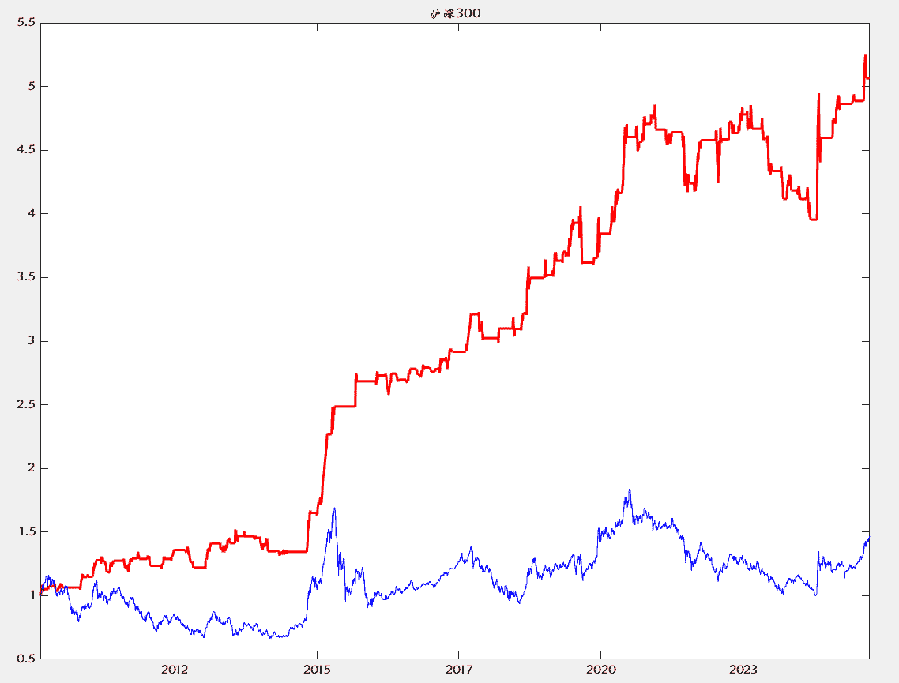
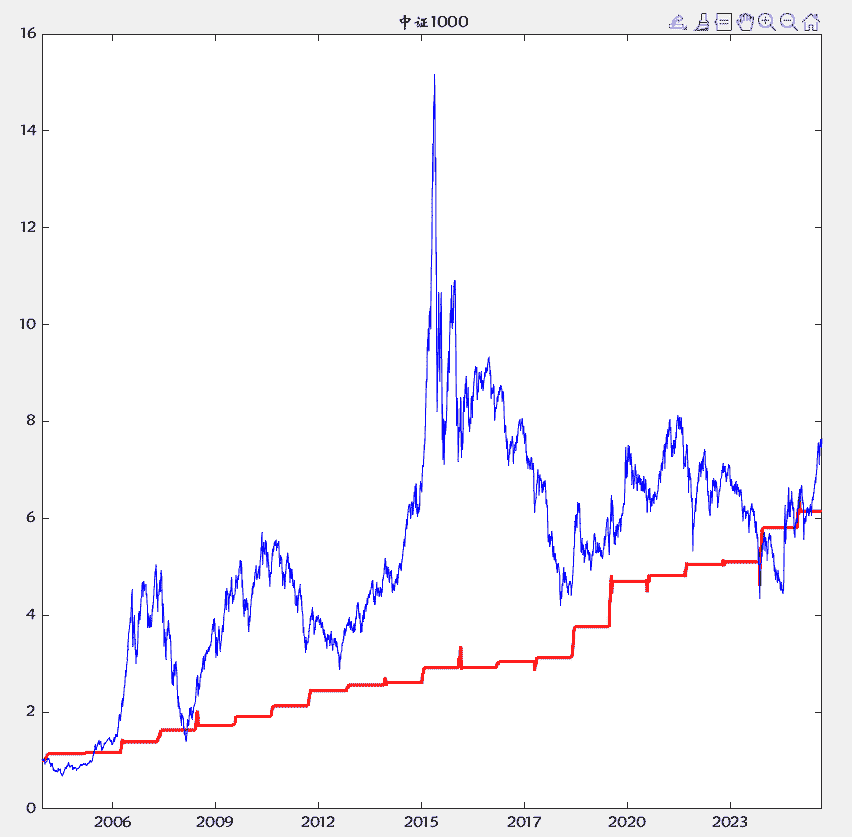
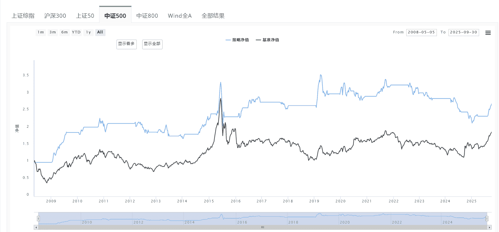
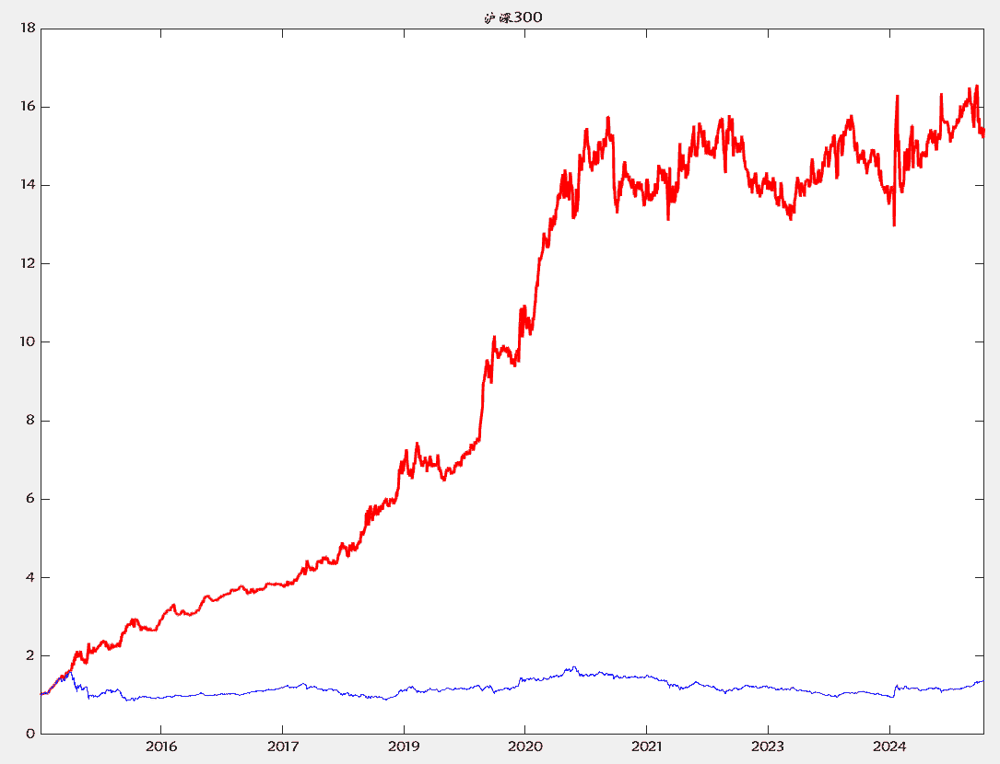
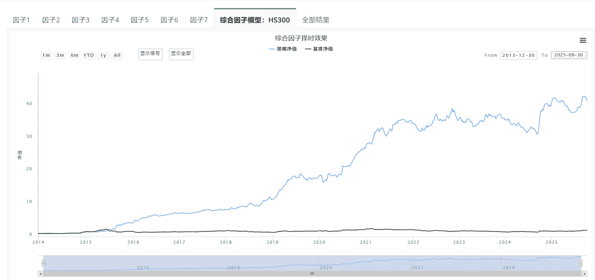
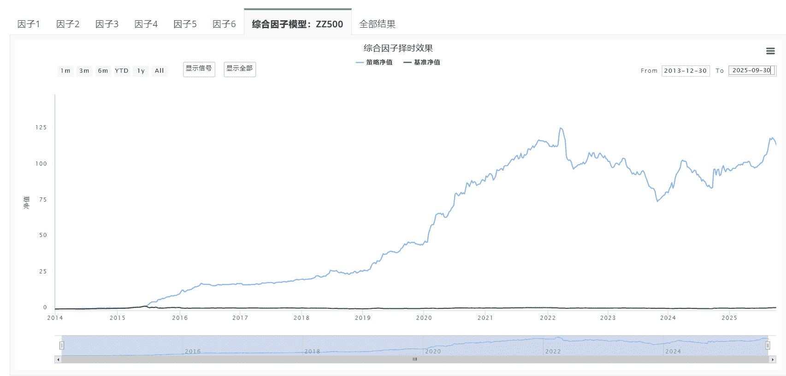
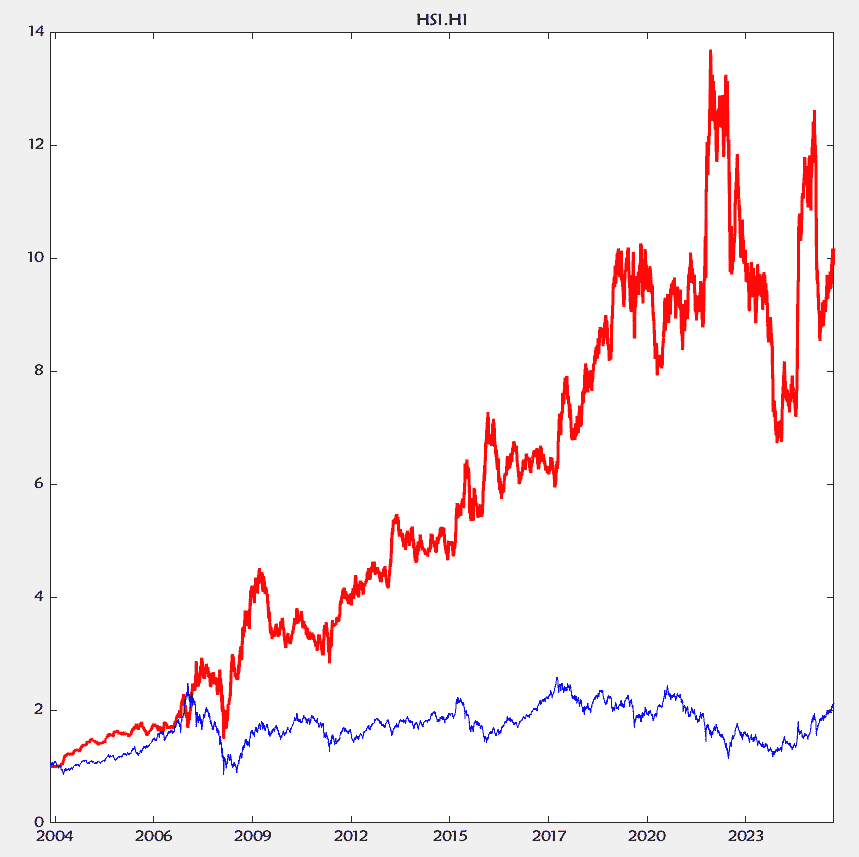
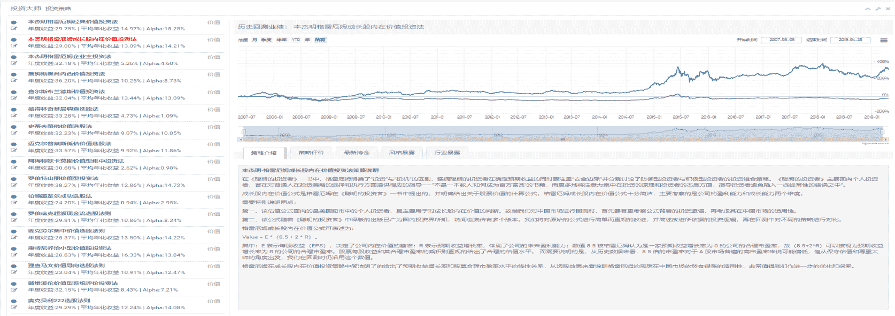
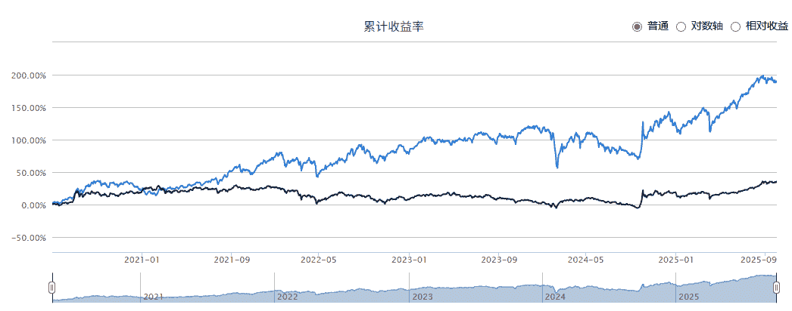
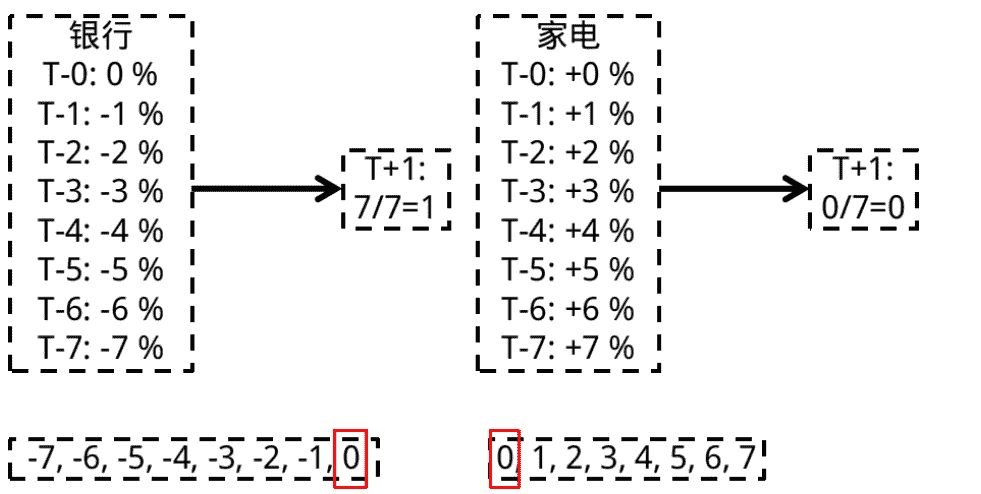

# 证券研究报告

证监会审核华创证券投资咨询业务资格批文号：证监许可（2009）1210 号

## 金融工程 专题报告

**2025年10月11日**

## 【专题报告】

## 三大指数均连涨5个月，市场或震荡向上

### ——2025年三季度策略总结与未来行情预判

### 摘要

2025年第三季度已经过去，三大指数均月线五连阳，其中创业板50季度上涨59.45%，上证指数涨幅12.73%。

从行业表现来看，三季度仅有少部分中信一级行业负收益，其中通信上涨50.20%，电子上涨44.49%。

从择时收益上讲，2025年第三个季度择时模型总体表现能获取绝对正收益，但是较难超越基准本身。

2025年三季度绝对收益表现相对优秀且收益为正的模型有价量共振V3模型、低波之刃模型、特征龙虎榜机构模型、推波助澜V3模型、动量摆动模型、智能算法沪深300模型、智能算法中证500模型、成交额倒波幅模型。

最新择时信号：

- **短期**：成交量模型中性。低波动模型中性。智能300模型看空，智能500模型中性。特征龙虎榜机构模型看多。特征成交量模型看空。
- **中期**：涨跌停模型中性。月历效应模型中性。
- **长期**：动量模型所有宽基指数看多。
- **综合**：综合兵器V3模型看空。综合国证2000模型看空。

从择时模型角度看，短期模型大多中性偏空，中期模型中性，长期模型看多，综合模型看空，后市或倾向于向上震荡。

2025年四季度我们看好：电力设备及新能源、通信、综合。

在2025年Q4，我们将继续砥砺前行，开发更多优秀策略。

### 风险提示：

本报告中数据均为历史数据，不代表未来发展趋势。

**证券分析师：王小川**

电话：021-20572528

邮箱：wangxiaochuan@hcyjs.com

执业编号：S0360517100001

**联系人：黄河**

邮箱：huanghe@hcyjs.com

**相关研究报告**

- 《兼具流动性与稳健性的配置工具——大成深证基准做市信用债ETF投资价值分析》 2025-05-26
- 《华创金工基本面研究（三）估值因子研究——拙能胜巧》 2025-05-16
- 《2025年6月指数样本股调整预测》 2025-05-05
- 《2025年一季报公募基金十大重仓股持仓分析》 2025-04-24
- 《一季度指数涨跌互现，市场或需注意风险——2025年一季度策略总结与未来行情预判》 2025-04-06

华创证券研究所

---

### 投资主题

### 报告亮点

本篇报告以目前华创金工历史所有择时、行业轮动、选股模型为基础，通过回顾2025年三季度表现，全方位分析与展示各类模型收益，并给出各个模型对未来的预测结果。首先，这篇报告是一个历史报告中模型的结果汇总，其次，本篇报告通过分析最近的各个模型的收益，对模型效果进行评价，并给出未来预测结果。

### 投资逻辑

择时采用多角度模型来分析市场；行业轮动模型基于基金预估仓位与超欠配来对行业未来进行预判；选股策略采用多视角选股的方法，列出市场未来值得关注的股票组合。目前择时、行业轮动、选股在历史上都有不俗的表现，可以通过这些策略对市场未来的投资机会进行预判。

---

## 目录

- 一、2025年三季度复盘：主要宽基、行业指数与基金表现 ........................................ 5
- 二、择时策略 ..................................................................................................................... 7
  - （一）短期择时模型 ......................................................................................................... 7
    - 1、价量共振模型 ........................................................................................................... 7
    - 2、低波之刃模型 ........................................................................................................... 8
    - 3、特征龙虎榜机构模型 .............................................................................................. 9
    - 4、特征成交量模型 ..................................................................................................... 10
  - （二）中期择时模型 ....................................................................................................... 11
    - 1、推波助澜模型 ......................................................................................................... 11
    - 2、月历效应模型 ......................................................................................................... 13
  - （三）长期择时模型 ....................................................................................................... 13
  - （四）综合择时模型 ....................................................................................................... 14
  - （五）智能算法择时模型 ............................................................................................... 15
    - 1、沪深300指数择时模型 ......................................................................................... 15
    - 2、中证500指数择时模型 ......................................................................................... 16
  - （六）港股指数择时模型 ............................................................................................... 17
    - 1、成交额倒波幅模型 ................................................................................................. 17
  - （七）择时收益小结 ....................................................................................................... 18
- 三、选股策略 ................................................................................................................... 19
  - （一）惠特尼·乔治小型价值股投资法 ....................................................................... 19
  - （二）福斯特佛莱斯积极成长选股策略 ....................................................................... 22
  - （三）CANSLIM基本面选股 ........................................................................................ 24
  - （四）形态识别选股 ....................................................................................................... 26
- 四、行业轮动 ................................................................................................................... 28
- 五、总结 ........................................................................................................................... 32
- 六、风险提示 ................................................................................................................... 32

---

## 图表目录

| 图表编号 | 图表标题 | 页码 |
| --- | --- | --- |
| 图表 1 | 2025年Q3主要指数表现 | 5 |
| 图表 2 | 2025年Q3行业指数收益 | 5 |
| 图表 3 | 2025年Q3不同类型基金收益率 | 6 |
| 图表 4 | 价量共振V3模型回测结果（上证指数） | 8 |
| 图表 5 | 低波之刃模型回测结果（上证50指数） | 9 |
| 图表 6 | 特征龙虎榜机构模型回测结果（沪深300指数） | 10 |
| 图表 7 | 特征成交量机构模型回测结果（万得全A指数） | 11 |
| 图表 8 | 推波助澜V3模型回测结果（沪深300指数） | 12 |
| 图表 9 | 月历效应模型回测结果（中证1000指数） | 13 |
| 图表 10 | 动量模型回测结果（中证500指数） | 14 |
| 图表 11 | 综合兵器V3模型回测结果（沪深300指数） | 15 |
| 图表 12 | 沪深300指数智能择时模型回测结果 | 16 |
| 图表 13 | 中证500指数智能择时模型回测结果 | 17 |
| 图表 14 | 成交额倒波幅择时模型回测结果（恒生指数） | 18 |
| 图表 15 | 大师策略 | 19 |
| 图表 16 | 惠特尼·乔治小型价值股投资法历史净值 | 20 |
| 图表 17 | 惠特尼·乔治小型价值股投资法最新持仓 | 20 |
| 图表 18 | 福斯特·佛莱斯投资法历史净值 | 23 |
| 图表 19 | 福斯特·佛莱斯最新股票池 | 23 |
| 图表 20 | CANSLIM 2.0策略净值 | 25 |
| 图表 21 | 最新CANSLIM2.0股票池 | 25 |
| 图表 22 | 杯柄形态 | 27 |
| 图表 23 | 最新杯柄形态实现突破的个股 | 27 |
| 图表 24 | 双底形态 | 28 |
| 图表 25 | 最新双底形态实现突破的个股 | 28 |
| 图表 26 | 超配/低配仓位转化为分位数流程示意图 | 29 |
| 图表 27 | 季度行业轮动模型历史净值 | 30 |
| 图表 28 | 绝对净值总结 | 30 |
| 图表 29 | 相对净值总结 | 30 |
| 图表 30 | 季度行业轮动模型换手率 | 31 |
| 图表 31 | 行业轮动策略分年度表现 | 31 |
| 图表 32 | 2025年Q4行业轮动模型推荐行业 | 32 |

## 一、2025年三季度复盘：主要宽基、行业指数与基金表现

2025年第三季度已经过去，三大指数均月线五连阳，其中创业板50季度上涨59.45%，上证指数涨幅12.73%。

**图表1 2025年Q3主要指数表现**

| 指数代码 | 指数简称 | 收盘价（截至20250930） | 季度涨跌幅（%） |
| --- | --- | --- | --- |
| 399673.SZ | 创业板50 | 3,418.56 | 59.45 |
| 399006.SZ | 创业板指 | 3,238.16 | 50.40 |
| 000688.SH | 科创50 | 1,495.29 | 49.02 |
| 399296.SZ | 创成长 | 5,933.77 | 34.40 |
| 399330.SZ | 深证100 | 5,958.53 | 31.13 |
| 399102.SZ | 创业板综 | 3,940.16 | 30.01 |
| 399001.SZ | 深证成指 | 13,526.51 | 29.25 |
| 399005.SZ | 中小100 | 8,380.38 | 28.37 |
| 000905.SH | 中证500 | 7,412.37 | 25.31 |
| 399101.SZ | 中小综指 | 14,466.87 | 21.69 |
| 399106.SZ | 深证综指 | 2,519.42 | 21.43 |
| 000903.SH | 中证A100 | 4,496.78 | 20.56 |
| 000906.SH | 中证800 | 5,108.27 | 19.83 |
| 881001.WI | 万得全A | 6,348.94 | 19.46 |
| 000852.SH | 中证1000 | 7,574.96 | 19.17 |
| 000300.SH | 沪深300 | 4,640.69 | 17.90 |
| 399303.SZ | 国证2000 | 9,776.84 | 17.24 |
| 000001.SH | 上证指数 | 3,882.78 | 12.73 |
| 000016.SH | 上证50 | 2,988.94 | 10.21 |

资料来源：wind，华创证券，截止日期20250930

从行业表现来看，三季度仅有少部分中信一级行业负收益，其中通信上涨50.20%，电子上涨44.49%。

**图表2 2025年Q3行业指数收益**

| 行业代码 | 行业简称 | 收盘价（截至20250930） | 季度涨跌幅（%） |
| --- | --- | --- | --- |
| CI005026.WI | 通信(中信) | 8,954.01 | 50.20 |
| CI005025.WI | 电子(中信) | 11,819.04 | 44.49 |
| CI005003.WI | 有色金属(中信) | 11,053.25 | 44.06 |
| CI005011.WI | 电力设备及新能源(中信) | 11,894.25 | 41.06 |
| CI005010.WI | 机械(中信) | 8,489.53 | 25.68 |
| CI005027.WI | 计算机(中信) | 7,847.20 | 23.71 |
| CI005006.WI | 基础化工(中信) | 6,681.50 | 20.96 |
| CI005028.WI | 传媒(中信) | 3,540.12 | 20.85 |
| CI005013.WI | 汽车(中信) | 13,964.02 | 19.75 |
| CI005023.WI | 房地产(中信) | 4,231.50 | 19.40 |
| CI005008.WI | 建材(中信) | 6,660.67 | 18.30 |
| CI005005.WI | 钢铁(中信) | 1,824.71 | 17.97 |
| CI005018.WI | 医药(中信) | 11,873.77 | 15.24 |
| CI005020.WI | 农林牧渔(中信) | 5,696.96 | 10.92 |
| CI005029.WI | 综合(中信) | 3,212.69 | 8.90 |
| CI005007.WI | 建筑(中信) | 3,695.79 | 8.80 |
| CI005009.WI | 轻工制造(中信) | 3,546.91 | 7.80 |
| CI005022.WI | 非银行金融(中信) | 10,569.13 | 7.47 |
| CI005016.WI | 家电(中信) | 18,972.99 | 7.37 |
| CI005015.WI | 消费者服务(中信) | 6,791.93 | 7.18 |
| CI005002.WI | 煤炭(中信) | 3,505.90 | 6.89 |
| CI005012.WI | 国防军工(中信) | 10,163.19 | 6.21 |
| CI005001.WI | 石油石化(中信) | 2,927.34 | 4.30 |
| CI005017.WI | 纺织服装(中信) | 3,090.12 | 3.94 |
| CI005014.WI | 商贸零售(中信) | 4,024.06 | 3.36 |
| CI005019.WI | 食品饮料(中信) | 23,652.04 | 3.24 |
| CI005004.WI | 电力及公用事业(中信) | 3,036.58 | 3.05 |
| CI005024.WI | 交通运输(中信) | 2,033.49 | 0.93 |
| CI005021.WI | 银行(中信) | 11,324.68 | -8.66 |
| CI005030.WI | 综合金融(中信) | 942.39 | -9.03 |

资料来源：wind，华创证券，截止日期20250930

接下来我们看一下不同类型基金的表现，其中在市场指数一致向上的情况下，偏股混合型基金表现最好，平均收益为25.83%。

**图表3 2025年Q3不同类型基金收益率**

| 基金类型 | 基金数量 | 收益均值 | 收益方差 | 收益中位数 | 最大跌幅 |
| --- | --- | --- | --- | --- | --- |
| 偏股混合型基金 | 4736 | 25.83% | 0.1622 | 23.28% | -10.73% |
| 股票型基金 | 5761 | 25.79% | 0.1624 | 23.24% | -10.73% |
| 灵活配置型基金 | 2339 | 20.56% | 0.1680 | 17.55% | -16.67% |
| 混合型基金 | 2383 | 20.44% | 0.1674 | 17.39% | -16.67% |
| 偏债混合型基金 | 1354 | 4.36% | 0.0434 | 3.50% | -5.49% |
| 平衡混合型基金 | 44 | 14.00% | 0.1101 | 14.37% | -5.14% |

资料来源：wind，华创证券，截止日期20250930

2025Q3新成立公募基金818只，合计募集69794.7亿元，其中混合型212只，共募集628.9亿，债券型153只，共募集67662.9亿，股票型453只，共募集1502.9亿。

## 二、择时策略

择时上，我们自2019年开始深耕于大盘择时，基于多维角度，创立了短期、中期、长期的择时模型。我们认为市场择时一定不是单一模型可以实现的，在每个周期下，我们从不同角度出发，又构建了次级别的策略。同一周期下策略或者不同周期下的策略可以进行耦合与共振，这样才能做到攻守兼备。

在过去持续地对多周期择时模型进行深挖和完善，我们得到了丰富的研究成果：短期择时体系有价量共振模型与低波之刃模型：其中价量共振模型主要作用在于跟踪趋势与捕捉顶部的背离，低波之刃模型在于捕捉市场底部的反弹行情。中期择时体系主要有推波助澜模型与月历效应模型：依赖涨跌停比率，构建推波助澜V1模型；挖掘更多信息，构建推波助澜V2模型；提升权重股占比，基于自由流通市值加权，构建推波助澜V3模型。月历效应模型是基于A股的春季躁动逻辑，基于中小盘指数构建的高胜率择时模型。长期择时体系主要有动量摆动模型：动量摆动模型先判断个股，再合成指数信号。基于短中长期各个周期模型，我们构造了综合兵器模型：综合兵器模型不仅利用多个版本的模型，而且利用同一个模型下不同宽基指数的信号，各个模型拥有各自特色的逻辑去捕捉市场的波段，将各个模型的信息充分汲取并且整合，最终实现了质的飞跃。

我们还基于特征收益分布，开发了特征龙虎榜机构模型，特征成交量模型。基于遗传规划，开发了智能算法择时模型：目前拥有沪深300指数的短期择时模型与GRASP(贪婪自适应搜索)算法合成的中证500指数短期择时模型。

我们不仅在A股指数的量化择时积累了一些经验，我们还在港股指数上，开发了相应的量化择时模型，成交额倒波幅模型，在恒生指数与恒生中国企业指数的择时回溯结果表现非常亮眼。

### （一）短期择时模型

**1、价量共振模型**

价量共振模型的基础逻辑是当供不应求时，人潮汹涌，都要买进，成交量自然放大；反之，供过于求，市场冷清无人，买盘稀少，成交量势必萎缩。华创金工探索的价量共振模型是基于一类低延迟快速的均线HMA来量化成交量，结合价格指标，创设一个结合价与量的新择时模型"价量共振择时模型"。价量共振择时模型，从初始的V1模型到更加稳健的价量共振V3模型(价量共振V1模型的缺点就是会在放量下跌的市场中，发出错误的买入信号。通过规避放量下跌产生的错误信号，形成价量共振V3模型)。

**图表4 价量共振V3模型回测结果（上证指数）**

资料来源：wind，华创证券

价量共振V3模型在上证指数自2005年1月4日至2025年9月30日，年化收益12.12%，最大回撤15.05%，胜率64.0%，盈亏比1.90，夏普比率0.792，平均每年交易10.4次，平均多头持有周期5.9日，历史回溯表现非常优秀。

价量共振V3模型在上证指数自今年2025年01月01日至2025年9月30日的绝对收益为8.92%，最大回撤2.15%，而上证指数自今年2025年01月01日至2025年9月30日的绝对收益为19.01%，最大回撤9.71%。

价量共振V3模型在上证指数自三季度2025年07月01日至2025年9月30日的绝对收益为3.14%，最大回撤1.86%。而上证指数自三季度2025年07月01日至2025年9月30日的绝对收益为12.29%，最大回撤3.03%。

**2、低波之刃模型**

一般来说，当价量共振模型空仓时候，市场处于一个缩量状态，缩量市场要么下跌，要么震荡，因此低波之刃模型是在一个缩量并且震荡的市场下，获取多头波段收益。 市场在震荡的时候，不断洗筹，成交量逐渐萎缩，市场波动在逐渐降低，直到市场冷冷清清，市场成交量与成交额降至冰点，才会有后续期待的反弹行情。低波之刃模型量化了市场处于极端缩量和极端冷清的这种状态，并且能够把握后续的反弹行情。

**图表5 低波之刃模型回测结果（上证50指数）**

资料来源：wind，华创证券

低波之刃模型在上证50指数上自2015年2月9日以来至2025年9月30日，年化收益3.81%，最大回撤15.54%，胜率58.2%，盈亏比1.17，夏普比率0.120，平均每年交易16.6次，平均多头持有周期2.7日，历史回溯表现表明能够在市场处于震荡的情形下获取极度萎缩后的反弹收益。

低波之刃模型在上证50指数自今年2025年01月01日至2025年9月30日的绝对收益为3.58%，最大回撤2.22%。而上证50指数自今年2025年01月01日至2025年9月30日绝对收益为14.50%，最大回撤8.37%。

低波之刃模型在上证50指数自三季度2025年07月01日至2025年9月30日绝对收益为1.31%，最大回撤0.40%。而上证50指数自三季度2025年07月01日至2025年9月30日绝对收益为9.98%，最大回撤2.78%。

**3、特征龙虎榜机构模型**

股票龙虎榜作为投资者可以窥探顶级资金交易行为的主要渠道一直备受关注，市面上也流传着很多有关龙虎榜的打板战法，但是龙虎榜本身包含的信息过于庞杂，上榜个体的交易目的也互有不同，甚至很多游资席位上榜的目的就是为了拉高股价进行出售，由于这些原因，使得龙虎榜数据并没有广泛的运用于量化投资领域。本文将从行为金融有限注意力理论的角度对这部分数据进行切入，以龙虎榜中全部机构席位信息总和作为原料进行加工，透过不同机构席位释放的干扰信号，探究机构席位资金出现极端行为时，宽基指数所呈现的规律并构建相应的择时策略。

由于龙虎榜资金净流入强度指标期望收益分布图呈现出明显的非线性V字型，正收益来自两端，负收益来自中间。因此择时模型的构造逻辑为做多两边做空中间，本文采用了一类巧妙的建模方法，构建了沪深300指数相应的龙虎榜机构多空择时模型。

特征龙虎榜机构模型在沪深300指数上自2013年01月01日以来至2025年9月30日，年化收益15.79%，最大回撤20.93%，胜率60.0%，盈亏比1.36，夏普比率0.759，平均每年交易18.4次，平均多头持有周期10.9日，空头持有期6.4个交易日。

特征龙虎榜机构模型在沪深300指数自今年2025年01月01日至2025年9月30日的绝对收益为5.67%，最大回撤8.14%。而沪深300指数自今年2025年01月01日至2025年9月30日绝对收益为21.47%，最大回撤10.49%。

特征龙虎榜机构模型在沪深300指数自三季度2025年07月01日至2025年9月30日绝对收益为3.08%，最大回撤7.78%。而沪深300指数自三季度2025年07月01日至2025年9月30日绝对收益为17.70%，最大回撤3.50%。

**图表6 特征龙虎榜机构模型回测结果（沪深300指数）**

资料来源：wind，华创证券

**4、特征成交量模型**

成交量指的是一个时间单位内对某项交易成交的数量。当供不应求时，人潮汹涌，都要买进，成交量自然放大；反之，供过于求，市场冷清无人，买盘稀少，成交量势必萎缩。而将人潮加以数值化，便是成交量。A股宽基指数有着明显的放量上涨，缩量下跌规律。由于量能指标的期望收益分布呈现出明显的右偏V型形状，特征成交量模型采用了一类巧妙的建模方法，将成交量建模趋于完善，开创性地挖掘成交量模型的缩量做空与地量反弹，因此从成交量的特征分布进行切入，将市场划分为放量上涨区域，高位震荡区域，缩量下跌区域，地量反弹区域。并构建相应的择时策略，在放量上涨区域做多，在缩量下跌区域做空，在地量反弹区域中做多，在回溯中获得了远超宽基指数的择时收益。

特征成交量模型在万得全A指数上自2004年1月2日以来至2025年9月30日，年化收益27.78%，最大回撤40.54%，胜率55.6%，盈亏比1.51，夏普比率1.036，平均每年交易34.4次，平均多头持有周期5.2日，空头持有期5.9个交易日。模型表现非常优秀。

特征成交量模型在万得全A指数上自今年2025年01月01日至2025年9月30日的绝对收益为6.30%，最大回撤10.81%。而全A指数自今年2025年01月01日至2025年9月30日绝对收益为29.84%，最大回撤13.76%。

特征成交量模型在万得全A指数上自三季度2025年07月01日至2025年9月30日的绝对收益为-5.37%，最大回撤6.07%。而全A指数自三季度2025年07月01日至2025年9月30日绝对收益为19.14%，最大回撤4.62%。

**图表7 特征成交量机构模型回测结果（万得全A指数）**

资料来源：wind，华创证券

### （二）中期择时模型

**1、推波助澜模型**

推波助澜V1模型：市场涨停个股较多的时候，市场人气旺盛，容易走出上涨行情；市场跌停个股较多的时候，市场人气冷淡，容易走出下跌行情。基于经验设定涨跌停阈值为9.5%，即个股涨幅大于9.5%为涨停，个股涨幅小于-9.5%为跌停。定义涨停比率：宽基指数单日涨幅大于9.5%的成分股数量占其成分股总数的比率。定义跌停比率：宽基指数单日跌幅大于9.5%(单日涨幅小于-9.5%)的成分股数量占其成分股总数的比率。推波助澜V1模型是基于涨停比率与跌停比率构建的择时模型。

推波助澜V2模型：而涨停和跌停仅仅只是利用个股当日涨跌幅的信息，因此我们定义连板比率，即连续涨停比率和连续跌停比率。连续涨停比率即宽基指数今日和昨日涨幅都大于9.5%的个股数量占其成分股总数的比率，同理，连续跌停比率即宽基指数今日和昨日跌幅都大于9.5%(涨幅小于-9.5%)的个股数量占其成分股总数的比率。类似涨跌停比率剪刀差的定义，涨停比率-跌停比率，因此我们定义连板比率剪刀差：即连续涨停比率-连续跌停比率。我们还定义了地天板比率和天地板比率，地天板比率即宽基指数今日地天板走势的个股数量占其成分股总数的比率，天地板比率即宽基指数今日天地板走势的个股数量占其成分股总数的比率。因此我们定义地天与天地板比率剪刀差：地天板比率-天地板比率。推波助澜V2模型是基于涨跌停比率剪刀差、连板比率剪刀差、地天与天地板比率剪刀差构建的择时模型。

推波助澜V3模型：A股指数的行情主要依靠权重股来带动，纯粹使用涨跌停个股数量简

单加减不一定能真实反映A 股的整体情绪，因此推波助澜V1 模型与推波助澜V2 模型计算涨跌停比率剪刀差的方式可能有所弊端。因此定义了自由流通市值加权涨跌停比率剪刀差、自由流通市值加权连板比率剪刀差、自由流通市值加权地天与天地板比率剪刀差，最终得到推波助澜V3 模型，因此推波助澜V3 模型是涨跌停择时系列中最稳健的模型。

图表 8 推波助澜V3 模型回测结果（沪深300 指数）

资料来源：wind, 华创证券

推波助澜V3 模型在沪深300 指数上自2009 年10 月09 日以来至2025 年09 月30 日，年化收益11.01%，最大回撤18.62%，胜率57.8%，盈亏比2.11，夏普比率0.698，平均每年交易5.8 次，平均多头持有周期14.4 日。

推波助澜V3 模型自今年2025 年01 月01 日至2025 年9 月30 日的绝对收益为10.16%，最大回撤3.51%。而沪深300 指数今年2025 年01 月01 日至2025 年9 月30 日的绝对收益为21.47%，最大回撤10.49%。

推波助澜V3 模型自三季度2025 年07 月01 日至2025 年9 月30 日的绝对收益为3.65%，最大回撤3.50%。而沪深300 指数自三季度2025 年07 月01 日至2025 年9 月30 日绝对收益为17.70%，最大回撤3.50%。

### 2、月历效应模型

图表 9 月历效应模型回测结果（中证1000 指数）

资料来源：wind, 华创证券

月历效应模型是基于A 股的春季躁动逻辑，基于中小盘指数构建的高胜率择时模型。

月历效应模型在中证1000 指数上自2005 年01 月04 日以来至2025 年9 月30 日，年化收益9.47%，最大回撤15.77%，胜率100.0%，夏普比率0.743，平均每年交易1.0 次，平均多头持有周期16.5 日，策略胜率极高，择时回溯结果非常优秀。

中证1000 指数月历效应模型自今年2025 年01 月01 日至2025 年9 月30 日在中证1000 指数上的绝对收益为5.87%，最大回撤4.70%。

### （三）长期择时模型

长期模型，即动量摆动模型：单纯从大盘宽基指数去挖掘长期信号，容易产生较多的噪音导致持有期限较为离散。而大盘宽基指数是由其成分股构建而成，成分股可获得的信息相比于单个大盘宽基指数更为丰富，因此从逻辑上来讲，利用成分股构建的择时系统应该要比利用单个大盘宽基指数构建的择时系统效果要更好，持有期集中度也会更强。我们试图基于成分股信号加权进而构造一类平均持有期限较长的摆动系统，该系统能够更为全面地反映市场运行的全貌，当摆动指标从下向上的时候做多，从上向下的时候平仓。

动量摆动模型在中证500 指数上自2008 年06 月02 日以来至2025 年9 月30 日，年化收益7.02%，最大回撤42.44%，胜率57.1%，盈亏比1.94，夏普比率0.295，平均每年交易1.3 次，平均多头持有周期87.4 日。

动量摆动模型在中证500 指数上自今年2025 年1 月1 日至2025 年9 月30 日的绝对收益为22.87%，最大回撤5.77%。而中证500 指数自今年2025 年1 月1 日至2025 年9 月30 日绝对收益为33.66%，最大回撤13.80%。

动量摆动模型在中证500 指数上自三季度2025 年7 月1 日至2025 年9 月30 日的绝对收益为14.66%，最大回撤5.77%。而中证500 指数自三季度2025 年7 月1 日至2025 年9 月30 日绝对收益为24.90%，最大回撤5.79%。

图表 10 动量模型回测结果（中证500 指数）

资料来源：wind, 华创证券

### （四）综合择时模型

基于短中长期各个周期模型，我们构造了综合兵器模型：综合兵器模型不仅利用多个版本的模型，而且利用同一个模型下不同宽基指数的信号，各个模型拥有各自特色的逻辑去捕捉市场的波段。综合兵器V3 模型，将短期价量共振模型与低波之刃模型，中期推波助澜模型与月历效应模型，长期动量摆动模型，利用不同周期模型的信号进行融合，将多维度的信息进行结合增强，形成更强的综合兵器模型，最终实现了质的飞跃。

综合兵器V3 模型在沪深300 指数上自2015 年02 月09 日以来至2025 年9 月30 日，年化收益30.28%，最大回撤18.03%，胜率57.0%，盈亏比1.76，夏普比率1.232，平均每年交易36.8 次，平均多头持有周期6.6 日，平均空头持有周期7.3 个交易日。

综合兵器V3 在沪深300 指数上自今年2025 年1 月1 日至2025 年9 月30 日绝对收益为6.66%，最大回撤8.27%。而沪深300 指数自今年2025 年1 月1 日至2025 年9 月30 日绝对收益为21.47%，最大回撤10.49%。

综合兵器V3 在沪深300 指数上自三季度2025 年7 月1 日至2025 年9 月30 日绝对收益为-2.19%，最大回撤8.27%。而沪深300 指数自三季度2025 年7 月1 日至2025 年9 月30 日绝对收益为17.70%，最大回撤3.50%。

图表 11 综合兵器V3 模型回测结果（沪深300 指数）

资料来源：wind, 华创证券

### （五）智能算法择时模型

#### 1、沪深300 指数择时模型

沪深300 指数智能择时模型是基于遗传规划算法对宽基指数择时因子进行挖掘。遗传规划基本思想和遗传算法一致，即模拟生物进化过程中自然选择以及遗传过程中复制、交叉和变异等过程。与生物种群类似，算法由一个初始种群开始，利用指定算法选择配对交叉产生后代，并在遗传过程中模拟基因的变异进而获得包含新基因特征的种群，在遗传过程中计算每个个体的适应度，并通过适应度来寻求最优个体。遗传规划不同于其他机器学习的黑箱模式，其可以获得显式的表达式，这在后续从逻辑角度解读算式以及过拟合检验等方面都具有无可比拟的优势。

沪深300 指数智能择时模型在沪深300 指数上自2014 年01 月02 日以来至2025 年9 月30 日，年化收益35.55%，最大回撤23.64%，胜率57.8%，盈亏比2.14，夏普比率1.561，平均每年交易28.0 次，平均多头持有周期7.9 日，平均空头持有周期6.4 个交易日，择时绝对收益远超沪深300 指数本身。

沪深300 指数智能择时模型在沪深300 指数上自今年2025 年1 月1 日至2025 年9 月30 日绝对收益为-2.29%，最大回撤12.26%。而沪深300 指数自今年2025 年1 月1 日至2025 年9 月30 日绝对收益为21.47%，最大回撤10.49%。

沪深300 指数智能择时模型在沪深300 指数上自三季度2025 年7 月1 日至2025 年9 月30 日绝对收益为8.82%，最大回撤4.53%。而沪深300 指数自三季度2025 年7 月1 日至2025 年9 月30 日绝对收益为17.70%，最大回撤3.50%。

图表 12 沪深300 指数智能择时模型回测结果

资料来源：wind, 华创证券

#### 2、中证500 指数择时模型

由于在沪深300 指数择时模型的单个因子挖掘时，我们对表达式的层数以及参数设置进行了限制，这种限制对于因子的逻辑解读和防止过拟合都具有较强的帮助，但由于表达式复杂度的限制，单个因子都只能对部分行情进行捕捉而在其他行情中只能表现平平。在因子信号叠加后，我们会发现，一部分因子给出的信号会趋同，另一部分因子给出的信号会矛盾，如果只是进行简单的信号叠加会造成部分行情中风险暴露加剧，部分行情中少数真理被大量谬误所吞没的情况。因此中证500 指数智能择时模型采用了GRASP(贪婪自适应搜索)算法思想进行因子组合，让整个组合的内部逻辑是清晰可控的。

中证500 指数智能择时模型在中证500 指数上自2014 年01 月02 日以来至2025 年9 月30 日，年化收益47.64%，最大回撤43.42%，胜率61.7%，盈亏比2.38，夏普比率1.804，平均每年交易22.8 次，平均多头持有周期9.9 日，平均空头持有周期6.8 个交易日，择时绝对收益远超中证500 指数本身。

中证500 指数智能择时模型在中证500 指数上自今年2025 年01 月01 日至2025 年9 月30 日绝对收益为19.00%，最大回撤5.76%。而中证500 指数自今年2025 年01 月01 日至2025 年9 月30 日绝对收益为33.66%，最大回撤13.80%。

中证500 指数智能择时模型在中证500 指数上自三季度2025 年7 月1 日至2025 年9 月30 日的绝对收益为12.95%，最大回撤5.75%。而中证500 指数自三季度2025 年7 月1 日至2025 年9 月30 日绝对收益为24.90%，最大回撤5.79%。

图表 13 中证500 指数智能择时模型回测结果

资料来源：wind, 华创证券

### （六）港股指数择时模型

#### 1、成交额倒波幅模型

在港股成交指标的选择上，成交额指标比成交量指标更具备说服力，因此我们在港股择时模型一般都选择成交额指标而非成交量指标作为基础指标。如果需要寻找的基础指标既能发现趋势，但是最终择时收益又能显著超越标的本身，那么该基础指标必须具备一定的价格领先作用。于是我们想到了成交额和VHSI 恒生波幅指数(港版的恐慌指数)，结合发现趋势与领先的特点，我们构建一个趋势指标，叫成交额倒波幅指标，市场在上涨的时候指标值较大，市场在下跌的时候指标值较小，定义成交额倒波幅指标=港股成交额/VHSI^(α)，α=2.5。最终成交额倒波幅择时模型的构建方式与A 股特征成交量指标类似，做多趋势上涨区间，做空趋势下跌区间，做多超跌反弹区间。

成交额倒波幅模型在恒生指数上自2004 年01 月02 日以来至2025 年9 月30 日，年化收益10.62%，最大回撤51.97%，胜率51.0%，盈亏比1.50，夏普比率0.426，平均每年交易14.1 次，平均多头持有周期21.4 日，平均空头持有周期11.4 个交易日，择时绝对收益超过恒生指数本身。

成交额倒波幅模型在恒生指数上自今年2025 年1 月1 日至2025 年9 月30 日绝对收益为-11.62%，最大回撤31.87%。而恒生指数自今年2025 年1 月1 日至2025 年9 月30 日表现为绝对收益为36.86%，最大回撤19.95%。

成交额倒波幅模型在恒生指数上自三季度2025 年7 月1 日至2025 年9 月30 日绝对收益为10.88%，最大回撤4.52%。而恒生指数自三季度2025 年7 月1 日至2025 年9 月30 日绝对收益为10.88%，最大回撤4.52%。

图表 14 成交额倒波幅择时模型回测结果（恒生指数）

资料来源：wind, 华创证券

### （七）择时收益小结

从择时收益上讲，2025 年第三个季度择时模型总体表现能获取绝对正收益，但是较难超越基准本身。

2025 年三季度绝对收益表现相对优秀且收益为正的模型有价量共振V3 模型、低波之刃模型、特征龙虎榜机构模型、推波助澜V3 模型、动量摆动模型、智能算法沪深300 模型、智能算法中证500 模型、成交额倒波幅模型。

最新择时信号：

- 短期：成交量模型中性。低波动模型中性。智能300 模型看空，智能500 模型中性。特征龙虎榜机构模型看多。特征成交量模型看空。
- 中期：涨跌停模型中性。月历效应模型中性。
- 长期：动量模型所有宽基指数看多。
- 综合：综合兵器V3 模型看空。综合国证2000 模型看空。

从择时模型角度看，短期模型大多中性偏空，中期模型中性，长期模型看多，综合模型看空，后市或倾向于向上震荡。

## 三、选股策略

大师系列作为最为经典的量化选股策略，在我们之前的研究中就有了很多的积累，我们网站中一共监控了33 个大师系列的策略。其中，价值型大师策略共19 篇，成长型大师策略共6 篇，综合型大师策略共8 篇。

通过大师策略，我们能发现目前收益靠前的组合暴露的因子，以及如果需要暴露某些因子的话，应该设置什么样的标准。下图为大师系列在华创量化平台上的监控结果，http://service.hcquant.com/production/master.php。

图表 15 大师策略

资料来源：wind, 华创证券

2025 年我们推荐的大师策略分别是："惠特尼·乔治小型价值股投资法"、"福斯特佛莱斯积极成长选股策略"、"CANSLIM 投资法"。其中，"惠特尼·乔治小型价值股投资法"、"福斯特佛莱斯积极成长选股策略"策略表现最好，因此下面我们对其选股方法进行整理。

### （一）惠特尼·乔治小型价值股投资法

惠特尼·乔治是华尔街著名的投资基金经理。由于钟情于小盘股且业绩表现突出，乔治在2011 年 1 月被《财智月刊》评为美国小盘股基金"最佳基金经理"。惠特尼·乔治小型价值股投资法从股票风格、公司运营状况和市场估值水平三个方面进行选股，关注公司的负债水平、自由现金流、总资产报酬率和资本报酬率。经过量化后的惠特尼乔治小型价值股投资法则非常明确，且均以市场均值作为参考阈值而没有加入过多的主观判断。惠特尼·乔治小型价值股投资法的选股数量较少，且存在长期无持股的情况。在行业上，由于偏好小盘股，所以过去策略对银行、非银、钢铁、采掘、食品饮料、通信 6 个行业没有入选股票，其主要指标如下：

- 总市值小于全市场平均市值；
- 产权比率（负债总额与所有者权益总额的比率）小于全市场平均值；
- 每股企业自由现金流量大于市场平均值；
- 累计三年总资产报酬率大于市场平均值；
- 累计三年投入资本回报率大于市场平均值；
- 最近四季度市盈率小于市场平均值；
- 最近一季度市净率小于市场平均值；
- 最近四季度市销率小于市场平均值。

历史净值走势

图表 16 惠特尼·乔治小型价值股投资法历史净值

资料来源：www.hcquant.com, wind, 通联数据, 华创证券，截至20250930

上图可以看出近三年来策略表现非常稳健，2020 年1 月1 日至2025 年09 月30 日策略年化收益22.4%，波动率23.2%。

图表 17 惠特尼·乔治小型价值股投资法最新持仓

| 股票代码 | 股票名称 | 中信一级行业 | PE(TTM) | 最新收盘价 | 市值（亿元） |
|---------|---------|-------------|---------|------------|-------------|
| 001206.SZ | 依依股份 | 轻工制造 | 25.29 | 30.38 | 56.17 |
| 001207.SZ | 联科科技 | 基础化工 | 16.21 | 22.91 | 49.61 |
| 001216.SZ | 华瓷股份 | 轻工制造 | 17.25 | 15.50 | 39.04 |
| 001368.SZ | 通达创智 | 轻工制造 | 28.54 | 24.01 | 27.33 |
| 002098.SZ | 浔兴股份 | 纺织服装 | 15.33 | 8.72 | 31.22 |
| 002154.SZ | 报喜鸟 | 纺织服装 | 16.97 | 4.05 | 59.10 |
| 002255.SZ | 海陆重工 | 电力设备及新能源 | 15.73 | 8.35 | 69.38 |
| 002264.SZ | 新华都 | 商贸零售 | 19.60 | 7.13 | 51.32 |
| 002293.SZ | 罗莱生活 | 纺织服装 | 14.59 | 8.04 | 67.06 |
| 002327.SZ | 富安娜 | 纺织服装 | 13.67 | 7.02 | 58.84 |
| 002412.SZ | 汉森制药 | 医药 | 17.00 | 6.36 | 32.00 |
| 002452.SZ | 长高电新 | 电力设备及新能源 | 20.23 | 7.70 | 47.77 |

## （二）福斯特·佛莱斯积极成长选股策略

福斯特·佛莱斯是白兰地基金创始人，他对成长股选择给出了7方面要求：1、高盈利成长率 2、高盈利能力 3、健全的资产负债表 4、正面的盈利惊喜 5、高质量的盈利水平 6、公司正面的内部动力 7、独立的产业基本面研究。我们根据其投资思想，以及结合中国市场的实际情况，我们选取6方面的因子，来实现积极成长选股策略，具体标准如下：

- 预估税前净利成长率＞20%；
- 营业利润率＞10%；
- 负债比例低＜30%；
- 最近一季税前利润 > 预估税前利润；
- 最近四季主营业务利润占税前利润比率＞80%；
- 市盈率＜25。

图表 18 福斯特·佛莱斯投资法历史净值

历史净值走势

资料来源：wind，通联数据，华创证券，截至20250930

该策略在历史的表现稳健，2020年1月1日至2025年9月30日策略年化收益5.7%，波动率21.5%。

图表 19 福斯特·佛莱斯最新股票池

| 股票代码 | 股票名称 | 中信一级行业 | PE(TTM) | 最新收盘价 | 市值（亿元） |
|---------|---------|------------|---------|-----------|------------|
| 000726.SZ | 鲁泰A | 纺织服装 | 9.06 | 6.66 | 54.43 |
| 000792.SZ | 盐湖股份 | 基础化工 | 22.22 | 20.85 | 1,103.29 |
| 000807.SZ | 云铝股份 | 有色金属 | 15.33 | 20.60 | 714.40 |
| 002159.SZ | 三特索道 | 消费者服务 | 20.14 | 15.13 | 26.83 |
| 002233.SZ | 塔牌集团 | 建材 | 13.98 | 8.76 | 104.44 |
| 002597.SZ | 金禾实业 | 基础化工 | 18.39 | 20.84 | 118.44 |
| 301004.SZ | 嘉益股份 | 轻工制造 | 12.47 | 61.76 | 89.83 |
| 600535.SH | 天士力 | 医药 | 22.10 | 15.80 | 236.04 |
| 600572.SH | 康恩贝 | 医药 | 18.49 | 4.35 | 109.81 |
| 600585.SH | 海螺水泥 | 建材 | 14.08 | 23.22 | 1,230.50 |
| 600731.SH | 湖南海利 | 基础化工 | 13.04 | 7.18 | 40.12 |
| 601566.SH | 九牧王 | 纺织服装 | 16.54 | 8.65 | 49.71 |
| 601880.SH | 辽港股份 | 交通运输 | 24.91 | 1.74 | 410.15 |
| 603112.SH | 华翔股份 | 机械 | 16.99 | 16.70 | 90.04 |
| 603259.SH | 药明康德 | 医药 | 24.01 | 112.03 | 3,306.57 |
| 605099.SH | 共创草坪 | 轻工制造 | 21.72 | 30.90 | 124.36 |

资料来源：华创证券，wind，截止日期2025年9月30日

### （三）CANSLIM基本面选股

威廉·欧奈尔的CANSLIM选股法则本质是一个挑选成长性股票的投资策略，其中每个英文字母都代表一个择股的维度。在他的第四版《笑傲股市》中对其每个维度都进行了详细的解释说明，具体说明如下：

- C：Current Quarterly Earnings Per Share，代表当前季度每股收益：越高越好。
- A：Annual Earnings Per Share，代表年度收益增长率：找出增长最为引人注目的股票。
- N：New company, product, service, or management，代表新公司、新产品、新服务、新管理层、股价新高。
- S：Supply and Demand，代表供给与需求：兼顾考虑流通股份的共计数量和需求量。
- L：Leader or Laggard，代表专注于各行业的龙头股。
- I：Institutional Sponsorship，代表机构投资者的支持度：关注主力机构动向。
- M：Market Direction，判断市场走势。

### 选股标准：

我们对上述CANSLIM的7个维度的标准，筛选其中可量化的条件，在A股市场中设定以下5个标准，在每个季度末进行选股：

- 最近披露的净利润增速≥18%。
- 五年常续性利益复合成长率≥15%且每年皆为正成长。
- 近期最高价为最近一年最高价附近。
- 一年股价相对强弱度(RPS)≥80。
- 十大股东中机构持有家数≥6或外资持股比例≥5%。

最后，为了更丰富我们的投资框架，我们进一步增加分析师一致预期指标，构建CANSLIM2.0选股组合：

- 个股的一致预期净利润的三个月变化率，排名位于前20%。

图表 20 CANSLIM 2.0策略净值

历史净值走势

资料来源：wind，通联数据，华创证券，截至20250930

2016年01月01日至今（2025年9月30日）策略在此期间年化收益率16.9%，最大回撤55%。2025年策略收益43%，相对偏股混合型基金指数超额收益4.9%。

图表 21 最新CANSLIM2.0股票池

| 股票代码 | 股票名称 | 中信一级行业 | PE(TTM) | 最新收盘价 | 市值（亿元） |
|---------|---------|------------|---------|-----------|------------|
| 300548.SZ | 长芯博创 | 通信 | 429.25 | 298.18 | 309.36 |
| 688313.SH | 仕佳光子 | 通信 | 503.79 | 71.89 | 327.13 |
| 300502.SZ | 新易盛 | 通信 | 128.11 | 4369.06 | 3635.65 |
| 688498.SH | 源杰科技 | 电子 |  | 603.75 | 368.72 |
| 301486.SZ | 致尚科技 | 电子 | 176.75 | 93.88 | 118.91 |
| 688183.SH | 生益电子 | 电子 | 196.7 | 83.95 | 652.98 |
| 002602.SZ | ST华通 | 传媒 | 126.8 | 199.22 | 1538.36 |
| 300607.SZ | 拓斯达 | 机械 |  | 192.75 | 170.66 |
| 688610.SH | 埃科光电 | 电子 | 340.75 | 79.28 | 53.58 |
| 688091.SH | 上海谊众 | 医药 | 1718.76 | 114.09 | 119.89 |
| 300476.SZ | 胜宏科技 | 电子 | 213.35 | 1408.94 | 2462.98 |
| 688270.SH | 臻镭科技 | 电子 | 783.07 | 129.55 | 139.78 |
| 301165.SZ | 锐捷网络 | 计算机 | 123.89 | 130.29 | 711.22 |
| 688336.SH | 三生国健 | 医药 | 49.74 | 57.14 | 350.46 |
| 300748.SZ | 金力永磁 | 有色金属 | 161.23 | 93.3 | 469.25 |
| 002250.SZ | 联化科技 | 基础化工 | 96.84 | 67.34 | 99.88 |
| 603893.SH | 瑞芯微 | 电子 | 159.52 | 232.39 | 948.95 |
| 688013.SH | 天臣医疗 | 医药 | 94.39 | 66.63 | 48.99 |
| 688372.SH | 伟测科技 | 电子 | 103.53 | 153.36 | 132.75 |
| 688668.SH | 鼎通科技 | 电子 | 119.74 | 141.22 | 132.12 |
| 688159.SH | 有方科技 | 通信 | 65.9 | 71.34 | 66.06 |
| 688800.SH | 瑞可达 | 电子 | 88.15 | 139.38 | 154.5 |
| 688025.SH | 杰普特 | 机械 | 101.27 | 146.11 | 134.37 |
| 002414.SZ | 高德红外 | 国防军工 |  | 177.55 | 527.44 |
| 001267.SZ | 汇绿生态 | 建筑 | 211.35 | 18.27 | 138.01 |
| 301200.SZ | 大族数控 | 电子 | 137.83 | 106.59 | 415.13 |
| 000657.SZ | 中钨高新 | 有色金属 | 45.19 | 107.69 | 424.57 |
| 688117.SH | 圣诺生物 | 医药 | 128.71 | 82.35 | 64.39 |
| 601609.SH | 金田股份 | 有色金属 | 46.35 | 13.48 | 214.18 |
| 688588.SH | 凌志软件 | 计算机 | 59.89 | 20.3 | 74.44 |

资料来源：wind，华创证券，截止日期20250930

### （四）形态识别选股

市场上各种选股策略层出不穷，追本溯源，不外乎基于股票基本面或者量价技术面的投资策略。形态识别是典型的技术面投资策略，也是所有分析方法中最基本最重要的方法，并且形态识别大体也可分为两类，包括持续形态和反转形态识别。我们目前参考投资大师威廉·欧奈尔的投资策略，参考其著作《笑傲股市》中的选股方法，在A股市场上复现其书中杯柄形态和双底形态，每周筛选形态突破的个股组合。

策略回测结果等详细内容可参考报告《华创金工形态选股系列之一：基于杯柄形态的识别与交易探索》、《华创金工形态选股系列之二：基于双底形态的识别与交易探索》。

### 1、杯柄形态识别

#### 形态介绍

杯柄形态(Cup-with-a-handle)是一个牛性的持续形态。正如它的名字所示，这个形态有两个部分：杯和柄。其中杯是在一段上涨后形成，看起来像个圆形底，当杯子的部分完成后，出现一段盘整行情，这就是柄。当柄这段盘整行情被突破后，价格将延续此前的上涨趋势。换句话说，杯柄形态是一种在上升趋势中显示买入信号的技术模型，股价先由高位回落，然后再从低位反弹到高位，形成杯形，然后再由高位下跌后迅速反弹，形成杯柄。通常杯子的底部应该有些圆弧，看起来像U字，而非急拉的V形，这样就是一个筑底的时间。随后探底洗出一些投机者，所以在后面的上攻中，卖压不重。当然也有一些股票不做杯柄，直接拉升，就是我们所说的圆弧底形态。

## （二）福斯特·佛莱斯积极成长选股策略（续上页股票池）

| 股票代码 | 股票名称 | 中信一级行业 | PE(TTM) | 最新收盘价 | 市值（亿元） |
|---------|---------|------------|---------|-----------|------------|
| 002790.SZ | 瑞尔特 | 轻工制造 | 21.25 | 7.21 | 30.13 |
| 002833.SZ | 弘亚数控 | 机械 | 15.43 | 16.67 | 70.72 |
| 002860.SZ | 星帅尔 | 家电 | 28.71 | 13.81 | 49.68 |
| 002864.SZ | 盘龙药业 | 医药 | 26.00 | 29.54 | 31.40 |
| 002950.SZ | 奥美医疗 | 医药 | 15.69 | 9.45 | 59.84 |
| 300121.SZ | 阳谷华泰 | 基础化工 | 39.98 | 16.07 | 72.13 |
| 300160.SZ | 秀强股份 | 建材 | 19.30 | 5.75 | 44.44 |
| 300230.SZ | 永利股份 | 基础化工 | 17.69 | 5.17 | 42.04 |
| 300320.SZ | 海达股份 | 基础化工 | 31.53 | 10.11 | 60.78 |
| 300439.SZ | 美康生物 | 医药 | 29.06 | 10.31 | 39.62 |
| 300481.SZ | 濮阳惠成 | 基础化工 | 29.29 | 15.02 | 43.84 |
| 301283.SZ | 聚胶股份 | 基础化工 | 33.15 | 42.00 | 33.78 |
| 301309.SZ | 万得凯 | 机械 | 21.60 | 29.78 | 29.78 |
| 301362.SZ | 民爆光电 | 电子 | 20.96 | 42.11 | 44.08 |
| 600125.SH | 铁龙物流 | 交通运输 | 17.40 | 6.35 | 82.90 |
| 600251.SH | 冠农股份 | 农林牧渔 | 31.57 | 8.21 | 63.79 |
| 600300.SH | 维维股份 | 食品饮料 | 14.18 | 3.34 | 54.01 |
| 600351.SH | 亚宝药业 | 医药 | 19.29 | 6.54 | 45.78 |
| 600493.SH | 凤竹纺织 | 纺织服装 | 32.29 | 6.54 | 17.79 |
| 600780.SH | 通宝能源 | 电力及公用事业 | 11.32 | 5.68 | 65.12 |
| 600897.SH | 厦门空港 | 交通运输 | 13.90 | 14.46 | 60.29 |
| 600987.SH | 航民股份 | 纺织服装 | 9.80 | 7.07 | 72.17 |
| 601065.SH | 江盐集团 | 基础化工 | 15.79 | 8.31 | 53.41 |
| 603022.SH | 新通联 | 轻工制造 | 39.90 | 10.11 | 20.22 |
| 603080.SH | 新疆火炬 | 电力及公用事业 | 19.07 | 23.95 | 33.89 |
| 603095.SH | 越剑智能 | 机械 | 34.24 | 15.72 | 40.60 |
| 603102.SH | 百合股份 | 食品饮料 | 21.93 | 43.94 | 28.12 |
| 603107.SH | 上海汽配 | 汽车 | 31.01 | 15.68 | 52.89 |
| 603167.SH | 渤海轮渡 | 交通运输 | 16.30 | 9.42 | 44.19 |
| 603187.SH | 海容冷链 | 机械 | 15.54 | 15.06 | 58.19 |
| 603237.SH | 五芳斋 | 食品饮料 | 33.46 | 17.51 | 34.52 |
| 603266.SH | 天龙股份 | 机械 | 46.29 | 25.31 | 50.34 |
| 603307.SH | 扬州金泉 | 纺织服装 | 23.32 | 40.25 | 27.32 |
| 603339.SH | 四方科技 | 机械 | 24.95 | 14.00 | 43.32 |
| 603351.SH | 威尔药业 | 医药 | 26.23 | 27.17 | 36.80 |
| 603518.SH | 锦泓集团 | 纺织服装 | 12.39 | 9.74 | 33.72 |
| 603558.SH | 健盛集团 | 纺织服装 | 11.34 | 9.96 | 34.13 |
| 603586.SH | 金麒麟 | 汽车 | 23.03 | 19.60 | 38.43 |
| 603587.SH | 地素时尚 | 纺织服装 | 23.31 | 12.35 | 58.55 |
| 603648.SH | 畅联股份 | 交通运输 | 33.14 | 10.90 | 39.50 |
| 603823.SH | 百合花 | 基础化工 | 37.58 | 15.83 | 65.91 |
| 603948.SH | 建业股份 | 基础化工 | 20.84 | 25.36 | 41.21 |
| 603987.SH | 康德莱 | 医药 | 16.75 | 9.02 | 39.40 |
| 605058.SH | 澳弘电子 | 电子 | 29.41 | 29.63 | 42.35 |
| 605155.SH | 西大门 | 建材 | 25.90 | 16.66 | 31.87 |
| 605169.SH | 洪通燃气 | 电力及公用事业 | 21.70 | 14.05 | 39.74 |
| 605259.SH | 绿田机械 | 机械 | 18.30 | 25.58 | 44.12 |
| 605338.SH | 巴比食品 | 食品饮料 | 18.71 | 23.18 | 55.53 |
| 605377.SH | 华旺科技 | 轻工制造 | 15.23 | 8.82 | 49.10 |
| 688571.SH | 杭华股份 | 基础化工 | 26.71 | 7.91 | 33.55 |

资料来源：华创证券，wind，截止日期2025年09月30日

证监会审核华创证券投资咨询业务资格批文号：证监许可（2009）1210 号

## 最新股票池

图表 23 最新杯柄形态实现突破的个股

| 代码 | A点 | B点 | C点 | 简称 | 市值(亿) | 申万一级行业 | PE(TTM) | 形态长度(周) | PCF(经营活动现金流ttm) |
| --- | --- | --- | --- | --- | --- | --- | --- | --- | --- |
| 000020.SZ | 2024-10-11 | 2025-06-20 | 2025-09-26 | 深华发A | 47.85 | 电子 | 116.65 | 50 | 96.99 |
| 000420.SZ | 2025-05-23 | 2025-08-22 | 2025-09-26 | 吉林化纤 | 106.22 | 基础化工 | 1106.47 | 18 | 91.12 |
| 000571.SZ | 2025-03-28 | 2025-07-25 | 2025-09-26 | 新大洲A | 43.13 | 煤炭 | -26.54 | 26 | 3890.07 |
| 000935.SZ | 2025-07-25 | 2025-09-12 | 2025-09-26 | 四川双马 | 164.37 | 非银金融 | 50.64 | 9 | 36.07 |
| 002068.SZ | 2025-08-08 | 2025-09-12 | 2025-09-26 | 黑猫股份 | 79.05 | 基础化工 | -223.76 | 7 | 76.99 |
| 002230.SZ | 2025-02-28 | 2025-08-29 | 2025-09-26 | 科大讯飞 | 1252.94 | 计算机 | 173.56 | 30 | 38.45 |

资料来源：wind，华创证券，截至2025年9月30日

### 2、双底形态识别

#### 形态介绍

"双重底"形态同杯柄形态一样也是一个牛性的持续形态。该形态看起来很像英文字母"W"。它虽然不如杯柄形态常见，但也能经常看到。与传统的双底形态不同在于，《笑傲股市》一书中介绍的双底形态同其杯柄形态一样均是在上涨的趋势中进行辨别，也就是说在W形态的出现前期有一段明显的上涨行情。

## 最新股票池

图表 25 最新双底形态实现突破的个股

| 代码 | A点 | C点 | E点 | 简称 | 市值(亿) | 申万一级行业 | PE(TTM) | 形态长度(周) | PCF(经营活动现金流ttm) |
| --- | --- | --- | --- | --- | --- | --- | --- | --- | --- |
| 300836.SZ | 2025-09-12 | 2024-12-20 | 2025-09-26 | 佰奥智能 | 51.27 | 机械设备 | 149.57 | 2 | 48.17 |
| 000931.SZ | 2025-08-29 | 2025-09-05 | 2025-09-26 | 中关村 | 39.69 | 医药生物 | 70.86 | 4 | 40.2 |
| 000935.SZ | 2025-08-15 | 2025-08-29 | 2025-09-26 | 四川双马 | 164.37 | 非银金融 | 50.64 | 6 | 36.07 |
| 002513.SZ | 2025-08-29 | 2025-09-05 | 2025-09-26 | 蓝丰生化 | 30.54 | 基础化工 | -19.34 | 4 | -32.67 |
| 301379.SZ | 2025-05-16 | 2025-09-19 | 2025-09-26 | 天山电子 | 57.89 | 电子 | 36.09 | 19 | 49.79 |
| 600060.SH | 2025-08-22 | 2025-09-05 | 2025-09-26 | 海信视像 | 323.5 | 家用电器 | 13.11 | 5 | 7.73 |
| 600201.SH | 2025-08-29 | 2025-07-25 | 2025-09-26 | 生物股份 | 103.84 | 农林牧渔 | 223.35 | 4 | 41.91 |
| 600802.SH | 2025-08-29 | 2025-09-05 | 2025-09-26 | 福建水泥 | 25.89 | 建筑材料 | -62.15 | 4 | 5.69 |
| 605056.SH | 2025-08-29 | 2025-09-12 | 2025-09-26 | 咸亨国际 | 64.63 | 机械设备 | 26.71 | 4 | 17.52 |
| 688293.SH | 2025-08-29 | 2025-09-12 | 2025-09-26 | 奥浦迈 | 75.14 | 医药生物 | 218.03 | 4 | 65.86 |

资料来源：wind，华创证券，截至2025年9月30日

## 四、行业轮动

华创金工的行业轮动模型是基于基金仓位测算结果来构建的：

以公募基金为代表的机构投资者在市场的话语权逐渐提升，近三年来尤其如此，我们认为其表现在两点：1. 机构投资者拥有更为强大的投研力量及更为及时的信息渠道。2. 机构投资者的资金量较大，对市场的影响较散户更强。既然如此，我们可以假设公募基金在行业配置上存在一定的alpha，并根据这一猜想构建行业轮动信号。

William F. Sharpe 在其资产因子模型中提出收益分解法，将基金收益分解到大中小盘价值成长及债券中，并利用二次规划得到基金在各风格上的近似比例，其数学模型如下：

$$R_t = \delta_1 x_{1,t} + \delta_2 x_{2,t} + \cdots + \delta_n x_{n,t} + \varepsilon_t$$

$$\delta_1 + \delta_2 + \cdots + \delta_n \leq 1$$

$$\delta_i \geq 0, \quad i = 1, 2, \cdots, n$$

其中 $R_t$ 代表基金t期收益率，$x_{i,t}$ 代表风格或资产i在t期的收益率，回归系数 $\delta_i$ 代表基金在各风格或资产上的近似配置比例，$\varepsilon_i$ 为残差项，这一模型本质仍旧是多元线性回归，只不过资产权重受到限制，从而转化为一个二次规划问题。

我们沿袭这一思路，将基金收益分解至中信一级行业，从而得到单支基金在各行业上的近似比例，由于债券及货基的波动远小于行业指数，且出于对自变量个数的考量，不添加对应项，而是将行业回归系数之和约束在 [0,1] 的范围内，即 $\delta_1 + \delta_2 + \cdots + \delta_n \leq 1$。

然后，将当期的平均行业持仓比例减去全市场的行业市值占比 × 平均总仓位，得到超配/低配比例，这一步处理的主要目的是为了去除行业价格动量对仓位的影响，我们尝试得到更为纯粹的仓位动量，考察单个因子对行业轮动模型的作用。

针对单个行业的时间序列数据进行中性化处理（滚动分位数法），得到行业配置信号，即计算过去一段时间序列上的当前超配/低配比例的分位数，把超配/低配比例映射至 [0,1] 区间的分位数（具体处理方法如下图所示），这里我们选取的时间序列长度为两年，这样处理一方面达到中性化的目的，一方面也体现了大类资产的周期性。

截至2025年9月30日，季度行业轮动模型的净值如下：

图表 28 绝对净值总结

| 年化收益 | 夏普比率 | 最大回撤 | 最大回撤开始时刻 | 最大回撤结束时刻 | 月胜率 | 周胜率 |
| --- | --- | --- | --- | --- | --- | --- |
| 21.45% | 0.71 | 69.50% | 2008/01/15 | 2008/11/04 | 58.33% | 57.85% |

资料来源：wind，华创证券，截至20250930

图表 29 相对净值总结

| 超额年化 | 信息比率 | 总年数 | 跑赢基准年数 | 跑输基准年数 | 跑赢基准年胜率 | 跑赢基准月胜率 |
| --- | --- | --- | --- | --- | --- | --- |
| 10.24% | 0.962 | 20 | 14 | 6 | 70.00% | 58.33% |

资料来源：wind，华创证券，截至20250930

换手率如下：

图表 30 季度行业轮动模型换手率

经过历史数据回测，基于基金仓位测算的行业轮动策略年化获得21.45%的绝对收益，相对等权一级行业超额年化10.24%。行业轮动模型分年度表现：

图表 31 行业轮动策略分年度表现

| 年份 | (绝对)年化 | (绝对)年化波动 | (绝对)夏普比率 | (绝对)最大回撤 | (相对)超额收益 | (相对)波动 | (相对)信息比率 | (相对)最大回撤 | (相对)周胜率 | (相对)月胜率 |
| --- | --- | --- | --- | --- | --- | --- | --- | --- | --- | --- |
| 2009 | 107.71% | 33.44% | 2.330 | 23.99% | 4.09% | 9.69% | 0.213 | 9.21% | 48.00% | 27.27% |
| 2010 | 13.05% | 29.66% | 0.477 | 29.07% | 8.09% | 9.42% | 0.847 | 9.75% | 52.00% | 54.55% |
| 2011 | -32.47% | 22.90% | -1.779 | 35.53% | -2.03% | 5.82% | -0.515 | 7.70% | 42.00% | 45.45% |
| 2012 | 19.62% | 22.41% | 0.804 | 16.65% | 14.01% | 6.28% | 2.178 | 3.94% | 68.00% | 63.64% |
| 2013 | 48.98% | 29.46% | 1.474 | 15.81% | 35.47% | 15.35% | 2.154 | 9.57% | 62.75% | 72.73% |
| 2014 | 92.98% | 22.31% | 3.001 | 15.09% | 49.60% | 10.30% | 3.439 | 6.01% | 65.38% | 72.73% |
| 2015 | 85.26% | 46.84% | 1.529 | 52.86% | 34.55% | 15.59% | 1.511 | 13.80% | 56.86% | 54.55% |
| 2016 | -0.79% | 32.47% | 0.047 | 28.25% | 6.13% | 7.25% | 0.932 | 6.76% | 57.14% | 63.64% |
| 2017 | 30.41% | 15.06% | 1.691 | 9.76% | 29.11% | 11.18% | 2.643 | 5.57% | 60.00% | 81.82% |
| 2018 | -21.51% | 25.13% | -0.989 | 25.65% | 8.50% | 8.51% | 1.471 | 6.20% | 60.00% | 63.64% |
| 2019 | 32.16% | 21.72% | 1.291 | 17.95% | -3.46% | 8.60% | -0.303 | 10.20% | 45.10% | 54.55% |
| 2020 | 16.29% | 26.97% | 0.604 | 23.33% | -12.13% | 9.53% | -1.018 | 19.88% | 49.02% | 36.36% |
| 2021 | 14.33% | 18.77% | 0.671 | 9.65% | 11.69% | 11.00% | 1.066 | 4.53% | 52.94% | 63.64% |
| 2022 | -15.76% | 23.26% | -0.777 | 28.51% | 0.87% | 12.60% | 0.085 | 8.51% | 55.10% | 63.64% |
| 2023 | -11.78% | 20.04% | -0.699 | 25.14% | -4.44% | 13.66% | -0.362 | 17.50% | 59.18% | 54.55% |
| 2024 | 32.08% | 23.85% | 1.203 | 9.79% | 23.79% | 9.26% | 2.458 | 7.24% | 62.75% | 72.73% |
| 2025 | 39.49% | 19.23% | 2.322 | 13.00% | 16.51% | 7.23% | 2.596 | 3.29% | 56.41% | 50.00% |

资料来源：wind，华创证券

基于基金仓位信号，我们计算的最新行业仓位超低配历史占比最新得分为：

图表 32 2025年Q4行业轮动模型推荐行业

| 行业代码 | 行业名称 |
| --- | --- |
| CI005011.WI | 电力设备及新能源 |
| CI005026.WI | 通信 |
| CI005029.WI | 综合 |

资料来源：wind，华创证券

基于以上分析，2025年四季度我们看好：电力设备及新能源、通信、综合。

## 五、总结

2025年第三季度已经过去，三大指数均月线五连阳，其中创业板50季度上涨59.45%，上证指数涨幅12.73%。

从行业表现来看，三季度仅有少部分中信一级行业负收益，其中通信上涨50.20%，电子上涨44.49%。

从择时收益上讲，2025年第三个季度择时模型总体表现能获取绝对正收益，但是较难超越基准本身。

2025年三季度绝对收益表现相对优秀且收益为正的模型有价量共振V3模型、低波之刃模型、特征龙虎榜机构模型、推波助澜V3模型、动量摆动模型、智能算法沪深300模型、智能算法中证500模型、成交额倒波幅模型。

最新择时信号：

- 短期：成交量模型中性。低波动模型中性。智能300模型看空，智能500模型中性。特征龙虎榜机构模型看多。特征成交量模型看空。
- 中期：涨跌停模型中性。月历效应模型中性。
- 长期：动量模型所有宽基指数看多。
- 综合：综合兵器V3模型看空。综合国证2000模型看空。

从择时模型角度看，短期模型大多中性偏空，中期模型中性，长期模型看多，综合模型看空，后市或倾向于向上震荡。

2025年四季度我们看好：电力设备及新能源、通信、综合。

在2025年Q4，我们将继续砥砺前行，开发更多优秀策略。

## 六、风险提示

本报告中数据均为历史数据，不代表未来发展趋势。

## 金融工程组团队介绍

组长、首席分析师：王小川

同济大学管理学博士。2017年加入华创证券研究所。

助理研究员：黄河

东华大学工学博士，FRM。2023年加入华创证券研究所。

助理研究员：洪远

华南理工大学金融硕士。2023年加入华创证券研究所。

助理研究员：刘依凡

上海财经大学金融统计博士。2024年加入华创证券研究所。

专题报告

证监会审核华创证券投资咨询业务资格批文号：证监许可（2009）1210 号

34

## 华创证券机构销售通讯录

| 地区 | 姓名 | 职务 | 办公电话 | 企业邮箱 |
|------|------|------|----------|----------|
| 北京机构销售部 | 张昱洁 | 副总经理、北京机构销售总监 | 010-63214682 | zhangyujie@hcyjs.com |
| 北京机构销售部 | 张菲菲 | 北京机构副总监 | 010-63214682 | zhangfeifei@hcyjs.com |
| 北京机构销售部 | 张婷 | 华北机构销售副总监 | | zhangting3@hcyjs.com |
| 北京机构销售部 | 刘懿 | 副总监 | 010-63214682 | liuyi@hcyjs.com |
| 北京机构销售部 | 侯春钰 | 资深销售经理 | 010-63214682 | houchunyu@hcyjs.com |
| 北京机构销售部 | 顾翎蓝 | 资深销售经理 | 010-63214682 | gulinglan@hcyjs.com |
| 北京机构销售部 | 蔡依林 | 资深销售经理 | 010-66500808 | caiyilin@hcyjs.com |
| 北京机构销售部 | 刘颖 | 资深销售经理 | 010-66500821 | liuying5@hcyjs.com |
| 北京机构销售部 | 阎星宇 | 销售经理 | | yanxingyu@hcyjs.com |
| 北京机构销售部 | 张效源 | 销售经理 | | zhangxiaoyuan@hcyjs.com |
| 北京机构销售部 | 车一哲 | 销售经理 | | cheyizhe@hcyjs.com |
| 北京机构销售部 | 吴昱颖 | 销售经理 | | wuyuying@hcyjs.com |
| 深圳机构销售部 | 张娟 | 副总经理、深圳机构销售总监 | 0755-82828570 | zhangjuan@hcyjs.com |
| 深圳机构销售部 | 汪丽燕 | 销售经理 | 0755-83715428 | wangliyan@hcyjs.com |
| 深圳机构销售部 | 张嘉慧 | 高级销售经理 | 0755-82756804 | zhangjiahui1@hcyjs.com |
| 深圳机构销售部 | 王春丽 | 高级销售经理 | 0755-82871425 | wangchunli@hcyjs.com |
| 深圳机构销售部 | 王越 | 高级销售经理 | | wangyue5@hcyjs.com |
| 深圳机构销售部 | 温雅迪 | 销售经理 | | wenyadi@hcyjs.com |
| 上海机构销售部 | 许彩霞 | 总经理助理、上海机构销售总监 | 021-20572536 | xucaixia@hcyjs.com |
| 上海机构销售部 | 官逸超 | 上海机构销售副总监 | 021-20572555 | guanyichao@hcyjs.com |
| 上海机构销售部 | 祁继春 | 副总监 | | qijichun@hcyjs.com |
| 上海机构销售部 | 黄畅 | 上海机构销售副总监 | 021-20572257-2552 | huangchang@hcyjs.com |
| 上海机构销售部 | 吴俊 | 资深销售经理 | 021-20572506 | wujun1@hcyjs.com |
| 上海机构销售部 | 张佳妮 | 资深销售经理 | 021-20572585 | zhangjiani@hcyjs.com |
| 上海机构销售部 | 郭静怡 | 高级销售经理 | | guojingyi@hcyjs.com |
| 上海机构销售部 | 蒋瑜 | 高级销售经理 | 021-20572509 | jiangyu@hcyjs.com |
| 上海机构销售部 | 吴菲阳 | 高级销售经理 | | wufeiyang@hcyjs.com |
| 上海机构销售部 | 朱涨雨 | 高级销售经理 | 021-20572573 | zhuzhangyu@hcyjs.com |
| 上海机构销售部 | 李凯月 | 高级销售经理 | | likaiyue@hcyjs.com |
| 上海机构销售部 | 张豫蜀 | 销售经理 | 15301633144 | zhangyushu@hcyjs.com |
| 上海机构销售部 | 张玉恒 | 销售经理 | | zhangyuheng@hcyjs.com |
| 上海机构销售部 | 章依若 | 销售经理 | | zhangyiruo@hcyjs.com |
| 广州机构销售部 | 段佳音 | 广州机构销售总监 | 0755-82756805 | duanjiayin@hcyjs.com |
| 广州机构销售部 | 周玮 | 销售经理 | | zhouwei@hcyjs.com |
| 广州机构销售部 | 王世韬 | 销售经理 | | wangshitao1@hcyjs.com |
| 私募销售组 | 潘亚琪 | 总监 | 021-20572559 | panyaqi@hcyjs.com |
| 私募销售组 | 汪子阳 | 副总监 | 021-20572559 | wangziyang@hcyjs.com |
| 私募销售组 | 江赛专 | 副总监 | 0755-82756805 | jiangsaizhuan@hcyjs.com |
| 私募销售组 | 汪戈 | 高级销售经理 | 021-20572559 | wangge@hcyjs.com |
| 私募销售组 | 宋丹玙 | 销售经理 | 021-25072549 | songdanyu@hcyjs.com |
| 私募销售组 | 赵毅 | 销售经理 | | zhaoyi@hcyjs.com |

[PAGE 34]

专题报告

证监会审核华创证券投资咨询业务资格批文号：证监许可（2009）1210 号

35

## 华创行业公司投资评级体系

基准指数说明：

A 股市场基准为沪深300 指数，香港市场基准为恒生指数，美国市场基准为标普500/纳斯达克指数。

公司投资评级说明：

- 强推：预期未来6 个月内超越基准指数20%以上；
- 推荐：预期未来6 个月内超越基准指数10%－20%；
- 中性：预期未来6 个月内相对基准指数变动幅度在-10%－10%之间；
- 回避：预期未来6 个月内相对基准指数跌幅在10%－20%之间。

行业投资评级说明：

- 推荐：预期未来3-6 个月内该行业指数涨幅超过基准指数5%以上；
- 中性：预期未来3-6 个月内该行业指数变动幅度相对基准指数-5%－5%；
- 回避：预期未来3-6 个月内该行业指数跌幅超过基准指数5%以上。

### 分析师声明

每位负责撰写本研究报告全部或部分内容的分析师在此作以下声明：

分析师在本报告中对所提及的证券或发行人发表的任何建议和观点均准确地反映了其个人对该证券或发行人的看法和判断；分析师对任何其他券商发布的所有可能存在雷同的研究报告不负有任何直接或者间接的可能责任。

### 免责声明

本报告仅供华创证券有限责任公司（以下简称"本公司"）的客户使用。本公司不会因接收人收到本报告而视其为客户。

本报告所载资料的来源被认为是可靠的，但本公司不保证其准确性或完整性。本报告所载的资料、意见及推测仅反映本公司于发布本报告当日的判断。在不同时期，本公司可发出与本报告所载资料、意见及推测不一致的报告。本公司在知晓范围内履行披露义务。

报告中的内容和意见仅供参考，并不构成本公司对具体证券买卖的出价或询价。本报告所载信息不构成对所涉及证券的个人投资建议，也未考虑到个别客户特殊的投资目标、财务状况或需求。客户应考虑本报告中的任何意见或建议是否符合其特定状况，自主作出投资决策并自行承担投资风险，任何形式的分享证券投资收益或者分担证券投资损失的书面或口头承诺均为无效。本报告中提及的投资价格和价值以及这些投资带来的预期收入可能会波动。

本报告版权仅为本公司所有，本公司对本报告保留一切权利。未经本公司事先书面许可，任何机构和个人不得以任何形式翻版、复制、发表、转发或引用本报告的任何部分。如征得本公司许可进行引用、刊发的，需在允许的范围内使用，并注明出处为"华创证券研究"，且不得对本报告进行任何有悖原意的引用、删节和修改。

证券市场是一个风险无时不在的市场，请您务必对盈亏风险有清醒的认识，认真考虑是否进行证券交易。市场有风险，投资需谨慎。

### 华创证券研究所

| 北京总部 | 广深分部 | 上海分部 |
|----------|----------|----------|
| 地址：北京市西城区锦什坊街 26 号 恒奥中心 C 座 3A | 地址：深圳市福田区香梅路 1061 号 中投国际商务中心 A 座 19 楼 | 地址：上海市浦东新区花园石桥路 33 号 花旗大厦 12 层 |
| 邮编：100033 | 邮编：518034 | 邮编：200120 |
| 传真：010-66500801 | 传真：0755-82027731 | 传真：021-20572500 |
| 会议室：010-66500900 | 会议室：0755-82828562 | 会议室：021-20572522 |
