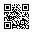

本报告仅供华金证券客户中的专业投资者参考

请仔细阅读在本报告尾部的重要法律声明

# 固态电池系列报告：锂金属负极

电力设备与新能源/行业深度报告

领先大市（维持）

分析师：贺朝晖 S0910525030003
周涛 S0910523050001

2025年9月25日

请仔细阅读在本报告尾部的重要法律声明 2

## 核心观点

- 锂金属负极：固态电池能量密度突破的重要推手。锂电负极材料正经历从传统石墨向多元高能量密度体系的重大转型。锂金属负极理论比容量达 3860mAh/g，远高于石墨（372mAh/g）和硅碳负极（3590mAh/g），且具备低电压平台特性。固态电池方面，全固态电解质凭借高机械强度抑制枝晶，与锂金属负极形成最优适配。
- 技术挑战与突破路径。锂金属负极存在体积膨胀、锂枝晶问题、界面反应复杂、制备工艺难度高等关键瓶颈。近年来，针对锂金属负极改善策略主要包括三维储锂基体和集流体，电解液和添加剂，修饰隔膜和人造SEI等，这些策略从锂枝晶的生长原理和SEI组分出发，主要功能在于限制锂体积膨胀，降低离子流和表面电流密度，构建稳定和快离子传输的表面SEI。
- 制备工艺：多路线并行，技术持续突破。锂金属负极的制备工艺是其实现产业化应用的核心支撑，目前行业形成了多路线并行、高低端场景分化的格局，主流工艺可分为成熟量产导向型（压延法）、高端技术突破型（蒸镀法）、前沿研发探索型（液相法、无负极方案）四大类。其中蒸镀法成本有望持续优化，成为全固态电池主流工艺。
- 2030年对应市场空间近百亿元。目前锂金属负极市场主要由锂企、负极厂商、箔材厂商三类参与者，锂企凭借丰富的锂资源与金属锂产能，在原材料制备上具备成本和质量优势；负极厂商同时在硅碳负极、锂金属负极上进行布局。根据《中国固态电池行业发展白皮书(2025 年)》预计到2030年全球固态电池出货量将达到 614.1GWh，其中全固态比例近 30%，基于此我们假设2030年锂金属负极假设渗透率20%，测算对应市场空间近百亿元。
- 投资建议。建议关注锂金属负极的英联股份、天铁科技，此外关注赣锋锂业、璞泰来、亿纬锂能、国轩高科、德福科技、道氏技术等锂电产业链相关企业。
- 风险提示：技术研发风险、原材料与供应链风险、路线迭代风险、政策监管风险。

请仔细阅读在本报告尾部的重要法律声明 3

## 目录

锂金属负极：固态电池能量密度突破的重要推手
技术挑战与改善策略研究进展
制备工艺：多路线并行，技术持续突破
市场格局：锂金属负极市场前景及产业链发展
相关标的

请仔细阅读在本报告尾部的重要法律声明 4

### 1.1 锂金属负极推动固态电池能量密度提升

- 负极方面，固态电池比传统锂电池更容易适配锂金属负极和硅碳负极，因为固态电解质由固态材料构成，具有较高的化学稳定性，对锂金属负极的锂枝晶的形成及硅的膨胀起抑制作用。
- 采用锂金属负极能量密度最高、接近400Wh/kg。右图中，正极均采用100m厚的NCM811，4种不同电芯比较下，采用锂金属负极材料的固态电池能量密度最高。

负极材料属性对比

| 主流固态电池负极材料 | 比容量 (mAh/g) | 优点 | 缺点 |
|---------------------|----------------|------|------|
| 石墨 | 372 | 技术成熟，成本低，高循环稳定性 | 理论容量较低 |
| 硅碳负极 | 3590 | 高比容量，原材料丰富，技术进步快 | 循环过程中体积膨胀问题难以解决，工艺复杂，成本较高 |
| 锂金属 | 3860 | 高比容量，低电压平台 | 体积膨胀容易引起电极材料的破裂和损坏；活性高易化学反应，安全隐患大。 |

传统锂电池和硫化物固态锂电池的电芯设计对比

传统锂电池的石墨负极和硅碳负极

硫化物固态电池的石墨负极和锂金属负极

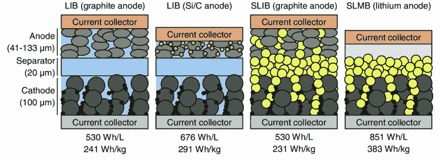

资料来源：钜大锂电、彪捷等《锂离子电池合金负极材料研究进展》、许晓雄等《为全固态锂电池“正名”》，华金证券研究所

请仔细阅读在本报告尾部的重要法律声明 5

### 1.2 锂金属负极对比传统负极的优势

- 由于传统石墨负极材料较低的理论比容量(372 mAh/g)以及较高的电压平台，造成传统锂离子电池无法进一步突破其比能量瓶颈(260 Wh/kg)。因此需要探索具有高理论比容量和低电极电势的负极材料，从而在电池材料体系上使电池达到更高的比能量，由于锂金属具有高理论比容量(3860 mAh/g)和低电极电势(−3.04 V vs SHE (standard hydrogen electrode))等特点将锂金属负极匹配过渡金属氧化物正极(LMO)构成锂金属电池时，其比能量可以提升到约440 Wh/kg。在锂硫(Li-S)和锂氧(Li-O2)电池体系中，其比能量可以进一步分别达到~650和~950 Wh/kg。高理论比容量给了锂金属负极更宽广的应用前景。

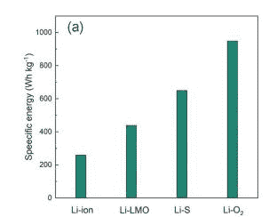

锂离子电池和锂金属电池的比能量对比

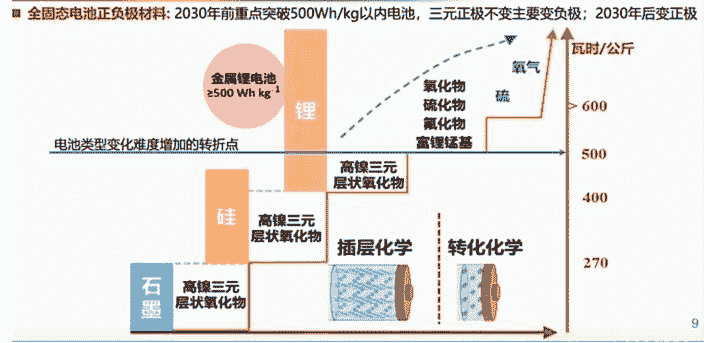

全固态电池材料体系迭代路线

资料来源：《锂金属负极的挑战与改善策略研究进展》刘凡凡，25 年中国全固态电池创新发展高峰论坛欧阳明高院士发言，华金证券研究所

请仔细阅读在本报告尾部的重要法律声明 6

- 锂金属电池凭借锂金属负极极低的电化学还原电位和超过高的理论比容量，而被认为是最有潜力的下一代电池候选者，它有潜力将现有锂离子电池的能量密度提升一倍。金属锂是锂电池的理想负极材料，原因有三个：1）锂金属负极可提供最高的重力能量密度（单位质量可存储的能量）。2）通过将锂直接沉积在负极上，可大幅提高充电速率。3）有了合适的电解质，就可以设计出无负极结构电池，从而节省材料和制造成本，提高能量密度。

- 锂负极材料最重要的特性是容量和电压，它们共同决定了电池的整体储能能力。关于电动汽车电池的负极，有三种主要的竞争者：石墨、硅和金属锂。金属锂在能量密度方面胜出一筹，但每种材料都各有优劣。

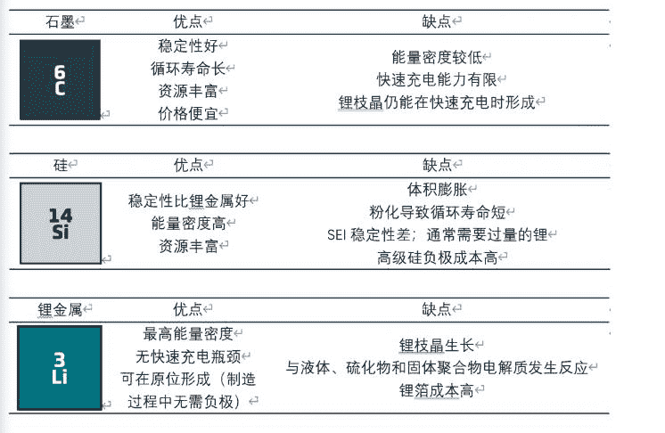

资料来源：《 Li2ZrF6-based electrolytes for durable lithium metal batteries》徐庆帅等，Batteryman Helps Batteryman，华金证券研究所

请仔细阅读在本报告尾部的重要法律声明 7

资料来源：云帆固态电池，《锂金属负极的挑战与改善策略研究进展》刘凡凡，华金证券研究所

- 锂电负极材料正在经历从传统石墨向多元高能量密度体系的重大转型。除硅碳负极外，目前主流研发方向还包括锂金属负极、硬碳材料、自生成负极技术等，未来技术趋势将按应用场景分化发展。
- 与传统石墨负极相比，锂金属负极具有更高的理论比容量（3.86 Ah/g）和较低的电化学电位，被认为是最具潜力的负极材料之一。锂金属负极的应用可以显著提升固态电池的能量密度，使其在电动汽车、储能系统等领域具有广阔的应用前景。除此以外，锂金属负极还有充放电效率高，在固态电池中安全性强的特点。
- 锂金属负极的“沉积-溶解”机制使其在充电过程中能够快速完成锂离子的嵌入和脱出。研究表明，在特定条件下，采用锂金属负极的电池能够在 15 分钟内将电量充至 80% 以上，远快于传统石墨负极电池，大大缩短充电时间，提升用户使用体验，满足未来快速充电的需求。
- 在液态电池中，锂枝晶生成会刺穿 SEI 膜，导致锂持续消耗、电池循环寿命降低，严重时引发电池内部短路等安全隐患。而固态电池体系采用固态电解质，其机械强度高，能有效抑制锂枝晶的生长，使锂金属负极在固态电池中得以更好地适配，显著增强电池的安全性。

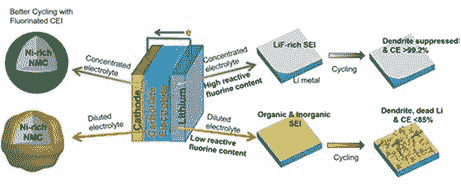

高压锂金属电池的正负极界面作用示意图

请仔细阅读在本报告尾部的重要法律声明 8

### 1.3 锂金属负极存在技术瓶颈

- 锂金属具有较高反应活性，容易与有机电解液反应生成Li2CO3、LiOH、Li2O、Li3N、LiF等无机产物18和ROCO2Li、ROLi、RCOO2Li (R是烷基官能团)等有机产物。这些反应会导致锂金属和电解液的利用率降低，并会伴随着大量的气体产生，容易引发锂金属电池的安全隐患。此外，锂金属的高活性和其表面SEI的锂离子扩散能垒较高会促进锂枝晶的形成。如下图所示，正是锂金属的不均匀沉积和枝晶生长引发了以上提到的诸多问题。

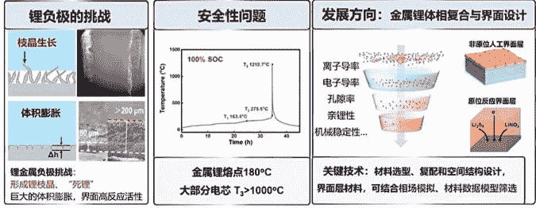

- 锂金属作为电池负极的应用还面临金属锂负极对SEI的要求很高、锂枝晶生长、极大的相对体积变化以及上述问题相互作用造成多孔锂电极等重大技术瓶颈，锂金属负极的发展还有赖于技术进步改善应用瓶颈。

资料来源：《锂金属负极的挑战与改善策略研究进展》刘凡凡，25 年中国全固态电池创新发展高峰论坛欧阳明高院士发言，华金证券研究所

请仔细阅读在本报告尾部的重要法律声明 9

### 1.4 硅碳负极：负极产业化的过渡选择

- 因为锂电池负极存在诸多技术瓶颈，硅基负极作为锂金属负极和石墨负极之间的过渡产物被诸多企业布局研发。
- 2025~2027:石墨/低硅负极硫化物全固态电池:以200~300Wh/kg为目标，攻克硫化物复合电解质，打通全固态电池技术链，三元正极和石墨/低硅负极基本不变,面向长寿命大倍率应用。
- 2027~2030:高硅负极硫化物全固态电池:以400Wh/kg和800Wh/L为目标，重点攻关高容量低膨胀长循环硅碳负极，优化高镍三元复合正极和硫化物复合电解质，面向下一代乘用车电池应用。
- 2030~2035:锂负极硫化物全固态电池:以500Wh/kg和1000Wh/L为目标，重点攻关锂负极、高电压高比容量正极。

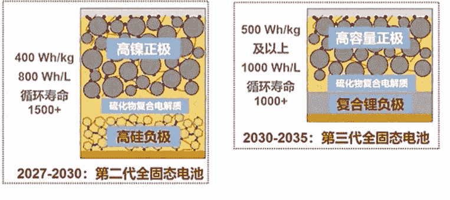

资料来源：25 年中国全固态电池创新发展高峰论坛欧阳明高院士发言，华金证券研究所

请仔细阅读在本报告尾部的重要法律声明 10

- 硅碳负极采用纳米硅和石墨材料混合，通过降低硅基材料粒径至纳米级别，可以拥有较小的颗粒尺寸和更多的空隙，更容易缓冲硅在脱嵌锂离子过程中产生的应力和形变。此外，纳米颗粒可以缩短锂离子扩散距离，增加硅材料储锂能力。
- 硅碳负极生产工艺核心难点在于纳米硅粉的制备，常见的纳米硅的生产工艺有镁热还原法、硅烷热解法、放电等离子法和机械研磨法。国内纳米硅粉的制备主要以机械研磨法为主，美国、日本等国家的企业对纳米硅粉的研究起步较早，日本帝人，美国杜邦等企业均可以用等离子蒸发冷凝法进行纳米硅粉的制备，目前国内等离子体法进展较快的企业为博迁新材，目前已经处于中试阶段。

资料来源：25 年中国全固态电池创新发展高峰论坛欧阳明高院士发言，SMM锂电，华金证券研究所

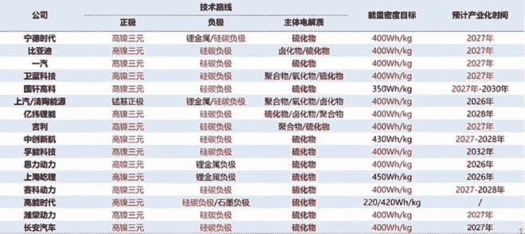

当前负极材料研发布局

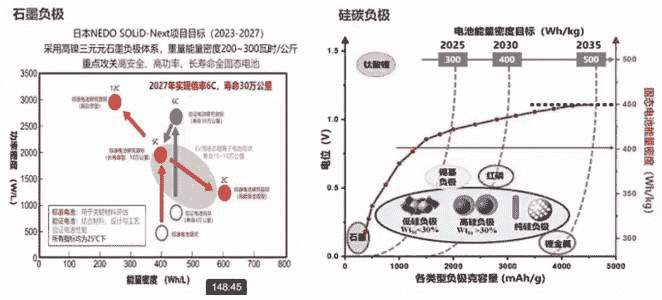

石墨负极对比硅碳负极

请仔细阅读在本报告尾部的重要法律声明 11

## 目录

锂金属负极：固态电池能量密度突破的重要推手
技术挑战与改善策略研究进展
制备工艺：多路线并行，技术持续突破
市场格局：锂金属负极市场前景及产业链发展
相关标的

请仔细阅读在本报告尾部的重要法律声明 12

- 锂金属负极由于其无基体转化反应的特性而存在无限体积膨胀的问题，针对于此类问题，研究者们设计多种三维导电骨架用于预储锂基体，三维导电骨架不仅可以限制锂的无限体积膨胀而且能够均匀化锂离子流，降低表面有效电流密度，从而抑制锂枝晶的生长。
- 石墨烯复合基体。石墨烯的高电子电导率，结构稳定，密度低和易掺杂等优势。基于这些优点，石墨烯也可以被应用于金属锂的结构基体中来优化锂负极的稳定性、使其均匀沉积使用并生成稳定人工SEI表面。石墨烯作为储锂利用热熔融的方法将液态锂渗入到分层石墨烯基体中得到复合金属锂电极Li-rGO，该复合电极仍然具有3390 mAh/g的比容量。

## 2.1 三维骨架改善锂金属负极问题

资料来源：《锂金属负极的挑战与改善策略研究进展》刘凡凡，华金证券研究所

该复合电极中的石墨烯有以下作用：1)石墨烯可以作为一个稳定的金属锂限域骨架；2)热处理后的石墨烯表面具有亲锂性的含氧官能团，能够促进金属锂的均匀沉积；3)石墨烯层间表面可以作为一个稳定的人工SEI表面。在上述的设计优点下该Li-rGO复合电极表现出优异的电化学性能。

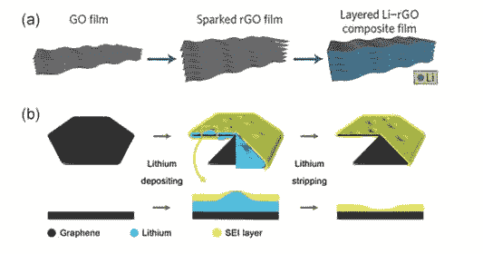

(a)分层还原氧化石墨烯复合锂电极合成示意图

(b)氮掺杂石墨烯诱导锂沉积过程示意图

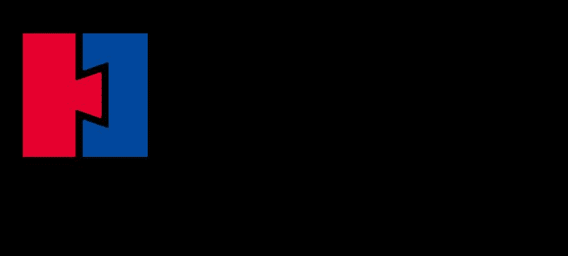

请仔细阅读在本报告尾部的重要法律声明 13

- 碳纤维复合基体。由于稳定的三维骨架网络，优异的电子导通性质和高比表面积等优点及碳纤维的三维结构可以降低有效电流密度，减小锂成核过电势，限制金属锂的体积膨胀。
- 多孔金属复合基体。由于高电子电导率和结构稳定性，三维多孔金属基体也被探索应用于预储存锂的基体或者锂电沉积的集流体以限制锂金属的无限体积膨胀和调控锂离子的沉积行为。

## 2.1 三维骨架改善锂金属负极问题

资料来源：《锂金属负极的挑战与改善策略研究进展》刘凡凡，华金证券研究所

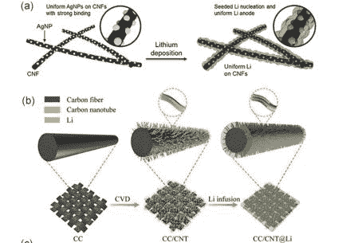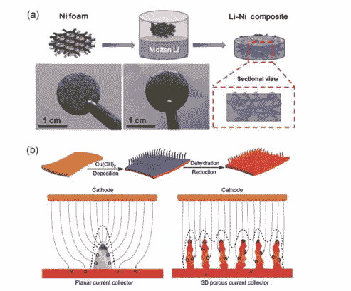

(a) Ag颗粒修饰碳纤维对诱导锂沉积行为示意图

(b) Li@CC-CNTs复合电极合成过程示意图

(a) Li-Ni复合锂负极的合成示意图

·(b)多孔Cu纳米线的合成示意图

## 2.2 粉体材料改善锂金属负极问题

复合金属基体主要集中于三维自支撑骨架，粉体材料则可用于储存和保护锂金属负极。粉体材料相对于三维自支撑骨架的优点主要在于其大面积合成制备工艺更加简单，从而可以规模化制备复合锂金属负极。粉体的多孔性和亲锂性质是其材料结构中的重要因素，并且可以通过设计合理的材料成分和结构来构建高离子扩散/电子传输动力学锂负极。

(a)碳纳米管团簇球熔锂过程示意图 (b) ZIF-8基碳材料熔锂示意图和Li-Zn二元相图 (c) LAN电极的制备过程示意图

资料来源：《锂金属负极的挑战与改善策略研究进展》刘凡凡，华金证券研究所

## 2.3 全固态适配带来技术突破

**全固态适配。** 第二届中国国际固态电池技术产业化发展论坛赣锋锂业发表演讲，公布了其在固态电池材料、大容量固态储能电池及储能业务方面的进展。详细介绍了赣锋锂业在氧化物、硫化物固态电解质材料和304Ah固态储能电芯、储能系统等方面的具体进展。据介绍，赣锋锂业构建起的覆盖电池材料-电芯-电池箱（柜-储能集装箱-储能电力）解决方案的全链条产品布局和行业内唯一开展原材料、电芯、储能系统自主建设运营、电池回收的全产业链建设极大推进了锂金属负极的研发和应用。其储能电池产品累计对外交付量已超21GWh，自主投资建成及在建储能电站超过20GWh。

锂金属负极应用的主要瓶颈是锂枝晶问题。在液态电池中，锂枝晶生成会刺穿SEI膜，导致锂持续消耗、电池循环寿命降低，严重时会刺穿电解质膜，引发电池内部失效。而固态电池体系能抑制锂枝晶发展，所以锂金属负极在固态电池中更适配。

资料来源：界面新闻，马里亚纳锂电，华金证券研究所

## 2.4 电沉积技术带来技术突破

电沉积技术原理是以预处理过的泡沫塑料为阴极，工业纯铝板为阳极，在烷基铝溶液中电镀制成泡沫铝。优点是孔隙结构良好、孔径小、孔隙均匀、孔隙率高，且其隔热和阻尼特性更优；缺点是工序长、操作繁琐、成本稍高，制品厚度有限。但近期出现突破，通过在超高压下原位电沉积电解质溶剂构建了稳定的电解碳基杂化（ECH）人工SEI，提高了离子导电性、机械强度、锂离子扩散均匀性、电解液与锂金属界面的稳定性，并抑制锂枝晶的生长和锂的粉碎。

通过在超高压下原位电解有机溶剂在LMA表面构建稳定的纳米结构电解碳基杂化（ECH）界面可以实现优异的离子导电性，从而在锂离子通过界面时均匀分布锂离子，防止锂枝晶的形成。该工艺所获得的ECH层包含一个以锂氧化物和聚合物层作为内核，一个非晶碳组分作为外层，有效地密封了锂表面，增强了机械强度和锂离子导电性。此外，即使在高电流密度和高充放电容量下，具有ECH层的改性锂电池也表现出更稳定的电镀/剥离周期，表现出显著改善的循环稳定性。

电沉积法工艺流程

资料来源：起点锂电，材料科学网，华金证券研究所

## 2.5 锂金属负极在电池中应用仍待改善

随着电子产品和汽车电动化的发展，社会对电池储能器件的比能量需求日益增高，近20年来，以石墨为负极，钴酸锂和磷酸铁锂以及三元材料为正极的锂离子电池已经得到广泛的应用和发展。但由于传统石墨负极材料较低的理论比容量(372mAh·g⁻¹)以及较高的电压平台，造成传统锂离子电池无法进一步突破其比能量瓶颈(260 Wh·kg⁻¹)。因此具有高理论比容量和低电极电势的负极材料急需研发。由于锂金属具有高理论比容量(3860mAh·g⁻¹)和低电极电势等特点，锂金属负极得到广泛关注，被认定为下一代电池负极。

近年来针对于锂金属负极改善策略主要包括三维储锂基体限和集流体，电解液和添加剂，修饰隔膜和人造SEI等。这些策略从锂枝晶的生长原理和锂表面SEI组分出发，主要功能在于限制锂体积膨胀，降低离子流和表面电流密度，构建稳定和快离子传输的表面SEI。但这些路线中锂金属电池要达到实际的应用条件时，电流密度和镀锂容量会进一步提高并带来更多的安全问题。当锂金属匹配固态电解质时能够解决安全问题，而且能够提高电池体系比能量，但是全固态锂金属电池的界面高阻抗问题和较低的离子传输速率一定程度限制着其发展。锂金属负极目前仍然处于研究阶段，在液态和固态体系均需要进一步探索锂沉积行为机理，稳定的SEI和界面组分，开发出更先进的储锂基体骨架和电解质体系，推进锂金属电池的实际应用。

资料来源：《锂金属负极的挑战与改善策略研究进展》刘凡凡，华金证券研究所

## 目录

01 锂金属负极：固态电池能量密度突破的重要推手

02 技术挑战与改善策略研究进展

03 制备工艺：多路线并行，技术持续突破

04 市场格局：锂金属负极市场前景及产业链发展

05 相关标的

## 3.1 多样的制备工艺

主流工艺在技术成熟度、加工性能和经济性上存在差异。技术成熟度顺序为压延法>气相沉积法>液相法>电沉积法；加工性能顺序为气相沉积法、液相法>压延法>电沉积法；经济性顺序为液相法>压延法>气相沉积法>电沉积法。商业化进展方面，压延法会率先实现规模化落地；液相法和气相沉积法作为长期潜在方向，目前距量产和规模化仍有较大距离。

资料来源：云帆固态电池，全产业链研究院，华金证券研究所

### 制备工艺

- **物理法**：包括挤压和辊压技术，像擀面皮一样压薄锂金属，这种方法简单直接，但锂金属太软，容易粘在机器上，导致薄片不均匀，厚度通常在20微米以上。而电子束物理气相沉积，相对好一些，用高能电子束把锂金属"烤化"成蒸汽，像喷雾一样喷到基材（比如铜箔）上，形成超薄锂层。后续还有磁控溅射，就是用磁场控制锂金属原子像"粒子雨"一样均匀洒在基材表面，形成薄膜。这方法在实验室常用，但量产成本高，而且锂金属容易氧化。

- **电化学法**：在电解液里通电，让锂离子像"游泳"一样聚集到集流体（比如铜箔）表面，形成锂金属层。这有点像电镀，但锂金属很活泼，容易在表面形成"皱纹"（枝晶），导致电池短路。目前还在实验室阶段。

- **自生成负极技术**：通过在充放电过程中直接沉积锂金属形成负极，避免了传统石墨负极的使用。宁德时代提出的自生成负极技术能够显著提升电池的能量密度。

- **蒸发镀和液相法**：蒸发镀技术特别适用于低熔点和高蒸气压的材料，液相法则通过熔融锂涂覆在集流体上制备锂金属负极。这两种方法均具备制备超薄锂带的潜力，但离规模化量产仍有较大距离。目前，压延法已实现规模化生产，但在制备超薄锂带方面存在限制。

### 3.1 无负极方案：推进锂金属负极走向应用

**无负极方案。** 无负极锂金属电池因其高能量密度而备受关注，但实际应用受限于锂库存损失、正极降解和锂离子可逆性差等问题。西北工业大学马越团队提出了一种集成Li₂S@C牺牲层的聚烯烃隔膜，通过在Ah级无负极软包电池中补充定制的Li⁺库存，并建立具有高电压耐受性（高达4.5 V）的含锂多硫化物的正极界面，实现了多尺度界面稳定化。这种预锂化方法展示了规模化潜力和通用适用性，可用于无负极/少负极锂金属电池的界面化学稳定化。

资料来源：《Multiscale interfacial stabilization via prelithiation separator engineering for Ah-level anode-free lithium batteries》Shao Ahu，华金证券研究所

预锂化层的锂补充过程示意图

Li₂S@C预锂化剂和Li₂S@C|PE隔膜的设计与制备

自宁德时代发布自生成负极技术后，近期又独立完成的锂金属电池研究成果于5月28日发表在国际顶级期刊《自然纳米技术》（即 Nature Nanotechnology）。研究解析了实际产品设计条件下的锂金属电池失效机制，并提出创新电解液设计原则，以实现兼具高能量密度与长循环寿命的锂金属电池产品。

《自然纳米技术》作为《自然》五大子刊之一，是纳米材料科学领域影响力全球领先的顶级期刊。宁德时代研究团队通过独创的动态追踪技术，量化电解质失效机制，首次揭示锂金属电池失效的核心消耗路径——研究结果表明，电解液盐在循环中消耗量高达71%，远超学界预期。基于此发现，团队引入低分子量稀释剂优化电解液配方，实现循环寿命较前代产品翻倍至483次。同样的电解液设计逻辑，可进一步支持电池能量密度突破500Wh/kg，使电动航空规模化、超千公里续航电动汽车成为可能。

资料来源：宁德时代，腾讯网新闻，华金证券研究所

宁德时代自生成负极样品

## 3.2 蒸镀法：工艺带来技术突破

英联股份依托蒸镀工艺的技术优势研发出应用于固态电池的锂金属/复合集流体负极一体化材料。蒸镀工艺是种薄膜制备技术，能够实现纳米级的材料沉积，从而提高材料的均匀性和一致性。这种技术在锂金属负极材料的制备中能够有效解决锂金属负极在充放电过程中的枝晶生长问题，提高电池的安全性和循环寿命。膜制备技术，能够实现纳米级的材料沉积，从而提高材料的均匀性和一致性。这种技术在锂金属负极材料的制备中具有显著优势，能够有效解决锂金属负极在充放电过程中的枝晶生长问题，提高电池的安全性和循环寿命。

与传统轧制工艺相比，蒸镀技术可将锂带厚度从传统的15-20μm降至仅2-3μm，能量密度提升30%以上。更薄的锂金属层意味着更轻的电池重量和更高的能量密度，这正是动力电池厂商梦寐以求的技术突破。

在材料纯度方面，蒸镀工艺保证材料纯度高达99.95%以上，大幅减少杂质带来的安全隐患。同时，该技术实现了原子级别的界面平整，有效降低了锂枝晶生成风险，解决了困扰固态电池多年的安全痛点。

蒸镀工艺还能掺杂元素将锂金属升级为锂合金负极，并在锂金属表面蒸镀保护层，原位生成人工SEI膜，进一步提升了电池的能量密度和循环寿命。

测试数据显示，采用该技术的电池循环寿命有望提升3倍以上，远超行业现有水平。英联股份在应用该领先技术后获得了头部车企技术研究院的战略合作，预计一年内实现新型材料量产。

资料来源：财法观天下，ETF炼金术士，华金证券研究所

通过热蒸镀工艺生产的锂金属负极的生产成本可以分为九个类别：碳酸锂、加工碳酸锂、劳动力、折旧、变动间接费用、一般费用、销售和管理费用、融资以及其他制造成本。

为了实现1000 Wh/L的能量密度和5.4 mAh/cm²的面积容量，锂负极不应超过17微米，同时在1250次循环后保持75%的容量，需要达到至少99.929%的库仑效率。因此，制造约17微米锂薄膜最有希望的技术是热蒸镀。技术经济评估显示，基于能源价格，这种厚度的锂金属负极可以以每平方米4.30美元的成本生产，电池包的成本为每千瓦时158美元。虽然这表明制造固态电池的成本虽然较高，但其快充、高能量密度和安全性在未来电池发展中展现出巨大的潜力。

锂和电价对17µm锂金属负极生产成本的综合影响

热蒸镀金属锂负极生产成本的全球技术经济分析

资料来源：能源学人，华金证券研究所

## 3.3 压延法：较为成熟，有工艺迭代空间

压延机常以辊子数目及排列方式分类。辊子数目有双辊、三辊、四辊。三辊压延机主要用于生产片材，四辊机可生产较薄制品，还可完成双面贴胶的操作，目前采用较为广泛。辊子排列方式很多，以倒L形和Z形用得较多，各间隙均可调整。压延机的规格用辊子外径和辊子的工作部分长度表示。辊子可通入蒸汽或过热水加热。通常压延机还必须和其他辅助设备组合成一条生产线才能进行生产。

压延法工艺流程

压延法是当前较为成熟的工艺，历史悠久，有望实现产业化和规模化。其工艺为先挤出，再通过压延进一步做薄。当前市场主流锂带厚度比20微米更厚，受碟片压或卷绕处理超薄材料的技术限制，目前较好水平是20微米。未来几年，20微米锂带大概率仍是主流，但长期并非理想状态。固态电池锂负极理想厚度为5-6微米，过厚会导致锂冗余，不利于能量密度提升和降本。压延法有工艺迭代空间，继续做薄可能，20微米并非极限，是近期可见的规模化工艺。

资料来源：塑料行业推广，微信公众号，华金证券研究所

## 目录

01 锂金属负极：固态电池能量密度突破的重要推手

02 技术挑战与改善策略研究进展

03 制备工艺：多路线并行，技术持续突破

04 市场格局：锂金属负极市场前景及产业链发展

05 相关标的

## 4.1 锂金属负极有广大发展空间

EVTank数据显示，2024年全球固态电池出货量达到5.3GWh，同比大幅增长4.3倍，全部为半固态电池，主要为中国企业生产。EVTank预计全固态电池将在2027年实现小规模量产，到2030年将实现较大规模的出货。《中国固态电池行业发展白皮书（2025年）》预计到2030年全球固态电池出货量将达到614.1GWh，其中全固态的比例将接近30%。而全球对固态电池的发展布局基本固定为石墨负极、硅基负极、锂金属负极，锂金属负极作为未来技术演进方向存在广大发展空间。

目前，锂金属负极市场主要由锂企、负极厂商、箔材厂商三类玩家。锂企业如赣锋锂业、天齐锂业、天铁科技等，凭借丰富的锂资源与金属锂产能，在原材料制备上具备成本和质量优势；负极厂商如璞泰来、贝特瑞、道氏技术等，同时在硅碳负极和锂金属负极上进行布局；箔材厂如英联股份、中一科技、德福科技等，涉足锂金属负极的制备和研发。

资料来源：evtank，云帆固态电池，华金证券研究所

## 4.2 锂电池产业化发展与产业链动态

目前，利用SEI膜的调控、锂复合结构的构建及固态电解质的使用等多种策略已经大幅提升了其稳定性和安全性，部分高能量密度的小型锂硫电池已成功应用于某些特殊领域。此外，锂金属电池在便携监测平台、智能武器装备、电动汽车轻量化等领域同样具有广阔的应用前景。

然而，目前锂金属负极仍然面临电解质界面适应性差、制备条件严苛、使用成本较高、评价标准不完善等问题，这影响了锂负极的产业化应用。因此，锂金属负极在未来仍然需要针对这些问题开展进一步的研究。

推动锂电池产业化需要坚持开发匹配的新型复合电解质材料，同时解决Li+的传输效率及其与锂金属的界面适应问题；在新材料研究和锂电池制备过程中，注重工艺方法改进，积极探索降低关键技术成本；加强跨学科合作，整合材料科学、化学、工程学等领域的知识，解决金属负极领域的复杂问题，同时建立并完善新的检测和评价标准，为储能领域向更高能量密度、更高安全性能和更长循环寿命发展提供理论依据和技术保障。

资料来源：石墨邦，华金证券研究所

## 4.3 上市公司布局情况

资料来源：etf炼金术士，赣锋锂业，云帆固态电池，华金证券研究所

目前，多家上市公司均已布局锂金属负极研发及生产。赣锋锂业已实现300mm宽度的超宽幅超薄锂带量产，铜锂复合带中锂箔厚度可达到3微米，并在固态电池领域取得了显著进展。并且随着赣锋锂业布局加码电池上下游一体化的能力，成为了行业内唯一一家拥有固态电池上下游一体化能力的企业。

天铁科技与欣界能源合作压延法锂金属负极，提供电池级锂金属产品，并计划在首条≥450Wh/kg固态2GWh量产线投产后负责金属锂材料供应。

英联股份依托蒸镀工艺的技术储备，研发锂金属/复合集流体负极一体化材料，产业化进度喜人，公司复合铝箔和复合铜箔产品已逐步获得小批量订单，与头部电池客户的合作持续推进。研发的硫化物电池专用铜箔采用电镀/PVD工艺，在铜箔表面生成致密保护膜，有效防止硫化物腐蚀，可直接蒸镀锂金属负极，相比传统压延工艺产品，在固固界面上具备天然优势，其送样测试结果有望超预期。

道氏技术合作电子科技大学布局液相法锂金属负极，通过熔融液体流延的方法实现锂负极的超薄化制备，公司具有在硅碳与锂金属负极双布局的优势。

中一科技已有用于固态电池的锂-铜金属一体化复合负极材料技术储备，改善金属锂与铜箔之间的界面亲和性。公司优势在于涉足锂金属负极制备研发。

## 4.4 龙头企业参与锂金属负极产业化发展

资料来源：真锂研究，华金证券研究所

随着固态电池的开发和量产，原先限制锂金属负极应用的锂枝晶问题正在被解决，新的技术不仅可以抑制锂枝晶的生长，固态电解质隔膜更可以防止其刺穿隔膜导致电池短路。

- 4月21日宁德时代发布了"自生成负极技术"，通过精准调控纳米级界面组分与结构，使离子传导速度提升两个数量级，攻克了锂金属负极的循环衰减的瓶颈。该技术使电池存储性能提升300%，能够将电池的体积能量密度提升60%以上，重量能量密度提升50%以上。

- 5月13日，赣锋锂业已经突破了锂金属负极的产业化门槛，以金属锂负极技术为核心，推动高比能电池量产。其二代混合固态锂电池采用金属锂作为负极，开发的高比能电池能量密度达到420Wh/kg，循环寿命超过700次，并开发出能量密度达到500Wh/kg的样品，可通过200℃热箱与针刺等严苛的安全测试。

- 天齐锂业目前通过与北京卫蓝新能源合作，研发预锂化负极材料、金属锂负极及锂基合金负极材料。其预锂化实验室建设项目已竣工验收，并完成两套负极预锂化设备工艺开发。此外，孚能科技、欣界能源等企业在固态电池研发中心，也采用了金属锂负极的路线，龙头企业齐齐布局锂金属负极也侧面说明该技术的良好前景。

- 欣界能源自主研发独特界面处理与固态电解质技术，结合高比能锂金属负极，重塑传统锂电池构造，单体能量密度高达480Wh/kg并成功量产，在确保安全的前提下，实现eVTOL续航里程倍增，为城市空中交通商业化铺路。作为国内固态电池商业化应用先行者，欣界能源自创立以来，以创新引领行业潮流。

- 欣界能源在高比能固态电池系统上，以远超传统电池两倍以上的卓越性能，引领低空经济、消费电子及动力领域变革。推出了高达480Wh/kg能量密度的电池，未来将广泛应用于飞行器、消费电子及电动汽车领域，吸引众多领先企业关注与合作。产能方面，欣界能源2023年建成全国首条200MWh锂金属固态电池产线，2024年开始启动5GWh量产线分期建设，锂金属负极电池朝量产目标不断推进。随着技术迭代与市场拓展，锂金属固态电池有望为更多新兴领域提供强劲动力。

资料来源：欣界能源，华金证券研究所

## 4.5 锂金属负极推动产业链发展

在中国锂行业面临周期性挑战之际，两大龙头企业赣锋锂业和天齐锂业正推进下一代电池技术研发，近期相对明确地公开了各自在固态电池领域的系统性布局。两家公司均重点发力硫化锂和金属锂负极这两大关键材料，此举被视为在传统锂盐业务承压背景下，寻求新增长曲线的重要举措。

赣锋锂业尤其强调其在固态电池领域的垂直整合能力，其布局覆盖了从上游的硫化物固态电解质核心原料"硫化锂"、固态电解质层、金属锂负极，直至下游的电池单体及系统集成。

其电池级硫化锂已于2022年具备量产能力，并在2024年将产线规模提升至百吨级。其硫化锂产品纯度可达99.9%，粒径D50小于5微米，已向下游超过20家客户供货。

在电解质技术层面，赣锋锂业在硫化物、氧化物及聚合物三大路线上均有长期研发积累。

负极材料方面，赣锋锂业的超薄锂带也具备量产能力，可提供定制化解决方案，并已实现300mm宽幅、锂箔厚度可达3微米的超薄锂带或铜锂复合带量产。

赣锋锂业在江西新余已有一条4GWh的混合固液电池产线投产，并在江西宜春和奉新拥有合计2150吨的金属锂产能，其青海年产1000吨金属锂项目也已部分进入试生产阶段。

产业化层面，赣锋锂业已将目光投向新兴市场，推出了适配低空飞行场景的固态电池解决方案，并已与知名的无人机、eVTOL企业达成合作。据称，首批样品计划于今年内完成交付，显示其技术正逐步走向实际应用。

资料来源：高工锂电，华金证券研究所

## 4.6 锂金属负极市场规模可观

对锂金属负极而言，预计到2030年全球固态电池领域的需求量将达到约2.63万吨（金属量，折合近14万吨LCE），市场规模约184亿元人民币，对应2024-2030年的需求量CAGR超过300%。

综合来看，搭载锂金属负极的硫化物全固态电池对锂的需求量约为1455吨LCE/GWh，是传统锂电池的2.4倍；即便是采用锂金属负极的半固态电池，锂需求也达到约1088吨LCE/GWh，是传统电池的1.8倍。到2030年，固态电池对锂的总需求量可能达到55.2万吨LCE，2024-2030年CAGR约为146%，有望在全球碳酸锂需求总量基础上额外增加约5%。

EV Tank预计全固态电池将在2027年实现小规模量产，到2030年将实现较大规模的出货。《中国固态电池行业发展白皮书(2025年)》预计到2030年全球固态电池出货量将达到614.1GWh，其中全固态的比例将接近30%。我们假设2030年全固态电池出货180GWh锂金属负极假设渗透率20%，测算得36GWh。假设采用双面20um锂箔，合计40um厚度，1GWh电池用量1000万平，结合锂的密度534kg/m³，则对应1GWh电池用锂金属(不考虑铜箔)约214吨，18GWh对应用量约7700吨，假设120万元/吨，对应市场92亿元。

资料来源：高工锂电，Evtank，北极星储能网，华金证券研究所

| 2030年全固态电池出货量（GWh）\锂金属负极渗透率 | 10% | 20% | 30% |
|---|---|---|---|
| 锂金属负极出货量（GWh） | 18.42 | 36.85 | 55.27 |
| 双面10um | 1967.58 | 3935.15 | 5902.73 |
| 双面20um | 3935.15 | 7870.31 | 11805.46 |
| 双面30um | 5902.73 | 11805.46 | 17708.19 |

注：表头数值184.23（市场规模约184.23亿元）

## 目录

01 锂金属负极：固态电池能量密度突破的重要推手
02 技术挑战与改善策略研究进展
03 制备工艺：多路线并行，技术持续突破
04 市场格局：锂金属负极市场前景及产业链发展
05 相关标的

## 5.1 相关标的：赣锋锂业

赣锋锂业是一家锂生态企业，通过锂资源、锂化工、锂电池、储能、电池回收等产业进行多维度组合运营。近年来，赣锋锂业布局加码电池上下游一体化的能力。

固态方面，公司是行业内唯一一家拥有固态电池上下游一体化能力的企业。在多场景应用方面，逐步完善固态电池一体化布局，积极推动固态电池商业化进程。在新能源汽车领域，与某国际头部车企签订联合开发协议；在低空经济领域，推出适配低空飞行场景的固态电池解决方案；在消费电子领域，其研发的高安全耐低温固态锂电池取得新突破。

在技术突破方面，在技术突破上，赣锋锂业称，公司同步推进硅基与锂金属负极双路线突破产业化门槛，以金属锂负极技术为核心，推动高比能电池量产进程。400Wh/kg电池循环寿命芯突破800次并完成工程验证，具备规模化应用潜力；全球首款500Wh/kg级10Ah产品实现小批量量产。同时硅基负极同步推进，硅基体系实现320-450Wh/kg产品梯度布局，其320Wh/kg电芯循环寿命突破1000次，450Wh/kg技术储备达行业顶尖水平，满足不同场景对能量密度与循环性能的差异化需求。

资料来源：公司官网，ifind，华金证券研究所

在电解质层面，赣锋对硫化物及氧化物路线均有多年研发投入。LPSC/LPS/LGPS等体系的硫化物固体电解质，通过工艺优化，可实现亚微米级别的硫化物电解质超细粉体（D50<1 μm），电导率达到3mS/cm，是全固态电池的关键原料。超高离子电导率氧化物粉体材料已完成开发，LLZO固体电解质室温离子电导率可达到1.7mS/cm，LATP固体电解质达到1.4mS/cm。聚合物基固态电解质膜实现5V耐高压，室温离子电导率超过0.5mS/cm，厚度低于30μm水平。

在锂金属负极层面，赣锋超薄锂带同样具备量产能力，可针对循环性能、加工性能、电化学稳定性等各类需求提供定制化解决方案。赣锋已实现300mm宽度的超宽幅超薄锂带量产，铜锂复合带中锂箔厚度可达到3微米。以超薄锂带或铜锂复合带作为负极的金属锂电池被认为是最具发展潜力的电池，搭载锂金属负极的赣锋固态电池能量密度可超过500Wh/kg。

资料来源：赣锋锂业，华金证券研究所

## 5.2 相关标的：国轩高科

国轩高科股份有限公司主要从事新能源汽车动力锂离子电池自主研发、生产和销售等，主要产品为磷酸铁锂材料及电芯、三元材料及电芯、动力电池组等，产品应用于纯电动乘用车、商用车、专用车、轻型车等新能源汽车领域。

固态方面，首条全固态中试线于2024年5月正式贯通，单体制式为70Ah（容量较上一代提升150%），能量密度350Wh/kg，预紧力由传统10MPa降至<1MPa，循环1000次容量保持率≥80%；已一次性通过针刺、热箱130℃、外短路、过充1C/1V、挤压300kN等五项车规安全测试；目前PACK系统集成方案已完成首轮装车路测，计划2024Q4启动小批量示范运营。

资料来源：公司官网，ifind，华金证券研究所

### 5.3 相关标的：英联股份

英联股份专注于快速消费品金属包装和新能源材料复合集流体的研发、生产和销售，提供安全、环保、易开启的金属包装产品及锂电池复合集流体材料。公司稳健经营易开盖业务板块的同时，积极布局并快速发展复合集流体业务，实现"快消品金属包装+新能源材料"双主业经营模式。公司复合铝箔采用一步蒸镀工艺，合作的设备商是日本爱发科企业；公司复合铜箔采用的是"两步法"，即磁控溅射和水电镀工艺。

- 江苏英联已研制出复合铝箔和复合铜箔（PET、PP），产品深入下游客户验证和反馈阶段。报告期内，江苏英联获得韩国客户U&S ENERGY批量生产订单（10万㎡复合铝箔和5万㎡复合铜箔），并于2024年11月26日双方签署了《战略合作协议》。U&S公司认定江苏英联为未来三年复合集流体的唯一供应商，计划2025年向江苏英联采购200万㎡复合铝箔和100万㎡复合铜箔，2026年-2029年需求将会持续增长，并向江苏英联进行采购。

资料来源：公司年报，ifind，华金证券研究所

- 固态电池方面，英联股份在江苏高邮打造的复合集流体生产基地已迈入实质性建设阶段，总投资额高达30.89亿元。该项目规划建设100条复合铜箔生产线和10条复合铝箔生产线，建设周期约3年。按照规划，到2025年底将形成年产5亿平方米复合铜箔和1亿平方米复合铝箔的产能布局。
- 公司复合铝箔和复合铜箔产品已逐步获得小批量订单，与头部电池客户的合作持续推进。公司研发的硫化物电池专用铜箔采用电镀/PVD工艺，在铜箔表面生成致密保护膜，有效防止硫化物腐蚀。该产品可直接蒸镀锂金属负极，相比传统压延工艺产品，在固固界面上具备天然优势。业内人士预计，其送样测试结果有望超预期。

资料来源：公司官网，《薄锂制造工艺前沿探索与应用前景展望》林娇娟等，清新电源，ifind，华金证券研究所

### 锂蒸镀工艺相比传统性能指标更优

| 锂金属负极路线 | 特点 | 对锂电池影响 |
|---|---|---|
| 锂蒸镀工艺 | 包括精准控制厚度，实现超薄制备挤压薄锂 | 可缓解过量锂金属导致的枝晶问题 |
| 锂蒸镀工艺 | 锂金属更加纯净，避免表面杂质 | 成膜更加稳定 |
| 锂蒸镀工艺 | 结合力、致密性、均匀性均有提升 | 降低锂金属脱落、死锂的风险、界面更加稳定 |
| 传统压延工艺 | 无法做薄 | 过量锂金属会引起枝晶演化 |
| 传统压延工艺 | 反应活性高稳定性差，剥离困难 | SEI成膜不均匀，影响电池的界面演化 |
| 传统压延工艺 | 低强度、材料粘性降低结合性 | 循环过程中锂金属脱落风险 |

### 5.4 相关标的：天铁科技

- 天铁科技是一家深耕减振降噪与锂化物新能源领域的高新技术企业、工信部专精特新"小巨人"企业和国家知识产权优势企业。公司以科技与智造为发展引擎，为客户提供优质解决方案，持续推动产业升级与绿色转型。
- 公司与欣界能源签署《战略合作框架协议》，双方将在固态锂金属负极材料产品供应、新材料研发、产线建设等方面展开合作。在欣界能源首条≥450Wh/kg固态2GWh量产线投产后，天铁科技负责该条产线的金属锂材料供应，原则上欣界能源向天铁科技年采购量不低于100吨，采购期限自投产后不少于5年。在产能范围内天铁科技亦优先保障欣界能源金属锂产品供应。具体以双方后续签订的产品采购合同/订单为准。
- 此次合作标志着中国企业在固态电池核心材料领域从"实验室研发"向"量产攻坚"的关键跃迁。本次战略合作，是在固态电池锂金属负极材料供应、研发、生产等方面全方位开展战略合作，有望推动锂金属负极电池的量产脚步。

资料来源：公司官网，锂电产业通，ifind，华金证券研究所

### 5.5 相关标的：德福科技

- 九江德福科技股份有限公司是一家拥有40年历史的国家级高新技术企业，主营业务为电解铜箔的研发、生产与销售。
- 固态电池方面，重点呈现高性能铜箔产品的多元化应用，特别是在机器人、无人机、新能源汽车等领域的创新解决方案。德福科技自主研发的PCF多孔锂电铜箔、雾化铜箔等多款新型锂电铜箔首次集中亮相，应用场景包括全固态/半固态电池、锂金属电池及低空飞行器专用锂离子电池技术等方向。

资料来源：公司官网，ifind，华金证券研究所

### 5.6 相关标的：亿纬锂能

- 亿纬锂能消费电池产品涵盖锂原电池、小型锂离子电池及圆柱电池，服务全球一线工业&消费品牌，广泛应用于智能表计、汽车电子、智能安防、电子雾化器、智能穿戴、TWS耳机、电动工具、电动两轮车、吸尘器等细分领域。
- 固态电池方面，已完成 20 Ah 软包硫化物全固态电池样品开发（400Wh/kg，1C充放循环600次），百MWh级中试线设备采购已开标，预计2025年6月进场安装；2026年推混动专用高功率固态电池（320Wh/kg，10C峰值），2028年推出400Wh/kg高比能固态电池并同步建设5GWh产线。

资料来源：公司官网，ifind，固态电池前沿，华金证券研究所

### 风险提示

- 技术研发风险：锂枝晶问题是关键瓶颈，锂金属的高活性和表面特性易引发枝晶生长，导致电池短路、容量衰减等，若无法有效解决，将阻碍锂金属负极大规模应用。蒸发镀、液相法等制备超薄锂带的工艺虽具潜力，但目前离规模化量产有距离，存在技术迭代慢、难以突破的风险，影响负极性能提升和成本降低。
- 原材料与供应链风险：锂金属负极生产依赖锂资源，上游锂矿资源供应受资源储量、开采难度、地缘政治等因素影响，若供应不足或不稳定，会推高原材料价格，增加生产成本，影响企业盈利能力和产业发展。此外，锂金属保护涂层等材料尚未形成稳定供应链。
- 路线迭代风险：随着电池技术的不断发展，除了锂金属负极，硅基负极、石墨负极等其他负极材料也在持续改进和优化，其性能不断提升，成本不断降低，对锂金属负极的市场份额构成竞争威胁。
- 政策监管风险：目前缺乏针对锂金属电池的安全测试标准，可能延缓产品认证和市场推广。

### 评级说明

**公司投资评级：**

- 买入 — 未来6-12个月内相对同期相关证券市场代表性指数涨幅大于15%；
- 增持 — 未来6-12个月内相对同期相关证券市场代表性指数涨幅在5%至15%之间；
- 中性 — 未来6-12个月内相对同期相关证券市场代表性指数涨幅在-5%至5%之间；
- 减持 — 未来6-12个月内相对同期相关证券市场代表性指数跌幅在5%至15%之间；
- 卖出 — 未来6-12个月内相对同期相关证券市场代表性指数跌幅大于15%。

**行业投资评级：**

- 领先大市 — 未来6-12个月内相对同期相关证券市场代表性指数领先10%以上；
- 同步大市 — 未来6-12个月内相对同期相关证券市场代表性指数涨跌幅介于-10%至10%；
- 落后大市 — 未来6-12个月内相对同期相关证券市场代表性指数落后10%以上。

**基准指数说明：**

A股市场以沪深300指数为基准；新三板市场以三板成指（针对协议转让标的）或三板做市指数（针对做市转让标的）为基准；香港市场以恒生指数为基准，美股市场以标普500指数为基准。

### 分析师声明

贺朝晖、周涛声明，本人具有中国证券业协会授予的证券投资咨询执业资格，勤勉尽责、诚实守信。本人对本报告的内容和观点负责，保证信息来源合法合规、研究方法专业审慎、研究观点独立公正、分析结论具有合理依据，特此声明。

### 本公司具备证券投资咨询业务资格的说明

华金证券股份有限公司（以下简称"本公司"）经中国证券监督管理委员会核准，取得证券投资咨询业务许可。本公司及其投资咨询人员可以为证券投资人或客户提供证券投资分析、预测或者建议等直接或间接的有偿咨询服务。发布证券研究报告，是证券投资咨询业务的一种基本形式，本公司可以对证券及证券相关产品的价值、市场走势或者相关影响因素进行分析，形成证券估值、投资评级等投资分析意见，制作证券研究报告，并向本公司的客户发布。

### 法律声明

**免责声明：**

本报告仅供华金证券股份有限公司（以下简称"本公司"）的客户使用。本公司不会因为任何机构或个人接收到本报告而视其为本公司的当然客户。

本报告基于已公开的资料或信息撰写，但本公司不保证该等信息及资料的完整性、准确性。本报告所载的信息、资料、建议及推测仅反映本公司于本报告发布当日的判断，本报告中的证券或投资标的价格、价值及投资带来的收入可能会波动。在不同时期，本公司可能撰写并发布与本报告所载资料、建议及推测不一致的报告。本公司不保证本报告所含信息及资料保持在最新状态，本公司将随时补充、更新和修订有关信息及资料，但不保证及时公开发布。同时，本公司有权对本报告所含信息在不发出通知的情形下做出修改，投资者应当自行关注相应的更新或修改。任何有关本报告的摘要或节选都不代表本报告正式完整的观点，一切须以本公司向客户发布的本报告完整版本为准。

在法律许可的情况下，本公司及所属关联机构可能会持有报告中提到的公司所发行的证券或期权并进行证券或期权交易，也可能为这些公司提供或者争取提供投资银行、财务顾问或者金融产品等相关服务，提请客户充分注意。客户不应将本报告为作出其投资决策的惟一参考因素，亦不应认为本报告可以取代客户自身的投资判断与决策。在任何情况下，本报告中的信息或所表述的意见均不构成对任何人的投资建议，无论是否已经明示或暗示，本报告不能作为道义的、责任的和法律的依据或者凭证。在任何情况下，本公司亦不对任何人因使用本报告中的任何内容所引致的任何损失负任何责任。

本报告版权仅为本公司所有，未经事先书面许可，任何机构和个人不得以任何形式翻版、复制、发表、转发、篡改或引用本报告的任何部分。如征得本公司同意进行引用、刊发的，需在允许的范围内使用，并注明出处为"华金证券股份有限公司研究所"，且不得对本报告进行任何有悖原意的引用、删节和修改。

华金证券股份有限公司对本声明条款具有惟一修改权和最终解释权。

**风险提示：**

报告中的内容和意见仅供参考，并不构成对所述证券买卖的出价或询价。投资者对其投资行为负完全责任，我公司及其雇员对使用本报告及其内容所引发的任何直接或间接损失概不负责。

华金证券股份有限公司

办公地址：

上海市浦东新区杨高南路759号陆家嘴世纪金融广场30层

北京市朝阳区建国路108号横琴人寿大厦17层

深圳市福田区益田路6001号太平金融大厦10楼05单元

电话：021-20655588

网址：www.huajinsc.cn

