第二批"数据要素×"

典型案例

（28 个）

国家数据局发布

数据观整理

2024 年 10 月

前言

为充分释放数据要素价值，落实《"数据要素×"三年行动计划（2024—2026 年）》，国家数据局会同科技部、农业农村部、文化和旅游部、中国科学院、中国工程院、国家文物局、国家中医药局等部门在 2024 中国国际大数据产业博览会上发布第二批 28 个"数据要素×"典型案例。

第二批典型案例在注重发挥以数据解行业发展难题、促行业效益提升作用的同时，更加突出数据来源合规、治理有效以及依靠先进适用技术保障数据安全流通等内容，充分展示了现代农业、商贸流通、交通运输等领域数据要素开发利用的典型经验做法。

第二批典型案例包括融合气象、铁路跨行业数据降低铁路行车安全风险，文物数据资源应用助力文化传播和文创产业发展，融合江海联运数据助力航运物流降本增效等。此次发布的案例涵盖了现代农业、商贸流通、交通运输、金融服务、科技创新、文化旅游、医疗健康、应急管理、气象服务、绿色低碳等 10 个行业和领域，在注重发挥以数据解行业发展难题、促行业效益提升作用的同时，更加突出数据来源合规、治理有效以及依靠先进适用技术保障数据安全流通等内容，彰显数据要素推动经济社会发展的乘数效应。

目 录

一、现代农业领域

1.打造农业农村大数据平台，有效支撑农业强国和乡村振兴建设

2.伏羲农场：构建智慧农业数据底座

3.浙江畜牧产业大脑助推畜牧业高质量发展

二、商贸流通领域

4.产业链数据要素应用赋能产业协同效率提升

5.多源餐饮数据实时精准服务赋能餐饮行业数字化增效

6.海量消费数据赋能传统零售业转型升级

三、交通运输领域

7.打通江海联运数据助力航运物流降本增效

8.公路货运智慧物流数据助力物流领域降本增效

9.公交数智化运营助力提升市民生活品质

10.能源物流数智管理平台引领危化运输新模式

11."以数补链"发展新质生产力赋能车路云一体化产业能级提升

四、金融服务领域

12.搭建普惠金融综合服务平台破解中小微企业融资难点问题

五、科技创新领域

13.科技文献数据挖掘助力科研效率提升和大模型训练

14.工程科技数据融合加速工程技术创新

15.数据赋能稀贵金属产业发展

六、文化旅游

16.汇聚优质文物数据资源加速文化传播和文创产业发展

17.数据资源共享共创助力文物保护、艺术传承、文化推广

18.文旅数据共享提升旅游目的地影响力

19.多源数据省域共享助推文旅服务提升

七、医疗健康领域

20.人工智能助力医疗健康数据融合应用助力提升基层医疗服务能力

21.全流程数据融合加速中药调剂传承创新

八、应急管理领域

22.数据支持自然灾害应急响应处置

九、气象服务领域

23.跨行业数据要素融合应用构筑铁路安全新防线

十、绿色低碳领域

24.基于多源数据融合的能源行业数据空间赋能绿色低碳发展

25.数据赋能能源行业绿色低碳转型

26.能耗监测数据多元应用助力政企绿色高质量发展

27.基于能源智慧观碳平台探索"双碳"领域数据流通应用

28."大数据+数字孪生"助力提升四川省流域水环境监测预警水平

## 一、现代农业领域

### 案例一

## 打造农业农村大数据平台

### 有效支撑农业强国和乡村振兴建设

为推动农业农村大数据共享，农业农村部大数据发展中心以农业农村用地"一张图"和乡村发展动态数据库为切入口，形成了"一个平台基座、一个关联通码、一个应用端口、一个云服务平台、一套数据标准"的协同推进体系，推动数据支撑政府部门科学决策，解决农业生产和农民生活需求，为政府、社会、市场提供了可感可及的农业农村数据服务。

一是推动多方数据融合。依托农业农村部统计监测数据，充分利用航空航天遥感、移动互联网、物联网、人工智能、区块链、云计算等先进技术手段，建立一体化农业农村大数据自动采集体系，采集汇聚土地、农作物以及技术应用情况等数据，为每块地建立"数字档案"，形成农业农村用地"一张图"；为每个村进行"精准画像"，汇聚分析人口、土地、资产、生产、环境、气象、电力等数据，形成乡村发展动态数据库。

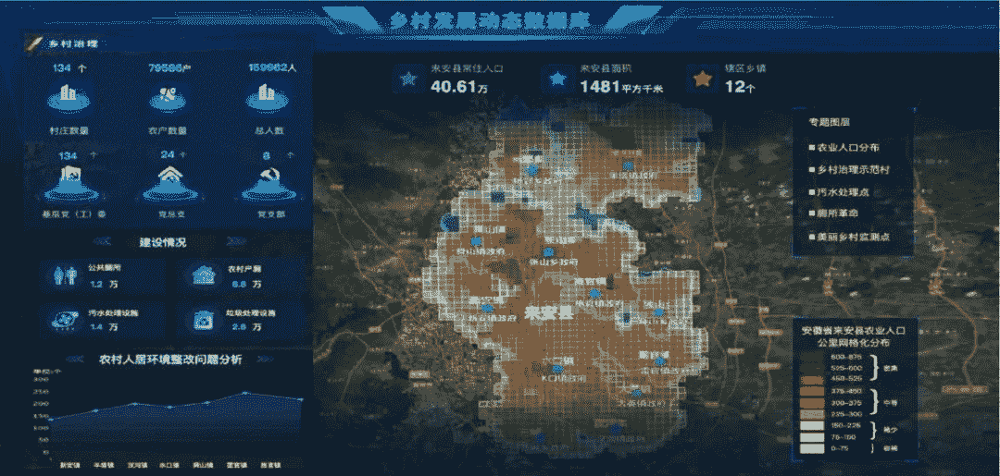

图1 乡村发展动态数据库

二是"一座一码一端一云一标"五大抓手提升农业农村部门工作能力。打造"农业农村大数据公共平台基座"，帮助地方快速建立大数据能力，实现各级大数据平台互联互通。打造"全农码"，为涉农资源、主体、产品赋予数字身份，实现农村"地、人、物、财、事"全面关联。打造"农事直通"APP，为农业农村大数据提供统一服务窗口。打造"云服务平台"，提升云端计算和服务能力，实现平台功能的协作协同和数据的关联互通。成立农业农村部数据标准化技术委员会，构建统一的农业农村数据标准体系，为涉农数据共享交换提供遵循。

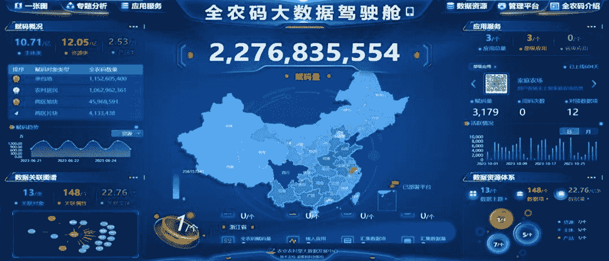

图2 全农码大数据驾驶舱

三是拓展数据应用场景。辅助政府部门科学决策，开发耕地用途管控、种子监管、宅基地管理、头雁培育、新型农业经营主体、农村土地承包合同网签、土地承包经营权流转台账、农业综合行政执法等新应用。其中，头雁培育系统为 4 万头雁学员提供培训跟踪服务，有效支撑乡村产业振兴带头人培训工作。土地承包经营权流转台账信息平台已备案流转合同超过 400 万份，可对流转价格、主体、用途、年限进行动态监测。解决农业生产和农民生活需求，与科技企业、金融机构合作，支撑金融机构快速放贷，助力精准承保理赔，为超 1600 万农户提供保险核验或信贷评估服务。

截至目前，农业农村部大数据发展中心初步形成大数据"资源池"，汇聚了全国约 11.07 亿块农村承包地、96 万个农村集体经济组织、9 亿成员、400 万家庭农场等数据，"全农码"累计赋码 22.76 亿个。推动通用数据产品陆续在省市县落地，其中，"农事直通"APP 服务主体达 106 万。

### 案例二

## 伏羲农场：构建智慧农业数据底座

多方积累和灵活运用农业数据，是发展智慧农业的基础和前提。目前，我国农业正处于农业机械化与智能化并行阶段，农业数据存在质量良莠不齐、融合应用不足等问题。为解决此类问题，中国科学院计算技术研究所通过搭建"智慧农业数据底座"，打通农场生产数据流，充分保障农业数据质量和安全，在施肥、施药、灌溉等耕作环节实现农业生产降本增效，带动粮食增产，农户和村集体增收。

一是推动多来源、多类型数据采集。建立"团连排班"四级网格管理体系（如图所示），通过卫星遥感、无人机遥感、地面传感器、人工采样、测土机器人等方式，采集作物分布、作物长势、土壤氮磷钾、土壤有机质、土壤墒情、农田病虫害、作物表型等多维关键要素数据，形成从土地环境数据到农业生产经营全链路的实时数据底座。

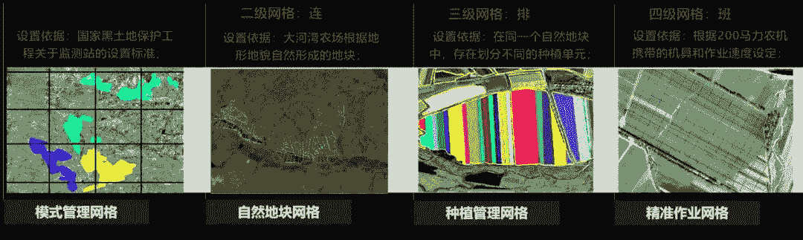

图"团连排班"四级网格管理体系

二是提升数据质量，保障数据安全。构建"农业大数据共性平台"，通过设计农业全要素数据采集标准，明确不同来源、不同类型数据结构和语义表示方法，有效解决农业生产数据格式不统一、数据来源不一致等问题，打造高质量数据资源。同时，实行网络安全等级保护制度，严守数据安全底线。

三是数据分析助力农业高效生产。在规模化施肥、施药环节，采集和分析土壤氮磷钾、农田病虫害、作物表型等数据，总结土壤肥力分布情况，绘制施肥打药处方图，为不同地块提供定制化保护性耕作措施，有效减少 20%以上化肥和农药使用，降低耕作成本。在精细化灌溉环节，实时采集土壤墒情、肥力等数据，结合作物需水模型，判断作物各生长时期的需水量；采集管道压力、流量、阀门温度等数据，实现远程阀门控制和流量监测，制定差异化灌溉策略，变革传统粗放型的灌溉方式，缓解大水漫灌引起的水土流失、土地盐碱化以及水资源浪费等问题。

自 2019 年以来，中国科学院计算技术研究所累计服务了呼伦贝尔农垦 600 万亩耕地，安徽芜湖繁昌 22.85 万亩耕地，成功经验已拓展至河北雄安、内蒙古兴安盟、湖北十堰、河南周口、山东农高区等地共计 1000 多万亩耕地，在呼伦贝尔农垦大河湾 1300 亩核心示范区，实现平均节本增效 104

元/亩，在安徽芜湖核心示范区，实现平均节本增效 300-500 元/亩。

### 案例三

## 畜牧产业大脑助推畜牧业高质量发展

畜牧业一头连着居民"菜篮子"，一头连着农民"钱袋子"，事关国计民生。我国畜牧业产业链条长、生产周期长，存在产能调控难度大、动物疫病防控和畜禽产品质量安全监管难、供需信息不对称等问题。浙江省畜牧农机发展中心构建了集行业分析、监测预警、数据服务于一体的"浙江畜牧产业大脑"平台，为省畜牧管理部门及生产经营主体提供生产、经营、管理等数据支撑。

一是建成一体化畜牧大脑数据仓。通过与市场监管、银保监、生态环境等 8 部门数据共享、业务对接，建设畜牧大脑数据仓。目前已汇集数据 2.2 亿条，覆盖 12 类畜牧兽医业务主体，日访问量 20 万次以上。以生猪模块为例，在养殖环节实时汇聚省、市、县生猪存栏量、调入量、出栏量及价格动态等数据，指导生猪科学生产；在检疫、屠宰、调运环节汇聚产地检疫、屠宰检疫、肉品品质检验等数据，实现从养殖到市场全流程追溯。

二是构建智能高效风险预警体系。依托数据仓，开发稳产保供智能模块，通过产能测算模型，智能感知和分析生猪产量、猪肉价格、头均盈亏等数据，提前 6 个月预测研判生猪产能、猪肉供应的波动风险，辅助畜牧管理部门提前部署稳产稳价调控措施。开发疫病风险管理模块，密切监测屠宰、检疫、调运等环节的动态数据，设置非洲猪瘟、口蹄疫检测等 19 个风险点，制定 36 条触发规则，实时研判分析风险情况，并精准推送至养殖、调运等畜牧主体及管理部门，实现重大风险早发现早处置。

三是推动数据要素增值赋能。在畜产品信息追溯方面，与市场监管部门协同，实现养殖场信息向产地检疫人员全推送，省内检疫、备案等信息向屠宰企业、驻场官方兽医全推送，屠宰企业检疫申报、检测、宰前检查等全程信息向驻场官方兽医全推送；同时与卫健部门协同，深化数据共享、风险评估、联合处置等工作，做好公共卫生安全追溯，守好人病兽防关口。在解决农户需求方面，为农户精准推送保险信贷、价格行情等服务，推动农户生产管理、检疫申报、受理、出证、扫码等业务办理"零跑腿"，实现贷款一键申请，保险一键参保、一键赔付，2023 年，已辅助 249 个养殖场抵押授信 7.21 亿元。

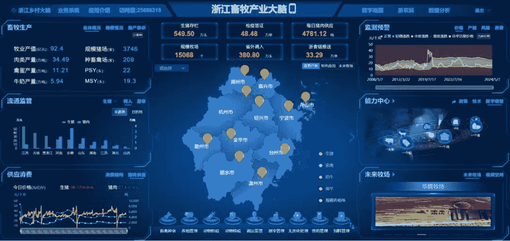

图 浙江畜牧产业大脑首页

2023 年，平台发布产能预警共计 790 次，处置安全风险 2.16 万次，帮助养殖户降低经济损失 6500 多万元。基于数据分析大幅提升检疫效率，单个屠宰企业日均检疫、检验出证时间分别缩短 98 分钟（降幅 68.5%）和 104 分钟（降幅 70.1%）。

## 二、商贸流通领域

### 案例四

## 产业链数据要素应用

### 赋能产业协同效率提升

煤炭是我国的基础能源，在保障国家能源安全中发挥着"压舱石"的重要作用。当前，煤炭产业生产、物流、金融等环节数据分散、孤立，导致产运信息不对称、服务不到位等情况频现。国能互通内蒙古网络科技有限公司通过整合煤

炭产业从生产、运输到消费端的各环节数据，开发了能源产业智慧服务平台，为煤炭能源企业提供精准对接、风险评估等数据服务，助力煤炭产业供应链高效精准对接，显著提升煤炭等能源产业协同效率。

一是整合产业数据资源。基于企业授权，获取企业的行为数据；通过合作协议，获取矿场、贸易商、电厂、钢厂、加工、金融机构等企业的生产、交易、物流、仓储、支付结算、票证等数据；通过与公路、铁路、港口等部门进行深入合作，基于合作协议获取"公铁水"运输数据。然后对数据进行标准化清洗、多维验证等处理，形成煤炭产业数据资源，每日新增各类数据近 100 万条。

二是丰富数据应用场景。通过分析企业生产经营、交易订单、物流等数据，形成企业经营画像，为金融机构提供金融服务额度测算、风险控制实时预警等服务，帮助中小企业拓展高效、低成本的供应链融资渠道。通过打通生产、流通到消费等各环节数据，构建智能的辅助决策体系，为产业链上下游企业提供优质客户筛选与管理、客户经营画像分析等服务，帮助企业实现精准运营管理。

三是多手段保障数据安全。联合编制数据存证、脱敏、加密、存储、使用等多项标准规范。建立合规审查、分级分类、交叉验证等管理机制，在支付、交易、物流、身份认证等环节应用区块链技术，确保全部数据的安全性和不可篡改

性。严格遵循用户授权及数据最小范围流出原则，流通数据以系统生成或加工处理后的数据为主，禁止原始数据流出。

图1 数字化生态平台作为产业链连接器

目前该平台已为5000多家煤炭行业用户提供了数据服务，累计服务煤炭交易量8.8亿吨，交易金额2600亿元，有效支撑煤炭行业提质增效。平台与新华社等单位发布5项能源价格指数，为市场提供定价参考，为政府宏观调控和行业监测提供支撑。

图2 全场景全流程数字化供应链服务

### 案例五

## 多源餐饮数据实时精准服务 赋能餐饮行业数字化增效

餐饮行业是促消费、惠民生、稳就业的重点领域，与人民的生命健康和生活水平紧密相关。当前，连锁餐饮行业面临经营数据收集难、数据化运营能力较弱等问题。企迈科技有限公司通过整合线上线下企业业务数据和线上用户行为数据，基于实时数据分析，为餐饮企业提供智能补货、门店经营分析等数据服务，赋能企业精细化运营，推动企业数字化转型。

一是多渠道采集汇聚数据。一方面，在消费者、品牌及平台协议授权的前提下，通过小程序、POS收银平台、第三方平台等渠道，采集涵盖订单、卡券、资产、营销以及其他日志等方面的相关业务数据；另一方面，基于企业合作协议，汇集餐饮商家经营管理中的营销活动、上架新品等对应的经营类数据。然后按照统一标准对数据进行整合治理，形成日增量约30TB、累计总量超过2PB的餐饮行业数据资源池。

二是开发覆盖经营全渠道的数据服务。基于用户行为数据，建立实时、全方位的用户标签体系，支撑企业为客户提供个性化的会员服务。基于商品销售、原材料库存等数据，构建门店智能补货与预警系统，为企业提供新品挖掘、销售预测、货品生命周期管理等货物服务。基于门店客流、财务、业绩等数据，打造门店全生命周期管理模型，为企业提供门店盈利评估、智能选址、业绩分析等门店服务。企业使用相关服务后，运营成本平均降低31.32%，用户拓展平均增长240.57%，订单增长提升121.89%，客单价提升14.50%。

三是强化数据全流程安全治理。数据资源从采集到汇聚、流通的整体过程中，敏感数据均采用源头脱敏和加密存储，对存储系统实行网络隔离。通过与专业安全机构合作，利用专用的数据处理平台进行整体的数据安全管控，涵盖脱敏、权限管控、审计、审批、水印等。建立分类分级、权限管控、安全培训与审计的企业数据安全制度，制定数据安全管理办法，设立系统安全、数据安全专人专岗。

图1 餐饮行业数据接入与应用

图2 经营分析驾驶舱

图3 全渠道数据融合分析

图4 数据治理流程

### 案例六

## 海量消费数据赋能传统零售业转型升级

零售行业是国民经济的重要组成部分，与居民生活紧密相关。当前，传统零售企业面临产业链上下游不匹配、消费者需求响应不足、运营管理效率较低等问题。山西全球蛙电子商务有限公司有效整合零售行业采购、供应、销售、服务等全链路数据，推出了智能补货、供应链优化、供应链协同等服务，提升传统零售企业服务效能，助力传统零售业转型升级。

一是推动多方数据采集汇聚清洗。全球蛙公司基于消费者授权，获取消费者线上购物的浏览、搜索、购买、评价等行为数据；通过与平台合作商户签订数据授权使用协议，获取上游供应商的库存、物流、价格等，以及下游零售商的销售、库存动态等数据。同时，借助人工智能、大数据等技术对数据进行清洗、整合与处理，形成覆盖30个省份连锁商超的超100TB数据资源。

二是强化数据安全与隐私保护。在对数据进行脱敏处理的基础上，建立严格的合规审查机制，利用可信计算等技术，建设安全可信数据空间，促进多主体间数据的安全合规流通与共享。利用信封加密技术，从源头到终端全程加密，防范数据传输中的安全风险。采用数据脱敏、加密、访问控制等多重防护措施，保障数据安全。

三是面向用户需求开发数据产品和服务。通过分析顾客年龄分布、购物频次、偏好品牌、热门时段、历史销售等数据，构建消费偏好图谱，为超市商户开发市场洞察、供应链优化、智能补货等数据产品和服务，提升超市运营效率和决策精准度，助力超市客户转化率提高15个百分点，客单价提高10%，直接带动整体销售额增长约15%，库存周转效率提升30%，节省库存成本约2000万元。通过订单数量、订单类型等数据加工和分析，帮助产业链上下游企业精准对接产品供应企业和消费客户群体，加快业务流程响应速度，实现供应链精细化管理，使订单处理时间平均缩短15%，每日处理订单量提升20%，采购到销售周期缩短20%，资金使用效率提升近33%，供应链协同效率提升40%以上，供应链响应速度平均缩短10个工作日。

图 数据产品与服务图

## 三、交通运输领域

### 案例七

## 打通江海联运数据 助力航运物流降本增效

江海联运是提升水运效率和灵活性、助推区域产业发展的重要手段。但江海联运涉及物流链主体多、环节多、链条长，若管理调度不到位，则难以发挥联运优势。舟山市港航和口岸管理局、中国电信舟山分公司通过建设江海联运数字化平台，贯通全链条物流数据，实现企业申报、港口调度、码头装卸、货物配送、物流跟踪等多业务协同，提升物流组织效率，推进江海联运高质量发展。

一是跨区域合作，实现多元数据汇聚。舟山市与张家港、江阴、南京、武汉、重庆等25个长江物流节点城市共建江海联运数据联盟，推动流域数据共享共治。通过公共数据平台共享海关、海事、边检、港航等政府部门数据，同时，平台构建港口全景、口岸通关、物流跟踪、船货撮合等120余项航运服务，以提供服务方式归集产业链上下游的企业数据。通过向专业第三方数据商购买的方式，获取船舶自动识别系统数据、气象数据、海图数据。目前，数据汇聚量已超16亿条，梳理形成了包括港口、船舶、通关、物流、气象等10大类主题的数据库。

二是推动数据共享互认，实现多业务协同。平台与江海联运数据联盟内的25个港口物流信息平台进行系统对接，以API接口形式进行数据流通，通过数据传输加密、网络可用性管理保证跨区数据交换安全。构建江海联运数据交互共享机制，联合15家单位出台《大宗散货江海联运信息互联交换标准》，规范数据交换项、数据交换方式、数据交换频率、数据传输安全等内容，年数据交换量达1200万条。同时，平台打通国际贸易单一窗口、边检船情系统等13个系统用户体系，整合边检船情、引航调度等申报项，缩减800多个重复数据项，形成"船舶进出境一张表"。企业通过平台分别向海关、海事、边检、港航部门同步分发所需审批数据，各部门并联审批，审批结果在平台一链反馈，从而推进港航、海关、海事、边检等跨部门共建共用业务模块，代理、供给、运输等经营主体跨业务合作。

三是数算融合，不断拓展赋能场景。融合海图、船舶自动识别系统、气象、作业、通关、船舶作业视频等多源数据，自动识别船舶运输状态，按照起运港、目的港、船舶名称、船舶类型、载重吨、当前运输计划、位置远近进行智能检索，开发了联运快申报、直达快配送、物流快组织、市场快服务等一批实用场景。通过研发航线找船算法，实时分析"船、港、货"和航线数据，将供应链企业、货主各方的运输需求、配送计划与船舶吨位、船舶类型、船舶运力等信息进行智能匹配，结合各港口作业计划智能筛选和推荐可供选择的船舶资源。打造航运服务超市，整合船货撮合、船舶交易、船舶维修、船舶供应、船员服务、船货代理等服务，实现航运服务的一站式精准查找。

通过数据的高效利用，江海直达配送每航次物流周期缩短4天以上、中转损耗减少7万元，大幅提高长江黄金水道运输效能。企业办理进出港手续时间从原来的16小时压缩至2小时，船舶平均在港时间减少1天以上，每年可为企业节省船舶租金等费用超13亿元。

图1 联运快申报

图2 大宗商品直达快配送

图3 物流快组织

### 案例八

## 公路货运智慧物流数据应用 降低物流运输成本

公路运输占据我国货运体系中的首要位置，承担着约70%的客货运输量，是国民经济发展的重要保障。然而，由于公路货运涉及主体众多，行业分散性强等特点，导致运输体系存在信息不对称、供需难匹配等问题。江苏满运软件科技有限公司通过汇集订单信息、地理位置、货物状态、运输轨迹等公路货运行业各环节动态数据，实现数据共享与互通，为产业链上下游参与主体提供有效服务，助力提升公路货运车货匹配效率，降低物流综合运输成本。

一是多渠道数据汇聚形成数据仓库。通过多方安全计算、产业链上下游企业数据API调用等交互共享机制，获取并整合车辆道路运输证号、从业资格证号等外部数据；通过数据挖掘、数据脱敏等技术挖掘公司内部数据，包含"长途整车""同城短途""大票零担"等类型。搭建全国公路干线物流最大的数据云仓，覆盖全国公路干线物流行业货源、车辆、交易、价格、轨迹、路线等各类数据。累计形成全国330多个城市、10万多条线路的数据资源，数据规模超过24PB，为公路货运智慧物流服务提供坚实基础。

图1 企业数据仓库

二是搭建智慧物流平台，助推公路货运数据协同融合。采用大数据实时决策智能算法、车辆实时定位、供需智能预测与车辆调度等技术，通过离线计算、实时计算等功能，搭建道路运输服务大数据、轨迹定位、供需预测等系统平台，提升数据使用与开发效率，实现司机与货主分钟级车货匹配。2023年，平台撮合交易额约3000亿元，成交订单约1.6亿个，大幅缩短货运匹配时间，降低综合运输成本10%至15%，提升单车运行效率30%以上，每年减少碳排放量约1200万吨，平均为每位司机降低燃油费用支出1万至2万元，促进物流降本增效和节能减排。

图2 道路运输服务大数据平台

图3 订单轨迹系统平台

图4 供需预测系统平台

三是建设Saas型运输管理系统，推动中小物流企业规范化运营。利用自身数据资源优势全面赋能物流企业，为其提供领先的物流信息化管理等专业解决方案，融合互联网技术、车辆定位技术，服务于物流企业中的零担、整车运输场景。系统包含了订单管理、运单管理、回单管理、车辆管理、客户管理、财务管理、组织管理、智能报表等八大模块，并通过连接发货人、收货人和不同承运企业，帮助物流企业更好、更快完成管货、管车、管人、管财务的工作。

四是建立纵深防御体系，保障数据安全。积极有序推进数据分类分级，在采集阶段公告用户隐私政策，在具体场景公告采集数据的内容和用途并让用户选择授权。同时，建立覆盖管理、技术层面的纵深防御安全体系，健全安全开发生命周期管理流程，设计安全编码规范、安全开发红线检测、黑盒测试等安全措施，确保对网络安全事件的及时发现和处置。

### 案例九

## 公交数智化运营助力提升市民生活品质

公共交通作为城市交通的骨干，为市民提供高效、环保的出行方式，缓解交通拥堵，降低环境污染，促进城市可持续发展。公交行业在传统系统架构下，存在营运资源利用不充分、难以形成科学高效的线网规划与调优能力等问题。重庆市公共交通控股有限公司通过架构重塑、数据治理和场景构建等措施，实现数据资源共享、多跨场景协同管理、人车资源统筹优化，满足市民高品质、多元化出行需求，促进了重庆公交的高质、高速、高效发展。

一是新型数字化架构推进数据资源汇聚、治理。打造终端互联感知体系，实现包括司机信息、车辆信息、客流量信息、乘客满意度与投诉信息、线路高低峰客流量信息、停车场信息等"人、车、站、线、场"全要素的感知互联。同时，整合内部运营数据和高德出行、气象地灾预警等外部数据，实现日均接入数据4300万条，日均调用数据110余万条，累计接入数据125.43亿条。持续开展数据治理，建立主数据规范，明确主数据属性名称、分类定义、数据类型、管理流程等，从数据全生命周期的角度管控数据、治理数据。同时，根据业务需求，建立运营、安全、机务、服务等统计指标体系，严谨明确各项指标的业务定义、计算方式、应用场景，确保公交集团统计指标的准确性、权威性。

图1 重庆中心城区公交运营实时信息

二是运营数字化升级实现人车供需匹配。通过升级智能调度系统，实现远程集中调度、多方式车辆监控、车辆到站时间预测、运营日报自动生成等数字化应用。打通与安全监控系统、智能维保系统、岗前监测系统等系统接口，实现跨部门、跨场景的协同管理。通过系统升级，调度班次自动生成率、人均发车班次、单人单日最高发车班次均得到大幅提升。通过重庆公交数字运营中心，完成站点客流分析、班次分析、热力图、线网覆盖率、线路效益分析、公轨接驳客流量人次等分析功能，以供需平衡为导向，主动优化调整线网及运营组织方案，实现"客流、运力、路况"资源匹配的智能排班。基于区域化运营理念，对多线路多班次进行混合调度，实现广域不均衡出行需求的动态精准匹配和区域人车资源统筹优化。

图2 公交线网优化系统

三是全面构建数字交通新场景。对外构建互联网"愉约出行"平台，通过发布车辆到站时间动态信息和推出手机移动支付系统，方便市民公交出行，满足高品质多元化出行需求，集观光巴士、机场快车、定制公交等出行方式于一体，共开通定制及观光类线路130余条，年运送乘客2000余万人次。建立需求响应公交运营服务模式，在固定服务区域内根据出行需求开行不固定线路，利用最少的车辆、线路资源，解决了区域覆盖，实现线上+线下服务，承诺乘客最短出行时间，让市民出行更加便捷高效。对内打造"重庆公交生产助手"应用，面向驾驶员和各级管理人员提供查询、自助服务、审批等移动应用相关的90余项功能。截至目前，移动端员工用户数量2.5万余人，日均访问量24万人次，日推送信息8.5万余条。

图3 响应公交移动客户端

自2020年以来，重庆公交集团优化线路约800条次。公交日均客流量于2022年超302.7万人次，于2023年超344万人次。目前，重庆公交集团拥有运营车辆8820辆，日均运行班次9.6万班次，日均运行里程140万公里，公交出行分担率为35.3%，以全国城市第十一位的车辆规模运送全国第二的客流，运营效率位居全国前列。

### 案例十

## 能源物流数智化管理 引领危化运输新模式

危险化学品运输是物流行业中一个特殊的组成部分，相对普通的物流来说，危险品的物流专业技术要求更高，更需要全面、准确、可靠的信息管理和控制。针对危险化学品运输作业安全风险高、车辆运行分散、通行限制多等行业特点，新奥能源物流有限公司通过集成人、车、路信息，构建"运途云"危货运输数智管理系统，全方位助推危货运输企业安全管理升级和运营降本增效，形成"数据驱动、科技护航"的危化品运输新模式。

一是汇集危化运输全要素数据。新奥能源物流与交通运输部公路院、清华大学、吉林大学、武汉理工大学联合研发岗前一体机、出岗一体机和在岗手环监测设备，通过签订知情协议书获得驾驶数据采集授权，实现驾驶员"速度估计、选择反应、深度知觉、注意力分配、紧急反应、驾驶风格、身体状态、风险感知"等指标的动态评估，累计收集驾驶员动态监测数据5000 余万条，通过数据模型分析将驾驶员健康数据情况在运途云数智平台看板进行展现，实现对驾押人员的前置主动安全管理。已累计接入全国近70%的LNG 运输槽车，服务3 座沿海LNG 接收站、1000 余家危化品运输企业和工业园区。

二是建设"运途云"危货运输数智管理系统。为企业提供人车实时在线监控、安全报警、成本管理、效益分析及线上通行审核等全方位服务。危货导航功能累计安全护航运输任务15000 余次，未发生安全事故。车辆出岛实现提前线上审批，线下等待时间缩短77%，车辆周转效率大幅提升。通过政企联动，将LNG 接收站外运车辆安全综检数据进行线上留痕，与高速交警线上审批端口打通。同时，平台采用了先进的数据加密技术，确保数据在流通过程中的安全性，消除了数据泄露风险。

图 "运途云"危货运输数智管理系统

### 案例十一

## "以数补链"发展新质生产力 赋能车路云一体化产业能级提升

车路云一体化是包括云计算、人工智能大模型等新一代信息技术深度赋能汽车和交通产业的战略性新兴产业，未来发展潜力巨大。智能驾驶汽车测试存在数据采集成本高、周期长、高价值场景缺乏等痛点问题，浙江德清莫干山智联未来科技有限公司、德清县数据局、阿里云计算有限公司、杭州数据交易所有限公司等单位联合构建以车路一体化场景数据库为核心的数据要素流通平台，通过融合红绿灯、交通事故、道路施工等公共数据和路侧车路协同行业数据，提供智能驾驶仿真场景库，基于先导区已建成的智能网联汽车封闭测试场和全域开放测试道路，补全"仿真测试-封闭测试-开放道路测试"的智能驾驶研发测试服务全链条，构建"以数补链、以链优数"的产业协同创新生态。

图1 车路云一体化数据要素流通路径

一是以授权运营促行业数据流通。依托省、市公共数据授权运营平台，针对数据产品开发所涉及的字段实施分类分级脱敏管理，将脱敏后的交通信号灯、道路施工、交通事故等公共数据，融合路侧设备采集和感知融合后获取的路侧交通参与者、路况感知等数据，为智能驾驶和交通等行业大模型训练提供了智能数据底座。

二是以场景驱动补数据服务链条。研发上架智能驾驶仿真场景库、路口车流量统计等系列数据产品，服务自动驾驶系统仿真测试、交通违法治理辅助决策、优化能源基础设施规划与选址等场景。截至目前，累计为20 余家车企、交通研发企业和高校提供服务。

三是以标准体系筑数据安全底线。聚焦车联网数据安全生命周期，率先出台数据脱敏和分类分级两方面地方标准规范，创新车路云一体化数据要素流通平台全流程监管技术，实现数据"采存算管用"的全过程安全保障，筑牢数据安全合规利用底线。

四是以登记交易引数据资产增值。有关数据产品通过上架杭州数据交易所等交易机构，完成合规认证和数据要素流通交易闭环。实现国家级车联网先导区行业数据产品场内交易。

图2 智能驾驶仿真库数据产品应用效果

## 四、金融服务领域

### 案例十二

## 搭建普惠金融综合服务平台 破解中小微企业融资难点问题

为完善西藏数字金融基础设施，加快涉企信用信息归集共享，有效激活信用数据价值，西藏高驰征信有限责任公司基于区内涉企信息数据，搭建了西藏自治区普惠金融综合服务平台"藏金普惠"，为西藏各级政府部门、金融机构和企业提供可靠、高效的征信服务，有效推进西藏高原经济的高质量发展。

一是汇聚多源数据。经政府部门同意，汇聚拉萨海关、税务局、科技厅、经信厅等12 个部门数据；与自来水公司、燃气热力公司建立合作关系，通过接口对接、线下对接等方式，融汇水、气、热力等民生数据；通过与企业签订授权协议，获取平台内企业相关数据。汇聚整合工商、司法、住房、银税、专利、企业等多源数据，形成了涵盖10 大领域100 多个维度的企业信用专题库，实施"一企一库"管理，结合监控、定时更新等机制，实现数据高效流转。

二是打造综合金融服务矩阵。基于业务场景需求，利用机器学习、自然语言处理、区块链等技术，构建客户画像模型、反欺诈模型、经营准入模型、客户评分模型等信用模型，依托藏金普惠平台正在与银行联合开发税务贷、政采贷、公积金贷等定制化产品，打造"全线上、全场景、全主体、全周期"的综合金融服务矩阵，以数据"可用不可见"方式为金融机构和政府部门提供定制化信用报告，实现金融政策、产品、服务"一站式"供给。

三是搭建数据资源管理服务平台。依托数据流通机制，遵照数据使用权限，平台面向政府部门、金融机构与企业，实现数据交换、服务的统一接入和开放。基于平台提供加解密、鉴权、协议转换、注册服务、身份认证、异常处理、服务路由、日志管理等服务。通过数据接口管理、元数据追溯、数据分类分级等管理方式，结合统一的对外标准化服务封装，将以往各系统、各平台之间点对点连接形成的网状拓扑结构，优化为星形拓扑结构，大幅降低数字金融服务网络复杂度，提高了各应用场景数字金融服务研发效率。

图 "一企一库"企业信用主题库架构

目前，藏金普惠平台已汇集涉企数据超1 亿条，入驻企业超1.1 万家，占比达到西藏中小企业总数的15%，入驻金融机构网点345 个，占比达到西藏金融机构网点的99%，发布金融产品超200 个，融资申请超2100 笔，授信额度超340 亿元。

## 五、科技创新领域

### 案例十三

## 科技文献数据挖掘 助力科研效率提升和大模型训练

科技文献为科学研究提供了丰富的研究资源与参考资料，是学术交流的重要媒介。科技创新需要大量科技文献数据支持，但传统文献文档内容结构松散，信息分布呈现碎片化特点，导致数据筛选整合低效，严重影响科研效率。中国科学院文献情报中心联合相关单位借助人工智能技术，深度挖掘科技文献中的数据价值，构建覆盖多领域的高质量数据集，支持科技领域大模型建设，助推科研范式变革。

一是合规归集高质量科技文献数据。在遵循知识产权法规和国际通行规范的基础上，充分发挥中国科学院文献情报中心和国家科技图书文献中心（NSTL）的学科优势，与领域内的科学家紧密协作，汇聚大量权威可靠的科技文献数据及专业领域知识。通过对科技文献全文数据中的文本、图表、公式等进行多模态解构，构建了一个覆盖多个学科的综合知识资源库，不仅包含了传统的文本信息，还涵盖了图表和公式等非文本元素，形成一个全方位的多模态知识体系。目前公益学术平台（PubScholar）已归集1.8 亿条文献元数据，逾8065 万篇完整的文献全文，为科研人员提供了丰富的研究素材和知识支持。

二是突破关键技术研发科技文献人工智能引擎（SciAIEngine）。提出了掩藏句子模型（Masked Sentence Model）与两阶段方案实现文本中的知识抽取，基于层次分类器集群实现千级类目中图法分类，通过嵌入词典和词性特征实现关键词识别，基于小样本数据利用半监督迭代学习等技术实现命名实体识别。利用这些创新技术，提升文本挖掘能力，研发科技文献人工智能引擎（SciAIEngine）。形成一系列可供扩展应用的软件、数据、解决方案和工具集，并提出了一套从科技文献中挖掘领域知识与科学数据的流程方法。

三是深度挖掘科技文献内容。利用科学人工智能引擎对优选文献进行深度挖掘，提取包括关键科学数据、实验结果等硬信息，提取理论框架、研究方法等软知识。通过深度挖掘科技文献的专业领域本体知识、科学数据、观点倾向等科技文献内容，建立细粒度科技文献内容与句子、段落、图表、全文之间的循证关系，支持文献内容溯源。将细粒度知识与科学数据进一步融合、精选、对齐、补齐，构建高质量语料库、专业化领域知识本体库、适用人工智能的科学数据集和研究观点倾向库。当前已支持上海药物所从文献中挖掘药物靶标数据，支撑新药研发；与西南交大合作挖掘二维材料属性数据，赋能材料研发；与东北地理所合作挖掘木质纤维素生物降解知识，助力黑土地生物质高效利用。

四是建设科技文献大模型。基于专业化领域知识本体库、适用人工智能的科学数据集、研究观点倾向库构建支撑智能科研（AI4S）的科技文献知识底座，支持AI4S 模型的训练，为AI4S 智能模型假设的提出、预测的验证和推理的监督提供知识基础。与头部人工智能企业合作，集成知识图谱、语义搜索等功能，打造支持智能化科研的解决方案。同时开发医学、化学领域的垂直大模型，为科技创新提供知识数据支持。其中，科技文献大模型提高论文调研效率10 倍以上，论文研读有效率超90%。

图1 AI4S 知识底座

### 案例十四

## 工程科技数据融合 加速工程技术创新

高质量数据是开展工程科技战略咨询不可或缺的基石。然而，工程科技领域的数据往往零散无序，数据源壁垒高筑，信息孤岛林立，数据难以互联互通。为此，中国工程院战略咨询中心联合浪潮软件科技有限公司汇聚和整合工程科技领域数据资源，实现跨领域数据融合和资源共享，促进知识倍增效应，为科技战略咨询、工程科技创新和国际交流合作提供信息支撑和知识服务。

图1 知识中心基础底座

一是持续推进数据资源汇聚整合。持续推动工程科技领域"元数据海"及特色资源建设，汇聚工程科技能源、交通、航天、化工、信息技术、海洋、地质、气象等30 多个专业领域数据资源，工程科技领域一级学科覆盖率达100%，二级学科覆盖率达90%，数据总量超过72 亿条，资源体量100TB。基于工程科技领域多源异构数据融合的大数据存储和处理技术搭建了资源汇聚加工的技术环境和数据采集、治理加工工具，支撑了知识服务搜索引擎、智库研究、技术洞察与趋势分析等应用场景，形成了一套科学的资源管理体系，推进生态、气象、环境、水利等跨领域基于地理和机构等维度的知识融合。

二是建设高价值特色数据资源。在数据治理的基础上建立了统一知识图谱构建、人工智能开发服务、技术洞察及趋势分析、词表集成等能力，为数据挖掘分析、知识关联发现提供技术和能力保障。构建工程科技专家库、机构数据库、战略咨询资源库、学术会议资源库等8 个主题库，基于知识组织与知识计算等前沿技术对咨询报告等资源深度加工，形成特色数据资源。

三是实施全面的数据安全控制措施。依托知识中心的数据安全管理规范，对数据资源处理流程实行端到端的监控；依据数据资源的分类分级管理制度，实行差异化管理策略，对数据进行分类存储，并对敏感信息采取加密和脱敏处理。此外，构建了数据缓冲区，利用大数据批量标注技术、内容安全审核API 同时结合人工复审的多层防护机制，建立健全数据安全保障技术体系。

四是整合多元生态打造精品化知识服务。聚焦国家战略和特定用户场景，利用已汇聚的海量数据资源，结合人工智能、大数据挖掘等技术，开发系列精品知识服务产品，建成了多学科融合的工程科技大数据服务平台。此平台包含服务于高端智库、科研人员和社会公众的多样化工具和专题，如智库支持系统、全球项目库、知领战"疫"系列等。这些知识产品广泛应用于图书馆联盟、高校及机构中，惠及科技界，形成了全面而深入的服务生态。

目前已汇聚工程科技30 多个专业领域的数据资源，覆盖工程科技领域全部一级学科，满足高端智库咨询研究工作所需。累计为100 多个国家重大项目与工程、数十家企业、科研机构与地方政府提供了数据支持、决策支撑服务，为全国2000 余家高校、130 余家科研单位、60 余个地方图书馆的科技工作者提供数据和知识服务。联盟式知识中心建设为推动我国工程科技领域大数据共建共享、行业和地方大数据系统建设提供了有益经验。

图2 知识中心门户

### 案例十五

## 数据赋能稀贵金属产业发展

云南是我国稀贵金属资源的重要富集地，但因受到技术瓶颈制约，相关矿产开发产业发展相对滞后。云南省科学技术院以科研数据深度利用作为破局的关键手段，启动实施稀贵金属材料基因工程，体系化推动相关计算、实验数据的采集与整合，建成内容完整的稀贵金属材料专业基础数据库和系列典型材料专用数据库，发展多方协同的一体化材料数据研发应用平台，精准指导技术研发，优化生产流程，有效支撑稀贵金属产业技术创新。

图1 数据赋能稀贵金属材料产业发展流程架构

一是探索科研新范式。携手贵金属集团、云锡、云锗等行业领军企业，联合清华大学、上海大学、美国宾夕法尼亚州立大学、日本国立物质材料研究所等30 余家终端用户及国际一流科研机构，集结跨越材料科学、物理学、化学等领域的400 多位跨学科研发与管理精英针对关键难题展开集中攻坚，构筑了从"创新平台搭建—精英团队聚合—项目统一调度—基础理论探索—核心技术攻破—工程实践应用"的全链路创新体系。项目团队依托拥有1.54 万计算核心的高性能计算平台，运用机器学习等人工智能技术，对海量稀贵金属材料数据进行深度建模分析，极大地加速了新材料的研发进程。与传统的试错法相比，这种创新技术路径将新材料的研发周期从5 年大幅缩减至2 年，研发成本降低80%以上，显著提升了稀贵金属材料研发的效率与经济性。

图2 科研新范式指导稀贵金属产品研发

二是以科学数据支撑技术创新。建成金、银、铂、钯等11 类稀贵金属新材料的基础参数数据库和汇聚计算、实验、生产加工、服役评价数据的系统性稀贵金属材料专用数据库，总数据量达到7900 万条。搭建稀贵金属材料基因工程总控平台，对计算/表征平台、数据管理平台、数据应用平台进行集成管理、资源的协同共享、数据的可视化分析。配套研发多种包含分布式存储、挖掘分析、交互协同等重要功能的材料基因工程大数据技术。

图3 科学数据支撑贵金属技术创新

三是加强科学数据安全合规管理。建立网络安全保障体系，完善科学数据管控、属性管理、身份识别、行为追溯、黑名单等管理措施，定期维护数据库系统安全，健全安全防护体系。开发内外网数据同步、多用户高效入库的单向控制传输技术，解决外部数据流转的安全、效率及存储保密问题。基于《材料基因工程数据通则》，建立了8 种材料的元数据标准和数据模板，实现稀贵金属材料全数据链条管理。自主研发了贵金属材料数据格式和搜索技术，支持大批量数据搜索。独创了secret/key 数据库数据分享，每个用户可创建专属密钥，并配置可获取的数据范围。

四是推动科学数据有序开放共享。以"稀贵金属材料基因工程数据一体化开发服务平台"为数字基座，联合新材料研发机构组建数据开发利用联盟，建立集约统筹的数据融通共享与权益互惠机制。强化统筹授权使用和管理，推进互联互通，打破"数据孤岛"，探索制定数据共享规范，建立基于区块链技术的数据共享平台，形成具有云南特色的稀贵金属数据共享共用的制度体系。

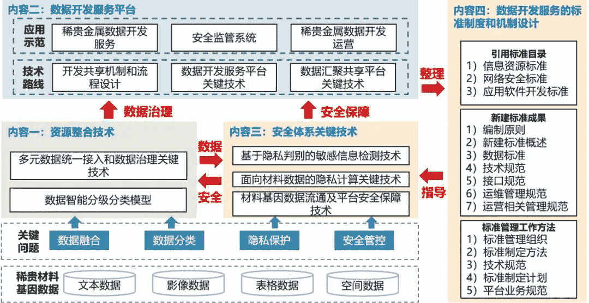

图4 稀贵金属材料数据一体化开发服务平台整体框架

2018年以来，稀贵金属材料基因工程已服务云南贵金属集团、云南锡业、中铜集团、云南钛业、云南锗业、中宣液态等龙头企业，支撑新建和升级15条示范线，加速了新材料产业从特色产业向支柱产业转变。开发半导体化合物用高纯铟（7N）、6英寸空间太阳能电池用锗单晶、热控与能源用液态金属导热膏和导热片、高性能环保锡基阻燃剂、海洋和舰船、石油工程用高耐蚀钛合金等国际国内领先的产品。带动企业研发投入5.6亿元，产生13.88亿元新增产值，新增利润2580万元，新增税金993万元。

## 六、文化旅游

### 案例十六

汇聚优质文物数据资源加速文化传播和文创产业发展

历史文化遗产是中华优秀传统文化的重要组成部分，蕴含着中国智慧与中国精神。当前，文化遗产行业存在数据资源供给不足，大量优质的文化遗产数据资源难以有效利用等问题。故宫博物院推出了文物数据资源平台"数字文物库"，推动更多优质的数字文化资源开放共享，拓展文物数据资源跨行业应用场景，为出版、教育、展览等行业赋能，加速文化传播和创意产业发展。

一是采集汇聚文物数据资源。利用超高清二维数字影像、三维数字重建、虚实融合视音频采集等，对文物进行数字化采集，形成文物高清影像等数据资源。通过机器自动标注与人工校对结合的方式，从物理属性、历史背景、艺术特征等方面对文物数字资源进行多维度、多层次标注，将原本分散、单一维度的数据资源链接成高度关联、多维度的知识网络，不仅优化了数据供给的质量和可用性，也将文物数字资源转化为可深度应用的标准化数据资源。构建文物数据资源平台"数字文物库"，汇集所有文物基础信息、数字影像等数据资源，对外可提供186万余件院藏珍贵级文物基本信息服务，公布了超10万件珍贵级文物高清数字影像。

二是强化文物数据安全治理。建立数据质量管理体系，对文物数据在生命周期内全方位进行管理。在资源管理系统统一存储，防止数据从采集汇聚过程中流失。制定数据传输规范，将原始文物数据资源存储在内网，并与外网隔离，经过数据加工后，通过单向推送方式输送到外网云存储空间，形成数据资源库。

三是拓展文物数据应用场景。通过授权使用的方式，支持用户利用故宫文物数据进行融合创新，打造图书出版、文创产品研发、数字展览等应用场景，进一步释放文物价值。每年完成《故宫日历》《故宫万象》等近百种特色图书出版发行，围绕"故宫中国节""宫囍龙凤呈祥""金榜题名"等主题研发文具、玩具、首饰、礼品等多品类文创新品超过1300多种，打造"悦读故宫"展、"画游千里江山——故宫沉浸艺术展"等对外文化创意展览、数字展览近10项，观众参与度达到百万级，形成超过亿元产值的文化创意产业规模。

图 文物数字资源平台"数字文物库"

### 案例十七

数据资源共享
助力文物保护、艺术传承、文化推广

敦煌石窟文化遗产是世界独一无二的文化宝藏，对历史、宗教、地理、民族、美术等都有重要研究价值。为推动敦煌石窟文化资源高效共享和广泛利用，敦煌研究院系统梳理各类文物数据资源，打造了数据资源共享平台"数字敦煌·开放素材库"，利用区块链、数字水印等版权保护技术，创新文物数据资源开放、共享、共创模式，助力提升敦煌石窟保护、艺术传承及文化推广。

一是整合制作文物数据资源素材。敦煌研究院应用多图像三维重建技术，对大遗址、洞窟结构、彩塑以及壁画进行数字化采集，形成7处大遗址、250个洞窟结构和60余身彩塑的三维重建数字档案，以及180多个洞窟壁画数字化成果。依托"数字敦煌"平台及敦煌石窟文物数据管理平台，应用大数据、人工智能、知识关联、质量增强等技术，整合热点文物数据资源，对"数字敦煌"成果进一步加工处理，分类梳理制作形成壁画专题、元素、线描稿、艺术摄影、藏经洞文献、创意内容等6500余份高清数据素材，汇聚至"数字敦煌·开放素材库"平台。

二是健全文物数据安全保障机制。通过建立数据安全体系，对数据生产流程追踪、数据传输校验、数据存储监控、文件备份及容灾系统建设等，保障文物数据全生命周期安全。在文物数据应用流通过程中，利用区块链、数字水印等技术，完成数据资源的版权保护和安全审核；通过与用户签订电子合同的方式，授权用户安全合规使用平台数据资源；通过引进专业律师团队，解决数据资源确权、授权和二次创作维权问题。

三是创新文物数据资源共享共创模式。将开放素材分为公益用途、商业用途两种类别，鼓励用户利用素材进行二次创作，收益按照合同约定比例通过平台分账系统自动分账，拓宽了艺术创作领域，增强了艺术创作积极性，促进了文物数据资源的融合创新与聚合增值。

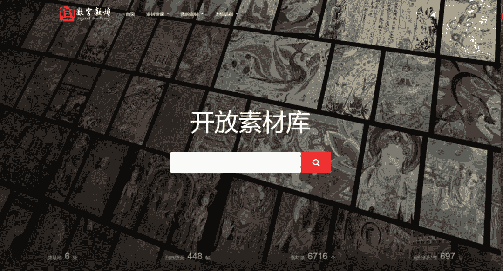

图 数字敦煌·开放素材库

"数字敦煌·开放素材库"自2022年12月上线以来，访问量超过420万人次，提高了敦煌文物和艺术作品的传播影响力，订单超过16000单，素材下载量超过22000次，拓展了文物数据流通使用范围，增强了文物数字化保护的可持续发展能力。

### 案例十八

文旅数据共享
提升旅游目的地影响力

文旅产业数字化是产业转型升级的重要路径，有利于优化服务和提升旅行体验。甘肃省文化和旅游厅整合公安、交通、民航等多源数据，建设了甘肃文旅大数据交换共享平台，为用户提供客流分析、景区监测、智能导游等服务，推动旅游数据要素流通与价值释放，为文旅产业转型升级提供了数据支撑和决策依据，促进文旅产业提质增效、高质量发展。

一是整合汇聚多源异构数据资源。横向上，通过交换共享的方式整合相关部门客流脱敏数据、高速公路车辆脱敏数据；通过项目建设方式获取景区视频监控数据、景区分时预约数据和铁路客运数据等；通过网络数据采集的形式获得游客分享、网络讨论等数据。纵向上，通过政务数据共享交换联通各市州区县文旅相关数据。目前，平台实现全省文旅数据跨部门、跨层级融合共享，日均处理数据7亿条，存储数据40GB。

二是加强数据安全与隐私保护。平台系统部署在甘肃省政务云平台上，已完成应用上云，通过信息安全等级保护测评三级认证。平台系统安全防护使用云服务商提供的安全资源池，包括防火墙、入侵防御系统、堡垒机、外网日志审计等，并定期派专人进行安全漏洞风险排查、日志审计风险排查和安全功能监测。同时甘肃省文旅厅成立网络安全领导小组，制定信息系统管理制度，建立由总体方针、安全策略、管理制度、操作规程等构成的网络安全管理制度体系，保障数据流通过程中的安全性和隐私性。

三是拓展数据应用场景。基于共享监测数据，构建客流分析预测、景区运营分析、客源地分析等模型，支撑智慧服务、运营管理、辅助决策等应用。例如，在"天水麻辣烫"火爆期间，通过整合分析在线旅游平台、短视频平台等数据，精准设置话题，结合各种特色线下活动，助力"天水麻辣烫"持续火热。平台支撑的面向游客端的"一部手机游甘肃"平台服务游客达3600万人次、分时预约平台服务游客达1360万人次，持续助力甘肃旅游接待人次和旅游消费整体提升。

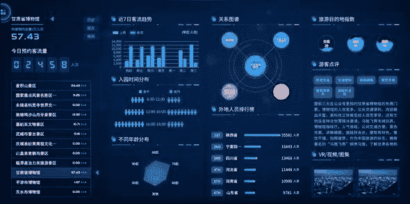

图 甘肃文旅大数据综合应用平台

### 案例十九

多源数据省域共享
助推文旅服务提升

利用数字技术创新赋能文旅产业发展，是国家文化数字化战略的重要内容。当前，文旅行业存在基础数据不贯通、公共服务数据难查询、行业数据"横向不可比、纵向不可加"等问题，不利于文物保护和行业监管。江苏省数字文化和智慧旅游发展中心推进省域文旅数据共享应用，推出客流测算、消费分析、景区监测、风险预警等服务，推动数据赋能文物保护利用和旅游服务提升。

一是推动多源数据汇聚。建立健全文旅数据统一目录和标准，通过自动化采集的方式归集闸机数据；通过统一购买的方式归集银联消费、美团本地服务、线上旅行社订单等数据；通过授权或交换共享方式接入景区、乡村旅游点、文化场馆、演出场所等监测数据，形成2.96亿条文旅行业数据资源。

二是促进数据多级共享。打造省市县企四级数据共享体系，通过数据接口、自动化报告、小程序等多种方式，与8家省级单位、13家设区市文旅局、95家区县文旅局、40家涉旅企业进行数据共享，累计交换数据0.8亿条。

三是开发数据产品和服务。联合南京大学、文旅部质监所、美团等多家单位研发算法模型，通过融合多方数据计算，推出客流测算、消费分析、景区监测、风险预警等服务，提升旅游服务和行业监管水平。例如，客流监测覆盖全省838家景区场馆，实时发布259家高等级景区的舒适度指数，引导游客合理出行。

四是强化数据安全防护。基于数据的所属行业、所属系统、数据体量、数据仓库所在层级、数据更新周期、数据访问级别等信息，对数据进行分项自动打分、多元综合得分、人工最终评分，形成了文化、文物、旅游三类四级数据体系，其中，景区目录、星级酒店目录等一级数据公开共享，景区实时客流、文化场馆参观信息等二级数据实行授权管理，文旅资源普查、银联消费等三级数据实行授权管理，导游信息、非遗传承人信息等四级数据实行授权管理并加密存储。通过多因素认证、加密存储和细粒度的资产授权管理，对二级及以上数据实行数据分级访问控制，有效防范数据泄露风险。

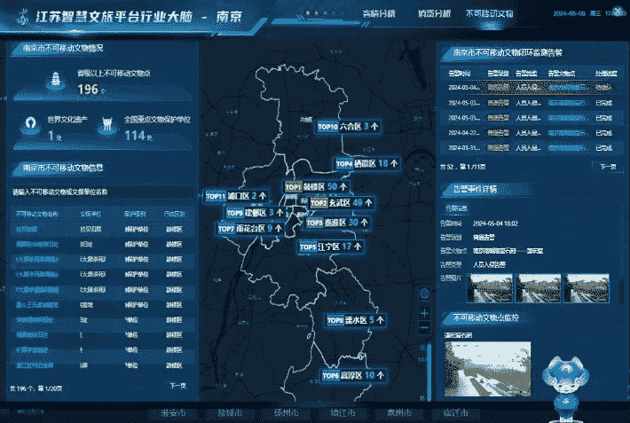

图1 智慧文旅平台行业大脑

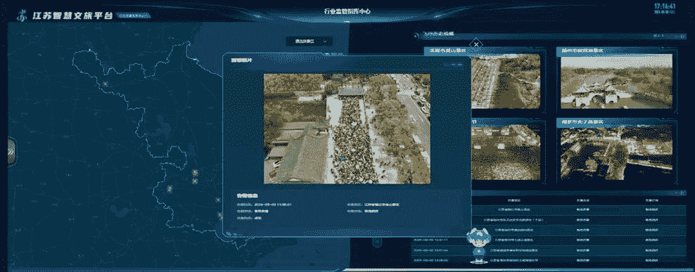

图2 数据应用赋能景区监测

通过批量采购数据，平均每个监测点位的采购价格约为原来单采价格的1/5，降低了数据采购成本。通过数据多级交换共享，平均为各市节省约100万元。为广大公众和30所学校、村（社区）线上、线下提供约8.6万次"云游"服务，进一步拓展了文化体验新空间。提升文物保护利用水平，2024年已进行文物安全预警43次，形成文物安全执法闭环。形成红黄蓝分级评价体系，为全省53家重点景区假期治安、1.64万家文旅场所安全巡查提供数据支撑。

## 七、医疗健康领域

### 案例二十

人工智能助力医疗健康数据融合应用
全面提升基层医疗服务能力

基层医疗服务是医疗体系的基础，直接关系到广大民众的健康和生活质量。基层医生专科诊疗能力和中医药服务能力不足，造成基层医疗服务难以满足需求。诸暨市卫生健康局联合讯飞医疗科技股份有限公司基于医疗机构门诊数据、体检数据、个人就医数据等，结合人工智能、大数据等技术，为基层医生提供科学问诊、精准诊断、合理用药、智能随访等智能辅助决策服务，着力提升诊疗规范性、促进医疗数据共享、提升公共卫生服务效率，促进基层医疗服务水平提升。

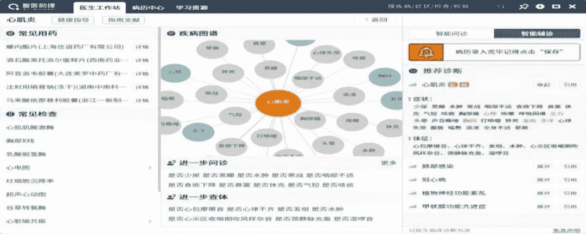

图1 AI临床辅助决策支持服务

一是搭建医疗健康数据共享平台，实现数据融合。在诸暨市卫生健康局牵头组织与推动下，建立和完善统一的数据标准，各医疗机构共同遵循统一的数据格式和传输协议，构建人工智能应用服务与现有医疗健康数字化应用系统（汇聚全市医疗健康数据的"健康大脑"、检查检验结果互认共享平台—"浙医互认"、医院信息系统等）之间的数据高速通道，实现病历、影像、公共卫生等医疗卫生数据及知识库的融合互通。

二是建立数据治理闭环机制，实现数据精准治理。结合医疗卫生数据流通的"数据采集—数据治理—数据应用—质量提升"闭环管理机制，构建"数治、数知、数智"三层治理体系，实现数据的规范统一和精准治理。"数治"是依托数据治理和人工智能技术实现基础治理，快速完成海量健康医疗数据采集和异构数据同构化，破解传统数据归集难、质控难、共享难的问题，形成"让机构可以用的数据"。"数知"实现数据与医学知识的深度融合，让数据具有明确的领域知识属性，破解传统知识与数据融合难、数据可用性不高等问题，形成"让业务用得好的数据"。"数智"是依托算法模型实现数据与智慧的融合，构建以数据为基础的智能驱动、场景融合和开放服务，形成"让医疗更智慧的数据"。目前采集健康数据610.7T，发布233个数据采集标准规范，形成496个值域目录，1600条数据元、2.3万条标准疾病代码。

三是强化数据安全保障，实现"可防可视可控"。依托数据脱敏、数据加密、数字水印、区块链和隐私计算等安全技术，对内构建可信网络环境，支撑医疗数据上链，实现数据流转高效协同；对外构建安全用数环境，支撑数据开发利用，实现数据"可用不可见"，为数据应用提供安全保障和安全监控，实现数据流通与应用"可防、可视、可控"。

四是深化数据开发应用，打造智慧医疗场景。依托人工智能、大数据等技术，结合患者的检查、检验、用药及健康档案等信息，实现医生问诊过程中，根据问诊逻辑提示病情问诊；诊断过程中，协助医生对病情进行合理诊断；病历书写过程中，给予智能分析与提示，协助医生提升病历书写规范性和质量；在医生开处方和检查检验时，及时给出专业建议；公共卫生随访过程中，替代传统人工拨打电话沟通的方式，实现智能语音呼叫随访对象，开展随访沟通，并将随访结果自动写入健康档案系统中等。

目前已在县域内23家基层医疗机构、340家村卫生室、2466个医生工作站落地应用，病历规范率达98.87%、诊断符合率达97.79%、用药合理率达94.4%，分别提升38.87、17.79、9.4个百分点，"语音外呼"让随访效率提升20倍以上，显著提升基层医疗服务能力。

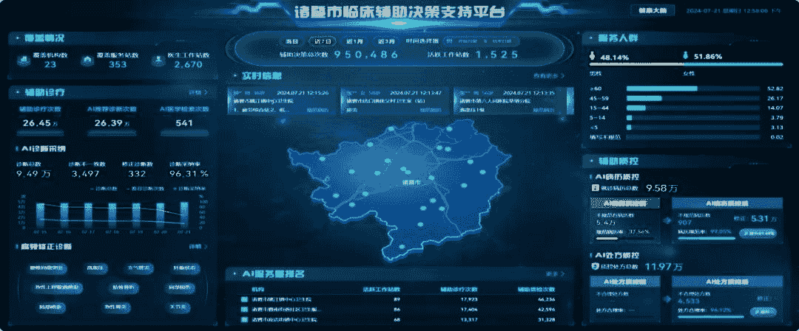

图2 临床辅助决策支持监管

### 案例二十一

全流程数据融合
加速中药调剂传承创新

中药调剂作为临床中药学的基础，直接影响中医临床疗效的发挥。中药调剂是对中药进行再加工调配和配送给患者的过程，但在临床应用过程中存在经验数据挖掘复用不充分、操作流程要素不统一、与医疗服务衔接不紧密等问题，容易导致医疗安全隐患。北京中医药大学联合中华中医药学会在一定范围内开展了相关研究，推动中药调剂全流程数据融合，挖数据、强治理、管流程、提服务，有效提升了相关参与单位的中药调剂效率和服务质量。

一是挖掘中药调剂关键知识数据，构建中药调剂关键技术核心数据体系。将传统中药调剂中的性状鉴别、中药炮制、中药调剂、中成药合理使用等经验，提取为处方审核、处方应付、发药交代、临床煎煮、调剂供应、性状辨别、临床炮制、采购管理和贮存养护等9项技术数据体系，并配套构建知识库与知识图谱，强化中药调剂全流程数据要素标准化建设，主研35项中药智能调剂关键技术标准（其中国际标准5项），同时配套形成数据元标准目录，支撑中药调剂数智化应用。

二是利用区块链技术，促进数据共享安全与合规监管。构建智能代配、代煎大数据要素融合服务平台，中药煎药中心通过与医疗机构、中药饮片厂、配送公司等各方的合作与数据授权，融合中药饮片厂的中药生产信息、医疗机构的处方信息、煎药中心的煎煮灌装信息、配送公司的配送信息等，利用区块链技术将数据同步存储到区块链节点中，在代煎各环节进行数据来源验证，将传统人工调剂模式升级为"全流程数据追溯+人工+智能自动化"的新调剂模式，推动实现处方精准调配、中药安全代煎，应用覆盖浙江、广东、上海、重庆、山东、湖北、江苏、广西、重庆、福建等21个省市，120家中药煎药中心和3500家医疗机构。

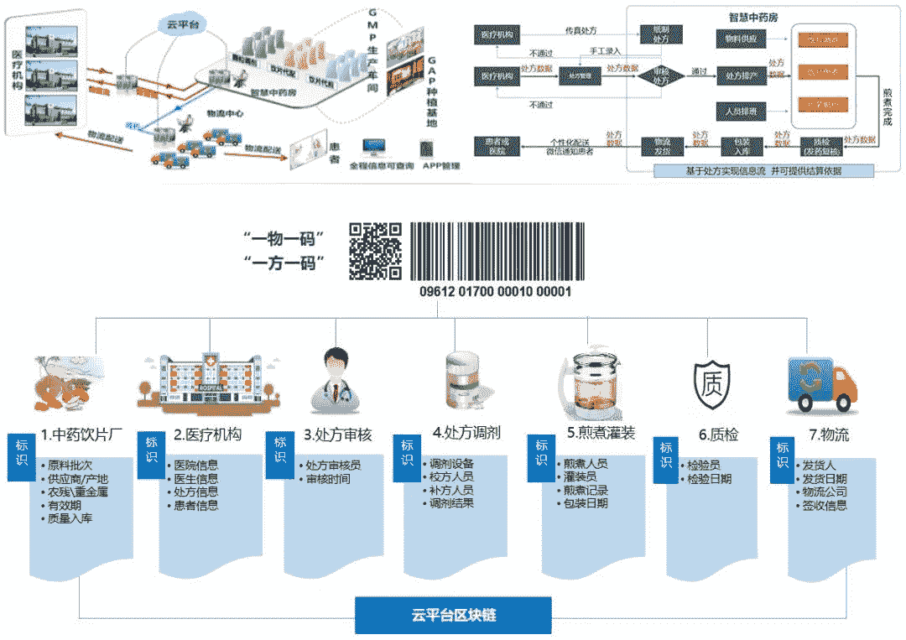

图智能代配、代煎数据融合服务平台

三是融合多元数据分析，开展个性化药嘱服务。基于《伤寒论》药嘱内涵解析，依托中药饮片标准库、中医经方库，结合调剂数据和患者用药情况等信息分析，实现个性化定制并生成中药饮片药嘱单，形成处方前置审核－饮片调剂复核－药嘱指导服务的标准工作流程，为患者提供正确煎药和服药的用药指导，实现"一人一方一指导"的个性化药嘱服务。自2017年以来，已在北京、天津、宁夏三地投入线下使用，累计服务患者逾105.47万次，用药指导正确率达100%，患者满意度达100%。

## 八、应急管理领域

### 案例二十二

## 数据支持自然灾害应急响应处置

应急救援是保障公众安全的重要措施，高效精准的数据能有效提升灾情感知能力、帮助及时制定应急处置决策和强化救援疏散科学管理。针对国内外地震、洪涝、滑坡等灾害应急响应处置中存在的灾情快速分析能力不足、精准预测预警难等问题，中国科学院西北生态环境资源研究院和空天信息创新研究院联合国家地震科学数据中心、地面卫星应用中心和甘肃省科学数据中心等20多家机构，构建了跨部门数据联动共享机制，创建了数据工程灾害应急响应服务平台，实现多源数据接入、确权、治理、流通、聚合和应用，提升了灾害应急处置速度和能力。

一是汇聚融合灾害应急响应数据。联合行业部门、科研院所、企业单位等，形成了针对灾害应急的跨部门数据汇聚机制，高效支持高分、资源等多种卫星数据的接入以及遥感数据的空谱融合、时空融合，构建了覆盖灾害高发区域的地质灾害、水文、气象、人口和卫星等本底数据资源约300TB。

二是实现灾害应急响应数据可信流通。建立覆盖我国主要减灾机构的区块链可信联盟体系，发展了基于共识信任机制的"确权认证-版本管理-可信共享-溯源追踪"服务新模式，推动灾害观测数据、制图产品和灾损报告等成果的安全流通，形成了良性可持续的数据减灾防灾发展格局。

三是提供基于"十大数据工程"的灾害应急响应服务。基于"数据+AI+模型"技术研发的多机构联动响应、应急响应、灾害演变分析等十大数据工程技术，灾害发生后可快速圈定灾害区域、划定数据范围，建立专题数据模型方法。例如，通过制备洪水、地震等灾害的空间分布，快速分析受灾情况，科学预警次生灾害的发生，合理调配救灾资源，形成数据驱动的灾后应急响应支持能力。

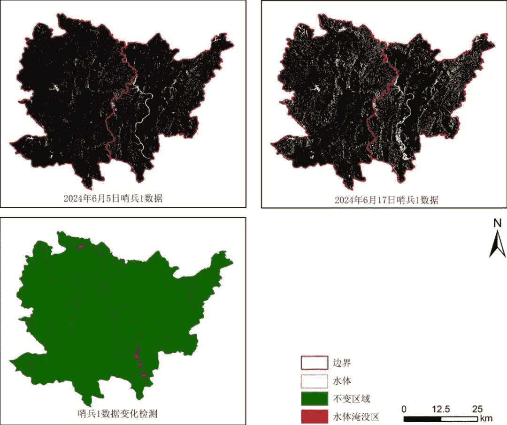

图2024年6月广州梅州洪水淹没区（面积152.1668平方千米）空间分布

该平台在灾后4小时内，可快速接入国家地震科学数据中心等20多家机构的灾害应急响应数据。目前，平台已支撑新疆、青海、甘肃、四川汤加火山、叙利亚、乌兹别克斯坦等地60次地震、洪水、滑坡的应急处置，为灾害研究机构和管理人员提供了6PB数据服务，加快了灾情分析，增强了快速救援能力，有效降低了应急响应成本。

## 九、气象服务领域

### 案例二十三

## 跨行业数据要素融合应用构筑铁路安全新防线

强风对列车运行具有严重影响，易损害基础设施、影响供电设备安全，严重的可能造成列车脱轨或倾覆。新疆铁路沿途风区多、风力大，为应对强风对新疆铁路运输生产和行车安全带来的严重影响，新疆气象服务中心与新疆铁路部门联合攻关，打通气象与铁路数据、创新气象服务模式、推动规模化应用，实现了跨行业数据有效利用，降低了铁路行车安全风险，筑牢维护乘客生命财产安全的"防风墙"。

一是推动气象和铁路部门数据融合共用。通过在铁路沿线建设98个大风监测站，实现了3秒/次的风力数据采集和传输，进一步融合铁路沿线周边气象部门的气象监测数据，形成了大风灾害风险精准预报研究的数据库，实现气象与铁路部门大风观测数据的实时共享，并在全国率先开展了20分钟大风精细化预报研究。

二是创新铁路气象服务模式。通过气象的评估、预报、预警等数据服务，构建了从源头到运行的风险防范模式。面向防风工程建设，在兰新客运高铁专线线路选址和防风工程建设前期，通过新建19个多要素气象观测站和2个挡风墙防范效果试验站，将气象风险区划数据与铁路重大工程建设数据深度融合，提前开展气象风险评估，从源头防范和减轻大风极端天气的影响。面向列车运行，气象与铁路部门联合建设铁路大风精细化预报系统，接入天气预报数据、铁路沿线地形数据，进行了7大风区16个关键站点的大风趋势预报，推出了未来48小时的铁路大风精细化数据产品，预报准确率达到80%，并纳入铁路调度指挥系统，实现由现场实况指挥行车到"实况数据+精细化预报"指挥行车，建立安全风险超前防范机制。

三是加大推广复制力度。新疆气象服务中心和铁路部门关于大风趋势预报的项目成果，已在中国铁路乌鲁木齐局集团有限公司管辖范围内5条铁路7大风区落地应用，累计形成了17万条大风预测数据和大风风险评估系数等共计15TB数据，用户数达8000人。2009年以来，保持因大风引起的铁路交通事故零发生，切实提升了新疆铁路客运产品的核心竞争力和新疆铁路部门的良好社会公众形象。

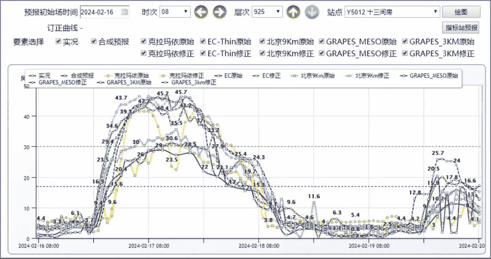

图新疆铁路大风精细化预报系统

## 十、绿色低碳领域

### 案例二十四

## 数据赋能能源行业绿色低碳转型

在能源行业快速变革的背景下，能源数据的流通和使用正成为推动行业转型升级的关键因素。当前，能源数据流通使用过程中面临数据主体多、标准规范性差、可信共享水平低等问题，影响高价值能源数据发挥作用。国家电网大数据中心通过建设能源大数据应用平台，开展能源数据汇聚、共享和应用，培育碳足迹核算、能耗监测等典型应用场景，有力推动数据要素价值释放、驱动能源行业绿色低碳发展。

一是创新数据获取模式，实现海量数据汇聚。基于能源大数据应用平台，通过政府授权、企业合作、市场采购和公开收集等方式，搭建与当地政府部门、电力企业、用能企业、新能源电站与国内外权威数据机构等的数据传输通道，累计实现能源、环境、社会经济、"双碳"、公共5大类50个小类，3.08万张表、1383.63亿条数据规范汇聚。

二是打造行业数据资源目录，推动数据合规共享。依托数联网、联邦计算等技术，构建能源数据目录，提供数据资源在线发布、数据共享申请、目录应用分析等服务，为"能源看征信""信贷反欺诈"等业务场景提供数据支撑，促进跨省市、跨行业的多方数据合规共享利用（如图1所示）。

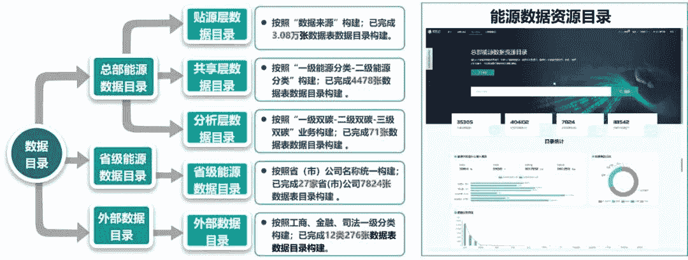

图1 能源数据资源目录

三是构建分析模型，培育典型应用。面向"双碳"数字化能力建设、能源行业绿色转型等方向，围绕碳排放智能监测、动态核算等场景，打造国际首创的"电－碳"计算模型，开展产品碳足迹核算、重点园区能耗监测等应用，实现分地区、分行业、重点企业的常态化监测和高频碳排放数据核算，助力政府实现能耗"双控"（如图2所示）。

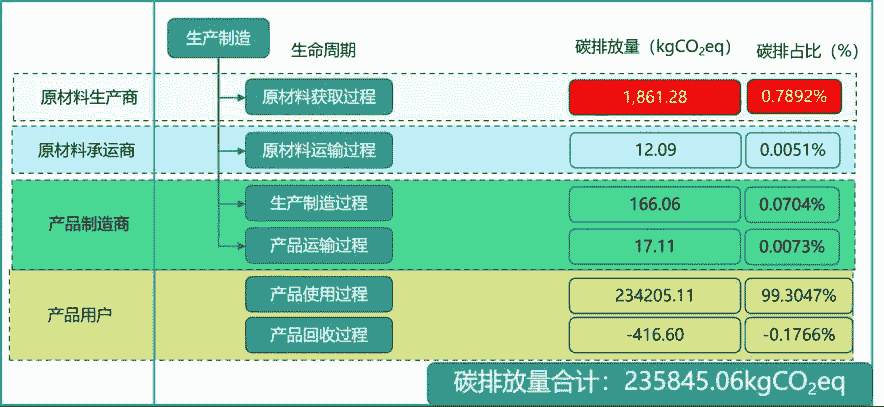

图2 某10kV-200kVA油浸式配电变压器碳足迹核算

四是建立数据标准体系、分类分级管理体系和安全合规管理体系，支撑数据安全流通。为填补能源行业标准体系空白，构建能源大数据标准体系框架（如图3所示），制定核心标准指导能源大数据中心建设运营。建立能源大数据分类分级管理体系，设计数据访问共享控制策略，实现数据共享权限颗粒度管理。建立全生命周期的数据安全合规管理体系，强化数据溯源、数据传输等关键环节安全防护能力，实现跨领域、跨地域的多方安全可信数据共享。

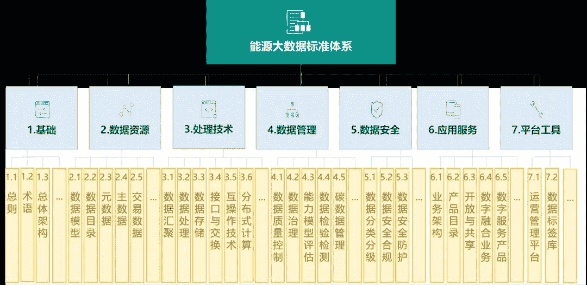

图3 能源大数据技术标准框架

自应用以来，实现能源服务和产业园区能耗监测覆盖26个省，累计提供1300余个数据产品，已服务上下游客户19.5万家，助力减少碳排放1017万吨，间接为企业节约成本约5亿元。

### 案例二十五

## 基于多源数据融合的能源行业数据共创空间赋能绿色低碳发展

当前能源行业承担着保障安全可靠供应、加快清洁低碳转型、助力实现"双碳"目标等重大战略任务，加快推进能源行业数字化、智能化发展，是保障实现战略目标的必然选择。能源行业数据市场的建立，正面临数据孤岛严重、数据共享缺乏信任机制、跨领域数据融合应用不充分等问题，缺乏数据共享流通和挖掘利用的产业生态。南方电网广东广州供电局通过建设能源行业数据空间，实现水、电、气等跨领域数据共享流通，孵化"能源+绿色低碳""能源+数字政府""能源+数字经济"等融合应用，推动绿色低碳发展。图1 应用总体架构

一是推动电、水、气、政务等多源数据汇聚。建立能源数据汇聚中心，一方面通过公共数据授权获取民政、工商等部门的基础公共数据；另一方面归集水务、燃气、油、煤等能源企业数据目录，累计汇聚数据量超500TB，为价值挖掘利用提供数据基础。为提高企业主动汇聚重要数据的意愿，创新"物理+逻辑"的数据汇聚模式，将敏感程度不高的企业数据经过加密后传输到能源数据共创空间存储区域，对于涉及级别为核心重要等相关敏感类数据，只存储数据的基本属性，按需调用。

二是研发数据可信流通与融合应用解决方案。为应对数据权属、隐私保护等问题，基于"数据可用不可见、数据使用可控可计量"原则，通过数据使用协议、数据目录链、数据沙箱、密文数据计算分析、隐私计算等技术手段，解决数据在多个环节的安全问题。建设安全合规、多方互信的数据共创空间，为数据共享流通提供全流程支撑，促进多主体供需对接、多对多数据安全融合共享。

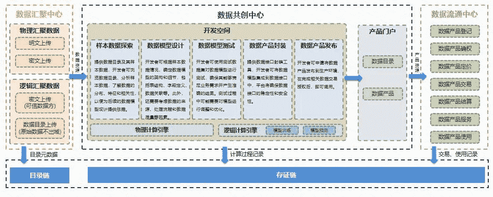

图2 能源数据共创空间功能分类

三是以多源数据融合提升城市治理能力。依托能源数据共创空间中汇聚的数据与共创中心的数据开发能力，构建多种融合能源数据、公共数据的应用产品，提升城市治理能力。构建"智慧电力"应用，以实时更新的能源电力数据指标构建城市用电模型，上报用电异常风险点，缩短城市应急管理风险识别的时间，提升决策精准度；运用居民用电监控数据，识别孤寡老人的用电异常，并构建分析模型，将异常用户预警信息发送至网格管理人员，网格管理人员上门提供服务，优化民生服务。

本案例应用以来，发展上下游企业会员超40个，服务政府部门约20个，服务企业超800家，孵化超20个融合应用。其中用能诊断、电力征信等服务累计为企业节省0.75亿元用能支出，助力企业授信约15亿元。

### 案例二十六

## "大数据+数字孪生" 助力提升流域水环境监测预警水平

流域水环境综合治理是生态文明建设的重要组成部分，包括水资源保护、水生态修复和水环境改善等多个方面。地表水环境数据分析能力不足，是流域地表水风险应对、污染精准防控等领域的共性问题。四川省生态环境监测总站通过立体化监测技术获取数据，以流域地表水环境模拟技术打造常态化运行的流域水环境数字孪生产品，服务于四川省流域地表水风险应对和污染管控，助力长江大保护和长江经济带高质量发展。

一是推动地表水环境数据汇聚。汇聚依托监测总站在日常监测过程中采集的污染数据，与研究机构在课题合作中共享的土壤数据、现场地勘数据等，由大数据局共享的人口、养殖、气象、水文等公共数据，构建数据量超1.2亿条且持续更新的地表水环境大数据采集系统，形成地表环境全要素数据库。

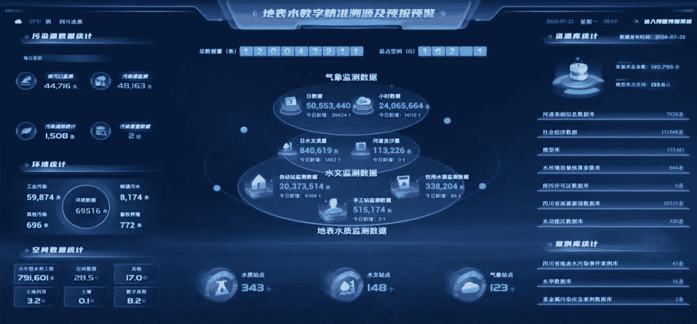

图1 地表水大数据赋能流域水环境管理

二是构建流域数字孪生体。基于流域模型和动力学模型，融合多领域、多行业的地表水环境数据，结合大数据分析、人工智能等技术构建具有完备物理基础的分布式流域水文水质模型、水动力和污染迁移扩散模型与大数据学习模型。根据流域水环境特征拓展模型的模拟要素和范围，在精细化、精准化模拟的基础上增强模拟能力，实现空间分辨率从3.3个控制断面/万km²提升至25.2个控制断面/万km²。

三是基于数字孪生实现环境保护智能化决策。基于流域数据孪生体构建水文和水环境预测预报应用，延长水文和水环境预报的预见期，水环境质量预测周期从24小时提升至4小时，主要污染物预报准确率超过75%。开展江河湖泊、水土流失等水环境水生态变化智能预测，对出现超标的流域全面溯源分析以识别工业企业、农业面源等对水体贡献比例，实现河湖治理精准监管能力提升，水环境水生态保护能力提升。基于水环境变化的模拟仿真和动态管理，支撑四川省各级地表水环境管理部门开展流域地表水环境监测管理、资源调配和污染管控。

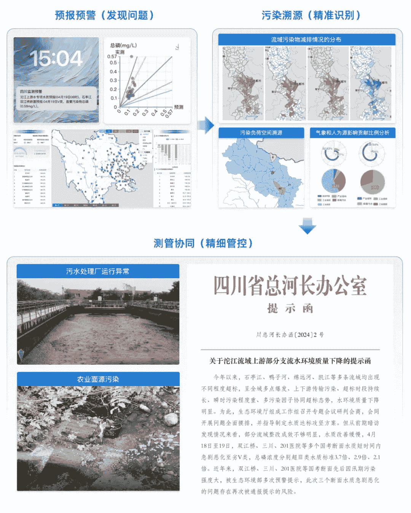

图2 地表水预报预警-精准溯源-测管协同体系

### 案例二十七

## 能耗监测数据多元应用助力政企绿色高质量发展

能源消耗动态监测分析是推动能源行业优化服务、高质量发展的关键手段。传统能源消耗监测分析多依赖专用监测装置及专业人员进行定期数据采集，面临成本高、数据覆盖面和时效性不足、数据质量参差不齐、安全防护难度大等挑战。南方电网云南电网公司通过建立云南能源公共数据要素管理体系，汇聚云南省16州（市）能源、公共服务领域等多源数据，研发"电－能分析算法模型"，准确研判区域、行业、企业能耗等情况，支撑各级政府监管部门能耗科学监管，促进能源高效利用，减少碳排放。

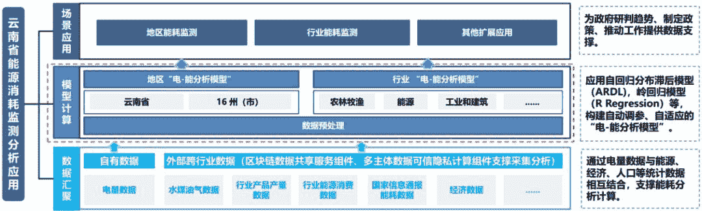

图1 应用总体架构

一是开展数据多渠道采集和规范化治理，实现数据供给质量提升。构建能源数据资源库，汇聚自有电网数据、气象数据、宏观经济和行业能源消费数据，以及水、煤、油、气等数据。使用AI大模型进行数据治理分析，构建数据血缘关系，识别并清洗修复问题数据，建立统一的数据资源目录。

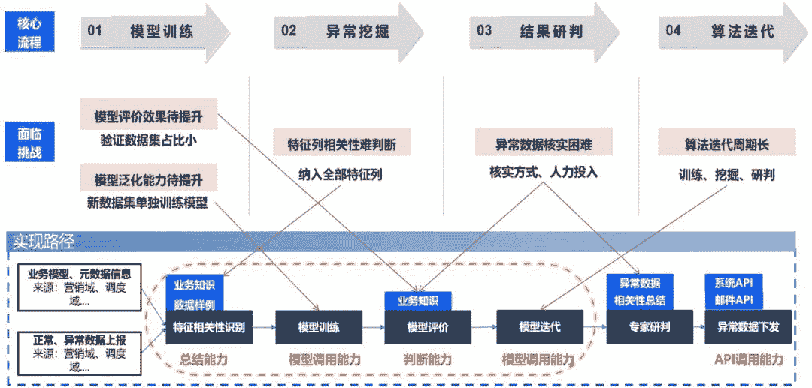

图2 AI大模型应用

二是建设数据汇聚开发平台，实现跨区域、跨行业数据安全流通应用。建设大数据底层支撑平台，实现结构化、非结构化、时序数据等多种类型数据源配置、采集和管理。构建能源数据模型，将原始数据、明细数据、中间数据及服务数据统一存储，打造指标库和标签库，形成能源数据核心资源库。建设区块链数据共享服务组件和多主体隐私计算组件，对数据流通交易全过程进行验证、管控、溯源，并实现数据可信计算。

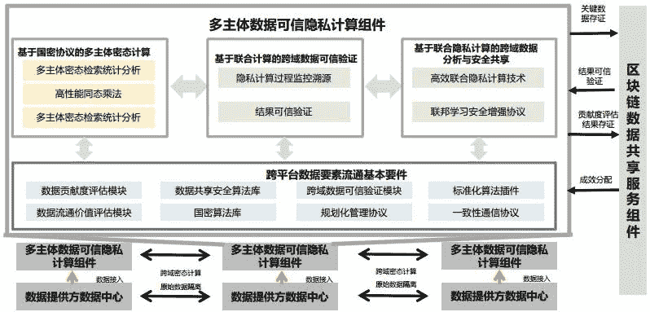

图3 多主体数据可信隐私计算组件

三是基于多源数据应用，提升能耗监测与分析能力。融合经济、能源消费等数据构建电能折算模型，开展能耗、碳排总量和强度分析，支撑政府相关部门决策。对充电站（桩）用电数据分析，优化充电站（桩）布点规划，为新能源汽车市场健康发展创造有利条件，助力交通运输业绿色低碳发展。将能耗测算结果与碳排放因子结合，实现园区能耗和碳排放的监测、分析、预警，帮助入园企业通过精准节电提高能效，通过峰谷电价降低用能成本，打造绿色低碳园区能碳监测"范本"。

自2023年5月上线以来，持续为云南省各级发展改革部门、能源部门、700余家重点用能企业等提供能耗监测分析及综合能源管理服务，为相关企业每年节约用能成本约1.8亿元、减少碳排放10万吨以上，为200余个中小微充电站投资者提供规划选址服务，节约其信息化投资约3000万元，助力经济社会绿色高质量发展。

### 案例二十八

## 基于能源智慧观碳平台探索"双碳"数据流通应用

国家高度重视绿色低碳发展，为落实碳达峰碳中和目标，正持续完善与"双碳"相关的政策制度体系。"双碳"目标下，能源行业转型正面临数据孤岛现象突出、跨部门数据开放共享难度大、数据价值挖掘不足等问题。国网吉林省电力有限公司打造了能源智慧观碳平台，汇聚企业用能、市场交易和公共服务等领域数据，培育面向政府、行业、企业的碳管理服务，通过集成能源生产、消费分析、控排企业监测、碳流图等功能，为政府决策提供实时、准确的数据支撑，有助于精准制定"双碳"目标路径，推动"双碳"战略落地。

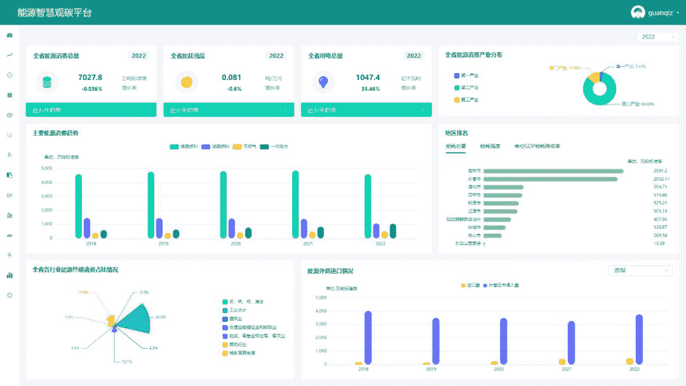

图1 能源消费分析

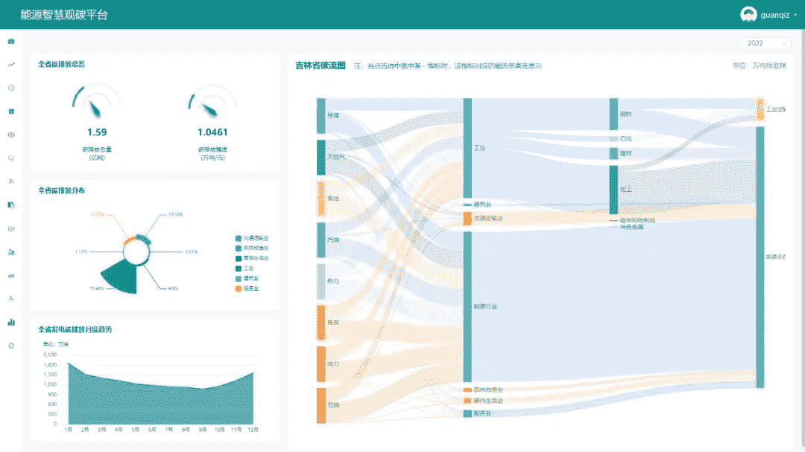

图2 碳流图

一是推动多主体数据汇聚，加快数据高效流通利用。依托省能源大数据中心，在省发展改革委协调推动下，融合汇聚296 家企业数据，建立能源数据资源目录，数据范围涵盖能源消纳、排控信息、公共服务等19 大类，覆盖能源、双碳、环境、社会经济等领域118 亿条数据。

二是以区块链技术为基础，支持数据安全可信共享。将数据进行基于区块链的存证，发挥数据可追溯、不可篡改等优势，消除数据共享各主体间的信任壁垒。通过编制数据应用安全管理、数据共享流程等制度规范，统一数据流通与应用过程中的标准。在平台开发过程中，采用先进的加密技术和访问控制机制，保护在共享和流通过程中的数据安全。

三是开展双碳场景应用，实现数据赋能产业发展。利用大数据分析、数据挖掘等技术，构建碳排放监测、碳配额测算等分析模型，打造碳资产地图场景，提供各省市碳减排量统计等服务；打造碳市场分析场景，提供碳市场交易信息查询等服务；打造企业碳账户监测场景，提供企业级数碳大屏监测分析等服务。全面洞察区域内排放达峰控制成效，支撑政府打造具备地方特色的碳交易市场，实现"双碳"领域数据资源的优化配置和行业的协同发展。

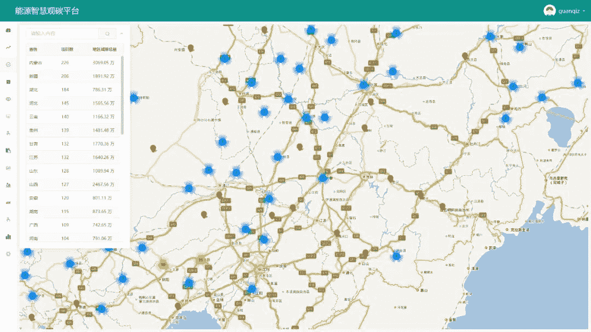

图3 碳资产地图

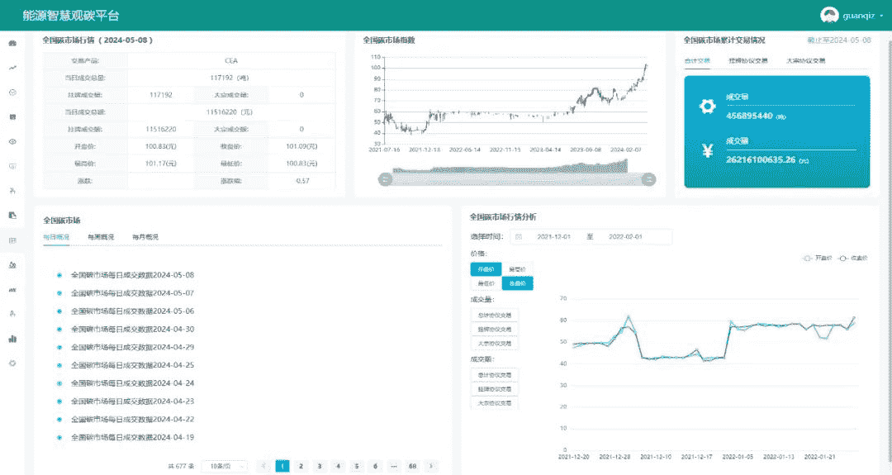

图4 碳市场分析

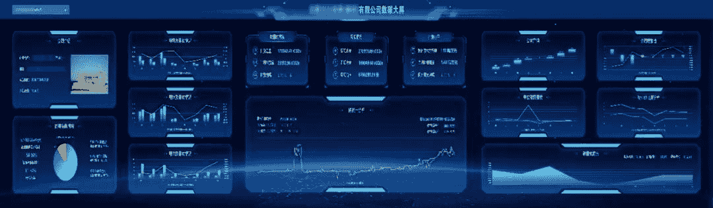

图5 企业级数碳大屏监测

平台应用后，对省内各地市行业碳排放进行有效监测预警，管理碳配额估值约2.6 亿元，实现碳资产的高效管理和透明运营，有效激发省内碳减排和绿色投资的积极性，加快促进行业和企业实现节能减排任务目标，为构建绿色低碳经济体系奠定了坚实基础。
