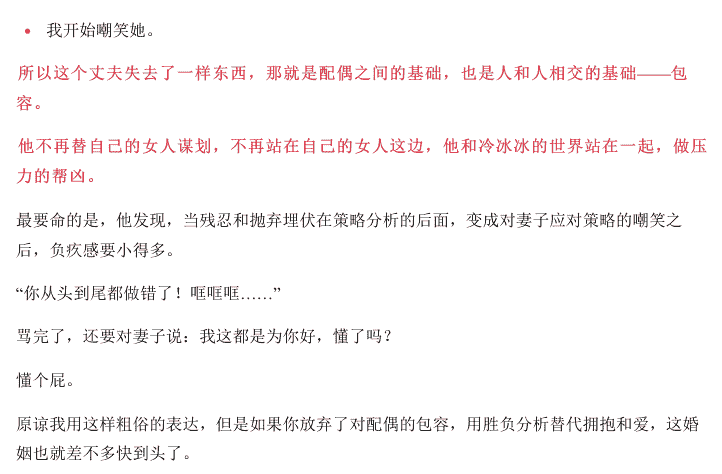
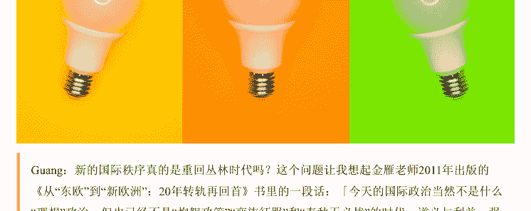

# 懒人专属群周报（第125期）

北京时间2025年 月 日 出品

懒人专属群群友大家好，我是小懒人～

第125期《懒人专属群周报》，与君共读。

希望咱们专属群独有的《懒人专属群周报》可以作为群友们喜欢阅读的一份类似周刊的读物。之前的离线版合集地址见咱们专属群总链接，小懒都有备份。

懒人微信：lazyhelper

## 目录

| 文章/章节名称 | 结构/涉及内容 |
|---|---|
| 关系攻略（节选）：你总得认识到自己不能拯救世界 | 知识点、应用范围、习题 |
| 你不是我男人嘛？为什么每句话都要伤我？ | 知识点、应用范围、与其它篇目的关系、习题 |

## 你问我答

## 懒人收藏夹

- B站UP主被骗千万，我也聊几句
- 没有人生来就知道自己要什么
- 来的不是未来
- 股票：那些年股市给我上过的课

## 总结

## 关系攻略（节选）

作者：熊太行

### 你总得认识到自己不能拯救世界

#### 知识点

> “帮过我的人，我应该帮助他们而不是伤害。”——超过民族国家界限的“互惠原则”

#### 应用范围

适用于朋友间要互相帮助、如何帮助别人让自己得到好处。

我刚上大学的时候，我爸送我去学校。

分别时我突然想问问老爷子，有没有什么至理名言送给我，要我记得的。

我老爹想了想，说了一句：“管好自己的事，有余力了要去帮助别人。”

后来的人生中琢磨这句话，越琢磨越对。

通过“成长”和“助人”两个维度，能把人分成好几种。

- 只成长不助人的人，是个精明人。
- 先成长后助人的人，是个善人。
- 不成长也不助人的人，是废人。

但是我们也会发现一些问题：

偏偏有一类人，成长没有做好，却在助人方面付出了太多的时间和精力。甚至于在有些方面，他们在助人方面显得特别急切，以至于别人都怀疑这个人是不是别有用心。

这就是因为他们搞错了“管好自己”和“帮助别人”之间的顺序，他们希望先拯救全世界。

我不止一次地收到类似的关系户留言：

熊老师，我的人生过去一直都灰暗，后来我发现了得到，订阅了很多专栏，后来我找到了关系攻略，关系攻略给我带来了很多改变，但是我把它分享给我的老公/女朋友/闺蜜，他却觉得自己不想学习，我不知道该怎么去改变他的想法……

我可能要说一些关于帮助别人的事，了解了为什么自己会急于帮助别人，可能就能够更好的帮助别人和做好自己了。

#### 帮人让我得到很多好处

对于人类的助人行为，社会心理学家已经研究得非常透彻了，大多数人都赞同这样一点，给予能够提高人的幸福感。

1.助人行为，尤其是拯救行为能够提高自己的社会地位

我小的时候跟我爸去参加一个饭局，遇见一个列车长叔叔，一桌人有处长、有教授、有政委，大家对他都非常尊敬和客气，因为他是新闻当事人，他的列车在去西北的路上被沙尘袭击过，他带着列车员和乘客们用上了一切的被褥毯子去堵塞被打破的玻璃，坚持了十个小时到天气好转。

2.帮人能让人感受到自我价值

投身社区服务的年轻人不容易变坏，踢足球的十几岁青年队员如果加入一些社区计划，去帮助小学生改善自己的足球技巧，他们的犯罪率就比不加入的要低，同时日后的成就也会更高。

日常的交往当中大家也会发现，如果你能够为别人分辨饭店、医院、学校的好坏提供建议，你就能成为朋友之间有影响力的那个人。

帮人能让你感觉到被人需要和认可。

3.捐赠行为会激活幸福的那部分脑区

不知道大家看过献血的广告没有，过去的献血的广告都会强调伤病员需要血液，但是近几年的献血都会强调说献血会让人更开心。我本人献过三次全血，确实这种感觉会上瘾。

帮助别人会取悦自己，但是我们作为受助者和旁观者都不应该强调这一点，而是应该积极给予称赞。

4.他再乐于助人你也应该称赞他

一些机构也会给一些物质上的回报，而且中国的传统认可这种回报。

子贡曾经去赎回流落在国外为奴的鲁国人，国家赞赏他的行为，奖励了他一头牛，子贡谢绝了赏赐，就有觉得“助人让我很快乐”的念头，但是孔子就会劝他，你要把牛拿回来，不然以后别人再拿牛，就会有压力，就没人做好事。

帮人会让我内心好受些

我们提到了帮人能感受到的外部回报，另外一种回报，是内心的回报。

1.帮人能缓解内疚感

不知道大家有没有那种情况，说错了一句话，做错了一件事，虽然不大，但是让自己特别纠结，总觉得心里会过不去。

这个时候如果遇到别人求助，哪怕只是陌生人街头问个路，就会如蒙大赦如获甘霖，赶紧把人领到对的路上，然后这个时候再回过神来，刚才的内疚感也就好了很多。

2.帮人能缓解悲伤

一些特别重度的悲伤——失去配偶或者孩子（记得我们给过大家的那个表格吗？失去配偶是最大的压力源、孩子次之、父母要更小一点）会让人沉浸在悲伤当中，陷入“过度的自我关注”，这期间的人对别人的悲伤是无法表示同情的，但是只要走出这种阶段，悲伤中的人会倾向于去帮助别人。

3.心情好的人会特别乐于助人

心理学家们曾经做了一个试验，给人车的雨刷下放一张纸，让人以为是罚单，车主大吃一惊，拿起来看时发现是广告单，松了一口气。而参加测试的人员在这里请求车主填调查问卷，大多数人（62%）都会答应帮忙，如果没有这张纸片，答应的人是（31%）。

> 从担忧转为轻松的人，特别容易去帮助别人。

另外一个调查是，当推销者赠送了文具和小礼品给潜在客户之后，推销者打电话过去向潜在客户借零钱，这些拿了人家赠品的家伙的借钱概率飙升，但是仅仅在5分钟之内有效，因为小礼品带来的快乐就是这么久。

活学活用

你现在明白为什么针对老年人卖保险、理财、保健品的推销员去见老太太的时候会提着水果出现了吧。当他们心情愉快的时候，你不说让他们买东西，而说自己的业绩不足，他们会放松警惕，帮你完成业绩。

本身生活充实快乐和富有的老人，对这种推销的抵抗能力就要强得多。你给王思聪的奶奶买个西瓜……好吧我得承认你进不了他家的大门。

#### 帮人是投资、帮人是借贷

人际交往当中，一个“互惠原则”是大家所公认的。

"帮过我的人，我应该帮助他们而不是伤害。"

尽管我会跟大家说，尽量调低对别人的期待，不过大多数时候，我们在人际交往中也会投资：

"我这次帮了你，你下次也要帮我。"

这种能力是人类很早的时候就发展出来的，21个月（不到两岁）的婴儿就知道优先回报给过自己玩具的人了。

我们之前提到过电影和小说《教父》，老教父就是一个善于投资的人：“这次我帮你，我不要你给我什么，我就要你的友谊，可能有的时候我需要你的帮忙呢。”而殡仪馆老板则担心他会被教父要求帮忙做些毁尸灭迹的不法勾当，所以一直不敢接受教父的恩惠。

我们知道有投资就可能有翻脸，有借贷就可能有多高利贷，所以在接受别人帮助的时候，确实可能会有人特别担忧。

比如当你推荐一本书、一部电影、一个音乐、一个得到的专栏的时候，你对你推荐的产品可能会特别喜欢，甚至于有一种“新皈依者的狂热”。

新皈依者狂热指的是一些人刚刚找到自己赞同的理论或者宗教，急于传播和影响他人的行为。

狂热情绪对自己迅速掌握一门技能和学问很有帮助，但是如果拿出去影响别人，就很容易和对方闹不愉快。

你看好多人拜了师父学武，一个月后就开始对别人指点起来，这就是新皈依者狂热。其实他这会儿最应该做的是自己天天练习才对。

新皈依者狂热会非常危险，比如对心理咨询的狂热，我见过有的抑郁症患者，自己刚刚好转，居然跑去给别人做心理咨询了。

没有执照，也没有过系统的学习，她说自己从很多人那里学到各门各派的知识，其中熊老师的启发受益匪浅，熊老师说：“做心理咨询一定要收费。”

我只好哀求她：

别提我，我们不是那种师徒关系……以及你没有医师资格就要给人处理抑郁症，出了事要坐牢的……

#### 不要想着拯救世界

帮人既然有这么多的好处，你一定不要把帮助别人变成一种道德绑架。认清楚这是自己的一种责任自觉和内心需求可能会更好。这是对朋友忠诚的一部分，但对对方回报这件事不要期待太高。

更不要急着去帮助全世界，但是如果你处在新皈依者狂热的阶段。你会觉得真理在手，确实会希望拯救世界。

高速飙车的时候人的视野会变窄，只能看得见前面一个小小的扇子面。急于向世界去推销真理，你可能会意外地得罪人。

其实新皈依者的狂热情绪特别好，但应该做的不是拿出去分享，不是去助人，而是快速高效地提升自己，处理好自己的事情。

回到开头我爸爸对我说的那句话：“管好自己的事，有余力了要去帮助别人。”这个顺序绝对不要错。

帮助行为是一种特殊的情感借贷。但是如果你显示了一种狂热，对方担心的是向你借了一笔情感高利贷。你如果相信一个专栏能够改变他的人生，那他未来的一切进步和转变都要归功于你的这次推荐，这个功劳未免太大了，被帮助的人也会心存恐慌的。

#### 所以正确的做法就是：

冷静地推荐《关系攻略》，或者其它好的东西给你的好朋友，但不要牛不喝水强按头，如果他表示不能接受或者虽然嘴上说好，但放在一边，就稍微等一下，他一定会有自己的困扰，而关系攻略的妙处，就在于几乎无所不包。

同样，其他学习继续深入之后，你所探触的知识也会逐渐无所不包。一定还有给对方推荐的机会。

在许多关系户同学刚开始接触《关系攻略》的时候，恨不得压在箱底，我也说过，发这个东西别给对手看。

但是人一定要交新朋友，不然你的关系开拓会陷入停滞。

公众号懒人搜索，懒人专属群分享

这个专栏开了将近半年，很多同学也都发现了，除了是一本秘籍之外，它还是一个特别好的三观探测器、交友小雷达。我们讲的是利益、策略和套路，但探出来的都是人和人之间的赤胆忠心。

#### 习题

一头牛把头钻进粮食罐里偷吃，出不来了，主人去请舅舅帮忙。

舅舅说：“把牛头砍了不就行了！”

大家把牛头砍了。但是牛头还在罐子里。

“把罐子砸碎不就行了！”

罐子砸碎了。

这时舅舅忽然放声大哭：“天呐，我年纪越来越大，以后我死了，你们怎么面对生活中的种种难题啊！”

这个故事里，舅舅具有影响力的原因是：

- A.年长者的经验；
- B.社会习俗赋予长辈的权力；
- C.乐于助人的品质；
- D.敢于建议的勇气；
- E.这个家庭内部缺乏有见识的正常人。

答案是：A.B.C.D.E。

这个故事是《笑林广记》里的，舅舅这个角色有艺术夸张，但是这种爱好指手画脚的人生活当中并不罕见。

- A.年长者有一种经验骄傲，在今天各种知识分享已经特别便利的时候，这种经验骄傲可能会成为一种认识世界的障碍。

2012年，陕西一个村里说在井里发现了“太岁”“肉灵芝”，还有眼有嘴，电视台过去采访，一个老人说：“活了七十多岁了，没见过这样神奇的东西。”后来这个电视节目播出之后，才发现那是一个男性用的性用品，硅胶制成的。电视台只好出来道歉，说记者太年轻、太简单，有时候太幼稚。迷信当地长者的经验有的时候非常危险。

- B.是好理解的选项，在许多地方习俗当中，几个儿子分家舅舅都要参与，为的是保证妈妈的利益或者做相对公正的裁决（他是外人不参与分产）。

- C.并不矛盾，“舅舅”一请就到，随时提供咨询支持，他是乐在其中的，要在有些团体或者家族中具有影响力，热心是最基本的一个素质，冷冰冰的人是无法领导大家的。

- D.舅舅有谜之自信，但在寻求建议的人当中，一个敢于给出明确判断的人比一个言语含糊的人要好得多。

- E.舅舅哀嚎说不知道自己死了外甥一家怎么办，说明这个家庭里恐怕没有比他更好的建议者和谋划者了。

## 你不是我男人嘛？为什么每句话都要伤我？

#### 知识点

使用非侮辱性的方式来表达自己的感受只会让你更强大。

如果你什么都不会说，至少还有一句：“我知道这不是你的错。”

#### 应用范围

这是一篇女性视角应对配偶言语暴力和侮辱的文章，但不仅仅是对女性有用。

事实上，我要告诉大家，这也是一个男性的语言、情绪管理指南。

### 与其它篇目的关系

这篇是：《男人说压力大，你就要赶紧抱他》（音频037）、《脾气坏就是人坏，不要替他找借口了》（音频032）和《家暴攻略》（排期中，很快放出）的姐妹篇。

我经常接到一些女性关系户的留言，提到自己老公对自己一直以来言语上侮辱性的打击。

“他不会打人，但是每次我遇到什么麻烦，去找他商量的时候，他总是把我一通骂，说我太蠢，把事情搞砸了。”

### 言语暴力的危害

这种描述我至少见过十几次，大多数质量极差的婚姻都存在这种问题，优势一方对劣势一方百般嫌弃。

大多数女性使用言语暴力欺凌男性的婚姻，男性都是比较严重的害羞者，而女性的核心观点就是“没本事”。

不过男性对女性的言语暴力则主要在于贬低对方的智商，这种贬低和侮辱一般不是为了追求离异，而是为了在关系中获取优势，同时享受智力上的优越感。

这种折磨不是必杀技，更像是钝刀子杀人，女方可能会忍受长期、反复的折磨，甚至接受这样的暗示。

很多女性一方面不满意对方的贬损，但是另一方面却倾向于承认自己受教育程度低和脑子反应慢，比如描绘为“熊老师，我承认我脑子确实比较笨。”

一旦自己接受了这种暗示，脑子就会真的变笨起来，尤其是如果在小学初中被老师说过笨的女性，在这种自暴自弃中，可能还会笨出奇迹来。

### 加害者也要受损

和直接的肢体暴力相比，男性对女性的言语暴力的特点是，加害者也会能力受损。

这是一种“受害者会变成笨蛋，加害者也会变成废柴”的不良行为。

大多数的言语暴力都会在婚后一年之后出现，我们在《男人说压力大，你就要赶紧抱他》当中提到过，生活变动会变成人们的压力源，而最大的变动，一般来说就是婚姻。婚姻以及伴生而来的搬家、财产改变、工作调整、怀孕、生育和哺育婴儿，会给青年夫妻带来极大的压力。

女性往往还面临着产假可能带来的失业或者是职业受损。

承受压力的人往往需要在自己的亲人、朋友当中寻求社会支持，这个我们之前也提到过。

中国的大多数婚姻男性与女性年龄相当或者稍微年长，所以在遇到各种压力的时候，配偶是“第一接诊者”。

心理咨询师这个行业里，有的咨询师会拒绝求助者。

比如一个自身夫妻关系恶劣的咨询师可能根本就无法应付别的夫妻咨询，他会把自己的情绪掺杂进来。

这个时候他需要把求助者转介给自己的同事或者同行就行了，所以大家合伙办咨询中心的时候，一般都找那种禁忌问题不一样的人来合伙，有的体重超标、有的夫妻反目，有的亲子成仇，不能大家缺陷都一样。

《关系攻略》的留言不是咨询关系，但有的时候我要处理六七百个提问，多的上千，认真回答的一般要到三分之一。你们最多能看到两百个，这里面有不少问题也超越了我的领域，有人问怎么争夺宅基地，有的人要争夺遗产，还有的问我他的女朋友怎么想。

我都是认认真真说，这个我不懂，那个我不会，这没有什么丢人的。

但丈夫不是咨询师，妻子也不是求助者。在妻子求助丈夫，希望得到支持和建议的时候，大多数的丈夫都不好说出：

- 我不懂
- 我不会
- 我想不出来

这是非常危险的事，女人对男人有一种期待，对他的评价过高，男人又在事实上不能应付这类复杂的问题，又因为成本或者面子的问题，不愿意去求助专业人士（比如心理咨询师），而且有些事情又不单纯是心理问题，还有职场规划、社会风俗之类的问题混在一起。

面对压力的无力感很伤人，许多男人就转而把自己的攻击性转向更弱者，对向自己求助的妻子指手画脚，百般责备。把事情归咎于一些很久之前做过的决定，或者是妻子的某些特质，比如智商。

聪明的丈夫会明白，妻子的问题如果超出自己的解决范围会非常正常。如果自己无法提供信息支持（建议），那就用物质支持的方式来解决。

有钱不抠门的买个包，有钱抠门的说句“我养你吧”都好。

> 我养你吧！

这句许多女权主义者会不喜欢，但这不是真的让她放弃事业，而是告诉她：你随时都有后援助。

实在没钱的，至少你可以有赞美和拥抱。

### 折磨人是件能上瘾的事

重温一下这个流程：

- 我的妻子感受到了极大的压力；
- 这个压力我没法帮她排解；
- 我想了想，如果能做得更好，事实上我根本就不该让自己陷入这种愚蠢的境地；
- 我开始嘲笑她。

所以这个丈夫失去了一样东西，那就是配偶之间的基础，也是人和人相交的基础——包容。

他不再替自己的女人谋划，不再站在自己的女人这边，他和冷冰冰的世界站在一起，做压力的帮凶。

最要命的是，他发现，当残忍和抛弃埋伏在策略分析的后面，变成对妻子应对策略的嘲笑之后，负疚感要小得多。

> “你从头到尾都做错了！哐哐哐……”

骂完了，还要对妻子说：我这都是为你好，懂了吗？

懂个屁。

原谅我用这样粗俗的表达，但是如果你放弃了对配偶的包容，用胜负分析替代拥抱和爱，这婚姻也就差不多快到头了。

贬低和侮辱，能够让她在短期之内更听话，有的女性会因为担忧和恐惧而变得更服从，甚至会显得夫妻关系有了改善。

问题是长远看来，妻子的自尊会严重受损，处理问题会丧失自信，工作能力的退化会非常快，侮辱挖苦一时爽，让妻子从一个职业女性退步回家中宅居，是非常不划算的做法。

### 女性的应对

夫妻之间的沟通训练有特殊的技巧，遗憾的是大多数夫妻都是生活中逐渐摸索的，这就要走很多弯路。在这里给大家提几个点，如果丈夫开始侮辱人和使用言语暴力，要注意以下几点：

### 1.立刻表示自己的不满

当场告诉他你的情绪是什么样的，别用表情和脸色，或者委婉的暗示，察言观色是高阶技能，大多数人的笨老公根本就不懂。

更不要一言不发和一声不吭。他不会因为你忍让而承你的情，只会觉得你在消极对抗而激怒他。

### 2.不要给对方定性

尽量避免用评价式的语句，评价也应该尽量针对行为，而不是人。

- “你就是一个骄傲自大的家伙！”
- “你这样做未免太不体谅人了吧！”

后者就比前者要好，后者看上去还有救，前者已经无可救药了。

### 3.描绘自己的情绪

正确的表达是：“我觉得很痛苦，你确实比我高明，但是我没能得到这个比我高明的人的帮助。而你本来就应该是最亲近的人哎。”

我不知道大家看过琼瑶电视剧没有，那里虽然很多台词特别中二幼稚，但是在描绘自己的感受方面，是对的，比如：

“你失去的仅仅是一条腿！紫菱她什么都没有了，她还失去了爱情！”

“书桓，我想念你，我家的门永远为你敞开着。也许你无法理解这卑微（记得念二声）的爱，但是……”

### 4.描述的魔力何在

描述一个剧情，或者一种感受的时候，最重要的特点是，能够让整个语速慢下来。

“你说让小姑子和我们一起住，她刚刚开始工作，没有问题的，但是她也要恋爱，也要有朋友，天天被哥哥嫂子盯着，也会觉得不自在。我觉得你和我，可能也需要更多我们两个人的空间，能不能这样，我们让她过来三个月，也帮她找着合租的机会，好吗？”

而祈使句“你和你妹过去吧！滚！”

或者判断句：“你和你妹、你妈都是占便宜没够的！”

则都是一种高速运转、充满冲突的句式。

描述给理性更多空间。

描述你的感受之后，除了会让对方恢复理智之外，本身对争吵降速、使用描述性的语句，就是从容不迫而充满智慧的，这种行为是充满理性之美的行为。

这也能击破男人对你“愚蠢”的评价。

事实上大多数的直男癌选手在听见妻子在描绘感受和分析利弊的时候都会大吃一惊，对自己的女人刮目相看。他们中的很多人一直都不相信女性是可以讲道理的。

当把对方从“发泄模式”拖进“讲理模式”之后，夫妻关系就会逐步迈向“可以沟通的范围”。

男人使用言语暴力，其实是显示他们的智力优越感上瘾，侮辱妻子本身不快乐，但是看见妻子被自己碾压（假象）就很快乐。

这些男性本身实力有限，在同事关系、同学关系之间很难找到这种碾压感，在职场上可能都是被欺负的人。

妻子如果追求不冲突，希望和气来退让，他就能体会到这种优越感了。妻子展开理性的对抗，改变了这种获得优越感的模式，自然他们也就无法对这种折磨上瘾了。

必要的时候，妻子可以描绘出这样模式发展下去的后果：

“总是这样，你可能会失去我，我们会过不下去的。”

沉溺于折磨妻子的丈夫往往对这类言语暴力的后果估计不足，或者说认为这是很容易弥补的错误。往往是肆无忌惮地折磨妻子，到了崩溃边缘则悔之晚矣。

大多数使用言语暴力的男人其实都很软弱，“能动手的不会哔哔”在这里是说得通的。

这些男性一旦发现可能因此而导致关系的崩溃，就会谨慎从事，重新恢复理性。

#### 习题

“外面话少，家里话多”对这句话的解释不正确的是：

A. 在工作、职场上，多说话可能会多出错；
B. 在家里，要多沟通，和自己的配偶保持理性的交流；
C. 题干有两个错别字，应该是“外面话少，家里活多”；
D. 在外面做事成绩第一，在家里表达自己的感受、和对方交换感受才是最最重要的。

答案是C。送分题，不多说。

大多数的人正好相反。

在这里提供一个小窍门。

当你与和你可能有竞争关系的人说话聊天的时候，说完了你要说的话就住嘴，如果对方陷入思考，你就由着这沉默发生，不要去补充，为了打破沉默而多说的话，一般全是错的，会泄露你的秘密，也可能得罪人。

而跟配偶跟恋人，要尽量说废话，一千句，一万句，其实都是同一个意思：

你特别好。

我在乎你的感受。

因为我爱你。

这篇可以分享给你深受其扰的好姐妹，以及如果你有好哥们正在使用言语暴力，分享给他们，这世界需要的爱比暴力要多。

## 为什么你要学习解决关系问题的心法？

> 我们研究人和人之间的关系，引入了心理学、社会学、政治学等领域的许多概念，同时也有一些原创概念，比如“老实人”、“老好人”、“妄人”、“笨人”，多温习一下有效果。

有些概念听起来高深可以试试解释给别人听，而有些概念比较浅显，却是重要的分类法，你看一眼名字就知道这样的人是什么特征。

希望你能明白，关系攻略的方法有理论依据支撑，把这些概念心法牢记于心，对你未来独自处理各类问题也有很大帮助。

### 1. 大五人格理论（Big Five）

可用在自我管理

大五人格理论（Big Five）由五个维度组成：开放性、责任感、外倾性、友善性、神经质。

从这五个维度来衡量人际关系中的鹰派、鸽派人格如下图。

| | 鹰派 | 鸽派 |
|---|---|---|
| 开放性 | 偏好新奇 | 偏封闭 |
| 责任感 | 倾向于冲动 | 比较坚定和可靠 |
| 外倾性 | 自信、大胆善于社交 | 偏被动 |
| 友善性 | 不少人有冷漠和残忍的一面 | 习惯顺从 |
| 神经质 | 逆境中有失控的可能 | 比较稳定 |

### 2. 人内损耗

可用在自我管理

人内损耗：过分纠结于追求“我是个好人”，让自己陷入重度的疲累当中，形成一种自我折磨。鸽派和老好人都会容易“人内损耗”。

### 3. 引而不发

可用在竞争时

引而不发：弓拉满了的时候最有威胁，放箭之后就失去了杀伤力。

遇事后，语言克制、表情克制，但冷静而坚定，才能真正显得有力量。

### 4. 笨人和妄人

可用于职场辨人

妄人：把自己看得太高，自恃清高；积极勇敢的行动；藐视规则和流程。

笨人：把自己看得特别低，行动力差，循规蹈矩。

### 5. 称赞

用在与人交往时

称赞别人是美好的；被称赞的人会很喜欢你；称赞行为能够改善你和对方的关系；认真研究一下别人的可称赞之处，是对自己的锻炼也是加深对方了解的过程。

称赞是积极的心理暗示，能让对方产生正面影响。

### 6. 注意力独占 vs 注意力争夺

用在与人沟通时

注意力独占状态：打电话时，对方只能听到你的声音，这一刻你是注意力独占状态。（单人演讲、电视主持、独舞、扔铁饼都是这种状态）

注意力争夺状态：发微信短信，你就要跟人抢着争夺注意力，这时候要尽可能让自己与众不同，戏剧化。（群众演员、踢足球、辩论赛自由辩论时都是这种状态）

### 7. 社会促进效应（Social Facilitation Effect）

用在职场行事时

有其他人在场的时候，个人的效率可能会增加或者降低。比如：体能测试时，如果有成绩优秀的人“带跑”，你就会比平时跑得快；写稿的时候，如果编辑盯着你写，可能什么也写不出来。

### 8. 热手效应（Hot-hand Effect）

用在与人竞争时

一个篮球运动员在连续投中之后的效果，他会更自信更强大，这个时候对方教练应该叫一个暂停，使本队队员调整状态。尽管这是一个心理学认识上的偏差，“暂停”这一分钟的准备和调整却依然有效。

### 9. 单纯接触效应（Mere Exposure Effect）

可用于社交、职场

一种外在的刺激仅仅因为出现的次数很频繁，就会更容易被喜欢。比如：你是一个正面或者中性的形象，你越在别人面前多晃晃，别人就越喜欢你。

### 10. 延迟满足

可用于职场中

为了追求更大的目标，获得更大的享受，可以克制自己的欲望，放弃眼前的诱惑。

这种抵御诱惑获得更大利益的能力就是延迟满足。

> 我们是人际关系的学习者，我们不是简单地仅仅想着应付眼前的人际困境。人无远虑，必有近忧。

如果你发现哪个知识点，哪个词特别喜欢，特别有感觉，也可以找相应的图书和论文来阅读，事实上，仅仅凭借几条经验行事，早晚会遇见自己啃不动的障碍，多读，多思考、才是迈向通透练达的一条金光大道。

## 新闻评论

新闻实验室是小懒付费订阅的通讯，年费300多。小懒整理分享，仅供专属群群友查阅。如有余力，可以自己到Newsletter上自费订阅。

### 最近的几桩媒体生死事件

> 媒体与金钱和政治权力的纠结关系。

媒体机构的关门已经成为常态，不过最近的几桩媒体生死事件还是值得拿出来一说，尤其是美国国际媒体署（U.S. Agency for Global Media）旗下的美国之音、自由亚洲电台、歪脑等的停摆。从这些案例中，我们能再次看到媒体与金钱和政治权力的纠结关系。

### 帝国主义阴影下的新闻自由

2025年3月15日（星期六），美国之音（VOA）主页上的新闻停止了更新。自由亚洲电台（RFA）则贴出通告：“3月15日，美国政府终止了对自由亚洲电台的资助，因此我们员工人数减少了。但我们仍将继续在网站及社媒平台上提供有限的新闻更新。感谢您持续的支持。”

作为RFA的旗下子品牌，歪脑也在同一天发出告别文：《歪脑今日暂别：永远记住这自由之声的沉默与回响》。

这些媒体停摆的直接原因是，川普在前一天，也就是3月14日（星期五）晚上签署了一则行政令，要求多家机构大幅削减人力和运作，仅保留法律要求的最小程度。其中一家机构就是美国国际媒体署。

行政令落地后，这几家隶属于美国国际媒体署的媒体给绝大多数员工都放了无限期的长假。由于美国国际媒体署是由国会设立的，因此总统不能单方面废除该机构，但川普的命令实际上令这些机构停止了所有业务。

美国之音这家始于83年前的媒体，走过了二战和冷战，停在了川普时代。这个结果既让人意外，又并不意外。世界上有不少国家视美国之音和自由亚洲/欧洲电台为眼中钉（有10名服务于这些机构的记者仍被关押在阿塞拜疆、白俄罗斯、缅甸、俄罗斯和越南），但最终击倒它的不是任何外部势力，而是本国总统。

作为美国政府支持的媒体，以及一家始于对抗纳粹宣传战的媒体，美国之音当然有着明显的工具属性。说它是帝国主义（或者至少是美国霸权）的工具，也并不离谱。它的题材选择特点和观点倾向性，也都是非常清楚的。

但是，美国之音又的确有一定的新闻专业主义色彩。会员通讯405期曾经详细提到，水门事件后，国会起草、总统颁布了《美国之音章程》，规定：美国之音必须发表准确的新闻，必须提供能够全面呈现美国社会的内容，必须对美国的政策进行清晰的解释和讨论。此后，国会又进一步明确了美国之音的操作规范，要求它保持“广播电视新闻的最高职业标准”，同时又要与“美国外交政策的目标方向”保持一致。其中，1994年明确了美国之音编辑部和美国政府之间的“防火墙”：任何政府官员都不得干涉美国之音的报道。

可以看到，美国之音既在机构和财政上依赖于政府，但又受到法规的保护拥有一定的独立性，因此可以产出相对高质量的报道。这是一家游走在“新闻”和“宣传”之间的媒体机构，美国政府用纳税人的钱供养它，需要它传递美国的形象和价值观，但为了让它具备公信力，为了让它的编辑记者们发挥才能，政府又必须给予足够的独立空间，不能进行太具体的干涉。

过去数十年间，这样的模式尽管存在内在张力，但也这样运行下去了。然而，川普对这种模式非常不满，他的逻辑是简单粗暴的：既然是美国政府的媒体，怎么能说我的坏话？既然是美国政府的媒体，为什么不能像现在的白宫主页一样充满了个人崇拜式的宣传？在他的第一任期内，川普就对美国之音的一些报道（比如对他处理新冠疫情做法的批评）颇为不满。第二任期开启后，川普更是放开手脚大干快上，而且有了马斯克等人的支持，于是就有了直接逼到美国之音停摆的这一幕。

新闻自由是脆弱的。它也许能在政府供养下获得暂时的栖身之地，但长久的安全需要更有力的保护。

一位在美国之音工作到最后一刻的记者在《哥伦比亚新闻评论》发表了一篇文章，他的报道条线就是新闻自由——据他所知，美国之音是唯一一家设有专门报道新闻自由问题的新闻机构。几周前，他们开始为五月的世界新闻自由日制作一个深度系列报道。他开玩笑说，自己会在那之前被解雇，然后事情就真的发生了。

他这样形容自己的工作：“我在美国之音工作的两年中，大部分时间都享有相对的自由，可以报道任何我想报道的新闻自由故事，从川普对哥伦比亚广播公司新闻的诉讼和美国地方新闻的衰落，到俄罗斯和中国对记者的跨国打压，不一而足。我们以前从不觉得我们的报道需要得到许可。但最终，报道美国新闻自由问题变得非常困难。我继续提这一方面的选题，但是大约有五六则报道被内部枪毙——要么是在提选题阶段，要么是在我完成报道和写作之后。……美国之音主页上的新闻自由专栏也被取消了。上级说这是一个疏忽，但尽管我们提出了要求，它却再也没有回来。”

很多清楚VOA、RFA、歪脑的媒体属性的人，依然选择支持这些媒体甚至为这些媒体供稿、工作，是因为他们相信“借力打力”的策略。但是，这样的策略也注定了只能是暂时的，追寻自由的力量还是需要从其它地方获得，美国或任何一个具体国家的政府，都是很难靠得住的。

### 最著名的数据新闻网站关门了

3月5日，最著名的数据新闻网站“538”（FiveThirtyEight）结束了它17年的生命，消失在了互联网上（除了互联网时光机留下的快照）。

538的创始人Nate Silver是它的核心人物（直到他2023年离开538），其数据驱动做新闻的本质也没有变化过，但它的东家变了好几次，最终是被后来的老板关掉。这个例子生动地说明：抛开商业模式和公司结构去谈“内容为王”是没有意义的。如果内容真的为王，产出了大量经典数据新闻作品的538应该活得很好才对。

538最初是一个独立博客，因为对2008年总统大选结果的成功预测暴得大名，其后被《纽约时报》收入旗下。2013年，Nate Silver带着538离开了《纽约时报》，加入了ESPN这家体育媒体，同时也将内容从政治扩展到了体育、科学、娱乐等多个领域。

ESPN的母公司是迪士尼。加入ESPN，为538带来了新的资源和活力，让它一度拥有了几十名员工，但也意味着，它的命运受制于大公司的决策。2018年，ESPN策略调整，减少政治类内容，538被转移到迪士尼旗下的新闻媒体ABC News。2023年，迪士尼的内部裁员让538的大半员工失去了工作。其后，538就走上了衰败之路，直到最近被彻底关闭。

正如美轮美奂newsletter分析的，538在数据新闻界鼎鼎大名，但对于迪士尼这样的大公司来说，最终还要看一个业务能不能赚钱，能不能赚大钱。538在发展过程中错失了开发更好的产品、建立更好的商业模式（例如付费订阅制）的机会，让它在迪士尼的媒体帝国中成了无足轻重的业务。

不过，虽然538死了，但Nate Silver还在做数据新闻。他的newsletter“Silver Bulletin”有近30万订户，依然在做民意追踪、选举分析和体育赛事预测。回归个人品牌，以付费订阅为商业模式，这条路在当下是比委身于大公司更可持续的选择。

### 大学会是严肃媒体的栖身之地吗？

最后，让我们再来看一本叫做《Lapham’s Quarterly》的杂志。

如果你知道这本杂志，那么你多半是一个狂热的杂志爱好者，或者是一个热衷读严肃英文读物的知识分子。这实在不是一本平易近人的大众读物，虽然其创办者Lewis H. Lapham强调，这本杂志是面向一般读者而非知识精英的，但是它的价格（2007年创刊时已经定价15美元/期）和内容足以筛掉大部分普通读者。

《Lapham’s Quarterly》每期围绕一个主题展开，比如“Religion（宗教）”、“夜晚（Night）”、“青年（Youth）”、“外国人（Foreigners）”。内容包括与主题相关的长文，也包括从历史经典作品中选出来的段落（例如莎士比亚的作品）。在去年暂停出刊之前，这本杂志有大约17500位付费订户。

暂停出刊的原因是，创办人Lapham去年7月去世了。这本杂志是他的心血，带有他鲜明的个人印记。因此，他的离去对这本杂志当然是相当重大的打击。

不过，当很多人以为《Lapham’s Quarterly》可能要和他的创办人一起离开世界的时候，前不久传来了好消息：它将在今年恢复出版，并且找到了一个新的东家——一所大学。

这所大学叫巴德学院（Bard College），是位于纽约州的一家著名文理学院。栖身于一家致力于博雅教育的大学，对于这本杂志来说似乎是一种气质相投的选择。在对外宣布这一消息时，巴德学院的校长说：“这将有利于我们的所有学生。他们将学习如何能够不使用专业术语，避免最糟糕的自说自话的学术文章，有条理地谈论重要的观点、重要的争议和复杂性——这些似乎都是我们今天所不能容忍的。”

更具体来说，这本杂志将由这所大学的汉娜·阿伦特中心（Hannah Arendt Center）具体负责运转。该中心的创始人兼学术主任Roger Berkowitz说：“Lewis H. Lapham的求知欲，他认为历史和人文学科能够照亮和启迪当下的信念，与阿伦特中心和巴德学院的使命完全一致，即成为一个对公共世界进行大胆而富有启发性的人文学科思考的机构空间。”

这桩合作以及这本杂志的续命，可以算是最近关于媒体的各种糟糕消息当中的一抹亮色了。即便读者数量不算多，但只要这本杂志能够继续，就是在保留一份思考和写作空间。尽管大学本身也在受到重重外力的挤压，但我个人认为，它们理应成为尽量多地保留住这些火种的地方。

## 你问我答

政党制度与舆论极化、公共表达欲的保持、社会科学信息渠道推荐、香港本地资讯推荐、阅读英文新闻方法……

> Guang：新的国际秩序真的是重回丛林时代吗？这个问题让我想起金雁老师2011年出版的《从“东欧”到“新欧洲”：20年转轨再回首》书里的一段话：「今天的国际政治当然不是什么“理想”政治，但也已经不是“炮舰政策”“蛮族征服”和“春秋无义战”的时代。道义与利益，强权与公理，都是国际政治中实际发挥作用的因索。也许“双重标准”这一概念比较近于现实；它意味着国际政治不是毫无道德标准的“战国”游戏，但是大国实力与利益的因素也使得这些标准在实践中还无法“一碗水端平”。米洛舍维奇的所作所为、乃至比米洛舍维奇更恶劣的所作所为如果发生在非洲也许就会被忽视和姑息（正如在卢旺达、刚果和苏丹等地发生的事一样），但在欧洲人们就难以容忍。这种“双重标准”当然令人遗憾。但问题在于我们应该向哪个方向努力？是努力使非洲发生的罪恶也能够像在欧洲那样得到制止，还是努力使欧洲发生的罪恶也能够像在欧洲那样得到姑息？」

虽然十多年又去了，但我依然觉得金雁老师这段话有着强烈的现实意义，我们不能应该实然层面的变化怀疑应然层面的价值。

我还想到了那次错过的北京活动上徐凯律师的分享，他问大家法律的核心是什么？我当时的第一反应也正是他要说的“权力”。他的整个分享让人非常动容，我也非常敬佩他为当事人所做的辩护努力，我也完全同意他所说的“从我的实际体验来讲，法律的核心根本就不是公平正义，从来都不是。这个其实不单纯中国的法律，但是我现在因为我更有直接经验的是中国的法律，它的核心是暴力，它的核心是权力”，但我还是觉得有必要在公共表达中对实然与应然进行澄清——尽管法律的核心仍然是权力，但它应该也可以更加公正。否则徐凯律师的努力又是为了什么呢？

谢谢新闻实验室一直以来的启发。

答：感谢如此精彩的分享。我非常同意你说的这些，尤其是实然和应然的区分。即便国际秩序在往丛林时代的方向走，也并不代表那是应该的方向。

我还想补充一个视角是：当我们说“XX时代结束了”的时候，其实往往并不意味着所有的相关元素就此销声匿迹了。一个简单的例子是：“纸媒的时代结束了”、“广播的时代结束了”、“门户网站的时代结束了”。这些表述本身没什么问题，但是纸媒、广播、门户网站都还存在于这个世界上，只不过它们的影响力没有那么大了，尤其是不再具备主导性的地位。我们生活的永远会是一个新旧混合（hybrid）的时代。

同样的道理，自由主义国际秩序的时代结束了，是因为长期维护该秩序的世界头号强国美国在政府层面转变了方向，但是在西欧依然有不少国家在延续这种秩序，哪怕美国内部也有政治力量希望延续它。它的影响也将长期持续下去，并不会立刻消散。

> Ary Dxy：最近观察法国和德国的选举，虽然左右极化现象也有加重，但感觉比美国的两极撕裂严重程度要低。考虑到法国和德国是多党制，而非美国的两党制，多党联合组阁，而非像美国一样必须2选1 选总统，非1即2。多党派会在某件事情上的观点形成一个谱系，而不是非黑既白的两个点，社会群体当中的多元观点谱系似乎可以得到更多的表达。因为社交媒体的传播特性，会放大极端的声音，使得对立与撕裂加重。我想问的是，这种撕裂效应，会不会在多党派社会比两党派社会更少一些？会不会稍微减少媒体上的极端观点和社会的撕裂，不知道有没有相关的研究讨论这个维度？

答：这是非常好的思考角度。我也一直认为两党制是有许多弊病的，我个人的观点是欧洲普遍实行的多党制是一种更优的制度。也的确有研究为你的假说提供了一些佐证。例如，2023年发表在政治学顶刊《American Political Science Review》的一篇论文就发现，在欧洲多党制之下，党派之间长期积累的联盟经验会降低党派成员对共同党派成员的喜爱和信任程度，以及对党外成员的厌恶和不信任程度。因此，联盟经验作为党派间合作的重要表现形式，可以减少情感极化。

但是，这并不意味着多党制就是根治极化问题的灵丹妙药。实际上，多党制国家也有很多正深受极化问题的困扰。比如荷兰，这是一个典型的欧洲多党制国家。皮尤研究中心的调查显示，在2022年的时候，有61%的荷兰人认为支持不同政党的人之间有很强或较强的冲突，比起2021年上升了23个百分点，是被调查的十几个西方国家里面升幅最大的。

当然，如果整体上比较美国和欧洲，那还是美国的极化程度更高。但这是否能归结于两党制？或者说，多大程度上能归结于两党制？这就是很难得出完美结论的问题了，因为有太多其他的干扰因素了。

此外，在多党制社会当中测量极化的程度也是一件在方法上更有挑战性的事情。这也让两党制和多党制之间的比较变得更加困难。2020年的一篇论文用了相对一致的方法来比较美国和挪威，发现美国人在政党方面的极化程度的确比挪威人高（也即更讨厌本国的其他政党），但是并没有比挪威人更讨厌给其他政党投票的选民。

> Johnson：方老师是怎么保持在公共空间的表达欲的，这是一种正反馈形成的习惯，还是某种natural attribute，还是某种更高的理想使然？

答：你提到的三点应该都有吧。正反馈应该是最重要的因素——作为一个I人，我的社交网络不是靠我去参加各种networking活动建立起来的（我在那样的场合会极度尴尬，很可能会找个角落躲起来），而是依靠公共表达建立起来的。

> Anonymous：方老师您好，下半年我将到香港读新闻硕士项目，想在开学前更多了解香港。除了您之前提到的两文三语学习以及阅读“香港第一课”，想问下还有哪些渠道建议，比如推荐的播客、书籍、电影、newsletter或者媒体账号等等，另外想问问方老师如果想了解香港本地资讯有哪些媒体推荐，您一般通过什么方式了解香港，谢谢！

答：从《明报》当中，你可以从相对知识精英的角度了解香港的大小事。从HK01当中，你可以更多看到网媒的视角。注册一个instagram账号，从一些香港本地独立书店、艺文空间、创作团体的账号开始，不断通过算法推荐机制发现类似的账号，你会进入一个兔子洞。

> Anonymous：方老师您好，我想要系统学习社科知识，想了解更多新闻传播等泛社科学术研究方向/学界热点，我平时的信源是部分国内期刊或知识类公众号、播客、经典著作和教材，请问您可以再推荐一些途径吗？

答：直接关注学者的社交媒体账号。大部分国际学者都有推特（现在有不少都转移到了Bluesky），有的学者还有自己的newsletter和播客。比如我自己订阅了政治传播学者Kevin Munger的newsletter。

> Winter：据马斯克买了推特已经过去了很长时间。我记得推特曾经是最大的社交媒体之一，现在的X成了什么样的存在呢？有很多左派逃离去了bluesky，这部分人占了多少？

答：其实从用户数来说，推特从来都和Facebook、Instagram等真正最大的社交媒体平台相差甚远。数据显示，在马斯克2022年买下推特之前，推特的日活跃用户数是2.55亿，马斯克买下之后，这个数字还有所下降。相比之下，Facebook的日活跃用户超过20亿，Instagram的日活跃用户也超过了5亿。推特之所以享有了超出其实际用户数的影响力，主要是因为其核心用户包括记者、学者以及各种喜欢就公共事件发表看法的人。

## 公众号懒人搜索，懒人专属群分享

最近两年，很多左派的确已经离开了X，一部分转去了Bluesky，也有人彻底不再使用公开的社交媒体。现在的X已经是右派，甚至是极右当道。而Bluesky的影响力依然算是小众，目前的注册用户数是三千多万（注意是注册用户数，不是日活跃用户数）。如果你在Bluesky上有1035个粉丝，已经可以击败99.7%的用户。

> Anonymous：方老师您好，现在曝光举报经常出现在互联网上并存在广泛传播（如近日一男子曝光其博士女友与大学老师存在不当关系）。但往往网络讨论充斥着玩梗、吃瓜心态，全网狂欢，并衍生隐私权的问题和网络暴力。请问方老师如何看待这种现象？

答：我觉得首要的问题还是为何没有更体面的举报方式，或者说，为什么理论上应该发挥作用的举报途径没有用。

另一个问题是，如果曝光侵犯了当事人的隐私权，让当事人遭到了网络暴力，那么当事人能不能用法律手段维权？当然我们知道，那基本上不可能，因为一个完美受害者者在遭到网暴之后都很难维权。

所以，我觉得重点真的不在于网民怎么玩梗吃瓜，而是这样的事情本来就不必发生，以及侵犯隐私、发起网暴的人本该遭受惩罚。与其批判网民，不如追问“为什么逼得人做曝光”、“为什么做坏事的人不会被惩罚”。

> Anonymous：方老师好，我曾经常读已停更“呦呦鹿鸣”文章，近读《血与蜜之地》，书中打动我之处在于从宏大叙事中打捞被遗忘的个体。新闻、旅行写作；附近现实、遥远他乡，但隐约能感觉，这些写作有共通的地方，总是能引人深思，就和新闻实验室一样，阅后好世界又清晰了一点点，您也有类似的体验吗？在这方面还可以怎样，能更深入一点、更清晰一些？

答：谢谢你分享自己的体验。我想，可以往两个方向去走，一个是你说的个体故事，它们往往能引发我们的共情，让我们理解他人的处境和世界的丰富；另一个方向则是那些在更大维度上理解世界的框架，它们能让我们把散乱的“数据点”组合起来，串成一些相对完整的逻辑结构——这些结构并不是标准答案，但它们能让我们从噪音中听出旋律。

> Anonymous：方老师您好！我以后想从事英文媒体相关工作，想问问应该如何高效阅读英文新闻报道呢？有什么推荐的渠道和技巧呢？

答：如果你的目标是从事英文媒体相关工作，那么在阅读英文新闻报道时要做到的第一点是：不要用全文翻译，不要用AI。因为你需要锻炼自己的英文阅读“肌肉”，而翻译和AI会让你偷懒，得不到锻炼。锻炼这些“肌肉”是很难的，一开始甚至是很痛苦的，但是这是必经之路。

在这个基础上，我们可以让锻炼的过程变得尽量愉快一点。所以，你可以选择自己感兴趣的题材去阅读和锻炼。比如，喜欢财经就去读《华尔街日报》《金融时报》等，喜欢非虚构写作就去读《纽约客》，去读何伟的英文原版书。大部分时候，我们读不懂英文新闻，不是因为我们语言水平不行，而是因为我们不了解新闻事件相关的背景，不了解英语世界对于一些事件和人物的常用表达方式。而要积累这方面的知识，除了多读之外也别无它法。

简单而言就是，有一些原则和方法，但没什么神奇的“渠道”和“技巧”。最重要的还是真实投入的时间和注意力。

> Anonymous：你好，方老師。我想請教一下你的時間管理，作爲學者，即要上課，又要做研究，又要與家人陪伴，還有多個項目同時進行，請問下你是如何進行時間管理的，每天的工作時長有多少？希望可以被選中問題，謝謝。

答：关于时间管理的问题，可以参见会员通讯805期里面的一条同题问答～由于我很需要8小时或以上的睡眠时间，再加上要带娃，算下来每天的工作时长应该在8小时左右。

## 懒人收藏夹

## B站UP主被骗千万，我也聊几句

> 九边

B站的一个up主发布视频，细说自己从2021年开始，被某所谓老板以投资为名，陆续骗了1249万，其中700万是借朋友的，他做了担保。2024年骗子跑路，该UP主卖了豪车，掏空自己和家人积蓄还钱，目前还欠外债300多万，欠亲属90万。

先给不了解情况的读者解释下“UP主”的意思，就是“uploader（上传者）”，一般说的是那些视频制作者，上传视频到网站。我们这些写作的，一般不这么叫。

这次被骗的博主做吃播视频起家的，吃那种巨贵食材，一顿吃五六千算平常，一两万也不算啥。这类博主一般出身富裕家庭，但是经过这次自曝，大家才发现他家庭一般，普通家庭，普通上班族，竟然敢拿一个月工资去做一个视频，这魄力，确实服。

我看很多人对这事的第一反应是说他“认知赶不上财富”，不能说这个说法有错，但是属于第一层，而且对有钱人的认知有误解。

很多人没咋跟那些有钱人的接触过，总觉得那些有钱人一定是有啥过人之处。尤其那些有钱了很多年的人，他们一定是有什么特别高的认知才能有那么高的财富。我自己以前也是这么理解的。

直到这些年我接触到了不少有钱人，尤其上了年龄的那些，才发现绝大部分都是low货，一目了然那种low。如果大家观察下周围的有钱人，基本都能同意我这个观点。

当然了，这些年的科技新贵们好了很多，但是这个社会的主要财富还是在那群老登手里。这些有钱的老登有点像那种“只懂一个道理的刺猬”，只在某件事上有明显过人之处，比如会经营饭店，或者紧跟另一个大佬，其他方面一塌糊涂。

可能有些有钱人意识到了自己low，尝试想重新包装下，然后整体感觉就跟个王八给自己镀了一层金，变成了个金光闪闪的王八。开始扯什么天道酬勤，厚德载物，上善若水，宁静致远，大道至简，海纳百川，沉默是金，君子坦荡，知足常乐，花开富贵什么的，再盘个串喝个茶，变得更加不伦不类。

看得时间长了，你会觉得财富这东西，绝大部分时候并不是补偿认知，更多的，单纯就是有些人特别幸运，或者说财富是对冒险的补偿。

而且很多时候，那些人变富不一定要提供很高级的产品，认知太高反而可能耽误事。咱们都有种生活体验，往往提供的东西越low，反而受众越广，越容易赚到钱。如果还不理解，看看现在在网上一天一个亿的带货主播都在干啥。

这又让我想到一件事，说咱们这个网络上，最顶级的那些带货主播和网红什么的，他们学历普遍很差，但是他们经常能一天赚几百上千万，正常人想都不敢想，为啥？

这个社会里绝大部分人的水平并不高，你说的话题太牛逼了，他们是看不懂的，也不想看。你得足够平均，甚至平庸，讲点大家容易接受的东西，销路才够广。所以那些网红主播们看着low，但是人家的产品确实能大行其道。我还认识一哥们，水平很高，但是他的号整天贩卖各种低级阴谋论，我一度很纳闷，他说你懂啥，想做大就得这么玩，这才是大众需要并且能看得懂的东西。

回到这次这个B站UP主的事，你能看出来，他就是个很冒险很投机的人，敏锐感觉到这个社会有很多人有那种偷窥上层社会生活方式的需求，美国那边已经是个成熟赛道，国内还一般。就花大价钱做了起来，专门挑贵的食材吃，猎奇心态让他快速涨粉，一度签约费达到了两百万。

我经常说“低成本尝试”，看看人家，刚上来就玩高成本，直接跟99%的初创自媒体拉开了差距。当然了，如果你现在去走这条路，发现已经挤满了人，效果也不太好。这就是为啥说运气好很重要，早一步晚一步都不行。

看懂了他起家的过程，再看他后来被人骗，也就好理解并且在意料之中了。具体也没啥复杂的，大概就是有一个众所周知的大哥，先是各种暗示自己有钱，并且要带小弟发财，他就相信了。

多说一句，这个UP主，之前的视频我刷到过，他也经常暗示自己非常有钱，跟这次骗他那个人如出一辙。

大哥说有大项目，一会儿要他入股，一会儿投钱，他各种投钱，中间有过犹豫和纠结，后来还是觉得人家那么大的产业，不可能骗他这仨瓜俩枣，于是还是大举入股，最后莫名其妙且情理之中的，人跑了，钱没了，他才反应过来自己被骗了。

钱没了之后不是去报警，而是在网上自曝，这也深得互联网精神的精髓。

首先投资给别人的钱，如果对方不还，一般是很难要回来的，把钱借出去的人都懂。你去报警，警察也不会管，属于经济纠纷，让你去法院告。如果对方已经转移资产，甚至人也不在国内，那就更没招了。

所以他选择在网络上曝光这事，因为这么个离谱的事，总会有不少人讨论，说不定能给骗他钱的人一点压力。就算于事无补，也能给自己来个破圈涨一波流量。

骗他钱的人榨光了他的价值，他也榨光“被骗”这件事的价值。

这里就有个问题，听他复盘，感觉有很多地方可疑，为啥他就跟被硬控似的使劲给骗子投钱，甚至借钱投资？

也不复杂，因为现实里很多人确实是想傍上了大佬，很快就富起来了。正是有人做成了，所以后来的人前赴后继。

大城市不太明显，每个小地方都有那种手眼通天的大佬，大佬已经富了很多年，甚至他爸那一代已经很有钱了，他在他们那一带，是毫无争议的有钱。有天他找周围人借钱周转，被借钱的人大概率不仅不会纠结，甚至很积极去凑钱。因为这并不是坏事，大家都希望跟大佬建立这种联系，将来大佬动动手指头，顶自己苦哈哈赚好几年。

大城市更加复杂一点，比如北京，路边撸个串，都能听隔壁桌在“海里”有关系，想验证难一些。

现实里很多时候就是一个巨富，带着一群人成了小富，形成了一个利益共同体。

在大佬的上升期，他借的钱不仅能还上，还有高利息，还能给你搞点赚钱门路，所以大家争着给投资。

但是在下降期，可能就变成了一个纯粹的庞氏骗局，只等着哪天暴雷。到后来，大佬知道结局已定，知道不可能补上了，于是尽可能多骗一些作为自己的养老钱，然后自己再玩个金蝉脱壳跑路。

骗人也有讲究，要骗那些现金多，但是没啥大背景的人，骗子们很了解啥人能惹，啥人不能惹。

其实我并不相信那个UP主说的那个骗他钱的大佬就是个纯粹的骗子。一般能让人心甘情愿把钱交出来，除非嘴皮子超级厉害，往往是大佬的信用已经积累了很多年，有大量无可置疑的战绩可查。

而且我不相信那个骗子为了骗他，在上海专门弄了几个餐厅（这个UP主自己去人家饭店吃过，知道菜很贵，人均两千块，客流量很大，这些都做不了假）。

那真实情况大概率是啥呢？

这人之前应该确实很赚钱，是个真大佬，在之前很长一段时间确实挺谁谁发财。随着这两年餐饮业不行了，尤其高端餐饮，普遍走下坡路，知道自己要完犊子，窟窿太大堵不上，干脆不堵了。于是到处借钱，然后卷钱跑路。所以UP主一直在纳闷人家那么大家业，不可能为了专门骗他吧？

本来就不是专门为了骗他，而是为了骗他们这一群人。

这种事并不只是在他身上发生，就在此时此刻，全国到处都在发生。很多昔日的“旧神”混不下去了，准备把最后的信用套现。

我理解这些并不是偶然的，而是时代正在滚滚向前，经济转型也好，经济周期也罢，很多昔日的大佬正在批量走下神坛，餐饮的，地产的，放贷的，土方的，做外贸的等等。他们知道自己不行了，但是周围的人不知道，于是利用这个信息差，利用昔日积攒的信用，给自己最后薅了一把养老钱。

而且这种模式有传导性，可能大佬碰上麻烦了，薅了一把小弟们跑掉了。小弟们转向薅周围的人，这也是为啥很多五线小县城的人也被薅了。

那为啥这个UP主就能不那么贪心，他能赚到1000万不少了，为啥还要做高风险操作呢？

其实通过上文论述大家也发现了，在他眼里，投资一个名声很不错的大佬并不一定是冒险，反而心存感恩。觉得终于要从高度竞争的视频赛道向稳定的“钱生钱”模式转换了，从“生产”转向“食利”，从“新钱”转向“老钱”。这也是几乎所有“小富”们的梦想。

此外很多可能不理解，有钱人普遍有两个毛病，或者说心态吧。

- 1、知道赚钱这事是一时的，过了这个节点就赚不到了，那种持续赚几十年赚钱的人非常少。所以赚大钱的人都很急，比上班的急得多。
- 2、他们普遍有种“恐惧感”，人一旦过一段时间好日子，就害怕再跌回之前清贫的日子，想一辈子这样过下去。但是手里的钱总觉得不够，担心维持不了此后几十年。熟悉历史的都知道，历史上差不多每隔二三十年，再硬的货币都得贬值90%左右。所以都希望在有限的赚钱时光里，尽量多赚。

此外，一些人之所以能赚到钱，本身就因为他们不是那种消停的。容易满足、倾向于安稳过日子的人，都很难有钱。

说到这里，其实已经很清楚了，一个爱闹腾、赚了点钱、又没赚够、对自己职业有深度焦虑的人。他很清楚这个赛道迟早要挤满人，自己也会被“新浪潮”给彻底拍死在沙滩上，于是积极寻求向“老钱”靠拢，勇敢地投资，希望能再幸运一次，没想到“老钱”也在走下坡路，然后被收割了。

而且他也经过计算，一千来万，如果全部赔光，几年内应该也能赚回来。但是如果像大哥说的那样让他赚上亿的钱，那可是让他少走几十年弯路。更何况他见过大哥的产业，觉得对方不至于忽悠他。没想到对方忽悠的就是他这种人。

他这不是孤例，我这两年均听了十几起例这类事情了，而且那些忽悠大家钱的人，都不是单纯骗子，而是之前做的很大。突然到处借钱，被借的人还以为大佬垂青自己，以为会给自己弄来更大的财富，高高兴兴把钱借出去，然后就没有然后了。

文章讲到这里差不多了，总结几句吧。

- 1、大部分人最终靠的，其实是运气，敢干，叠加运气好，就踩着一堆同行的尸体做成了。世界真的是个大草台班子，哪天起风了，你说不定也能起飞。
- 2、盈亏同源，因为胆子大敢冒险赚到钱，很可能会因为胆子大敢冒险最后亏光。很多人在教那个UP主做人，有没有想过一个问题，如果他和绝大部分人一样不爱折腾小富即安，他可能做不到那么一大摊子。靠装逼起飞，被装逼的收割，简直跟宿命似的。

文末以一段李银河的话作为结尾吧：

> 死得早的都是操劳的，瞎折腾的，贪心的，不省心的，不放过自己也不放过别人的。要想活得长，就得慢悠悠，看得开，最好有点钱不工作，睡到自然醒，有钱无钱都活得通透了的，不攀比不羡慕不后悔的，把人生当游戏来看待。

## 没有人生来就知道自己要什么

记忆承载

那天聊宏观经济的时候，最后一个话题我谈到了个人，所谓1个A带3个B，还是1个C带3个D的那个比喻。

有些读者留言说，最令他困扰的都不是3个5个，而是1个他都弄不清。

有些人做的事情，正巧是自己喜欢的，也是自己擅长的。

而对于他们来说，是迷茫的。

迷茫的意思就是说，当下来看，似乎他没找到自己喜欢什么，擅长什么。

我们来看这种问题。

首先，没有人，或者说，只有极少数人，也许一百万人里面有一个，是做事的第一天，就知道自己喜欢什么，擅长什么。

绝大多数人，都要经历两个轴，一个叫时间轴，一个叫空间轴。

比如乔丹，在学生时代，他刚开始接触篮球时打得很糟，他既不喜欢，也不擅长。

打了几个月，他开始喜欢了，但是不擅长。那个阶段面对过很多很多的质疑和自我怀疑。

但做着做着，他不仅喜欢，而且擅长。

这个过程就叫做时间轴。

齐白石是做木匠的，起初是做粗木匠，后来做细木匠，再后来尝试木工雕刻。

他做过很多很多事情的，他直到40岁才接触绘画。

文人画需要读书，他也是很晚才开始读书识字，他尝试过那么多事情，最后发现绘画是他喜欢的，也是他擅长的。

这个就叫空间轴。

缺乏这两个轴的支撑，谁能回答你？

谁也不能。

你不要觉得绝大多数人都知道自己要什么，只有你不知道，不，你想多了。

事实上是绝大多数人，都不知道。

99.9999%的人，都不知道。

因为知道是需要样本的，没有足够的样本，谁也没法知道。

我那天第四个话题聊到房地产，我聊的是宏观角度。

我今天聊点微观。

站在微观的角度下，你信不信，再差的楼市里，都有人能够低买高卖，赚到钱？

你信，不是因为你能，而是因为你见过。

那你想没想过，这帮二道贩子，或者说黄牛，他们挣的是什么钱？

很简单，人性的钱，他们挣的是大多数人根本不理解自己到底要什么的那份钱。

他们就是利用你不懂你要什么，于是才能够在市场明明没有多少波动的时间里，依然捡漏，依然杀猪。

我拿我太太举个例子，她就是不知道自己要什么的大多数人之一。

我太太一共看过两次房子，前后相距七八年。

第一次看房的时候，我也很年轻，我陪她一起看的，我发现她不会取舍。

我把一个完美的答案放在你面前，比如地段好，板块好，小区好，户型好，性价比高，谁都会选。

问题是这种东西会有？

你记住，什么都好，价格就不会好。

你不能忍受的条件，那就不要去看。在你能够忍受的条件范围内，一切条件都折算成价值，房东的报价低于价值，就叫性价比高。

这就叫选择。

这个选择，我太太能出来么？做不出来的。

做不出来很正常，因为她此前只有购物经历，就是买鞋买衣服的经历。

你买鞋买衣服的时候，是很容易被导购引导的，人家跟你说这双鞋好看，你就可能被打动，更加倾向于买。

反之，你就后悔，你就觉得买错了。

你只有这类经验，于是你就会在买房当中套用。

那么七八年之后，她第二次看房，是替我看，那时候我已经没空去处理这些事情了。

我让一个应该说王牌中介陪着她看房，看了好几十套，她迟迟做不了决定。

我就觉得挺奇怪的。

我问那个中介，我知道他水平很高，他是年收入七位数的房产中介，不是啥都不懂的带看小哥。

我问他，事情到底卡哪儿了？为啥我太太说你找不到她要的房源。

他就跟我讲，他说我太太这个人，处在还没有弄清楚自己到底要什么的阶段。

他作为中介，又不方便像忽悠客人一样哄着我太太下单，因为他知道，最后是我买单，我还是会看的，我这关也过不去。

他的意思就是说，别浪费时间了，还是你亲自来看看吧，这活儿，你太太替不了。

那么我上手处理这件事就很容易了，我会跟具体去执行的中介讲的很清楚，目标都是些什么，去把符合需求的过滤出来。

然后怎么评估，怎么排序，怎么处理，就像公司处理一桩生意的过程是一样的。

我事后想，虽然两次看房过去了很多年，我太太已经不年轻了，但是她实际上从来没有做过一次决策。

那么让她去处理这种事情，本来就是超纲了呀。

小学生答不出微积分有什么奇怪的，没学过，没练过呀。你在小学阶段，无论是读多少年，你年龄上去了，能力没上去呀。

所谓的决策，就是你天天做天天做，做到麻木，你就会做了。

我每天都让你去做决定，这个部门要做什么，这个组要做什么，这个员工这个星期要做什么，这笔钱要投什么。

你自己会看到实时反馈的，安排错了，你就被打脸嘛。

脸打得多了，你自然就熟了呀。你慢慢就会感受到什么是好的安排，什么是差的安排。

没有人可能看两次奥运会游泳比赛，就会游泳，你下水之后一定是惊恐的。

天天泡在水里，想不会都难。

所以回到那天第五个话题，个人发展问题，也是一样的。

没有人生来就知道自己要什么，然后才去经历生活，没有人。

你总不能说，因为我生下来头上有一个旋，所以我适合这个A加这三个B，他生下来头上有俩旋，他就适合那个B加那俩C。

所有人，都是在经历生活的过程中，逐步定位自己要什么。

你比如买房这种事，涉及的决策大，你不想靠多上当来明确自己的需求，那你就多看看别人的案例。

他买在这个小区，他是开心还是糟心？他开心的理由是什么？他糟心的理由又是什么？

这些个理由，和你自身的处境，有没有重合？

如果时光能重来，你还会选这个小区么？

时光怎么重来？多和别人交流交流呀。

别人的人生，就是你的人生的一部分，参考的那部分。

看看别人学游泳的过程，不能让你会游泳，但能打消你的疑虑，让你对水没那么陌生。

然后加上你自己在泳池里的扑腾，你才会渐渐掌握平衡。

## 来的不是未来

槽边往事

根据我的观察，很多人存在相同的心理：生活中出现任何新事物、新变化，他们就会忍不住地忧虑未来，忧虑未来有没有自己的一席之地，有没有自己孩子的一席之地，总觉得这些新事物和新变化肯定会不利于自己。他们脑海里还会有一些中文词汇徘徊不去，大概是：竞争、落后、淘汰、抛弃……

我有时候也很羡慕这些人，因为一想起未来我就只能看到一团迷雾，什么都看不真切。他们就不一样，他们能清晰地看到自己被取代，被淘汰，被时代抛弃，看到自己流落街头，看到自己乞讨为生，看到自己和孩子分着喝一个豁口破碗里的稀粥……就像是一位伟大的导演，在电影尚未开始拍摄之前，就已经想清楚了每一个场景，以及每一个场景用什么镜头拍才合适。

问题是，他们如此构思的未来却从未未来过。之所以我可以那么笃定地说，是因为他们中的任何一个人都会承认，他们在过去不曾预见过此时此刻自己的生活——作为预言家，他们是失败的。在过去，他们也一定幻想过现在，没有任何证据表明他们有任何预测能力。事实上，他们只是在想象，而他们所想象的未来却从未降临过。如果他们真能预见未来，真知道未来的模样，那么他们现在应该非常心安才对。

我花了很长时间找寻如何安心的答案。其中有一条是这么说的：不要为过去而后悔，也不要为将来而担忧，全神贯注于此刻，如此就能获得心安。

所有的答案都有一个优点，那就是非常有道理。所有的答案也都有一个缺点，那就是自己做不到。有的人就是无法停止为过去后悔，而有的人就是无法停止对未来担忧，说起来大多数人也都根本做不到全神贯注于此刻，总是要游离于当下，让思绪不断在过去未来飘荡。

后来我找到了一个解释：无论是习惯于为过去后悔，还是为未来担忧的人，他们都过度自信。过去的事情已经过去，所有人都知道无论怎么想也改变不了即成事实，那么他们忍不住去后悔，说明他们有一种自信，可以不承认现实，可以逆转时空，可以修改因果，所以才愿意不断花时间花精力。

未来的事情尚未来到，谁也不知道未来会是怎样，那么他们忍不住去担忧，说明他们有一种自信，觉得自己可以洞见未来，甚至可以预见自己在未来的遭遇，不然他们忧虑什么呢？他们甚至都不会自问一句：我所想象的未来是真的吗？然后就直接忧虑了起来。我觉得，这只自信到了一定程度的人才能做到无需任何理由，直接上感情，就像当年校园里的那些表白狂。

如果我的分析正确，这些人当真是非常勇敢。因为他们有勇气放任现在白白流逝，把自己的心神不是放在过去，就是放在未来。此时此刻对于他们而言不重要，没什么值得思考的事情，也没有什么值得采取的行动。对于那些自信可以预见未来的人，忧虑才是此时此刻唯一值得做的事情。

这样的话，他们想象的未来永远不会到来，真正到来的未来也永远不会符合他们的期待。要知道，如果想要十年后自己成为一个胖子，那么现在就需要每顿多加一碗饭，最好用米饭把剩菜盘子擦干净一吃下去--你此刻采取了行动，行动会在未来结出果实。并且，这个果实的确和你本人有关。

但是，此时此刻什么都没做，或者说，并没有全神贯注做好手头的事，吃好眼前的饭，喝好眼前的水，睡好眼前的觉，那么未来其实就和自己没有多大关系。因为既然此刻没有为此播种，那么未来也不会有对应的果实。如果此刻只有忧虑的话，那么未来唯一可能收获的大概只有秃顶。即便未来真有什么机会，这种长期饱受忧虑折磨的脆弱精神和肉身也无力去把握。

所以不快乐可能是延续的。从忧虑开始，那么未来就一定会有更多值得忧虑的地方，于是就始终不能快乐起来。从这个意义上来说，我们就很容易理解许多国民心理的两重性：一方面总是忧心忡忡，然后所有的收获和成果就会变成狂喜，狂喜就会变成自信甚至是傲慢，以此来对冲之前忧心忡忡带来的心理创伤。另一方面则是残暴，如此苛刻地对待自己，也就会如此苛刻地对待他人。对家人，对朋友，对同事下属，忧心忡忡随时可能转成暴怒，丝毫没有任何宽容。因为不在别人身上发泄，那么自己就会爆裂。

而这样的人始终忧心忡忡，对于世界总是持有负面的看法和期待，那么人生对于他们而言就只剩下吃苦一件事。所以，他们要自己选择受苦，同时也让别人受苦。他们什么都不相信，只信仰和苦的猛烈对冲，也就是相信暴富、大名、全权之类的东西，觉得这些才是人生中唯一值得追求的东西。也因为他们什么都不相信，在情感上来说，除了让别人受苦之外，无法和他人建立任何真正的情感联系。

苦，使得人感知到自己和他人真实存在。什么是成功？个人成就只是一方面，而且要强调那是通过足够的苦换来的，于是在成就之后恣意妄为就没意思。此外，更需要有人因此而受苦，不能见证这种苦，就不能感受到乐，有人为此受苦这才能让自己终于心满意足。

所以，拥有这种 SM 心理的人从未抵达过未来。迎面而来的，是苦和苦的延续。也正因为这样，有人问我未来该怎么办，自己满心都是忧虑时，我真正想说的话是：你不仅是选择而且是锁定了苦，苦不仅是降临到此刻而且是你通过它塑造了未来，所以未来的所有其他可能性和你无关，来的不是未来，而是继续延续下去的你的现在。

但是我现在情商提升了不少，所以我真正说出口的是：好！生于忧患，死于安乐。好！先天下之忧而忧，后天下之乐而乐。

## 股票：那些年股市给我上过的课

#### 和菜头

股票，一种有价证券，假设人人都基于理性而决定买入、持有或者卖出，但人并不是这样行事的。

*

当沃伦·巴菲特的身家达到1000亿美金的时候，我在股市上的斩获依然是个负数。当然，我不是说自己此刻正在股市里追涨杀跌，盯着蜡烛线看，这一切都发生在遥远的过去，像是小时候出过的疹子，又或者是一段无疾而终的感情。

我认为，比分析股票更为重要的事情，是认识自己。

我本身对股市毫无兴趣，甚至可以扩展到一切经济学领域，只要翻开书就犯困，觉得自己缺乏天分。加上我妈的缘故，更是让我对股市退避三舍。

我家最早是我母亲炒股，电脑有一半时间都是给她用。母亲是个非常强势和好学的的人，她曾经带着我们兄妹两人，同时还完成了成人自学高考的全部教程，并且拿到了毕业证书。

我就看她每天看K线图，听股评，笔记做了几大本，比我们读书都认真，但是依然赚不到什么钱。当时我就想，以我母亲那么强横的学习能力，在股市里摸爬滚打那么多年，对于各种股票的历史如数家珍，尚且不能赚钱，我又何德何能，可以进去逐浪踏波？

而且就我的观察，她老人家赚钱的时候喜形于色，亏钱的时候夜夜失眠，炒股二十多年后一声长叹，告诉我们说：赚的都是点数，亏进去的都是真金白银。

我就感觉，这件事情并没有那么简单，不比自己考个研究生容易到哪里去。

虽然我是如此冷静，但是毕竟还年轻，很难抗拒来自社会的压力。经过2002年到2005年的三年慢熊，连我妈都偃旗息鼓，不在晚饭的时候讨论股市，谁能想到2006年来了呢？当时人人开户，处处论股。

本来和我没有任何关系，问题是我的直属领导也去炒股了。可能是人类总是会感觉到孤独，领导命令我在一周内也去开户，和他并肩作战。我说我真的弄不了这个，怕是会赔。领导说，不要怕，我有证券公司的朋友，他们会给我内线消息，我买什么你买什么，你就跟着赚钱好了。于是，我就这么稀里糊涂地进入了股市，也是第一次知道深市和沪市要分别开两个账户，不能合起来一起炒。

我当然不会相信什么所谓的内线消息，虽然人应该心存美好，但是也应该脚踏实地。那时候我想着既然来也来了，不如好好学习一番，就去买了一堆股票书籍，什么《股票作手回忆录》《日本蜡烛图技术》《股票K线战法》《价值投资——从格雷厄姆到巴菲特》《金融炼金术》等等。看完之后，我觉得我又回到了大学，回到了气象预报课堂。

天气很难预报，因为天气系统的运动涉及到温度、气压、湿度、陆地性质、环流形式等等因素，把所有这些因素都考虑进去，那基本上就没法预测了。股市也和天气预报类似，人人都想预测股票的涨跌，但是控制股票的涨跌因素同样很多，各家都有自己的说法，同样让我感到困惑。

那时候我很幸运地认识了一位同事，他是巴菲特多年的忠实信徒，自称是一位价值投资者。他劝我说：你不是技术炒股的材料，短时间内也不可能有任何起色，不如加入我们价值投资者的行列，菲哥才是我们上班族的指路明灯。

因为我们价值投资者看的是企业基本面，根本不用理会短期波动。

说完他打开电脑，让我看了看他的收益率，红色的，三位数。又让我看了看他的持股时间，好多年，没交易。我觉得他说得很有道理，就把之前那些书都扔到书柜下层，决定做个价值投资者。要求不高，收益率是正数就行，个位数或者十位数我都可以接受。于是，我决定终止所有的交易，沽清手头所有的股票。因为亏损得实在是有些伤心，我很长一段时间都没有再次打开我的账户。

从此我认定自己不适合投资，也不适合投机。所以，比特币出现的时候，我把它当做一个互联网产品研究了一番，并没有囤积。2016年，当我知道自己的前同事辞职卖房加杠杆入市，一天赚一套房的时候，我依然非常冷静。我知道，一定有人可以通过股市赚到钱，但那个人一定不会是我。或者是像我母亲退休以后那样，用固定的一笔小钱放在股市里，赚了取出来买菜，亏了不补，也算是一种业余生活，但我同样也做不到。

我也并不仇视股市，因为花费本金的30%就能认识到自己，这是一笔很划算的生意。

清楚地知道自己是谁，那么总有办法在别的地方赚回来。

如果可能，我倒是建议所有人都去开个股票账号，越早认清自己越好，越不容易妄想。

股市的好处不止于此。2008年我辞职北上，需要在北京落脚。虽然朋友们给了我一笔安家费，但是心里还是觉得不踏实，因为我基本上没有什么储蓄。这时候我突然想起，那个因为太过伤心而两年都没有打开的股票账户，似乎里面还有一笔钱。打开一看，果然还有几万块人民币安安静静躺在那里。

这大概是我炒股生涯中唯一一次长期持有，坚决不肯失去头寸的价值投资。只是投资的对象不是任何一只股票，而是我自己。

至于说“内线消息”，从来没有过。谁会把发财的机会无偿分享给别人呢？这是我从股市中学到的另一课。

所以，我做不了理财专家，也给不出任何建议。如果可能的话，我更希望你能认识自己。不幸和我一样的话，那么就没有必要用股票去考验自己，认为可以从中找寻投资的机会，因为即便有的话，我们这样的人也把握不住。

如果幸运地和我不同，清楚地知道自己是个什么人，又能够坚定地执行纪律，能够在面对事实的时候压制自己的感情和自我，那么股票可能的确适合你。

而大部分不那么感性，又没有那么理性的人，如果也不想通过提升搬砖效率的方式来增加收入，那么可以考虑一下股票之外的其他投资方式。我想，收益再怎么低，也不会惨得过我吧？

懒人公众号导读：

小懒做了个网页，汇总一些公众号的原创文章列表，并用脚本自动更新，“文章荒”的话可以到这里看看有没有兴趣的内容：

地址：https://lazybook.fun/#/gzh/gzh_list

小懒在博客懒人收藏夹上面也更新了不少文章。

大家可以看看有没有兴趣的哈，小懒觉得体验还是不错的~

一些文章有访问密码，见咱们专属群群消息即可。

地址：https://www.lazyblog.top/

## 总结

本周周报到这里就结束了，合计2.7w字

小懒会准备好PDF和epub版本，方便大家多平台查阅。

在茫茫互联网不断搜索查找优质内容，希望带给大家愈加有收获的内容。

大家的分享也很多，希望每个群友都有收获。

咱们专属群的更新记录可以查看这里：

https://lazybook.fun/#/blog/record2

平时大家如果需要找软件工具，可以到懒人手册上找看看先：

手册地址：https://lazybook.fun/#/

