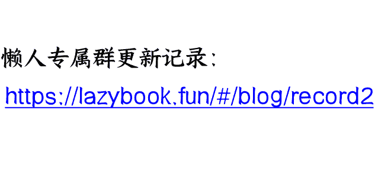

# 李嘉诚暂缓卖港，施压起效了？

250401 文/卢克文工作室嘉宾 星海舰长

整理：公众号懒人搜索，懒人专属群独享

懒人微信：lazyhelper


微信:lazyhelper

3月28日晚上，李嘉诚的长江和记实业有限公司突然向外放出消息，表示“下星期不会签订任何关于出售巴拿马港口的协议”。

要知道，长和原本要在4月2日签署相关“卖港”的最终协议的，这一表态，被外界解读为“李嘉诚暂缓交易”。

与此同时，国家市场监督管理总局宣布，要对交易依法进行审查。

看起来，随着舆论的压力和国家层面的出手，运河保卫战赢得了阶段性胜利。

那么，李嘉诚是真的不卖了？

## 一

我们要明确，现在只是“暂缓卖港”，而不是“停止卖港”，仍然存在达成的可能，而且和他良心发现一点关系都没有，完全是施压起作用了。

那么，这次几乎是板钉钉的交易，是怎么变成“暂缓”的？也许，我们从公开的一鳞半爪消息中，可以探究背后潜藏的刀光剑影的交锋。

首先，从3月4日李嘉诚宣布卖港说起。

3月5日，中国外交部新闻发布会，路透社记者提了一个问题：

> "由贝莱德集团支持的财团已同意收购一家香港公司的多数股权。这意味着在白宫施压下，美国公司得以控制该地区的关键港口。外交部对此有何评论？"

说实话，应该给路透社记者发个勋章，不管他是有意帮忙也好，还是想看笑话也好，都客观起到了一个托的作用，他这个问题包含了两个关键要素：

- 多数股权，那也就意味着这和贝莱德在国内一些只分红不参与经营的股权不一样，而是拥有了控制权了。
- 第二，白宫是在施压之下才控制港口的。

果然，中国外交部发言人顺着路透社记者的提问就说了：

> "我们对有关商业交易不予评论。中方支持包括香港特区企业在内的本国企业赴海外投资兴业，各国都应应为相关企业提供公平公正的环境，我们反对在国际经贸关系中滥施胁迫施压手段。"

这个回答很艺术。

懒人微信：lazyhelper

因为当时虽然特朗普一个劲地嚷嚷要拿到巴拿马运河，但真没提运河两端港口的事情。博弈的双方是美国和巴拿马政府，和长和没关系。

哪怕2月份卢比奥访问巴拿马之后巴拿马要对运河进行审计，长和也没有任何关于要卖港的表态（此时其实长和已经在与贝莱德接触了）。

所以，无论是外交部还是商务部或是港澳办，估计都被李嘉诚搞了个措手不及，当时正处于两会期间，一时半会也拿不出特别完善的方案出来，国家层面也不好说重话，否则香港人又要在背后蛐蛐中央政府干涉香港事务，破坏“一国两制”云云。

这样一来，才有了这个很艺术的表态：

你要是正常商业交易，我就不予评论。但你要是胁迫交易，我们就反对。

是不是正常商业交易呢？

根本不是。

正常商业交易，肯定是价高者得，但现在你偷偷私下就把港口低价卖了，算什么正常商业交易？分明是政治交易。

说实话，在这期间，中央给了李嘉诚大约7天时间来考虑，毕竟李泽楷就在北京开两会，如果李嘉诚有什么想给国家说的，直接说就行。

然而并没有，什么都没有。

于是，也就有了《大公报》三篇社论，《大公报》算是香港报纸，有什么重话也比较方便说，而港澳办只是不吱声地转发一下，就足以表明态度了。

值得一提的是，3月14日，中联部代表团访问巴拿马。似乎国家层面也想要搞清楚，李嘉诚卖港，到底真的是不是有难以说出口的苦衷，还是单纯想给特朗普纳投名状？

从巴拿马方面的表态来看，似乎巴拿马政府也没有收回港口运营权的想法。那也就充分说明，李嘉诚只是想套现跑路。

了解前因后果之后，3月18日，香港特首李家超作为“现管”，提出：任何交易须符合法律法规要求，港府会依法依规处理。

同样是3月18日，中国外交部发言人毛宁指出：“中方一贯坚决反对利用经济胁迫、霸道霸凌侵犯损害他国正当权益的行为。”

注意两次表述的不同。上次是“我们反对”，这次是“坚决反对”，而且在反对内容里面加了一条“侵害他国正当权益”，这就把卖港行为上升到国家利益层面了。

中央层面和香港特区政府都表态了，这信号，足够明显了吧？

如果李嘉诚认知足够清楚，应该明白国家层面这是动真格了，否则大公报、港澳办、外交部和香港特区政府不会集体发声。

其实，哪怕到这个时候，国家层面其实还是不想撕破脸的，仍然希望这种规劝能让李嘉诚回头，取消交易。

至于那点违约金，说实话，只要李嘉诚回头，国家随便给李嘉诚一块地皮，就足以弥补了。

但是，李嘉诚似乎和中央政府杠上了，在3月26日的时候，彭博社引述内部人士的话说，长和集团在面对多方压力的情况下，还是坚定继续推进这个项目，计划在4月2号前完成协议的签署。

看到没？这就是给脸不要脸了。既然如此，那也就别怪上手段了。

3月27日，彭博社报道，内地已经下令国企暂停与李嘉诚相关公司的新增合作，包括有意与正在审批的各种项目。报道还说，有关方面已经在调查李氏家族相关企业的现有或计划中的海内外投资，以便掌握其中的商业往来。

到这个时候，李嘉诚似乎才认识到是玩真的，于是在3月28日（还是收盘之后），宣布“下周不会签约”。紧接着才有国家市场监管总局发声开展调查。

注意，哪怕都到了撕破脸边缘了，国家层面仍然给李嘉诚留有余地。

国家市场监督管理总局反垄断二司负责人的表态是：“我们注意到此交易，将依法进行审查。”

注意，调查机构虽然是反垄断部门，但调查的出发点是“保护市场公平竞争，维护社会公共利益”，并不是反垄断。

原因很简单，反垄断是个大杀器，一旦坐实了，李嘉诚不仅要缴纳巨额赎金，而且说不定家族企业都要拆分。

从这一点来看，国家层面自始至终在给李嘉诚留面子、留余地，奈何李嘉诚执迷不悟，哪怕到了最后关头也只是“暂缓”，而不是取消交易，足可见其有多么顽固了。

## 二

那现在卖港口计划暂缓，是不是意味着这事儿就黄了呢？

也不一定。

根据港媒的说法，4月2日只是能签协议的“最早日期”，而不是“真正的最后期限”。

也就是说，双方还在扯皮，交易仍然有能够达成的可能。

如果李嘉诚真的把港口卖了，对中国会有多大的影响呢？

我们必须澄清两个事实。

- 第一，卖港口，并不意味着中国船只就过不了巴拿马运河了。
很多人的认知中，一旦美国买下那两个港口，就可以卡住中国的脖子，断绝中国船只前往加勒比海之路，其实这是错误的。
港口是港口，船闸是船闸，港口是李嘉诚运营的，而船闸是巴拿马运河运营，你过巴拿马运河，和港口是谁的没关系。

- 第二，国家对李嘉诚有意见的地方，不是他卖这两个巴拿马港口，而是他一口气把全世界的43个港口都卖了。2023年中国通过巴拿马运河的货运量1.2亿吨，相比中国海运总量45.77亿吨，只占2.6%，可以忽略不计。
相反，如果把全球20多个国家的43个港口都卖了，再配上美国的“加征入港费”政策，才会给中国带来巨大麻烦。

所以，站在国家层面，巴拿马运河这两个港口，不是不能卖，但有条件。

- 第一，其他41个港口，不能卖。
- 第二，哪怕卖巴拿马这两个港口，也不能别人一吓，就主动低价卖了。

咱们都还记得前些年美国说要收购TikTok，字节一开始是怂了的，但国家层面直接从法律层面禁止了敏感技术出口（也就是抖音的推荐算法），命令字节跳动站起来，不许跪。

### 结果怎么样？

公众号懒人搜索，懒人专属群分享

- TikTok 硬起来了，美国拿 TikTok 也没办法。特朗普施压，扛过去了。国会听证会，扛过去了。就连去年年底的最后通牒，也再度硬扛成功，而且还导致了一堆 TikTok 难民跑到小红书，制造了一个现象级事件。
哪怕到现在，如日中天的特朗普，也不敢直接关停 TikTok，而是和中国谈判。

3月26日，特朗普在白宫跟记者们主动爆料：如果中国同意将 TikTok 出售给美国公司，他就考虑降低对中国的关税。你看，不跪，就相当于给国家贡献了一个筹码。跪了，就什么也没有了。

所以，站在国家的角度，巴拿马运河不是不能卖，但卖港，需要美国人用筹码来换。

有人可能觉得，长和注册在开曼群岛，交易对象又是贝莱德，这完全是两个外企的交易，中国能管么？

其实，完全是可以的。

我们可以回忆一下，去年年底中国对英伟达发起调查，是怎么回事？

起因，也是因为英伟达当年花69亿美元收购迈络思。根据行业惯例，大型跨国公司在进行可能涉及垄断的项目收购时，需要主动向各国监管部门申报，而各国监管部门也会在审核中添加一些预防垄断的限制性条件。

英伟达和中国市场监管总局谈了一年，2020年，总算谈妥了，双方签订了协议，其中就包括一条“公平供应产品”。

中国当时也没别的想法，我不拦你收购，你英伟达好好跟我做生意就行。

可是英伟达却配合美国的芯片法案，停止向中国出售A100、H100 等高端计算卡，而是推出了阉割版。这显然就违反了英伟达承诺的第五条“公平供应产品”。

所以，中国对英伟达的调查是完全合情合理的。

还有一次，2022年，英特尔收购以色列公司高塔半导体，也是因为没有被中国所允许，最终交易失败，英特尔赔了3.5亿美元赔偿金。

这种纯外企交易都需要中国批准，更不要说是一家香港公司了。

如果没有中国批准，李嘉诚倒是可以强行交易，但这样一来，你的所有商业活动，可能都要在中国被叫停了，就算李嘉诚同意，贝莱德同意吗？

所以，李嘉诚这次大概率是玩脱了，本来想快刀斩乱麻，造成既成事实，大陆想拦也晚了。但现在呢？生意搞成了夹生饭，自己被夹在了中间了。

大陆方面，曾经对李嘉诚这个香港商界领袖还是比较尊重的，哪怕李嘉诚在大陆捂盘一捂就是一二十年这种事，大陆也基本上是睁一眼闭一眼，轻轻放下，无非考虑到李嘉诚还有统战价值。

哪怕李嘉诚撤出中国投资英国这种明摆着拆台的事情，大陆的态度也是不想撕破脸，也并没有把李嘉诚怎样。可是现在呢？李嘉诚在中美激烈博弈的大形势下的卖港行为，已经赤裸裸地属于资敌和投敌行为了，那对不起，以后只能公事公办了。

偏偏，无论李嘉诚在香港的地产、水电燃气、公共交通、零售行业的垄断经营，还是在大陆的捂盘行为，都是经不起查的（李嘉诚的生意，很大程度是靠人脉）。

如果李嘉诚执迷不悟，那面临的一定是暴风骤雨般的调查。

而美国方面呢？原则性合同已经签了，李嘉诚要是变卦，那不仅仅是违约金问题，而是来自特朗普的报复问题。

特朗普最好面子，巴拿马是他的巨大政绩，之前夸耀自己的话都说出去了，现在突然告诉他不卖了，特朗普怎么交代？

恐怕特朗普的报复，会让李嘉诚更难受。

所以李嘉诚现在的唯一出路，就是完全配合大陆，把巴拿马这两个港口作为筹码，从美国换回来点东西，才有希望实现交易的最终完成。

有消息称，中美元首或在未来几个月内见面，现在双方处于出牌叫牌阶段，别看现在嘴上吵得凶，其实都是在造牌，为未来的筹码交易做准备。

无论是TikTok，还是巴拿马运河两个港口，只要特朗普出价合适，也不是不能考虑，但如果只是想白嫖，那绝无可能。



历史3000多份各类付费文章以及年费三千多的副业社群资源，见懒人专属群内部分享!

付费群，白嫖勿扰！

懒人专属群更新记录：

```
https://lazybook.fun/#/blog/record2
```