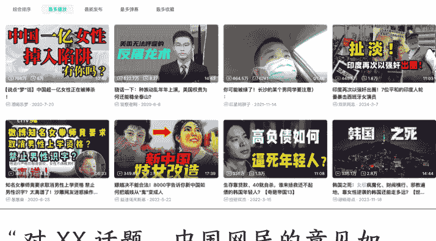
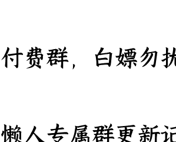

## B站网民如何谈论女权
# 250409 新闻实验室

整理：公众号懒人搜索，懒人专属群周报连载

懒人微信 lazyhelper


谈论女权的热门视频绝大多数都是由男性制作。



> “对 XX 话题，中国网民的意见如何？”

也许在 10 年前或者更早，我们尚且能够给出相对简单清晰的答案。但是现在，一定需要在“网民”二字前面加一个具体平台的名字才可以，比如“知乎网民”、“小红书网民”、“微博网民”，因为几乎每个平台的网民构成和观点倾向都很不一样，而它们谁都无法代表网民整体。

在几家主流平台之中，B站用户的典型形象大概是“民族主义、反资本家、反女权等进步价值的年轻男性”。但凡有过B站使用经验的朋友，大概对于这个平台上的网民如何看待女权主义会有一定的判断。最近我读到一篇由斯坦福大学和美利坚大学的研究者合作完成的论文，主题就是B站用户如何谈论女权。虽然研究结果并不意外，但研究者的细致分析还是让这篇论文值得一读。本期会员通讯，我们就来一起了解这篇论文的主要发现。

### 热门女权视频大多是男的做的

两位研究者首先利用B站的搜索功能，找出包含“女权”为关键词的视频，并按照播放量排序，选择排名前100的视频作为研究对象。这些视频的发布时间跨度从2016年12月到2024年2月，播放量分布在100万到720万之间。

除了视频内容本身，研究者还分析了视频的弹幕，因为弹幕是B站网民参与共同塑造话语的重要途径，也是B站整体舆论氛围和文化气质的核心。针对这100个关于女权的最高播放量视频，研究者进行了一系列量化的分析。

首先是视频创作者的构成。在这些高播放量视频中，60个由“网红”UP主制作，包括知名UP主、科普UP主以及专注于影视、动画、喜剧和游戏的专题UP主。另外40个由普通UP主制作。其中，贡献了最多视频的是观察者网——在B站排名前100的以女权为关键词的视频中，有5个都是观察者网发布的。

就性别构成而看，有52个UP主未指明性别，10个UP主资料显示为女性，39个是男性。研究者还通过对视频当中主持人/解说者的外表和声音分析（虽然这种判断可能存在主观偏差），发现女性创作者/主持人21位，男性65位，另有15个无法判断。

研究者引用的数据显示，B站在2022年的用户数据是女性占51.4%。可是，谈论女权的热门视频却绝大多数都是由男性制作。

在视频立场方面，只有16个视频展现出支持女权主义的立场，讨论了针对女性的暴力、基于性别刻板印象的语言攻击等议题。这些视频大多是基于影视作品的混剪。

另有18个视频表现出既不公开反对也不拥护女权主义的理念。这些视频大多是讨论“真女权”和“伪女权”，尤其是反对所谓的“极端女权”。

相比之下，有多达38个视频采取明确的反女权立场，或污名化女权运动和人物，常常使用“田园女权”、“女拳”等表述。这些视频要么认为不能以女权的视角来分析社会问题，要么是针对女权主义理念本身的攻击。

另外的29个视频对女权主义态度模糊，仅零星提及而未明确表态。

研究者们还分析了这100个视频的主题分布。结果显示，21个视频关注（主要是国外的）社会运动，14个视频讨论暴力、虐待和骚扰问题，15个视频分析影视作品，15个视频探讨婚恋、感情关系和生育议题。13个视频围绕公众人物和名人展开讨论，6个视频大致可归类为“生活方式”类别（其中5个涉及性产业和从业者议题），仅3个视频明确以政治事件为主题。

在视频的观点视角方面，62个视频采用文化视角，探讨流行文化内容、日常互动和传统习俗等主题。21个视频从经济视角出发，分析（反）女权主义项目的社会经济层面。历史和政治视角各占5个视频。科学视角最少，仅1个视频采用。7个视频被归入“其他/无法识别”类别。研究发现，相当一部分创作者倾向于将女权议题去政治化，往往通过经济或文化简化来实现这一点。

从视频的地理关注点来看，44个视频聚焦中国议题，11个视频关注西方背景（其中美国7个，欧盟国家4个）。东亚邻国也占据重要位置，日本相关7个，韩国相关17个，其他地区（如阿根廷和阿富汗）共6个。剩余15个视频属于一般性讨论，缺乏具体地理背景。

## B 站网民眼中的女权主义“三宗罪”

在量化分析之外，两位研究者还对这些视频及弹幕做了深入的质化分析。她们总结出了B站上的女权视频（或者更准确说，反女权视频）当中三种常见的话语类别。

- 第一种是以“反消费主义”的理由反对女权。

在B站最受欢迎的女权相关视频中，一个显著的话语倾向是将女权运动归因于注意力经济。这类视频认为，女权概念已被商业力量扭曲，成为情感博主和营销号“讨好”女性消费者的手段，诱使她们进行不必要的消费。例如，带有女权标签的播放量最高的视频《中国超一亿女性正在被捧杀！》就明确表达了这一观点。

这种论述经常使用“灌毒鸡汤”等网络用语，暗示女权思想在“洗脑”女性追求过度的自信和自爱。根据这些视频及其弹幕的说法，喝了这些“毒鸡汤”的女性，只知道要求权利，却不履行自己的社会责任；她们在追求自身利益的过程中，伤害了其他人的利益，尤其是男性在婚恋关系中的利益。这些视频认为，那些关于性骚扰和性暴力的讨论只是女性的“炒作”。UP主和发送弹幕的人还普遍觉得，女性的声音不是被压制，而是被过度呈现了。

此外值得注意的是，这些视频往往借用官方社会主义话语（例如“妇女能顶半边天”），强调“生产力”和“经济独立”是获得平等权利的前提。这种表述不经意间把女权议题简化为个人奋斗的问题，忽视了更深层的结构性不平等。

- 第二种话语是以“反西方自由主义”的立场来反对女权。

这些视频倾向于放大西方女权运动的负面影响，通过中西社会制度的对比，强调中国特色社会主义道路的优越性。在这个过程中，西方的“政治正确”和身份政治频繁被讽刺，女权运动被描述为西方社会分裂和“西方衰落”的重要原因之一。这类视频经常采用选择性呈现的方式，重点展示西方女权运动中的极端个案。比如，《为了体现绝对的男女平等，德国允许女性游泳裸露上身！》就是一个例子。

研究者还发现，视频和弹幕对于西方右翼民粹主义者表达出了同情和支持。他们认为，这些民粹主义者是用“理性”来对抗西方社会里普遍存在的“极端主义”。比如，《种族动乱年年上演，美国权贵为何还能稳坐泰山？》这个视频，就认为西方“虚伪的”身份政治让社会分裂，从而使得工人阶级无法跨越种族、性别、性向等鸿沟联合起来，也就让精英资产阶级维持了自己的统治地位。

有趣的是，一些视频会使用游戏术语如“叠buff”来讽刺交叉性别歧视议题，这种表达方式在年轻用户中特别容易引起共鸣。通过这种方式，复杂的社会运动被简化为琐碎议题。

- 第三种话语是以中华中心主义的视角来反对女权。

这类话语的特征是通过对比日韩女权运动带来的“祸害”来凸显中国制度的优越性。我们从视频标题中就可见一二：《韩国之死：女权疯魔化、财阀横行、邪教遍地，靠女性逆袭的韩国还能走多远？》《职场溃败？婚恋贬值？堕胎弑父？日韩女权为啥被男权“反杀”？【亚洲怪物13】》……

这种叙事特别关注邻国女权运动中的极端案例，例如韩国的Megalia和Womad等激进团体的争议行为。这些视频往往将韩国女权运动描述为社会对立和生育率下降的主要原因，同时将男性的反女权立场合理化为“理性”选择。

在弹幕评论中，这种优越感更加明显。许多评论会直接比较中国与日韩的女性地位，称“我们的女孩能顶半边天”、“比起日韩，中国女性地位最高”、“韩国有历史吗？”。这种话语不仅强化了对邻国的优越感，也暗含着对女权主义本身的否定。

## 反女权话语的“病毒式村落”

基于这些发现，研究者认为，B站的产品设计和运营方式在反女权话语的形成过程中扮演着关键角色。该平台独特的弹幕系统创造了一种“伪同步”的群体观看体验，用户可以实时看到他人的评论，这种设计促进了群体认同感的形成。然而，弹幕的匿名性也使得用户更容易表达极端观点，而平台的算法和推荐机制则倾向于放大已经获得高度关注的主流观点。

在内容管理方面，B站大力推广的观察者网及相关账号，正是这一系列反女权视频的主要创作者。更多想要获得流量的UP主，也进入这个领域想要分一杯羹。

研究者借用学者Florian Schneider提出的“病毒式村落”（viral villages）概念，解释了B站上的观点同质化现象。在这个平台上，用户通过弹幕互动形成具有相似价值观的社群，这些社群会不断强化共同认知，而不同意见则容易被边缘化。这种机制导致女权相关的讨论往往陷入某种固定的表达模式。

值得注意的是，那些成功获得高播放量的女权相关视频，往往采取了特定的生存策略：它们倾向于避免直接挑战官方意识形态，很少讨论国内具体政策和制度，而是将批评的目标转向境外，并采用娱乐化的表达方式。这种策略虽然保证了内容的可见度，但也导致女权议题被不断消解和简化。

研究者还认为，在B站上，女权议题呈现出明显的去政治化倾向。创作者往往将结构性问题简化为个人选择。他们还普遍用“平权”来代替女权，抹杀女性特有的困境和抗争。

这些机制最终导致了一个封闭的意见生态圈：批判性的声音被边缘化，平台话语进一步强化既有偏见，真正的性别议题讨论难以深入开展。在这个过程中，商业利益、平台规则和社会意识形态构成了一个相互影响的复杂系统，共同塑造着B站上的反女权话语。




微信:lazyhelper

历史 3000 多份各类付费文章以及年费三千多的副业社群资源，见懒人专属群内部分享！

付费群，白嫖勿扰！

## 懒人专属群更新记录：

```
https://lazybook.fun/#/blog/record2
```

懒人微信：lazyhelper