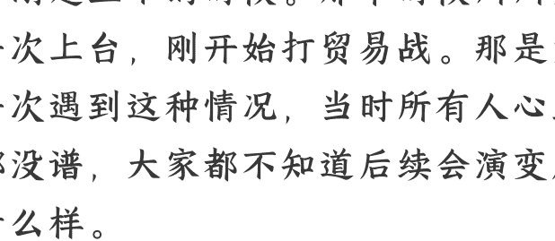

其二，大家再回忆21—22年，海运运费翻了几倍。商品的原本价格是X元，税率是（1+x%），运费是（1+y%），无论是x还是y，效果都是在商品价格上加成。

所以因为海运运费暴涨，也一样能够积累大量“商品价格被加成后，出口量如何受影响”的数据。

以上这些数据是支撑国内做出反制政策的基础。

其次，海运运费暴涨那件事，能给大家的启迪是：为什么海运运费翻了几倍，结果出口量还暴增，原因无非就是替代效应。当时全球都瘫痪，中国的商品就算加了运费涨价了，也没有替代者，所以美国用户不得不接受。

而现在特朗普不是光收中国一家关税，而是收全球的关税。如果全球税都涨，哪里的东西价格都贵，老中的商品还能算贵吗？这就是替代效应。

很离谱的是，当年因为中国有25%关税，越南没有，所以转移到越南有优势，现在越南关税46%？

中国关税，视不同类目，50%几到70%几之间。

如果是46%对55%的关税，在生产率优势下，甚至有可能越南都变得不划算了，所以到底是有利中国还是不利中国？

懒人微信：lazyhelper

再回头看反制政策的出台，不到 12 小时内，一连环政策。

你相信这是等特朗普发布完信息之后，连轴转加班开会，紧急出台的政策吗？

如果想的这么短，说明对中国的政策习惯一点都不了解。

体系内做事，一贯四平八稳，不可能立马表达一个没有通过“组织决议”的表态。

相反，像前面李总理卖港口那件事，先是新闻爆出来一点反应没有，四五天后媒体才开始发酵，然后又过了四五天才开始出现部门表态，这才是正常的“遇到紧急的、意外事件后，加班加点的时效”。

真有意外，至少关起门来十天供各部门分别开会，再碰头通盘，最后再出对策对外公开。

所以不到 12 小时，立马搞出连环炮反制出来，只能说明一件事，就是早就至少提前十天、半年、月里，就已经对各种假设可能性先提前准备了反制政策，已经各部门关门会议都过一遍了。才会这么快出政策。

大家还要再考虑，上个月是两会，刚定的全年发展目标计划。你要说，定的时候没想到这些意外事件，就定 5%的目标，然后上旬开完会，中旬突然一拍脑袋，想起来要预防一下特朗普再搞高关税，先关门制定一下预案？

3月初没有先见之明，3月底突然有先见之明了，想起来提前预防特朗普？这不是搞笑吗。

再按某些券商软蛋说的，特朗普政策出来至少给中国经济打下来1.5%，真是呵呵了。

所以按照政策出台的速度，反推，就能知道，核心部门其实是已经提前在想预防了。

所以站在现在这个时间点，我反推想到这一层之后，心中有很多疑惑突然就解开了。

一个很大的疑惑就是，我不明白今年的政策为何如此激进而不计后果，有一种“悲观下的乐观”。

因为今年很奇怪，政策完全是按照08年的规格，以一种非常悲观之态势定的方向。

比如提出要搞特别国债，提出要加大赤字，但明明年初时开局真的很“春暖花开”，新年的旅游数据很好，国产AI很亮眼，机器人很拉憧憬，哪吒票房很高，有一种很好的复苏迹象。

明明今年的迹象，是比22年初和23年初要乐观很多的，反而是今年，政策很激进，完全不是以乐观的、复苏的态度去定的，而是，我记得原话说，政策要有超前性，还有大概意思说是，不能因为看见数据很好，很复苏就不搞强力政策，一定要预防谷底，要提早出强力政策，大概意思就是这样。

上周我还时不时的就提，感觉好像我们要进入信贷扩张周期了，政策要搞大放水。

这是我的预判，感觉，但说不出道理，我不知道国家为什么这么激进。但昨晚上反制政策一出来，似乎好像知道了。原来各种牌都有后手。

以上絮絮叨叨的说了一堆，再回过头来浓缩一下，就是，

- 第一，国家手中有比我们更充足的数据积累，可以更加全盘判断优劣势。我们不是第一次被打关税战，但如果不具备优势，就不会打全局战，而是局部战，继续玩农村包围城市，继续玩伏击，敌进我退，敌退我扰。我国向来不畏惧打持久战或者韬光养晦。继续韬光养晦，忍一忍，光让外交部嘴上谴责，然后继续谈判，也不是忍不了。但如果开始直接对垒，开始百万雄狮过大江跟你正面战役的时候，大家最好要有政治敏感性，要知道现在战役到了哪一阶段了。如果没有胜算，就不会打，忍一忍十年后还是一条好汉。但如果打了，就一定要打胜。

- 第二，我现在目前已经大致能推测出来国家的后手有哪些了。

## 后手一：信贷扩张周期
其实从18年之后，一直到24年年中，这六年里一直是我国的信贷紧缩周期。大家看到的建筑行业不行了，房地产完了，金融行业被收拾的很惨，这都是因为6年信贷紧缩周期，而金融和地产都是绝对的需要占用海量资本的行业，跟信贷周期息息相关，信贷收缩，这两个行业必惨。

地产行业，先银行限贷，然后把信托融资的路给断了，逼得很多地产商在21年去海外发美元债（最后美元债爆雷了，坑了老外一大笔，这是后话），什么地产三条红线，其次是各地的地方债。很多地方的地铁，明明规划先是批准了，结果建一半硬是叫停了。地方融资平台也是一堆爆雷的。很多地方公务员发不出薪，也算是跟地方债紧缩的连锁反应。

18年还有贸易战，20年还有疫情，22年还国内多处受限，连着这么多年，各种难关下，竟然还在咬牙搞收缩，现在想想，正是当年的勒紧裤腰带，现在算是有余量了。

后面如果真想放水的话，空间还是蛮大的。

但大家不要被我上面提的金融和地产误导，以为信贷放松，这两个行业就好了。

（前段时间，有几天地产涨的厉害，其实也是因为开始有人押大放水了。然后按照传统路径，放水等于地产涨。我认为不对。）

后续对放水后的引导，方向主要有三，一是消费内循环，二是科技研发，三是，我推测跟特朗普的关税政策有关，有可能是要引导企业布局海外，引导人民币资本进入世界循环体系吧。

忍不住还要说，我感觉等到现在信贷放松，这很像是一条计谋——田忌赛马。

用劣马去 PK 美国的上等马，只要熬过去了就算赢了，等美国出二等马的时候，我们就可以上等马了。大家再回忆一下，是不是这样，

前面从奥巴马到特朗普再到拜登，一路都在搞的信贷放松，历任总统都想放松，没人敢收缩，因为放松让人爽，收缩让人痛，谁放松谁有选票，谁收缩谁丢选票。只不过他们连着放松了 16 年，国债到了天量的位置，有点难以为继了，在 22—24 年，美国除了信贷放松，还叠加加息加到高息，那个位置，我国就算是当年搞信贷放松，又有什么用呢，毕竟大家都在放松周期时，美国形势上更占优，正面PK，上等马对上等马，很难直接跑赢。

但是现在美国没余量放松了，他们要收缩了。

收缩就像是二等马，我们也用二等马跑，自然是不占优的，但如果我们搞信贷放松，就像是把之前藏着不跑的上等马拿出来，现在才用。

史书真是常看常新，非常有趣啊。继续讲，

## 后手二：合纵连横之术
可能是借特朗普跟全球宣战的时候，抓紧玩合纵连横之术吧。

合纵连横之术毕竟也是国内源起，2000年的历史了，中国人从小就耳濡目染的东西。

自从特朗普上台之后，大家应该有印象，美国跟欧洲开始不对付起来，在各种场合互相打嘴炮，直接骂来骂去。

以前欧洲一堆政客依附美国，但不是依附特朗普。而是依附拜登那一派的国际化美国。

后来民主党在美国一败涂地，等于欧洲变成他们的海外根据地了，美欧关系其实变成了美国斗争的外展，所以到底是美国利益更高，还是斗争利益更高呢？我觉得很可能是后者。

他们演变成了攘外必先安内，所以欧洲反中的问题反而可以放一放了。必要的时候肯定也可以联中、过程中肯定有一些条件可以谈，比如一直不肯放松的，国产大飞机的欧洲适航证问题，没准就会突然谈妥突然放开了呢。（注意，此条不包含投资建议）类似的可能性有很多，具体我需要撸一遍美国的进出口数据，看看能找到哪些线索。

## 后手三：合理利用规则
不是所有国家都会反制，肯定还有很多小国，没有能力，没有条件。他们只能妥协，给美国各种好政策。这类国家往往是新兴市场国家，新的待开放市场。

但我记得年轻时学课本上的 WTO 规则时，说里面有些条款，很像是拼多多的一价跟随政策，发现最低价了，就自动跟随降价。WTO 的一些条款是这样的，假设越南给了美国最优的关税条件，那么只要越南是 WTO 成员，就必须给其他成员国一键跟随上所有的最优条件。

我不知道越南是不是 WTO 成员国。但越南一定是某些群的成员。其他国家也一样，不一定是 WTO，也可能是什幺其他合约群的成员，只要跟中国在一个群里就好说。

合理利用规则，有可能意味着会有一些国家开始降低门槛，提供开放的市场了。同样的市场条件下PK，你说是中国商品赢还是美国商品赢？显而易见。

唯一的输家就是这些无力反制的弱势国家。后发国家，设置高额关税，其实是为了在弱小的时期保护本土工业。可惜在特朗普上任后的丛林时代，只能任人鱼肉了。


历史3000多份各类付费文章以及年费三千多的副业社群资源，见懒人专属群内部分享!

付费群，白嫖勿扰!

### 懒人专属群更新记录:
```
https://lazybook.fun/#/blog/record2
```